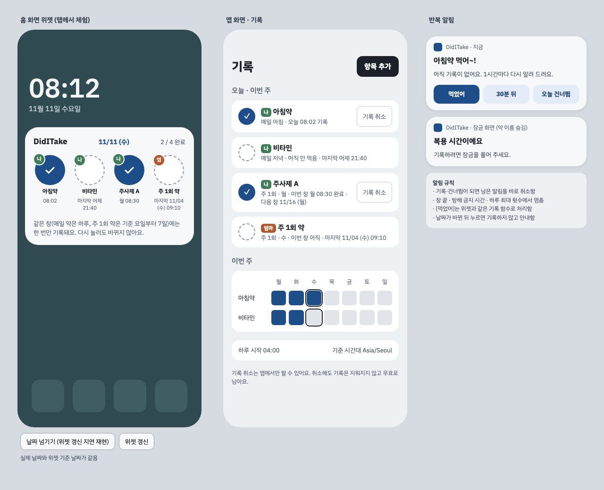

# DidITake · 한 번만 약통

같은 기간에 같은 약은 몇 번을 눌러도 한 번만 기록되는 복용 기록 앱임. 홈 화면 위젯을 눌러 기록하고, "약 먹었나? 또 먹어도 되나?"를 위젯 상태로 바로 확인함. 핵심 가치는 이중투약 방지임.

> 앱은 기록·표시 도구임. 복용량 권고, 빼먹었을 때 처치 안내, 약물 상호작용 판정 같은 의학적 판단은 하지 않음.

## 현재 상태

| 구분 | 상태 | 문서 |
| --- | --- | --- |
| 기획 | v3 (2026-11-11). v2 검토 결과와 열린 질문 결정을 반영함 | [planning-v3](docs/01-planning/planning-v3.md) |
| 설계 | 초안. 기술 스택 확정 | [02-design](docs/02-design/) |
| 구현 | 최소 프로토타입 완료: 항목 등록, 위젯 탭 기록, 이미 기록됨 안내, 날짜 머리글, 오늘·이번 주 목록, 기록 취소, 04:00 경계 갱신. JVM 테스트 71개 | [빌드와 실행](#빌드와-실행) |
| 동작 확인 | 에뮬레이터(API 34)에서 13개 항목 확인, 결함 2개 수정 | [QA 2026-11-11](docs/07-qa/2026-11-11-prototype/report.md) |
| 배포 | 1단계 Android APK 직접 설치 → 2단계 iOS | [architecture](docs/02-design/architecture.md) |

## 화면 미리보기



홈 화면 위젯(왼쪽), 앱 화면(가운데), 반복 알림(오른쪽) 초안임. 설명은 [05-ui](docs/05-ui/README.md)에 있음.

## 핵심 규칙 요약

- **창(window)**: 한 번 먹어야 하는 시간 구간임. 매일 약은 04:00~다음 날 04:00, 주 1회 약은 기준 요일 04:00부터 7일임.
- **한 창에 활성 판정은 최대 1개**임. 판정은 기록(복용)·건너뜀 두 종류이며, DB 유니크 제약으로 보장함.
- **위젯은 비어 있는 창에만 판정을 만듦.** 이미 있는 판정은 앱에서만 바꿈.
- **취소는 지우지 않고 무효 처리**함. 이력이 남음.
- MVP는 서버·계정 없이 모든 데이터를 기기에 저장함. 추후 백엔드를 붙일 수 있게 메타데이터(UUIDv7 · version · device_id · 보관 처리)를 설계함. AI 기능은 없음.

전체 규칙과 반례별 기대 동작은 [record-rules](docs/02-design/record-rules.md)에 있음.

## 문서 지도

| 순서 | 문서 | 내용 |
| --- | --- | --- |
| 0 | [00-history](docs/00-history/history.md) | 결정 로그, 작업 이력, 문서 판 이력 |
| 1 | [01-planning](docs/01-planning/) | 기획 v3(현재 기준)와 v1·v2 원본 |
| 2 | [02-design/record-rules.md](docs/02-design/record-rules.md) | 창·기간키·판정·쓰기 절차, 반례별 기대 동작 (핵심) |
| 3 | [02-design/data-model.md](docs/02-design/data-model.md) | ERD, 테이블 정의, 인덱스, 삭제·백업 정책 |
| 4 | [02-design/architecture.md](docs/02-design/architecture.md) | 크로스플랫폼 구조, 모듈, 플랫폼 분담, 테스트 전략 |
| 5 | [03-sequence/sequences.md](docs/03-sequence/sequences.md) | 위젯 기록, 동시 탭, 취소, 반복 알림, 날짜 경계, iOS 위젯, 기준일 이동 |
| 6 | [04-flow/flows.md](docs/04-flow/flows.md) | 사용자 플로우, 창 상태, 위젯 탭 판단, 알림 흐름 |
| 7 | [05-ui](docs/05-ui/) | UI 초안 v3와 화면 설명 |
| 8 | [06-review](docs/06-review/) | v2 검토 결과와 반례 실증 스크립트 |
| 9 | [07-qa](docs/07-qa/) | 동작 확인 보고서 (에뮬레이터·실기기) |

처음 읽는 개발자는 1 → 2 → 5 순서를 권장함.

## 기술 스택 (확정, 2026-11-11)

언어는 Kotlin임. MVP는 기기 로컬 APK이고, 나중에 iOS와 백엔드를 붙일 수 있게 구성함.

| 영역 | 지금 (MVP) | 나중 |
| --- | --- | --- |
| 언어·빌드 | Kotlin 2.4.21, AGP 8.13.2, Gradle 8.14.6, JDK 17 | |
| 공통 코드 | Kotlin Multiplatform 모듈 1개 (Android + JVM 타깃) | iOS 타깃 추가 |
| 화면 | Compose Multiplatform 1.11.1 | iOS에서 그대로 씀 |
| DB | Room 3.0.3 + BundledSQLiteDriver 2.7.1 | 서버는 PostgreSQL |
| 시간 계산 | kotlinx-datetime 0.8.0 | |
| 위젯 | Jetpack Glance 1.2.0 | iOS WidgetKit + App Intents (iOS 17 이상) |
| 알림 | 앱 자체 알림 (AlarmManager · NotificationManager) | iOS UNUserNotificationCenter. 카카오톡은 보류 |
| 서버 | 없음 | Kotlin(Spring Boot 또는 Ktor) + PostgreSQL. 창·판정 규칙을 같은 코드로 재사용 |

SDK는 compile·target 36, min 26임. 버전 전체는 `gradle/libs.versions.toml`에 있음. 선택 이유와 지금 하지 않는 것은 [architecture 2장](docs/02-design/architecture.md#2-기술-스택-확정)에 있음.

## 이력

결정 로그, 작업 이력, 문서 판 이력은 [히스토리 관리대장](docs/00-history/history.md)에 있음.

## 보류

- 카카오톡 알림: 추후 확장 기능
- 가족 기기 알림: 카카오톡 문제가 풀린 뒤 정함

## 로드맵

1. ~~설계·기술 스택 확정~~ (완료)
2. ~~공통 모듈: 창·판정 규칙과 반례 테스트~~ (완료, 뼈대)
3. ~~최소 프로토타입: 항목 등록, 위젯 탭 기록, 이미 기록됨 안내, 날짜 머리글, 오늘·이번 주 목록, 기록 취소~~ (완료, 에뮬레이터 확인)
4. Android 앱·위젯 MVP 나머지 (미래 시각 기록 경고, 위젯 대상자 필터, 건너뜀, 늦은 투약 처리, 설정 화면) ← 다음
5. 반복 알림
6. APK 배포 (alpha)
7. iOS 확장 PoC
8. 확장 기능: 건너뜀, 주기 밀림, 복용일기, 처방전
9. 백엔드·동기화: Kotlin 서버 + PostgreSQL
10. (보류) 카카오톡 알림

## 폴더 구조

```
(저장소 루트)
├── README.md
├── shared/        공통 코드: domain(창·기간키·경계) · data(Room) · usecase(기록·취소·항목 관리) · status(목록·위젯 표시 모델) · ui(Compose 화면)
├── androidApp/    Android 앱 진입점, Glance 위젯, 04:00 경계 알람
├── gradle/        버전 목록(libs.versions.toml)·래퍼
└── docs/
    ├── 00-history/    히스토리 관리대장
    ├── 01-planning/   기획
    ├── 02-design/     설계 (기록 규칙·데이터 모델·아키텍처)
    ├── 03-sequence/   시퀀스 다이어그램
    ├── 04-flow/       사용자 플로우·상태 흐름
    ├── 05-ui/         UI 초안
    ├── 06-review/     검토·반례 실증
    └── 07-qa/         동작 확인 보고서
```

앱 소스는 저장소 루트의 `shared/`(공통)와 `androidApp/`(Android)에 둠.

## 빌드와 실행

준비: JDK 17, Android SDK(platform 36). 저장소 루트에 `local.properties`를 만들고 `sdk.dir=<Android SDK 경로>`를 적음 (커밋하지 않음).

```bash
./gradlew :shared:jvmTest            # 공통 규칙·DB 테스트 (JVM)
./gradlew :androidApp:assembleDebug  # 디버그 APK → androidApp/build/outputs/apk/debug/
adb install -r androidApp/build/outputs/apk/debug/androidApp-debug.apk
```

- 에뮬레이터는 API 34 arm64 이미지로 확인함. 위젯은 홈 화면 길게 누르기 → 위젯 → DidITake (기본 4×2)
- 디버그 서명 APK임. 나중에 정식 서명 키로 바꾸면 한 번 지우고 다시 설치해야 하며, 기기에 저장된 기록은 사라짐
- KSP가 KMP Android 대상의 Room 생성 코드를 연결하지 못하는 문제(google/ksp#2476)를 `shared/build.gradle.kts`에서 우회함. 설명과 제거 조건은 그 파일 주석에 있음

## 작업 규칙

- 브랜치: `main`은 두지 않음. 기본 브랜치 `develop`에 개발 내용을 올리고, 기능이 완성되면 `alpha`, 출시할 때 `release`.
- AI 작업 전용 저장소임. PR·사람 승인 없이 `develop`에 바로 커밋·push함.
- 커밋은 `docs: ...`, `feat: ...`처럼 영문 타입과 한글 설명을 씀.
- 건강정보·실사용 기록·인증정보를 커밋하지 않음. 문서와 시안의 약 이름은 가상의 예시임.
- 기획 문서는 덮어쓰지 않고 새 판(v4 …)으로 추가함.
- 결정·작업·판 이력은 README가 아니라 [히스토리 관리대장](docs/00-history/history.md)에 남김. develop에 push할 때마다 작업 이력 행을 추가함.
- 다이어그램은 Mermaid로 작성해 GitHub에서 바로 보이게 함.
