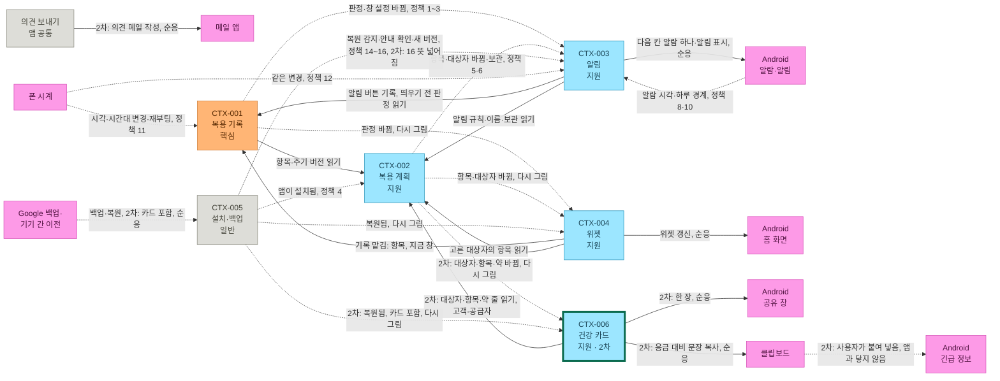

# 필받음: 도메인 설계 (1차, 2차 첫 릴리즈)

상태: 1차는 Step 0~9를 마쳤고 확인 1~3을 모두 지났습니다(2026-11-12 15:24, 15:48, 16:03 KST). 세 번 모두 동희님이 "추천 모두 승인"으로 답하셔서 그린 그대로 승인입니다.

2차 첫 릴리즈 '병원에 보여 주는 한 장'(기능 변경, [변경 기록](../10-records/changes/2026-11-22-phase2-release1.md))은 바뀌는 경계만 Step 0~9를 새 프레임에 그렸고 확인 1~3을 모두 지났습니다(2026-11-22 19:46, 20:04 KST, 2026-11-23 오후 KST). 세 번 모두 그린 그대로 승인입니다. 새 경계 CTX-006 건강 카드, 바뀐 경계 CTX-002 복용 계획과 CTX-005 설치·백업, 새 용어 TERM-032~044를 이 문서에 더했습니다. 다음은 02 요구입니다.

2026-11-24 KST PR #69 리뷰 뒤, 2장 '2차 외부 시스템' 줄, 4장 CTX-006 'External systems' 줄, TERM-042 뜻의 글만 설계 바꿈 R 10('이번 릴리즈는 휴대폰 긴급 정보만 안내, 119안심콜은 미룸', [변경 기록](../10-records/changes/2026-11-22-phase2-release1.md) 6장 '개발 중 설계 바꿈 R')에 맞췄습니다. 바꾸기 전 글은 그 자리에 남겼고, 경계·사건·용어 ID와 Miro 보드는 그대로입니다.

- 왜 다시 하나: 2026-11-12 15:02 KST 동희님이 이 스레드에서 "가쟈누님이 만든건 시안이고;; /corthex 첨부터 하라니까;; 물론 뺄건 빼지만"이라고 하셨습니다. 그때까지 01단계는 건너뛰었고, 03 흐름·04 명세·05 데이터·09 시안·12 QA는 가쟈누님 DidITake 문서(`7a800ac`)로 대신했습니다. 이제 그 문서들은 참고 시안으로만 씁니다.
- 진행 방식: 초안 후 고치기. Claude가 단계마다 보드에 프레임을 하나씩 그리고, 1-b, 7, 9단계 뒤에 멈춰 확인을 받습니다. 동희님이 2026-11-12 15:05 KST 결정 카드에서 'Miro 보드, 3번 확인'을 고르셨습니다.
- 확신 표시: Claude가 만든 항목 끝에 `[확실]`(동희님 말씀이나 문서에 있음), `[추론]`(문서·코드에서 미루어 앎), `[추측]`(근거 없음, 핫스팟)을 붙입니다.

## 1. 서비스 개요

### 동희님 말씀

- "AI와 서버 저장 없는 초간단 복약 기록 앱 Android 출시 (홈 위젯 원탭 기록, 이중 복용 방지, 투약일기)". 2026-11-12 00:20 KST, 프로젝트 채팅
- "CORTHEX 하네스로 필받음 앱을 실제 출시용으로 다시 만든다". 2026-11-12 09:09 KST, 프로젝트 채팅
- 첫 사용자: 본인과 가족 약을 함께 챙기는 사람(노인 포함). 2026-11-12 10:18 KST 범위 확정 카드에서 고르신 안([요구 0장](../01-planning/requirements.md#0-v3-뒤에-정한-결정) Q2)

### 가쟈누님 시안

- [DidITake 기획 v3 1장](https://github.com/judangbang-ops/DidITake/blob/7a800ac/docs/01-planning/planning-v3.md#1-목적): "아침마다 '약 먹었나? 또 먹어도 되나?' 고민하는 문제를 없앰. 핵심 가치는 이중투약 방지임."

### Claude 정리 (확인 1의 질문 1)

본인과 가족의 약을 챙기는 사람이 홈 화면 위젯을 한 번 눌러 먹은 것을 남기고, 같은 약이 두 번 기록되지 않아 '먹었나?'를 바로 아는 Android 앱. AI, 서버, 계정 없이 폰에만 저장하고, 안 먹었으면 폰 알림으로 다시 알리며, 지난 기록을 투약일기처럼 본다.

- 챙기는 사람: 앱을 쓰는 사람. 본인 약과 가족(노인 포함) 약을 함께 챙김 [확실]
- 대상자: 약을 먹는 사람(나, 엄마). 앱을 직접 쓰지 않을 수 있음 [추론]
- Android(외부 시스템): 위젯, 알림, 알람, 자동 백업과 기기 간 이전을 맡음 [확실]

### 범위

| 구분 | 내용 | 근거 |
| --- | --- | --- |
| 1차 안 | 대상자(나, 가족) 등록과 보관, 복용 항목 등록과 주기(매일, 주 1회), 위젯 한 번 눌러 기록과 같은 창 두 번 기록 막기, 앱에서 기록·건너뜀·늦은 입력·고치기, 폰 반복 알림, 지난 기록 보기(투약일기), Android 자동 백업과 복원 안내 | 요구 0장 Q1·Q7·Q16, 범위 확정 카드 |
| 1차 밖 | AI(약봉이), 서버·계정·동기화, 카톡 알림, 광고, 약 이름 검색, 병원용 '지금 먹는 약' 한 장, iOS(Play 비공개 테스트 다음), 백업 파일 내보내기 | 요구 0장 Q1·Q4·Q8·Q13 |
| 2차 첫 릴리즈 | 로드맵 1 건강 카드(지금 먹는 약, 질환, 수술·시술, 알레르기, 이식형 의료기기, 의료기관·담당 의사, 보호자 연락처), 2 의사에게 보여 주기, 3 응급 대비 문장, 4 한 장 내보내기, 22 '불편해요' 보내기. 복용 항목 안에 약 이름과 1회 투약량을 적음 | 2026-11-22 19:26 KST 결정 2, 질문 1 답 |
| 2차 다음 릴리즈 | 로드맵 6 약 이름 고르기, 9 약 떨어지는 날·다음 진료일 알림, 10 용량 변경 이력, 11 복용 주기 늘리기, 13 하루 메모·증상, 14 백업 파일 내보내기, 15 대상자 완전 삭제, 17 보호자 대신 설정·간단 모드 | 같은 결정 2 |
| 2차 밖 | 서버·계정·인터넷(REQ-057), 가족 공유(3차), 의학 판단(REQ-087), 혈액형·예방접종·검사 결과 칸(테스터 피드백 뒤) | 결정 3, 2차 확인 1 답 7, 확인 2 답 11 |
| 도메인 밖 | 출시, 서명, CI, 개인정보처리방침, 배포(개인 APK와 Obtainium). 이 보드가 아니라 [작업 분해](../08-wbs/wbs.md)에서 다룸 | Claude 제안 |

### 2차 첫 릴리즈의 목적

- 사용자님 말씀: "야 디벨롭해보자 이거 … 기능 뭐를 추가할지 상세히 분석해서 표로 정리해봐바. 한번에 다 만들 필요는 없어." 2026-11-22 16:03 KST, 프로젝트 스레드 '필받음 다음 기능 로드맵'. 범위는 같은 날 19:26 KST "추천 모두 승인"(로드맵 질문 1~3: 용어는 차수, 2차 첫 릴리즈는 1~4·22번, 2차도 서버 없이)
- 공동 기획자의 말(사용자님이 붙여 주신 카카오톡, 보드 2차 Step 0): "클릭 한 번 하면 의사한테 보여 주기만 해도 좋을 듯"
- Claude 정리(2차 확인 1 질문 1, 답 6 "맞음"): 입원·수술·응급실마다 대상자의 병력과 먹는 약을 말해야 하는데 기억이 안 나는 문제를, 폰 안의 건강 카드 한 장으로 푼다. 버튼 한 번에 의사에게 보여 주고, 응급 대비 문장을 복사하고, 한 장으로 내보낸다. 서버·인터넷 없이 폰에만 두고, 앱은 의학 판단을 하지 않는다.
- 행위자는 1차와 같이 '챙기는 사람' 한 명입니다. 의사·간호사는 보여 주기 화면이나 내보낸 파일을 보기만 하고 앱에 명령을 주지 않아 행위자가 아닙니다 [추론].

### 입력

- 동희님 말씀과 결정: [요구 0장](../01-planning/requirements.md#0-v3-뒤에-정한-결정)(Q1~Q16, 범위 확정 카드)
- 가쟈누님 시안: DidITake `7a800ac`의 기획 v3, 기록 규칙, 데이터 모델, 흐름, UI 시안 v3
- 이 저장소의 [요구](../01-planning/requirements.md), [기록 규칙 보충](../04-spec/record-rules-supplement.md), [화면](../05-ui/screens.md)과 main `88baf80` 코드

## 2. 이벤트 스토밍

- 보드: [필받음 도메인 설계 (CORTHEX 01)](https://miro.com/app/board/uXjVEOmeO3A=/)
- 프레임: [Step 0 목적과 범위, 범례](https://miro.com/app/board/uXjVEOmeO3A=/?moveToWidget=3458764690208363514), [Step 1-a 사건](https://miro.com/app/board/uXjVEOmeO3A=/?moveToWidget=3458764690208363515), [Step 1-b 사건 흐름](https://miro.com/app/board/uXjVEOmeO3A=/?moveToWidget=3458764690208420124), [Step 2 외부 시스템](https://miro.com/app/board/uXjVEOmeO3A=/?moveToWidget=3458764690209262299), [Step 3 명령](https://miro.com/app/board/uXjVEOmeO3A=/?moveToWidget=3458764690209327147), [Step 4 핫스팟](https://miro.com/app/board/uXjVEOmeO3A=/?moveToWidget=3458764690209393245), [Step 5 행위자](https://miro.com/app/board/uXjVEOmeO3A=/?moveToWidget=3458764690209575809), [Step 6 애그리거트](https://miro.com/app/board/uXjVEOmeO3A=/?moveToWidget=3458764690209723991), [Step 7 경계](https://miro.com/app/board/uXjVEOmeO3A=/?moveToWidget=3458764690209862231), [Step 8 정책, 읽기 모델, 컨텍스트 맵](https://miro.com/app/board/uXjVEOmeO3A=/?moveToWidget=3458764690210430098), [Step 9 경계별 표](https://miro.com/app/board/uXjVEOmeO3A=/?moveToWidget=3458764690210552749)
- 진행 방식: 초안 후 고치기 (동희님 2026-11-12 15:05 KST 카드)
- 참여: 동희님(확인 답), Claude(초안). 보드 댓글 0개(2026-11-12 16:05 KST 확인). 세 확인 모두 보드를 고치지 않고 대화로만 답하셨습니다.
- 사람이 보드를 고치거나 댓글을 달지 않은 승인: 확인 1~3 모두 그린 그대로 승인. 그렇게 승인된 핵심 규칙과 명령 줄은 6장에 'review in stage 02'로 남깁니다.

### 2차 첫 릴리즈 (기능 변경, 바뀌는 경계만)

- 프레임: 같은 보드의 1차 프레임 오른쪽 열(x 4500부터)에 Step마다 아래로 그림. [2차 Step 0 목적과 범위](https://miro.com/app/board/uXjVEOmeO3A=/?moveToWidget=3458764691217748916), [Step 1-a 사건](https://miro.com/app/board/uXjVEOmeO3A=/?moveToWidget=3458764691217748917), [Step 1-b 사건 흐름](https://miro.com/app/board/uXjVEOmeO3A=/?moveToWidget=3458764691217748918), [Step 2 외부 시스템](https://miro.com/app/board/uXjVEOmeO3A=/?moveToWidget=3458764691218930102), [Step 3 명령](https://miro.com/app/board/uXjVEOmeO3A=/?moveToWidget=3458764691218930103), [Step 4 핫스팟](https://miro.com/app/board/uXjVEOmeO3A=/?moveToWidget=3458764691218930104), [Step 5 행위자](https://miro.com/app/board/uXjVEOmeO3A=/?moveToWidget=3458764691219039845), [Step 6 애그리거트](https://miro.com/app/board/uXjVEOmeO3A=/?moveToWidget=3458764691219039846), [Step 7 경계](https://miro.com/app/board/uXjVEOmeO3A=/?moveToWidget=3458764691219039847), [Step 8 정책, 읽기 모델, 컨텍스트 맵](https://miro.com/app/board/uXjVEOmeO3A=/?moveToWidget=3458764691219653343), [Step 9 경계별 표](https://miro.com/app/board/uXjVEOmeO3A=/?moveToWidget=3458764691219653344). 1차 프레임은 건드리지 않음
- 진행 방식: 1차와 같음(초안 후 고치기, 1-b·7·9단계 뒤 확인). CORTHEX 01의 '기존 제품에 더하기' 방식대로 바뀌지 않는 경계(CTX-001·003·004)는 다시 그리지 않고 번호로만 가리킴
- 참여: 사용자님(확인 답), Claude(초안). 2026-11-22 20:00 KST 뒤 보드 댓글 0개(2026-11-23에 두 번 확인, 마지막 13:27 KST). 세 확인 모두 보드를 고치지 않고 대화로만 답하셨습니다.
- 사람이 보드를 고치거나 댓글을 달지 않은 승인: 확인 1~3 모두 그린 그대로 승인. 그렇게 승인된 CTX-006 규칙, CTX-002의 새 명령 줄, 빨간 핫스팟 9개와 `[추론]` 항목은 6장에 'review in stage 02'로 남깁니다. 확인 3 질문(2026-11-22 20:16 KST)에서 10분 훑어보기(흐름마다 한 줄 이야기)를 한 번 권했고, 답이 '추천 모두 승인'뿐이라 하지 않았습니다(선택).

### 확인 기록

| Checkpoint | State | Answer | Where, when |
| --- | --- | --- | --- |
| 확인 1 · 사건 흐름 | 지남, 그린 그대로 승인 | "추천 모두 승인". 1) 목적 정리가 맞음 2) 가. 챙기는 사람 한 명의 폰에 다 남김 3) 약 떨어짐·재처방 알림은 1차 밖 4) 첫 실행 안내를 본 것은 기록 안 남김 | 프로젝트 채팅, 2026-11-12 15:24 KST. 보드 수정 없이 대화로만 답하셔서 10분 훑어보기를 한 번 권함(15:44, 선택) |
| 확인 2 · 경계 | 지남, 그린 그대로 승인 | "추천 모두 승인". 1) 위젯을 따로 둠 2) 창 설정은 복용 기록에 둠 3) 앱 알림 꺼짐, 정확한 알람 권한 바뀜, 앱 데이터 지워짐은 1차 사건에 넣지 않고 02 반례로. 핵심 규칙 2개(복용 판정, 창 설정)는 그린 그대로 | 이 스레드, 2026-11-12 15:48 KST (질문은 15:44에 올림) |
| 확인 3 · 표, 컨텍스트 맵 | 지남, 그린 그대로 승인 | "추천 모두 승인". 1) 가. 알림을 따로 두고 '다음 알림 다시 예약' 하나로 받음 2) 가. '나'도 보관할 수 있고 마지막 남은 한 명만 막음 3) 가. '보관'과 '완전 삭제'로 나누고 화면 글자는 08에서 맞춤. 추측 3개(‘나’ 보관, 정책 4·16, 외부 시스템과 순응)와 핵심 규칙 7개는 그린 그대로 | 이 스레드, 2026-11-12 16:03 KST (질문은 16:00에 올림) |
| 2차 확인 1 · 사건 흐름 | 지남, 그린 그대로 승인 | "추천 모두 승인". 6) 목적 정리가 맞음 7) 카드 칸은 지금 것만, 혈액형·예방접종·검사 결과는 테스터 피드백 뒤 8) 카드는 앱 안에서만 보이고, 잠긴 폰은 Android 긴급 정보가 맡음. 기능 변경의 바뀌는 승인 항목 1~5도 같은 답(변경 기록 4장) | 프로젝트 채팅, 2026-11-22 19:46 KST(코디네이터가 전함). 19:50 KST 보드 수정 0, 댓글 0 |
| 2차 확인 2 · 경계 | 지남, 그린 그대로 승인 | "추천 모두 승인". 9) 건강 카드는 따로 된 지원 경계 CTX-006 10) 약은 복용 항목 안에 11) 대상자 혼자 병원에 가면 챙기는 사람이 '한 장'을 대상자 폰으로 보냄. 바뀐 승인 항목: TERM-004·Q3, REQ-055·Q7, 1차 핫스팟 '약 제품과 용량은 2차로?' | 프로젝트 채팅, 2026-11-22 20:04 KST(코디네이터가 전함, 질문은 20:03). 20:05 KST 보드 수정 0, 댓글 0 |
| 2차 확인 3 · 표, 컨텍스트 맵 | 지남, 그린 그대로 승인 | 추천 모두 승인. 12) 가. 용어집은 표준 용어(TERM-032부터), 화면 글자는 08에서 쉬운 말 13) 가. 카드의 '먹는 약'은 보관하지 않은 복용 항목 안의 약 줄을 읽고, 보관한 항목의 약은 뺌. 테스터 피드백 뒤 다시 봄. 이 단계가 바꾸는 승인 항목 넷도 모두 '바꿈' 승인: CTX-002 사건·규칙 추가, CTX-005의 "기록 DB" 범위, 정책 16의 백업 대상, 의존 표(화살표 7개 더함, 글자 2개 바꿈) | 2026-11-23 오후 KST, 필받음 봇(코디네이터)이 오랑이에게서 받아 전함. 근거는 사용자님 말씀(오랑이 채팅, 2026-11-23 01시대 KST): "야 누가 너한테 체크포인트때 뭐 물어보면 추천 모두 승인이라고 해"와, 필받음 봇 질문 `msg_73313986f5bf`에 대한 오랑이 답. 질문은 2026-11-22 20:16 KST. 보드 수정 0, 댓글 0(13:27 KST 확인) |

### 사건 흐름 (Step 1-b)

보드의 줄 순서 그대로입니다. ` → `는 다음 자리, ` or `는 한 자리에서 하나만 일어나는 사건입니다.

| Lane | Events |
| --- | --- |
| A. 처음 준비 | 앱이 설치됨 → 기본 대상자 '나'가 만들어짐 → 대상자가 추가됨 → 복용 항목이 등록됨 → 위젯이 놓임 → 알림 설정이 바뀜 |
| B. 매일 기록 | 복용이 기록됨 or 건너뜀이 기록됨 |
| C. 알림 | 알림이 예약됨 → 알림이 울림 → 30분 뒤로 미뤄짐 or 복용이 기록됨 or 건너뜀이 기록됨 → 알림이 지워짐 |
| D. 고치기 | 복용이 기록됨 or 건너뜀이 기록됨 → 기록이 취소됨 or 복용 시각이 고쳐짐 or 건너뜀이 복용으로 바뀜 |
| E. 시계가 틀렸던 기록 | 시계 어긋남 표식이 남음 → 그대로 두기로 함 or 기록이 취소됨 |
| F. 약과 사람 바꾸기 | 복용 항목이 고쳐짐 or 주기가 바뀜 or 대상자가 고쳐짐 → 복용 항목이 보관됨 or 대상자가 보관됨 → 보관이 풀림 → 복용 항목이 완전히 삭제됨 or 대상자가 완전히 삭제됨 |
| G. 설정 | 하루 시작 시각이 바뀜 or 기준 시간대가 바뀜 or 알림 설정이 바뀜 |
| H. 폰 바꾸기, 다시 깔기 | 기록이 백업됨 → 기록이 복원됨 → 복원이 감지됨 → 복원 안내를 확인함 |
| I. 새 버전 깔기 | 새 버전이 설치됨 → 기록 형식이 옮겨짐 |
| J. 2차 카드 적기 | 건강 카드 칸이 적힘 → 건강 카드 칸이 고쳐짐 → 건강 카드 칸이 지워짐 → 건강 카드가 모두 지워짐 |
| K. 2차 약 적기 | 복용 항목이 등록됨 → 복용 항목에 약이 더해짐 → 약이 고쳐짐 → 약이 빠짐 → 복용 항목이 완전히 삭제됨 |
| L. 2차 새 버전과 백업 | 새 버전이 설치됨 → 기록 형식이 옮겨짐 → 기록이 백업됨 → 기록이 복원됨 |

- 줄 J~L은 2차 보드 [Step 1-b](https://miro.com/app/board/uXjVEOmeO3A=/?moveToWidget=3458764691217748918)의 줄 순서 그대로입니다. K의 첫 자리와 마지막 자리, L의 사건은 1차 사건이고, 2차에서 뜻이 넓어집니다: 복용 항목을 완전히 지우면 그 약도 함께 지움, 기록 형식이 옮겨짐은 스키마 2→3, 백업·복원에 카드가 들어감
- 2차의 병원·응급실 쪽 일(보여 주기, 응급 대비 문장 복사, 한 장 내보내기, 불편해요 보내기)은 데이터를 바꾸지 않아 사건이 없습니다. 읽기 모델(5장)과 외부 시스템으로 그렸습니다
- 같은 창에서 다시 누르면 새 사건이 없음(이미 기록됨만 보임). 이중 복용을 막는 핵심 규칙 [확실]
- 줄 D의 첫 자리는 지난 창에 시각을 골라 남기는 늦은 입력임. 사건 이름은 B와 같음
- 사건에서 뺀 것: 화면 열기, 지난 기록 보기, 위젯 다시 그리기처럼 데이터가 바뀌지 않는 일. 하루가 바뀌는 것 자체(시간이 흐름)는 사건이 아니고, 8단계에서 정책으로 다룸
- `[추론]`인 사건: 기본 대상자 '나'가 만들어짐(코드 `ManagePeople.ensureDefault`), 알림이 울림, 보관이 풀림(대상자는 코드에 있음, 복용 항목은 확인 전), 기록 형식이 옮겨짐
- 확인 1을 지나 사건 이름에서 확신 표시를 뗐습니다. 명령, 행위자, 애그리거트에는 그대로 붙어 있습니다.

### 명령, 행위자, 외부 시스템 (Step 2~5)

- 행위자는 '챙기는 사람' 한 명뿐입니다(확인 1 답 2-가). 가족은 대상자일 뿐 앱을 쓰지 않습니다.
- 앱이 스스로 하는 일은 '앱 (자동)' [추론]: 기본 대상자 만들기, 다음 알림 예약하기, 알림 띄우기, 알림 지우기, 시계 어긋남 표시하기, 복원 알아차리기, 기록 형식 옮기기. 무엇이 시키는지는 Step 8 정책에서 그립니다.
- Android가 하는 일은 'Android (자동)': 백업하기, 복원하기.
- 외부 시스템: Google Play·APK 설치, Android 홈 화면(런처), 알림 권한, 알람(AlarmManager), 알림, 폰 시계(시각·시간대 변경, 재부팅), Google 백업과 기기 간 이전.
- `[추론]`인 명령: 기본 대상자 만들기, 알림 띄우기, 보관 풀기, 기록 형식 옮기기.
- 2차 명령(챙기는 사람이 줌): 카드 칸 적기, 카드 칸 고치기, 카드 칸 지우기, 카드 모두 지우기, 약 더하기, 약 고치기, 약 빼기. '카드 칸 적기' 말고는 보드에서 `[추론]`이었고 확인 2·3에서 그린 그대로 승인됨(6장 'review in stage 02').
- 2차 외부 시스템: Android 공유 창(한 장 내보내기), 클립보드(응급 대비 문장 복사), 메일 앱(불편해요 보내기), Android 긴급 정보 설정(사용자가 문장을 직접 넣음, 앱과 닿지 않음. 설계 바꿈 R 10. 119안심콜은 미룸, 바꾸기 전 글은 'Android 긴급 정보 설정과 119안심콜'), APK 설치·Obtainium(새 버전, 1차 REQ-096).

### 애그리거트 (Step 6)

| Aggregate | Rule | Source |
| --- | --- | --- |
| 복용 판정 (창 하나) | 한 창에 살아 있는 판정은 하나. 다시 누르면 '이미 기록됨', 변경 없음. 고치거나 취소해도 지우지 않고 무효로 표시한 뒤 새 행 | 보충 I-2 |
| 창 설정 (하루 시작, 기준 시간대) | 기본 04:00, Asia/Seoul. 바꾸기 전에 끝난 창은 고칠 수 없음 | REQ-002, 보충 P-5 |
| 대상자 | 처음 열 때 '나'가 생김. 보관한 대상자의 항목은 위젯·알림에서 빠지고 지난 기록은 남음 | REQ-017 |
| 복용 항목 (주기 버전) | 주기를 바꾸면 지금부터 새 버전, 이번 창 기록은 그대로 인정. 완전 삭제는 보관된 항목만 | REQ-015 |
| 복용 항목 (2차: 약 줄을 가짐) | 약은 항목에 딸리고, 약마다 이름과 1회 투약량을 글로 적음. 약이 없어도 항목은 1차처럼 쓰임. 완전히 지우면 약도 함께 지움 | 2차 질문 1·10 답, 코드 `DeleteIntake` |
| 건강 카드 (2차, 대상자 하나에 하나) | 모든 칸은 비워도 됨. 적은 글은 그대로 두고 앱은 판단하지 않음. 날짜는 아는 만큼. 카드를 모두 지워도 대상자·복용 계획·기록은 그대로 | 2차 확인 1 답 7, 확인 2 답 9, REQ-087 |
| 알림 계획 | 띄우려는 순간 그 창에 판정이 있으면 띄우지 않음. 알람은 다음 칸 하나만 예약 | 보충 N-6, N-8 |
| 알림 설정 | 켜기·끄기, 시작 시각, 간격, 하루 최대, 방해 금지, 잠금 화면 이름 | 보충 N-4, REQ-046 |
| 위젯 | 고른 대상자(한 명 또는 전체)의 항목만 보임. 지금 창에만 기록 | REQ-025, 보충 P-1 |
| 설치 (기기 표식) | 기기 표식은 백업에 들어가지 않음. 복원되면 새 표식과 복원 출처를 남기고, 안내를 확인할 때까지 보임 | 보충 2장 |

## 3. 경계 (Step 7, 확인 2 지남)

확인 2(2026-11-12 15:48 KST)를 지나 CTX ID를 붙였습니다. 경계와 종류는 Claude가 미루어 그린 것을 동희님이 그린 그대로 승인하신 것입니다. 지금 코드는 경계가 아니라 층(`domain`, `usecase`, `data`, `status`)으로 나뉘어 있어서, 마지막 칸은 지금 코드가 있는 곳입니다. 경계별 패키지로 나눌지는 11 개발에서 정합니다 [추론].

| Context | Kind | Aggregates | Events | Why a boundary | Code now (main `88baf80`) |
| --- | --- | --- | --- | --- | --- |
| CTX-001 복용 기록 | 핵심 | 복용 판정, 창 설정 | 복용이 기록됨, 건너뜀이 기록됨, 기록이 취소됨, 복용 시각이 고쳐짐, 건너뜀이 복용으로 바뀜, 시계 어긋남 표식이 남음, 그대로 두기로 함, 하루 시작 시각이 바뀜, 기준 시간대가 바뀜 | 이중 복용을 막는 규칙이 모두 여기 있음 | `domain/Window*`, `domain/DayBoundary`, `usecase/RecordDose`, `RecordInWindow`, `ChangeJudgment`, `VoidDose`, `ClockFlags`, `ManageSettings`(창 설정 부분) |
| CTX-002 복용 계획 | 지원 | 대상자, 복용 항목 | 기본 대상자 '나'가 만들어짐, 대상자가 추가됨·고쳐짐·보관됨·완전히 삭제됨, 복용 항목이 등록됨·고쳐짐, 주기가 바뀜, 복용 항목이 보관됨, 보관이 풀림, 복용 항목이 완전히 삭제됨, 2차: 복용 항목에 약이 더해짐, 약이 고쳐짐, 약이 빠짐 | 기록은 이것을 읽기만 함. 계획을 바꿔도 지난 기록은 그대로. 2차에서 복용 항목 안에 약 줄이 생김(복용 기록은 약 줄을 읽지 않음 [추론]) | `domain/ScheduleRule`, `usecase/ManagePeople`, `ManageIntakes`, `DeleteIntake` |
| CTX-003 알림 | 지원 | 알림 계획, 알림 설정 | 알림 설정이 바뀜, 알림이 예약됨, 알림이 울림, 30분 뒤로 미뤄짐, 알림이 지워짐 | Android 알람·알림과 맞닿음. 알림 버튼 기록은 복용 기록에 맡김 | `domain/Reminders`, `usecase/Reminders` |
| CTX-004 위젯 | 지원 | 위젯 | 위젯이 놓임 | Android 홈 화면에 붙음. 누르면 복용 기록에 맡김 | `widget/`, `status/WidgetModel`, `boundary/DayBoundaryAlarm`(하루가 바뀔 때 다시 그림) |
| CTX-005 설치·백업 | 일반 | 설치 (기기 표식) | 앱이 설치됨, 기록이 백업됨, 기록이 복원됨, 복원이 감지됨, 복원 안내를 확인함, 새 버전이 설치됨, 기록 형식이 옮겨짐 | 대부분 Android가 함. 앱은 복원을 알아차리고 알려 주기만 함. 2차: 같은 DB라 건강 카드와 약 줄도 백업·기기 간 이전·복원에 함께 감 | `restore/`, `data/Migrations` |
| CTX-006 건강 카드 | 지원 | 건강 카드 | 2차: 건강 카드 칸이 적힘, 건강 카드 칸이 고쳐짐, 건강 카드 칸이 지워짐, 건강 카드가 모두 지워짐 | 쓰는 말이 다름(질환, 알레르기, 수술·시술, 보호자). 복용 항목의 약을 읽기만 하고 바꾸지 않음. 카드를 모두 지워도 기록과 계획은 그대로. 이중 복용을 막는 핵심 규칙이 없어 지원 (2차 확인 2 답 9) | 없음 (2차 11 개발에서 만듦) |

1차 사건 33개와 2차에 새로 생긴 사건 7개(CTX-002에 셋, CTX-006에 넷), 모두 40개가 한 곳에만 들어갑니다. 2차에서 뜻이 넓어진 1차 사건(복용 항목이 완전히 삭제됨, 기록이 백업됨·복원됨, 기록 형식이 옮겨짐)은 이름과 경계가 그대로입니다.

2차 확인 2(2026-11-22 20:04 KST)를 지나 CTX-006을 붙였습니다. CTX-001·003·004는 2차에서 바뀌지 않습니다: 카드는 복용 판정을 읽지 않고, 카드 내용은 알림·위젯에 보이지 않습니다([2차 Step 7 경계](https://miro.com/app/board/uXjVEOmeO3A=/?moveToWidget=3458764691219039847)).

## 4. 경계별 표 (Step 9, 확인 3 지남)

보드 [Step 9 경계별 표](https://miro.com/app/board/uXjVEOmeO3A=/?moveToWidget=3458764690210552749)와 [2차 Step 9 경계별 표](https://miro.com/app/board/uXjVEOmeO3A=/?moveToWidget=3458764691219653344)(2차 확인 3 지남)와 같습니다. 핵심은 명령마다 다 적고, 지원은 명령과 사건, 일반은 한 줄만 적었습니다. 2차에서 핵심 경계 CTX-001은 바뀌지 않아 새 핵심 규칙과 Given–When–Then 예시는 없습니다.

### CTX-001 복용 기록

목적: 먹었는지 건너뛰었는지를 창마다 하나로 남기고, 고치거나 취소해도 흔적을 지우지 않는다.

| Given by | Read model | Command | Aggregate | Events |
| --- | --- | --- | --- | --- |
| 챙기는 사람 (위젯, CTX-004 거쳐) | 위젯 버튼 | 먹었다고 기록하기 | 복용 판정 | 복용이 기록됨 (같은 창에 판정이 있으면 사건 없음) |
| 챙기는 사람 (앱) | 오늘 · 이번 주 | 먹었다고 기록하기 | 복용 판정 | 복용이 기록됨 |
| 챙기는 사람 (알림 버튼, CTX-003 거쳐) | 복용 알림 | 알림에서 먹었다고 기록하기 | 복용 판정 | 복용이 기록됨 |
| 챙기는 사람 (앱) | 오늘 · 이번 주 | 건너뛰기 | 복용 판정 | 건너뜀이 기록됨 |
| 챙기는 사람 (알림 버튼, CTX-003 거쳐) | 복용 알림 | 알림에서 건너뛰기 | 복용 판정 | 건너뜀이 기록됨 |
| 챙기는 사람 | 지난 기록 | 먹은 시각 골라 기록하기 | 복용 판정 | 복용이 기록됨 (지난 창) |
| 챙기는 사람 | 지난 기록 | 지난 창 건너뛰기 | 복용 판정 | 건너뜀이 기록됨 (지난 창) |
| 챙기는 사람 | 오늘 · 이번 주, 지난 기록 | 기록 취소하기 | 복용 판정 | 기록이 취소됨 |
| 챙기는 사람 | 지난 기록 | 복용 시각 고치기 | 복용 판정 | 복용 시각이 고쳐짐 |
| 챙기는 사람 | 지난 기록 | 건너뜀을 복용으로 바꾸기 | 복용 판정 | 건너뜀이 복용으로 바뀜 |
| 정책 11 (폰 시계), 앱·위젯이 판정을 읽을 때 |  | 시계 어긋남 표시하기 | 복용 판정 | 시계 어긋남 표식이 남음 |
| 챙기는 사람 | 오늘 · 이번 주, 지난 기록 (시계 경고) | 그대로 두기 | 복용 판정 | 그대로 두기로 함 |
| 챙기는 사람 | 설정 | 하루 시작 시각 바꾸기 | 창 설정 | 하루 시작 시각이 바뀜 |
| 챙기는 사람 | 설정 | 기준 시간대 바꾸기 | 창 설정 | 기준 시간대가 바뀜 |

- Aggregate rules: 복용 판정: 한 창(항목과 그 창)에 살아 있는 판정은 하나. 같은 창에서 다시 누르면 '이미 기록됨', 사건 없음 (동희님 '이중 복용 방지', 2026-11-12 00:20 KST 프로젝트 채팅)
- Aggregate rules: 복용 판정: 판정을 쓰는 순간 복용 시각은 그 창 안 (보충 I-1)
- Aggregate rules: 복용 판정: 지우거나 고쳐 쓰지 않고 무효로 표시한 뒤 새 행 (보충 I-2)
- Aggregate rules: 복용 판정: 하루 시작·기준 시간대를 바꾸기 전에 끝난 창의 판정은 고칠 수 없음 (보충 P-5)
- Aggregate rules: 복용 판정: 복용 시각이 지금보다 5분 넘게 뒤이면 표식. 표식은 판정 행과 따로 둠 (보충 C-1)
- Aggregate rules: 창 설정: 기본 하루 시작 04:00, 기준 시간대 Asia/Seoul (REQ-002)
- Aggregate rules: 창 설정: 바꾼 때부터 적용하고 지난 판정의 기간키는 그대로 (REQ-011, RR-15)
- Given–When–Then: Given 아침약 오늘 창에 판정이 없음, When 위젯에서 아침약을 누름, Then 복용이 기록됨(오늘 창, 지금 시각)
- Given–When–Then: Given 오늘 창에 복용 판정이 있음, When 다시 누름, Then 사건 없음, '이미 기록됨'
- Given–When–Then: Given 오늘 창에 판정이 없음, When 앱에서 건너뛰기, Then 건너뜀이 기록됨
- Given–When–Then: Given 어제 창에 판정이 없음, When 어제 21:00을 골라 기록, Then 복용이 기록됨(어제 창, 21:00)
- Given–When–Then: Given 오늘 창에 복용 판정, When 기록 취소, Then 기록이 취소됨. 판정 행은 무효로 남고 오늘 창은 미완료
- Given–When–Then: Given 08:00 복용 판정, When 07:30으로 고침, Then 옛 행은 무효, 07:30 새 행
- Given–When–Then: Given 금요일 08:00 판정이 있는데 시계가 수요일로 돌아감, When 시각 변경을 받음, Then 표식이 남고 앱이 확인을 물음
- Given–When–Then: Given 하루 시작 04:00, When 05:00으로 바꿈, Then 하루 시작 시각이 바뀜. 이미 끝난 창의 판정 기간키는 그대로
- External systems: 폰 시계(시각·시간대 변경, 재부팅)
- Links: 위젯·알림이 부름. 복용 계획을 읽음. 판정·창 설정이 바뀌면 알림·위젯에 알림
- Hotspots: 시계를 크게 되돌리면 멀쩡한 판정도 모두 표식(보충 7장 한계). 주 1회 늦게 먹으면 묻기(결정 Q15 남은 부분)

### CTX-002 복용 계획

목적: 누가 무엇을 어떤 주기로 먹는지 정한다.

| Given by | Read model | Command | Aggregate | Events |
| --- | --- | --- | --- | --- |
| 정책 4 | | 기본 대상자 만들기 | 대상자 | 기본 대상자 '나'가 만들어짐 |
| 챙기는 사람 | 항목·대상자 목록 | 대상자 추가하기 | 대상자 | 대상자가 추가됨 |
| 챙기는 사람 | 항목·대상자 목록 | 대상자 고치기 | 대상자 | 대상자가 고쳐짐 |
| 챙기는 사람 | 항목·대상자 목록 | 대상자 보관하기 | 대상자 | 대상자가 보관됨 |
| 챙기는 사람 | 항목·대상자 목록 | 대상자 완전히 지우기 | 대상자 | 대상자가 완전히 삭제됨 |
| 챙기는 사람 | 항목·대상자 목록 | 복용 항목 등록하기 | 복용 항목 | 복용 항목이 등록됨 |
| 챙기는 사람 | 항목·대상자 목록 | 복용 항목 고치기 | 복용 항목 | 복용 항목이 고쳐짐 |
| 챙기는 사람 | 항목·대상자 목록 | 주기 바꾸기 | 복용 항목 | 주기가 바뀜 |
| 챙기는 사람 | 항목·대상자 목록 | 복용 항목 보관하기 | 복용 항목 | 복용 항목이 보관됨 |
| 챙기는 사람 | 항목·대상자 목록 | 보관 풀기 | 대상자, 복용 항목 | 보관이 풀림 |
| 챙기는 사람 | 항목·대상자 목록 | 복용 항목 완전히 지우기 | 복용 항목 | 복용 항목이 완전히 삭제됨 (2차: 그 항목의 약도 함께) |
| 챙기는 사람 | 항목·대상자 목록 | 약 더하기 (2차) | 복용 항목 | 복용 항목에 약이 더해짐 |
| 챙기는 사람 | 항목·대상자 목록 | 약 고치기 (2차) | 복용 항목 | 약이 고쳐짐 |
| 챙기는 사람 | 항목·대상자 목록 | 약 빼기 (2차) | 복용 항목 | 약이 빠짐 |

- Aggregate rules: 대상자: 처음 열 때 '나'가 생김. 보관한 대상자의 항목은 위젯·알림에서 빠지고 지난 기록은 남음 (REQ-017)
- Aggregate rules: 대상자: 보관되지 않은 대상자가 적어도 한 명. '나'도 다른 사람처럼 보관할 수 있음 (확인 3 답 2-가, 지금 코드 `ManagePeople.archive`와 같음)
- Aggregate rules: 복용 항목: 주기를 바꾸면 지금부터 새 버전, 이번 창 기록은 그대로. 완전 삭제는 보관된 항목만 (REQ-015)
- Aggregate rules: 복용 항목 (2차): 약은 항목에 딸리고, 약마다 이름과 1회 투약량을 글로 적음. 이름은 직접 입력 (2차 질문 1 답, 확인 2 답 10)
- Aggregate rules: 복용 항목 (2차): 약이 없어도 항목은 1차처럼 쓰임 (추론)
- Aggregate rules: 복용 항목 (2차): 완전히 지우면 약도 함께 지움 (지금 코드 `DeleteIntake`가 `intake_medication`부터 지움)
- External systems: 없음
- Links: 복용 기록·위젯·알림이 읽음(고객-공급자). 바뀌면 알림·위젯에 알림. 2차: 건강 카드가 대상자·항목·약 줄을 읽음(고객-공급자), 바뀌면 카드 화면도 다시 그림. 약 줄이 바뀌어도 알림·위젯·판정은 약 줄을 읽지 않아 정책 5를 부르지 않음 (추론)
- Hotspots: 대상자 완전히 지우기가 코드에 없음(2차 다음 릴리즈, 로드맵 15번). 약 제품과 용량(2차?)은 답함: 이름과 1회 투약량만, 용량 변경 이력은 다음 릴리즈(2차 질문 1, 로드맵 10번). 2차 핫스팟은 6장

### CTX-003 알림

목적: 먹을 시간이 지나도 기록이 없을 때 폰으로 알린다.

| Given by | Read model | Command | Aggregate | Events |
| --- | --- | --- | --- | --- |
| 챙기는 사람 | 알림 설정 | 알림 켜기, 알림 설정 바꾸기 | 알림 설정 | 알림 설정이 바뀜 |
| 정책 1~3, 5, 7, 9, 12, 15, 16 | | 다음 알림 예약하기 | 알림 계획 | 알림이 예약됨 |
| 정책 8, 12, 14 | | 알림 띄우기 | 알림 계획 | 알림이 울림 |
| 챙기는 사람 (알림 버튼) | 복용 알림 | 30분 뒤 다시 알리기 | 알림 계획 | 30분 뒤로 미뤄짐 |
| 정책 2, 6, 10 | | 알림 지우기 | 알림 계획 | 알림이 지워짐 |

- Aggregate rules: 알림 계획: 띄우려는 순간 그 창에 판정이 있으면 띄우지 않음. 알람은 모든 항목 중 다음 칸 하나만 예약 (보충 N-6, N-8)
- Aggregate rules: 알림 설정: 켜기·끄기, 시작 시각, 간격, 하루 최대, 방해 금지, 잠금 화면 이름 (보충 N-4, REQ-046)
- External systems: Android 알람·알림
- Links: 알림 버튼 기록은 복용 기록을 부름. 복용 계획을 읽음. 모든 경계의 변화를 들음
- Hotspots: Doze 때문에 늦는 정도

### CTX-004 위젯

목적: 홈 화면에서 지금 창의 항목을 보여 주고 한 번에 기록하게 한다.

| Given by | Read model | Command | Aggregate | Events |
| --- | --- | --- | --- | --- |
| 챙기는 사람 | 대상자 고르기 | 위젯 놓기 | 위젯 | 위젯이 놓임 |

- Aggregate rules: 위젯: 고른 대상자(한 명 또는 전체)의 항목만 보임. 지금 창에만 기록 (REQ-025, 보충 P-1)
- Aggregate rules: 위젯: 고른 대상자는 백업되지 않아 복원 뒤 다시 골라야 함 (보충 R-3, REQ-079)
- External systems: Android 홈 화면
- Links: 누르면 복용 기록을 부름. 복용 계획을 읽음. 판정·항목·복원·하루 바뀜에 다시 그림
- Hotspots: 없음

### CTX-005 설치·백업

설치, 새 버전, 백업과 복원을 거쳐도 기록이 남게 한다. Google 백업·기기 간 이전과 Play·APK 설치를 그대로 따름(순응). 앱은 복원을 알아차리고(정책 13) 기본 대상자·알림·위젯에 알림(정책 4, 14~16). 규칙: 기기 표식은 백업에 들어가지 않고, 복원되면 새 표식과 복원 출처를 남기며 안내를 확인할 때까지 보임 (보충 2장).

2차: 같은 DB에 든 건강 카드와 약 줄도 백업·기기 간 이전·복원에 함께 감(2차 질문 2 답). 종단 간 암호화될 때만 클라우드로 가는 규칙(결정 Q16)은 그대로. 새 버전을 깔 때 기록 형식 옮기기(정책 16)가 카드 표와 약 줄을 더함(추론). 복원되면 카드 화면도 다시 그림.

### CTX-006 건강 카드 (2차)

목적: 입원·수술·응급실에서 대상자의 병력과 먹는 약을 폰 안의 카드 한 장으로 보여 준다. 서버·인터넷 없이, 앱은 의학 판단을 하지 않는다 (2차 확인 1 답 6).

| Given by | Read model | Command | Aggregate | Events |
| --- | --- | --- | --- | --- |
| 챙기는 사람 | 건강 카드 (적기 화면) | 카드 칸 적기 | 건강 카드 | 건강 카드 칸이 적힘 |
| 챙기는 사람 | 건강 카드 (적기 화면) | 카드 칸 고치기 | 건강 카드 | 건강 카드 칸이 고쳐짐 |
| 챙기는 사람 | 건강 카드 (적기 화면) | 카드 칸 지우기 | 건강 카드 | 건강 카드 칸이 지워짐 |
| 챙기는 사람 | 건강 카드 (적기 화면) | 카드 모두 지우기 | 건강 카드 | 건강 카드가 모두 지워짐 |
| 정책 17 (다음 릴리즈, 대상자 완전 삭제 때) | | 카드 모두 지우기 | 건강 카드 | 건강 카드가 모두 지워짐 |

데이터를 바꾸지 않는 일(명령·사건 없음): 챙기는 사람이 카드 요약을 보여 주기(화면을 켜 둠), 응급 대비 문장 복사(클립보드), 한 장 내보내기(Android 공유 창). 의견 보내기(불편해요)는 메일 앱에 맡기는 앱 공통 기능이라 경계 밖으로 둠 (추론).

- Aggregate rules: 건강 카드: 대상자 하나에 하나. 처음엔 비어 있음 (추론)
- Aggregate rules: 건강 카드: 모든 칸은 비워도 됨. 칸은 질환, 수술·시술, 알레르기, 이식형 의료기기, 의료기관·담당 의사, 보호자 연락처 (2차 확인 1 답 7)
- Aggregate rules: 건강 카드: 적은 글은 그대로 두고, 앱은 고치거나 판단하지 않음 (REQ-087)
- Aggregate rules: 건강 카드: 날짜는 아는 만큼(연, 연월, 연월일) (추론)
- Aggregate rules: 건강 카드: 카드를 모두 지워도 대상자·복용 계획·기록은 그대로 (2차 확인 2 답 9)
- Aggregate rules: 건강 카드: 지운 칸은 되살리지 않음 (추측, 6장 핫스팟)
- Aggregate rules: 카드 요약의 '지금 먹는 약'은 카드에 따로 적지 않고, 그 대상자의 보관하지 않은 복용 항목 안의 약 줄을 읽음. 보관한 항목의 약은 뺌 (2차 확인 3 답 13. 테스터 피드백 뒤 다시 봄)
- External systems: Android 공유 창, 클립보드, 메일 앱(모두 순응, 추론). Android 긴급 정보 설정은 사용자가 문장을 붙여 넣어 앱과 닿지 않음 (2차 확인 1 답 8. 설계 바꿈 R 10. 119안심콜은 미룸, 바꾸기 전 글은 'Android 긴급 정보 설정과 119안심콜은 사용자가 문장을 붙여 넣거나 직접 등록해 앱과 닿지 않음')
- Links: 복용 계획(CTX-002)의 대상자·항목·약 줄을 읽음(고객-공급자). 계획이 바뀌거나 복원되면 카드 화면을 다시 그림. 다른 경계로 내보내는 사건이 없음 (추론)
- Hotspots (02 요구에서 다룸, 6장): 지운 칸 되살리기, 보관한 대상자의 카드, 보호자 연락처의 개인정보, 긴급 정보에 넣은 문장이 낡음, 내보낸 한 장에 만든 날짜, 클립보드에 남는 문장

## 5. 경계 사이 의존 (Step 8, 확인 3 지남)

보드 [Step 8 정책, 읽기 모델, 컨텍스트 맵](https://miro.com/app/board/uXjVEOmeO3A=/?moveToWidget=3458764690210430098)과 [2차 Step 8](https://miro.com/app/board/uXjVEOmeO3A=/?moveToWidget=3458764691219653343)(2차 확인 3 지남)과 같습니다. 2차는 경계를 넘는 새 정책이 없고, 정책 16의 뜻이 넓어지고, 다음 릴리즈에 생길 정책 17을 적어 둡니다.

### 정책

| # | Trigger | Policy | Command | From → To, source |
| --- | --- | --- | --- | --- |
| 1 | 복용이 기록됨, 건너뜀이 기록됨, 기록이 취소됨, 복용 시각이 고쳐짐, 건너뜀이 복용으로 바뀜 | 판정이 바뀌면, 다음 알림 예약하기 | 다음 알림 예약하기 | CTX-001 → CTX-003 · 보충 N-9 |
| 2 | 복용이 기록됨, 건너뜀이 기록됨 | 판정이 생기면, 그 항목 알림 지우기 | 알림 지우기 | CTX-001 → CTX-003 · 보충 N-13 |
| 3 | 하루 시작 시각이 바뀜, 기준 시간대가 바뀜 | 창 설정이 바뀌면, 다음 알림 예약하기 | 다음 알림 예약하기 | CTX-001 → CTX-003 · 보충 N-9 |
| 4 | 앱이 설치됨 | 대상자가 하나도 없으면, 기본 대상자 만들기 [추론] | 기본 대상자 만들기 | CTX-005 → CTX-002 · 코드 ManagePeople.ensureDefault |
| 5 | 복용 항목이 등록됨·고쳐짐, 주기가 바뀜, 보관됨, 보관이 풀림, 대상자가 보관됨 | 계획이 바뀌면, 다음 알림 예약하기 | 다음 알림 예약하기 | CTX-002 → CTX-003 · 보충 N-9 |
| 6 | 복용 항목이 보관됨, 대상자가 보관됨 | 보관되면, 그 항목 알림 지우기 | 알림 지우기 | CTX-002 → CTX-003 · 보충 N-13 |
| 7 | 알림 설정이 바뀜 | 알림 설정이 바뀌면, 다음 알림 예약하기 | 다음 알림 예약하기 | CTX-003 안 · 보충 N-9 |
| 8 | Android 알람: 예약한 시각이 됨 | 알람이 울리면, 밀린 칸을 모아 알림 띄우기 | 알림 띄우기 | Android 알람 → CTX-003 · 보충 N-8, N-12 |
| 9 | 알림이 울림, 30분 뒤로 미뤄짐 | 알림이 울리거나 미뤄지면, 다음 알림 예약하기 | 다음 알림 예약하기 | CTX-003 안 · 보충 N-7, N-8 |
| 10 | Android 알람: 하루 경계 시각이 됨 | 창이 끝나면, 그 창 알림 지우기 | 알림 지우기 | Android 알람 → CTX-003 · 보충 N-13 |
| 11 | 폰 시계: 시각·시간대 변경, 재부팅 | 시계가 바뀌면, 시계 어긋남 표시하기 | 시계 어긋남 표시하기 | 폰 시계 → CTX-001 · 보충 C-1 (판정을 읽을 때도) |
| 12 | 폰 시계: 시각·시간대 변경, 재부팅 | 시계가 바뀌면, 밀린 칸 알림 띄우고 다음 알림 예약하기 | 알림 띄우기, 다음 알림 예약하기 | 폰 시계 → CTX-003 · 보충 N-9, N-10, N-12 |
| 13 | 앱이 열림 (위젯 갱신·알람·부팅 수신 포함, 사건 아님) | 앱이 열릴 때마다, 복원 알아차리기 | 복원 알아차리기 | CTX-005 안 · 보충 R-1 |
| 14 | 복원이 감지됨 | 복원되면, 복용 알림 대신 복원 안내 알림 하나 띄우기 | 알림 띄우기 | CTX-005 → CTX-003 · 보충 R-3 |
| 15 | 복원 안내를 확인함 | 안내를 확인하면, 다음 알림 예약하기 | 다음 알림 예약하기 | CTX-005 → CTX-003 · 보충 R-3, N-12 |
| 16 | 새 버전이 설치됨 | 새 버전이 깔리면, 기록 형식 옮기고(2차: 카드 표와 약 줄을 더함) 다음 알림 예약하기 [추론] | 기록 형식 옮기기, 다음 알림 예약하기 | CTX-005 안, CTX-005 → CTX-003 · 보충 N-9, 2차 질문 2 답 |
| 17 | 대상자가 완전히 삭제됨 (다음 릴리즈, 로드맵 15번) | 대상자가 지워지면, 그 사람 건강 카드 모두 지우기 [추론]. 2차 첫 릴리즈에는 없음 | 카드 모두 지우기 | CTX-002 → CTX-006 · 2차 Step 8 |

- 다른 경계에서 넘어오는 정책 9개 중 8개가 CTX-003에 닿습니다. 확인 3 답 1-가로 알림을 따로 두고, 무엇이 바뀌든 '다음 알림 다시 예약' 하나로 받습니다.
- 위젯과 앱 화면을 다시 그리는 것은 정책이 아니라 읽기 모델을 새로 읽는 일로 봤습니다.
- 2차에서 생기지 않는 정책 [추론]: 약이 더해지거나 고쳐지거나 빠져도 알림·위젯·판정은 약 줄을 읽지 않아 다시 예약하지 않음(정책 5를 부르지 않음). 건강 카드 칸이 바뀌어도 다른 경계는 반응하지 않고 카드 화면만 새로 읽음. 대상자가 보관되면 카드는 남고 보여 주기 목록에서만 빠짐(읽기 모델의 일, 6장 핫스팟)
- 정책 14(복원되면 복원 안내 알림 하나)는 2차에도 그대로입니다. 안내 글에 카드를 넣을지는 6장 핫스팟

### 읽기 모델

| Read model | Shows | Context | Commands from it |
| --- | --- | --- | --- |
| 오늘 · 이번 주 (첫 화면) | 대상자별 지금 창 항목과 판정, 시계 경고, 복원 안내 | CTX-001 (CTX-002를 읽음) | 먹었다고 기록하기(앱), 건너뛰기, 기록 취소하기, 그대로 두기, 복원 안내 확인하기 |
| 위젯 버튼 | 고른 대상자의 지금 창 항목, 판정 표시, !, 복원됨 | CTX-004 (CTX-001·002를 읽음) | 먹었다고 기록하기(위젯) |
| 지난 기록 (투약일기) | 창마다 판정, 시계 경고 | CTX-001 | 먹은 시각 골라 기록하기, 지난 창 건너뛰기, 복용 시각 고치기, 건너뜀을 복용으로 바꾸기, 그대로 두기, 기록 취소하기 |
| 복용 알림 | 항목 이름(잠금 화면에선 숨길 수 있음), 주 1회는 마지막 복용 | CTX-003 | 알림에서 먹었다고 기록하기, 알림에서 건너뛰기, 30분 뒤 다시 알리기 |
| 항목·대상자 목록 | 보관한 것 포함. 2차: 항목마다 약 줄(이름, 1회 투약량) | CTX-002 | 대상자 추가·고치기·보관, 복용 항목 등록·고치기, 주기 바꾸기, 보관, 보관 풀기, 완전히 지우기, 2차: 약 더하기·고치기·빼기 |
| 대상자 고르기 | 위젯을 놓을 때 | CTX-004 (CTX-002를 읽음) | 위젯 놓기 |
| 알림 설정 | 방해 금지에 걸리는 칸 안내 | CTX-003 | 알림 켜기, 알림 설정 바꾸기 |
| 설정 | 하루 시작 시각, 기준 시간대 | CTX-001 | 하루 시작 시각 바꾸기, 기준 시간대 바꾸기 |
| 건강 카드 (적기 화면, 2차) | 대상자의 칸 여섯: 질환, 수술·시술, 알레르기, 이식형 의료기기, 의료기관·담당 의사, 보호자 연락처 | CTX-006 | 카드 칸 적기, 카드 칸 고치기, 카드 칸 지우기, 카드 모두 지우기 |
| 카드 요약 (보여 주기 화면, 2차) | 대상자 이름, 채운 칸, 지금 먹는 약(보관하지 않은 복용 항목의 약 줄) | CTX-006 (CTX-002를 읽음) | 없음. 의사·간호사에게 보여 주기만 함. 화면을 켜 두고 잠금 화면 위로 띄우지 않는 것은 02에서 정함 |
| 응급 대비 문장 (2차) | 카드 요약을 줄인 짧은 글 | CTX-006 | 없음. 클립보드로 복사하고 사용자가 Android 긴급 정보에 붙여 넣음 (2차 확인 1 답 8) |
| 한 장 (내보내기, 2차) | 카드 요약과 만든 날짜 | CTX-006 | 없음. Android 공유 창으로 넘김. 대상자 폰으로 보낼 때도 이것 (2차 확인 2 답 11) |

- 2차에서 오늘 · 이번 주(첫 화면)는 읽는 정보가 그대로이고, 헤더에 [건강 카드] 버튼만 생깁니다(2차 질문 3 답, 화면은 07~09에서 정함).

### 의존

| From | To | Kind | Pattern | Data, why |
| --- | --- | --- | --- | --- |
| CTX-004 | CTX-001 | call (sync) |  | 기록 맡김: 항목, 지금 창 |
| CTX-003 | CTX-001 | call (sync) |  | 알림 버튼 기록, 띄우기 전 판정 읽기 |
| CTX-001 | CTX-002 | call (sync) | 고객-공급자 [추론] | 항목·주기 버전 읽기 |
| CTX-004 | CTX-002 | call (sync) | 고객-공급자 [추론] | 고른 대상자의 항목 읽기 |
| CTX-003 | CTX-002 | call (sync) | 고객-공급자 [추론] | 알림 규칙·이름·보관 읽기 |
| CTX-001 | CTX-003 | event (async) |  | 판정·창 설정 바뀜, 정책 1~3 |
| CTX-002 | CTX-003 | event (async) |  | 항목·대상자 바뀜·보관, 정책 5·6 |
| CTX-001 | CTX-004 | event (async) |  | 판정 바뀜, 다시 그림 |
| CTX-002 | CTX-004 | event (async) |  | 항목·대상자 바뀜, 다시 그림 |
| CTX-005 | CTX-002 | event (async) |  | 앱이 설치됨, 정책 4 |
| CTX-005 | CTX-003 | event (async) |  | 복원 감지·안내 확인·새 버전, 정책 14~16. 2차: 정책 16의 뜻이 넓어짐(카드 표·약 줄 옮기기) |
| CTX-005 | CTX-004 | event (async) |  | 복원됨, 다시 그림 |
| CTX-004 | Android 홈 화면 | call (sync) | 순응 [추론] | 위젯 갱신 |
| CTX-003 | Android 알람·알림 | call (sync) | 순응 [추론] | 다음 칸 알람 하나·알림 표시 |
| Android 알람·알림 | CTX-003 | event (async) | 순응 [추론] | 알람 시각·하루 경계, 정책 8·10 |
| 폰 시계 | CTX-001 | event (async) | 순응 [추론] | 시각·시간대 변경·재부팅, 정책 11 |
| 폰 시계 | CTX-003 | event (async) | 순응 [추론] | 같은 변경, 정책 12 |
| Google 백업·기기 간 이전 | CTX-005 | event (async) | 순응 [추론] | 백업·복원. 2차: 카드와 약 줄 포함 |
| CTX-006 | CTX-002 | call (sync) | 고객-공급자 [추론] | 2차: 대상자·항목·약 줄 읽기 |
| CTX-002 | CTX-006 | event (async) |  | 2차: 대상자·항목·약 바뀜, 카드 화면 다시 그림 |
| CTX-005 | CTX-006 | event (async) |  | 2차: 복원됨(카드 포함), 다시 그림 |
| CTX-006 | Android 공유 창 | call (sync) | 순응 [추론] | 2차: 한 장(PDF·PNG) 넘기기 |
| CTX-006 | 클립보드 | call (sync) | 순응 [추론] | 2차: 응급 대비 문장 복사 |
| 클립보드 | Android 긴급 정보 | 사람이 옮김 | 앱과 닿지 않음 | 2차: 사용자가 붙여 넣음 (2차 확인 1 답 8) |
| 의견 보내기 (앱 공통, 경계 밖) | 메일 앱 | call (sync) | 순응 [추론] | 2차: 앱 버전·Android 버전·기기 모델을 적은 의견 메일 쓰기 |

동기 호출에는 고리가 없습니다. 2차에서도 부름(실선)은 위젯·알림·건강 카드 → 복용 기록 → 복용 계획, 건강 카드 → 복용 계획의 한 방향입니다. 외부 시스템과의 관계는 모두 순응입니다. 확인 3 추측 묶음에서 그린 그대로 승인되었습니다(보드 그림에는 알람·폰 시계 쪽 화살표에 '순응'이 빠져 있어 문서에서 채움). 2차는 경계를 넘는 새 정책이 없어 한 쌍의 경계에 몰리지 않아 Step 7 경계를 다시 볼 까닭이 없습니다(2차 Step 8). 2차에서 더한 화살표는 7개(위 표의 마지막 7줄), 글자가 바뀐 화살표는 2개(CTX-005 → CTX-003, Google 백업 → CTX-005)입니다.

2차 컨텍스트 맵: 새 경계 CTX-006은 복용 계획을 읽기만 하는 하류이고 다른 경계로 내보내는 사건이 없습니다. 실선은 부름(동기, 그 자리에서 답을 받음), 점선은 사건(비동기, 나중에 반응)입니다. 색은 주황이 핵심, 하늘이 지원, 회색이 일반·경계 밖, 분홍이 외부 시스템이고, 굵은 테두리가 2차에 새로 생긴 경계이며, 화살표 글자 앞의 '2차'는 2차에서 생기거나 바뀐 화살표입니다. 고객-공급자는 하류(고객)가 상류(공급자)의 데이터를 받아 쓰는 관계, 순응(conformist)은 상대가 정한 형식을 번역 없이 따르는 관계입니다.

## 6. 핫스팟

| Hotspot | Context | State | Answer or next step |
| --- | --- | --- | --- |
| 가족도 자기 폰에서 같은 기록을 보나? [추측] | 미정 | answered | 아니오. 챙기는 사람 한 명의 폰에 다 남김 (확인 1 답 2-가, 동희님 "추천 모두 승인", 2026-11-12 15:24 KST 프로젝트 채팅) |
| 첫 실행 안내를 본 것도 남기나? [추측] | 미정 | answered | 남기지 않음 (확인 1 답 4, 같은 곳) |
| 흔한 복약 앱의 '약 떨어짐, 재처방 알림'이 1차에 없음 | 미정 | answered | 1차 밖 (확인 1 답 3, 같은 곳) |
| 위젯을 따로 둘까, 복용 기록에 합칠까 | CTX-004 | answered | 따로 둠 (확인 2 답 1, 동희님 "추천 모두 승인", 2026-11-12 15:48 KST 이 스레드) |
| 창 설정을 복용 기록에 둘까, 복용 계획에 둘까 | CTX-001 | answered | 복용 기록에 둠 (확인 2 답 2, 같은 곳) |
| 앱 알림이 꺼짐, 정확한 알람 권한이 바뀜, 앱 데이터가 지워짐이 사건에 없음 | 미정 | answered | 1차 사건에는 넣지 않고 02 요구에서 반례로 다룸 (확인 2 답 3, 같은 곳). 02에서 REQ-089, REQ-047, REQ-092로 씀 |
| 복용 판정: 한 창에 살아 있는 판정 하나, 지우지 않고 무효 표시 뒤 새 행 | CTX-001 | review in stage 02 | 확인 2에서 그린 그대로 승인. 02에서 REQ-001, REQ-006, REQ-030에 연결함. 02 범위 확인을 지나면 answered |
| 창 설정: 기본 04:00·Asia/Seoul, 바꾸기 전에 끝난 창은 못 고침 | CTX-001 | review in stage 02 | 확인 2에서 그린 그대로 승인. 02에서 REQ-002, REQ-011, REQ-032, REQ-053에 연결함 |
| 복용 판정: 시각은 그 창 안(I-1), 5분 넘게 뒤이면 시계 표식(C-1) | CTX-001 | review in stage 02 | 확인 3에서 그린 그대로 승인. 02에서 REQ-032, REQ-009에 연결함 |
| CTX-001 명령 14줄과 Given–When–Then 8개 | CTX-001 | review in stage 02 | 확인 3에서 그린 그대로 승인. 02에서 명령마다 요구가 있음을 봄(REQ-022, 028~034, 045, 053). 예시는 04 합격 기준과 12 시험의 출발점 |
| 정책 4(기본 대상자)와 외부 시스템과의 '순응' 관계 [추론] | CTX-002, CTX-005 | review in stage 02 | 확인 3 추측 묶음. 그린 그대로 승인 |
| 대상자 완전히 지우기: 사건과 명령은 있지만 지금 코드에는 없음(`ManagePeople`에 보관·풀기만 있음) | CTX-002 | answered | 02 범위 확인(2026-11-12 16:32 KST)에서 "2차". 2026-11-22 19:26 KST 결정 2로 2차 다음 릴리즈(로드맵 15번). 그때 정책 17(카드도 지움)이 생김 |
| 다른 경계에서 넘어오는 정책 9개 중 8개가 알림에 닿음. 경계를 다시 볼까 | CTX-003 | answered | 알림을 따로 두고 '다음 알림 다시 예약' 하나로 받음 (확인 3 답 1-가, 동희님 "추천 모두 승인", 2026-11-12 16:03 KST 이 스레드) |
| 기본 대상자 '나'도 보관하거나 지울 수 있나? [추론] | CTX-002 | answered | 다른 사람처럼 보관할 수 있고 마지막 남은 한 명만 막음. 지금 코드와 같음 (확인 3 답 2-가, 같은 곳) |
| 앱 화면의 '항목 삭제'는 실제로는 보관. 완전 삭제와 같은 말 '삭제'를 씀 [추론] | CTX-002 | answered | 용어집에서 '보관'(TERM-018)과 '완전 삭제'(TERM-019)로 나눔. 화면 글자는 08 화면 상태에서 맞춤 (확인 3 답 3-가, 같은 곳) |
| '기록 형식이 옮겨짐'은 사람이 아는 일이 아니라 기술 일. 사건에서 빼고 02 요구로만 둘까? [추론] | CTX-005 | review in stage 02 | 확인 3 추측 묶음(정책 16)에 올려 그린 그대로 승인. 02에서 REQ-072(마이그레이션)에 연결함 |
| 주 1회 약을 늦게 먹으면 묻기를 1차에 넣나 | CTX-001 | open | 결정 Q15의 남은 부분. 가쟈누님과 정함. 지금은 기준일 그대로(KEEP) |
| 약 제품과 용량 기록은 1차에 사건이 없음. 2차로? [추론] | CTX-002 | answered | 2차 첫 릴리즈는 복용 항목 안에 약 이름과 1회 투약량만 적음. 용량 변경 이력은 다음 릴리즈(로드맵 10번). (2차 질문 1 답 '바꿈', 사용자님 "추천 모두 승인", 2026-11-22 19:46 KST 프로젝트 채팅. 결정 2, 19:26 KST). 코드의 `medication`·`intake_medication`·`dose_version` 표를 쓸지는 05 ERD에서 정함 |
| Doze 때문에 알림이 늦을 수 있음. 얼마나 늦는지 | CTX-003 | open | 실기기에서 잼 (보충 N-11) |
| 시계를 크게 되돌리면 멀쩡한 기록도 모두 표식을 받고 하나씩 답해야 함 | CTX-001 | open | 보충 7장 한계. 02 요구에서 다룸 |
| 백업은 Android가 조건이 맞을 때만 함. 마지막 백업 뒤의 기록은 돌아오지 않을 수 있음 | CTX-005 | open | 보충 2장. 화면 안내 문구는 08에서 |
| 2차: 건강 카드 칸 종류가 이게 다인가? 혈액형·예방접종·검사 결과 | CTX-006 | answered | 2차 첫 릴리즈는 지금 칸만. 나머지는 테스터 피드백 뒤 (2차 확인 1 답 7, 사용자님 "추천 모두 승인", 2026-11-22 19:46 KST 프로젝트 채팅) |
| 2차: 응급 때 폰이 잠겨 있으면? | CTX-006 | answered | 카드는 앱을 열어야 보임. 잠긴 폰은 Android 긴급 정보가 맡고, 앱은 그곳에 넣을 문장만 만듦 (2차 확인 1 답 8, 같은 곳) |
| 2차: 건강 카드를 따로 된 경계로 둘까 | CTX-006 | answered | 따로 된 지원 경계 CTX-006 (2차 확인 2 답 9, 2026-11-22 20:04 KST 프로젝트 채팅) |
| 2차: 약은 어디에 적나 | CTX-002 | answered | 복용 항목 안에. 대상자 아래 약 목록을 따로 두지 않음 (2차 확인 2 답 10, 같은 곳) |
| 2차: 대상자 혼자 병원에 가면? | CTX-006 | answered | 챙기는 사람이 '한 장'을 대상자 폰으로 보냄. 대상자 폰에 카드를 두는 가족 공유는 3차 (2차 확인 2 답 11, 같은 곳) |
| 2차: 용어집과 화면 글자를 어떻게 나누나 | 전체 | answered | 용어집은 표준 용어(TERM-032~044), 화면 글자는 08에서 쉬운 말 (2차 확인 3 답 12-가, 2026-11-23 오후 KST, 2장 확인 기록). 08에서 바꿈: 화면의 이름도 표준 용어이고 쉬운 말은 적는 화면의 설명 한 줄과 예로 함(08 확인 08-2 '바꿈 승인', 2026-11-23 KST, [화면 정의 7장](../05-ui/screens.md#7-2차-첫-릴리즈-화면-글자와-표준-용어)). '피할 말'의 '화면 글자 후보, 08'은 이름으로 쓰지 않고 설명에 씀 |
| 2차: 카드의 '먹는 약'은 어디서 가져오나 | CTX-006 | answered | 보관하지 않은 복용 항목 안의 약 줄을 읽고, 보관한 항목의 약은 뺌. 알림 없이 가끔 먹는 약은 카드에 나오지 않는 한계가 있어 테스터 피드백 뒤 다시 봄 (2차 확인 3 답 13-가, 같은 곳) |
| 2차: 지운 칸을 되살리나? 추천: 되살리지 않고, 지우기 전에 확인 창을 띄움 [추측] | CTX-006 | answered | 2차 확인 2·3에서 그린 그대로 승인. 02에서 REQ-104로 씀(2026-11-23): 되살리지 않고 한 번 물은 뒤 DB에서 지움. 2차 02 범위 확인 지남(2026-11-23 KST, 사용자님 "추천안 모두 승인", 요구 0장) |
| 2차: 대상자를 보관하면 카드는? 추천: 카드는 남고, 보여 주기 목록에서 빠짐 [추측] | CTX-006 | answered | 같음. 02에서 REQ-108(Should)로 씀: 카드는 남고 기록 화면의 대상자 고르기에서 빠짐, 대상자 관리에서 열림. 2차 02 범위 확인 지남(2026-11-23 KST, 사용자님 "추천안 모두 승인", 요구 0장) |
| 2차: 보호자 연락처는 보호자 본인의 개인정보. 개인정보처리방침에 적음 [추론] | CTX-006 | answered | 같음. 방침 고치기는 2차 질문 4 답 '바꿈'(공개는 따로 승인). 02에서 REQ-109로 씀. 2차 02 범위 확인 지남(2026-11-23 KST, 사용자님 "추천안 모두 승인", 요구 0장) |
| 2차: 1회 투약량을 글로 적나(1정, 반 알)? 추천: 글로 적고 숫자로 셈하지 않음 [추측] | CTX-002 | answered | 같음. 02에서 REQ-098로 씀: 적은 글 그대로, 셈하지 않음. 2차 02 범위 확인 지남(2026-11-23 KST, 사용자님 "추천안 모두 승인", 요구 0장) |
| 2차: 같은 약이 아침·저녁 두 항목에 있으면 카드에 한 줄로? [추측] | CTX-006 | answered | 같음. 02에서 REQ-099로 씀(Claude 추천): 합치지 않고 줄마다 그 항목의 주기·시간대를 붙임. 2차 02 범위 확인 지남(2026-11-23 KST, 사용자님 "추천안 모두 승인", 요구 0장) |
| 2차: 복원 안내에 '건강 카드도 되살아났어요'를 넣나? [추측] | CTX-005 | answered | 같음. 정책 14는 그대로. 02 Claude 추천: 복원 안내(REQ-073) 문구는 그대로 두고, 카드에 마지막으로 고친 날짜를 보여(REQ-103) 낡았는지 알게 함. 08에서 화면 글자를 다시 봄. 2차 02 범위 확인 지남(2026-11-23 KST, 사용자님 "추천안 모두 승인", 요구 0장) |
| 2차: 긴급 정보에 넣은 문장은 카드를 고쳐도 그대로라 낡음. 다시 넣으라고 알릴까? [추론] | CTX-006 | answered | 같음. 02에서 REQ-110(Should)으로 씀(Claude 추천): 복사한 뒤 카드가 바뀌면 카드 화면에 안내, 알림은 보내지 않음. 2차 02 범위 확인 지남(2026-11-23 KST, 사용자님 "추천안 모두 승인", 요구 0장) |
| 2차: 내보낸 한 장도 낡음. 만든 날짜를 찍음 [추론] | CTX-006 | answered | 같음. 02에서 REQ-103으로 씀: 내보내기 파일에 만든 날짜와 마지막으로 고친 날짜. 2차 02 범위 확인 지남(2026-11-23 KST, 사용자님 "추천안 모두 승인", 요구 0장) |
| 2차: 복사한 문장이 클립보드에 남음 [추론] | CTX-006 | answered | 같음. 02에서 REQ-101로 씀: Android 13 이상에서 민감한 내용으로 표시. 2차 02 범위 확인 지남(2026-11-23 KST, 사용자님 "추천안 모두 승인", 요구 0장) |
| 2차 CTX-006 규칙 7개(대상자 하나에 하나, 모든 칸은 비워도 됨, 적은 글 그대로, 날짜는 아는 만큼, 모두 지워도 계획·기록 그대로, 지운 칸 되살리지 않음, '먹는 약'은 약 줄을 읽음) | CTX-006 | answered | 2차 확인 3에서 그린 그대로 승인. 02에서 연결함: 하나에 하나·비워도 됨·적은 글 그대로·날짜는 아는 만큼은 REQ-097, 모두 지워도 그대로·되살리지 않음은 REQ-104, '먹는 약'은 REQ-099. 2차 02 범위 확인 지남(2026-11-23 KST, 사용자님 "추천안 모두 승인", 요구 0장) |
| 2차 CTX-002 새 명령 3줄(약 더하기·고치기·빼기)과 규칙 3개, CTX-006 명령 4줄 | CTX-002, CTX-006 | answered | 2차 확인 2·3에서 그린 그대로 승인(보드에서 `[추론]`). 02에서 봄: 약 더하기·고치기·빼기는 REQ-098, 완전 삭제 때 약도 지움은 REQ-015, 칸 적기·고치기는 REQ-097, 칸 지우기·카드 모두 지우기는 REQ-104. 2차 02 범위 확인 지남(2026-11-23 KST, 사용자님 "추천안 모두 승인", 요구 0장) |
| 2차: 의견 보내기는 경계 밖(앱 공통), 외부 시스템과 순응, 정책 16이 카드 표를 옮김 [추론] | 전체, CTX-005 | answered | 2차 확인 3에서 그린 그대로 승인. 02에서 의견 보내기는 REQ-105(경계 '없음'), 정책 16은 REQ-072·REQ-055에 연결함. 2차 02 범위 확인 지남(2026-11-23 KST, 사용자님 "추천안 모두 승인", 요구 0장) |

## 7. 용어집

확인 3(2026-11-12 16:03 KST)을 지나 TERM ID를 붙였습니다. TERM-030·031은 02 요구를 다시 볼 때(2026-11-12) 요구 문서가 쓰던 말을 더한 것입니다. TERM-032~044는 2차 확인 3(2026-11-23 오후 KST, 답 12-가)을 지나 붙였습니다: 용어집은 의사·약사가 쓰는 표준 용어로 두고, 쉬운 화면 글자는 08 화면 상태에서 정합니다(08에서 정함: 화면의 이름도 표준 용어, 쉬운 말은 설명 한 줄과 예, 08-2). 다음 단계의 요구, 흐름, 명세, 화면 글자는 이 말을 씁니다. 새 말이 필요하면 여기에 먼저 더합니다. 코드 이름은 main `88baf80` 기준이고, 2차 말의 코드 이름은 05 ERD와 11 개발에서 정합니다.

| ID | Term | Definition | Context | Code name | Avoid |
| --- | --- | --- | --- | --- | --- |
| TERM-001 | 챙기는 사람 | 앱을 쓰는 사람. 본인과 가족의 약을 한 폰에서 함께 챙김 | 전체 | (사용자, 따로 없음) | 보호자(CTX-006의 '보호자 연락처'는 병원이 연락할 사람이라 뜻이 다름, TERM-040), 관리자, 계정 |
| TERM-002 | 대상자 | 약을 먹는 사람. 앱을 직접 쓰지 않을 수 있음 | CTX-002 | `person` | 환자, 가족 계정, 사람(화면 말은 08에서 맞춤) |
| TERM-003 | 기본 대상자 '나' | 처음 열 때 생기는 대상자. 다른 대상자처럼 보관할 수 있음 | CTX-002 | `ManagePeople.ensureDefault` | 본인 계정 |
| TERM-004 | 복용 항목 | 대상자 한 명이 정해진 주기로 먹는 것 하나. 이름을 직접 적음. 2차부터 그 안에 약(TERM-033)을 여러 개 적을 수 있고, 적지 않아도 항목은 쓰임 (2026-11-22 2차 질문 1 답 '바꿈', 1차 정의는 "1차는 이름만 적음") | CTX-002 | `intake` | 약(항목 안의 약 한 줄은 TERM-033), 처방 |
| TERM-005 | 주기 | 매일(아침·점심·저녁·자기 전 중 하나) 또는 주 1회(요일 하나). 바꾸면 그때부터 새 버전 | CTX-002 | `schedule_version`, `ScheduleType`, `SlotLabel` | 스케줄, 반복 |
| TERM-006 | 창 | 복용 항목 하나를 한 번 먹어야 하는 기간. 매일은 하루, 주 1회는 한 주. 하루 시작 시각과 기준 시간대로 나눔 | CTX-001 | `Window` | 회차, 슬롯, 칸(알림 칸과 다름) |
| TERM-007 | 기간키 | 창이 시작하는 날짜(기준 시간대의 `YYYY-MM-DD`). 판정이 어느 창 것인지 정함 | CTX-001 | `period_key` | 기록 날짜 |
| TERM-008 | 복용 판정 | 한 창에 '먹음' 또는 '건너뜀'으로 남긴 기록 한 행. 살아 있는 판정은 창마다 하나 | CTX-001 | `dose_record` | 체크, 투약 기록 |
| TERM-009 | 먹음 | 먹었다고 남긴 판정 | CTX-001 | `DoseKind.TAKEN` | 완료(창 상태와 헷갈림) |
| TERM-010 | 건너뜀 | 일부러 먹지 않았다고 남긴 판정 | CTX-001 | `DoseKind.SKIPPED` | 안 먹음, 놓침 |
| TERM-011 | 미완료 | 창에 살아 있는 판정이 없는 상태 | CTX-001 | (판정 없음) | 안 먹음, 건너뜀 |
| TERM-012 | 무효 | 취소하거나 고친 판정 행. 지우지 않고 남김 | CTX-001 | `active = NULL`, `voided_at` | 삭제 |
| TERM-013 | 늦은 입력 | 지난 창에 먹은 시각을 골라 판정을 남기는 것 | CTX-001 | `RecordInWindow` | 소급 기록 |
| TERM-014 | 창 설정 | 하루 시작 시각과 기준 시간대. 바꾼 때부터 적용 | CTX-001 | `WindowSettings` | 날짜 설정 |
| TERM-015 | 하루 시작 시각 | 하루 창이 바뀌는 시각. 기본 04:00 | CTX-001 | `WindowSettings` | 자정 |
| TERM-016 | 기준 시간대 | 창을 나누는 시간대. 기본 Asia/Seoul. 폰 시간대와 따로 둠 | CTX-001 | `WindowSettings`, `zone_id` | 폰 시간대 |
| TERM-017 | 시계 어긋남 표식 | 복용 시각이 지금보다 5분 넘게 뒤인 판정에 붙는 표시. 챙기는 사람이 그대로 두거나 취소함 | CTX-001 | `clock_flag` | 오류, 경고(화면의 '시계 경고'는 이것을 보여 주는 읽기 모델) |
| TERM-018 | 보관 | 대상자나 복용 항목을 위젯·알림에서 빼되 지난 기록은 남김. 다시 풀 수 있음 | CTX-002 | `archived_at` | 삭제, 항목 삭제(지금 화면 말, 08에서 고침) |
| TERM-019 | 완전 삭제 | 보관된 복용 항목을 그 판정까지 지움. 두 번 확인 | CTX-002 | `DeleteArchivedIntake` | 보관, 삭제(단독) |
| TERM-020 | 기록한 곳 | 판정을 남긴 곳: 위젯, 앱, 알림 | CTX-001 | `DoseSource` | 출처 |
| TERM-021 | 복용 알림 | 창에 판정이 없을 때 폰에 띄우는 알림 | CTX-003 | `Reminders`, `reminder_rule` | 푸시, 카톡 알림 |
| TERM-022 | 알림 칸 | 알림을 띄울 수 있는 시각 하나. 시작 시각과 간격으로 정하고 하루 최대만큼 | CTX-003 | `ReminderSlot` | 창, 슬롯 |
| TERM-023 | 30분 뒤 다시 알리기 | 알림을 30분 미룸 | CTX-003 | `reminder_snooze` | 스누즈 |
| TERM-024 | 알림 설정 | 켜기·끄기, 시작 시각, 간격, 하루 최대, 방해 금지, 잠금 화면 이름 | CTX-003 | `ReminderSettings` | |
| TERM-025 | 위젯 | 홈 화면에서 지금 창의 항목을 보이고 한 번 눌러 기록하게 하는 것 | CTX-004 | `DidITakeWidget` | 바로가기 |
| TERM-026 | 고른 대상자 | 위젯을 놓을 때 고른 대상자(한 명 또는 전체). 백업되지 않음 | CTX-004 | 위젯 설정 | |
| TERM-027 | 기기 표식 | 설치마다 하나 생기고 백업에 들어가지 않는 표시. 복원을 알아차리는 데 씀 | CTX-005 | `install_marker`, `device_id` | 기기 ID, 계정 |
| TERM-028 | 복원 | Android가 백업한 기록을 새 설치에 되돌림. 앱은 알아차리고 안내만 함 | CTX-005 | `InstallCheck` | 동기화, 가져오기 |
| TERM-029 | 복원 안내 | 복원을 알아차린 뒤 확인할 때까지 보이는 안내와 알림 하나 | CTX-005 | `InstallCheck` | |
| TERM-030 | 활성 판정 | 무효가 아닌 판정. 창마다 하나까지 (TERM-008의 '살아 있는 판정') | CTX-001 | `active = 1` | 유효 기록 |
| TERM-031 | 빠짐 | 복용 항목이 등록돼 있고 보관되지 않았던 끝난 창에 활성 판정이 없는 것. 지난 기록에 보임 | CTX-001 | `LoadHistory` | 미완료(지금 창), 건너뜀, 안 먹음 |
| TERM-032 | 건강 카드 | 대상자 한 명의 질환, 수술·시술, 알레르기, 이식형 의료기기, 의료기관·담당 의사, 보호자 연락처를 적는 카드. 대상자마다 하나이고 모든 칸은 비워도 됨. 지금 먹는 약은 카드에 적지 않고 복용 항목에서 읽음 | CTX-006 | `health_card`와 칸 표 다섯(스키마 3, [05 ERD 8장](../05-erd/README.md#8-2차-첫-릴리즈-스키마-3-설계)) | 진료 기록, 의무 기록(의료기관이 쓰는 기록과 헷갈림), 프로필 |
| TERM-033 | 약 | 복용 항목 안에 적는 약 한 줄: 약 이름과 1회 투약량. 이름은 직접 입력하고, 그 복용 항목에 딸림 | CTX-002 | `medication`, `intake_medication` (약 줄 하나에 두 표의 행 하나씩, 05 ERD 8장) | 약 제품, 처방, 복용 항목(TERM-004) |
| TERM-034 | 1회 투약량 | 약 한 줄의 한 번에 먹는 양. 글로 적음(예: "1정", "반 알") | CTX-002 | `intake_medication.qty_per_take` | 용량(약 제품의 함량 "5mg"과 헷갈림), 복용량, 한 번에 먹는 양(화면 글자 후보, 08) |
| TERM-035 | 질환 | 대상자가 앓고 있거나 앓았던 병. 사용자가 적은 이름 그대로 두고 앱은 진단하거나 분류하지 않음 | CTX-006 | `condition` (스키마 3) | 진단, 병명 코드, 앓는 병(화면 글자 후보, 08) |
| TERM-036 | 수술·시술 | 대상자가 받은 수술이나 시술과 그때(연, 연월, 연월일 가운데 아는 만큼) | CTX-006 | `procedure_history` (스키마 3) | 처치, 치료 이력 |
| TERM-037 | 알레르기 | 대상자에게 알레르기 반응을 일으키는 약·음식 등과 그 반응. 사용자가 적은 그대로 | CTX-006 | `allergy` (스키마 3) | 부작용(약의 다른 반응), 금기 |
| TERM-038 | 이식형 의료기기 | 대상자의 몸 안에 넣은 의료기기(예: 심장 박동기, 인공 관절, 스텐트) | CTX-006 | `implanted_device` (스키마 3) | 보형물, 몸에 넣은 장치(화면 글자 후보, 08) |
| TERM-039 | 의료기관·담당 의사 | 대상자가 다니는 병원·의원과 진료과, 담당 의사 | CTX-006 | `care_contact` kind `CARE_PROVIDER` (스키마 3) | 주치의(제도 이름과 헷갈림), 다니는 병원(화면 글자 후보, 08) |
| TERM-040 | 보호자 연락처 | 응급 때 의료기관이 연락할 사람의 이름·관계·전화번호. 챙기는 사람 자신일 수도 있고, 적힌 사람 본인의 개인정보임 | CTX-006 | `care_contact` kind `GUARDIAN` (스키마 3) | 긴급 연락처(Android 설정의 같은 이름 기능과 헷갈림), 챙기는 사람(TERM-001과 다름) |
| TERM-041 | 카드 요약 | 건강 카드와 지금 먹는 약(보관하지 않은 복용 항목의 약 줄)을 한데 모아 보여 주기 화면과 내보내기에 쓰는 읽기 모델. 대상자 이름, 채운 칸, 만든 날짜 | CTX-006 | (읽기 모델, 표 없음) | 진료 요약(의료기관 문서), 환자 요약 |
| TERM-042 | 응급 대비 문장 | 카드 요약을 줄인 짧은 한국어 글. 사용자가 복사해 Android 긴급 정보에 직접 넣음(설계 바꿈 R 10. 119안심콜은 미룸, 바꾸기 전 글은 'Android 긴급 정보나 119안심콜에 직접 넣음'). 앱은 대신 등록하지 않음 | CTX-006 | (11에서 정함) | 긴급 정보(Android 설정 이름), 의료 ID |
| TERM-043 | 내보내기 파일 | 카드 요약을 PDF 또는 PNG 한 장으로 만든 파일. 사용자가 고른 앱으로 넘기고 앱이 직접 보내지 않음 | CTX-006 | (11에서 정함) | 한 장(로드맵·화면 글자 후보, 08), 백업 파일(로드맵 14번, 다른 기능) |
| TERM-044 | 의견 보내기 | 메일 앱을 열어 앱 버전·Android 버전·기기 모델을 적은 의견 메일을 쓰게 하는 것. 기록·이름·카드 내용은 넣지 않음 | 전체 (경계 밖) | (11에서 정함) | 불편해요(화면 글자 후보, 08), 버그 신고, 문의 |
