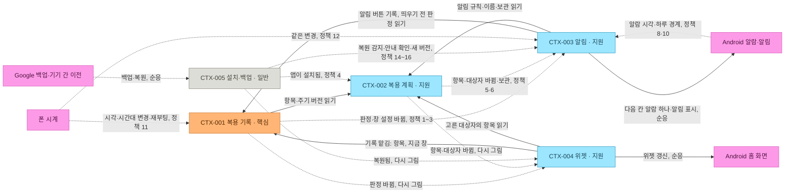

# 필받음 1차: 도메인 설계

상태: Step 0~9를 마쳤고 확인 1~3을 모두 지났습니다(2026-11-12 15:24, 15:48, 16:03 KST). 세 번 모두 동희님이 "추천 모두 승인"으로 답하셔서 그린 그대로 승인입니다. 다음은 02 요구입니다.

- 왜 다시 하나: 2026-11-12 15:02 KST 동희님이 이 스레드에서 "가쟈누님이 만든건 시안이고;; /corthex 첨부터 하라니까;; 물론 뺄건 빼지만"이라고 하셨습니다. 그때까지 01단계는 건너뛰었고, 03 흐름·04 명세·05 데이터·09 시안·12 QA는 가쟈누님 DidITake 문서(`7a800ac`)로 대신했습니다. 이제 그 문서들은 참고 시안으로만 씁니다.
- 진행 방식: 초안 후 고치기. Claude가 단계마다 보드에 프레임을 하나씩 그리고, 1-b, 7, 9단계 뒤에 멈춰 확인을 받습니다. 동희님이 2026-11-12 15:05 KST 결정 카드에서 'Miro 보드, 3번 확인'을 고르셨습니다.
- 확신 표시: Claude가 만든 항목 끝에 `[확실]`(동희님 말씀이나 문서에 있음), `[추론]`(문서·코드에서 미루어 앎), `[추측]`(근거 없음, 핫스팟)을 붙입니다.

## 1. 서비스 개요

### 동희님 말씀

- "AI와 서버 저장 없는 초간단 복약 기록 앱 Android 출시 (홈 위젯 원탭 기록, 이중 복용 방지, 투약일기)". 2026-11-12 00:20 KST, 프로젝트 채팅
- "CORTHEX 하네스로 필받음 앱을 실제 출시용으로 다시 만든다". 2026-11-12 09:09 KST, 프로젝트 채팅
- 첫 사용자: 본인과 가족 약을 함께 챙기는 사람(노인 포함). 2026-11-12 10:18 KST 범위 확정 카드에서 고르신 안([요구 0장](../01-planning/requirements.md#0-v3-뒤에-정한-결정) Q2)

### 가쟈누님 시안

- [DidITake 기획 v3 1장](https://github.com/judangbang-ops/DidITake/blob/7a800ac/docs/01-planning/planning-v3.md#1-목적): "아침마다 '약 먹었나? 또 먹어도 되나?' 고민하는 문제를 없앰. 핵심 가치는 이중투약 방지임."

### Claude 정리 (확인 1의 질문 1)

본인과 가족의 약을 챙기는 사람이 홈 화면 위젯을 한 번 눌러 먹은 것을 남기고, 같은 약이 두 번 기록되지 않아 '먹었나?'를 바로 아는 Android 앱. AI, 서버, 계정 없이 폰에만 저장하고, 안 먹었으면 폰 알림으로 다시 알리며, 지난 기록을 투약일기처럼 본다.

- 챙기는 사람: 앱을 쓰는 사람. 본인 약과 가족(노인 포함) 약을 함께 챙김 [확실]
- 대상자: 약을 먹는 사람(나, 엄마). 앱을 직접 쓰지 않을 수 있음 [추론]
- Android(외부 시스템): 위젯, 알림, 알람, 자동 백업과 기기 간 이전을 맡음 [확실]

### 범위

| 구분 | 내용 | 근거 |
| --- | --- | --- |
| 1차 안 | 대상자(나, 가족) 등록과 보관, 복용 항목 등록과 주기(매일, 주 1회), 위젯 한 번 눌러 기록과 같은 창 두 번 기록 막기, 앱에서 기록·건너뜀·늦은 입력·고치기, 폰 반복 알림, 지난 기록 보기(투약일기), Android 자동 백업과 복원 안내 | 요구 0장 Q1·Q7·Q16, 범위 확정 카드 |
| 1차 밖 | AI(약봉이), 서버·계정·동기화, 카톡 알림, 광고, 약 이름 검색, 병원용 '지금 먹는 약' 한 장, iOS(Play 비공개 테스트 다음), 백업 파일 내보내기 | 요구 0장 Q1·Q4·Q8·Q13 |
| 도메인 밖 | 출시, 서명, CI. 이 보드가 아니라 [작업 분해](../08-wbs/wbs.md)에서 다룸 | Claude 제안 |

### 입력

- 동희님 말씀과 결정: [요구 0장](../01-planning/requirements.md#0-v3-뒤에-정한-결정)(Q1~Q16, 범위 확정 카드)
- 가쟈누님 시안: DidITake `7a800ac`의 기획 v3, 기록 규칙, 데이터 모델, 흐름, UI 시안 v3
- 이 저장소의 [요구](../01-planning/requirements.md), [기록 규칙 보충](../04-spec/record-rules-supplement.md), [화면](../05-ui/screens.md)과 main `88baf80` 코드

## 2. 이벤트 스토밍

- 보드: [필받음 도메인 설계 (CORTHEX 01)](https://miro.com/app/board/uXjVEOmeO3A=/)
- 프레임: [Step 0 목적과 범위, 범례](https://miro.com/app/board/uXjVEOmeO3A=/?moveToWidget=3458764690208363514), [Step 1-a 사건](https://miro.com/app/board/uXjVEOmeO3A=/?moveToWidget=3458764690208363515), [Step 1-b 사건 흐름](https://miro.com/app/board/uXjVEOmeO3A=/?moveToWidget=3458764690208420124), [Step 2 외부 시스템](https://miro.com/app/board/uXjVEOmeO3A=/?moveToWidget=3458764690209262299), [Step 3 명령](https://miro.com/app/board/uXjVEOmeO3A=/?moveToWidget=3458764690209327147), [Step 4 핫스팟](https://miro.com/app/board/uXjVEOmeO3A=/?moveToWidget=3458764690209393245), [Step 5 행위자](https://miro.com/app/board/uXjVEOmeO3A=/?moveToWidget=3458764690209575809), [Step 6 애그리거트](https://miro.com/app/board/uXjVEOmeO3A=/?moveToWidget=3458764690209723991), [Step 7 경계](https://miro.com/app/board/uXjVEOmeO3A=/?moveToWidget=3458764690209862231), [Step 8 정책, 읽기 모델, 컨텍스트 맵](https://miro.com/app/board/uXjVEOmeO3A=/?moveToWidget=3458764690210430098), [Step 9 경계별 표](https://miro.com/app/board/uXjVEOmeO3A=/?moveToWidget=3458764690210552749)
- 진행 방식: 초안 후 고치기 (동희님 2026-11-12 15:05 KST 카드)
- 참여: 동희님(확인 답), Claude(초안). 보드 댓글 0개(2026-11-12 16:05 KST 확인). 세 확인 모두 보드를 고치지 않고 대화로만 답하셨습니다.
- 사람이 보드를 고치거나 댓글을 달지 않은 승인: 확인 1~3 모두 그린 그대로 승인. 그렇게 승인된 핵심 규칙과 명령 줄은 6장에 'review in stage 02'로 남깁니다.

### 확인 기록

| Checkpoint | State | Answer | Where, when |
| --- | --- | --- | --- |
| 확인 1 · 사건 흐름 | 지남, 그린 그대로 승인 | "추천 모두 승인". 1) 목적 정리가 맞음 2) 가. 챙기는 사람 한 명의 폰에 다 남김 3) 약 떨어짐·재처방 알림은 1차 밖 4) 첫 실행 안내를 본 것은 기록 안 남김 | 프로젝트 채팅, 2026-11-12 15:24 KST. 보드 수정 없이 대화로만 답하셔서 10분 훑어보기를 한 번 권함(15:44, 선택) |
| 확인 2 · 경계 | 지남, 그린 그대로 승인 | "추천 모두 승인". 1) 위젯을 따로 둠 2) 창 설정은 복용 기록에 둠 3) 앱 알림 꺼짐, 정확한 알람 권한 바뀜, 앱 데이터 지워짐은 1차 사건에 넣지 않고 02 반례로. 핵심 규칙 2개(복용 판정, 창 설정)는 그린 그대로 | 이 스레드, 2026-11-12 15:48 KST (질문은 15:44에 올림) |
| 확인 3 · 표, 컨텍스트 맵 | 지남, 그린 그대로 승인 | "추천 모두 승인". 1) 가. 알림을 따로 두고 '다음 알림 다시 예약' 하나로 받음 2) 가. '나'도 보관할 수 있고 마지막 남은 한 명만 막음 3) 가. '보관'과 '완전 삭제'로 나누고 화면 글자는 08에서 맞춤. 추측 3개(‘나’ 보관, 정책 4·16, 외부 시스템과 순응)와 핵심 규칙 7개는 그린 그대로 | 이 스레드, 2026-11-12 16:03 KST (질문은 16:00에 올림) |

### 사건 흐름 (Step 1-b)

보드의 줄 순서 그대로입니다. ` → `는 다음 자리, ` or `는 한 자리에서 하나만 일어나는 사건입니다.

| Lane | Events |
| --- | --- |
| A. 처음 준비 | 앱이 설치됨 → 기본 대상자 '나'가 만들어짐 → 대상자가 추가됨 → 복용 항목이 등록됨 → 위젯이 놓임 → 알림 설정이 바뀜 |
| B. 매일 기록 | 복용이 기록됨 or 건너뜀이 기록됨 |
| C. 알림 | 알림이 예약됨 → 알림이 울림 → 30분 뒤로 미뤄짐 or 복용이 기록됨 or 건너뜀이 기록됨 → 알림이 지워짐 |
| D. 고치기 | 복용이 기록됨 or 건너뜀이 기록됨 → 기록이 취소됨 or 복용 시각이 고쳐짐 or 건너뜀이 복용으로 바뀜 |
| E. 시계가 틀렸던 기록 | 시계 어긋남 표식이 남음 → 그대로 두기로 함 or 기록이 취소됨 |
| F. 약과 사람 바꾸기 | 복용 항목이 고쳐짐 or 주기가 바뀜 or 대상자가 고쳐짐 → 복용 항목이 보관됨 or 대상자가 보관됨 → 보관이 풀림 → 복용 항목이 완전히 삭제됨 or 대상자가 완전히 삭제됨 |
| G. 설정 | 하루 시작 시각이 바뀜 or 기준 시간대가 바뀜 or 알림 설정이 바뀜 |
| H. 폰 바꾸기, 다시 깔기 | 기록이 백업됨 → 기록이 복원됨 → 복원이 감지됨 → 복원 안내를 확인함 |
| I. 새 버전 깔기 | 새 버전이 설치됨 → 기록 형식이 옮겨짐 |

- 같은 창에서 다시 누르면 새 사건이 없음(이미 기록됨만 보임). 이중 복용을 막는 핵심 규칙 [확실]
- 줄 D의 첫 자리는 지난 창에 시각을 골라 남기는 늦은 입력임. 사건 이름은 B와 같음
- 사건에서 뺀 것: 화면 열기, 지난 기록 보기, 위젯 다시 그리기처럼 데이터가 바뀌지 않는 일. 하루가 바뀌는 것 자체(시간이 흐름)는 사건이 아니고, 8단계에서 정책으로 다룸
- `[추론]`인 사건: 기본 대상자 '나'가 만들어짐(코드 `ManagePeople.ensureDefault`), 알림이 울림, 보관이 풀림(대상자는 코드에 있음, 복용 항목은 확인 전), 기록 형식이 옮겨짐
- 확인 1을 지나 사건 이름에서 확신 표시를 뗐습니다. 명령, 행위자, 애그리거트에는 그대로 붙어 있습니다.

### 명령, 행위자, 외부 시스템 (Step 2~5)

- 행위자는 '챙기는 사람' 한 명뿐입니다(확인 1 답 2-가). 가족은 대상자일 뿐 앱을 쓰지 않습니다.
- 앱이 스스로 하는 일은 '앱 (자동)' [추론]: 기본 대상자 만들기, 다음 알림 예약하기, 알림 띄우기, 알림 지우기, 시계 어긋남 표시하기, 복원 알아차리기, 기록 형식 옮기기. 무엇이 시키는지는 Step 8 정책에서 그립니다.
- Android가 하는 일은 'Android (자동)': 백업하기, 복원하기.
- 외부 시스템: Google Play·APK 설치, Android 홈 화면(런처), 알림 권한, 알람(AlarmManager), 알림, 폰 시계(시각·시간대 변경, 재부팅), Google 백업과 기기 간 이전.
- `[추론]`인 명령: 기본 대상자 만들기, 알림 띄우기, 보관 풀기, 기록 형식 옮기기.

### 애그리거트 (Step 6)

| Aggregate | Rule | Source |
| --- | --- | --- |
| 복용 판정 (창 하나) | 한 창에 살아 있는 판정은 하나. 다시 누르면 '이미 기록됨', 변경 없음. 고치거나 취소해도 지우지 않고 무효로 표시한 뒤 새 행 | 보충 I-2 |
| 창 설정 (하루 시작, 기준 시간대) | 기본 04:00, Asia/Seoul. 바꾸기 전에 끝난 창은 고칠 수 없음 | REQ-002, 보충 P-5 |
| 대상자 | 처음 열 때 '나'가 생김. 보관한 대상자의 항목은 위젯·알림에서 빠지고 지난 기록은 남음 | REQ-017 |
| 복용 항목 (주기 버전) | 주기를 바꾸면 지금부터 새 버전, 이번 창 기록은 그대로 인정. 완전 삭제는 보관된 항목만 | REQ-015 |
| 알림 계획 | 띄우려는 순간 그 창에 판정이 있으면 띄우지 않음. 알람은 다음 칸 하나만 예약 | 보충 N-6, N-8 |
| 알림 설정 | 켜기·끄기, 시작 시각, 간격, 하루 최대, 방해 금지, 잠금 화면 이름 | 보충 N-4, REQ-046 |
| 위젯 | 고른 대상자(한 명 또는 전체)의 항목만 보임. 지금 창에만 기록 | REQ-025, 보충 P-1 |
| 설치 (기기 표식) | 기기 표식은 백업에 들어가지 않음. 복원되면 새 표식과 복원 출처를 남기고, 안내를 확인할 때까지 보임 | 보충 2장 |

## 3. 경계 (Step 7, 확인 2 지남)

확인 2(2026-11-12 15:48 KST)를 지나 CTX ID를 붙였습니다. 경계와 종류는 Claude가 미루어 그린 것을 동희님이 그린 그대로 승인하신 것입니다. 지금 코드는 경계가 아니라 층(`domain`, `usecase`, `data`, `status`)으로 나뉘어 있어서, 마지막 칸은 지금 코드가 있는 곳입니다. 경계별 패키지로 나눌지는 11 개발에서 정합니다 [추론].

| Context | Kind | Aggregates | Events | Why a boundary | Code now (main `88baf80`) |
| --- | --- | --- | --- | --- | --- |
| CTX-001 복용 기록 | 핵심 | 복용 판정, 창 설정 | 복용이 기록됨, 건너뜀이 기록됨, 기록이 취소됨, 복용 시각이 고쳐짐, 건너뜀이 복용으로 바뀜, 시계 어긋남 표식이 남음, 그대로 두기로 함, 하루 시작 시각이 바뀜, 기준 시간대가 바뀜 | 이중 복용을 막는 규칙이 모두 여기 있음 | `domain/Window*`, `domain/DayBoundary`, `usecase/RecordDose`, `RecordInWindow`, `ChangeJudgment`, `VoidDose`, `ClockFlags`, `ManageSettings`(창 설정 부분) |
| CTX-002 복용 계획 | 지원 | 대상자, 복용 항목 | 기본 대상자 '나'가 만들어짐, 대상자가 추가됨·고쳐짐·보관됨·완전히 삭제됨, 복용 항목이 등록됨·고쳐짐, 주기가 바뀜, 복용 항목이 보관됨, 보관이 풀림, 복용 항목이 완전히 삭제됨 | 기록은 이것을 읽기만 함. 계획을 바꿔도 지난 기록은 그대로 | `domain/ScheduleRule`, `usecase/ManagePeople`, `ManageIntakes`, `DeleteIntake` |
| CTX-003 알림 | 지원 | 알림 계획, 알림 설정 | 알림 설정이 바뀜, 알림이 예약됨, 알림이 울림, 30분 뒤로 미뤄짐, 알림이 지워짐 | Android 알람·알림과 맞닿음. 알림 버튼 기록은 복용 기록에 맡김 | `domain/Reminders`, `usecase/Reminders` |
| CTX-004 위젯 | 지원 | 위젯 | 위젯이 놓임 | Android 홈 화면에 붙음. 누르면 복용 기록에 맡김 | `widget/`, `status/WidgetModel`, `boundary/DayBoundaryAlarm`(하루가 바뀔 때 다시 그림) |
| CTX-005 설치·백업 | 일반 | 설치 (기기 표식) | 앱이 설치됨, 기록이 백업됨, 기록이 복원됨, 복원이 감지됨, 복원 안내를 확인함, 새 버전이 설치됨, 기록 형식이 옮겨짐 | 대부분 Android가 함. 앱은 복원을 알아차리고 알려 주기만 함 | `restore/`, `data/Migrations` |

사건 33개가 모두 한 곳에만 들어갑니다.

## 4. 경계별 표 (Step 9, 확인 3 지남)

보드 [Step 9 경계별 표](https://miro.com/app/board/uXjVEOmeO3A=/?moveToWidget=3458764690210552749)와 같습니다. 핵심은 명령마다 다 적고, 지원은 명령과 사건, 일반은 한 줄만 적었습니다.

### CTX-001 복용 기록

목적: 먹었는지 건너뛰었는지를 창마다 하나로 남기고, 고치거나 취소해도 흔적을 지우지 않는다.

| Given by | Read model | Command | Aggregate | Events |
| --- | --- | --- | --- | --- |
| 챙기는 사람 (위젯, CTX-004 거쳐) | 위젯 버튼 | 먹었다고 기록하기 | 복용 판정 | 복용이 기록됨 (같은 창에 판정이 있으면 사건 없음) |
| 챙기는 사람 (앱) | 오늘 · 이번 주 | 먹었다고 기록하기 | 복용 판정 | 복용이 기록됨 |
| 챙기는 사람 (알림 버튼, CTX-003 거쳐) | 복용 알림 | 알림에서 먹었다고 기록하기 | 복용 판정 | 복용이 기록됨 |
| 챙기는 사람 (앱) | 오늘 · 이번 주 | 건너뛰기 | 복용 판정 | 건너뜀이 기록됨 |
| 챙기는 사람 (알림 버튼, CTX-003 거쳐) | 복용 알림 | 알림에서 건너뛰기 | 복용 판정 | 건너뜀이 기록됨 |
| 챙기는 사람 | 지난 기록 | 먹은 시각 골라 기록하기 | 복용 판정 | 복용이 기록됨 (지난 창) |
| 챙기는 사람 | 지난 기록 | 지난 창 건너뛰기 | 복용 판정 | 건너뜀이 기록됨 (지난 창) |
| 챙기는 사람 | 오늘 · 이번 주, 지난 기록 | 기록 취소하기 | 복용 판정 | 기록이 취소됨 |
| 챙기는 사람 | 지난 기록 | 복용 시각 고치기 | 복용 판정 | 복용 시각이 고쳐짐 |
| 챙기는 사람 | 지난 기록 | 건너뜀을 복용으로 바꾸기 | 복용 판정 | 건너뜀이 복용으로 바뀜 |
| 정책 11 (폰 시계), 앱·위젯이 판정을 읽을 때 |  | 시계 어긋남 표시하기 | 복용 판정 | 시계 어긋남 표식이 남음 |
| 챙기는 사람 | 오늘 · 이번 주, 지난 기록 (시계 경고) | 그대로 두기 | 복용 판정 | 그대로 두기로 함 |
| 챙기는 사람 | 설정 | 하루 시작 시각 바꾸기 | 창 설정 | 하루 시작 시각이 바뀜 |
| 챙기는 사람 | 설정 | 기준 시간대 바꾸기 | 창 설정 | 기준 시간대가 바뀜 |

- Aggregate rules: 복용 판정: 한 창(항목과 그 창)에 살아 있는 판정은 하나. 같은 창에서 다시 누르면 '이미 기록됨', 사건 없음 (동희님 '이중 복용 방지', 2026-11-12 00:20 KST 프로젝트 채팅)
- Aggregate rules: 복용 판정: 판정을 쓰는 순간 복용 시각은 그 창 안 (보충 I-1)
- Aggregate rules: 복용 판정: 지우거나 고쳐 쓰지 않고 무효로 표시한 뒤 새 행 (보충 I-2)
- Aggregate rules: 복용 판정: 하루 시작·기준 시간대를 바꾸기 전에 끝난 창의 판정은 고칠 수 없음 (보충 P-5)
- Aggregate rules: 복용 판정: 복용 시각이 지금보다 5분 넘게 뒤이면 표식. 표식은 판정 행과 따로 둠 (보충 C-1)
- Aggregate rules: 창 설정: 기본 하루 시작 04:00, 기준 시간대 Asia/Seoul (REQ-002)
- Aggregate rules: 창 설정: 바꾼 때부터 적용하고 지난 판정의 기간키는 그대로 (REQ-011, RR-15)
- Given–When–Then: Given 아침약 오늘 창에 판정이 없음, When 위젯에서 아침약을 누름, Then 복용이 기록됨(오늘 창, 지금 시각)
- Given–When–Then: Given 오늘 창에 복용 판정이 있음, When 다시 누름, Then 사건 없음, '이미 기록됨'
- Given–When–Then: Given 오늘 창에 판정이 없음, When 앱에서 건너뛰기, Then 건너뜀이 기록됨
- Given–When–Then: Given 어제 창에 판정이 없음, When 어제 21:00을 골라 기록, Then 복용이 기록됨(어제 창, 21:00)
- Given–When–Then: Given 오늘 창에 복용 판정, When 기록 취소, Then 기록이 취소됨. 판정 행은 무효로 남고 오늘 창은 미완료
- Given–When–Then: Given 08:00 복용 판정, When 07:30으로 고침, Then 옛 행은 무효, 07:30 새 행
- Given–When–Then: Given 금요일 08:00 판정이 있는데 시계가 수요일로 돌아감, When 시각 변경을 받음, Then 표식이 남고 앱이 확인을 물음
- Given–When–Then: Given 하루 시작 04:00, When 05:00으로 바꿈, Then 하루 시작 시각이 바뀜. 이미 끝난 창의 판정 기간키는 그대로
- External systems: 폰 시계(시각·시간대 변경, 재부팅)
- Links: 위젯·알림이 부름. 복용 계획을 읽음. 판정·창 설정이 바뀌면 알림·위젯에 알림
- Hotspots: 시계를 크게 되돌리면 멀쩡한 판정도 모두 표식(보충 7장 한계). 주 1회 늦게 먹으면 묻기(결정 Q15 남은 부분)

### CTX-002 복용 계획

목적: 누가 무엇을 어떤 주기로 먹는지 정한다.

| Given by | Read model | Command | Aggregate | Events |
| --- | --- | --- | --- | --- |
| 정책 4 | | 기본 대상자 만들기 | 대상자 | 기본 대상자 '나'가 만들어짐 |
| 챙기는 사람 | 항목·대상자 목록 | 대상자 추가하기 | 대상자 | 대상자가 추가됨 |
| 챙기는 사람 | 항목·대상자 목록 | 대상자 고치기 | 대상자 | 대상자가 고쳐짐 |
| 챙기는 사람 | 항목·대상자 목록 | 대상자 보관하기 | 대상자 | 대상자가 보관됨 |
| 챙기는 사람 | 항목·대상자 목록 | 대상자 완전히 지우기 | 대상자 | 대상자가 완전히 삭제됨 |
| 챙기는 사람 | 항목·대상자 목록 | 복용 항목 등록하기 | 복용 항목 | 복용 항목이 등록됨 |
| 챙기는 사람 | 항목·대상자 목록 | 복용 항목 고치기 | 복용 항목 | 복용 항목이 고쳐짐 |
| 챙기는 사람 | 항목·대상자 목록 | 주기 바꾸기 | 복용 항목 | 주기가 바뀜 |
| 챙기는 사람 | 항목·대상자 목록 | 복용 항목 보관하기 | 복용 항목 | 복용 항목이 보관됨 |
| 챙기는 사람 | 항목·대상자 목록 | 보관 풀기 | 대상자, 복용 항목 | 보관이 풀림 |
| 챙기는 사람 | 항목·대상자 목록 | 복용 항목 완전히 지우기 | 복용 항목 | 복용 항목이 완전히 삭제됨 |

- Aggregate rules: 대상자: 처음 열 때 '나'가 생김. 보관한 대상자의 항목은 위젯·알림에서 빠지고 지난 기록은 남음 (REQ-017)
- Aggregate rules: 대상자: 보관되지 않은 대상자가 적어도 한 명. '나'도 다른 사람처럼 보관할 수 있음 (확인 3 답 2-가, 지금 코드 `ManagePeople.archive`와 같음)
- Aggregate rules: 복용 항목: 주기를 바꾸면 지금부터 새 버전, 이번 창 기록은 그대로. 완전 삭제는 보관된 항목만 (REQ-015)
- External systems: 없음
- Links: 복용 기록·위젯·알림이 읽음(고객-공급자). 바뀌면 알림·위젯에 알림
- Hotspots: 약 제품과 용량(2차?), 대상자 완전히 지우기가 코드에 없음

### CTX-003 알림

목적: 먹을 시간이 지나도 기록이 없을 때 폰으로 알린다.

| Given by | Read model | Command | Aggregate | Events |
| --- | --- | --- | --- | --- |
| 챙기는 사람 | 알림 설정 | 알림 켜기, 알림 설정 바꾸기 | 알림 설정 | 알림 설정이 바뀜 |
| 정책 1~3, 5, 7, 9, 12, 15, 16 | | 다음 알림 예약하기 | 알림 계획 | 알림이 예약됨 |
| 정책 8, 12, 14 | | 알림 띄우기 | 알림 계획 | 알림이 울림 |
| 챙기는 사람 (알림 버튼) | 복용 알림 | 30분 뒤 다시 알리기 | 알림 계획 | 30분 뒤로 미뤄짐 |
| 정책 2, 6, 10 | | 알림 지우기 | 알림 계획 | 알림이 지워짐 |

- Aggregate rules: 알림 계획: 띄우려는 순간 그 창에 판정이 있으면 띄우지 않음. 알람은 모든 항목 중 다음 칸 하나만 예약 (보충 N-6, N-8)
- Aggregate rules: 알림 설정: 켜기·끄기, 시작 시각, 간격, 하루 최대, 방해 금지, 잠금 화면 이름 (보충 N-4, REQ-046)
- External systems: Android 알람·알림
- Links: 알림 버튼 기록은 복용 기록을 부름. 복용 계획을 읽음. 모든 경계의 변화를 들음
- Hotspots: Doze 때문에 늦는 정도

### CTX-004 위젯

목적: 홈 화면에서 지금 창의 항목을 보여 주고 한 번에 기록하게 한다.

| Given by | Read model | Command | Aggregate | Events |
| --- | --- | --- | --- | --- |
| 챙기는 사람 | 대상자 고르기 | 위젯 놓기 | 위젯 | 위젯이 놓임 |

- Aggregate rules: 위젯: 고른 대상자(한 명 또는 전체)의 항목만 보임. 지금 창에만 기록 (REQ-025, 보충 P-1)
- Aggregate rules: 위젯: 고른 대상자는 백업되지 않아 복원 뒤 다시 골라야 함 (보충 R-3, REQ-079)
- External systems: Android 홈 화면
- Links: 누르면 복용 기록을 부름. 복용 계획을 읽음. 판정·항목·복원·하루 바뀜에 다시 그림
- Hotspots: 없음

### CTX-005 설치·백업

설치, 새 버전, 백업과 복원을 거쳐도 기록이 남게 한다. Google 백업·기기 간 이전과 Play·APK 설치를 그대로 따름(순응). 앱은 복원을 알아차리고(정책 13) 기본 대상자·알림·위젯에 알림(정책 4, 14~16). 규칙: 기기 표식은 백업에 들어가지 않고, 복원되면 새 표식과 복원 출처를 남기며 안내를 확인할 때까지 보임 (보충 2장).

## 5. 경계 사이 의존 (Step 8, 확인 3 지남)

보드 [Step 8 정책, 읽기 모델, 컨텍스트 맵](https://miro.com/app/board/uXjVEOmeO3A=/?moveToWidget=3458764690210430098)과 같습니다.

### 정책

| # | Trigger | Policy | Command | From → To, source |
| --- | --- | --- | --- | --- |
| 1 | 복용이 기록됨, 건너뜀이 기록됨, 기록이 취소됨, 복용 시각이 고쳐짐, 건너뜀이 복용으로 바뀜 | 판정이 바뀌면, 다음 알림 예약하기 | 다음 알림 예약하기 | CTX-001 → CTX-003 · 보충 N-9 |
| 2 | 복용이 기록됨, 건너뜀이 기록됨 | 판정이 생기면, 그 항목 알림 지우기 | 알림 지우기 | CTX-001 → CTX-003 · 보충 N-13 |
| 3 | 하루 시작 시각이 바뀜, 기준 시간대가 바뀜 | 창 설정이 바뀌면, 다음 알림 예약하기 | 다음 알림 예약하기 | CTX-001 → CTX-003 · 보충 N-9 |
| 4 | 앱이 설치됨 | 대상자가 하나도 없으면, 기본 대상자 만들기 [추론] | 기본 대상자 만들기 | CTX-005 → CTX-002 · 코드 ManagePeople.ensureDefault |
| 5 | 복용 항목이 등록됨·고쳐짐, 주기가 바뀜, 보관됨, 보관이 풀림, 대상자가 보관됨 | 계획이 바뀌면, 다음 알림 예약하기 | 다음 알림 예약하기 | CTX-002 → CTX-003 · 보충 N-9 |
| 6 | 복용 항목이 보관됨, 대상자가 보관됨 | 보관되면, 그 항목 알림 지우기 | 알림 지우기 | CTX-002 → CTX-003 · 보충 N-13 |
| 7 | 알림 설정이 바뀜 | 알림 설정이 바뀌면, 다음 알림 예약하기 | 다음 알림 예약하기 | CTX-003 안 · 보충 N-9 |
| 8 | Android 알람: 예약한 시각이 됨 | 알람이 울리면, 밀린 칸을 모아 알림 띄우기 | 알림 띄우기 | Android 알람 → CTX-003 · 보충 N-8, N-12 |
| 9 | 알림이 울림, 30분 뒤로 미뤄짐 | 알림이 울리거나 미뤄지면, 다음 알림 예약하기 | 다음 알림 예약하기 | CTX-003 안 · 보충 N-7, N-8 |
| 10 | Android 알람: 하루 경계 시각이 됨 | 창이 끝나면, 그 창 알림 지우기 | 알림 지우기 | Android 알람 → CTX-003 · 보충 N-13 |
| 11 | 폰 시계: 시각·시간대 변경, 재부팅 | 시계가 바뀌면, 시계 어긋남 표시하기 | 시계 어긋남 표시하기 | 폰 시계 → CTX-001 · 보충 C-1 (판정을 읽을 때도) |
| 12 | 폰 시계: 시각·시간대 변경, 재부팅 | 시계가 바뀌면, 밀린 칸 알림 띄우고 다음 알림 예약하기 | 알림 띄우기, 다음 알림 예약하기 | 폰 시계 → CTX-003 · 보충 N-9, N-10, N-12 |
| 13 | 앱이 열림 (위젯 갱신·알람·부팅 수신 포함, 사건 아님) | 앱이 열릴 때마다, 복원 알아차리기 | 복원 알아차리기 | CTX-005 안 · 보충 R-1 |
| 14 | 복원이 감지됨 | 복원되면, 복용 알림 대신 복원 안내 알림 하나 띄우기 | 알림 띄우기 | CTX-005 → CTX-003 · 보충 R-3 |
| 15 | 복원 안내를 확인함 | 안내를 확인하면, 다음 알림 예약하기 | 다음 알림 예약하기 | CTX-005 → CTX-003 · 보충 R-3, N-12 |
| 16 | 새 버전이 설치됨 | 새 버전이 깔리면, 기록 형식 옮기고 다음 알림 예약하기 [추론] | 기록 형식 옮기기, 다음 알림 예약하기 | CTX-005 안, CTX-005 → CTX-003 · 보충 N-9 |

- 다른 경계에서 넘어오는 정책 9개 중 8개가 CTX-003에 닿습니다. 확인 3 답 1-가로 알림을 따로 두고, 무엇이 바뀌든 '다음 알림 다시 예약' 하나로 받습니다.
- 위젯과 앱 화면을 다시 그리는 것은 정책이 아니라 읽기 모델을 새로 읽는 일로 봤습니다.

### 읽기 모델

| Read model | Shows | Context | Commands from it |
| --- | --- | --- | --- |
| 오늘 · 이번 주 (첫 화면) | 대상자별 지금 창 항목과 판정, 시계 경고, 복원 안내 | CTX-001 (CTX-002를 읽음) | 먹었다고 기록하기(앱), 건너뛰기, 기록 취소하기, 그대로 두기, 복원 안내 확인하기 |
| 위젯 버튼 | 고른 대상자의 지금 창 항목, 판정 표시, !, 복원됨 | CTX-004 (CTX-001·002를 읽음) | 먹었다고 기록하기(위젯) |
| 지난 기록 (투약일기) | 창마다 판정, 시계 경고 | CTX-001 | 먹은 시각 골라 기록하기, 지난 창 건너뛰기, 복용 시각 고치기, 건너뜀을 복용으로 바꾸기, 그대로 두기, 기록 취소하기 |
| 복용 알림 | 항목 이름(잠금 화면에선 숨길 수 있음), 주 1회는 마지막 복용 | CTX-003 | 알림에서 먹었다고 기록하기, 알림에서 건너뛰기, 30분 뒤 다시 알리기 |
| 항목·대상자 목록 | 보관한 것 포함 | CTX-002 | 대상자 추가·고치기·보관, 복용 항목 등록·고치기, 주기 바꾸기, 보관, 보관 풀기, 완전히 지우기 |
| 대상자 고르기 | 위젯을 놓을 때 | CTX-004 (CTX-002를 읽음) | 위젯 놓기 |
| 알림 설정 | 방해 금지에 걸리는 칸 안내 | CTX-003 | 알림 켜기, 알림 설정 바꾸기 |
| 설정 | 하루 시작 시각, 기준 시간대 | CTX-001 | 하루 시작 시각 바꾸기, 기준 시간대 바꾸기 |

### 의존

| From | To | Kind | Pattern | Data, why |
| --- | --- | --- | --- | --- |
| CTX-004 | CTX-001 | call (sync) |  | 기록 맡김: 항목, 지금 창 |
| CTX-003 | CTX-001 | call (sync) |  | 알림 버튼 기록, 띄우기 전 판정 읽기 |
| CTX-001 | CTX-002 | call (sync) | 고객-공급자 [추론] | 항목·주기 버전 읽기 |
| CTX-004 | CTX-002 | call (sync) | 고객-공급자 [추론] | 고른 대상자의 항목 읽기 |
| CTX-003 | CTX-002 | call (sync) | 고객-공급자 [추론] | 알림 규칙·이름·보관 읽기 |
| CTX-001 | CTX-003 | event (async) |  | 판정·창 설정 바뀜, 정책 1~3 |
| CTX-002 | CTX-003 | event (async) |  | 항목·대상자 바뀜·보관, 정책 5·6 |
| CTX-001 | CTX-004 | event (async) |  | 판정 바뀜, 다시 그림 |
| CTX-002 | CTX-004 | event (async) |  | 항목·대상자 바뀜, 다시 그림 |
| CTX-005 | CTX-002 | event (async) |  | 앱이 설치됨, 정책 4 |
| CTX-005 | CTX-003 | event (async) |  | 복원 감지·안내 확인·새 버전, 정책 14~16 |
| CTX-005 | CTX-004 | event (async) |  | 복원됨, 다시 그림 |
| CTX-004 | Android 홈 화면 | call (sync) | 순응 [추론] | 위젯 갱신 |
| CTX-003 | Android 알람·알림 | call (sync) | 순응 [추론] | 다음 칸 알람 하나·알림 표시 |
| Android 알람·알림 | CTX-003 | event (async) | 순응 [추론] | 알람 시각·하루 경계, 정책 8·10 |
| 폰 시계 | CTX-001 | event (async) | 순응 [추론] | 시각·시간대 변경·재부팅, 정책 11 |
| 폰 시계 | CTX-003 | event (async) | 순응 [추론] | 같은 변경, 정책 12 |
| Google 백업·기기 간 이전 | CTX-005 | event (async) | 순응 [추론] | 백업·복원 |

동기 호출에는 고리가 없습니다. 외부 시스템과의 관계는 모두 순응입니다. 확인 3 추측 묶음에서 그린 그대로 승인되었습니다(보드 그림에는 알람·폰 시계 쪽 화살표에 '순응'이 빠져 있어 문서에서 채움).

## 6. 핫스팟

| Hotspot | Context | State | Answer or next step |
| --- | --- | --- | --- |
| 가족도 자기 폰에서 같은 기록을 보나? [추측] | 미정 | answered | 아니오. 챙기는 사람 한 명의 폰에 다 남김 (확인 1 답 2-가, 동희님 "추천 모두 승인", 2026-11-12 15:24 KST 프로젝트 채팅) |
| 첫 실행 안내를 본 것도 남기나? [추측] | 미정 | answered | 남기지 않음 (확인 1 답 4, 같은 곳) |
| 흔한 복약 앱의 '약 떨어짐, 재처방 알림'이 1차에 없음 | 미정 | answered | 1차 밖 (확인 1 답 3, 같은 곳) |
| 위젯을 따로 둘까, 복용 기록에 합칠까 | CTX-004 | answered | 따로 둠 (확인 2 답 1, 동희님 "추천 모두 승인", 2026-11-12 15:48 KST 이 스레드) |
| 창 설정을 복용 기록에 둘까, 복용 계획에 둘까 | CTX-001 | answered | 복용 기록에 둠 (확인 2 답 2, 같은 곳) |
| 앱 알림이 꺼짐, 정확한 알람 권한이 바뀜, 앱 데이터가 지워짐이 사건에 없음 | 미정 | answered | 1차 사건에는 넣지 않고 02 요구에서 반례로 다룸 (확인 2 답 3, 같은 곳). 02에서 REQ-089, REQ-047, REQ-092로 씀 |
| 복용 판정: 한 창에 살아 있는 판정 하나, 지우지 않고 무효 표시 뒤 새 행 | CTX-001 | review in stage 02 | 확인 2에서 그린 그대로 승인. 02에서 REQ-001, REQ-006, REQ-030에 연결함. 02 범위 확인을 지나면 answered |
| 창 설정: 기본 04:00·Asia/Seoul, 바꾸기 전에 끝난 창은 못 고침 | CTX-001 | review in stage 02 | 확인 2에서 그린 그대로 승인. 02에서 REQ-002, REQ-011, REQ-032, REQ-053에 연결함 |
| 복용 판정: 시각은 그 창 안(I-1), 5분 넘게 뒤이면 시계 표식(C-1) | CTX-001 | review in stage 02 | 확인 3에서 그린 그대로 승인. 02에서 REQ-032, REQ-009에 연결함 |
| CTX-001 명령 14줄과 Given–When–Then 8개 | CTX-001 | review in stage 02 | 확인 3에서 그린 그대로 승인. 02에서 명령마다 요구가 있음을 봄(REQ-022, 028~034, 045, 053). 예시는 04 합격 기준과 12 시험의 출발점 |
| 정책 4(기본 대상자)와 외부 시스템과의 '순응' 관계 [추론] | CTX-002, CTX-005 | review in stage 02 | 확인 3 추측 묶음. 그린 그대로 승인 |
| 대상자 완전히 지우기: 사건과 명령은 있지만 지금 코드에는 없음(`ManagePeople`에 보관·풀기만 있음) | CTX-002 | open | 02 범위 확인 질문으로 올림 |
| 다른 경계에서 넘어오는 정책 9개 중 8개가 알림에 닿음. 경계를 다시 볼까 | CTX-003 | answered | 알림을 따로 두고 '다음 알림 다시 예약' 하나로 받음 (확인 3 답 1-가, 동희님 "추천 모두 승인", 2026-11-12 16:03 KST 이 스레드) |
| 기본 대상자 '나'도 보관하거나 지울 수 있나? [추론] | CTX-002 | answered | 다른 사람처럼 보관할 수 있고 마지막 남은 한 명만 막음. 지금 코드와 같음 (확인 3 답 2-가, 같은 곳) |
| 앱 화면의 '항목 삭제'는 실제로는 보관. 완전 삭제와 같은 말 '삭제'를 씀 [추론] | CTX-002 | answered | 용어집에서 '보관'(TERM-018)과 '완전 삭제'(TERM-019)로 나눔. 화면 글자는 08 화면 상태에서 맞춤 (확인 3 답 3-가, 같은 곳) |
| '기록 형식이 옮겨짐'은 사람이 아는 일이 아니라 기술 일. 사건에서 빼고 02 요구로만 둘까? [추론] | CTX-005 | review in stage 02 | 확인 3 추측 묶음(정책 16)에 올려 그린 그대로 승인. 02에서 REQ-072(마이그레이션)에 연결함 |
| 주 1회 약을 늦게 먹으면 묻기를 1차에 넣나 | CTX-001 | open | 결정 Q15의 남은 부분. 가쟈누님과 정함. 지금은 기준일 그대로(KEEP) |
| 약 제품과 용량 기록은 1차에 사건이 없음. 2차로? [추론] | CTX-002 | open | 코드에 `medication`, `dose_version` 표가 있음. 요구 0장 Q3(1차는 항목 이름만) |
| Doze 때문에 알림이 늦을 수 있음. 얼마나 늦는지 | CTX-003 | open | 실기기에서 잼 (보충 N-11) |
| 시계를 크게 되돌리면 멀쩡한 기록도 모두 표식을 받고 하나씩 답해야 함 | CTX-001 | open | 보충 7장 한계. 02 요구에서 다룸 |
| 백업은 Android가 조건이 맞을 때만 함. 마지막 백업 뒤의 기록은 돌아오지 않을 수 있음 | CTX-005 | open | 보충 2장. 화면 안내 문구는 08에서 |

## 7. 용어집

확인 3(2026-11-12 16:03 KST)을 지나 TERM ID를 붙였습니다. TERM-030·031은 02 요구를 다시 볼 때(2026-11-12) 요구 문서가 쓰던 말을 더한 것입니다. 다음 단계의 요구, 흐름, 명세, 화면 글자는 이 말을 씁니다. 새 말이 필요하면 여기에 먼저 더합니다. 코드 이름은 main `88baf80` 기준입니다.

| ID | Term | Definition | Context | Code name | Avoid |
| --- | --- | --- | --- | --- | --- |
| TERM-001 | 챙기는 사람 | 앱을 쓰는 사람. 본인과 가족의 약을 한 폰에서 함께 챙김 | 전체 | (사용자, 따로 없음) | 보호자, 관리자, 계정 |
| TERM-002 | 대상자 | 약을 먹는 사람. 앱을 직접 쓰지 않을 수 있음 | CTX-002 | `person` | 환자, 가족 계정, 사람(화면 말은 08에서 맞춤) |
| TERM-003 | 기본 대상자 '나' | 처음 열 때 생기는 대상자. 다른 대상자처럼 보관할 수 있음 | CTX-002 | `ManagePeople.ensureDefault` | 본인 계정 |
| TERM-004 | 복용 항목 | 대상자 한 명이 정해진 주기로 먹는 것 하나. 1차는 이름만 적음 | CTX-002 | `intake` | 약(약 제품은 `medication`, 1차 밖), 처방 |
| TERM-005 | 주기 | 매일(아침·점심·저녁·자기 전 중 하나) 또는 주 1회(요일 하나). 바꾸면 그때부터 새 버전 | CTX-002 | `schedule_version`, `ScheduleType`, `SlotLabel` | 스케줄, 반복 |
| TERM-006 | 창 | 복용 항목 하나를 한 번 먹어야 하는 기간. 매일은 하루, 주 1회는 한 주. 하루 시작 시각과 기준 시간대로 나눔 | CTX-001 | `Window` | 회차, 슬롯, 칸(알림 칸과 다름) |
| TERM-007 | 기간키 | 창이 시작하는 날짜(기준 시간대의 `YYYY-MM-DD`). 판정이 어느 창 것인지 정함 | CTX-001 | `period_key` | 기록 날짜 |
| TERM-008 | 복용 판정 | 한 창에 '먹음' 또는 '건너뜀'으로 남긴 기록 한 행. 살아 있는 판정은 창마다 하나 | CTX-001 | `dose_record` | 체크, 투약 기록 |
| TERM-009 | 먹음 | 먹었다고 남긴 판정 | CTX-001 | `DoseKind.TAKEN` | 완료(창 상태와 헷갈림) |
| TERM-010 | 건너뜀 | 일부러 먹지 않았다고 남긴 판정 | CTX-001 | `DoseKind.SKIPPED` | 안 먹음, 놓침 |
| TERM-011 | 미완료 | 창에 살아 있는 판정이 없는 상태 | CTX-001 | (판정 없음) | 안 먹음, 건너뜀 |
| TERM-012 | 무효 | 취소하거나 고친 판정 행. 지우지 않고 남김 | CTX-001 | `active = NULL`, `voided_at` | 삭제 |
| TERM-013 | 늦은 입력 | 지난 창에 먹은 시각을 골라 판정을 남기는 것 | CTX-001 | `RecordInWindow` | 소급 기록 |
| TERM-014 | 창 설정 | 하루 시작 시각과 기준 시간대. 바꾼 때부터 적용 | CTX-001 | `WindowSettings` | 날짜 설정 |
| TERM-015 | 하루 시작 시각 | 하루 창이 바뀌는 시각. 기본 04:00 | CTX-001 | `WindowSettings` | 자정 |
| TERM-016 | 기준 시간대 | 창을 나누는 시간대. 기본 Asia/Seoul. 폰 시간대와 따로 둠 | CTX-001 | `WindowSettings`, `zone_id` | 폰 시간대 |
| TERM-017 | 시계 어긋남 표식 | 복용 시각이 지금보다 5분 넘게 뒤인 판정에 붙는 표시. 챙기는 사람이 그대로 두거나 취소함 | CTX-001 | `clock_flag` | 오류, 경고(화면의 '시계 경고'는 이것을 보여 주는 읽기 모델) |
| TERM-018 | 보관 | 대상자나 복용 항목을 위젯·알림에서 빼되 지난 기록은 남김. 다시 풀 수 있음 | CTX-002 | `archived_at` | 삭제, 항목 삭제(지금 화면 말, 08에서 고침) |
| TERM-019 | 완전 삭제 | 보관된 복용 항목을 그 판정까지 지움. 두 번 확인 | CTX-002 | `DeleteArchivedIntake` | 보관, 삭제(단독) |
| TERM-020 | 기록한 곳 | 판정을 남긴 곳: 위젯, 앱, 알림 | CTX-001 | `DoseSource` | 출처 |
| TERM-021 | 복용 알림 | 창에 판정이 없을 때 폰에 띄우는 알림 | CTX-003 | `Reminders`, `reminder_rule` | 푸시, 카톡 알림 |
| TERM-022 | 알림 칸 | 알림을 띄울 수 있는 시각 하나. 시작 시각과 간격으로 정하고 하루 최대만큼 | CTX-003 | `ReminderSlot` | 창, 슬롯 |
| TERM-023 | 30분 뒤 다시 알리기 | 알림을 30분 미룸 | CTX-003 | `reminder_snooze` | 스누즈 |
| TERM-024 | 알림 설정 | 켜기·끄기, 시작 시각, 간격, 하루 최대, 방해 금지, 잠금 화면 이름 | CTX-003 | `ReminderSettings` | |
| TERM-025 | 위젯 | 홈 화면에서 지금 창의 항목을 보이고 한 번 눌러 기록하게 하는 것 | CTX-004 | `DidITakeWidget` | 바로가기 |
| TERM-026 | 고른 대상자 | 위젯을 놓을 때 고른 대상자(한 명 또는 전체). 백업되지 않음 | CTX-004 | 위젯 설정 | |
| TERM-027 | 기기 표식 | 설치마다 하나 생기고 백업에 들어가지 않는 표시. 복원을 알아차리는 데 씀 | CTX-005 | `install_marker`, `device_id` | 기기 ID, 계정 |
| TERM-028 | 복원 | Android가 백업한 기록을 새 설치에 되돌림. 앱은 알아차리고 안내만 함 | CTX-005 | `InstallCheck` | 동기화, 가져오기 |
| TERM-029 | 복원 안내 | 복원을 알아차린 뒤 확인할 때까지 보이는 안내와 알림 하나 | CTX-005 | `InstallCheck` | |
| TERM-030 | 활성 판정 | 무효가 아닌 판정. 창마다 하나까지 (TERM-008의 '살아 있는 판정') | CTX-001 | `active = 1` | 유효 기록 |
| TERM-031 | 빠짐 | 복용 항목이 등록돼 있고 보관되지 않았던 끝난 창에 활성 판정이 없는 것. 지난 기록에 보임 | CTX-001 | `LoadHistory` | 미완료(지금 창), 건너뜀, 안 먹음 |
