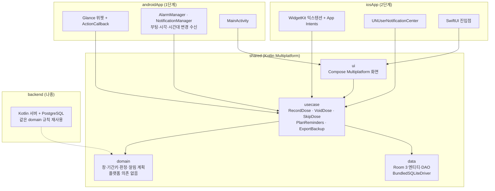

# 아키텍처 (설계 초안)

- 상태: 초안. 기술 스택은 확정함 (2026-11-11)
- 범위: 1단계 Android, 2단계 iOS, 그다음 백엔드. MVP는 서버 없음

## 1. 목표와 제약

| 목표·제약 | 설계에 주는 영향 |
| --- | --- |
| 이중투약 방지가 핵심 | 기록 규칙을 공통 코드 한 곳에 두고 반례 테스트로 고정함 |
| 위젯이 주 입력 수단 | 위젯 쪽 코드는 얇게 두고, 판단은 공통 기록 함수가 함 |
| Android 먼저, iOS 확장 | 도메인·데이터·화면을 공통 모듈로 둠 |
| MVP는 서버 없음, 추후 백엔드 | 지금은 동기화를 만들지 않고 [공통 메타데이터](data-model.md#0-공통-메타데이터)만 맞춤. 백업·이전은 파일로 함 |
| 민감 정보 | 기기 로컬 저장, 백업 범위 명시 |

## 2. 기술 스택 (확정)

선택 기준: 유지보수·확장이 쉬울 것, 추후 백엔드와 동시 처리를 감당할 것, 그렇다고 MVP(기기 로컬 APK)를 무겁게 만들지 않을 것.

### 2.1 지금 (MVP, Android APK)

| 영역 | 선택 | 이유 |
| --- | --- | --- |
| 언어 | Kotlin | Android 표준. 같은 언어로 iOS 공통 코드와 백엔드까지 이어짐 |
| 공통 코드 구조 | Kotlin Multiplatform 모듈 1개(`shared`), 타깃은 Android + JVM | 공통 코드 자리를 처음부터 만들어 둠. JVM 타깃은 빠른 단위 테스트와 나중 백엔드 재사용용 |
| 화면 | Compose Multiplatform (`shared` 안) | Android에서는 Jetpack Compose와 같음. iOS를 붙일 때 화면을 다시 쓰지 않음 |
| 위젯 | Jetpack Glance (`androidApp`) | 위젯은 어느 스택이든 플랫폼 코드임 |
| DB | Room 3 + BundledSQLiteDriver | Room 3는 드라이버 기반이라 Android·iOS·JVM에서 같은 코드. 번들 SQLite로 플랫폼별 버전 차이를 없앰 |
| 시간 | kotlinx-datetime | 공통 코드에서 시간대·날짜 계산 |
| 알림 | AlarmManager + NotificationManager | 앱 자체 알림 (카카오톡은 추후 확장) |
| 의존성 주입 | 수동 주입으로 시작 | 작은 앱에 프레임워크를 먼저 넣지 않음. 필요해지면 Koin(KMP 지원) |

### 2.2 나중 (확장)

| 단계 | 추가하는 것 | 지금 해 두는 대비 |
| --- | --- | --- |
| iOS | `shared`에 iOS 타깃, SwiftUI 진입점, WidgetKit 위젯 | 공통 코드에 플랫폼 API를 쓰지 않음 |
| 백엔드 | Kotlin 서버(Spring Boot 또는 Ktor) + PostgreSQL | `shared`의 창·판정 규칙을 JVM 타깃으로 서버에서도 그대로 씀. 데이터는 [공통 메타데이터](data-model.md#0-공통-메타데이터)로 동기화에 대비함 |
| 동시 처리 | 서버 유니크 제약 + `INSERT ... ON CONFLICT DO NOTHING` + 클라이언트 UUID 멱등 업로드 + `version` 낙관적 잠금 | 같은 유니크 구조 `(intake_id, period_key, active)`가 PostgreSQL에서도 그대로 통함 ([data-model 6장](data-model.md#6-백엔드-이전-대비)) |

### 2.3 지금 하지 않는 것 (과하게 만들지 않기)

- iOS 타깃·빌드 설정 (2단계에서 추가)
- 서버·로그인·동기화 엔진 (백엔드 단계에서 추가)
- 모듈 잘게 쪼개기: `shared` + `androidApp` 두 개로 시작하고, `shared` 안은 패키지(domain · data · usecase · ui)로 나눔
- 의존성 주입 프레임워크

### 2.4 대안 비교

| 안 | 장점 | 단점 |
| --- | --- | --- |
| **Kotlin + KMP (선택)** | 규칙 한 벌을 Android·iOS·서버가 같이 씀. Kotlin 경험을 그대로 씀 | iOS 위젯 익스텐션 안에서 공통 프레임워크 메모리 확인 필요 |
| Flutter | 화면 한 벌, 생태계가 큼 | Dart로 전환. 위젯·알림은 결국 네이티브. 백엔드와 규칙을 공유할 수 없음 |
| Android 네이티브 후 iOS 별도 | 1단계가 가장 단순함 | 규칙을 Swift·서버에서 다시 써야 해 구현이 어긋날 위험이 있음 |

## 3. 모듈 구조

규칙

- 처음엔 `shared` 모듈 하나 안에서 패키지로 나눔 (그림의 상자). 커지면 모듈로 쪼갬
- 서버도 백엔드 단계에서 같은 `domain` 규칙을 JVM으로 씀
- `domain`은 어떤 플랫폼 API도 쓰지 않음. 시계와 시간대는 주입받음. 반례 테스트를 JVM에서 빠르게 돌림
- DB에 쓰는 길은 `usecase` 하나뿐임. 위젯·앱·알림 버튼 모두 같은 `RecordDose`를 부름
- 플랫폼 코드는 "이벤트를 받아 usecase를 부르고, 결과로 위젯·알림을 갱신"만 함

## 4. 플랫폼 분담

| 영역 | 공통 | Android | iOS |
| --- | --- | --- | --- |
| 창·판정 규칙 | O | | |
| DB | 스키마·DAO | 앱 전용 저장소 | App Group 공유 컨테이너 (앱·위젯이 같이 씀) |
| 앱 화면 | O | | |
| 위젯 | 기록 함수·표시 모델 | Glance | WidgetKit |
| 알림 | 예약 계획 계산 | AlarmManager | UNUserNotificationCenter |
| 날짜 경계 갱신 | 다음 경계 시각 계산 | 비정확 알람 + 시스템 방송 | 위젯 타임라인 항목 |
| 백업·이전 | 파일 형식·직렬화 | 공유 시트 | 공유 시트 |

## 5. 동시성과 멱등

- Android: Glance 위젯 동작은 앱 프로세스 안에서 돎. 같은 프로세스 안 동시 탭은 쓰기 트랜잭션으로 줄을 서고, 유니크 제약이 마지막에 막음
- iOS: 위젯 익스텐션은 앱과 별도 프로세스임. 앱 안 잠금으로는 못 막고 SQLite 파일 잠금과 유니크 제약이 막음. 이 경우 유니크 제약이 유일한 보장임
- 쓰기 트랜잭션은 짧게 유지함. iOS에서 공유 컨테이너 DB 잠금을 쥔 채 프로세스가 정지되면 시스템이 강제 종료함

## 6. 시간

- 저장: 실제 복용 시각 `taken_at`(UTC epoch ms) + 그때의 시간대 `zone_id` + 입력 시각 `recorded_at`
- 계산: 기준 시간대(설정)로 창을 계산함
- 날짜 경계: 다음 경계 시각에 위젯을 갱신함
  - Android는 비정확 알람으로 충분함. 04:00 경계라 아침까지 여유가 있음
  - 위젯 자체 주기 갱신(`updatePeriodMillis`)은 최소 30분이고 시각이 정확하지 않아 경계 갱신에 쓰지 않음
  - 부팅·시각 변경·시간대 변경 때 다시 예약함
- 앱에서 쓴 기록은 위젯이 스스로 알지 못함. 모든 쓰기 뒤에 위젯 전체 갱신(`updateAll`)을 부름

## 7. 알림

- 공통 코드가 "언제 울릴지 목록"을 계산하고, 플랫폼은 예약·취소만 함
- 기록·건너뜀 시 해당 창의 남은 알림을 취소함. 무효 처리 시 창이 열려 있으면 다시 계산함
- Android
  - 정확 알람 권한(Android 14부터 기본 거부, 사용자 허용 필요) 또는 배터리 최적화 예외 앱 등록
  - 갤럭시는 "사용하지 않는 앱 절전" 대상이 될 수 있음. 위젯만 쓰고 앱을 잘 열지 않는 사용 방식이라 절전 예외 등록을 안내함 (실기기 확인 항목)
  - Android 13부터 알림 권한 요청
- iOS
  - 정해진 시각에 앱 코드를 실행할 수 없어 미리 예약함
  - 대기 알림 64개 한도가 있음. 가까운 것만 예약하고 앱 실행·기록·알림 동작 때 보충함

## 8. 저장·백업

- Android 자동 백업은 기본으로 켜져 있음. MVP에서 `allowBackup`·`dataExtractionRules`로 범위를 명시함
- 기기 이전용 내보내기 파일은 플랫폼 중립 JSON + 스키마 버전임. 형식은 [data-model 5장](data-model.md#5-내보내기-형식-백업기기-이전)에 있음

## 9. 테스트 전략

| 층 | 방법 | 대상 |
| --- | --- | --- |
| domain | JVM 단위 테스트 (시계·시간대 주입) | [반례별 기대 동작](record-rules.md#9-반례별-기대-동작) 전부 |
| data | 번들 드라이버 DB 테스트 | 유니크·무효 처리·동시 쓰기 |
| usecase | 실제 DB + 가짜 플랫폼 | 쓰기 절차, 기간키 대조, 보관 항목 거절 |
| Android 위젯 | Glance 테스트 + 실기기 확인표 | 탭 → 기록 → 갱신, 경계 갱신, 절전 모드 |
| iOS (2단계) | PoC | 위젯 익스텐션 메모리, App Group 동시 접근, 알림 64개 |

## 10. 2단계(iOS)에서 PoC로 확인할 것

- 위젯 익스텐션 메모리 한도 안에서 공통 모듈 + Room이 동작하는지
- 앱과 위젯이 App Group DB를 같이 쓸 때의 잠금 문제
- 대기 알림 64개 한도 안에서 반복 알림 운용
- 아이폰 실기기 설치에 필요한 개발자 계정 조건

## 11. 빌드·배포 (1단계)

- APK 직접 설치함
- 브랜치: 개발은 기본 브랜치 `develop`에 모으고, 기능이 완성되면 `alpha`로 올려 APK를 시험하며, 출시는 `release`에서 함. `main`은 두지 않음
- 서명 키는 하나로 고정하고 저장소 밖에 백업함. 키를 잃으면 업데이트가 안 되고, 재설치하면 기기 데이터가 사라짐
- 서명 키·비밀번호·`.env`는 커밋하지 않음
