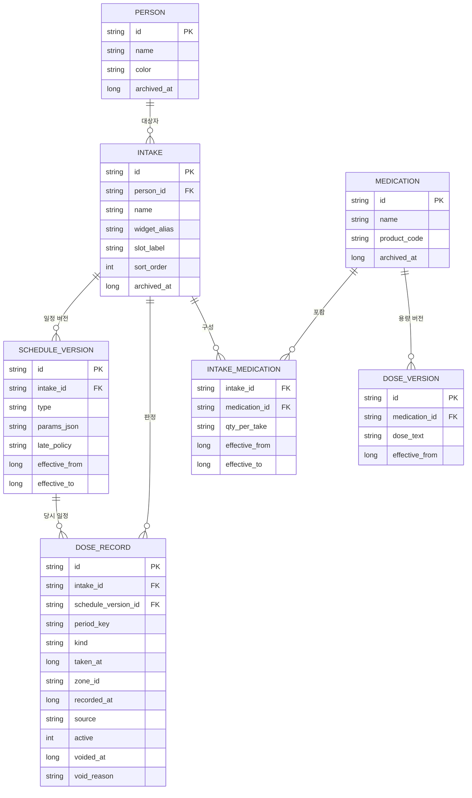
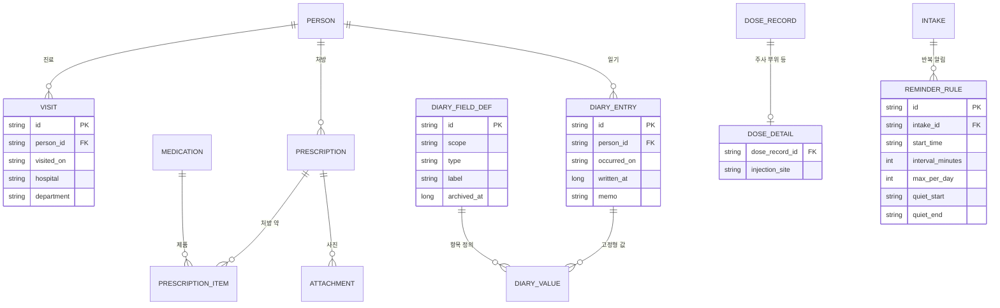

# 데이터 모델 (설계 초안)

[planning-v3 6.11](../01-planning/planning-v3.md#611-지금-설계에-반영할-것)의 (A) MVP 스키마와 (B) 확장 테이블을 정의함. 판정 규칙은 [record-rules](record-rules.md)에 있음.

## 0. 공통 메타데이터

MVP는 기기 로컬에서만 돌지만, 추후 백엔드를 붙일 때 데이터를 그대로 옮길 수 있게 모든 테이블(setting 제외)에 아래 열을 둠.

| 열 | 타입 | 설명 |
| --- | --- | --- |
| id | TEXT | 기기에서 만드는 UUIDv7 (시간순 정렬 가능). 자동 증가 정수를 쓰지 않음. 여러 기기가 오프라인에서 만든 행이 서버에서 겹치지 않음 |
| created_at | INTEGER | 만든 시각 (UTC epoch ms) |
| updated_at | INTEGER | 마지막 수정 시각 (UTC epoch ms) |
| version | INTEGER | 수정할 때마다 1 증가. 나중에 서버 낙관적 잠금에 씀 |
| device_id | TEXT | 이 행을 만든 기기. 설치할 때 한 번 만듦 |
| archived_at | INTEGER NULL | 보관(소프트 삭제). 동기화 때 삭제 표시로 씀 |

규칙

- 상태·종류 값은 순번 정수가 아니라 고정 문자열 코드(`TAKEN`, `WEEKLY` 등)로 저장함. 값이 늘어도 기존 데이터의 뜻이 바뀌지 않음
- 시각은 UTC epoch ms로 저장하고, 지역 날짜가 뜻을 갖는 곳(복용 시각)은 `zone_id`를 함께 둠
- Room 스키마를 내보내(`exportSchema`) 스키마 버전마다 마이그레이션 테스트를 둠
- 지금 넣지 않는 것: 계정·가구 ID, 서버 동기화 순번(`synced_at` 등). 백엔드 단계에서 NULL 허용 열로 추가하면 기존 데이터에 영향이 없음

## 1. ERD (MVP)

`SETTING`(키-값)은 관계가 없어 그림에서 뺌. 공통 메타데이터 열도 그림에서 생략함.

## 2. 테이블 정의 (MVP)

시각은 모두 UTC epoch ms(`long`)임. 표시와 창 계산은 기준 시간대로 변환함. 아래 표에서는 [공통 메타데이터](#0-공통-메타데이터) 열(created_at · updated_at · version · device_id)을 생략함.

### person

| 열 | 타입 | 제약 | 설명 |
| --- | --- | --- | --- |
| id | TEXT | PK | UUIDv7 |
| name | TEXT | NOT NULL | 예: 나, 엄마 |
| color | TEXT | NOT NULL | 위젯 표시 색 |
| archived_at | INTEGER | NULL | 보관 시각 |

### intake (복용 항목)

| 열 | 타입 | 제약 | 설명 |
| --- | --- | --- | --- |
| id | TEXT | PK | UUIDv7 |
| person_id | TEXT | FK → person, NOT NULL | 대상자 |
| name | TEXT | NOT NULL | 예: 아침약, 주사제 A |
| widget_alias | TEXT | NULL | 위젯·알림 표시 이름. 없으면 name |
| slot_label | TEXT | NULL | MORNING / NOON / EVENING / BEDTIME (표시·정렬용) |
| sort_order | INTEGER | NOT NULL | 위젯 순서 |
| archived_at | INTEGER | NULL | 보관 시각. 보관되면 위젯·알림에서 빠짐 |

### schedule_version (일정 버전)

| 열 | 타입 | 제약 | 설명 |
| --- | --- | --- | --- |
| id | TEXT | PK | UUIDv7 |
| intake_id | TEXT | FK → intake, NOT NULL | |
| type | TEXT | NOT NULL | DAILY / WEEKLY (확장: EVERY_N_DAYS, DAILY_SLOTS, WEEKLY_SLOTS, PRN) |
| params_json | TEXT | NOT NULL | 예: `{"anchorWeekday":"MON"}` |
| late_policy | TEXT | NOT NULL | ASK / MOVE / KEEP (주 1회 늦은 투약 처리) |
| effective_from | INTEGER | NOT NULL | 적용 시작 |
| effective_to | INTEGER | NULL | 적용 끝. NULL이면 현재 버전 |

- 주기·기준 요일이 바뀌면 현재 버전의 `effective_to`를 채우고 새 행을 추가함. 일정은 덮어쓰지 않음
- 이름·위젯 별칭·시간대 표시 같은 표시 필드는 `intake` 행을 고치고 `version`을 올림 (일정 버전을 만들지 않음)
- 중단 구간(확장)은 `params_json`의 중단 기간 또는 별도 버전으로 표현함

`params_json` 예시

| type | 예 |
| --- | --- |
| DAILY | `{}` |
| WEEKLY | `{"anchorWeekday":"MON"}` |
| EVERY_N_DAYS | `{"n":14,"anchorDate":"2026-11-02"}` |
| DAILY_SLOTS | `{"slots":[{"id":"morning","start":"04:00"},{"id":"evening","start":"14:00"}]}` |
| PRN | `{"minIntervalMinutes":240,"maxPerDay":3}` |

### dose_record (판정)

| 열 | 타입 | 제약 | 설명 |
| --- | --- | --- | --- |
| id | TEXT | PK | UUIDv7 (자동 증가 정수 대신) |
| intake_id | TEXT | FK → intake, NOT NULL | |
| schedule_version_id | TEXT | FK → schedule_version, NOT NULL | 기록 당시 일정 |
| period_key | TEXT | NOT NULL | 창 시작 날짜 (`2026-11-11`, `2026-11-11#evening`) |
| kind | TEXT | NOT NULL | TAKEN / SKIPPED |
| taken_at | INTEGER | NOT NULL | 실제 복용 시각 |
| zone_id | TEXT | NOT NULL | 그때의 기기 시간대 |
| recorded_at | INTEGER | NOT NULL | 입력 시각 |
| source | TEXT | NOT NULL | WIDGET / APP / NOTIFICATION |
| active | INTEGER | NULL | 활성 1, 무효 NULL |
| voided_at | INTEGER | NULL | 무효 처리 시각 |
| void_reason | TEXT | NULL | 사유 |

인덱스

| 이름 | 열 | 종류 | 용도 |
| --- | --- | --- | --- |
| ux_dose_active | (intake_id, period_key, active) | UNIQUE | 창마다 활성 판정 1개 보장 |
| ix_dose_taken | (intake_id, taken_at) | 일반 | 창 안 판정 조회 |

- `active`는 1 또는 NULL만 씀. Room은 CHECK 제약을 만들지 않으므로 쓰기 함수에서 보장함
- 행을 지우지 않음. 취소는 `active = NULL`로 무효 처리함

### medication (약), intake_medication (구성), dose_version (용량 버전)

| 테이블 | 핵심 열 | 설명 |
| --- | --- | --- |
| medication | id, name, product_code, archived_at | 실제 제품. `product_code`는 확장 단계의 공공 데이터 연결용 |
| intake_medication | intake_id, medication_id, qty_per_take, effective_from, effective_to | 복용 항목 1개에 약 여러 개. 구성이 바뀌면 기간으로 나눔 |
| dose_version | id, medication_id, dose_text, effective_from | 용량 버전. 복용 시각에 맞는 버전을 조회해서 보여줌 |

MVP 화면에서는 복용 항목만 다루고 약·구성·용량 버전은 비워 둠. 스키마는 처음부터 둠.

### setting

| 키 | 기본값 | 설명 |
| --- | --- | --- |
| day_start | `04:00` | 하루 시작 시각 |
| base_zone | `Asia/Seoul` | 기준 시간대 |
| backup_policy | `NONE` | 자동 백업 허용 범위 |
| show_names_on_lock | `false` | 잠금 화면·알림에 약 이름 표시 |

## 3. 삭제·보관 정책

- 대상자·복용 항목·약은 `archived_at`으로 보관 처리함. 기록은 그대로 남음
- 외래 키에 연쇄 삭제(CASCADE)를 걸지 않음. 하드 삭제 후 남은 위젯 버튼을 누르면 FK 위반이 `INSERT OR IGNORE`로도 무시되지 않고 예외가 남 (실증 T4)
- 완전 삭제는 앱에서 별도 확인을 거쳐 항목과 그 기록을 함께 지움

## 4. 확장 테이블 (B)

나중에 테이블을 추가하면 되는 것임. 지금 MVP 스키마에는 넣지 않음.

| 테이블 | 메모 |
| --- | --- |
| visit | "지난 진료일 ~ 오늘" 요약 기준점 |
| prescription, prescription_item, attachment | 처방일·병원·진료과·일수, 처방 약, 사진. 사진은 기기 안에만 둠 |
| diary_entry | `occurred_on`(무슨 날의 일)과 `written_at`(쓴 시각)을 분리함 |
| diary_field_def, diary_value | 고정형 항목 정의는 보관 처리만 함. 옛 일기가 계속 보여야 함 |
| dose_detail | 주사 부위처럼 회차마다 1개인 값. 부위 순환을 기록 기준으로 계산함 |
| reminder_rule | 반복 알림 시작 시각·간격·하루 최대·방해 금지 |

## 5. 내보내기 형식 (백업·기기 이전)

- 플랫폼 중립 JSON 1개 파일: `{"schemaVersion": n, "exportedAt": ..., "tables": {...}}`
- 무효 행까지 전부 포함함 (이력 보존)
- 암호화 방식은 확장 단계에서 정함. 정하기 전까지 내보내기 기능을 열지 않음
- Android 자동 백업 범위는 `allowBackup`·`dataExtractionRules`로 명시함

## 6. 백엔드 이전 대비

지금 만들지 않음. 나중에 무리 없이 옮기기 위한 방향임.

| 항목 | 클라이언트 (지금) | 서버 (나중) |
| --- | --- | --- |
| DB | SQLite (Room 3) | PostgreSQL |
| ID | TEXT UUIDv7 | `uuid` |
| 시각 | INTEGER UTC ms | `timestamptz` (또는 `bigint` 유지) |
| 일정 파라미터 | `params_json` TEXT | `jsonb` |
| 활성 판정 1개 보장 | `UNIQUE(intake_id, period_key, active)` | 같은 제약 그대로 (PostgreSQL도 유니크 비교에서 NULL을 서로 다르게 봄) 또는 부분 유니크 인덱스 `WHERE active = 1` |
| 중복 쓰기 | `INSERT OR IGNORE` | `INSERT ... ON CONFLICT DO NOTHING` |

동기화 방향 (백엔드 단계)

- 업로드는 클라이언트가 만든 `id`로 멱등하게 처리함. 재시도해도 두 번 들어가지 않음
- 두 기기가 같은 창을 오프라인에서 각각 기록했다면 서버 유니크 제약이 두 번째 활성 판정을 거절함. 늦게 온 쪽은 `void_reason = SYNC_CONFLICT`로 무효 처리하고 "다른 기기에서 08:02에 이미 기록됨"을 알림. MVP에서 막을 수 없던 기기 간 이중투약을 이때부터 감지함
- 일정·항목 수정은 `version`으로 낙관적 잠금을 걸어 동시 수정을 감지함
