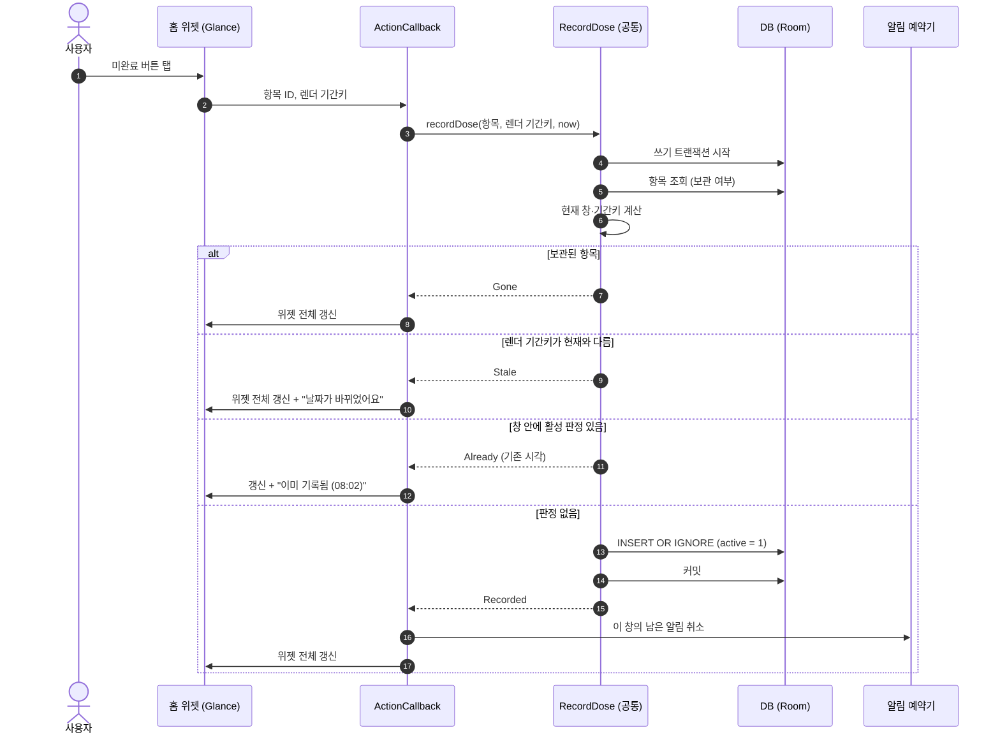
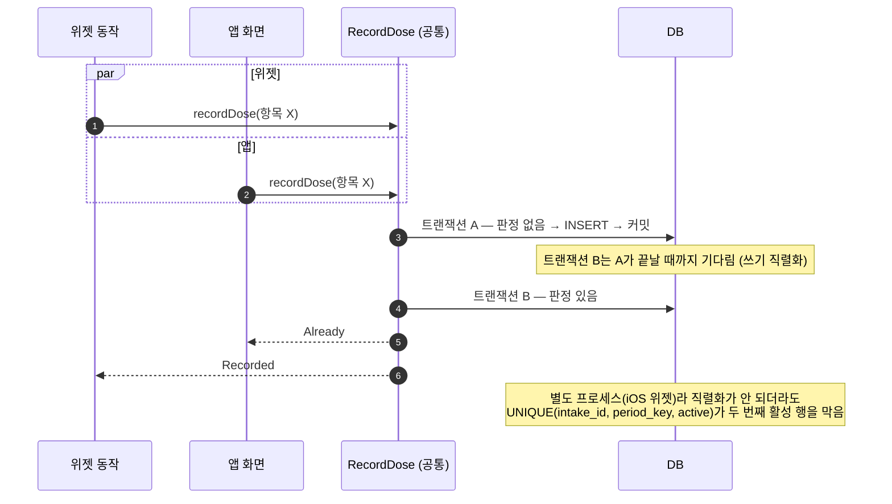
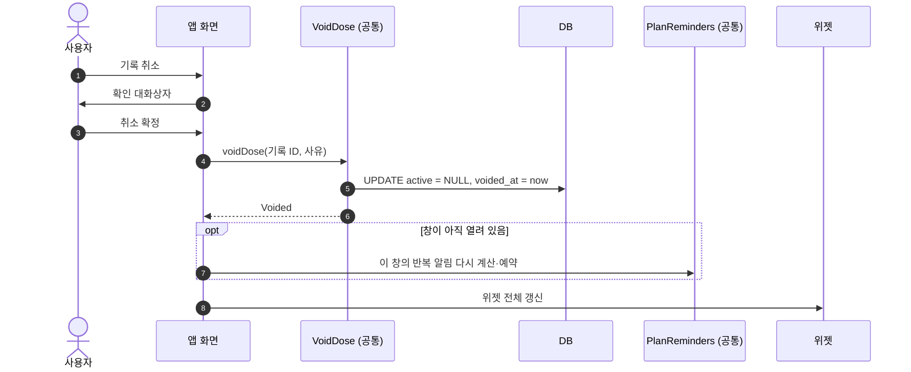
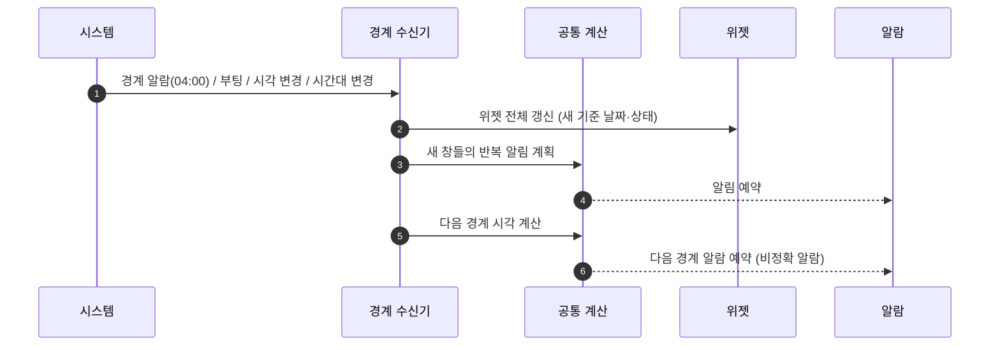
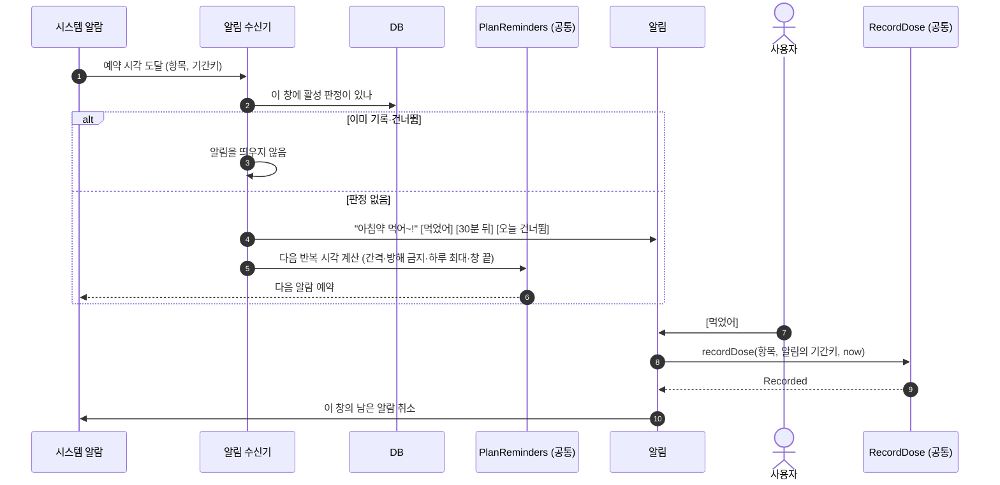
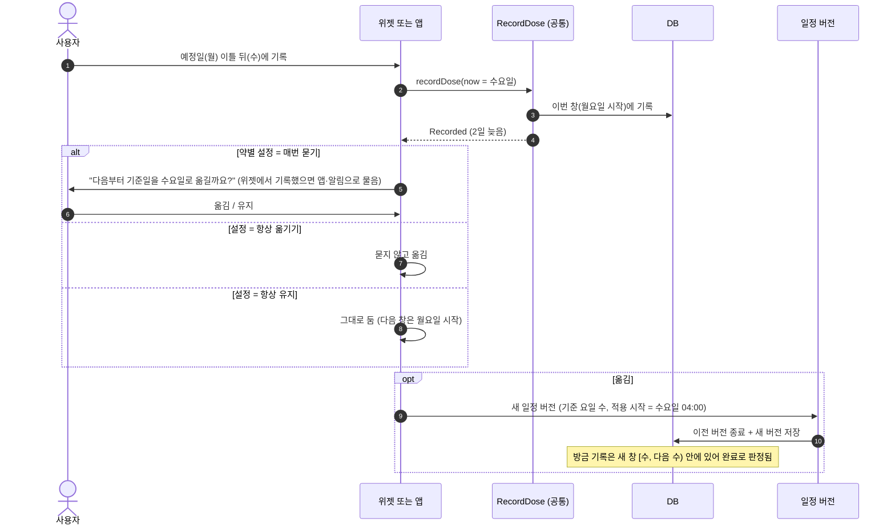
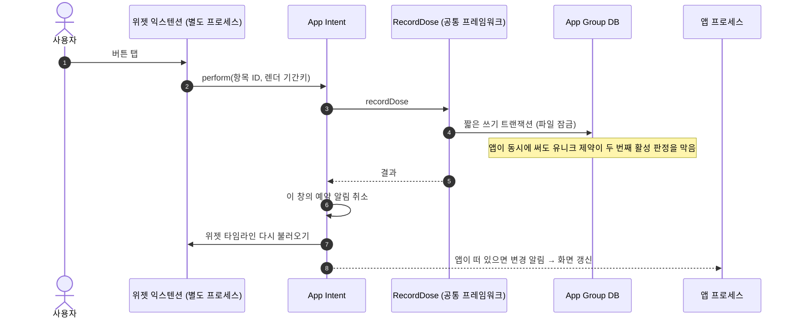

# 시퀀스 다이어그램 (설계 초안)

주요 동작의 호출 순서임. 판정 규칙은 [record-rules](../02-design/record-rules.md), 모듈 이름은 [architecture](../02-design/architecture.md#3-모듈-구조)를 따름.

| # | 시퀀스 | 단계 |
| --- | --- | --- |
| 1 | 위젯 탭으로 기록 (Android) | MVP |
| 2 | 위젯·앱 거의 동시 기록 | MVP |
| 3 | 앱에서 기록 취소 | MVP |
| 4 | 날짜 경계 갱신 | MVP |
| 5 | 반복 알림 | MVP 다음 |
| 6 | 주 1회 늦은 투약과 기준일 이동 | 확장 |
| 7 | iOS 위젯 탭으로 기록 | 2단계 |

## 1. 위젯 탭으로 기록 (Android)

- 위젯 동작은 비동기 방송 수신기 안에서 돎. 오래 걸리는 일은 넣지 않음
- 앱 프로세스가 내려가 있으면 처음 실행 비용 때문에 반영이 늦어질 수 있음. 그 사이 연타는 2번 시퀀스처럼 막힘

## 2. 위젯·앱 거의 동시 기록

## 3. 앱에서 기록 취소 (무효 처리)

## 4. 날짜 경계 갱신

- 경계 알람이 늦게 와도 위젯 머리글 날짜와 렌더 기간키 대조가 잘못된 기록을 막음

## 5. 반복 알림

- iOS는 예약 시각에 앱 코드를 실행할 수 없음. 기록될 때 남은 예약을 취소하는 방식으로 같은 결과를 냄
- 알림의 기간키가 현재와 다르면(날짜가 바뀐 뒤 누름) 기록하지 않고 안내함

## 6. 주 1회 늦은 투약과 기준일 이동

## 7. iOS 위젯 탭으로 기록 (2단계)

- 트랜잭션을 짧게 유지함. 공유 컨테이너 DB 잠금을 쥔 채 정지되면 시스템이 프로세스를 강제 종료함
