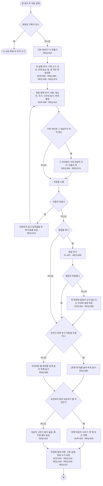

# FL-001 처음 깔고 위젯까지 놓기

- 누가: 챙기는 사람(TERM-001)이 앱을 처음 깔았을 때
- 목표: 첫 복용 항목을 만들고 홈 화면에 위젯을 놓음
- 쓰는 요구: REQ-016, REQ-080, REQ-036, REQ-074, REQ-012, REQ-013, REQ-085, REQ-049, REQ-089, REQ-025, REQ-018, REQ-019, REQ-020, REQ-026, REQ-027
- 화면: SCR-005 → SCR-006 → SCR-002 → SCR-001
- 이어지는 흐름: 복원된 기록이 있으면 [FL-009](FL-009-restore.md), 알림 설정은 [FL-007](FL-007-reminder-setup.md)

## 실패 경로

- 이름이 비었으면 저장하지 않음 (REQ-013)
- 알림 권한을 거부하면 첫 화면에 안내가 남음 (REQ-089)
- 런처가 위젯 추가 버튼을 지원하지 않으면 손으로 놓는 법을 보임 (REQ-080)
