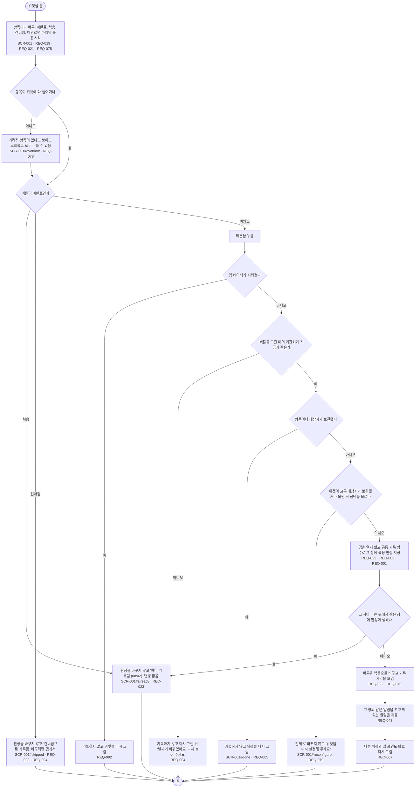

# FL-002 위젯에서 먹었다고 누르기

- 누가: 챙기는 사람이 약을 먹은 뒤(또는 먹이기 전에 확인하려고) 홈 화면 위젯을 볼 때
- 목표: 먹었는지 한눈에 보고, 안 먹었으면 한 번 눌러 기록함. 이미 먹었으면 다시 먹지 않음
- 쓰는 요구: REQ-019, REQ-021, REQ-075, REQ-078, REQ-022, REQ-023, REQ-024, REQ-092, REQ-004, REQ-005, REQ-079, REQ-001, REQ-003, REQ-043, REQ-007, REQ-070
- 화면: SCR-001 (SCR-001#gone, #already, #skipped, #overflow, #reconfigure)

## 실패 경로

- 위젯에서는 취소·건너뜀을 할 수 없음. 바꾸려면 앱으로 감 (REQ-024, [FL-004](FL-004-fix-today.md))
- 날짜가 바뀐 뒤 누른 버튼, 보관된 항목, 앱 데이터가 지워진 뒤의 버튼은 기록하지 않음 (REQ-004·005·092)
- 두 곳에서 거의 같이 눌러도 한 창에 판정은 하나뿐임 (REQ-001)
