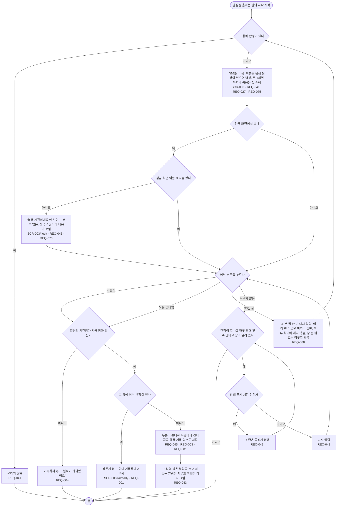

# FL-003 알림을 받고 답하기

- 누가: 알림을 켠 복용 항목이 있는 챙기는 사람
- 목표: 아직 판정이 없는 창을 알림으로 알고, 알림에서 바로 먹었어·건너뜀·나중에를 고름
- 쓰는 요구: REQ-041, REQ-042, REQ-088, REQ-045, REQ-004, REQ-043, REQ-046, REQ-076, REQ-075, REQ-027, REQ-001, REQ-003, REQ-081
- 화면: SCR-003 (SCR-003#already, #lock)

## 실패 경로

- 날짜가 바뀐 뒤 누른 알림 버튼은 기록하지 않음 (REQ-004)
- 이미 판정이 있으면 바꾸지 않음 (REQ-001)
- 잠금 화면에서는 이름 표시를 켠 때만 이름과 버튼이 보임 (REQ-046·076)
- 다른 앱이 알림 버튼 수신기로 판정을 만들 수 없음 (REQ-081, 코드 검사)
- 알림이 몇 분 안에 온다고 약속하지 않음 (REQ-048)
- 알림이 꺼져 있거나 정확 알람이 허용되지 않은 경우는 [FL-007](FL-007-reminder-setup.md)

