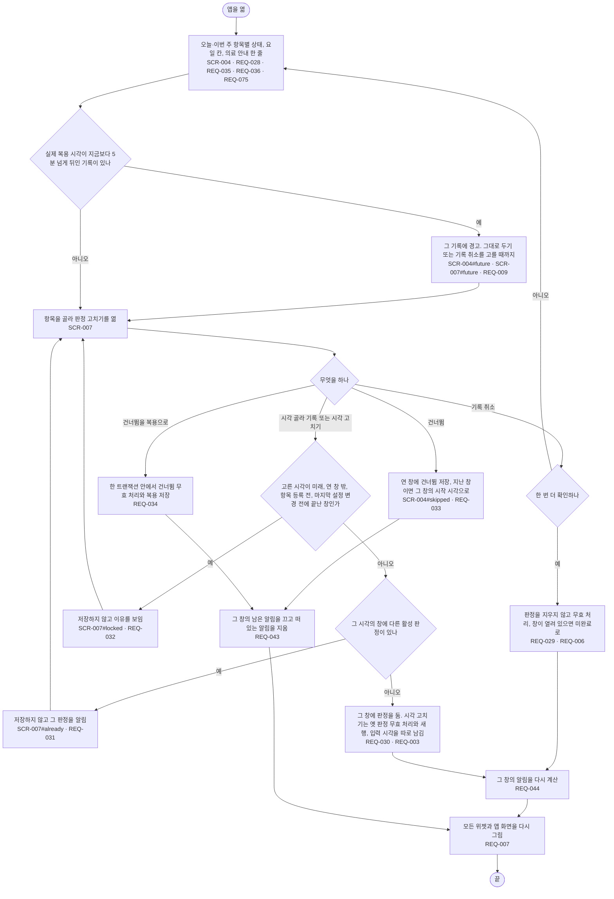

# FL-004 앱에서 오늘 기록 보고 고치기

- 누가: 잘못 눌렀거나, 먹은 시각을 나중에 적거나, 건너뛴 것을 바꾸려는 챙기는 사람
- 목표: 오늘·이번 주 상태를 보고 판정을 바르게 고침
- 쓰는 요구: REQ-028, REQ-035, REQ-036, REQ-075, REQ-029, REQ-006, REQ-044, REQ-030, REQ-031, REQ-032, REQ-033, REQ-034, REQ-009, REQ-003, REQ-007, REQ-043
- 화면: SCR-004 → SCR-007 (SCR-004#skipped, #future, SCR-007#already, #locked, #future)

## 실패 경로

- 미래 시각, 연 창 밖, 항목 등록 전, 하루 시작·기준 시간대를 바꾸기 전에 끝난 창은 저장하지 않음 (REQ-032)
- 같은 창에 다른 판정이 있으면 저장하지 않음 (REQ-031)
- 시계가 앞서 있다가 돌아와 미래 기록이 생기면 경고함 (REQ-009)
- 취소는 확인을 한 번 더 받음 (REQ-029)
