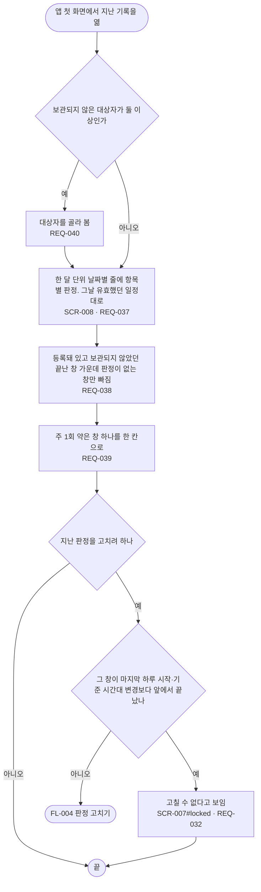

# FL-005 지난 기록 보기

- 누가: 지난주·지난달에 빠뜨린 날이 있었는지 보려는 챙기는 사람 (병원 가기 전 등)
- 목표: 날짜별로 복용·건너뜀·빠짐을 보고, 필요하면 지난 판정을 고침
- 쓰는 요구: REQ-037, REQ-038, REQ-039, REQ-040, REQ-032
- 화면: SCR-004 → SCR-008 → SCR-007 (SCR-008#future, SCR-007#locked)

## 실패 경로

- 하루 시작 시각이나 기준 시간대를 바꾸기 전에 끝난 창은 고칠 수 없음 (REQ-032)
- 등록 전 날짜와 보관한 뒤 날짜는 빠짐으로 세지 않음 (REQ-038)
