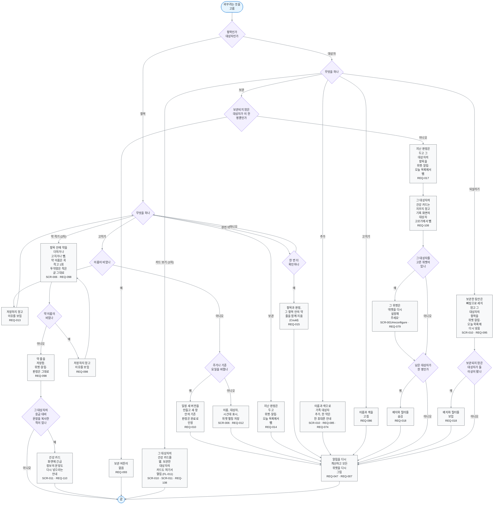

# FL-006 복용 항목과 대상자 바꾸기

- 누가: 약이 바뀌었거나 끊었거나, 가족을 더하거나 빼려는 챙기는 사람
- 목표: 지난 기록은 그대로 둔 채 앞으로 챙길 항목과 대상자를 바꿈
- 쓰는 요구: REQ-013, REQ-010, REQ-012, REQ-014, REQ-015, REQ-098, REQ-110, REQ-085, REQ-074, REQ-086, REQ-093, REQ-017, REQ-108, REQ-079, REQ-018, REQ-095, REQ-047, REQ-007
- 화면: SCR-009 → SCR-010, SCR-004 → SCR-006 (SCR-006#gone), SCR-010 → SCR-011 (2차)

| 모양 | 뜻 |
| --- | --- |
| 둥근 끝(파란 테) | 흐름의 시작과 끝 |
| 네모(회색 테) | 한 동작. 아래 줄의 `SCR-…`는 화면, `REQ-…`는 맡는 요구 |
| 마름모(보라 테) | 분기점. 분기마다 글이 붙음 |

## 실패 경로

- 마지막 남은 대상자는 보관할 수 없음 (REQ-093)
- 보관한 대상자를 고른 위젯은 '전체'로 바뀌지 않고 다시 설정하라고 함 (REQ-079)
- 보관한 항목의 위젯 버튼을 누르면 기록하지 않음 ([FL-002](FL-002-widget-tap.md), REQ-005)
- 이름이 비면 저장하지 않음 (REQ-013)
- 2차: 약 이름이 비면 약 줄을 저장하지 않음 (REQ-098)
- 2차: 대상자를 보관해도 건강 카드는 남고, 기록 화면의 대상자 고르기에서만 빠짐 (REQ-108)

## 범위 메모

- 대상자 완전 삭제는 1차에 없음. 02 범위 확인(2026-11-12 16:32 KST)에서 2차로 정함
- 대상자 되살리기(REQ-095)는 04 명세 고정(2026-11-13 00:16 KST, 동희님 "추천 모두 승인")에서 1차에 넣어 '되살리기' 갈래를 더함([03 확인 기록](README.md#확인-기록)). 따로 보관한 항목은 되살리지 않음(항목 보관에는 되살리기가 없음)
- 2차 첫 릴리즈(2026-11-23 03): '약 적기' 분기(REQ-098, 01 확인 3 답 01-1·2차 질문 1), 완전 삭제 때 약 줄도 지움(REQ-015, 02 범위 확인 02-4), 대상자 보관 때 카드가 남는 칸(REQ-108), '카드 보기' 분기(REQ-108)를 더함. 약을 바꾸면 응급 대비 문장 안내(REQ-110). 나머지 칸과 분기는 그대로
- 응급 대비 문장 안내(REQ-110)는 그림의 '약 적기' 분기에만 그렸지만, 그 대상자 항목의 추가·이름·주기·시간대 바꾸기·보관·완전 삭제와 대상자 이름 바꾸기도 카드 고친 시각을 써서 같은 안내가 뜸(04 명세 SPEC-049·SPEC-055, 시험 TC-100). 그림은 그대로 둠(2026-11-23 PR #57 리뷰에서 적음)
- 같은 날 그림을 [corthex-diagram 문법](README.md#읽는-법)으로 옮김: 칸 종류마다 색, 줄마다 ID, 한국어 줄 바꿈. 칸 글과 분기는 바꾸지 않음
