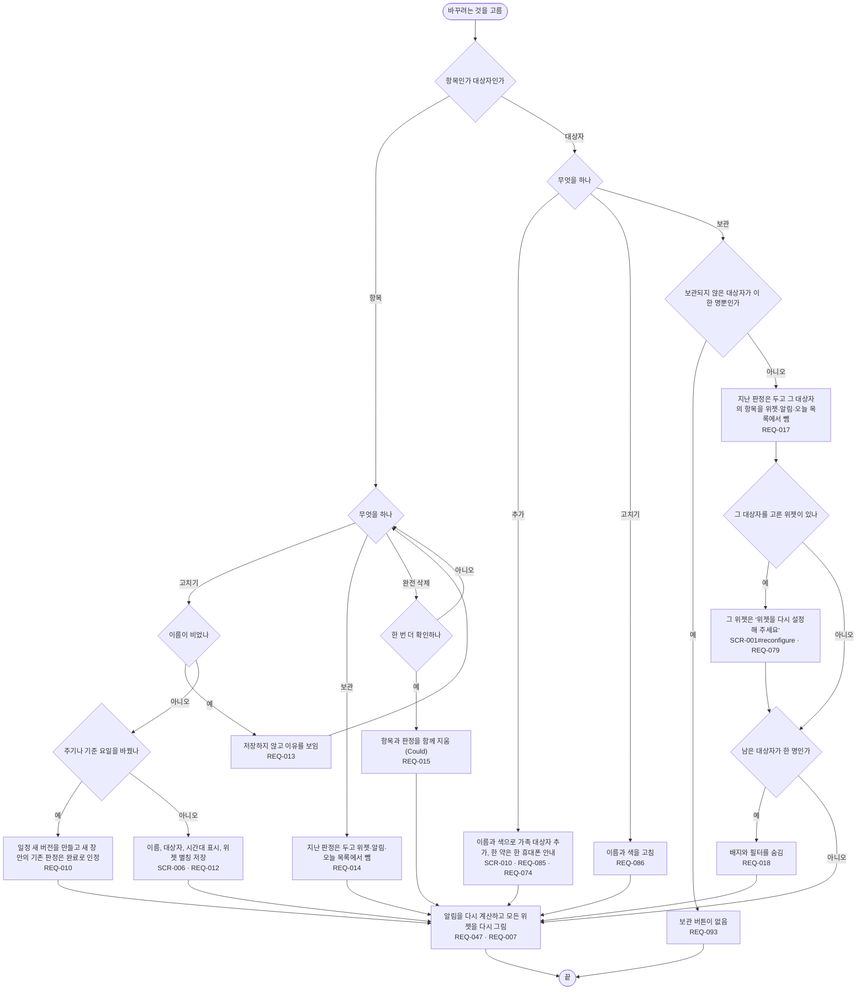

# FL-006 복용 항목과 대상자 바꾸기

- 누가: 약이 바뀌었거나 끊었거나, 가족을 더하거나 빼려는 챙기는 사람
- 목표: 지난 기록은 그대로 둔 채 앞으로 챙길 항목과 대상자를 바꿈
- 쓰는 요구: REQ-012, REQ-013, REQ-010, REQ-014, REQ-015, REQ-085, REQ-086, REQ-017, REQ-093, REQ-018, REQ-074, REQ-079, REQ-047, REQ-007
- 화면: SCR-009 → SCR-010, SCR-004 → SCR-006 (SCR-006#gone)

## 실패 경로

- 마지막 남은 대상자는 보관할 수 없음 (REQ-093)
- 보관한 대상자를 고른 위젯은 '전체'로 바뀌지 않고 다시 설정하라고 함 (REQ-079)
- 보관한 항목의 위젯 버튼을 누르면 기록하지 않음 ([FL-002](FL-002-widget-tap.md), REQ-005)
- 이름이 비면 저장하지 않음 (REQ-013)

## 범위 메모

- 대상자 완전 삭제는 1차에 없음. 02 범위 확인에서 2차로 여쭘 (requirements.md 5.1절)
