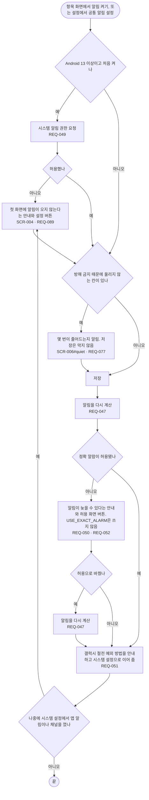

# FL-007 알림을 켜고 놓치지 않게 하기

- 누가: 복용 항목에 알림을 켜려는 챙기는 사람
- 목표: 알림이 실제로 오게 권한과 설정을 맞춤
- 쓰는 요구: REQ-049, REQ-089, REQ-050, REQ-051, REQ-077, REQ-047, REQ-052
- 화면: SCR-006 → SCR-004, SCR-009 (SCR-006#quiet)

## 실패 경로

- 알림 권한 거부, 시스템 설정에서 알림이나 채널을 끔 → 첫 화면 안내가 남음 (REQ-089)
- 정확 알람이 허용되지 않음 → 늦을 수 있다는 안내 (REQ-050). 허용을 끌 때 시스템이 앱에 무엇을 보내는지는 확인 전(TASK-027)
- 방해 금지와 겹침 → 줄어드는 횟수를 알림 (REQ-077)
