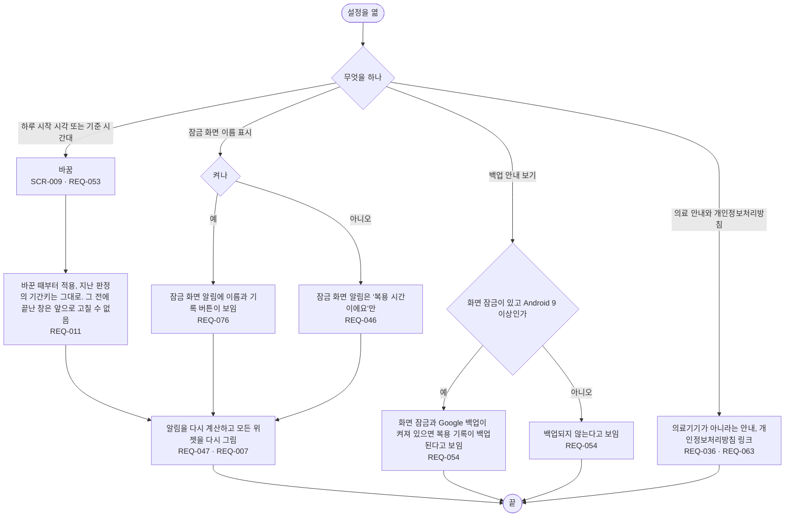

# FL-008 설정 바꾸기

- 누가: 밤늦게 자는 사람(하루 시작 시각), 해외에 나간 사람(기준 시간대), 잠금 화면에 약 이름이 보여도 되는 사람
- 목표: 하루를 나누는 기준과 잠금 화면 표시를 바꾸고, 백업·의료 안내를 확인함
- 쓰는 요구: REQ-053, REQ-011, REQ-047, REQ-007, REQ-046, REQ-076, REQ-054, REQ-036, REQ-063
- 화면: SCR-009

## 실패 경로

- 하루 시작 시각이나 기준 시간대를 바꾸면 그 전에 끝난 창은 고칠 수 없게 됨 (REQ-011, REQ-032, [FL-005](FL-005-history.md))
- 화면 잠금이 없거나 Android 8.x면 백업되지 않음 (REQ-054·055)
