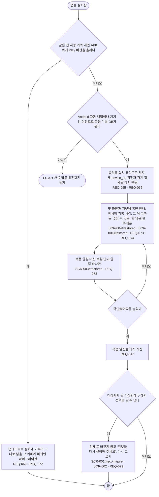

# FL-009 새 폰이나 다시 설치한 뒤 이어 쓰기

- 누가: 휴대폰을 바꿨거나 앱을 지웠다 다시 깐 챙기는 사람, 개인 APK에서 Play 테스트 버전으로 옮기는 사람
- 목표: 전에 쓰던 복용 기록을 잃지 않고, 복원된 기록이 언제까지인지 알고 이어 씀
- 쓰는 요구: REQ-055, REQ-056, REQ-073, REQ-074, REQ-079, REQ-047, REQ-062, REQ-072
- 화면: SCR-004#restored, SCR-001#restored, SCR-003#restored, SCR-002

## 실패 경로

- 화면 잠금이 없는 폰과 Android 8.x 폰은 클라우드 백업을 하지 않아 기록이 오지 않음 → FL-001로 새로 시작 (REQ-055)
- 복원 뒤 기록이 비어 있는 기간이 있을 수 있음을 알리고, 확인 전에는 복용 알림을 울리지 않음 (REQ-073)
- 위젯의 대상자 선택을 모르면 '전체'로 바꾸지 않음 (REQ-079)
