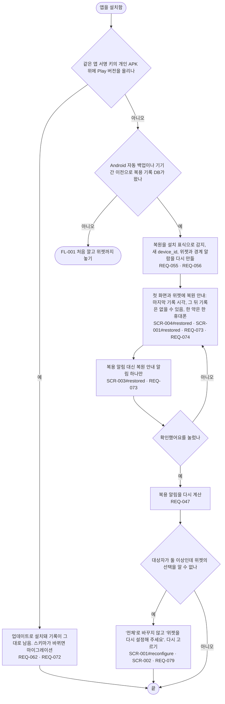

# FL-009 새 폰이나 다시 설치한 뒤 이어 쓰기

- 누가: 휴대폰을 바꿨거나 앱을 지웠다 다시 깐 챙기는 사람, 개인 APK에서 Play 테스트 버전으로 옮기는 사람
- 목표: 전에 쓰던 복용 기록을 잃지 않고, 복원된 기록이 언제까지인지 알고 이어 씀
- 쓰는 요구: REQ-055, REQ-056, REQ-073, REQ-074, REQ-079, REQ-047, REQ-062, REQ-072
- 화면: SCR-004#restored, SCR-001#restored, SCR-003#restored, SCR-002

## 실패 경로

- 화면 잠금이 없는 폰과 Android 8.x 폰은 클라우드 백업을 하지 않아 기록이 오지 않음 → FL-001로 새로 시작 (REQ-055)
- 복원 뒤 기록이 비어 있는 기간이 있을 수 있음을 알리고, 확인 전에는 복용 알림을 울리지 않음 (REQ-073)
- 위젯의 대상자 선택을 모르면 '전체'로 바꾸지 않음 (REQ-079)

## 2차 첫 릴리즈

- 건강 카드와 약 줄은 복용 기록과 같은 DB에 있어 이 흐름으로 함께 돌아옴(REQ-055, 2차 질문 2 답, 02 범위 확인 02-3). 그림은 그대로 둠(2026-11-23 03)
- 복원 안내 문구(REQ-073)도 그대로임. 복원된 카드가 언제 것인지는 카드의 마지막으로 고친 날짜로 앎(REQ-103, 02 범위 확인 02-12)
- 복원을 감지하면 같은 거래에서 응급 대비 문장을 복사한 적이 있는 모든 카드의 닫은 상태를 비우고 설정 `restored_at`을 씀. 그래서 새 폰의 카드 화면에 다시 넣으라는 안내가 보임. 시계 차이에 흔들리지 않게 시각을 견주지 않고 상태로 정함(04 명세 SPEC-055, 05 ERD 8.4 4, 설계 바꿈 R 05)
- 시험: 스키마 2로 만든 백업을 2차 앱에 복원해 여는 시험을 TC-102에, 1→3 이주 jvm 시험을 TC-111에 더함. 기기 간 이전은 시험 계획 0장의 실기기 확인 목록에 그대로 둠(설계 바꿈 R 14). 그림은 그대로
