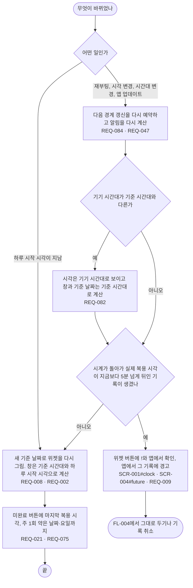

# FL-010 날이 바뀌거나 폰 상태가 바뀐 뒤 위젯 보기

- 누가: 아침에 위젯을 보는 챙기는 사람. 그 사이 하루 시작 시각이 지났거나, 폰을 다시 켰거나, 시계·시간대가 바뀌었거나, 앱이 업데이트됨
- 목표: 앱을 열지 않아도 위젯이 오늘 기준으로 맞게 보임
- 쓰는 요구: REQ-002, REQ-008, REQ-084, REQ-047, REQ-082, REQ-009, REQ-021, REQ-075
- 화면: SCR-001 (SCR-001#clock), SCR-004 (SCR-004#future)

## 실패 경로

- 재부팅·시각 변경 뒤 경계 갱신이 빠지면 위젯이 전날에 머묾 → 다시 예약 (REQ-084)
- 시계를 뒤로 돌려 미래 기록이 생기면 경고 (REQ-009)
