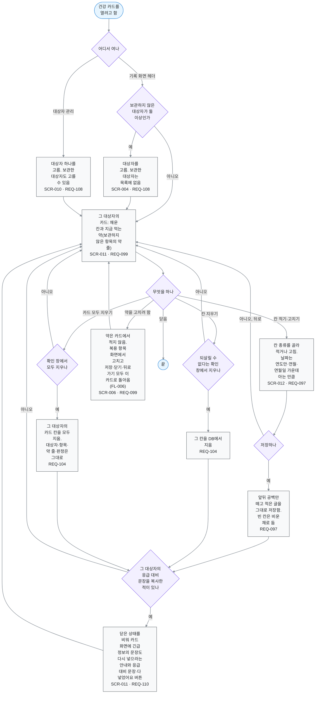

# FL-011 건강 카드 적기와 지우기

- 누가: 병원에 가기 전에 대상자의 병력과 먹는 약을 정리해 두려는 챙기는 사람
- 목표: 대상자의 건강 카드에 칸을 채우거나 고치고, 필요 없는 칸이나 카드를 지움. 지난 복용 기록과 복용 계획은 그대로
- 쓰는 요구: REQ-108, REQ-099, REQ-097, REQ-110, REQ-104
- 화면: SCR-004 → SCR-011 → SCR-012, SCR-010 → SCR-011, SCR-011 → SCR-006

| 모양 | 뜻 |
| --- | --- |
| 둥근 끝(파란 테) | 흐름의 시작과 끝 |
| 네모(회색 테) | 한 동작. 아래 줄의 `SCR-…`는 화면, `REQ-…`는 맡는 요구 |
| 마름모(보라 테) | 분기점. 분기마다 글이 붙음 |

## 실패 경로

- 보관한 대상자는 기록 화면의 대상자 고르기에 없고, 대상자 관리에서만 카드가 열림 (REQ-108)
- 지운 칸과 지운 카드는 되살리지 않음. 확인 창에서 취소하면 아무것도 지우지 않음 (REQ-104)
- 카드에서 '지금 먹는 약'을 바로 고칠 수 없음. 약은 복용 항목 안에 있음 (REQ-099, FL-006)
- 저장에 실패하면 적은 글을 그대로 두고 다시 하게 함: 08 화면 상태에서 정함
- 카드에서 연 복용 항목 화면은 저장·닫기·뒤로 가기·없어진 항목·방해 금지 안내 확인 뒤 모두 그 대상자의 카드로 돌아옴 (SCR-006, 설계 바꿈 R 17)
- 입력은 앞뒤 공백만 떼고 글자 수는 코드 포인트로 셈. 한도를 넘게 붙여 넣으면 한도까지만 들어감 (04 명세 SPEC-045, 설계 바꿈 R 12)

## 범위 메모

- 2차 첫 릴리즈(로드맵 1번). 칸은 질환, 수술·시술, 알레르기, 이식형 의료기기, 의료기관·담당 의사, 보호자 연락처(2차 확인 1 답 7). 혈액형·예방접종·검사 결과는 테스터 피드백 뒤
- 대상자를 완전히 지우는 기능은 다음 릴리즈(로드맵 15번). 그때 카드도 함께 지움(01 정책 17)
- 새 화면 SCR-011·012의 ID는 03에서 미리 쓰고(2026-11-23) 07 사이트맵에서 그대로 붙임(2026-11-23, [sitemap.yaml](../05-ui/sitemap.yaml)). 그림은 [corthex-diagram 문법](README.md#읽는-법)대로 그림(2차에 더하거나 고친 흐름).
- 2026-11-23 개발 중 설계 바꿈 R(설계 독립 검토 반영, '바꿈 승인', 필받음 봇 질문 `msg_422b96fb86bb`에 대한 오랑이 답 "추천안 모두 승인"): 노드 F2(앞뒤 공백, R 12)·G1(닫은 상태를 비움, R 05)·J(카드로 돌아옴, R 17)의 글과 J의 화살표(끝 → 카드 D)를 고침. 노드·화살표 수는 그대로. 기록은 [변경 기록](../10-records/changes/2026-11-22-phase2-release1.md) 6장 '개발 중 설계 바꿈 R'
