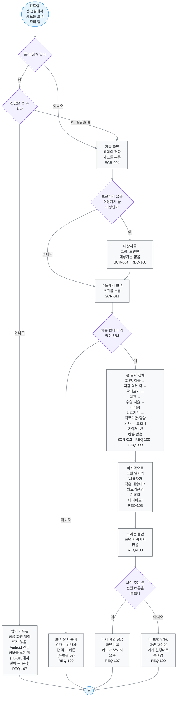

# FL-012 병원·응급실에서 카드 보여 주기

- 누가: 진료실이나 응급실에서 의사·간호사에게 대상자의 먹는 약과 병력을 말해야 하는 챙기는 사람
- 목표: 버튼 한 번으로 카드를 큰 글자 전체 화면으로 보여 줌. 의사·간호사는 보기만 함(행위자가 아님)
- 쓰는 요구: REQ-107, REQ-108, REQ-100, REQ-099, REQ-103
- 화면: SCR-004 → SCR-011 → SCR-013

| 모양 | 뜻 |
| --- | --- |
| 둥근 끝(파란 테) | 흐름의 시작과 끝 |
| 네모(회색 테) | 한 동작. 아래 줄의 `SCR-…`는 화면, `REQ-…`는 맡는 요구 |
| 마름모(보라 테) | 분기점. 분기마다 글이 붙음 |

## 실패 경로

- 폰 잠금을 풀 수 없으면 앱은 카드를 보여 주지 않음. 잠긴 폰은 Android 긴급 정보가 맡음 (REQ-107, 2차 확인 1 답 8)
- 보여 주는 중 화면을 끄면 다시 잠금 화면 (REQ-107)
- 카드가 비었으면 보여 줄 내용이 없다고 알림 (REQ-100. 화면 글자는 08)
- 오래된 카드는 마지막으로 고친 날짜로 알 수 있음 (REQ-103)

## 범위 메모

- 2차 첫 릴리즈(로드맵 2번). 순서는 2차 02 범위 확인 02-7(2026-11-23)
- 새 화면 SCR-011·013의 ID는 03에서 미리 쓰고(2026-11-23) 07 사이트맵에서 그대로 붙임(2026-11-23, [sitemap.yaml](../05-ui/sitemap.yaml)). 그림은 [corthex-diagram 문법](README.md#읽는-법)대로 그림(2차에 더하거나 고친 흐름).
