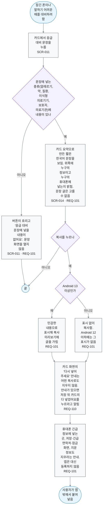

# FL-013 응급 대비 문장 넣어 두기

- 누가: 폰이 잠겨 있거나 대상자가 말하기 어려운 때를 대비하려는 챙기는 사람
- 목표: 카드로 만든 짧은 문장을 복사해 대상자가 쓰는 휴대폰의 긴급 정보에 직접 넣어 둠. 이번 릴리즈는 휴대폰 긴급 정보만 안내하고 119안심콜은 미룸(10 확인 10-4, 설계 바꿈 R 10)
- 쓰는 요구: REQ-101, REQ-110
- 화면: SCR-011 → SCR-014

| 모양 | 뜻 |
| --- | --- |
| 둥근 끝(파란 테) | 흐름의 시작과 끝 |
| 네모(회색 테) | 한 동작. 아래 줄의 `SCR-…`는 화면, `REQ-…`는 맡는 요구 |
| 마름모(보라 테) | 분기점. 분기마다 글이 붙음 |

## 실패 경로

- 문장에 넣는 종류에 내용이 없으면(빈 카드, 수술·시술만 적은 카드) 문장을 만들지 않음. 카드 화면의 버튼이 흐리고 "응급 대비 문장에 넣을 내용이 없어요" (REQ-101, 04 명세 SPEC-051, 설계 바꿈 R 11)
- 가족의 카드를 자기 휴대폰 긴급 정보에 넣지 않게, 화면 위쪽과 넣는 곳 안내에 "(대상자 이름)의 정보예요. (대상자 이름)이 쓰는 휴대폰의 긴급 정보에 넣어 주세요"를 늘 보임. 확인 대화상자는 두지 않음 (설계 바꿈 R 01)
- 문장 글은 길게 눌러 고를 수 없음. 시스템 선택 메뉴의 복사에는 민감 표시를 붙일 수 없어서, 복사는 [모두 복사]와 줄 [복사]로만 함 (설계 바꿈 R 07)
- Android 12 이하에서는 복사 미리보기를 가릴 방법이 없어 표시 없이 복사함 (REQ-101, 02 범위 확인 02-14)
- 앱은 긴급 정보에 실제로 무엇이 들었는지 읽을 수 없음. 복사한 뒤 카드가 바뀌면 카드 화면에서 다시 넣으라고 알림 (REQ-110, FL-011). 복사는 붙여 넣고 저장했다는 뜻이 아니라서 [모두 복사]든 줄 [복사]든 그 안내를 지우지 않음. 휴대폰에 저장한 뒤 카드로 돌아가 안내의 [다 넣었어요]를 누름 (설계 바꿈 S-2, R 02·19)
- 보호자 줄을 붙여 넣어도 휴대폰의 긴급 연락처가 등록되지 않고, 잠금 화면 표시도 휴대폰 설정에서 따로 켬. 넣는 곳 안내에 적음 (설계 바꿈 R 09)

## 범위 메모

- 2차 첫 릴리즈(로드맵 3번). 등록은 사용자가 함(2차 확인 1 답 8)
- 긴급 정보 설정을 여는 방법(Pixel·갤럭시)은 10 WBS의 기술 시험에서 봄
- 2026-11-23 개발 중 설계 바꿈 S-2a('바꿈 승인', 필받음 봇 질문 `msg_254f2f12019e`에 대한 오랑이 답 "추천안 모두 승인"): 노드 G 글을 '복사하면 안내를 지움'에서 '[모두 복사]면 지우고 줄 복사는 지우지 않음'으로, 실패 경로 셋째 줄에 같은 뜻을 더함. 그림 모양(노드·화살표)은 그대로. 기록은 [변경 기록](../10-records/changes/2026-11-22-phase2-release1.md) 6장 '개발 중 설계 바꿈 S-2·S-3'. 이 S-2a는 같은 날 R 02에서 다시 바뀜(아래 줄)
- 2026-11-23 개발 중 설계 바꿈 R(설계 독립 검토 반영, '바꿈 승인', 필받음 봇 질문 `msg_422b96fb86bb`에 대한 오랑이 답 "추천안 모두 승인"): 노드 G 글을 S-2a의 '[모두 복사]면 지움'에서 '어떤 복사로도 지우지 않음'으로(R 02·19), 목표와 노드 H에서 119안심콜을 빼고(R 10), 노드 C·C1을 명세의 여는 조건으로(R 11), 노드 D에 대상자를 밝히는 문구와 고를 수 없는 문장을(R 01·07), 노드 H에 저장·긴급 연락처·잠금 화면·지운 정보 안내를(R 02·09) 넣음. 실패 경로도 같은 뜻으로 고침. 노드·화살표 수는 그대로. 기록은 [변경 기록](../10-records/changes/2026-11-22-phase2-release1.md) 6장 '개발 중 설계 바꿈 R'
- 새 화면 SCR-011·014의 ID는 03에서 미리 쓰고(2026-11-23) 07 사이트맵에서 그대로 붙임(2026-11-23, [sitemap.yaml](../05-ui/sitemap.yaml)). 그림은 [corthex-diagram 문법](README.md#읽는-법)대로 그림(2차에 더하거나 고친 흐름).
