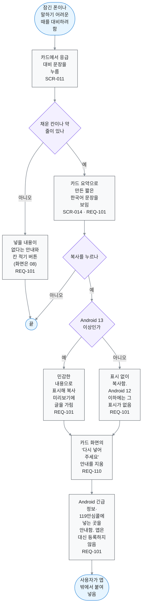

# FL-013 응급 대비 문장 넣어 두기

- 누가: 폰이 잠겨 있거나 대상자가 말하기 어려운 때를 대비하려는 챙기는 사람
- 목표: 카드로 만든 짧은 문장을 복사해 Android 긴급 정보나 119안심콜에 직접 넣어 둠
- 쓰는 요구: REQ-101, REQ-110
- 화면: SCR-011 → SCR-014

| 모양 | 뜻 |
| --- | --- |
| 둥근 끝(파란 테) | 흐름의 시작과 끝 |
| 네모(회색 테) | 한 동작. 아래 줄의 `SCR-…`는 화면, `REQ-…`는 맡는 요구 |
| 마름모(보라 테) | 분기점. 분기마다 글이 붙음 |

## 실패 경로

- 카드가 비었으면 문장을 만들지 않고 알림 (REQ-101. 화면 글자는 08)
- Android 12 이하에서는 복사 미리보기를 가릴 방법이 없어 표시 없이 복사함 (REQ-101, 02 범위 확인 02-14)
- 앱은 긴급 정보에 실제로 무엇이 들었는지 읽을 수 없음. 복사한 뒤 카드가 바뀌면 카드 화면에서 다시 넣으라고 알림 (REQ-110, FL-011)

## 범위 메모

- 2차 첫 릴리즈(로드맵 3번). 등록은 사용자가 함(2차 확인 1 답 8)
- 긴급 정보 설정을 여는 방법(Pixel·갤럭시)은 10 WBS의 기술 시험에서 봄
- 새 화면 SCR-011·014의 ID는 07 사이트맵에서 붙임(2026-11-23 03에서 미리 씀). 그림은 [corthex-diagram 문법](README.md#읽는-법)대로 그림(2차에 더하거나 고친 흐름).
