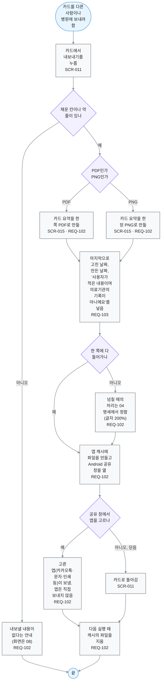

# FL-014 카드 내보내기

- 누가: 대상자가 혼자 병원에 가거나 병원에 미리 보내려는 챙기는 사람
- 목표: 카드 요약을 PDF나 PNG 한 쪽으로 만들어 사용자가 고른 앱으로 넘김
- 쓰는 요구: REQ-102, REQ-103
- 화면: SCR-011 → SCR-015

| 모양 | 뜻 |
| --- | --- |
| 둥근 끝(파란 테) | 흐름의 시작과 끝 |
| 네모(회색 테) | 한 동작. 아래 줄의 `SCR-…`는 화면, `REQ-…`는 맡는 요구 |
| 마름모(보라 테) | 분기점. 분기마다 글이 붙음 |

## 실패 경로

- 카드가 비었으면 만들지 않고 알림 (REQ-102. 화면 글자는 08)
- 공유 창을 닫아도 파일은 다음 실행 때까지 앱 캐시에만 있고 그때 지움 (REQ-102)
- 글자 200%에서 한 쪽을 넘길 때의 처리는 04 명세의 예외에서 정함

## 범위 메모

- 2차 첫 릴리즈(로드맵 4번). 앱이 직접 보내지 않음(결정 3, REQ-057)
- 대상자 폰으로 보낼 때도 이 흐름(2차 확인 2 답 11). 대상자 폰에 카드를 두는 가족 공유는 3차
- 새 화면 SCR-011·015의 ID는 07 사이트맵에서 붙임(2026-11-23 03에서 미리 씀). 그림은 [corthex-diagram 문법](README.md#읽는-법)대로 그림(2차에 더하거나 고친 흐름).
