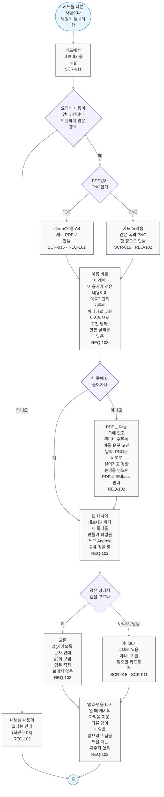

# FL-014 카드 내보내기

- 누가: 대상자가 혼자 병원에 가거나 병원에 미리 보내려는 챙기는 사람
- 목표: 카드 요약을 PDF나 PNG 파일로 만들어 사용자가 고른 앱으로 넘김
- 쓰는 요구: REQ-102, REQ-103
- 화면: SCR-011 → SCR-015

| 모양 | 뜻 |
| --- | --- |
| 둥근 끝(파란 테) | 흐름의 시작과 끝 |
| 네모(회색 테) | 한 동작. 아래 줄의 `SCR-…`는 화면, `REQ-…`는 맡는 요구 |
| 마름모(보라 테) | 분기점. 분기마다 글이 붙음 |

## 실패 경로

- 요약이 비었으면(칸도 보관하지 않은 항목도 없음) 만들지 않음. 카드 화면에 버튼이 없음 (REQ-102, 04 명세 SPEC-052. 화면 글자는 08)
- 공유 창을 닫으면 미리보기에 그대로 있고, 미리보기를 닫아야 카드로 감 (SCR-015, 설계 바꿈 R 20)
- 파일은 앱 캐시에만 있고 앱 화면을 다시 열 때 지움. 받는 앱이 늦게 읽으려고 앱 프로세스를 깨울 때는 지우지 않음 (REQ-102, 설계 바꿈 R 13)
- 같은 날 두 사람의 카드를 차례로 보내도 경로가 겹치지 않음. 내보내기마다 이름을 무작위로 지은 새 폴더를 쓰고 같은 경로를 다시 쓰지 않음. 보이는 파일 이름은 그대로 (설계 바꿈 R 03)
- 내용이 넘치면 다음 쪽이고 기기 글자 크기와는 상관없음. PNG가 정한 높이를 넘으면 "사진이 너무 길어요. PDF로 보내 주세요" (04 명세 SPEC-052, 설계 바꿈 R 13)

## 범위 메모

- 2차 첫 릴리즈(로드맵 4번). 앱이 직접 보내지 않음(결정 3, REQ-057)
- 대상자 폰으로 보낼 때도 이 흐름(2차 확인 2 답 11). 대상자 폰에 카드를 두는 가족 공유는 3차
- 새 화면 SCR-011·015의 ID는 03에서 미리 쓰고(2026-11-23) 07 사이트맵에서 그대로 붙임(2026-11-23, [sitemap.yaml](../05-ui/sitemap.yaml)). 그림은 [corthex-diagram 문법](README.md#읽는-법)대로 그림(2차에 더하거나 고친 흐름).
- 2026-11-23 개발 중 설계 바꿈 R(설계 독립 검토 반영, '바꿈 승인', 필받음 봇 질문 `msg_422b96fb86bb`에 대한 오랑이 답 "추천안 모두 승인"): 노드 C를 명세의 여는 조건으로(R 11), D1·D2·F1에서 '한 쪽'과 '글자 200%'를 빼고 넘칠 때의 처리를(R 13), E의 문구 자리를(R 06), G를 내보내기마다 새 폴더로(R 03), H2를 미리보기에 남는 것으로(R 20), I를 앱 화면을 열 때 지우는 것으로(R 13) 고침. 노드·화살표는 그대로. 기록은 [변경 기록](../10-records/changes/2026-11-22-phase2-release1.md) 6장 '개발 중 설계 바꿈 R'
