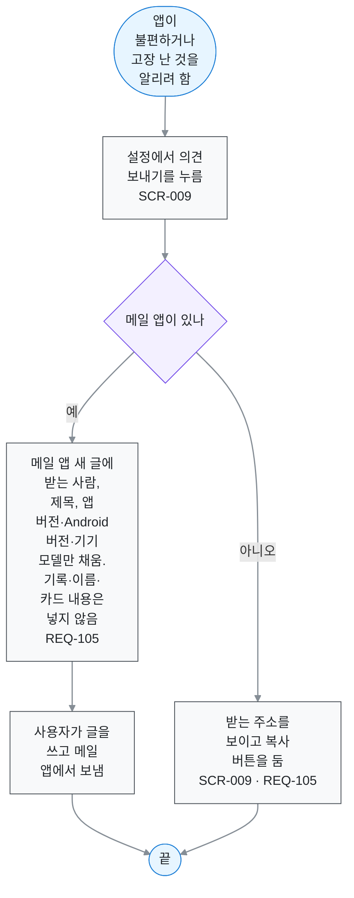

# FL-015 의견 보내기

- 누가: 앱이 불편하거나 고장 난 것을 개발팀에 알리고 싶은 챙기는 사람(테스터)
- 목표: 메일 앱으로 의견을 보냄. 앱은 기기 정보 세 가지만 채우고 직접 보내지 않음
- 쓰는 요구: REQ-105
- 화면: SCR-009

| 모양 | 뜻 |
| --- | --- |
| 둥근 끝(파란 테) | 흐름의 시작과 끝 |
| 네모(회색 테) | 한 동작. 아래 줄의 `SCR-…`는 화면, `REQ-…`는 맡는 요구 |
| 마름모(보라 테) | 분기점. 분기마다 글이 붙음 |

## 실패 경로

- 메일 앱이 없으면 주소를 보이고 복사하게 함 (REQ-105)
- 보낼지 말지는 사용자가 메일 앱에서 정함. 앱은 보냈는지 알 수 없음
- 사용자가 메일을 보내면 메일 주소·쓴 내용·기기 정보 세 가지가 개발자 메일함에 감. 앱이 자동으로 보내는 것은 없음. 개인정보처리방침에 이 사실과 메일의 보관·삭제 방법을 적음 (REQ-109, 10 WBS TASK-067, 설계 바꿈 R 15)

## 범위 메모

- 2차 첫 릴리즈(로드맵 22번). 받는 주소는 개인정보처리방침 8장의 연락 이메일
- 경계 밖(앱 공통) 기능(01, 2차 확인 3). 그림은 [corthex-diagram 문법](README.md#읽는-법)대로 그림(2차에 더하거나 고친 흐름).
