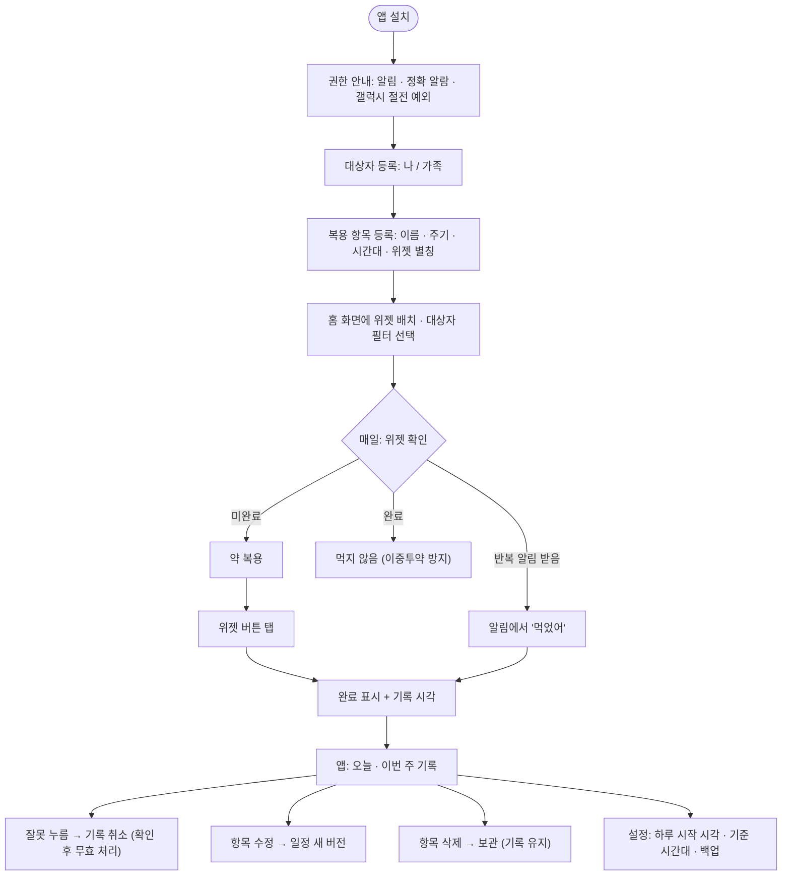
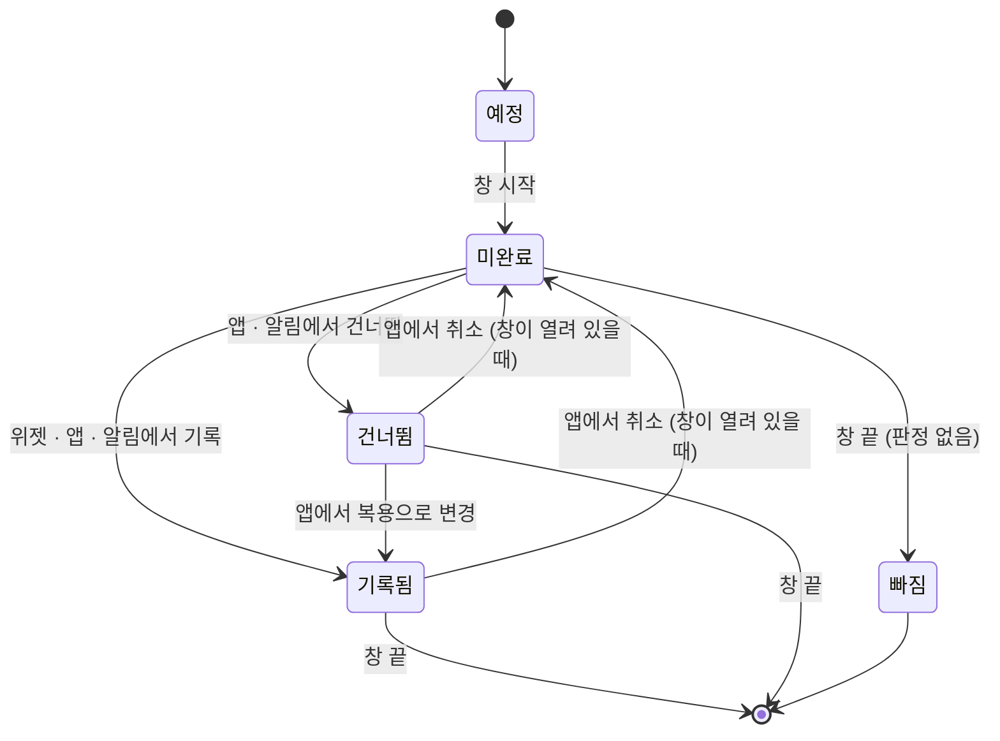
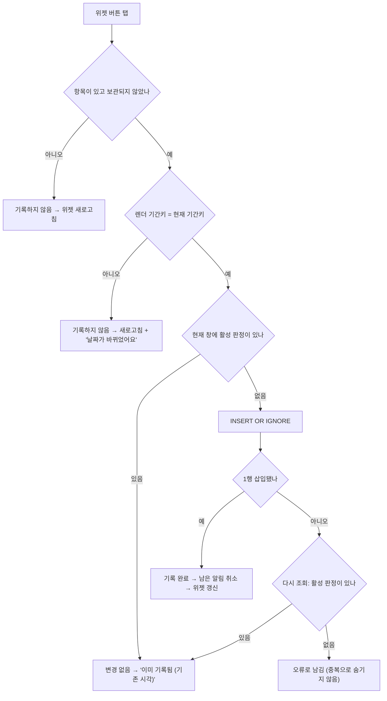
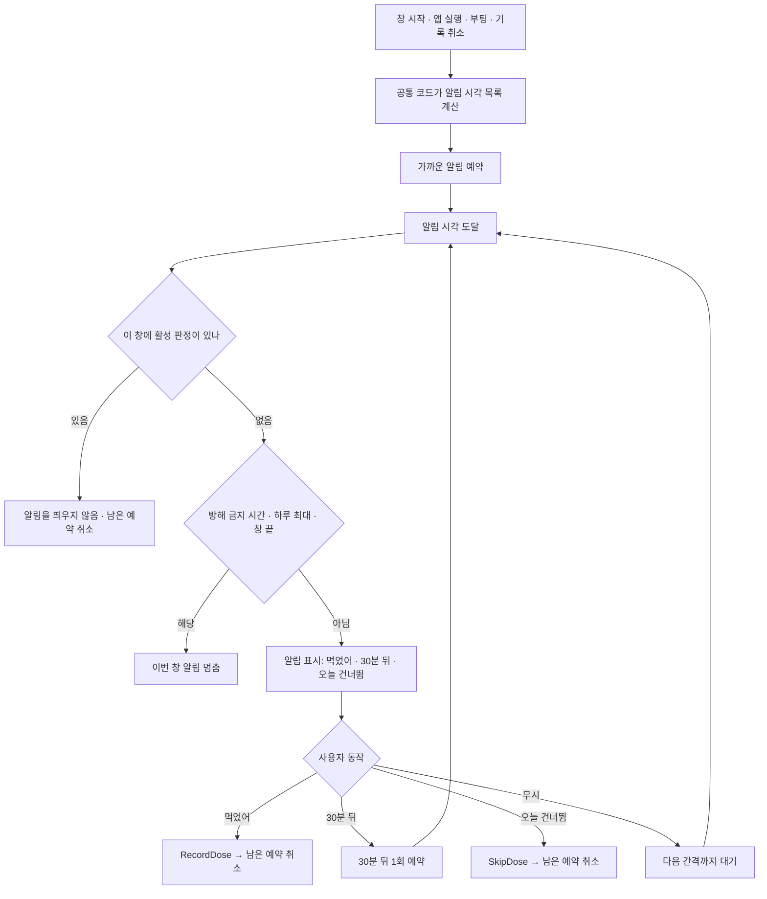
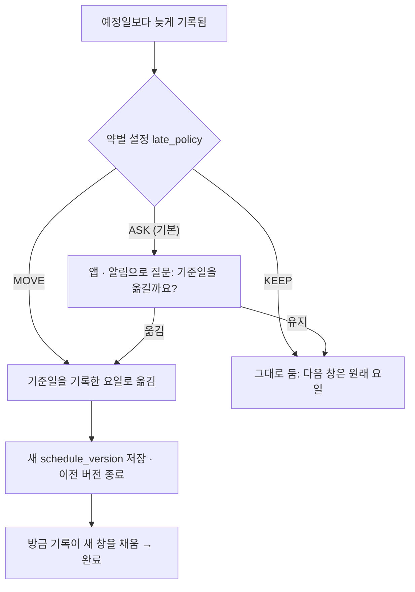

# 사용자 플로우·상태 흐름 (설계 초안)

다이어그램을 먼저 두고, 단계별 관련 테이블을 아래 표로 연결함. 테이블 정의는 [data-model](../02-design/data-model.md)에 있음.

## 1. 사용자 플로우 맵

| 단계 | 관련 테이블 | 메모 |
| --- | --- | --- |
| 대상자 등록 | person | 색은 위젯 표시용 |
| 복용 항목 등록 | intake, schedule_version | 주기는 `schedule_version.type`, `params_json` |
| 위젯 배치 | (위젯 인스턴스 상태) | 대상자 필터는 위젯마다 따로 저장 |
| 위젯 탭 기록 | dose_record (`kind` = TAKEN, `source` = WIDGET) | `UNIQUE(intake_id, period_key, active)` |
| 알림 '먹었어' | dose_record (`source` = NOTIFICATION) | 확장 단계 reminder_rule |
| 기록 취소 | dose_record (`active` = NULL, `voided_at`) | 행을 지우지 않음 |
| 항목 수정 | schedule_version 새 행 | 이전 버전 `effective_to` 채움 |
| 항목 삭제 | intake.archived_at | 기록 유지 |
| 설정 | setting | `day_start`, `base_zone`, `backup_policy` |

## 2. 창 상태

| 상태 | 저장 여부 | 위젯 표시 |
| --- | --- | --- |
| 예정 | 계산 | 표시하지 않음 (일정 시작 전·중단 구간) |
| 미완료 | 계산 | 점선 빈 원 + "마지막 어제 22:00" |
| 기록됨 | dose_record (TAKEN, active = 1) | 채움 + 체크 + 기록 시각 |
| 건너뜀 | dose_record (SKIPPED, active = 1) | 확장 단계에서 별도 표시 |
| 빠짐 | 계산 | 위젯에 표시하지 않음. 앱 기록·리포트에서 보여줌 |

- 취소는 판정을 무효 처리할 뿐 행을 지우지 않음. 창이 끝난 뒤 취소하면 그 창은 빠짐이 됨
- 위젯은 미완료 → 기록됨 전이만 만듦. 나머지 전이는 앱·알림에서만 일어남

## 3. 위젯 탭 판단 흐름

## 4. 반복 알림 흐름

| 단계 | 관련 테이블 | 메모 |
| --- | --- | --- |
| 알림 시각 계산 | reminder_rule (확장), schedule_version, setting | 시작 시각·간격·하루 최대·방해 금지 |
| 판정 확인 | dose_record | [record-rules 5장](../02-design/record-rules.md#5-판정-계산) 조건 |
| 먹었어 | dose_record (TAKEN, NOTIFICATION) | 알림의 기간키로 대조 |
| 오늘 건너뜀 | dose_record (SKIPPED, NOTIFICATION) | |

## 5. 주 1회 늦은 투약 처리

