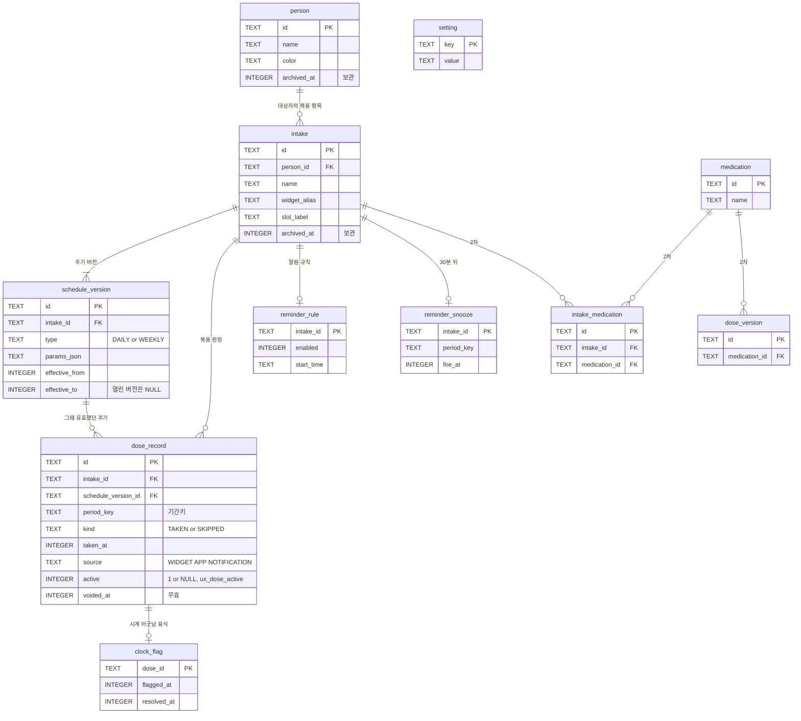
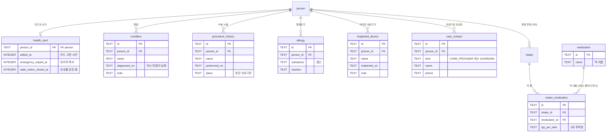

# 05 ERD: 필받음 데이터 (1차, 2차 첫 릴리즈)

- 상태 (2차 첫 릴리즈): **스키마 3 설계를 씀, 고정 질문 중** (2026-11-23 KST). 새 표 여섯(TBL-012~017)과 쓰기 시작하는 표 둘(TBL-009·010)을 [8장](#8-2차-첫-릴리즈-스키마-3-설계)에 둠. Room 스키마 3(`3.json`)과 이주 2→3은 11 개발에서 만들고, 그때 `db/schema.sql`에 옮김. 그 전까지 `db/schema.sql`은 스키마 2 그대로이고 표 주석만 고침. 입력은 04 명세 SPEC-045~055와 고친 SPEC-025·SPEC-037(고정 2026-11-23 KST), 01 도메인 CTX-006·TERM-032~044
- 상태 (1차): **고정** (2026-11-13 01:04 KST, 동희님 "추천모두승인", 프로젝트 채팅. 질문은 2026-11-13 00:55 KST 프로젝트 스레드 '약봉이 1차 릴리즈 이어 가기'의 Claude 메시지 1번. 기록은 [7장](#7-고정-기록)). 1차 스키마는 Room 스키마 2(TBL-001~011) 그대로임. 고정한 뒤 표를 바꾸려면 동희님 결정이 필요하고 이주를 함께 만듦. 초안은 2026-11-12 Claude가 씀. 04 명세 고정(2026-11-13 00:16 KST)에서 5장 3을 정함(대상자 되살리기, 스키마 그대로).
- 원본: [`db/schema.sql`](../../db/schema.sql) (TBL-001~011). 그 파일은 Room이 내보낸 [스키마 2](../../shared/schemas/com.judangbang.pillbadeum.data.DidITakeDatabase/2.json)의 CREATE 문을 그대로 옮기고 표마다 TBL 번호·맥락(CTX)·명세(SPEC)·용어(TERM)를 단 것. `check_docs.py`가 두 쪽이 같은지 봄.
- 입력: [04 기능 명세](../04-functional-spec/spec.md) SPEC-001~044(고정), [01 도메인](../01-domain/domain.md) CTX-001~005·TERM-001~031.
- 이전 시안: 가쟈누님 DidITake `docs/02-design/data-model.md`. 표 구조는 그 시안으로 이미 만들어져 앱에 들어가 있음. 이번 단계는 표를 새로 짜지 않고, 01~04에서 다시 정한 말과 동작에 비춰 빠진 것·남는 것을 찾음.

## 1. 그림

GitHub에서 이 파일을 열면 그림으로 보임. 열 이름은 줄였고 전체는 `db/schema.sql`에 있음.



## 2. 표

| TBL | 표 | 맥락 | 용어 | 쓰는 명세 |
| --- | --- | --- | --- | --- |
| TBL-001 | person | CTX-002 | TERM-002 대상자, TERM-003 '나', TERM-018 보관 | SPEC-001, 004, 005, 026, 027, 044 |
| TBL-002 | intake | CTX-002 | TERM-004 복용 항목, TERM-018 보관 | SPEC-003, 006, 015, 023, 024, 025 |
| TBL-003 | schedule_version | CTX-002 | TERM-005 주기 | SPEC-003, 022, 023, 044 |
| TBL-004 | dose_record | CTX-001 | TERM-008 복용 판정, TERM-012 무효, TERM-030 활성 판정 | SPEC-007, 008, 011, 016~019, 022, 043 |
| TBL-005 | clock_flag | CTX-001 | TERM-017 시계 어긋남 표식 | SPEC-020 |
| TBL-006 | reminder_rule | CTX-003 | TERM-021 복용 알림, TERM-024 알림 설정 | SPEC-010, 028, 032 |
| TBL-007 | reminder_snooze | CTX-003 | TERM-023 30분 뒤 다시 알리기 | SPEC-012, 014 |
| TBL-008 | setting | CTX-001·003·005 | TERM-014~016 창 설정, TERM-024 알림 설정 | 4장 |
| TBL-009 | medication | CTX-002 (2차부터 씀) | TERM-033 약 | SPEC-025, 048, 049 |
| TBL-010 | intake_medication | CTX-002 (2차부터 씀) | TERM-033 약, TERM-034 1회 투약량 | SPEC-025, 048, 049 |
| TBL-011 | dose_version | 2차 | 없음 | 없음 |
| TBL-012~017 | health_card, condition, procedure_history, allergy, implanted_device, care_contact | CTX-006 | TERM-032, TERM-035~040 | 스키마 3 설계(8장). Room 3.json이 생기면 이 표에 한 줄씩 |

DB가 직접 막는 규칙은 셋:

- 활성 판정은 창마다 하나(CTX-001 핵심 규칙, SPEC-043): `ux_dose_active` UNIQUE(intake_id, period_key, active). 무효 행은 active가 NULL이라 몇 개든 남음.
- 판정이 남은 항목·버전은 지울 수 없음: 외래 키가 모두 ON DELETE NO ACTION이고 Room이 외래 키 검사를 켬(`DoseRecordDaoTest.foreignKeys_*`). 완전 삭제(SPEC-025)는 자식 표부터 지움.
- 판정 하나에 표식 하나, 항목 하나에 알림 규칙 하나·미룸 하나: 기본 키.

나머지 규칙(마지막 대상자는 보관 못 함, 열린 주기 버전은 하나, 보관된 항목만 완전 삭제)은 코드가 지킴. 표마다 `db/schema.sql` 주석에 적음.

## 3. 명세가 쓰는 데이터

| SPEC | 읽고 쓰는 데이터 |
| --- | --- |
| SPEC-001 | person에 '나'를 씀. setting `device_id`, 기기 표식 파일(표 밖) |
| SPEC-002 | setting `intro_seen_at`을 읽고 씀(TASK-022) → 5장 1. person을 읽음(첫 실행에 만든 '나') |
| SPEC-003 | intake, schedule_version을 씀. person을 읽음 |
| SPEC-004 | person을 씀 |
| SPEC-005 | person을 읽음. 위젯마다 고른 대상자는 표 밖(Glance 위젯 상태) → 5장 2 |
| SPEC-006 | person, intake, schedule_version, dose_record, clock_flag, setting `day_start`·`base_zone` |
| SPEC-007 | dose_record를 씀(source WIDGET) |
| SPEC-008 | dose_record를 읽음 |
| SPEC-009 | intake·person의 archived_at, dose_record |
| SPEC-010 | reminder_rule, reminder_snooze, dose_record, setting `reminder_*`·`quiet_*` |
| SPEC-011 | dose_record를 씀(source NOTIFICATION) |
| SPEC-012 | reminder_snooze를 씀 |
| SPEC-013 | setting `show_names_on_lock` |
| SPEC-014 | reminder_snooze를 지움, dose_record를 읽음 |
| SPEC-015 | person, intake, schedule_version, dose_record, clock_flag, setting |
| SPEC-016 | dose_record의 active·voided_at·void_reason |
| SPEC-017 | dose_record(taken_at, 고치기는 무효 + 새 행) |
| SPEC-018 | dose_record를 씀(kind SKIPPED) |
| SPEC-019 | dose_record(무효 + 새 행) |
| SPEC-020 | clock_flag |
| SPEC-021 | 없음(화면 상태만) |
| SPEC-022 | dose_record, schedule_version, intake·person의 archived_at, clock_flag, setting → 5장 3 |
| SPEC-023 | intake, schedule_version(닫고 엶) |
| SPEC-024 | intake의 archived_at, reminder_snooze |
| SPEC-025 | clock_flag, dose_record, reminder_snooze, reminder_rule, intake_medication, (2차) 그 약 줄의 medication, schedule_version, intake를 지움 |
| SPEC-026 | person |
| SPEC-027 | person의 archived_at, 위젯 상태(표 밖) |
| SPEC-028 | reminder_rule, setting `reminder_*` |
| SPEC-029 | 없음(Android 정확 알람 허용 상태) |
| SPEC-030 | 없음(Android 배터리 최적화 상태) |
| SPEC-031 | setting `quiet_start`·`quiet_end`, `reminder_*` |
| SPEC-032 | reminder_rule, reminder_snooze, setting `reminder_alarm_at`·`reminder_last_run_at` |
| SPEC-033 | setting `day_start`·`base_zone`·`window_settings_changed_at` |
| SPEC-034 | setting `show_names_on_lock` |
| SPEC-035 | 없음(Android 화면 잠금·버전을 그때 읽음) |
| SPEC-036 | 없음 |
| SPEC-037 | DB 파일 전체가 백업 대상(`backup_rules.xml`), 기기 표식 파일은 제외 |
| SPEC-038 | 기기 표식 파일, setting `device_id`·`restored_from_device_id`·`restore_notice_pending`, (2차) `restored_at` |
| SPEC-039 | setting `restore_notice_pending`·`restore_notice_last_record_at` |
| SPEC-040 | setting `day_start`·`base_zone` |
| SPEC-041 | setting `reminder_alarm_at`·`reminder_last_run_at`, clock_flag |
| SPEC-042 | setting `base_zone` |
| SPEC-043 | dose_record의 `ux_dose_active` |
| SPEC-044 | person의 archived_at, schedule_version(되살릴 때 그 대상자 항목의 열린 버전을 보관한 때에 닫고 새로 엶, 보충 P-9) |
| SPEC-045 | 칸 종류의 표 하나에 씀(condition·procedure_history·allergy·implanted_device·care_contact, `source` USER). health_card `edited_at`을 씀(행이 없으면 만듦). person을 읽음 |
| SPEC-046 | 그 칸의 행을 지움. health_card `edited_at` |
| SPEC-047 | 그 대상자의 칸 표 다섯 행을 한 거래에서 지움. health_card 행은 남기고 `edited_at`만 씀(복사 시각을 지켜 SPEC-055가 쓰게) |
| SPEC-048 | 항목 저장과 같은 거래에서 intake_medication·medication을 쓰고 지움(약 줄 하나에 두 표의 행 하나씩, 8장 5). health_card `edited_at` |
| SPEC-049 | 칸 표 다섯, person `name`·`archived_at`, intake(보관하지 않은 것)의 `name`·`slot_label`·`created_at`, 열린 schedule_version, intake_medication·medication, health_card `edited_at`, setting `base_zone`(날짜). `edited_at`은 SPEC-003·023·024·025·026·045~048이 씀 |
| SPEC-050 | SPEC-049의 요약. 화면 켜 두기는 표 밖(화면 창의 설정) |
| SPEC-051 | SPEC-049의 요약. health_card `emergency_copied_at`을 씀. 클립보드는 표 밖 |
| SPEC-052 | SPEC-049의 요약. 파일은 앱 캐시의 내보내기 폴더(표 밖, 백업 밖) |
| SPEC-053 | 없음(앱 버전·Android 버전·기기 모델은 그때 읽고, 받는 주소는 앱 안의 글) |
| SPEC-054 | person(`archived_at` 포함), health_card |
| SPEC-055 | health_card `edited_at`·`emergency_copied_at`·`stale_notice_closed_at`(닫기 때 씀), setting `restored_at` |

## 4. setting 키

| 키 | 값 | 쓰는 명세 |
| --- | --- | --- |
| `day_start` | 하루 시작 시각 `HH:MM`, 기본 04:00 (TERM-015) | SPEC-006, 033, 040 |
| `base_zone` | 기준 시간대 IANA id, 기본 Asia/Seoul (TERM-016) | SPEC-006, 033, 040, 042 |
| `window_settings_changed_at` | 위 둘을 마지막으로 바꾼 때. 그 전에 끝난 창은 고칠 수 없음(보충 P-5) | SPEC-033 |
| `show_names_on_lock` | 잠금 화면에 이름을 보일지 `true`/`false`, 기본 꺼짐 | SPEC-013, 034 |
| `reminder_interval_minutes`, `reminder_max_per_day`, `quiet_start`, `quiet_end` | 앱 전체 알림 설정(TERM-024) | SPEC-010, 028, 031 |
| `reminder_last_run_at`, `reminder_alarm_at` | 알림 계산이 마지막으로 돈 때와 예약한 알람 시각(보충 N-8, N-12) | SPEC-032, 041 |
| `device_id` | 이 설치의 id. 복원 뒤 새로 만듦(보충 R-1, R-2) | SPEC-001, 038 |
| `restored_from_device_id` | 복원한 DB가 갖고 있던 옛 `device_id` | SPEC-038 |
| `restore_notice_pending`, `restore_notice_last_record_at` | 복원 안내를 확인할 때까지 `1`, 복원 전 마지막 기록 시각 | SPEC-038, 039 |
| `restored_at` | (2차) 복원을 감지한 때(UTC epoch ms). 낡은 응급 대비 문장 안내가 복원 뒤에 보이게 함(8장 4) | SPEC-038, 055 |
| `intro_seen_at` | 첫 실행 안내를 다 본 때. 값이 없으면 첫 실행 안내를 보임. 05 고정(2026-11-13)에서 정하고 TASK-022에서 더함(5장 1) | SPEC-002 |
| `backup_policy` | 키만 정의돼 있고 앱이 읽거나 쓰지 않음 | 없음 |

## 5. 01~04와 대조해 찾은 것

1. **첫 실행 안내를 봤는지 둘 곳이 없음** (SPEC-002). **정함** (2026-11-13 01:04 KST 05 고정): 아래 제안대로 setting 키 `intro_seen_at`을 씀(4장, TASK-022). 05 고정 때 앱에는 첫 실행 안내 화면 자체가 없었음(앱 첫 화면 아래 문구만 있었음). Claude 제안: setting에 `intro_seen_at` 키를 더함. setting은 키·값 표라 스키마 버전은 그대로. 이 키는 DB와 함께 백업되므로 복원한 폰에서는 첫 실행 안내 대신 복원 안내(SPEC-039)가 뜸. 구현(TASK-022, [PR #19](https://github.com/judangbang-ops/pillbadeum_release/pull/19)): 값은 [시작하기]나 [건너뛰기]를 누른 때(UTC epoch ms)이고, 처음 시각을 지켜 다시 쓰지 않음(`ManageSettings.markIntroSeen`). 키가 없는 DB(이 업데이트 전부터 쓰던 설치와 그 백업)는 처음 연 것으로 보고 안내를 보임.
2. **위젯마다 고른 대상자를 둘 곳이 없음** (SPEC-005, TERM-026). **정함** (같은 05 고정): 아래대로 위젯마다 Glance 상태에 둠(TASK-012). 01에서 "백업되지 않음"으로 정했으므로 DB가 아니라 위젯마다 있는 Glance 상태(백업 대상이 아닌 파일)에 둠. 표는 늘지 않음. 구현(TASK-012, [PR #19](https://github.com/judangbang-ops/pillbadeum_release/pull/19)): 키는 `person_choice`, 값은 '전체'면 `*`, 한 사람이면 그 `person.id`. 값이 없으면 선택을 모름(복원 뒤). 이 업데이트 전부터 놓인 위젯은 한 번 `*`로 채움(보충 R-3, RR-74).
3. **대상자를 되살리면 보관했던 기간이 지난 기록에서 '빠짐'으로 바뀜** (SPEC-022, 04 명세 3장 '대상자 되살리기'). **정함** (2026-11-13 00:16 KST 04 명세 고정, 동희님 "추천 모두 승인"): 되살리기를 1차에 넣고(REQ-095, SPEC-044) 아래의 방법으로 고침(보충 P-9, TASK-053). 보관은 `archived_at` 한 칸이라, 되살릴 때 그 칸을 비우면 언제부터 언제까지 보관했는지가 남지 않음. 지난 기록은 그 칸으로 "보관 뒤 날짜는 빠짐이 아님"을 가르므로, 되살린 뒤에는 보관 기간의 창이 모두 빠짐으로 보임. 되살리기를 1차에 둔다면 스키마를 바꾸지 않고 고칠 수 있음: 되살릴 때 그 대상자 항목의 열린 주기 버전을 보관한 때에 닫고, 되살린 때부터 같은 주기로 새 버전을 엶. 주기 버전이 없는 기간은 이미 빠짐이 아님. 항목 보관에는 되살리기가 없어 이 문제가 없음.
4. **2차 표 셋(TBL-009~011)은 1차에서 쓰지 않음.** **정함** (같은 05 고정): 지우지 않고 둠. CORTHEX 검사의 "쓰지 않는 표가 없어야 함"에 걸림. Claude 판단: 지우지 않고 둠. 1차 앱은 이 표를 읽거나 쓰지 않아 늘 비어 있고, 지우려면 이주(2 → 3)와 그 시험이 필요한데 2차에서 다시 들여올 표임. 지우는 쪽을 원하시면 이주를 만듦.
5. **`backup_policy` 키는 쓰이지 않음.** (05 고정 때 그대로 둠) 백업 안내(SPEC-035)는 폰 상태를 그때 읽으므로 저장할 값이 없음. 키 정의를 지울지는 개발(11)에서 정리.

## 6. 검사

`python3 .github/scripts/check_docs.py .`가 보는 것:

- `db/schema.sql`의 표·색인 CREATE 문이 가장 높은 버전의 Room 스키마 JSON과 글자까지 같고, 표가 빠지거나 남지 않음
- 표마다 TBL 번호·맥락·명세·용어 주석이 있고, 그 번호가 01·04 문서에 있음
- 용어집의 TERM이 모두 어느 표의 `terms:`나 `without a table:` 줄에 있음
- 이 문서 3장에 모든 SPEC 행이 있음

이주가 빈 DB에서 스키마를 다시 만드는지: 새 설치는 Room이 스키마 2를 바로 만들고, 1 → 2 이주는 `MigrationTest`가 옛 스키마 1로 만든 DB를 이주한 뒤 스키마 2와 같은지 확인함(CI의 jvmTest).

## 7. 고정 기록

- 언제·누가: 2026-11-13 01:04 KST, 동희님 "추천모두승인", 프로젝트 채팅. 같은 때 "독립검토 넘어가고 개발 시작해 ㄱㄱ"라고 하셔서 PR #17의 독립 검토는 하지 않음
- 물은 것: 질문은 2026-11-13 00:55 KST 프로젝트 스레드 '약봉이 1차 릴리즈 이어 가기'의 Claude 메시지 1번 "05 데이터: 스키마 2(표 11개)를 1차 스키마로 고정할까요?" (추천: 고정). 함께 정해진다고 알린 것: 첫 실행 안내를 봤는지는 설정 키 하나(스키마 버전 그대로), 위젯마다 고른 대상자는 DB 밖 위젯 상태(01에서 정한 대로 백업 안 됨), 2차용 빈 표 셋은 지우지 않음. 반론으로 쓰지 않는 표가 남는다고 알림
- 정한 것: 1차 스키마는 Room 스키마 2(TBL-001~011) 그대로. 5장 1·2·4는 정함, 5장 5(`backup_policy`)는 개발(11)에서 정리
- 고정한 뒤 표를 바꾸려면 동희님 결정이 필요하고, 바꾸면 이주(스키마 3)와 `MigrationTest`를 함께 만듦
- 고정을 적은 커밋에서 `check_docs.py`가 "no problems"

## 8. 2차 첫 릴리즈: 스키마 3 설계

- 상태: 설계 (2026-11-23, 고정 질문 중). Room 스키마 3과 이주 2→3은 11 개발에서 만듦(REQ-072). 그 작업이 `3.json`을 내보내면 CREATE 문이 8.3의 설계와 같은지 보고 `db/schema.sql`에 옮긴 뒤, 8.3의 표 주석을 그 파일로 옮김
- 입력: [04 명세](../04-functional-spec/spec.md) SPEC-045~055와 2차에서 고친 SPEC-025·SPEC-037, [01 도메인](../01-domain/domain.md) CTX-006 규칙과 TERM-032~044, [변경 기록](../10-records/changes/2026-11-22-phase2-release1.md) 2장 '05 ERD' 제안
- 1차 표 TBL-001~008의 열은 바뀌지 않음

### 8.1 그림

2차에 더하거나 쓰기 시작하는 표와 그 표가 매달린 1차 표. 1차의 나머지 표는 1장 그림에 있음.



읽는 법: `||--o{`는 왼쪽 행 하나에 오른쪽 행이 0개 이상, `||--o|`는 0개나 1개. 칸 표 넷(care_contact 빼고)의 `code_system`·`code`, 칸 표 다섯의 `source`, 모든 표의 `created_at`·`updated_at`·`version`·`device_id`는 그림에서 뺐고 8.3에 있음.

### 8.2 표

| TBL | 표 | 맥락 | 용어 | 쓰는 명세 | 스키마 |
| --- | --- | --- | --- | --- | --- |
| TBL-009 | medication | CTX-002 | TERM-033 약 | SPEC-025, 048, 049 | 스키마 2에 있음, 2차부터 씀 |
| TBL-010 | intake_medication | CTX-002 | TERM-033 약, TERM-034 1회 투약량 | SPEC-025, 048, 049 | 스키마 2에 있음, 2차부터 씀 |
| TBL-012 | health_card | CTX-006 | TERM-032 건강 카드 | SPEC-045~049, 051, 054, 055 | 스키마 3 새 표 |
| TBL-013 | condition | CTX-006 | TERM-035 질환 | SPEC-045~047, 049 | 스키마 3 새 표 |
| TBL-014 | procedure_history | CTX-006 | TERM-036 수술·시술 | SPEC-045~047, 049 | 스키마 3 새 표 |
| TBL-015 | allergy | CTX-006 | TERM-037 알레르기 | SPEC-045~047, 049 | 스키마 3 새 표 |
| TBL-016 | implanted_device | CTX-006 | TERM-038 이식형 의료기기 | SPEC-045~047, 049 | 스키마 3 새 표 |
| TBL-017 | care_contact | CTX-006 | TERM-039 의료기관·담당 의사, TERM-040 보호자 연락처 | SPEC-045~047, 049 | 스키마 3 새 표 |

TBL-011 `dose_version`은 다음 릴리즈(용량 바뀜 이력)까지 빈 표로 둠. 표가 없는 2차 용어: TERM-041 카드 요약(읽기 모델, 계산), TERM-042 응급 대비 문장(계산), TERM-043 내보내기 파일(앱 캐시 파일), TERM-044 의견 보내기(메일 앱).

### 8.3 DDL 설계

Room이 내보내는 형식으로 씀. 열 순서는 엔터티의 필드 순서를 따르므로 `3.json`과 다르면 `3.json`이 기준이고, 그때 이 절을 맞춤.

```sql
-- TBL-012 health_card (CTX-006) ← SPEC-045, SPEC-046, SPEC-047, SPEC-048, SPEC-049, SPEC-051, SPEC-054, SPEC-055 | terms: TERM-032
--   대상자 한 명의 건강 카드에 딸린 시각. 칸은 종류마다 아래 표 다섯에 둠.
--   edited_at: 카드 고친 시각(SPEC-049). 마지막으로 고친 날짜(REQ-103)와 낡은 문장 안내(REQ-110)가 읽음.
--   emergency_copied_at: 응급 대비 문장을 마지막으로 복사한 때(SPEC-051). stale_notice_closed_at: 낡은 문장 안내를 닫은 때(SPEC-055).
--   rule (CTX-006, DB가 막음): 대상자 하나에 카드 하나 = PRIMARY KEY person_id.
--   rule (코드): 행은 edited_at이나 복사 시각을 처음 쓸 때 만듦(edited_at은 그때). 카드를 모두 지워도(SPEC-047) 이 행은 남김. 행이 없으면 빈 카드.
CREATE TABLE IF NOT EXISTS `health_card` (`person_id` TEXT NOT NULL, `edited_at` INTEGER NOT NULL, `emergency_copied_at` INTEGER, `stale_notice_closed_at` INTEGER, `created_at` INTEGER NOT NULL, `updated_at` INTEGER NOT NULL, `version` INTEGER NOT NULL, `device_id` TEXT NOT NULL, PRIMARY KEY(`person_id`), FOREIGN KEY(`person_id`) REFERENCES `person`(`id`) ON UPDATE NO ACTION ON DELETE NO ACTION );

-- TBL-013 condition (CTX-006) ← SPEC-045, SPEC-046, SPEC-047, SPEC-049 | terms: TERM-035
--   질환 칸 하나. name은 꼭 적고 나머지는 비워도 됨(SPEC-045). diagnosed_on은 아는 만큼의 날짜(8.4 1).
--   code_system·code: 질병 분류 코드 자리, 2차 첫 릴리즈는 늘 비움. source: 적은 곳, 2차 첫 릴리즈는 늘 USER.
CREATE TABLE IF NOT EXISTS `condition` (`id` TEXT NOT NULL, `person_id` TEXT NOT NULL, `name` TEXT NOT NULL, `diagnosed_on` TEXT, `note` TEXT, `code_system` TEXT, `code` TEXT, `source` TEXT NOT NULL, `created_at` INTEGER NOT NULL, `updated_at` INTEGER NOT NULL, `version` INTEGER NOT NULL, `device_id` TEXT NOT NULL, PRIMARY KEY(`id`), FOREIGN KEY(`person_id`) REFERENCES `person`(`id`) ON UPDATE NO ACTION ON DELETE NO ACTION );
CREATE INDEX IF NOT EXISTS `ix_condition_person` ON `condition` (`person_id`);

-- TBL-014 procedure_history (CTX-006) ← SPEC-045, SPEC-046, SPEC-047, SPEC-049 | terms: TERM-036
--   수술·시술 칸 하나. name은 꼭 적음. performed_on은 아는 만큼의 날짜, place는 받은 의료기관. code_system·code·source는 TBL-013과 같음.
CREATE TABLE IF NOT EXISTS `procedure_history` (`id` TEXT NOT NULL, `person_id` TEXT NOT NULL, `name` TEXT NOT NULL, `performed_on` TEXT, `place` TEXT, `code_system` TEXT, `code` TEXT, `source` TEXT NOT NULL, `created_at` INTEGER NOT NULL, `updated_at` INTEGER NOT NULL, `version` INTEGER NOT NULL, `device_id` TEXT NOT NULL, PRIMARY KEY(`id`), FOREIGN KEY(`person_id`) REFERENCES `person`(`id`) ON UPDATE NO ACTION ON DELETE NO ACTION );
CREATE INDEX IF NOT EXISTS `ix_procedure_history_person` ON `procedure_history` (`person_id`);

-- TBL-015 allergy (CTX-006) ← SPEC-045, SPEC-046, SPEC-047, SPEC-049 | terms: TERM-037
--   알레르기 칸 하나. substance(원인)는 꼭 적고 reaction(반응)은 비워도 됨. code_system·code·source는 TBL-013과 같음.
CREATE TABLE IF NOT EXISTS `allergy` (`id` TEXT NOT NULL, `person_id` TEXT NOT NULL, `substance` TEXT NOT NULL, `reaction` TEXT, `code_system` TEXT, `code` TEXT, `source` TEXT NOT NULL, `created_at` INTEGER NOT NULL, `updated_at` INTEGER NOT NULL, `version` INTEGER NOT NULL, `device_id` TEXT NOT NULL, PRIMARY KEY(`id`), FOREIGN KEY(`person_id`) REFERENCES `person`(`id`) ON UPDATE NO ACTION ON DELETE NO ACTION );
CREATE INDEX IF NOT EXISTS `ix_allergy_person` ON `allergy` (`person_id`);

-- TBL-016 implanted_device (CTX-006) ← SPEC-045, SPEC-046, SPEC-047, SPEC-049 | terms: TERM-038
--   이식형 의료기기 칸 하나. name은 꼭 적음. implanted_on은 넣은 때(아는 만큼의 날짜). code_system·code·source는 TBL-013과 같음.
CREATE TABLE IF NOT EXISTS `implanted_device` (`id` TEXT NOT NULL, `person_id` TEXT NOT NULL, `name` TEXT NOT NULL, `implanted_on` TEXT, `note` TEXT, `code_system` TEXT, `code` TEXT, `source` TEXT NOT NULL, `created_at` INTEGER NOT NULL, `updated_at` INTEGER NOT NULL, `version` INTEGER NOT NULL, `device_id` TEXT NOT NULL, PRIMARY KEY(`id`), FOREIGN KEY(`person_id`) REFERENCES `person`(`id`) ON UPDATE NO ACTION ON DELETE NO ACTION );
CREATE INDEX IF NOT EXISTS `ix_implanted_device_person` ON `implanted_device` (`person_id`);

-- TBL-017 care_contact (CTX-006) ← SPEC-045, SPEC-046, SPEC-047, SPEC-049 | terms: TERM-039, TERM-040
--   의료기관·담당 의사 칸(kind CARE_PROVIDER) 또는 보호자 연락처 칸(kind GUARDIAN) 하나. name은 기관 이름이나 보호자 이름이고 꼭 적음.
--   CARE_PROVIDER는 department(진료과)·doctor(담당 의사)·phone, GUARDIAN은 relation(관계)·phone을 씀. 쓰지 않는 열은 비움.
--   rule (코드): GUARDIAN은 phone도 꼭 적음(SPEC-045). phone은 적은 글 그대로이고 형식을 따지지 않음.
CREATE TABLE IF NOT EXISTS `care_contact` (`id` TEXT NOT NULL, `person_id` TEXT NOT NULL, `kind` TEXT NOT NULL, `name` TEXT NOT NULL, `department` TEXT, `doctor` TEXT, `relation` TEXT, `phone` TEXT, `source` TEXT NOT NULL, `created_at` INTEGER NOT NULL, `updated_at` INTEGER NOT NULL, `version` INTEGER NOT NULL, `device_id` TEXT NOT NULL, PRIMARY KEY(`id`), FOREIGN KEY(`person_id`) REFERENCES `person`(`id`) ON UPDATE NO ACTION ON DELETE NO ACTION );
CREATE INDEX IF NOT EXISTS `ix_care_contact_person_kind` ON `care_contact` (`person_id`, `kind`);
```

### 8.4 정한 형식과 규칙

1. **아는 만큼의 날짜**(`diagnosed_on`·`performed_on`·`implanted_on`): TEXT, ISO 8601의 정밀도를 줄인 형식 `YYYY`·`YYYY-MM`·`YYYY-MM-DD`. 글의 길이가 정밀도라 정밀도 칸을 따로 두지 않음. 글 순서로 정렬해도 시간 순. 1900년부터 오늘까지는 코드가 막음(SPEC-045)
2. **시각**: 1차 표처럼 UTC epoch ms INTEGER. 날짜로 보일 때는 setting `base_zone`
3. **글자 수·칸 수 한계**(04 명세 3장): 코드가 막음. Room 엔터티에는 CHECK 제약이 없음. 꼭 적는 열의 빈 글('')도 코드가 막음(NOT NULL은 빈 글을 막지 못함)
4. **낡은 문장 안내**(SPEC-055): `emergency_copied_at`이 있고 MAX(`edited_at`, setting `restored_at`)가 MAX(`emergency_copied_at`, `stale_notice_closed_at`)보다 뒤면 보임(빈 값은 0으로 셈). `restored_at`은 복원 감지(SPEC-038)가 `device_id`를 새로 쓰는 같은 거래에서 씀
5. **약 줄**(SPEC-048): 줄 하나 = intake_medication 행 하나 + medication 행 하나. 이름을 고치면 `medication.name`, 1회 투약량을 고치면 `intake_medication.qty_per_take`. 빼면 두 행을 지움. 같은 이름의 줄도 medication 행을 따로 둠(REQ-099, 합치지 않음). `product_code`·`effective_to`는 비우고 `effective_from`은 만든 때. 항목 완전 삭제(SPEC-025)는 intake_medication 다음에 그 medication 행을 지움
6. **지우기**: 칸은 지우면 행을 지움(REQ-104, 되살리지 않음). 그래서 칸 표에는 `archived_at`을 두지 않음. 대상자 완전 삭제(다음 릴리즈, 로드맵 15번)는 칸 표 다섯과 health_card를 먼저 지우고 person을 지움(외래 키가 ON DELETE NO ACTION)
7. **백업**: 같은 DB 파일이라 함께 백업·복원됨(SPEC-037). 내보내기 파일은 앱 캐시라 백업 밖
8. **동기화 대비**: 1차 표처럼 `created_at`·`updated_at`·`version`·`device_id`를 행마다 둠

DB가 직접 막는 2차 규칙은 둘: 대상자 하나에 카드 행 하나(health_card의 기본 키), 칸과 카드는 있는 대상자에만(외래 키). 나머지(꼭 적는 칸, 날짜 형식, 글자 수, 보호자 전화번호, `kind` 값)는 코드가 지킴.

### 8.5 이주 2→3

1. 새 표 여섯과 색인을 만듦(8.3)
2. 있는 대상자마다 health_card 행을 하나 만듦. `edited_at`은 그 대상자와 그 대상자 항목의 `updated_at` 가운데 가장 늦은 것이고, 복사·닫은 시각은 비움. 1차부터 쓰던 항목만 있는 카드도 마지막으로 고친 날짜를 가짐
3. 1차 표는 건드리지 않음(medication·intake_medication은 1차에서 늘 빔)

```sql
INSERT INTO `health_card` (`person_id`, `edited_at`, `emergency_copied_at`, `stale_notice_closed_at`, `created_at`, `updated_at`, `version`, `device_id`)
SELECT p.`id`,
       MAX(p.`updated_at`, IFNULL((SELECT MAX(i.`updated_at`) FROM `intake` i WHERE i.`person_id` = p.`id`), 0)),
       NULL, NULL, :now, :now, 1,
       IFNULL((SELECT `value` FROM `setting` WHERE `key` = 'device_id'), p.`device_id`)
FROM `person` p;
```

시험(REQ-072): `MigrationTest`에 2→3을 더함. 스키마 2로 만든 DB(가상 대상자 둘, 항목 셋, 판정 다섯)를 이주한 뒤 (가) 스키마가 `3.json`과 같고 (나) 1차 판정·항목·대상자 행이 그대로이며 (다) 대상자마다 health_card 행이 하나이고 `edited_at`이 위 규칙대로임. 새 설치는 Room이 `3.json`을 바로 만듦.

### 8.6 01~04와 대조해 찾은 것

1. **변경 기록 2장 '05 ERD' 제안과 달라진 것** (질문 05-2): (가) 시각을 담는 health_card 표를 더함. 카드 고친 시각·복사 시각·닫은 시각은 칸 하나가 아니라 카드에 딸리고, 카드를 모두 지워도 남아야 함(SPEC-047·055). 그래서 칸 표 번호가 하나씩 밀려 TBL-013~017 (나) 날짜는 '날짜와 정밀도' 두 칸이 아니라 정밀도를 줄인 ISO 8601 글 한 칸 (다) 칸 표에 `archived_at`을 두지 않음. 칸은 보관이 없고 지우면 DB에서 지움(REQ-104) (라) care_contact에는 코드 칸을 두지 않음. 연락처에 붙는 의학 코드가 없음
2. SPEC-045의 '첫 칸을 저장할 때 생김'은 화면에 보이는 카드를 말함. health_card 행은 항목을 더할 때처럼 더 일찍 생길 수 있음(8.3의 행 만드는 규칙). 명세 글은 그대로 둠
3. 복원 뒤 낡은 문장 안내(04 명세 3장)는 복원한 때를 알아야 해서 setting `restored_at`을 더함(질문 05-4). setting은 키·값 표라 스키마 버전과 상관없음
4. 1차의 TBL-009·010(05 고정 5장 4에서 '지우지 않고 둠')을 약 줄에 씀(질문 05-5). 약 줄 하나에 medication 행 하나라, medication이 약 제품 목록 노릇을 하지는 않음. 식약처 목록을 붙이는 다음 릴리즈에서 같은 이름의 행을 합칠지 다시 봄 [추론]
5. 2차가 읽는 1차 열: person `name`·`archived_at`, intake `name`·`slot_label`·`created_at`·`archived_at`, 열린 schedule_version. 1차 표의 열은 바뀌지 않음

### 8.7 고정 기록 (2차)

- 질문: 05 고정 질문 05-1~05-5를 필받음 봇에게 보냄(2026-11-23 KST). 답은 아직 없음
