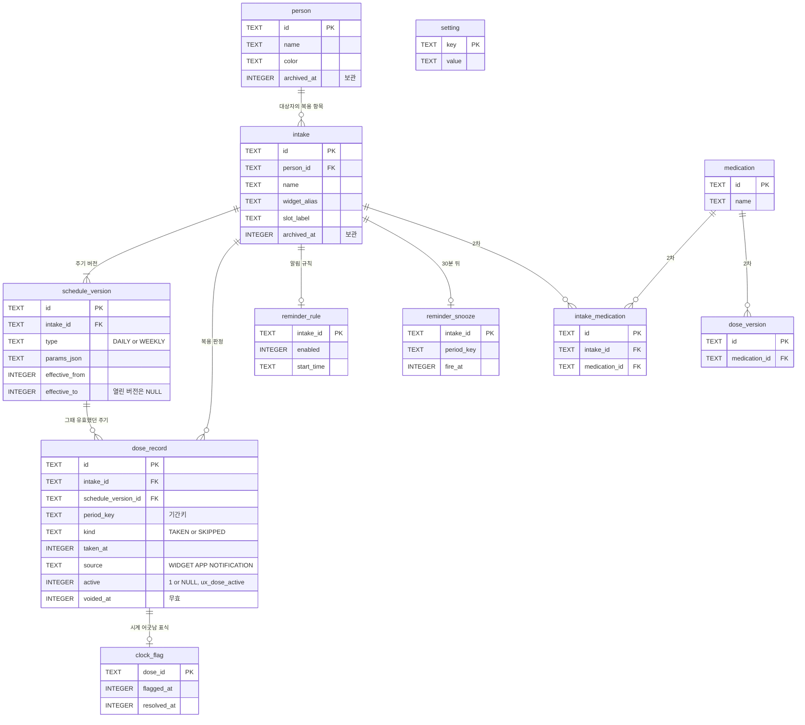

# 05 ERD: 필받음 1차 데이터

- 상태: **고정** (2026-11-13 01:04 KST, 동희님 "추천모두승인", 프로젝트 채팅. 질문은 2026-11-13 00:55 KST 프로젝트 스레드 '약봉이 1차 릴리즈 이어 가기'의 Claude 메시지 1번. 기록은 [7장](#7-고정-기록)). 1차 스키마는 Room 스키마 2(TBL-001~011) 그대로임. 고정한 뒤 표를 바꾸려면 동희님 결정이 필요하고 이주를 함께 만듦. 초안은 2026-11-12 Claude가 씀. 04 명세 고정(2026-11-13 00:16 KST)에서 5장 3을 정함(대상자 되살리기, 스키마 그대로).
- 원본: [`db/schema.sql`](../../db/schema.sql) (TBL-001~011). 그 파일은 Room이 내보낸 [스키마 2](../../shared/schemas/com.judangbang.pillbadeum.data.DidITakeDatabase/2.json)의 CREATE 문을 그대로 옮기고 표마다 TBL 번호·맥락(CTX)·명세(SPEC)·용어(TERM)를 단 것. `check_docs.py`가 두 쪽이 같은지 봄.
- 입력: [04 기능 명세](../04-functional-spec/spec.md) SPEC-001~044(고정), [01 도메인](../01-domain/domain.md) CTX-001~005·TERM-001~031.
- 이전 시안: 가쟈누님 DidITake `docs/02-design/data-model.md`. 표 구조는 그 시안으로 이미 만들어져 앱에 들어가 있음. 이번 단계는 표를 새로 짜지 않고, 01~04에서 다시 정한 말과 동작에 비춰 빠진 것·남는 것을 찾음.

## 1. 그림

GitHub에서 이 파일을 열면 그림으로 보임. 열 이름은 줄였고 전체는 `db/schema.sql`에 있음.

## 2. 표

| TBL | 표 | 맥락 | 용어 | 쓰는 명세 |
| --- | --- | --- | --- | --- |
| TBL-001 | person | CTX-002 | TERM-002 대상자, TERM-003 '나', TERM-018 보관 | SPEC-001, 004, 005, 026, 027, 044 |
| TBL-002 | intake | CTX-002 | TERM-004 복용 항목, TERM-018 보관 | SPEC-003, 006, 015, 023, 024, 025 |
| TBL-003 | schedule_version | CTX-002 | TERM-005 주기 | SPEC-003, 022, 023, 044 |
| TBL-004 | dose_record | CTX-001 | TERM-008 복용 판정, TERM-012 무효, TERM-030 활성 판정 | SPEC-007, 008, 011, 016~019, 022, 043 |
| TBL-005 | clock_flag | CTX-001 | TERM-017 시계 어긋남 표식 | SPEC-020 |
| TBL-006 | reminder_rule | CTX-003 | TERM-021 복용 알림, TERM-024 알림 설정 | SPEC-010, 028, 032 |
| TBL-007 | reminder_snooze | CTX-003 | TERM-023 30분 뒤 다시 알리기 | SPEC-012, 014 |
| TBL-008 | setting | CTX-001·003·005 | TERM-014~016 창 설정, TERM-024 알림 설정 | 4장 |
| TBL-009 | medication | 2차 | 없음 | 없음 |
| TBL-010 | intake_medication | 2차 | 없음 | 없음 |
| TBL-011 | dose_version | 2차 | 없음 | 없음 |

DB가 직접 막는 규칙은 셋:

- 활성 판정은 창마다 하나(CTX-001 핵심 규칙, SPEC-043): `ux_dose_active` UNIQUE(intake_id, period_key, active). 무효 행은 active가 NULL이라 몇 개든 남음.
- 판정이 남은 항목·버전은 지울 수 없음: 외래 키가 모두 ON DELETE NO ACTION이고 Room이 외래 키 검사를 켬(`DoseRecordDaoTest.foreignKeys_*`). 완전 삭제(SPEC-025)는 자식 표부터 지움.
- 판정 하나에 표식 하나, 항목 하나에 알림 규칙 하나·미룸 하나: 기본 키.

나머지 규칙(마지막 대상자는 보관 못 함, 열린 주기 버전은 하나, 보관된 항목만 완전 삭제)은 코드가 지킴. 표마다 `db/schema.sql` 주석에 적음.

## 3. 명세가 쓰는 데이터

| SPEC | 읽고 쓰는 데이터 |
| --- | --- |
| SPEC-001 | person에 '나'를 씀. setting `device_id`, 기기 표식 파일(표 밖) |
| SPEC-002 | 안내를 봤는지: 아직 저장하는 곳이 없음 → 5장 1 |
| SPEC-003 | intake, schedule_version을 씀. person을 읽음 |
| SPEC-004 | person을 씀 |
| SPEC-005 | person을 읽음. 위젯마다 고른 대상자는 표 밖(Glance 위젯 상태) → 5장 2 |
| SPEC-006 | person, intake, schedule_version, dose_record, clock_flag, setting `day_start`·`base_zone` |
| SPEC-007 | dose_record를 씀(source WIDGET) |
| SPEC-008 | dose_record를 읽음 |
| SPEC-009 | intake·person의 archived_at, dose_record |
| SPEC-010 | reminder_rule, reminder_snooze, dose_record, setting `reminder_*`·`quiet_*` |
| SPEC-011 | dose_record를 씀(source NOTIFICATION) |
| SPEC-012 | reminder_snooze를 씀 |
| SPEC-013 | setting `show_names_on_lock` |
| SPEC-014 | reminder_snooze를 지움, dose_record를 읽음 |
| SPEC-015 | person, intake, schedule_version, dose_record, clock_flag, setting |
| SPEC-016 | dose_record의 active·voided_at·void_reason |
| SPEC-017 | dose_record(taken_at, 고치기는 무효 + 새 행) |
| SPEC-018 | dose_record를 씀(kind SKIPPED) |
| SPEC-019 | dose_record(무효 + 새 행) |
| SPEC-020 | clock_flag |
| SPEC-021 | 없음(화면 상태만) |
| SPEC-022 | dose_record, schedule_version, intake·person의 archived_at, clock_flag, setting → 5장 3 |
| SPEC-023 | intake, schedule_version(닫고 엶) |
| SPEC-024 | intake의 archived_at, reminder_snooze |
| SPEC-025 | clock_flag, dose_record, reminder_snooze, reminder_rule, intake_medication, schedule_version, intake를 지움 |
| SPEC-026 | person |
| SPEC-027 | person의 archived_at, 위젯 상태(표 밖) |
| SPEC-028 | reminder_rule, setting `reminder_*` |
| SPEC-029 | 없음(Android 정확 알람 허용 상태) |
| SPEC-030 | 없음(Android 배터리 최적화 상태) |
| SPEC-031 | setting `quiet_start`·`quiet_end`, `reminder_*` |
| SPEC-032 | reminder_rule, reminder_snooze, setting `reminder_alarm_at`·`reminder_last_run_at` |
| SPEC-033 | setting `day_start`·`base_zone`·`window_settings_changed_at` |
| SPEC-034 | setting `show_names_on_lock` |
| SPEC-035 | 없음(Android 화면 잠금·버전을 그때 읽음) |
| SPEC-036 | 없음 |
| SPEC-037 | DB 파일 전체가 백업 대상(`backup_rules.xml`), 기기 표식 파일은 제외 |
| SPEC-038 | 기기 표식 파일, setting `device_id`·`restored_from_device_id`·`restore_notice_pending` |
| SPEC-039 | setting `restore_notice_pending`·`restore_notice_last_record_at` |
| SPEC-040 | setting `day_start`·`base_zone` |
| SPEC-041 | setting `reminder_alarm_at`·`reminder_last_run_at`, clock_flag |
| SPEC-042 | setting `base_zone` |
| SPEC-043 | dose_record의 `ux_dose_active` |
| SPEC-044 | person의 archived_at, schedule_version(되살릴 때 그 대상자 항목의 열린 버전을 보관한 때에 닫고 새로 엶, 보충 P-9) |

## 4. setting 키

| 키 | 값 | 쓰는 명세 |
| --- | --- | --- |
| `day_start` | 하루 시작 시각 `HH:MM`, 기본 04:00 (TERM-015) | SPEC-006, 033, 040 |
| `base_zone` | 기준 시간대 IANA id, 기본 Asia/Seoul (TERM-016) | SPEC-006, 033, 040, 042 |
| `window_settings_changed_at` | 위 둘을 마지막으로 바꾼 때. 그 전에 끝난 창은 고칠 수 없음(보충 P-5) | SPEC-033 |
| `show_names_on_lock` | 잠금 화면에 이름을 보일지 `true`/`false`, 기본 꺼짐 | SPEC-013, 034 |
| `reminder_interval_minutes`, `reminder_max_per_day`, `quiet_start`, `quiet_end` | 앱 전체 알림 설정(TERM-024) | SPEC-010, 028, 031 |
| `reminder_last_run_at`, `reminder_alarm_at` | 알림 계산이 마지막으로 돈 때와 예약한 알람 시각(보충 N-8, N-12) | SPEC-032, 041 |
| `device_id` | 이 설치의 id. 복원 뒤 새로 만듦(보충 R-1, R-2) | SPEC-001, 038 |
| `restored_from_device_id` | 복원한 DB가 갖고 있던 옛 `device_id` | SPEC-038 |
| `restore_notice_pending`, `restore_notice_last_record_at` | 복원 안내를 확인할 때까지 `1`, 복원 전 마지막 기록 시각 | SPEC-038, 039 |
| `intro_seen_at` | 첫 실행 안내를 다 본 때. 값이 없으면 첫 실행 안내를 보임. 05 고정(2026-11-13)에서 정하고 TASK-022에서 더함(5장 1) | SPEC-002 |
| `backup_policy` | 키만 정의돼 있고 앱이 읽거나 쓰지 않음 | 없음 |

## 5. 01~04와 대조해 찾은 것

1. **첫 실행 안내를 봤는지 둘 곳이 없음** (SPEC-002). **정함** (2026-11-13 01:04 KST 05 고정): 아래 제안대로 setting 키 `intro_seen_at`을 씀(4장, TASK-022). 지금 앱에는 첫 실행 안내 화면 자체가 없음(앱 첫 화면 아래 문구만 있음). Claude 제안: setting에 `intro_seen_at` 키를 더함. setting은 키·값 표라 스키마 버전은 그대로. 이 키는 DB와 함께 백업되므로 복원한 폰에서는 첫 실행 안내 대신 복원 안내(SPEC-039)가 뜸.
2. **위젯마다 고른 대상자를 둘 곳이 없음** (SPEC-005, TERM-026). **정함** (같은 05 고정): 아래대로 위젯마다 Glance 상태에 둠(TASK-012). 01에서 "백업되지 않음"으로 정했으므로 DB가 아니라 위젯마다 있는 Glance 상태(백업 대상이 아닌 파일)에 둠. 표는 늘지 않음. 지금 위젯은 늘 전체를 보임.
3. **대상자를 되살리면 보관했던 기간이 지난 기록에서 '빠짐'으로 바뀜** (SPEC-022, 04 명세 3장 '대상자 되살리기'). **정함** (2026-11-13 00:16 KST 04 명세 고정, 동희님 "추천 모두 승인"): 되살리기를 1차에 넣고(REQ-095, SPEC-044) 아래의 방법으로 고침(보충 P-9, TASK-053). 보관은 `archived_at` 한 칸이라, 되살릴 때 그 칸을 비우면 언제부터 언제까지 보관했는지가 남지 않음. 지난 기록은 그 칸으로 "보관 뒤 날짜는 빠짐이 아님"을 가르므로, 되살린 뒤에는 보관 기간의 창이 모두 빠짐으로 보임. 되살리기를 1차에 둔다면 스키마를 바꾸지 않고 고칠 수 있음: 되살릴 때 그 대상자 항목의 열린 주기 버전을 보관한 때에 닫고, 되살린 때부터 같은 주기로 새 버전을 엶. 주기 버전이 없는 기간은 이미 빠짐이 아님. 항목 보관에는 되살리기가 없어 이 문제가 없음.
4. **2차 표 셋(TBL-009~011)은 1차에서 쓰지 않음.** **정함** (같은 05 고정): 지우지 않고 둠. CORTHEX 검사의 "쓰지 않는 표가 없어야 함"에 걸림. Claude 판단: 지우지 않고 둠. 1차 앱은 이 표를 읽거나 쓰지 않아 늘 비어 있고, 지우려면 이주(2 → 3)와 그 시험이 필요한데 2차에서 다시 들여올 표임. 지우는 쪽을 원하시면 이주를 만듦.
5. **`backup_policy` 키는 쓰이지 않음.** (05 고정 때 그대로 둠) 백업 안내(SPEC-035)는 폰 상태를 그때 읽으므로 저장할 값이 없음. 키 정의를 지울지는 개발(11)에서 정리.

## 6. 검사

`python3 .github/scripts/check_docs.py .`가 보는 것:

- `db/schema.sql`의 표·색인 CREATE 문이 가장 높은 버전의 Room 스키마 JSON과 글자까지 같고, 표가 빠지거나 남지 않음
- 표마다 TBL 번호·맥락·명세·용어 주석이 있고, 그 번호가 01·04 문서에 있음
- 용어집의 TERM이 모두 어느 표의 `terms:`나 `without a table:` 줄에 있음
- 이 문서 3장에 모든 SPEC 행이 있음

이주가 빈 DB에서 스키마를 다시 만드는지: 새 설치는 Room이 스키마 2를 바로 만들고, 1 → 2 이주는 `MigrationTest`가 옛 스키마 1로 만든 DB를 이주한 뒤 스키마 2와 같은지 확인함(CI의 jvmTest).

## 7. 고정 기록

- 언제·누가: 2026-11-13 01:04 KST, 동희님 "추천모두승인", 프로젝트 채팅. 같은 때 "독립검토 넘어가고 개발 시작해 ㄱㄱ"라고 하셔서 PR #17의 독립 검토는 하지 않음
- 물은 것: 질문은 2026-11-13 00:55 KST 프로젝트 스레드 '약봉이 1차 릴리즈 이어 가기'의 Claude 메시지 1번 "05 데이터: 스키마 2(표 11개)를 1차 스키마로 고정할까요?" (추천: 고정). 함께 정해진다고 알린 것: 첫 실행 안내를 봤는지는 설정 키 하나(스키마 버전 그대로), 위젯마다 고른 대상자는 DB 밖 위젯 상태(01에서 정한 대로 백업 안 됨), 2차용 빈 표 셋은 지우지 않음. 반론으로 쓰지 않는 표가 남는다고 알림
- 정한 것: 1차 스키마는 Room 스키마 2(TBL-001~011) 그대로. 5장 1·2·4는 정함, 5장 5(`backup_policy`)는 개발(11)에서 정리
- 고정한 뒤 표를 바꾸려면 동희님 결정이 필요하고, 바꾸면 이주(스키마 3)와 `MigrationTest`를 함께 만듦
- 고정을 적은 커밋에서 `check_docs.py`가 "no problems"
