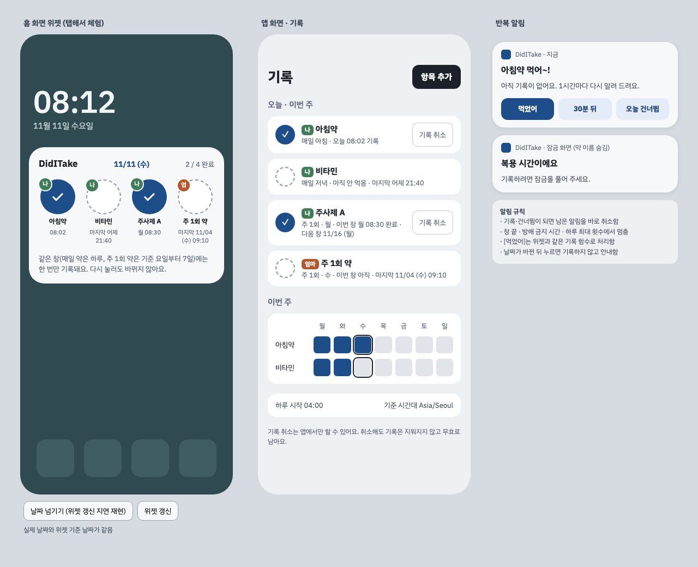

# UI 초안

- 시안 파일: [ui-mockup-v3.html](ui-mockup-v3.html). 내려받아 브라우저로 열면 위젯 탭과 "날짜 넘기기(갱신 지연)"를 직접 해볼 수 있음
- 약 이름·대상자는 가상의 예시임
- v2 시점 원본 시안을 바탕으로 [v2 검토 결과](../06-review/review-v2.md)를 반영해 다시 그림

## 1. 홈 화면 위젯

| 요소 | 내용 | 이유 |
| --- | --- | --- |
| 머리글 | 앱 이름 · 기준 날짜 `11/11 (수)` · 완료 수 | 갱신이 늦은 위젯을 눈으로 알아봄 |
| 버튼 | 항목마다 동그라미. 미완료 = 점선 빈 원, 완료 = 채움 + 체크 | `+`는 "약 추가"로 읽혀 쓰지 않음 |
| 대상자 배지 | 버튼 왼쪽 위 이니셜(나 · 엄) + 사람별 색 | 전체 보기에서 가족 약을 잘못 누르는 일을 막음 |
| 보조 문구 | 완료 = 기록 시각, 미완료 = 마지막 기록 시각 | 경계 직후·주기 직후 이중투약 방지 |
| 안내 영역 | "이미 기록됨", "날짜가 바뀌었어요" | 위젯 원칙 안내 |

동작

- 탭 = 기록. 이미 판정이 있으면 "이미 기록됨 (08:02). 변경 없음"만 안내함
- 날짜가 바뀌었는데 위젯이 이전 날짜로 그려져 있으면, 탭해도 기록하지 않고 새로고침함. 시안에서 "날짜 넘기기"를 누른 뒤 완료 칸을 탭하면 재현됨
- 위젯에서는 취소·건너뜀을 하지 않음
- 위젯마다 대상자 필터(나 / 가족 / 전체)를 둠

## 2. 앱 화면

| 영역 | 내용 |
| --- | --- |
| 오늘 · 이번 주 | 항목별 상태, 기록 시각, 마지막 기록, 주 1회 약의 다음 창 |
| 기록 취소 | 확인 대화상자를 거쳐 무효 처리함. 행은 남음 |
| 이번 주 | 매일 약의 요일별 칸 (표시는 월~일, 계산은 하루 시작 시각 기준) |
| 설정 줄 | 하루 시작 시각 · 기준 시간대 |

## 3. 반복 알림

| 요소 | 내용 |
| --- | --- |
| 제목 | "아침약 먹어~!" (위젯 별칭 사용) |
| 버튼 | 먹었어 / 30분 뒤 / 오늘 건너뜀 |
| 잠금 화면 | 약 이름 숨김 설정 시 "복용 시간이에요" |

규칙은 [planning-v3 6.12](../01-planning/planning-v3.md#612-반복-알림-신규)와 [시퀀스 5](../03-sequence/sequences.md#5-반복-알림)에 있음.

## 4. v2 시안에서 바뀐 점

| 항목 | v2 시안 | v3 |
| --- | --- | --- |
| 머리글 | 앱 이름 + 완료 수 | 기준 날짜 추가 |
| 미완료 아이콘 | `+` | 점선 빈 원 |
| 미완료 보조 문구 | 주기 (매일 저녁 등) | 마지막 기록 시각 |
| 대상자 | 항목 이름에 포함 | 이니셜 배지·색으로 분리 |
| 갱신 지연 | 다루지 않음 | 렌더 기간키 대조 안내 |
| 알림 | 없음 | 반복 알림 화면 추가 |
| 앱 설정 | 없음 | 하루 시작 시각·기준 시간대 표시 |

## 5. 구현 메모 (Android Glance)

- 위젯 안 안내 문구는 저절로 사라지지 않음. 상태 저장 + 지연 갱신으로 지우거나 시스템 토스트를 씀
- 위젯은 길게 누르기를 받을 수 없음. "탭 = 기록"을 유지함
- 버튼 터치 영역은 48dp 이상으로 함
- 접근성: 버튼 설명에 "아침약, 오늘 08:02 기록됨"처럼 상태를 함께 넣음
