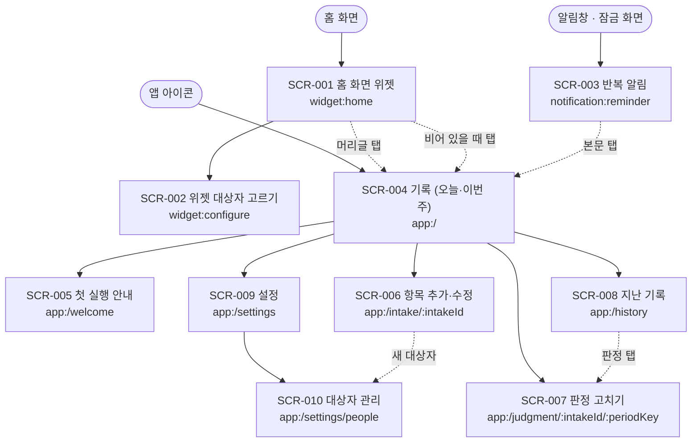

# 화면 목록과 상태 (1차 릴리즈 초안)

- 상태: **초안** (2026-11-11, Claude 작성). 화면 구조 합의 전임
- 기준: DidITake develop `7a800ac`의 [UI 초안](https://github.com/judangbang-ops/DidITake/blob/7a800ac/docs/05-ui/README.md), [시안 v3](https://github.com/judangbang-ops/DidITake/blob/7a800ac/docs/05-ui/ui-mockup-v3.html), [플로우](https://github.com/judangbang-ops/DidITake/blob/7a800ac/docs/04-flow/flows.md), [기록 규칙](https://github.com/judangbang-ops/DidITake/blob/7a800ac/docs/02-design/record-rules.md), 지금 코드(`App.kt`, `DidITakeWidget.kt`, `Labels.kt`)
- 화면 목록의 원본은 [sitemap.yaml](sitemap.yaml)이고, 1장의 그림과 표는 그 파일에서 옮겨 그림. 요구는 [requirements.md](../01-planning/requirements.md)
- 이 문서는 UI 초안을 대신하지 않음. UI 초안의 위젯·앱·알림 화면에 화면 ID와 상태를 붙이고, 1차 범위(결정 Q1)로 새로 생긴 화면을 더함

## 0. 읽는 법

- **화면 ID**: `SCR-001`부터. 상태는 `SCR-001#stale`처럼 `#` 뒤에 씀
- **상태 이름**: normal(기본), loading(불러오는 중), empty(비어 있음), error(오류), permission(권한), stale(지난 화면)은 모든 화면에서 따짐. 생기지 않는 상태는 이유를 적음. 화면에만 있는 상태(`#already`, `#skipped` 등)는 따로 붙임
- **출처**: 서버 API가 없어서 공통 코드의 함수 이름을 적음. `LoadStatusBoard`·`RecordDose`·`VoidDose`·`ChangeJudgment`·`SaveIntake`·`ArchiveIntake`·`ManagePeople`은 지금 있음. '(새로 만듦)'은 아직 없는 함수임
- **결과 → 상태**: `RecordResult`의 Recorded·Already·Stale·Gone·Error, `VoidResult`의 Voided·NotActive, `SaveIntakeResult`의 Saved·Invalid·Gone이 어느 상태로 가는지 각 화면에 적음
- **(제안)**: Claude 제안이고 확정 전임. 5장에 모아 둠
- **지금 코드**: DidITake develop `7a800ac`(이 저장소로 가져온 코드와 같음)을 Claude가 읽고 판단함(빌드·실행하지 않음)

## 1. 화면 지도

진입 지점은 셋임: 홈 화면 위젯, 알림, 앱 아이콘. 실선은 부모 → 자식, 점선은 다른 화면으로 가는 길임.

| ID | 화면 | 경로 | 누가 보나 | 플로우 | 지금 코드 |
| --- | --- | --- | --- | --- | --- |
| SCR-001 | 홈 화면 위젯 | `widget:home` | 위젯을 놓은 기기 사용자 | 1, 2, 3장 | 있음 (대상자 필터·넘칠 때 처리 없음) |
| SCR-002 | 위젯 대상자 고르기 | `widget:configure` | 위젯을 놓거나 위젯 설정을 연 사용자 | 1장 | 없음 |
| SCR-003 | 반복 알림 | `notification:reminder` | 알림 권한을 허용한 사용자. 잠금 화면은 이름 숨김(기본) | 1, 4장 | 없음 |
| SCR-004 | 기록 (오늘·이번 주) | `app:/` | 기기 사용자 | 1, 2장 | 있음 (건너뜀·경고·권한 안내 없음) |
| SCR-005 | 첫 실행 안내 | `app:/welcome` | 처음 실행한 사용자 | 1장 | 없음 |
| SCR-006 | 항목 추가·수정 | `app:/intake/:intakeId` | 기기 사용자 | 1, 4장 | 있음 (알림 설정 없음) |
| SCR-007 | 판정 고치기 | `app:/judgment/:intakeId/:periodKey` | 기기 사용자 | 2장 | 일부 (기록·취소 버튼만 첫 화면에 있음) |
| SCR-008 | 지난 기록 | `app:/history` | 기기 사용자 | 2장 | 없음 (이번 주 칸만 있음) |
| SCR-009 | 설정 | `app:/settings` | 기기 사용자 | 1장 | 없음 (첫 화면에 표시만) |
| SCR-010 | 대상자 관리 | `app:/settings/people` | 기기 사용자 | 1장 | 일부 (항목 화면에서 추가만) |

플로우 열의 장 번호는 [flows.md](https://github.com/judangbang-ops/DidITake/blob/7a800ac/docs/04-flow/flows.md)의 장임. 플로우 5장(주 1회 늦은 투약 처리)은 1차에 화면이 없음(요구 4장 1번 추천: 기준일을 옮기지 않음).

## 2. 화면별 정의

### SCR-001 홈 화면 위젯

목적: 약을 먹은 뒤 앱을 열지 않고 한 번 눌러 기록하고, 먹기 전에 이미 먹었는지 확인함. (플로우 1·3장)

| 보여 주는 것 | 출처 |
| --- | --- |
| 머리글: 앱 이름, 기준 날짜 `11/11 (수)`, `n / m 완료` (REQ-020) | `LoadStatusBoard` → `WidgetModel` |
| 항목 버튼: 대상자 배지, 위젯 별칭(없으면 이름), 미완료 = 점선 빈 원, 완료 = 채운 원과 체크 (REQ-019, REQ-027) | 같음 |
| 보조 문구: 완료면 기록 시각, 미완료면 `마지막 어제 22:00` 또는 `기록 없음` (REQ-021) | `Labels.widgetSubtitle` |
| 안내 줄: 탭 결과 문구, 10초 동안 | `Labels.recordMessage` |

| 동작 | 결과 | 실패 |
| --- | --- | --- |
| 미완료 버튼 탭 | `RecordDose`(위젯, 그려진 기간키) → Recorded: 버튼이 완료로 바뀌고 그 창의 남은 알림이 취소됨 (REQ-022, REQ-043) | 아래 상태 표의 `#already`, `#stale`, `#gone`, `#error` |
| 완료·건너뜀 버튼 탭 | 판정을 바꾸지 않음 → `#already` (REQ-023) | 없음 |
| 머리글 탭 | 앱 SCR-004가 열림 | 없음 |

| 상태 | 사용자가 보는 것과 할 수 있는 것 | 생기는 때 |
| --- | --- | --- |
| SCR-001#normal | 머리글과 버튼. 버튼 탭으로 기록 | 보이는 항목이 1개 이상 |
| SCR-001#loading | "불러오는 중…". 누를 것 없음 | 위젯을 처음 놓았거나 앱 프로세스가 내려가 있다가 다시 그릴 때 |
| SCR-001#empty | "앱에서 복용 항목을 추가해 주세요". 누르면 SCR-004 | 보관되지 않은 항목이 0개. 대상자를 고른 위젯은 그 사람 항목이 0개일 때 "엄마 항목이 없어요"로 씀 (제안) |
| SCR-001#error | "기록하지 못했어요. 앱에서 확인해 주세요". 버튼은 미완료로 남음 | `RecordResult.Error` |
| SCR-001#permission | 해당 없음. 위젯은 권한이 필요 없고, 알림 권한이 없어도 위젯 기록은 됨 | 없음 |
| SCR-001#stale | 기록하지 않고 새 날짜로 다시 그린 뒤 "날짜가 바뀌었어요. 다시 눌러 주세요" (REQ-004) | `RecordResult.Stale`: 그려진 기간키가 지금 기간키와 다름 |
| SCR-001#gone | 문구 없이 다시 그림. 그 버튼이 사라짐 (REQ-005) | `RecordResult.Gone`: 보관된 항목, 보관된 대상자의 항목 (REQ-014, REQ-017) |
| SCR-001#already | "아침약: 이미 기록됨 (08:02). 변경 없음". 건너뜀이면 "아침약: 건너뜀으로 기록됨 (09:10). 바꾸려면 앱에서" (제안) | `RecordResult.Already` |
| SCR-001#skipped | 회색으로 채운 원과 `건너뜀` 보조 문구 (제안) | 그 창의 활성 판정이 건너뜀 (REQ-033, 결정 Q1로 1차에 들어옴) |
| SCR-001#overflow | 버튼 줄이 위젯 높이를 넘으면 버튼 목록만 위젯 안에서 스크롤되고 머리글은 고정됨 (제안) | 4×2에서 버튼이 5개 이상 (한 줄 4개, 4×2에는 한 줄만 들어감) |

규칙

- 기록은 공통 `RecordDose`를 거치고, 한 창의 활성 판정은 하나뿐임 (REQ-001, REQ-003). 기준 날짜와 창은 하루 시작 시각·기준 시간대로 계산함 (REQ-002)
- 위젯은 미완료 → 복용 전이만 만듦. 취소·건너뜀 버튼이 없음 (REQ-024)
- 기본·최소 크기 4×2(250×110dp)에서 버튼과 이름이 잘리지 않음 (REQ-026, 새로 놓은 화면은 아직 확인 안 함)
- 판정·항목·대상자·설정이 바뀌면 모든 위젯을 바로 다시 그림 (REQ-007). 하루 시작 시각에 새 기준 날짜로 다시 그림 (REQ-008)
- 보이지 않는 대상자가 한 명뿐이면 배지를 숨김 (REQ-018)
- 대상자를 고른 위젯은 그 사람 항목과 그 사람 완료 수만 보임 (REQ-025)
- 백업에서 복원하면 런처가 위젯 자리를 되살린 경우에만 위젯이 다시 보임. 위젯의 대상자 선택은 DB가 아니라서 백업되지 않고 '전체'로 보임 (REQ-056, 제안)
- 홈 화면은 잠금을 푼 사람 누구나 봄. 약 이름을 숨기고 싶으면 위젯 별칭을 씀 (REQ-027)
- TalkBack은 "나 아침약, 오늘 08:02 기록됨"으로 읽음 (REQ-068, 지금 코드)

바꿀 것: 대상자 필터, `#skipped`, `#overflow`, 건너뜀 안내 문구.

### SCR-002 위젯 대상자 고르기

목적: 위젯마다 누구의 약을 보일지 고름. (플로우 1장 '위젯 배치 · 대상자 필터 선택')

| 보여 주는 것 | 출처 |
| --- | --- |
| '전체'와 보관되지 않은 대상자 목록(이름, 색) | `ManagePeople.list` |

| 동작 | 결과 | 실패 |
| --- | --- | --- |
| 대상자 고르기 | 위젯이 그 대상자로 바로 그려짐 (REQ-025) | 저장 실패 → "저장하지 못했어요. 다시 골라 주세요". 위젯은 '전체' |
| 뒤로 가기 | 위젯 놓기를 취소함 (위젯이 놓이지 않음) | 없음 |

| 상태 | 사용자가 보는 것과 할 수 있는 것 | 생기는 때 |
| --- | --- | --- |
| SCR-002#normal | 목록에서 하나를 고름 | 대상자가 두 명 이상 |
| SCR-002#loading | "불러오는 중…" | 대상자를 읽는 동안 |
| SCR-002#empty | 해당 없음. 대상자 '나'가 늘 있음 (REQ-016) | 없음 |
| SCR-002#error | "저장하지 못했어요. 다시 골라 주세요" | 저장 실패 |
| SCR-002#permission | 해당 없음 | 없음 |
| SCR-002#stale | 고른 대상자를 나중에 보관하면 그 위젯은 '전체'로 보임 (제안) | 대상자 보관 (REQ-017) |

규칙

- 보관되지 않은 대상자가 한 명뿐이면 이 화면을 띄우지 않고 '전체'로 둠 (REQ-018)
- Android 12 이상에서는 위젯을 길게 눌러 다시 고를 수 있게 함 (제안. 구현 때 공식 문서로 확인)

### SCR-003 반복 알림

목적: 위젯을 보지 못한 날에도 먹을 때를 알려 주고, 알림에서 바로 기록하거나 건너뜀. (플로우 4장)

| 보여 주는 것 | 출처 |
| --- | --- |
| 제목: "아침약 먹어~!" (위젯 별칭, 없으면 이름) (REQ-027) | 알림 예약 때 저장한 항목·기간키 |
| 본문: `마지막 어제 08:02` (제안) | `Labels.lastLabel` |
| 버튼: [먹었어] [30분 뒤] [오늘 건너뜀] (REQ-045) | 없음 |
| 잠금 화면: "복용 시간이에요"만 (REQ-046) | 설정 `show_names_on_lock` (기본 끔) |

| 동작 | 결과 | 실패 |
| --- | --- | --- |
| [먹었어] | `RecordDose`(알림, 알림의 기간키) → Recorded: 알림이 닫히고 남은 예약이 취소되고 위젯이 다시 그려짐 (REQ-043) | `#already`, `#stale`, `#error`. Gone이면 알림만 닫음 |
| [오늘 건너뜀] | `RecordDose`(건너뜀) → Recorded: 위와 같음 | 위와 같음 |
| [30분 뒤] | 알림이 닫히고 30분 뒤 한 번 다시 울림 (REQ-045) | 창 끝·방해 금지 시간이면 울리지 않음 |
| 본문 탭 | 앱 SCR-004가 열림 | 없음 |
| 밀어서 닫기 | 다음 간격에 다시 울림 (REQ-042) | 없음 |

| 상태 | 사용자가 보는 것과 할 수 있는 것 | 생기는 때 |
| --- | --- | --- |
| SCR-003#normal | 제목·본문·버튼 셋 | 알림 시각에 그 창의 판정이 없음 (REQ-041) |
| SCR-003#loading | 해당 없음. 알림은 띄울 때 필요한 값을 다 가짐 | 없음 |
| SCR-003#empty | 해당 없음. 판정이 있으면 알림을 띄우지 않음 (REQ-041, RR-21) | 없음 |
| SCR-003#error | 알림 문구를 "기록하지 못했어요. 앱에서 확인해 주세요"로 바꿈 | `RecordResult.Error` |
| SCR-003#permission | 알림이 뜨지 않음. 대신 SCR-004#permission 안내 (REQ-049) | 알림 권한 거부, 알림 채널 끔 |
| SCR-003#stale | 기록하지 않고 "날짜가 바뀌었어요. 앱에서 확인해 주세요"로 바꿈 (REQ-004) | `RecordResult.Stale`: 경계를 넘긴 뒤 누름 (RR-23) |
| SCR-003#already | "이미 기록됨 (08:02)"으로 바꾼 뒤 닫음 | `RecordResult.Already`: 위젯·앱에서 먼저 기록함 |
| SCR-003#lock | "복용 시간이에요"만. 이름 표시를 켠 경우에만 제목이 보임 (REQ-046) | 잠금 화면 |

규칙

- 버튼의 기록은 위젯과 같은 공통 `RecordDose`를 거침 (REQ-003)
- 항목마다 알림 하나. 같은 시각에 셋이면 알림 셋 (버튼이 항목마다 달라서)
- 간격·하루 최대·방해 금지 시간·창 끝에서 멈춤 (REQ-042). 기본값은 [요구 4장 3번](../01-planning/requirements.md#4-범위-확정-때-정할-것-claude-추천-기본값)
- [30분 뒤]는 하루 최대 횟수에 세지 않음 (제안)
- 기록이 취소되고 창이 열려 있으면 다시 예약함 (REQ-044). 재부팅·시각 변경·시간대 변경·업데이트·복원 뒤 다시 예약함 (REQ-047, REQ-056)
- 주 1회 약은 버튼을 [이번 주 건너뜀]으로 씀 (제안)

### SCR-004 기록 (오늘·이번 주)

목적: 오늘과 이번 주에 무엇을 먹었는지 한눈에 보고, 기록·취소·건너뜀으로 가는 첫 화면. (플로우 1·2장)

| 보여 주는 것 | 출처 |
| --- | --- |
| 머리글: "기록", [항목 추가], 그리고 [지난 기록]·[설정] (제안, 새로 만듦) | 없음 |
| 기준 날짜와 완료 수 `11/11 (수) 기준 · 2 / 3 완료` | `LoadStatusBoard` |
| 항목 줄: 상태 원, 대상자 배지, 이름, 보조 줄(주기, 기록 시각 또는 마지막 기록, 주 1회 약의 이번·다음 창) (REQ-028) | `LoadStatusBoard`, `Labels.appDetail` |
| 이번 주 칸: 매일 약의 월~일 (REQ-035) | `StatusBoard`의 `DayCell` |
| 안내 줄: 하루 시작·기준 시간대, "기록 도구이며 복용 방법은 의사·약사와 상의해 주세요" (REQ-036) | 설정 |

| 동작 | 결과 | 실패 |
| --- | --- | --- |
| [먹었어] (미완료 줄) | `RecordDose`(앱, 지금) → 완료 | Already → "이미 기록됨 (08:02). 변경 없음", Stale → `#stale`, Gone → 다시 불러옴, Error → "기록하지 못했어요. 다시 눌러 주세요" |
| [기록 취소] (완료 줄) | "기록을 취소할까요?" 확인 → `VoidDose` → 창이 열려 있으면 미완료, 알림 다시 예약 (REQ-029, REQ-044) | NotActive → 다시 불러옴 |
| [⋯] (모든 줄, 제안) | SCR-007이 열림 | 없음 |
| 줄 탭 | SCR-006 (항목 수정) | 없음 |
| [항목 추가] | SCR-006 (새 항목) | 없음 |
| [지난 기록] / [설정] | SCR-008 / SCR-009 | 없음 |

| 상태 | 사용자가 보는 것과 할 수 있는 것 | 생기는 때 |
| --- | --- | --- |
| SCR-004#normal | 위 내용 | 항목이 1개 이상 |
| SCR-004#loading | 머리글과 "불러오는 중…" (지금 코드) | 처음 읽는 동안 |
| SCR-004#empty | "아직 복용 항목이 없어요. [항목 추가]로 등록해 주세요." (지금 코드) | 보관되지 않은 항목 0개 |
| SCR-004#error | "기록을 불러오지 못했어요" + [다시 시도] (제안) | DB를 열거나 읽지 못함 |
| SCR-004#permission | 알림을 켠 항목이 있는데 알림 권한·채널이 꺼져 있으면 맨 위에 "알림이 꺼져 있어 알려 드릴 수 없어요" + [설정 열기] (REQ-049). 정확 알람이 허용되지 않았으면 "알림이 최대 10분 늦을 수 있어요" + [허용하기] (REQ-050) | 권한 상태를 화면에 올 때마다 확인 |
| SCR-004#stale | 화면을 켜 둔 채 하루 시작 시각을 넘기면 새 날짜로 다시 불러옴 (제안). 그 전에 누른 기록은 Stale → "날짜가 바뀌었어요. 다시 눌러 주세요" | 경계 시각, 앱으로 돌아올 때 |
| SCR-004#skipped | 줄에 `건너뜀 (09:10)`. 주 버튼 대신 [⋯]만 | 활성 판정이 건너뜀 (REQ-033) |
| SCR-004#future | 줄에 "기록 시각이 지금보다 뒤예요 (금 04:00). 휴대폰 시계를 확인해 주세요". [기록 취소]는 그대로 (REQ-009) | 실제 복용 시각이 지금보다 뒤인 활성 판정 (RR-19) |

규칙

- 기록·취소는 공통 `RecordDose`·`VoidDose`를 거침 (REQ-003). 기준 날짜와 이번 주 칸은 하루 시작 시각 기준임 (REQ-002)
- 버튼은 처리하는 동안 눌리지 않음. 두 번 눌러도 결과는 하나 (REQ-001)
- 보관되지 않은 대상자가 한 명뿐이면 배지를 숨김 (REQ-018)
- 기록·취소 뒤 위젯을 바로 다시 그림 (REQ-007)

바꿀 것: [지난 기록]·[설정]·[⋯] 버튼, `#error`, `#permission`, `#stale`(지금은 다시 열 때까지 갱신 안 됨, QA 5장), `#skipped`, `#future`.

### SCR-005 첫 실행 안내

목적: 처음 연 사람에게 이 앱이 기록 도구라는 것과 위젯 놓는 법을 알려 줌. 한 번만 보임. (플로우 1장 '권한 안내')

| 보여 주는 것 | 출처 |
| --- | --- |
| 1쪽: "먹었는지 헷갈릴 때, 위젯 한 번이면 돼요" + 기록 도구 안내 (REQ-036) | 없음 |
| 2쪽: 위젯 놓는 법 그림 + [위젯 추가] (런처가 지원하면) | 없음 |

| 동작 | 결과 | 실패 |
| --- | --- | --- |
| [위젯 추가] | 시스템이 위젯 놓기 확인을 띄움 (Android 8 이상, 런처가 지원할 때) | 지원하지 않으면 버튼 대신 손으로 놓는 법만 보임 |
| [시작하기] / [건너뛰기] | SCR-004. 다시 보이지 않음 | 없음 |

| 상태 | 사용자가 보는 것과 할 수 있는 것 | 생기는 때 |
| --- | --- | --- |
| SCR-005#normal | 두 쪽 | 첫 실행 |
| SCR-005#loading | 해당 없음. 읽을 데이터가 없음 | 없음 |
| SCR-005#empty | 해당 없음 | 없음 |
| SCR-005#error | [위젯 추가]를 지원하지 않는 런처 → 손으로 놓는 법 | 런처가 위젯 고정 요청을 지원하지 않음 |
| SCR-005#permission | 해당 없음. 알림 권한은 항목에서 알림을 처음 켤 때 물음 (REQ-049) | 없음 |
| SCR-005#stale | 해당 없음 | 없음 |

규칙

- 대상자 '나'는 첫 실행 때 만들어짐 (REQ-016, 지금 코드)
- 이 화면 전체가 제안임. 1차에 넣을지는 5장 3번

### SCR-006 항목 추가·수정

목적: 복용 항목을 등록·수정·삭제하고, 항목의 알림을 켬. (플로우 1장 '복용 항목 등록', 4장)

| 보여 주는 것 | 출처 |
| --- | --- |
| 이름(필수), 위젯 별칭, 대상자(+ 새 대상자), 주기(매일 / 주 1회 + 기준 요일), 시간대 표시 (REQ-012, REQ-016, REQ-027) | `SaveIntake`, `ManagePeople` |
| 알림: [알림 받기] (기본 끔), 시작 시각 (REQ-041, 제안). 간격·하루 최대·방해 금지는 SCR-009에서 (REQ-042) | 알림 규칙 (새로 만듦) |
| 주기를 바꿀 때 안내 "주기를 바꾸면 지금부터 새 일정이 적용돼요. 이번 창의 기록은 그대로 인정돼요." (REQ-010, 지금 코드) | 없음 |

| 동작 | 결과 | 실패 |
| --- | --- | --- |
| [저장] | `SaveIntake` → Saved: SCR-004로 돌아가고 위젯·알림이 다시 계산됨 | Invalid → `#error`, Gone → `#gone` |
| [알림 받기] 켜기 | Android 13 이상에서 처음이면 알림 권한을 물음 (REQ-049) | 거부 → `#permission` |
| [항목 삭제] | "항목을 삭제할까요?" 확인 → `ArchiveIntake` → 위젯·알림·오늘 목록에서 빠짐, 기록은 남음 (REQ-014) | 실패 → "삭제하지 못했어요. 다시 눌러 주세요" |
| [닫기] | 저장하지 않고 SCR-004 | 없음 |

| 상태 | 사용자가 보는 것과 할 수 있는 것 | 생기는 때 |
| --- | --- | --- |
| SCR-006#normal | 빈 입력(새 항목) 또는 저장된 값(수정) | 화면 열림 |
| SCR-006#loading | 해당 없음. 첫 화면이 가진 값으로 바로 채움 | 없음 |
| SCR-006#empty | 해당 없음. 입력 화면임 | 없음 |
| SCR-006#error | 이름 칸 옆에 "이름을 입력해 주세요". 다른 입력은 그대로 (REQ-013). 저장 실패 → "저장하지 못했어요. 다시 눌러 주세요" | `SaveIntakeResult.Invalid`, DB 오류 |
| SCR-006#permission | 알림 칸 아래 "알림 권한이 없어 알림이 오지 않아요" + [설정 열기] (REQ-049) | 알림 권한 거부 |
| SCR-006#stale | 해당 없음. 이 화면을 연 동안 다른 곳에서 항목을 바꾸는 길이 없음 | 없음 |
| SCR-006#gone | "이 항목은 삭제됐어요" 뒤 SCR-004 | `SaveIntakeResult.Gone` |

규칙

- 키보드가 열려도 [저장]에 닿음 (`imePadding`, `adjustResize`, QA D1 고침)
- 보관되지 않은 대상자가 한 명뿐이면 대상자 칸을 접고 [+ 가족 추가]만 보임 (REQ-018, 제안)

바꿀 것: 알림 칸과 권한 요청.

### SCR-007 판정 고치기

목적: 한 항목의 한 창 판정을 고침: 시각을 골라 기록, 먹은 시각 고치기, 건너뜀, 기록 취소, 건너뜀을 복용으로. (플로우 2장의 앱 전이, 기획 v3 3.3)

| 보여 주는 것 | 출처 |
| --- | --- |
| 항목 이름, 대상자, 창(매일 `11/11 (수)`, 주 1회 `11/09 (월) ~ 11/15 (일)`), 지금 판정과 시각 | 부르는 화면이 넘김 (`IntakeStatus`) |

| 판정 | 동작 | 결과 | 실패 |
| --- | --- | --- | --- |
| 없음 | [지금 먹었어] | `RecordDose`(앱, 지금) → Recorded | Already → `#already`, Stale → `#stale` |
| 없음 | [먹은 시각 고르기] | 시각 고르기 → `RecordDose`(실제 복용 시각) → 기간키는 고른 시각의 창, 입력 시각은 따로 남음 (REQ-030) | 미래 시각은 고를 수 없음 (REQ-032). 고른 시각의 창에 판정이 있으면 "11/11에 이미 기록됨 (21:30)" (REQ-031) |
| 없음 | [건너뜀] | `RecordDose`(건너뜀) → Recorded (REQ-033) | 위와 같음 |
| 복용 | [먹은 시각 고치기] | 시각 고르기 → 실제 복용 시각과 기간키를 새 시각으로 다시 계산, 입력 시각은 따로 남음 (REQ-030, 기록 규칙 6.4) | 옮겨 갈 창에 다른 판정이 있으면 저장하지 않음 (REQ-031). 미래 시각은 막힘 (REQ-032) |
| 복용 | [기록 취소] | 확인 → `VoidDose` → 무효 처리, 창이 열려 있으면 미완료와 알림 다시 예약 (REQ-006, REQ-029, REQ-044) | NotActive → 새로 불러옴 |
| 건너뜀 | [먹었어로 바꾸기] | `ChangeJudgment`: 건너뜀 무효 + 복용 저장을 한 트랜잭션으로 (REQ-034) | Already·Stale 같음 |
| 건너뜀 | [건너뜀 취소] | 확인 → `VoidDose` (REQ-029) | NotActive → 새로 불러옴 |

| 상태 | 사용자가 보는 것과 할 수 있는 것 | 생기는 때 |
| --- | --- | --- |
| SCR-007#normal | 판정에 맞는 버튼 | 화면 열림 |
| SCR-007#loading | 해당 없음. 부르는 화면이 값을 넘김. 처리하는 동안 버튼이 눌리지 않음 | 없음 |
| SCR-007#empty | 해당 없음 | 없음 |
| SCR-007#error | "기록하지 못했어요. 다시 눌러 주세요". 화면은 그대로 | `RecordResult.Error` |
| SCR-007#permission | 해당 없음 | 없음 |
| SCR-007#stale | 오늘 창을 연 채 날짜가 바뀌면 "날짜가 바뀌었어요" 뒤 닫히고 SCR-004를 새로 불러옴 | `RecordResult.Stale` |
| SCR-007#already | "이미 기록됨 (08:02)" 뒤 판정 '복용'의 버튼으로 바뀜 | `RecordResult.Already`: 위젯·알림에서 먼저 기록 |
| SCR-007#gone | "이 항목은 삭제됐어요" 뒤 닫힘 | `RecordResult.Gone` |

규칙

- 모든 동작은 공통 `RecordDose`·`VoidDose`·`ChangeJudgment`를 거침 (REQ-003). 판정이 저장되면 그 창의 남은 알림을 취소함 (REQ-043)
- 시각 고르기는 그 창의 날짜에서 시작함. 다른 날로 바꾸면 그날의 창에 기록됨 (기록 규칙 6.4). 지난 창은 SCR-008에서 엶
- 지금 `RecordCommand`에 실제 복용 시각이 없어 공통 코드에 더해야 함 (WBS)

### SCR-008 지난 기록

목적: 지난날 먹었는지, 언제 먹었는지 확인함 (가벼운 투약일기, 결정 Q1). (플로우 2장)

| 보여 주는 것 | 출처 |
| --- | --- |
| 달 바꾸기 `‹ 2026년 11월 ›`, (대상자 둘 이상이면) 대상자 고르기 (REQ-040) | 없음 |
| 날짜 줄(최신이 위): 그날 창의 항목별 판정. 복용 ✓ `08:02`, 건너뜀, 빠짐 (REQ-037) | `LoadHistory`(달, 대상자) (새로 만듦) |
| 주 1회 약: 창이 시작하는 날짜 줄에 한 번, "11/09~11/15" 표시 (REQ-039) | 같음 |

| 동작 | 결과 | 실패 |
| --- | --- | --- |
| 이전·다음 달 | 그 달을 불러옴 | `#error` |
| 판정 탭 | SCR-007 (그 창) | 없음 |
| 대상자 고르기 | 그 사람 항목만 (REQ-040) | 없음 |

| 상태 | 사용자가 보는 것과 할 수 있는 것 | 생기는 때 |
| --- | --- | --- |
| SCR-008#normal | 날짜 줄 목록 | 그 달에 창이 있음 |
| SCR-008#loading | 날짜 줄 자리에 회색 줄 | 달을 읽는 동안 |
| SCR-008#empty | "이 달에는 기록할 항목이 없었어요" | 그 달에 창이 하나도 없음 (등록 전, 모두 보관 뒤) |
| SCR-008#error | "기록을 불러오지 못했어요" + [다시 시도] | 읽기 실패 |
| SCR-008#permission | 해당 없음 | 없음 |
| SCR-008#stale | 화면을 켜 둔 채 하루 시작 시각을 넘기면 다시 불러옴 (SCR-004#stale과 같음) | 경계 시각, 돌아올 때 |
| SCR-008#future | 그 판정 옆에 경고 표시 (REQ-009) | 실제 복용 시각이 지금보다 뒤 |

규칙

- 빠짐은 끝난 창에 활성 판정이 없을 때만. 등록 전·보관 뒤 창은 칸이 없음 (REQ-038)
- 보관되지 않은 대상자가 한 명뿐이면 대상자 고르기를 숨김 (REQ-018)
- 다음 달은 이번 달까지만, 이전 달은 첫 항목을 등록한 달까지만 감
- 무효 처리한 판정은 1차에 보이지 않음 (제안)

### SCR-009 설정

목적: 날짜 계산·알림·잠금 화면 표시를 바꾸고, 알림이 오지 않을 때 고칠 곳으로 안내함. (플로우 1장 '설정')

| 보여 주는 것 | 출처 |
| --- | --- |
| 하루 시작 시각(기본 04:00), 기준 시간대(기본 Asia/Seoul) (REQ-053) | 설정 `day_start`, `base_zone` |
| 잠금 화면에 약 이름 보이기 (기본 끔) (REQ-046, REQ-053) | 설정 `show_names_on_lock` |
| 알림 간격·하루 최대·방해 금지 시간 (모든 항목 공통, 제안) | 알림 규칙 (새로 만듦) |
| 알림이 오지 않을 때: 알림 권한, 정확 알람, 배터리 최적화 상태와 [설정 열기] (REQ-049, REQ-050, REQ-051) | 시스템 상태 |
| 대상자 관리 → SCR-010 | 없음 |
| 보관된 항목과 [완전 삭제] (REQ-015, Could) | 항목(보관됨) |
| 백업 안내 "휴대폰의 Google 백업이 켜져 있으면 복용 기록이 백업돼요" (REQ-054) | 없음 |
| 앱 정보: 버전, 개인정보처리방침(브라우저로 엶), 의료 안내 (REQ-036) | 없음 |

| 동작 | 결과 | 실패 |
| --- | --- | --- |
| 하루 시작 시각·기준 시간대 바꾸기 | "바꾼 때부터 적용돼요. 지난 기록의 날짜는 그대로예요" 확인 → 저장 → 위젯·경계 알람·알림 다시 계산 (REQ-011, RR-15) | 저장 실패 → 이전 값 유지 + 안내 |
| 잠금 화면 이름 표시 바꾸기 | 다음 알림부터 적용 | 같음 |
| [완전 삭제] | 한 번 더 확인 → 항목과 판정을 지움 (REQ-015) | 같음 |
| [설정 열기] / [허용하기] | 시스템 설정 화면 | 없음 |

| 상태 | 사용자가 보는 것과 할 수 있는 것 | 생기는 때 |
| --- | --- | --- |
| SCR-009#normal | 위 내용 | 화면 열림 |
| SCR-009#loading | 값 자리에 회색 칸 | 설정을 읽는 동안 |
| SCR-009#empty | 해당 없음. 설정은 기본값이 늘 있음. 보관된 항목이 없으면 그 줄을 숨김 | 없음 |
| SCR-009#error | "저장하지 못했어요" + 이전 값 | 저장 실패 |
| SCR-009#permission | 권한 상태 줄에 꺼짐 표시와 버튼. 화면 자체는 막지 않음 | 권한 거부 |
| SCR-009#stale | 시스템 설정에서 돌아오면 권한 상태를 다시 읽음 | 돌아올 때 |

규칙

- 백업 범위 자체(REQ-055)는 화면이 아니라 매니페스트와 백업 규칙 파일로 정함

### SCR-010 대상자 관리

목적: 가족 대상자를 추가·수정·보관함. (플로우 1장 '대상자 등록')

| 보여 주는 것 | 출처 |
| --- | --- |
| 대상자 목록: 이름, 색, 항목 수. 보관된 대상자는 아래 '보관됨'에 | `ManagePeople` (수정·보관은 새로 만듦) |

| 동작 | 결과 | 실패 |
| --- | --- | --- |
| [대상자 추가] | 이름·색 입력 → 저장 (REQ-016) | 빈 이름 → 입력 옆 안내, 입력 유지 |
| 대상자 탭 → 이름·색 바꾸기 | 위젯 배지·색이 바뀜 (REQ-017) | 같음 |
| [보관] | "엄마의 항목 3개가 위젯·알림에서 빠져요. 지난 기록은 남아요" 확인 → 보관 (REQ-017) | 남은 대상자가 하나면 버튼이 없음 |
| [되살리기] (제안) | 보관을 풂 | 없음 |

| 상태 | 사용자가 보는 것과 할 수 있는 것 | 생기는 때 |
| --- | --- | --- |
| SCR-010#normal | 목록 | 화면 열림 |
| SCR-010#loading | 목록 자리에 회색 줄 | 읽는 동안 |
| SCR-010#empty | 해당 없음. '나'가 늘 있음 | 없음 |
| SCR-010#error | 입력 옆 안내 또는 "저장하지 못했어요" | 빈 이름, 저장 실패 |
| SCR-010#permission | 해당 없음 | 없음 |
| SCR-010#stale | 해당 없음 | 없음 |

규칙

- 보관되지 않은 대상자가 한 명만 남으면 그 사람은 보관할 수 없음
- 대상자가 둘 이상이 되면 위젯·앱에 배지와 대상자 고르기가 보이기 시작함 (REQ-018)
- 배지는 이름 첫 글자라 "엄마"와 "엄지"가 같아 보임. 색으로 구분함 (QA 5장 알려진 제한)

## 3. 사례 종류별 처리 (앱 전체)

| 종류 | 이 앱에서 | 보이는 곳 |
| --- | --- | --- |
| 접근 | 계정이 없음. 기기를 가진 사람은 누구나 앱·위젯을 씀. 잠금 화면에는 알림 문구만 | SCR-003#lock |
| 입력 | 빈 이름, 미래 시각, 창 밖 시각 | SCR-006#error, SCR-007 |
| 대상 | 보관된 항목·대상자의 버튼과 알림 | SCR-001#gone, SCR-003, SCR-006#gone, SCR-007#gone |
| 상태 변화 | 날짜가 바뀜, 다른 곳에서 먼저 기록 | 각 화면 `#stale`, `#already` |
| 반복 | 연타, 알림 버튼 두 번 | 활성 판정은 하나 (REQ-001). 처리 중 버튼 막음 |
| 동시성 | 위젯·앱·알림 동시 기록 | 쓰기 직렬화와 DB 유니크. 늦은 쪽은 `#already` (시퀀스 2) |
| 한도 | 하루 최대 알림, 위젯에 다 들어가지 않는 항목 수, 글자 크기 200% | SCR-003, SCR-001#overflow, REQ-066 |
| 외부 서비스 | 해당 없음. 네트워크를 쓰지 않음 (REQ-057). 개인정보처리방침만 브라우저로 엶 | SCR-009 |
| 데이터 노출 | 잠금 화면 알림(이름 숨김 기본), 홈 화면 위젯(별칭으로 가림), Google 백업에 DB가 들어감 | SCR-003#lock, SCR-001, SCR-009 |
| 빈 결과 | 항목 없음, 그 달에 창 없음. 스트리밍 응답은 해당 없음 | 각 화면 `#empty` |
| 화면 상태 | 폭 360dp, 글자 100%·200%, 위젯 4×2와 가장 크게 | REQ-066 (아직 확인 안 함) |
| AI 답 | 해당 없음. AI 기능 없음 (REQ-059) | 없음 |

## 4. 검사 결과 (2026-11-11, Claude)

- 플로우 1장에서 무언가를 보여 주는 단계는 모두 화면에 대응함: 권한 안내 → SCR-005·SCR-006·SCR-004#permission, 대상자 등록 → SCR-010·SCR-006, 복용 항목 등록 → SCR-006, 위젯 배치 → SCR-002, 위젯 확인·탭·완료 표시 → SCR-001, 알림 '먹었어' → SCR-003, 오늘·이번 주 → SCR-004, 기록 취소 → SCR-004·SCR-007, 항목 수정·삭제 → SCR-006, 설정 → SCR-009. '앱 설치'와 '약 복용'은 앱 화면이 아님
- 모든 화면은 세 진입 지점 중 하나에서 닿고, 경로가 겹치지 않고, 누가 보는지 적음 ([sitemap.yaml](sitemap.yaml))
- 화면이 쓰는 요구: 기능 요구 53개가 모두 화면 하나 이상에 있음 (`sitemap.yaml`의 `reqs`와 이 문서의 화면별 절을 스크립트로 대조함). 다만 REQ-003(공통 기록 함수)과 REQ-055(백업 범위)는 화면에 보이지 않아 코드 검사와 기기 시험으로 확인함
- 하지 않은 것: 상태별 와이어프레임을 아직 그리지 않음. 지금 있는 그림은 [시안 v3](https://github.com/judangbang-ops/DidITake/blob/7a800ac/docs/05-ui/ui-mockup-v3.html)(SCR-001·SCR-003·SCR-004 일부)뿐임. 폭 360dp·글자 200%로 실제 화면을 보지 않음

## 5. 화면에서 정할 것 (Claude 추천)

| # | 질문 | Claude 추천 | 이유 |
| --- | --- | --- | --- |
| 1 | 위젯에 항목이 많아 넘칠 때 | 버튼 목록만 위젯 안에서 스크롤, 머리글 고정 | 4×2에는 한 줄(4개)만 들어감. 가족 약을 합치면 금방 넘음 |
| 2 | 위젯의 건너뜀 표시와 문구 | 회색 채운 원 + `건너뜀`, 탭하면 "건너뜀으로 기록됨 (09:10). 바꾸려면 앱에서" | 건너뜀이 1차에 들어와 표시가 필요함(UI 초안은 확장 단계로 둠) |
| 3 | 첫 실행 안내(SCR-005)를 1차에 넣을지 | 넣음 (두 쪽, 건너뛰기 가능) | 위젯을 놓아야 이 앱의 핵심이 시작됨. 고정 요청 버튼이 노인에게 쉬움 |
| 4 | 시각 골라 기록·건너뜀을 어디서 | 첫 화면 줄의 [⋯] → SCR-007. 줄 탭은 지금처럼 항목 수정 | 지금 코드의 흐름을 덜 바꿈 |
| 5 | 알림 간격·하루 최대·방해 금지를 항목마다 둘지 | 모든 항목 공통(설정), 항목에는 켜기와 시작 시각만 | 입력이 적어야 노인도 씀 |
| 6 | 잠금 화면에서 알림 버튼을 누를 때 잠금 해제를 요구할지 | 요구하지 않음 (기록은 취소할 수 있음) | 노인에게 해제 단계가 부담. 반대: 다른 사람이 잘못 누를 수 있음 |
| 7 | 지난 기록 모양 | 날짜 줄 목록(최신이 위) | 달력 칸보다 큰 글자에서 잘 읽힘 |
