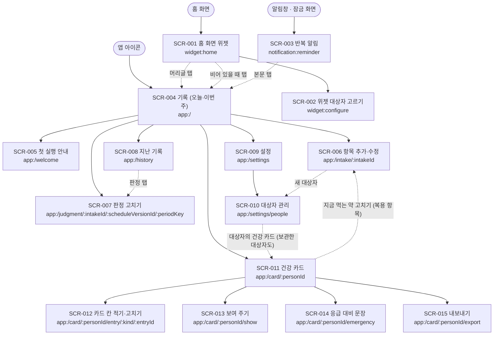

# 화면 목록과 상태 (1차 릴리즈, 2차 첫 릴리즈)

- 상태 (2차 첫 릴리즈): **07 화면 지도 확인 끝** (2026-11-23 KST, 필받음 봇이 전한 사용자님 답 "추천안 모두 승인"(07-1~07-5, 근거는 사용자님 말씀(오랑이 채팅, 2026-11-23 01시대 KST)과 필받음 봇 질문 `msg_97c052ed16f3`에 대한 오랑이 답)). **08 화면 정의 확인 끝** (2026-11-23 KST, 필받음 봇이 전한 사용자님 답 "추천안 모두 승인"(08-1~08-6, 근거는 사용자님 말씀(오랑이 채팅, 2026-11-23 01시대 KST)과 필받음 봇 질문 `msg_74425407eb6a`에 대한 오랑이 답). 08-2~08-6은 '바꿈 승인'). **09 목업 확인 끝** (2026-11-23 KST, 필받음 봇이 전한 사용자님 답 "추천안 모두 승인"(09-1~09-4, 근거는 사용자님 말씀(오랑이 채팅, 2026-11-23 01시대 KST)과 필받음 봇 질문 `msg_e1c2389f7568`에 대한 오랑이 답). 09-3은 '바꿈 승인'. 보드 25개, [09 목업 8장](../09-mockup/README.md#8-2차-첫-릴리즈-건강-카드-보드-2026-11-23-claude-기능-변경)). 08에서 한 일(Claude, 기능 변경): 2장에 SCR-011~015의 정의와 상태를 더하고 SCR-004·006·009·010을 고침(각 화면에서 '(2차)'를 붙인 줄). 화면 글자와 용어집 표준 용어의 짝은 [7장](#7-2차-첫-릴리즈-화면-글자와-표준-용어). 07 지도는 [sitemap.yaml](sitemap.yaml)에서 고치고 1장을 `draw_sitemap.py`로 다시 그림. 기록은 [6장](#6-승인-기록) 맨 아래
- 상태 (1차): **화면 정의 승인** (2026-11-13 01:04 KST, 동희님 "추천모두승인", 프로젝트 채팅. 질문은 2026-11-13 00:55 KST 프로젝트 스레드 '약봉이 1차 릴리즈 이어 가기'의 Claude 메시지 2번. 기록은 [6장](#6-승인-기록)). 07 화면 지도(1장)도 같은 답으로 확인 끝. 그 전: CORTHEX 08 다시 하기 초안 (2026-11-12, Claude). 화면 구성과 5장 7개는 2026-11-12 10:18 KST 동희님 범위 확정 그대로이고, 다시 하기에서는 흐름을 03의 FL ID로, 화면마다 보이는 04 명세(SPEC)를, 화면 글자를 01 용어(보관·완전 삭제 등)로 맞춤. 상태별 와이어프레임: TASK-044가 위젯 큰 글씨·잠금 화면·판정 고치기를 [states/](states/README.md)에 그림(2026-11-13, PR #19). 나머지는 화면 작업 PR마다 그림
- 기준: DidITake develop `7a800ac`의 [UI 초안](https://github.com/judangbang-ops/DidITake/blob/7a800ac/docs/05-ui/README.md), [시안 v3](https://github.com/judangbang-ops/DidITake/blob/7a800ac/docs/05-ui/ui-mockup-v3.html), [플로우](https://github.com/judangbang-ops/DidITake/blob/7a800ac/docs/04-flow/flows.md), [기록 규칙](https://github.com/judangbang-ops/DidITake/blob/7a800ac/docs/02-design/record-rules.md), 지금 코드(`App.kt`, `DidITakeWidget.kt`, `Labels.kt`)
- 화면 목록의 원본은 [sitemap.yaml](sitemap.yaml)이고, 1장의 그림과 표는 그 파일에서 옮겨 그림. 요구는 [requirements.md](../01-planning/requirements.md)
- 이 문서는 UI 초안을 대신하지 않음. UI 초안의 위젯·앱·알림 화면에 화면 ID와 상태를 붙이고, 1차 범위(결정 Q1)로 새로 생긴 화면을 더함. 화면이 따르는 기록 규칙은 원본 [기록 규칙](https://github.com/judangbang-ops/DidITake/blob/7a800ac/docs/02-design/record-rules.md)과 [기록 규칙 보충](../04-spec/record-rules-supplement.md)(규칙 ID `S-1`, `P-2` 등)임

## 0. 읽는 법

- **화면 ID**: `SCR-001`부터. 상태는 `SCR-001#stale`처럼 `#` 뒤에 씀
- **상태 이름**: normal(기본), loading(불러오는 중), empty(비어 있음), error(오류), permission(권한), stale(지난 화면)은 모든 화면에서 따짐. 생기지 않는 상태는 이유를 적음. 화면에만 있는 상태(`#already`, `#skipped` 등)는 따로 붙임
- **출처**: 서버 API가 없어서 공통 코드의 함수 이름을 적음. `LoadStatusBoard`·`RecordDose`·`VoidDose`·`ChangeJudgment`·`SaveIntake`·`ArchiveIntake`·`ManagePeople`은 지금 있음. '(새로 만듦)'은 아직 없는 함수임(`RecordInWindow`, `LoadHistory` 등)
- **결과 → 상태**: `RecordResult`의 Recorded·Already·Stale·Gone·Error, `VoidResult`의 Voided·NotActive, `SaveIntakeResult`의 Saved·Invalid·Gone이 어느 상태로 가는지 각 화면에 적음
- **(제안)**: Claude가 정한 작은 것이고 범위 확정 카드에서 따로 묻지 않았음. 5장 7개는 확정됨. 이 문서의 제안 다섯(SCR-001#empty의 대상자 문구, SCR-003 주 1회 [이번 주 건너뜀], SCR-004#error, SCR-004#stale, SCR-008 무효 판정 숨김)은 2026-11-13 화면 정의 승인 때 함께 승인됨(6장). 승인 뒤 바꾸려면 동희님 결정이 필요함
- **지금 코드**: 이 저장소 main(2026-11-12 `843a737`, DidITake `7a800ac` 프로토타입에서 패키지 이름만 바뀜)을 Claude가 읽고 판단함(기기에서 실행하지 않음)

## 1. 화면 지도

진입 지점은 셋임: 홈 화면 위젯, 알림, 앱 아이콘. 실선은 부모 → 자식, 점선은 다른 화면으로 가는 길임.

<!-- sitemap:start -->

| ID | 화면 | 경로 | 누가 보나 | 흐름 | 지금 코드 |
| --- | --- | --- | --- | --- | --- |
| SCR-001 | 홈 화면 위젯 | `widget:home` | 위젯을 놓은 기기 사용자 | FL-001, FL-002, FL-006, FL-009, FL-010 | 있음 (대상자 필터·넘칠 때 처리는 없음) |
| SCR-002 | 　위젯 대상자 고르기 | `widget:configure` | 위젯을 놓거나 위젯 설정을 연 기기 사용자 | FL-001, FL-009 | 없음 |
| SCR-003 | 반복 알림 | `notification:reminder` | 알림 권한을 허용한 기기 사용자. 잠금 화면에서는 약 이름을 숨김(기본) | FL-003, FL-009 | 없음 |
| SCR-004 | 기록 (오늘·이번 주) | `app:/` | 기기 사용자 | FL-001, FL-004, FL-005, FL-006, FL-007, FL-009, FL-010, FL-011, FL-012 | 있음 (건너뜀·미래 시각 경고·권한 안내는 없음) |
| SCR-005 | 　첫 실행 안내 | `app:/welcome` | 처음 실행한 기기 사용자 | FL-001 | 없음 |
| SCR-006 | 　항목 추가·수정 | `app:/intake/:intakeId` | 기기 사용자 | FL-001, FL-006, FL-007, FL-011 | 있음 (알림 설정·권한 요청은 없음) |
| SCR-007 | 　판정 고치기 | `app:/judgment/:intakeId/:scheduleVersionId/:periodKey` | 기기 사용자 | FL-004, FL-005 | 일부 (기록·취소만 첫 화면 버튼으로 있음) |
| SCR-008 | 　지난 기록 | `app:/history` | 기기 사용자 | FL-005 | 없음 (첫 화면의 이번 주 칸만 있음) |
| SCR-011 | 　건강 카드 | `app:/card/:personId` | 기기 사용자 | FL-006, FL-011, FL-012, FL-013, FL-014 | 없음 (2차 첫 릴리즈에서 만듦) |
| SCR-012 | 　　카드 칸 적기·고치기 | `app:/card/:personId/entry/:kind/:entryId` | 기기 사용자 | FL-011 | 없음 (2차 첫 릴리즈에서 만듦) |
| SCR-013 | 　　보여 주기 | `app:/card/:personId/show` | 잠금을 푼 기기 사용자. 잠금 화면 위에는 띄우지 않음(REQ-107) | FL-012 | 없음 (2차 첫 릴리즈에서 만듦) |
| SCR-014 | 　　응급 대비 문장 | `app:/card/:personId/emergency` | 기기 사용자 | FL-013 | 없음 (2차 첫 릴리즈에서 만듦) |
| SCR-015 | 　　내보내기 | `app:/card/:personId/export` | 기기 사용자 | FL-014 | 없음 (2차 첫 릴리즈에서 만듦) |
| SCR-009 | 　설정 | `app:/settings` | 기기 사용자 | FL-006, FL-007, FL-008, FL-015 | 없음 (첫 화면에 하루 시작·기준 시간대 표시만 있음) |
| SCR-010 | 　　대상자 관리 | `app:/settings/people` | 기기 사용자 | FL-006, FL-011 | 일부 (항목 화면에서 대상자 추가만 있음) |
<!-- sitemap:end -->

그림과 표는 [sitemap.yaml](sitemap.yaml)에서 `.github/scripts/draw_sitemap.py`가 그림(2026-11-12 07 다시 하기). 흐름 열은 [03 흐름](../03-user-flow/README.md)의 FL ID이고, 들여 쓴 화면은 위 화면의 자식임. 시안의 플로우 5장(주 1회 늦은 투약 처리)은 1차에 화면이 없음(요구 4장 1번 확정: 기준일을 옮기지 않고 마지막 복용을 크게 보임).

## 2. 화면별 정의

### SCR-001 홈 화면 위젯

목적: 약을 먹은 뒤 앱을 열지 않고 한 번 눌러 기록하고, 먹기 전에 이미 먹었는지 확인함. (FL-001, FL-002, FL-006, FL-009, FL-010)

명세: SPEC-005, SPEC-006, SPEC-007, SPEC-008, SPEC-009, SPEC-020, SPEC-024, SPEC-027, SPEC-039, SPEC-040, SPEC-042, SPEC-043

목업 (09, 2안 요일 약통): [캔버스](https://claude.ai/artifact/QW5JRsx1Zpz5ekeqHmjpKC)의 보드 [`BoxWidget`](../09-mockup/boards/BoxWidget.dc.html), [`BoxWidget200`](../09-mockup/boards/BoxWidget200.dc.html)

상태 그림 (TASK-044): [위젯 두 배치](states/README.md#2-위젯-두-배치-scr-001). 가로 4개와 요일 약통을 4×2·글자 100%·200%로 견주고, 안내 줄이 보이는 10초도 그림

| 보여 주는 것 | 출처 |
| --- | --- |
| 머리글: 요일 칩 `수`, `앱 이름 · 11/11`(기준 날짜), `n / m 완료`, 건너뜀이 있으면 `· 건너뜀 k`. `n / m`만 굵게 (REQ-020, 09 BoxWidget). 한 줄에 다 들어가지 않으면 수가 둘째 줄 오른쪽으로 감 (TASK-014) | `LoadStatusBoard` → `WidgetModel` |
| 항목 버튼(칸): 대상자 이름, 위젯 별칭(없으면 이름), 칸 색은 대상자 색. 미완료 = 옅은 칸과 점선 빈 원, 복용 = 진한 칸과 흰 원 안의 체크, 건너뜀 = 회색 칸과 회색으로 채운 원 (REQ-019, REQ-027, 09 BoxWidget). 대상자 이름과 항목 이름이 한 줄에 다 들어가지 않으면 대상자 이름을 위 줄로 올림 (TASK-014) | 같음 |
| 보조 문구: 복용이면 기록 시각, 건너뜀이면 `건너뜀`, 미완료면 `마지막 복용 어제 22:00` 또는 `기록 없음`, 그보다 늦은 건너뜀이 있으면 둘째 줄 `어제 건너뜀` (REQ-021). 날짜 글자는 보충 S-2의 표. 시각은 기기 시간대 (REQ-082) | `Labels.widgetLines` |
| 주 1회 미완료 버튼: `마지막 복용 어제(일) 22:00`을 이름과 같은 글자 크기로 (REQ-075) | 같음 |
| 안내 줄: 탭 결과 문구, 10초 동안 머리글 자리에 (제안, TASK-044: 글자 200%에서 머리글과 함께 두면 목록 창이 약 20px만 남음) | `Labels.recordMessage` |
| 복원 안내 줄: `복원됨 · 마지막 기록 11/09 21:40 · 앱에서 확인` (REQ-073) | 설정 `restore_notice_pending` (새로 만듦) |
| 넘침 표시: 넘치는 동안 목록 아래 가운데에 글자 없는 작은 아래 화살표, TalkBack은 '더 있음' (REQ-078, 09 목업 확인 2026-11-12 19:11) | 없음 |

| 동작 | 결과 | 실패 |
| --- | --- | --- |
| 미완료 버튼 탭 | `RecordDose`(위젯, 그려진 기간키) → Recorded: 버튼이 완료로 바뀌고 그 창의 남은 알림이 취소됨 (REQ-022, REQ-043) | 아래 상태 표의 `#already`, `#stale`, `#gone`, `#error` |
| 완료·건너뜀 버튼 탭 | 판정을 바꾸지 않음 → `#already` (REQ-023) | 없음 |
| 경고(`!`) 버튼 탭 | 판정을 바꾸지 않음, `앱에서 확인` (REQ-009) | 없음 |
| 머리글·복원 안내 줄 탭 | 앱 SCR-004가 열림 | 없음 |

| 상태 | 사용자가 보는 것과 할 수 있는 것 | 생기는 때 |
| --- | --- | --- |
| SCR-001#normal | 머리글과 버튼. 버튼 탭으로 기록 | 보이는 항목이 1개 이상 |
| SCR-001#loading | "불러오는 중…". 누를 것 없음 | 위젯을 처음 놓았거나 앱 프로세스가 내려가 있다가 다시 그릴 때 |
| SCR-001#empty | "앱에서 복용 항목을 추가해 주세요". 누르면 SCR-004 | 보관되지 않은 항목이 0개. 대상자를 고른 위젯은 그 사람 항목이 0개일 때 "엄마 항목이 없어요"로 씀 (제안) |
| SCR-001#error | "기록하지 못했어요. 앱에서 확인해 주세요". 버튼은 미완료로 남음 | `RecordResult.Error` |
| SCR-001#permission | 해당 없음. 위젯은 권한이 필요 없고, 알림 권한이 없어도 위젯 기록은 됨 | 없음 |
| SCR-001#stale | 기록하지 않고 새 날짜로 다시 그린 뒤 "날짜가 바뀌었어요. 다시 눌러 주세요" (REQ-004) | `RecordResult.Stale`: 그려진 기간키가 지금 기간키와 다름 |
| SCR-001#gone | 문구 없이 다시 그림. 그 버튼이 사라짐 (REQ-005) | `RecordResult.Gone`: 보관된 항목, 보관된 대상자의 항목 (REQ-014, REQ-017), 앱 데이터를 지운 뒤 남은 위젯 버튼 (REQ-092) |
| SCR-001#already | "아침약: 이미 기록됨 (08:02). 변경 없음". 건너뜀이면 "아침약: 건너뜀으로 기록됨 (09:10). 바꾸려면 앱에서" (REQ-023, 화면 5장 2번) | `RecordResult.Already` |
| SCR-001#skipped | 회색으로 채운 원과 `건너뜀`. 머리글의 완료 수에 넣지 않고 `건너뜀 k`로 따로 셈 (REQ-019, REQ-020, 화면 5장 2번) | 그 창의 활성 판정이 건너뜀 (REQ-033, 결정 Q1로 1차에 들어옴) |
| SCR-001#overflow | 버튼 목록만 위젯 안에서 스크롤되고 머리글은 고정됨. 넘치는 동안 글자 없는 아래 화살표를 늘 보임 (REQ-078, 화면 5장 1번, 09 목업 확인 2026-11-12 19:11). 기술 시험(TASK-042)에서 목록 안 버튼의 탭 기록이 안 되면 `+2 더 있음 · 앱에서 보기`로 앱을 엶 | 목록이 위젯에 다 들어가지 않을 때. 4×2·글자 100%는 보통 항목 5개부터(한 줄에 둘), 큰 글자는 항목 2개부터(한 줄에 하나). 안내 줄이 보이는 10초 동안과 문구가 긴 항목은 더 일찍 ([TASK-044 그림](states/README.md#2-위젯-두-배치-scr-001)) |
| SCR-001#restored | 머리글 아래 `복원됨 · 마지막 기록 11/09 21:40 · 앱에서 확인`. 버튼 탭 기록은 그대로 됨 (REQ-073, 보충 R-3) | 복원을 감지한 뒤 앱에서 [확인했어요]를 누르기 전 |
| SCR-001#reconfigure | 버튼 없이 "위젯을 다시 설정해 주세요"(대상자 보관이면 "대상자가 보관됐어요. 위젯을 다시 설정해 주세요"). 누르면 SCR-002 (REQ-079) | 위젯이 고른 대상자를 보관함. 복원 뒤 대상자가 둘 이상인데 위젯의 선택을 알 수 없음 |
| SCR-001#clock | 그 버튼에 `!`와 `앱에서 확인`. 탭해도 판정을 바꾸지 않음 (REQ-009, 보충 C-2) | 휴대폰 시계가 틀린 채 기록돼 풀리지 않은 경고가 있는 판정의 창이 지금 창일 때. 그 창이 오기 전에는 앱에만 경고가 보임 (2026-11-12 검토 B9) |

규칙

- 기록은 공통 `RecordDose`를 거치고, 한 창의 활성 판정은 하나뿐임 (REQ-001, REQ-003). 기준 날짜와 창은 하루 시작 시각·기준 시간대로 계산함 (REQ-002)
- 위젯은 미완료 → 복용 전이만 만듦. 취소·건너뜀 버튼이 없음 (REQ-024)
- 기본 크기와 가장 작은 크기 모두 실제 4×2 칸(Pixel 5 세로 약 350×213dp)이고 그보다 작게 줄지 않음. 이 크기에서 글자 100%와 가장 큰 크기 모두 버튼, 이름, 마지막 복용 시각, 안내 줄이 잘리지 않음 (REQ-026, REQ-066). 배치는 요일 약통(09 목업): 한 줄에 둘이고, 칸 글자 폭이 주 1회 날짜·시각 묶음(`11/02(월) 08:10`)보다 좁아지면 한 줄에 하나(350dp 위젯은 글자 130% 이상으로 봄, TASK-014에서 확인). 가로 4개는 글자 100%에서도 이름과 마지막 복용이 잘려 쓰지 않음 ([TASK-044 그림](states/README.md#2-위젯-두-배치-scr-001), 2026-11-13). 구현(TASK-014, [PR #19](https://github.com/judangbang-ops/pillbadeum_release/pull/19)): 가장 작은 크기는 270×110dp(Pixel 세로 4열의 세 칸보다 넓고 Android 5열 표의 네 칸 안, Claude 계산). 그 값은 폭 360dp에서 4×3으로 놓여(BUG-005) [PR #31](https://github.com/judangbang-ops/pillbadeum_release/pull/31)에서 에뮬레이터 Pixel 런처로 잰 칸에 맞춰 고침: Android 12 이상 270×102dp(`targetCell` 4×2), 8~11 230×102dp. API 34·36·30·26의 기본 폭과 폭 360dp에서 4×2로 놓이고 4×2보다 줄지 않음(화면 바꾸기가 아니라 이 규칙대로 되게 한 것). 한 줄에 둘·하나, 머리글 두 줄, 이름 위의 대상자, 화살표는 위젯 크기와 글자 배율로 `WidgetLayout`이 정하고, 글은 띄어쓰기에서만 줄을 바꿈(한글 낱말 사이에 U+2060). 렌더 시험(`WidgetRenderTest`)으로 확인한 것과 못 한 것은 [상태 그림 2장의 구현 확인](states/README.md#2-위젯-두-배치-scr-001)
- 위젯 맨 위(머리글, 또는 10초 동안 그 자리의 탭 안내)는 위젯 위 여백과 목록 앞 간격을 품은 한 버튼으로 높이 48dp 이상이고, 복원 띠와 다시 설정 띠도 48dp 이상임 (REQ-067). 구현(TASK-030, 2026-11-14): 머리글 줄만 눌리던 때는 298×28dp였음(접근성 점검 첫 실행). 요일 칩은 그대로 위에서 10dp이고 목록이 4dp 아래에서 시작함. 렌더 시험이 보이는 눌리는 뷰마다 가로세로 48dp 이상인지 봄. 승인 뒤 바꾼 것이라 6장에 적음
- 판정·항목·대상자·설정이 바뀌면 모든 위젯을 바로 다시 그림 (REQ-007). 하루 시작 시각에 새 기준 날짜로 다시 그림 (REQ-008). 재부팅·시각 변경·시간대 변경·업데이트 뒤 다음 경계 갱신을 다시 예약함 (REQ-084)
- 보관되지 않은 대상자가 한 명뿐이면 배지를 숨기고, TalkBack도 대상자 이름을 읽지 않음 (REQ-018)
- 대상자를 고른 위젯은 그 사람 항목과 그 사람 완료 수만 보임 (REQ-025). 구현(TASK-012, [PR #19](https://github.com/judangbang-ops/pillbadeum_release/pull/19)): 선택은 위젯마다 Glance 상태의 `person_choice`(전체는 `*`)에 둠. 대상자가 둘 이상인 동안은 한 사람만 보이는 위젯에도 칸의 이름 위 대상자를 그대로 보임(REQ-018과 같은 규칙, Claude 선택)
- 백업에서 복원하면 런처가 위젯 자리를 되살린 경우에만 위젯이 다시 보임 (REQ-056). 위젯의 대상자 선택은 DB 밖이라 백업되지 않음. 선택이 없는 위젯은 대상자가 둘 이상이면 '전체'로 바꾸지 않고 `#reconfigure`로 보임. 대상자 고르기가 들어오기 전부터 놓인 위젯은 그 업데이트에서 선택을 '전체'로 써 둠 (REQ-079, 보충 R-3). 구현(TASK-012): 앱이 처음 DB를 열 때 한 번, 선택이 없는 놓인 위젯을 '전체'로 채움. 그 설치가 복원으로 시작했으면 채우지 않음. 한 번 했다는 표시는 백업되지 않는 폴더(`noBackupFilesDir`)에 둠
- 구현(TASK-012): `#reconfigure`는 머리글의 완료 수와 칸을 그리지 않고 안내 띠 하나만 그림. 띠를 누르면 SCR-002. 그 전에 그려진 칸이 남아 눌려도 기록하지 않음(SPEC-009). `#empty`의 대상자 문구("엄마 항목이 없어요")도 그림
- 홈 화면은 잠금을 푼 사람 누구나 봄. 약 이름을 숨기고 싶으면 위젯 별칭을 씀 (REQ-027)
- TalkBack은 복용 "아침약, 복용함, 오늘 08:02", 건너뜀 "아침약, 건너뜀", 미완료 "아침약, 미완료, 마지막 복용 어제 22:00"으로 읽음. 주 1회는 요일까지 읽고, 대상자가 둘 이상이면 이름 앞에 대상자를 읽음 (REQ-068, 보충 S-4·W-3). 코드는 [PR #19](https://github.com/judangbang-ops/pillbadeum_release/pull/19)부터 이 문장대로 읽음(`Labels.spoken`, 기기 확인 전)

바꿀 것: 대상자 필터, 건너뜀 표시와 완료 수, 마지막 복용 문구, 주 1회 마지막 복용 크기, `#overflow`, `#restored`, `#reconfigure`, `#clock`, 큰 글씨 배치, TalkBack 문장.

### SCR-002 위젯 대상자 고르기

목적: 위젯마다 누구의 약을 보일지 고름. (FL-001, FL-009)

명세: SPEC-005, SPEC-027

목업 (09, 2안 요일 약통): [캔버스](https://claude.ai/artifact/QW5JRsx1Zpz5ekeqHmjpKC)의 보드 [`WidgetPick`](../09-mockup/boards/WidgetPick.dc.html)

| 보여 주는 것 | 출처 |
| --- | --- |
| '전체'와 보관되지 않은 대상자 목록(이름, 색) | `ManagePeople.list` |

| 동작 | 결과 | 실패 |
| --- | --- | --- |
| 대상자 고르기 | 위젯이 그 대상자로 바로 그려짐 (REQ-025) | 저장 실패 → "저장하지 못했어요. 다시 골라 주세요". 위젯은 '전체' |
| 뒤로 가기 | 위젯 놓기를 취소함 (위젯이 놓이지 않음) | 없음 |

| 상태 | 사용자가 보는 것과 할 수 있는 것 | 생기는 때 |
| --- | --- | --- |
| SCR-002#normal | 목록에서 하나를 고름 | 대상자가 두 명 이상 |
| SCR-002#loading | "불러오는 중…" | 대상자를 읽는 동안 |
| SCR-002#empty | 해당 없음. 보관되지 않은 대상자가 늘 한 명 이상 있음 (REQ-093) | 없음 |
| SCR-002#error | "저장하지 못했어요. 다시 골라 주세요" | 저장 실패 |
| SCR-002#permission | 해당 없음 | 없음 |
| SCR-002#stale | 고른 대상자를 나중에 보관하면 그 위젯은 '전체'로 바꾸지 않고 SCR-001#reconfigure를 보임 (REQ-079, 검토 B7) | 대상자 보관 (REQ-017) |

규칙

- 고를 수 있는 것은 '한 명' 또는 '전체'임 (REQ-025, 요구 4장 4번 확정)
- 보관되지 않은 대상자가 한 명뿐이면 이 화면을 띄우지 않고 '전체'로 둠 (REQ-018)
- Android 12 이상에서는 위젯을 길게 눌러 다시 고를 수 있게 함 (제안). 공식 문서([앱 위젯 설정](https://developer.android.com/develop/ui/views/appwidgets/configuration), [Glance 설정](https://developer.android.com/develop/ui/compose/glance/configuration), 2026-11-13 읽음)대로 위젯 정보에 `widgetFeatures="reconfigurable"`을 둬 구현함(TASK-012). `configuration_optional`은 놓을 때 고르기를 건너뛰게 해 쓰지 않음. 런처에서의 확인은 에뮬레이터 전
- 구현(TASK-012, [PR #19](https://github.com/judangbang-ops/pillbadeum_release/pull/19)): 대상자를 읽는 0.4초 동안은 아무것도 그리지 않아 런처가 그대로 보이고, 더 걸리면 "불러오는 중…"을 보임(Claude 기본값). 대상자가 한 명이면 화면을 그리지 않고 '전체'로 놓음. 대상자를 읽지 못하면 '전체'만 보임. 고르면 위젯을 바로 다시 그림(설정 화면이 있는 위젯에는 시스템이 첫 갱신을 보내지 않음, 공식 문서)
- 저장 실패(Claude 선택. 2026-11-13 09:33 KST 동희님이 그대로 두기로 정함, 6장): 동작 표의 "위젯은 '전체'"대로 하지 못함. '전체'도 같은 저장소에 써야 해서, 문구를 보이고 화면을 그대로 둠. 다시 고르거나 [취소]·뒤로 가기를 누름. 놓던 위젯은 놓이지 않고, 이미 놓인 위젯은 전과 같음

### SCR-003 반복 알림

목적: 위젯을 보지 못한 날에도 먹을 때를 알려 주고, 알림에서 바로 기록하거나 건너뜀. (FL-003, FL-009)

명세: SPEC-010, SPEC-011, SPEC-012, SPEC-013, SPEC-014, SPEC-039, SPEC-042, SPEC-043

목업 (09, 2안 요일 약통): [캔버스](https://claude.ai/artifact/QW5JRsx1Zpz5ekeqHmjpKC)의 보드 [`Notif`](../09-mockup/boards/Notif.dc.html)

상태 그림 (TASK-044): [잠금 화면 여덟 칸](states/README.md#3-잠금-화면-여덟-칸-scr-003). 아래 표와 PR #15 실험 결과를 옮겨 그림

| 보여 주는 것 | 출처 |
| --- | --- |
| 제목: "아침약 먹어~!" (위젯 별칭, 없으면 이름) (REQ-027) | 알림 예약 때 저장한 항목·기간키 |
| 본문: `마지막 복용 어제 08:02` (REQ-021의 문구). 주 1회 약은 본문 첫 줄에 `마지막 복용 어제(일) 22:00` (REQ-075). 늦은 건너뜀이 있으면 둘째 줄에 `어제 건너뜀`(펼쳤을 때). 시각은 기기 시간대 (REQ-082) | `ReminderLabels.text` (위젯과 같은 `Labels.lastTaken`·`laterSkip`) |
| 버튼: [먹었어] [30분 뒤] [오늘 건너뜀] (REQ-045, REQ-088). 잠금 화면에서는 이름 표시를 켠 경우에만 (REQ-076) | 없음 |
| 잠금 화면: 이름 표시 끔(기본)이면 따로 띄운 "복용 시간이에요" 알림만 (REQ-046) | 설정 `show_names_on_lock` (기본 끔) |

잠금 화면과 버튼 (REQ-046, REQ-076, 화면 5장 6번, 검토 B2)

| 이름 표시 | 잠금 화면 | 잠금을 푼 화면 |
| --- | --- | --- |
| 끔 (기본) | 항목 알림은 보이지 않음(`VISIBILITY_SECRET`). 따로 띄운 알림 하나(`VISIBILITY_PUBLIC`): 제목 "복용 시간이에요", 본문 없음, 버튼 없음. 누르면 잠금 해제 뒤 SCR-004 | 항목 알림마다 제목 "아침약 먹어~!", 본문, 버튼 셋. "복용 시간이에요" 줄이 하나 더 보임 |
| 켬 | 항목 알림(`VISIBILITY_PRIVATE`, 공개용 판 "복용 시간이에요"): 기기가 '내용 표시'면 제목, 본문, 버튼 셋이고 버튼은 잠금 해제 없이 기록함. 기기가 '내용 숨김'이면 공개용 판만 | 항목 알림마다 제목, 본문, 버튼 셋 |

방법은 [잠금 화면 알림 실험](https://github.com/judangbang-ops/pillbadeum_release/blob/e862b05/docs/07-qa/2026-11-12-lockscreen-experiment/report.md)(PR #15, 에뮬레이터 API 26·30·34·36)으로 정함(04 명세 고정, 2026-11-13 00:16 KST 동희님 "추천 모두 승인"). 처음 계획한 공개용 판(`setPublicVersion`)만으로는 기기가 '내용 표시'일 때 잠금 화면에 약 이름과 버튼이 나왔음(실험 방법 1). 끔의 방법(실험 방법 5)은 두 기기 설정과 네 API 모두에서 이름을 가렸음. 켬의 방법은 Claude가 정함: `PUBLIC` 항목(실험 방법 7)은 기기가 '내용 숨김'이어도 이름이 보여 SPEC-013의 '기기 설정을 따름'을 어기므로 `PRIVATE` + 공개용 판을 씀. 따로 띄운 알림은 항목 알림이 모두 없어지면 함께 지우고(보충 N-13), 그 알림 때문에 소리가 한 번 더 나지 않게 함(TASK-025). 갤럭시(One UI)는 에뮬레이터와 다를 수 있어 이름 표시 끔·켬 × 잠금·해제 × 기기 설정 두 가지 여덟 칸을 TASK-025 바로 뒤에 실기기로 확인함 (TASK-052, REQ-046 합격 기준).

| 동작 | 결과 | 실패 |
| --- | --- | --- |
| [먹었어] | `RecordDose`(알림, 알림의 기간키) → Recorded: 알림이 닫히고 남은 예약이 취소되고 위젯이 다시 그려짐 (REQ-043) | `#already`, `#stale`, `#error`. Gone이면 알림만 닫음 |
| [오늘 건너뜀] | `RecordDose`(건너뜀) → Recorded: 위와 같음 | 위와 같음 |
| [30분 뒤] | 알림이 닫히고 30분 뒤 한 번 다시 울림(방해 금지여도 울림). 여러 번 누르면 마지막 것만 남음 (REQ-088, 보충 N-7) | 30분 뒤가 창 끝과 같거나 그 뒤면 미루지 않음. 창 끝까지 30분이 안 남은 때 띄운 알림에는 이 버튼이 없음 (2026-11-12 검토 B4) |
| 본문 탭 | 앱 SCR-004가 열림 | 없음 |
| 밀어서 닫기 | 다음 간격에 다시 울림 (REQ-042) | 없음 |

| 상태 | 사용자가 보는 것과 할 수 있는 것 | 생기는 때 |
| --- | --- | --- |
| SCR-003#normal | 제목·본문·버튼 셋 | 알림 시각에 그 창의 판정이 없음 (REQ-041) |
| SCR-003#loading | 해당 없음. 알림은 띄울 때 필요한 값을 다 가짐 | 없음 |
| SCR-003#empty | 해당 없음. 판정이 있으면 알림을 띄우지 않음 (REQ-041, RR-21) | 없음 |
| SCR-003#error | 알림 문구를 "기록하지 못했어요. 앱에서 확인해 주세요"로 바꿈 | `RecordResult.Error` |
| SCR-003#permission | 알림이 뜨지 않음. 대신 SCR-004#permission 안내 (REQ-089) | 알림 권한 거부, 알림 채널 끔 |
| SCR-003#stale | 기록하지 않고 "날짜가 바뀌었어요. 앱에서 확인해 주세요"로 바꿈 (REQ-004) | `RecordResult.Stale`: 경계를 넘긴 뒤 누름 (RR-23) |
| SCR-003#already | "이미 기록됨 (08:02)"으로 바꾼 뒤 닫음 | `RecordResult.Already`: 위젯·앱에서 먼저 기록함 |
| SCR-003#lock | 위 표대로. 이름 표시가 꺼져 있으면 따로 띄운 "복용 시간이에요"만 보이고 버튼이 없음 (REQ-046, REQ-076) | 잠금 화면 |
| SCR-003#restored | 복용 알림 대신 "백업에서 복원했어요. 앱에서 확인해 주세요" 알림 하나. 누르면 SCR-004 (REQ-073) | 복원을 감지한 뒤 [확인했어요] 전 |

규칙

- 버튼의 기록은 위젯과 같은 공통 `RecordDose`를 거침 (REQ-003)
- 항목마다 알림 하나. 같은 시각에 셋이면 알림 셋 (버튼이 항목마다 달라서). 알람은 다음 칸 하나만 예약하고, 울릴 때 항목별 알림을 만듦 (보충 N-8)
- 시작 시각부터 간격마다 하루 최대까지 울리고, 창 끝 뒤와 방해 금지 시간 [시작, 끝) 안의 칸은 울리지 않음. 첫 알림은 방해 금지여도 울림 (REQ-042). 시작 시각이 하루 시작 시각보다 이르면 다음 날짜의 그 시각이 첫 칸임 (보충 N-4). 기본값은 [요구 4장 3번](../01-planning/requirements.md#4-범위-확정-때-정한-것)
- [30분 뒤]는 하루 최대 횟수에 세지 않고 방해 금지여도 울림 (REQ-088, 보충 N-7)
- 밀린 칸은 알람이 울릴 때와 재부팅·시각 변경 뒤에만 모아 항목마다 하나로 띄우고, 간격보다 오래된 칸은 띄우지 않음 (보충 N-12)
- 판정이 저장되거나, 창이 끝나거나, 항목·대상자가 보관되거나, 그 항목의 알림을 끄면 떠 있는 알림을 지움. 같은 항목의 새 칸은 앞 알림을 바꿔 씀 (REQ-043, 보충 N-13)
- 지금 창의 판정이 없어지면 다시 계산함 (REQ-044). 재부팅·시각 변경·시간대 변경·업데이트, 항목·대상자 보관, 설정 변경, 복원 안내 확인 뒤 다시 계산함 (REQ-047)
- 주 1회 약은 창의 첫날에만 울림 (REQ-041, 보충 N-5). 버튼은 [이번 주 건너뜀]으로 씀 (제안)

### SCR-004 기록 (오늘·이번 주)

목적: 오늘과 이번 주에 무엇을 먹었는지 한눈에 보고, 기록·취소·건너뜀으로 가는 첫 화면. 2차부터 헤더의 [건강 카드]로 건강 카드를 엶. (FL-001, FL-004, FL-005, FL-006, FL-007, FL-009, FL-010, FL-011, FL-012)

명세: SPEC-015, SPEC-016, SPEC-018, SPEC-020, SPEC-028, SPEC-029, SPEC-039, SPEC-040, SPEC-042, SPEC-043, SPEC-054

목업 (09, 2안 요일 약통): [캔버스](https://claude.ai/artifact/QW5JRsx1Zpz5ekeqHmjpKC)의 보드 [`BoxHome`](../09-mockup/boards/BoxHome.dc.html), [`HomeEmpty`](../09-mockup/boards/HomeEmpty.dc.html), [`HomeRestored`](../09-mockup/boards/HomeRestored.dc.html). 2차 보드: [`HomeCard`](../09-mockup/boards/HomeCard.dc.html) ([그림](../09-mockup/renders-p2/HomeCard.png)), [`HomeCard200`](../09-mockup/boards/HomeCard200.dc.html) ([그림](../09-mockup/renders-p2/HomeCard200.png)), [`HomeCardPick`](../09-mockup/boards/HomeCardPick.dc.html) ([그림](../09-mockup/renders-p2/HomeCardPick.png))

| 보여 주는 것 | 출처 |
| --- | --- |
| 머리글: "기록"과 [지난 기록]·[설정]. [항목 추가]는 목록 아래 큰 버튼 (09 목업, 2026-11-12. TASK-016) | 없음 |
| (2차) 헤더의 [건강 카드]: [지난 기록] 앞. 보관하지 않은 대상자가 둘 이상이면 누를 때 `#cardpicker` (REQ-108, SPEC-054) | `ManagePeople` |
| 복원 안내(복원 뒤 확인 전): "백업에서 복원했어요. 마지막 기록은 11/09 21:40이에요. 그 뒤의 기록은 없을 수 있어요. 한 약은 한 휴대폰에서 기록해 주세요" + [확인했어요] (REQ-073, REQ-074) | 설정 `restore_notice_pending`, `restore_notice_last_record_at` (새로 만듦) |
| 요일 배지와 기준 날짜 `11월 12일 목요일`, 그 아래 `2 / 4 완료 · 건너뜀 1 · 하루 시작 04:00` (09 BoxHome, 보충 S-1). 항목이 없으면 `하루 시작 04:00`만 | `LoadStatusBoard`, `Labels.longDate`·`countParts`·`dayStart` |
| 항목 칸(09 BoxHome의 타일, 한 줄에 둘): 대상자(둘 이상일 때), 이름, 보조 줄(주기, 기록 시각 또는 마지막 복용, 판정이 있는 주 1회 약의 다음 창 `다음 창 11/16(월)`) (REQ-028). 미완료는 사람의 연한 색과 [먹었어], 완료는 사람 색과 [기록 취소], 건너뜀은 회색과 [⋯]만. 주 1회 미완료는 `마지막 복용 11/02(월) 08:10`을 굵게 (REQ-075). 시각은 기기 시간대 (REQ-082). 글자 130%부터 한 줄에 하나(가장 긴 조각 `11/02(월) 08:10`이 칸에 들어가지 않으면, TASK-016) | `LoadStatusBoard`, `Labels.appRow`, `HomeLayout` |
| 이번 주 약통: 매일 약마다 월~일 칸. 복용은 사람 색, 건너뜀은 빗금, 빠짐은 빈 칸, 오늘 아직은 점선, 앞날은 회색, 오늘은 테두리 (REQ-035, 09 BoxHome). 글자가 크면 이름을 칸 위 줄로. 글자 100%라도 이름 하나가 64dp 이름 칸보다 넓으면 모든 줄의 이름을 칸 위로 (REQ-066, TASK-030 2026-11-14, 6장) | `StatusBoard`의 `DayCell` |
| 시계 경고: 맨 위 띠에 항목 이름, 문구, [그대로 두기]·[기록 취소]. 칸에는 `! 시계 확인`. 경고가 둘 이상이면 그 위에 "시계가 맞지 않았던 기록이 4개 있어요"와 [모두 그대로 두기], 경고는 2개씩 보임 (REQ-009, 보충 C-2·C-3, TASK-016) | `StatusBoard.clockWarnings` |
| 맨 아래 안내: "기록 도구이며 복용 방법은 의사·약사와 상의해 주세요." (REQ-036). 기기 시간대가 기준 시간대와 다를 때만 "날짜는 기준 시간대(Asia/Seoul)로 셈해요." (REQ-082). 하루 시작은 날짜 아래 줄에 | 설정 |

| 동작 | 결과 | 실패 |
| --- | --- | --- |
| [먹었어] (미완료 줄) | `RecordDose`(앱, 지금) → 완료 | Already → "이미 기록됨 (08:02). 변경 없음", Stale → `#stale`, Gone → 다시 불러옴, Error → "기록하지 못했어요. 다시 눌러 주세요" |
| [기록 취소] (완료 줄) | "기록을 취소할까요?" 확인 → `VoidDose` → 창이 열려 있으면 미완료, 알림 다시 예약 (REQ-029, REQ-044) | NotActive → 다시 불러옴 |
| [⋯] (모든 줄, 화면 5장 4번) | SCR-007이 열림 (지금 창) | 없음 |
| [확인했어요] (복원 안내) | 복원 안내가 사라지고 알림을 다시 계산함 (REQ-073, REQ-047) | 저장 실패 → 안내가 남고 "다시 눌러 주세요" |
| [그대로 두기] / [기록 취소] (시계 경고) | 경고가 풀림. [기록 취소]는 "기록을 취소할까요?"를 물은 뒤 `VoidDose`도 함 (REQ-009, REQ-029) | NotActive → 다시 불러옴 |
| [모두 그대로 두기] (경고 둘 이상) | 보이는 경고와 2개 밖의 경고까지 모두 [그대로 두기]. 판정은 그대로 (보충 C-3) | 실패 → "기록하지 못했어요. 다시 눌러 주세요" |
| 칸 탭 | SCR-006 (항목 수정) | 없음 |
| [항목 추가] | SCR-006 (새 항목) | 없음 |
| [지난 기록] / [설정] | SCR-008 / SCR-009 | 없음 |
| [건강 카드] (2차) | 보관하지 않은 대상자가 한 명이면 그 사람의 SCR-011, 둘 이상이면 `#cardpicker` (SPEC-054) | 없음 |

| 상태 | 사용자가 보는 것과 할 수 있는 것 | 생기는 때 |
| --- | --- | --- |
| SCR-004#normal | 위 내용 | 항목이 1개 이상 |
| SCR-004#loading | 머리글과 "불러오는 중…" (지금 코드) | 처음 읽는 동안 |
| SCR-004#empty | 점선 상자에 빈 칸 일곱, "아직 복용 항목이 없어요." "[항목 추가]로 등록해 주세요."와 [항목 추가] (09 HomeEmpty) | 보관되지 않은 항목 0개 |
| SCR-004#error | "기록을 불러오지 못했어요" + [다시 시도] (제안) | DB를 열거나 읽지 못함 |
| SCR-004#permission | 알림을 켠 항목이 있는데 알림 권한·채널이 꺼져 있으면 맨 위에 "알림이 꺼져 있어 알려 드릴 수 없어요" + [설정 열기] (REQ-089). 정확 알람이 허용되지 않았으면 "알림이 늦을 수 있어요" + [허용하기] (REQ-050). 분 단위 약속은 쓰지 않음 (REQ-048) | 권한 상태를 화면에 올 때마다 확인 |
| SCR-004#stale | 화면을 켜 둔 채 하루 시작 시각을 넘기면 새 날짜로 다시 불러옴 (제안). 그 전에 누른 기록은 Stale → "날짜가 바뀌었어요. 다시 눌러 주세요" | 경계 시각, 앱으로 돌아올 때 |
| SCR-004#skipped | 회색 칸에 `매일 · 건너뜀 09:10`. 주 버튼 없이 [⋯]만 | 활성 판정이 건너뜀 (REQ-033) |
| SCR-004#future | 맨 위 띠에 "기록 시각이 휴대폰 시계와 맞지 않았어요 (금 08:00). 확인해 주세요" + [그대로 두기] [기록 취소], 칸에 `! 시계 확인`. 그날이 와도 고를 때까지 남음 (REQ-009, 보충 C-2). 칸이 좁아 문구와 버튼은 띠로 옮김 (TASK-016) | 실제 복용 시각이 지금보다 뒤인 활성 판정이 생긴 뒤 풀리지 않은 동안 (RR-19, RR-64) |
| SCR-004#restored | 맨 위 복원 안내와 [확인했어요] (REQ-073, REQ-074) | 복원을 감지한 뒤 확인 전 |
| SCR-004#cardpicker | (2차) 아래에서 올라오는 창에 "누구의 건강 카드를 볼까요?"와 보관하지 않은 대상자(대상자 관리의 순서, 색 배지와 이름), [닫기]. 고르면 그 사람의 SCR-011. 보관한 대상자는 없음(대상자 관리에서 엶) (REQ-108, SPEC-054). 고르는 사이 대상자가 보관되거나 되살려지면 목록을 다시 그림. 이름이 같은 대상자가 있으면 그 사람들의 이름 아래에 항목 이름 줄("항목: 아침약 외 1", 항목이 없으면 "항목 없음")을 보이고, 창 아래에 "이름이 같은 대상자가 있어요. 대상자 관리에서 이름을 바꾸면 헷갈리지 않아요" (설계 바꿈 R 04) | [건강 카드]를 눌렀고 보관하지 않은 대상자가 둘 이상 |

규칙

- 기록·취소는 공통 `RecordDose`·`VoidDose`를 거침 (REQ-003). 기준 날짜와 이번 주 칸은 하루 시작 시각 기준임 (REQ-002)
- 버튼은 처리하는 동안 눌리지 않음. 두 번 눌러도 결과는 하나 (REQ-001)
- 보관되지 않은 대상자가 한 명뿐이면 배지를 숨김 (REQ-018)
- 기록·취소 뒤 위젯을 바로 다시 그림 (REQ-007)
- TalkBack은 SCR-001과 같은 문장으로 읽음 (REQ-068). 칸 하나를 한 번에 읽고(`아침약, 복용함, 오늘 08:02`, 대상자 둘 이상이면 `엄마 혈압약, …`, 시계 경고가 있으면 `…, 시계 확인 필요`), 칸의 버튼과 [⋯](`아침약 판정 고치기`)는 따로 읽음. 앱은 별칭 대신 이름을 읽음 (TASK-015). 이번 주 약통은 줄마다 `혈압약 이번 주: 월 화 복용, 수 빠짐, 목 아직` (TASK-016)
- 누르는 곳은 모두 48dp 이상. [⋯]는 09 목업의 44px 대신 48dp (REQ-067, TASK-016)
- 글은 낱말 가운데서 줄이 바뀌지 않음 (BUG-002, 위젯과 같은 `keepWords`)
- (2차) 헤더 버튼은 [건강 카드]·[지난 기록]·[설정] 셋. 한 줄에 들어가지 않으면(글자 200% 등) [건강 카드]를 헤더에서 빼고 날짜 아래 줄 버튼으로 둠(09 `HomeCard200`). 고르기 창의 줄은 56dp 이상이고 TalkBack은 `가상 엄마의 건강 카드`로 읽음(이름이 같으면 `가상 엄마의 건강 카드, 항목: 아침약 외 1`, 설계 바꿈 R 04). 고르기 창은 다시 만들어진 화면에서도 남음. 카드에서 돌아오면 이 화면(고르기 창은 닫힘)
- 시스템 뒤로 가기는 첫 화면에서 앱을 나가고, 다른 앱 화면에서는 첫 화면으로 돌아옴(대상자 관리는 설정으로) (REQ-094). 위젯 머리글·알림은 어느 화면에 있었든 첫 화면을 엶 (`MainActivity.homeIntent`)
- 화면을 켜 둔 채 하루 시작 시각을 넘기면 그 시각에 다시 읽음(`#stale`, TASK-017). 경계 시각은 보이는 판의 다음 하루 시작(`StatusBoard.staleAt`)이고, 기다리는 동안 1분마다 시계를 봐서 시계를 앞으로 옮겨도 1분 안에 바뀜. 앱으로 돌아올 때도 다시 읽음. 다시 읽기 전에 누른 [먹었어]는 기록하지 않고 "날짜가 바뀌었어요. 다시 눌러 주세요" 뒤 새 날짜를 보임
- 알림이 오지 않을 때(`#permission`, TASK-026): 알림을 켠 항목(보관되지 않은 항목·대상자의 켜진 알림 규칙, `StatusBoard.remindersOn`)이 있을 때만 맨 위에 띠 하나를 보임. 앱 알림이나 복용 알림 채널이 꺼져 있으면 "알림이 꺼져 있어 알려 드릴 수 없어요"와 [설정 열기](채널만 꺼졌으면 그 채널의 설정, 아니면 앱 알림 설정) (REQ-089). 알림은 켜져 있는데 정확 알람(Android 12 이상)이 허용되지 않았으면 "알림이 늦을 수 있어요"와 [허용하기](이 앱의 정확 알람 허용 화면) (REQ-050). 두 문장 모두 분 단위 약속이 없음 (REQ-048). 배터리 사용 제한은 첫 화면에 띄우지 않고 설정에만 둠. 띠는 복원 안내 아래, 시계 경고 위. 첫 화면에 올 때와 앱으로 돌아올 때마다 휴대폰 상태를 다시 읽어, 시스템 화면에서 켜고 돌아오면 띠가 사라짐. 시스템 화면이 없으면 앱 정보 화면을 열고, 그것도 열지 못하면 "설정 화면을 열지 못했어요. 휴대폰 설정의 앱 목록에서 필받음을 찾아 주세요". 상태 읽기와 화면 열기는 `Phone.reminderAccess`·`openAccessSettings`(Android는 `AndroidPhone`)로 하고 권한을 더 받지 않음. 정확 알람 권한 선언(`SCHEDULE_EXACT_ALARM`)은 R3 PR #20에 있어, PR #19만 있는 판에서는 Android 12 이상에서 정확 알람이 늘 허용되지 않은 것으로 읽힘

남은 것 (2026-11-13, TASK-026 뒤): 에뮬레이터 캡처(둘러보기, `#stale`은 12단계, `#permission`은 알림 끔·정확 알람 거부). [⋯]는 TASK-018부터 SCR-007을, [지난 기록]은 TASK-019부터 SCR-008을, [설정]은 TASK-020부터 SCR-009를 엶.

### SCR-005 첫 실행 안내

목적: 처음 연 사람에게 이 앱이 기록 도구라는 것, 한 약은 한 휴대폰에서 기록한다는 것, 위젯 놓는 법을 알려 줌. 한 번만 보임. (FL-001)

명세: SPEC-002, SPEC-005, SPEC-036

목업 (09, 2안 요일 약통): [캔버스](https://claude.ai/artifact/QW5JRsx1Zpz5ekeqHmjpKC)의 보드 [`Welcome1`](../09-mockup/boards/Welcome1.dc.html), [`Welcome2`](../09-mockup/boards/Welcome2.dc.html)

| 보여 주는 것 | 출처 |
| --- | --- |
| 1쪽: "먹었는지 헷갈릴 때, 위젯 한 번이면 돼요" + 기록 도구 안내 (REQ-036, REQ-080) + "한 약은 한 휴대폰에서 기록해 주세요" (REQ-074) | 없음 |
| 2쪽: 위젯 놓는 법 그림 + [위젯 추가] (런처가 지원하면) (REQ-080) | 없음 |

| 동작 | 결과 | 실패 |
| --- | --- | --- |
| [위젯 추가] | 시스템이 위젯 놓기 확인을 띄움 (Android 8 이상, 런처가 지원할 때) | 지원하지 않으면 버튼 대신 손으로 놓는 법만 보임 |
| [다음] (1쪽) | 2쪽 | 없음 |
| [시작하기] / [건너뛰기] | SCR-004. 다시 보이지 않음 | 없음 |

| 상태 | 사용자가 보는 것과 할 수 있는 것 | 생기는 때 |
| --- | --- | --- |
| SCR-005#normal | 두 쪽 | 첫 실행 |
| SCR-005#loading | 해당 없음. 읽을 데이터가 없음 | 없음 |
| SCR-005#empty | 해당 없음 | 없음 |
| SCR-005#error | [위젯 추가]를 지원하지 않는 런처 → 손으로 놓는 법 | 런처가 위젯 고정 요청을 지원하지 않음 |
| SCR-005#permission | 해당 없음. 알림 권한은 항목에서 알림을 처음 켤 때 물음 (REQ-049) | 없음 |
| SCR-005#stale | 해당 없음 | 없음 |

규칙

- 대상자 '나'는 첫 실행 때 만들어짐 (REQ-016, 지금 코드)
- 1차에 넣음 (5장 3번, 2026-11-12 확정)

구현 (2026-11-13, TASK-022, [PR #19](https://github.com/judangbang-ops/pillbadeum_release/pull/19))

- setting `intro_seen_at`이 없으면 DB를 연 뒤 첫 화면 대신 1쪽을 엶. 첫 화면의 데이터가 보이기 전이고, '나'는 이때 이미 있음 (REQ-016)
- 1쪽은 09 Welcome1대로 요일 약통 그림(월~수 먹음은 첫 대상자 색에 체크, 목요일 오늘은 점선과 검은 테), 제목 "먹었는지 헷갈릴 때, 위젯 한 번이면 돼요"('돼요'가 혼자 줄에 남지 않음), 안내 한 줄, 왼쪽에 검은 줄이 있는 두 문장 "필받음은 기록 도구예요. 복용 방법은 의사·약사와 상의해 주세요."(REQ-036)·"한 약은 한 휴대폰에서 기록해 주세요. 휴대폰끼리는 기록이 이어지지 않아요."(REQ-074), 쪽 표시와 [다음]
- 2쪽은 09 Welcome2대로 제목 "홈 화면에 위젯을 놓아 주세요", 위젯 그림(09처럼 11/12 목요일 예시로 고정, 2 / 4 완료, 칸 넷), 번호를 붙인 세 단계와 "휴대폰마다 메뉴 이름이 조금 달라요.", [위젯 추가](검은 버튼)와 [시작하기](테두리 버튼). 손으로 놓는 단계는 런처가 요청을 받아도 늘 보임
- [위젯 추가]는 `AppWidgetManager.requestPinAppWidget`(Android 8 이상)을 부름. 런처가 놓기 확인을 띄우고, 놓인 위젯은 대상자가 한 명이면 '전체'로 저장함(SCR-002에서 '전체'를 고른 것과 같음). 런처는 이렇게 놓은 위젯에 SCR-002를 띄우지 않음(Android `requestPinAppWidget` 문서). 대상자가 둘 이상이면 저장하지 않아 위젯이 SCR-001#reconfigure로 다시 설정을 물음. 안내는 그대로 남음
- 런처가 요청을 받지 않으면(`isRequestPinAppWidgetSupported`가 거짓이거나 요청이 거절됨) [위젯 추가]가 없어지고 단계만 남으며 [시작하기]가 검은 버튼이 됨 (`#error`)
- [시작하기]와 두 쪽 위 오른쪽의 [건너뛰기]는 첫 화면으로 바로 가고, 그 뒤에 `intro_seen_at`(누른 시각)을 저장함. 다음 실행부터 보이지 않음 (SPEC-002). 저장하지 못하면 이번 실행에는 다시 보이지 않고 다음 실행에 다시 보임
- 시스템 뒤로 가기는 2쪽 → 1쪽, 1쪽에서는 앱이 닫힘. 닫혀도 다 본 것으로 치지 않아 다음 실행에 다시 보임
- 다시 만들어진 화면은 그 쪽을 그대로 보임 (BUG-003). 위젯 머리글이나 알림이 앱을 열어도 안내가 그대로 있음. DB에 이미 본 것으로 적혀 있으면 다시 만들어진 화면은 첫 화면을 보임
- 쪽마다 위 막대와 아래 버튼 사이가 스크롤되어 글자 200%에서도 끝까지 읽힘. 누르는 곳은 48dp 이상
- TalkBack: 약통 그림은 "요일 약통 그림: 월 화 수는 먹음, 목요일은 오늘", 쪽 표시는 "2쪽 중 1쪽", 두 제목은 제목으로, 단계는 "1. 홈 화면의 빈 곳을 길게 누르기"처럼 번호와 함께 읽음. 위젯 그림은 읽지 않음 (09의 `aria-hidden`)
- `intro_seen_at`은 DB와 함께 백업되므로 복원한 폰은 안내 대신 복원 안내를 보임 (05 ERD 5장 1). 이 키가 없는 DB(이 업데이트 전부터 쓰던 설치, 그 DB의 백업)는 처음 연 것으로 보고 안내를 보임
- 시험: 앱 시험 `IntroScreenTest` 9개, jvm `SettingsTest`·`LabelsTest`에 1개씩. 쪽마다 `build/app-render/intro-*.png`로 그림(글자 200%, 런처가 받지 않을 때 포함)

남은 것 (2026-11-13, TASK-022 뒤): 실제 런처의 놓기 확인과 놓인 위젯이 '전체'로 그려지는지(Robolectric은 확인 없이 바로 놓음), 앱 이름이 정해지면 "DidITake은(는)"을 바꿈(TASK-045, 조사는 이름에 맞춰 붙음. 2026-11-16 "필받음은"이 되어 09와 같아짐), TalkBack 자체, 에뮬레이터 캡처(둘러보기 1단계가 안내 두 쪽을 찍게 고침, 아직 돌리지 못함).

확인함 (2026-11-16, TASK-022 끝남, [PR #47](https://github.com/judangbang-ops/pillbadeum_release/pull/47)): Pixel 런처의 놓기 창과 '전체'로 그린 위젯(화면 확인 17단계, `64ecbe8`), 이름이 든 두 쪽(회귀 확인 1단계, `1cf4e34`), TalkBack이 읽는 말·48dp·명암비(접근성 확인 SCR-005, `1cf4e34`). 갤럭시 홈의 놓기 창은 실기기 확인(TASK-032)에서 봄.

### SCR-006 항목 추가·수정

목적: 복용 항목을 등록·수정·보관하고, 항목의 알림을 켬. 2차부터 항목 안에 약을 적음. (FL-001, FL-006, FL-007, FL-011)

명세: SPEC-003, SPEC-004, SPEC-010, SPEC-021, SPEC-023, SPEC-024, SPEC-028, SPEC-031, SPEC-048

목업 (09, 2안 요일 약통): [캔버스](https://claude.ai/artifact/QW5JRsx1Zpz5ekeqHmjpKC)의 보드 [`ItemForm`](../09-mockup/boards/ItemForm.dc.html), [`ItemFormError`](../09-mockup/boards/ItemFormError.dc.html), [`ItemForm200`](../09-mockup/boards/ItemForm200.dc.html). 2차 보드: [`ItemFormMeds`](../09-mockup/boards/ItemFormMeds.dc.html) ([그림](../09-mockup/renders-p2/ItemFormMeds.png)), [`ItemFormMeds200`](../09-mockup/boards/ItemFormMeds200.dc.html) ([그림](../09-mockup/renders-p2/ItemFormMeds200.png)), [`ItemFormMedsError`](../09-mockup/boards/ItemFormMedsError.dc.html) ([그림](../09-mockup/renders-p2/ItemFormMedsError.png))

| 보여 주는 것 | 출처 |
| --- | --- |
| 이름(필수), 위젯 별칭, 대상자(+ 새 대상자), 주기(매일 / 주 1회 + 기준 요일), 시간대 표시 (REQ-012, REQ-016, REQ-085, REQ-027) | `SaveIntake`, `ManagePeople` |
| 알림: [알림 받기] (기본 끔), 시작 시각. 시작 시각 기본값은 시간대 표시를 따름: 아침 08:00·점심 12:00·저녁 18:00·자기 전 21:00·없음 08:00 (REQ-041). 간격·하루 최대·방해 금지는 SCR-009에서 (REQ-042) | `reminder_rule` (새로 만듦, 스키마 2) |
| 주기를 바꿀 때 안내 "주기를 바꾸면 지금부터 새 일정이 적용돼요. 이번 창의 기록은 그대로 인정돼요." (REQ-010, 지금 코드) | 없음 |
| (2차) 약: 시간대 칸 아래, 알림 위. 제목 "약"과 설명 "이 항목으로 먹는 약을 적으면 건강 카드에 보여요. 적지 않아도 돼요". 줄마다 약 이름(필수)·1회 투약량(선택, 입력 예 "예: 1정, 반 알", 설명 "한 번에 먹는 양")·[빼기], 아래 [약 더하기] (REQ-098, SPEC-048) | `SaveIntake`(약 줄을 함께 저장, 고침) |
| (2차) 항목 이름과 '위젯·알림에 보일 이름'은 30자까지. 글자 수 한계에 가까우면(한도의 90% 이상, 소수는 올림. 30자 칸은 27자부터) 입력란 아래 `27/30`(코드 포인트로 셈) (설계 바꿈 T-1, SPEC-003, SPEC-023) | `SaveIntake` |

| 동작 | 결과 | 실패 |
| --- | --- | --- |
| [저장] | `SaveIntake` → Saved: SCR-004로 돌아가고 위젯·알림이 다시 계산됨. 방해 금지 때문에 울리지 않는 칸이 있으면 먼저 `#quiet` (REQ-077) | Invalid → `#error`, Gone → `#gone` |
| [알림 받기] 켜기 | Android 13 이상에서 처음이면 알림 권한을 물음 (REQ-049). (2차) 켜서 '첫 알림 시각' 줄이 새로 생기면 그 줄이 아래 [저장] 바 위에 다 보이게 스크롤함. 글자 100%·200% 모두 (BUG-008) | 거부 → `#permission` |
| [보관] | "아침약을 보관할까요? 위젯·알림·오늘 목록에서 빠지고 지난 기록은 남아요" 확인 → `ArchiveIntake` → 위젯·알림·오늘 목록에서 빠짐, 기록은 남음 (REQ-014). 보관한 항목은 SCR-009에서 완전 삭제할 수 있음 | 실패 → "보관하지 못했어요. 다시 눌러 주세요" |
| [약 더하기] (2차) | 빈 약 줄을 하나 더하고 그 줄의 약 이름 칸으로 감 | 10줄이면 버튼 대신 "약은 10개까지 적을 수 있어요" |
| 약 줄의 [빼기] (2차) | 묻지 않고 그 줄을 뺌. [저장] 전이면 [×] 닫기로 되돌림 (SPEC-048) | 없음 |
| [×] 닫기 | 저장하지 않고 SCR-004 | 없음 |
| 시스템 뒤로 가기 | 저장하지 않고 SCR-004 ([닫기]와 같음, REQ-094) | 없음 |

| 상태 | 사용자가 보는 것과 할 수 있는 것 | 생기는 때 |
| --- | --- | --- |
| SCR-006#normal | 빈 입력(새 항목) 또는 저장된 값(수정) | 화면 열림 |
| SCR-006#loading | 해당 없음. 첫 화면이 가진 값으로 바로 채움 | 없음 |
| SCR-006#empty | 해당 없음. 입력 화면임 | 없음 |
| SCR-006#error | 이름 칸 옆에 "이름을 입력해 주세요". 다른 입력은 그대로 (REQ-013). 저장 실패 → "저장하지 못했어요. 다시 눌러 주세요". (2차) 약 이름이 빈 줄이 있으면 그 줄 옆에 "약 이름을 입력해 주세요"(SPEC-048). (2차) 이름이 공백뿐이면 비었을 때와 같이 "이름을 입력해 주세요"(설계 바꿈 T-1). 이름·'위젯·알림에 보일 이름'의 "30자까지 적을 수 있어요"는 오류가 아니라 입력란 아래 안내이고 저장을 막지 않음(규칙) | `SaveIntakeResult.Invalid`(약 이름 빈 줄, 공백뿐인 이름도), DB 오류 |
| SCR-006#permission | 알림 칸 아래 "알림 권한이 없어 알림이 오지 않아요" + [설정 열기] (REQ-089) | 알림 권한 거부 |
| SCR-006#stale | 해당 없음. 이 화면을 연 동안 다른 곳에서 항목을 바꾸는 길이 없음 | 없음 |
| SCR-006#gone | "이 항목은 보관됐거나 지워졌어요" 뒤 SCR-004 | `SaveIntakeResult.Gone` |
| SCR-006#quiet | 저장한 뒤 "방해 금지 시간(22:00~07:00)과 겹쳐 다시 알림이 2번 줄어요"(시작 시각이 방해 금지 안이면 "방해 금지 시간이라 첫 알림만 울리고 다시 알림은 없어요") + [확인] → SCR-004. 저장은 막지 않음 (REQ-077, 보충 N-4) | 알림을 켠 항목의 칸 중 방해 금지에 걸리는 것이 있음 |

규칙

- 키보드가 열려도 [저장]에 닿음 (`imePadding`, `adjustResize`, QA D1 고침)
- 보관되지 않은 대상자가 한 명뿐이면 대상자 칸을 접고 [+ 가족 추가]만 보임 (REQ-018, 제안). [+ 가족 추가]로 더한 사람은 그 항목의 대상자로 바로 골라짐 (제안, TASK-015)
- 모양은 09 ItemForm (TASK-016): 이름·별칭 칸, "누구 약인가요?" 세 칸씩, "얼마나 자주?" 매일/주 1회, "무슨 요일에?" 네 칸씩과 "수요일부터 화요일 사이에 한 번 먹으면 완료예요.", "언제 먹나요?" 다섯 칸(글자가 크면 세 칸). [+ 가족]은 이 화면 안에 이름·색·"한 약은 한 휴대폰에서 기록해 주세요"를 펼침. 색은 09 PersonAdd처럼 이름(파랑·주황·초록·보라·장미·청록)으로 읽히는 48dp 칸, 이 칸 안에서는 세 칸씩 (REQ-067)
- 화면이 다시 만들어져도(회전, 키보드 연결 등) 보던 화면과 입력이 남음 (BUG-003, TASK-016)
- (2차) SCR-011의 지금 먹는 약 줄에서 열었으면 [저장]·[×]·시스템 뒤로 가기·`#gone`·`#quiet`의 [확인] 뒤 모두 SCR-004 대신 그 대상자의 SCR-011로 돌아가고 카드가 다시 읽음 (REQ-094, SPEC-048, SPEC-049. `#quiet`은 설계 바꿈 R 17에서 더함). TASK-059가 '연 화면으로 돌아감'을 일반 동작으로 만들고, 카드에서 들어가는 진입점과 통합 시험(TC-103)은 TASK-060이 맡음
- (2차) 약 줄은 위젯·알림·오늘 목록에 보이지 않음(SPEC-048). 글자 200%에서는 약 이름·1회 투약량·[빼기]를 세로로 쌓음(09 `ItemFormMeds200`). 이름 칸의 글자는 '약 이름'에서 '항목 이름'(입력 예 "예: 아침약")으로, 별칭 설명은 "홈 화면에서 항목 이름을 가리고 싶을 때 써요."로 바꿈(09 확인 09-3 '바꿈 승인', 2026-11-23 KST. 약 줄의 '약 이름'과 겹치기 때문. 앱 글자와 앱 시험은 11에서 고침, TASK-059). 설정의 '잠금 화면에 약 이름 보이기'는 1차 글자 그대로. TalkBack은 줄을 `약 1, 약 이름 가상정 10mg, 1회 투약량 1정`으로, [빼기]는 `가상정 10mg 빼기`로 읽음. 약 줄의 입력은 SCR-012 규칙과 같이 앞뒤 공백을 떼고 글자 수를 코드 포인트로 세며, 한도를 넘게 붙여 넣으면 한도까지만 들어가고 "{한도}자까지 적을 수 있어요" (설계 바꿈 R 12)
- (2차) 항목 이름과 '위젯·알림에 보일 이름'은 30자까지이고 SCR-012 규칙과 같음: 앞뒤 공백만 떼고 저장, 글자 수는 코드 포인트, 30자에 닿으면 더 들어가지 않고 한도를 넘게 붙여 넣으면 30자까지만 들어가며 입력란 아래 "30자까지 적을 수 있어요". 이미 30자를 넘게 저장된 이름·별칭은 열 때 그대로 보이고, 위젯·알림·기록 화면·건강 카드에도 그대로 보임. 그 칸을 고칠 때(글자를 넣거나 지울 때)만 고친 값에 한도를 써서 30자까지만 남고 같은 안내가 보임. 고치지 않은 칸은 다른 것을 바꿔 저장해도 그대로 남음. 글자 수 표시도 그대로 셈(예: `40/30`) (설계 바꿈 T-1, 2026-11-24. 까닭: 한도가 없어 긴 이름이 SCR-004의 반쪽 폭 칸에서 9줄이 되고 [먹었어]가 화면 밖으로 밀림, AI 테스터 시범 1번)
- 수정 화면 맨 아래 [보관]과 "보관해도 지난 기록은 지워지지 않아요." 확인은 "아침약을 보관할까요?" + "위젯·알림·오늘 목록에서 빠지고 지난 기록은 남아요." (REQ-014, TERM-018, TASK-016)
- 알림 칸 모양은 09 ItemForm (TASK-023): 주기·요일·시간대 칸 아래 '알림 받기' 스위치(주 1회 약이면 그 아래 "그 주의 월요일에만 울려요."), 켜면 '첫 알림 시각'과 시각 버튼, "다시 알림 간격·하루 최대·방해 금지는 설정에서 바꿔요.". 시각은 SCR-009처럼 시스템 시각 고르기(24시간, 분 단위). 글자가 커서 시각 버튼이 줄 폭의 45%를 넘으면 이름 아래로. TalkBack은 스위치를 "알림 받기"(주 1회 약은 안내 문장까지), 시각 버튼을 "첫 알림 시각, 21시"로 읽음

남은 것 (2026-11-13, TASK-023 뒤): 실제 휴대폰의 권한 창. 권한 선언(`POST_NOTIFICATIONS`)은 R3 PR #20이 더하므로, 그 PR이 들어간 뒤 에뮬레이터(API 33 이상)에서 허용·거부를 봄. 알림 칸·권한 요청·`#permission`·`#quiet`은 TASK-023, 시스템 뒤로 가기와 [보관] 글자는 TASK-016에서 고침.

### SCR-007 판정 고치기

목적: 한 항목의 한 창 판정을 고침: 시각을 골라 기록, 먹은 시각 고치기, 건너뜀, 기록 취소, 건너뜀을 복용으로. (FL-004, FL-005)

명세: SPEC-016, SPEC-017, SPEC-018, SPEC-019, SPEC-020, SPEC-021, SPEC-042, SPEC-043

목업 (09, 2안 요일 약통): [캔버스](https://claude.ai/artifact/QW5JRsx1Zpz5ekeqHmjpKC)의 보드 [`Judge`](../09-mockup/boards/Judge.dc.html), [`JudgeTaken`](../09-mockup/boards/JudgeTaken.dc.html)

상태 그림 (TASK-044): [지난 창의 판정 고치기](states/README.md#4-지난-창의-판정-고치기-scr-007). 기록 없음·먹음·건너뜀(주 1회)·`#locked`를 폭 360dp·글자 100%·200%로 그림

| 보여 주는 것 | 출처 |
| --- | --- |
| 항목 이름, 대상자, 창(매일 `11/11 (수)`, 주 1회 `11/09 (월) ~ 11/15 (일)`), 지금 판정과 시각. 지금 창이면 제목을 "오늘 기록"(09 목업), 지난 창이면 "11/11 (수) 기록 고치기"로 씀. 주 1회 약의 지난 창은 "11/02 (월) 주 기록 고치기" (제안, TASK-044). 시각은 기기 시간대 (REQ-082) | 부르는 화면이 넘김 (`IntakeStatus`, 일정 버전과 기간키, 보충 P-1) |

| 판정 | 동작 | 결과 | 실패 |
| --- | --- | --- | --- |
| 없음 | [지금 먹었어] (지금 창에서만 보임) | `RecordDose`(앱, 지금) → Recorded | Already → `#already`, Stale → `#stale` |
| 없음 | [먹은 시각 고르기] | 시각 고르기(연 창 [시작, 끝)과 지금보다 이전 안에서만) → `RecordInWindow`(그 창, 고른 시각) → Recorded, 입력 시각은 따로 남음 (REQ-030, 보충 P-1·P-2) | 고를 수 없는 시각은 고르기에서 막힘: 지금보다 뒤, 창 밖, 항목 등록 창보다 앞 (REQ-032). Already → `#already` |
| 없음 | [건너뜀] | `RecordInWindow`(그 창, 건너뜀) → Recorded. 지난 창이면 `taken_at` = 창 시작 (REQ-033, 보충 P-3) | 위와 같음 |
| 복용 | [먹은 시각 고치기] | 시각 고르기(지금보다 이전) → 옛 판정 무효(`TIME_EDIT`) + 새 시각의 창에 새 행을 한 트랜잭션으로, 입력 시각은 따로 남음 (REQ-030, 보충 P-6) | 옮겨 갈 창에 다른 판정이 있으면 저장하지 않고 "11/11에 이미 기록됨 (21:30)" (REQ-031). 고를 수 없는 시각은 막힘 (REQ-032) |
| 복용 | [기록 취소] | 확인 → `VoidDose` → 무효 처리, 지금 창이면 미완료와 알림 다시 계산 (REQ-006, REQ-029, REQ-044) | NotActive → 새로 불러옴 |
| 건너뜀 | [먹었어로 바꾸기] | `RecordInWindow`(그 창, 바꿀 건너뜀을 `replacing`으로): 건너뜀 무효 + 복용 저장을 한 트랜잭션으로. 지금 창이면 지금 시각, 지난 창이면 시각을 먼저 고름 (REQ-034) | Already·Stale 같음 |
| 건너뜀 | [건너뜀 취소] | 확인 → `VoidDose` (REQ-029) | NotActive → 새로 불러옴 |
| 복용(시계 경고) | [그대로 두기] / [기록 취소] | `ResolveClockFlag`: 경고가 풀림. [기록 취소]는 `VoidDose`와 같은 규칙으로 판정도 무효로 하고(경고 풀기와 한 트랜잭션), 지금 창이면 미완료와 알림 다시 계산 (REQ-009, 보충 C-3) | NotFlagged → 새로 불러옴 |
| 모두 | 시스템 뒤로 가기 | 고치지 않고 SCR-004 (REQ-094) | 없음 |

| 상태 | 사용자가 보는 것과 할 수 있는 것 | 생기는 때 |
| --- | --- | --- |
| SCR-007#normal | 판정에 맞는 버튼 | 화면 열림 |
| SCR-007#loading | 해당 없음. 부르는 화면이 값을 넘김. 처리하는 동안 버튼이 눌리지 않음 | 없음 |
| SCR-007#empty | 해당 없음 | 없음 |
| SCR-007#error | "기록하지 못했어요. 다시 눌러 주세요". 화면은 그대로 | `RecordResult.Error` |
| SCR-007#permission | 해당 없음 | 없음 |
| SCR-007#stale | 오늘 창을 연 채 날짜가 바뀌면 "날짜가 바뀌었어요" 뒤 닫히고 SCR-004를 새로 불러옴 | `RecordResult.Stale` |
| SCR-007#already | "이미 기록됨 (08:02)" 뒤 판정 '복용'의 버튼으로 바뀜 | `RecordResult.Already`: 위젯·알림에서 먼저 기록 |
| SCR-007#gone | "이 항목은 보관됐거나 지워졌어요" 뒤 닫힘 | `RecordResult.Gone` |
| SCR-007#locked | "설정을 바꾸기 전의 기록은 고칠 수 없어요". 버튼 없음 (REQ-032, 보충 P-5). 둘째 줄 "하루 시작 시각이나 기준 시간대를 바꾸기 전에 끝난 날이에요." (제안, TASK-044) | 마지막 하루 시작 시각·기준 시간대 변경보다 앞에서 끝난 창을 엶 |
| SCR-007#future | 판정 옆에 "기록 시각이 휴대폰 시계와 맞지 않았어요 (금 08:00)"와 [그대로 두기]·[기록 취소] (REQ-009) | 풀리지 않은 시계 경고가 있는 판정을 엶 (보충 C-2, 2026-11-12 검토 C2) |

규칙

- 모든 동작은 공통 `RecordDose`·`RecordInWindow`·`VoidDose`를 거침 (REQ-003). [지금 먹었어]는 `RecordDose`, [기록 취소]·[건너뜀 취소]는 `VoidDose`, 나머지 고치기는 `RecordInWindow`임. 시계 경고의 두 버튼만 `ResolveClockFlag`임. 위젯과 알림은 지금 창에만 씀. 판정이 저장되면 그 창의 남은 알림이 울리지 않음 (REQ-043)
- 기록할 때의 시각 고르기는 연 창 안에서만 고를 수 있음 (보충 P-2). 다른 날에 기록하려면 SCR-008에서 그날을 엶. 시각 고치기만 다른 창으로 옮길 수 있음 (보충 P-6)
- 지금 `RecordCommand`는 지금 창만 받으므로 앱 전용 `RecordInWindow`를 더함 (보충 P-1, TASK-005)

구현 (2026-11-13, TASK-018, [PR #19](https://github.com/judangbang-ops/pillbadeum_release/pull/19))

- 첫 화면 칸의 [⋯]가 그 칸의 지금 창(일정 버전과 기간키, 보충 P-1)을 엶. 경로에는 항목·일정 버전·기간키만 두고 화면이 그 칸을 읽음(`LoadJudgeCell`). 그래서 다시 만들어진 화면에서도 같은 칸과 고르던 시각이 남음 (BUG-003)
- 09 Judge·JudgeTaken과 TASK-044 그림대로 그림: 제목, 사람 색 타일(대상자가 둘 이상일 때 이름, 항목, 주기, 창, 판정), 판정별 버튼, 아래 안내. 저장한 결과는 타일의 판정 줄로 보이고, TalkBack은 바뀐 판정 줄을 읽음
- 시각 고르기 (Claude 설계, 09에 그림 없음): 날짜(둘 이상일 때)·시·분 칸. 분은 5분 단위이고 칸은 모두 48dp. 처음에는 아무것도 고르지 않고, 시각 고치기만 저장된 시각(5분 단위로 내림)을 골라 둠. 시각 고치기의 [이 시각으로 고치기]는 다른 시각을 고르기 전까지 눌리지 않음(그대로 누르면 08:02가 08:00으로 바뀜). 고를 수 있는 범위는 기록이면 연 창의 시작부터 화면을 연 때까지(지난 창은 창 끝 전까지), 시각 고치기면 그 창의 앞뒤 하루 안에서 항목의 첫 창 시작 뒤, 화면을 연 때까지. 범위 밖과 서머타임으로 없는 시각은 칸이 없거나 눌리지 않음 (REQ-032). 한계: 서머타임이 끝나 같은 시각이 두 번 있는 날은 앞의 시각만 고를 수 있음(Asia/Seoul은 서머타임이 없음)
- [먹었어로 바꾸기]는 `RecordInWindow`에 바꿀 건너뜀을 넘겨(`replacing`) 건너뜀 무효와 복용 저장을 한 트랜잭션으로 함. `ChangeJudgment`와 같은 일인데 지난 창도 받음 (REQ-034)
- 시각 고치기로 다른 날의 창으로 옮기면 화면이 그 창을 보이고 "먹은 시각을 고쳤어요" (보충 P-6)
- 결과 문구: 옮길 창에 다른 판정 → "11/10에 이미 기록됨 (21:30)" (REQ-031), 바뀐 것 없음 → "바뀐 것이 없어요", 이미 무효 → "이미 취소된 기록이에요", 잠긴 창 → `#locked`, 보관됨 → `#gone`, 그 사이 판정이나 설정이 바뀜(날짜가 바뀐 때 말고) → "화면을 새로 불러왔어요. 다시 눌러 주세요"(새로 읽음), 오류 → `#error`
- 지금 창을 연 채 하루 시작 시각을 넘기면 첫 화면과 같은 경계 시각(`StatusBoard.staleAt`)에 "날짜가 바뀌었어요" 뒤 첫 화면으로 감. 그 전에 그린 버튼은 저장하지 않고 `#stale` (TASK-017과 같음)
- `#locked`인 매일 약의 창은 날짜만(`11/11 (수)`) 보임. 바꾸기 전 하루 시작 시각은 남지 않아서, 지금 설정으로 그리면 그날에 없던 시각이 보이기 때문임
- 건너뜀의 시각은 그 창 안에서 누른 건너뜀(입력 시각과 같음)에만 보임. 지난 창의 건너뜀이 저장하는 창 시작(보충 P-3)은 하루 시작 시각을 바꾼 뒤에도 보이지 않음
- 화면이 칸을 읽는 동안 "불러오는 중…", 읽지 못하면 "기록을 불러오지 못했어요"와 [다시 시도] (SCR-004#error와 같음. 6장의 TASK-018 ①)
- 시험: 앱 시험 `JudgeScreenTest` 11개(판정별 버튼과 결과와 남은 행, 옮길 날에 판정이 있는 시각 고치기, 주 1회 창, 시계 경고, 먼저 기록됨, 보관됨, 날짜 바뀜, 글자 200%와 다시 만들어진 화면), jvm `JudgeCellTest` 9개와 `JudgeOutcomesTest` 4개. 상태별 화면은 앱 시험이 `build/app-render/judge-*.png`로 그림

남은 것 (2026-11-13, TASK-019 뒤): 에뮬레이터 캡처(둘러보기). 지난 창은 TASK-019부터 지난 기록(SCR-008)의 칸을 눌러 엶. 그렇게 연 판정 고치기가 닫히면 SCR-004 대신 SCR-008의 같은 달·대상자·줄로 돌아감(6장의 TASK-019 ①).

### SCR-008 지난 기록

목적: 지난날 먹었는지, 언제 먹었는지 확인함 (가벼운 투약일기, 결정 Q1). (FL-005)

명세: SPEC-020, SPEC-021, SPEC-022, SPEC-042

목업 (09, 2안 요일 약통): [캔버스](https://claude.ai/artifact/QW5JRsx1Zpz5ekeqHmjpKC)의 보드 [`History`](../09-mockup/boards/History.dc.html)

| 보여 주는 것 | 출처 |
| --- | --- |
| 달 바꾸기 `‹ 2026년 11월 ›`, (대상자 둘 이상이면) 대상자 고르기 (REQ-040) | 없음 |
| 날짜 줄(최신이 위): 그날 창의 항목별 판정. 복용 ✓ `08:02`, 건너뜀은 다른 기호와 `건너뜀` 글자(색만으로 구분하지 않음), 빠짐 (REQ-037). 그날 유효했던 일정대로 그림: 일정을 바꾼 때는 옛 버전의 칸을 바꾸기 전에 끝난 창까지, 새 버전의 칸을 바꾼 시각이 든 창부터 그림. 같은 버전의 판정은 기간키로, 다른 버전의 판정은 시각으로 칸에 맞춤. 등록 전·보관 뒤는 칸 없음 (보충 P-8). 시각은 기기 시간대 (REQ-082) | `LoadHistory`(달, 대상자) (새로 만듦) |
| 주 1회 약: 창이 시작하는 날짜 줄에 한 번, "11/09~11/15" 표시. 나머지 날은 칸 없음 (REQ-039) | 같음 |

| 동작 | 결과 | 실패 |
| --- | --- | --- |
| 이전·다음 달 | 그 달을 불러옴 | `#error` |
| 판정 탭 | SCR-007 (그 칸의 일정 버전과 창, 보충 P-1) | 없음 |
| 대상자 고르기 | 그 사람 항목만 (REQ-040) | 없음 |
| 시스템 뒤로 가기 | SCR-004 (REQ-094) | 없음 |

| 상태 | 사용자가 보는 것과 할 수 있는 것 | 생기는 때 |
| --- | --- | --- |
| SCR-008#normal | 날짜 줄 목록 | 그 달에 창이 있음 |
| SCR-008#loading | 날짜 줄 자리에 회색 줄 | 달을 읽는 동안 |
| SCR-008#empty | "이 달에는 기록할 항목이 없었어요" | 그 달에 창이 하나도 없음 (등록 전, 모두 보관 뒤) |
| SCR-008#error | "기록을 불러오지 못했어요" + [다시 시도] | 읽기 실패 |
| SCR-008#permission | 해당 없음 | 없음 |
| SCR-008#stale | 화면을 켜 둔 채 하루 시작 시각을 넘기면 다시 불러옴 (SCR-004#stale과 같음. 같은 경계 시각 `StatusBoard.staleAt`을 TASK-019에서 씀) | 경계 시각, 돌아올 때 |
| SCR-008#future | 그 판정 옆에 경고 표시. 누르면 SCR-007#future에서 [그대로 두기]·[기록 취소] (REQ-009) | 풀리지 않은 시계 경고가 있는 판정 (보충 C-2) |

규칙

- 빠짐은 끝난 창에 활성 판정이 없을 때만. 등록 전·보관 뒤 창은 칸이 없음 (REQ-038)
- 보관되지 않은 대상자가 한 명뿐이면 대상자 고르기를 숨김 (REQ-018)
- 다음 달은 이번 달까지만, 이전 달은 첫 항목을 등록한 달까지만 감
- 무효 처리한 판정은 1차에 보이지 않음 (제안)

구현 (2026-11-13, TASK-019, [PR #19](https://github.com/judangbang-ops/pillbadeum_release/pull/19))

- 첫 화면 머리글의 [지난 기록]이 기준 날짜가 든 달을 '전체'로 엶. 경로에 달과 대상자를 두고 목록 자리도 남겨, 다시 만들어진 화면에서도 같은 달·대상자·자리가 보임 (BUG-003)
- 09 History대로 그림: 머리글 '지난 기록'과 [뒤로], 달 바꾸기 `‹ 2026년 11월 ›`, (대상자 둘 이상이면) '전체'와 보관되지 않은 대상자를 한 줄에 셋씩, 날짜 줄(왼쪽에 날짜·요일·'오늘', 오른쪽에 칸)
- 달 버튼은 48dp. 끝에 닿은 쪽은 흐린 색으로 남고 눌리지 않으며 TalkBack은 "이전 달 없음"·"다음 달 없음"으로 읽음. 이전 달의 끝은 보는 대상자 항목의 첫 창이 든 달. 달을 읽는 동안 두 버튼은 기다림
- 칸: 복용은 사람 색 칸에 체크 기호와 시각, 지금 창은 사람 색 점선 칸에 '아직', 건너뜀은 회색 칸에 빼기 기호와 '건너뜀', 빠짐은 테두리만 있는 칸에 '빠짐' (REQ-037, 보충 S-5). 주 1회 약의 칸은 한 줄을 혼자 쓰고 `11/09~11/15`를 판정 앞에 씀 (REQ-039)
- 한 줄에 칸 둘. 09에서 가장 긴 이름 낱말('골다공증약')이 칸 하나에 들어가지 않으면(폭 360dp에서 글자 200%) 한 줄에 하나로 바꾸고, 날짜 칸도 '오늘'과 두 자리 날짜가 들어가게 넓힘 (`HistoryLayout`)
- 시각은 기기 시간대 (REQ-082). 그 창의 첫날과 다른 날짜에 먹었으면 날짜를 붙이고(`11/11 01:30`), 주 1회는 늘 날짜와 요일을 붙임(`11/10(화) 08:30`) (6장의 TASK-019 ④)
- '전체'를 보고 대상자가 둘 이상이면 칸의 항목 이름 앞에 대상자 이름을 씀 (6장의 TASK-019 ②)
- TalkBack: 날짜 줄은 제목("11월 12일 목요일, 오늘")으로 읽혀 날짜 사이를 건너뛸 수 있음. 칸 하나는 한 문장("엄마 혈압약, 21:40 먹음", "아침약, 11월 11일 수요일 01:30 먹음", "엄마 골다공증약, 11월 9일부터 15일까지, 아직", 시계 경고가 있으면 ", 시계 확인 필요")이고 누르면 '판정 고치기'로 읽음
- 칸을 누르면 그 칸의 일정 버전과 기간키로 SCR-007을 엶 (보충 P-1). 거기서 닫히면(뒤로 가기, [뒤로], `#gone`, `#stale`) 같은 달·대상자·줄로 돌아오고 고친 판정이 바로 보임 (6장의 TASK-019 ①). 보관된 항목·대상자의 칸은 SCR-007을 열지 않고 "이 항목은 보관됐거나 지워졌어요" (6장의 TASK-019 ③)
- `#loading`: 달 바꾸기와 대상자 고르기 아래 회색 줄 넷. TalkBack은 "불러오는 중…". `#error`: "기록을 불러오지 못했어요"와 [다시 시도] (SCR-004#error와 같음)
- `#stale`: 첫 화면과 같은 경계 시각(`StatusBoard.staleAt`)과 앱으로 돌아올 때 다시 읽음. 지금 창의 '아직'은 '빠짐'이 되고 새 날짜 줄이 '오늘'로 생김 (TASK-017과 같음)
- `#future`: 칸에 `! 시계 확인` 줄을 더함. 누르면 SCR-007#future의 [그대로 두기]·[기록 취소]
- 고른 대상자가 보관되거나 보관되지 않은 대상자가 한 명이 되면 '전체'로 보임 (REQ-018)
- 시험: 앱 시험 `HistoryScreenTest` 10개(모두의 칸과 최신이 위, 대상자 고르기, 칸을 눌러 고친 뒤 같은 자리로 돌아옴, 달의 끝, 빈 달, 읽는 동안과 읽기 실패, 켜 둔 채 04:00, 시계 경고, 보관된 항목, 글자 200%와 다시 만들어진 화면), jvm `HistoryLabelsTest` 5개·`HistoryLayoutTest` 3개·`LoadHistoryTest` 1개. 상태별 화면은 앱 시험이 `build/app-render/history-*.png`로 그림

남은 것 (2026-11-13, TASK-019 뒤): 에뮬레이터 캡처(둘러보기에 지난 기록 단계 더하기).

### SCR-009 설정

목적: 날짜 계산·알림·잠금 화면 표시를 바꾸고, 알림이 오지 않을 때 고칠 곳으로 안내함. 2차부터 의견 보내기로 메일 앱을 엶. (FL-006, FL-007, FL-008, FL-015)

명세: SPEC-021, SPEC-025, SPEC-029, SPEC-030, SPEC-031, SPEC-033, SPEC-034, SPEC-035, SPEC-036, SPEC-053

목업 (09, 2안 요일 약통): [캔버스](https://claude.ai/artifact/QW5JRsx1Zpz5ekeqHmjpKC)의 보드 [`Settings`](../09-mockup/boards/Settings.dc.html). 2차 보드: [`SettingsFeedback`](../09-mockup/boards/SettingsFeedback.dc.html) ([그림](../09-mockup/renders-p2/SettingsFeedback.png)), [`SettingsNoMail`](../09-mockup/boards/SettingsNoMail.dc.html) ([그림](../09-mockup/renders-p2/SettingsNoMail.png))

| 보여 주는 것 | 출처 |
| --- | --- |
| 하루 시작 시각(기본 04:00), 기준 시간대(기본 Asia/Seoul) (REQ-053) | 설정 `day_start`, `base_zone` |
| 잠금 화면에 약 이름 보이기 (기본 끔) (REQ-046, REQ-053) | 설정 `show_names_on_lock` |
| 알림 간격(기본 60분)·하루 최대(3회)·방해 금지 시간(22:00~07:00). 모든 항목 공통 (REQ-042, 화면 5장 5번) | 설정 `reminder_interval_minutes`·`reminder_max_per_day`·`quiet_start`·`quiet_end` (새로 만듦) |
| 알림이 오지 않을 때: 알림 권한, 정확 알람, 배터리 최적화 상태와 [설정 열기] (REQ-089, REQ-050, REQ-051) | 시스템 상태 |
| 대상자 관리 → SCR-010 | 없음 |
| 보관된 항목과 [완전 삭제] (REQ-015, Could) | 항목(보관됨) |
| 백업 안내 "화면 잠금과 Google 백업이 켜져 있으면 복용 기록이 백업돼요". 화면 잠금이 없으면 "화면 잠금이 없어 복용 기록이 백업되지 않아요". Android 8.x면 "이 휴대폰은 Android 버전이 낮아 복용 기록이 백업되지 않아요" (REQ-054, 보충 B-3) | 시스템 화면 잠금 상태, Android 버전 |
| 앱 정보: 버전, 개인정보처리방침(브라우저로 엶, REQ-063), 의료 안내 "의료기기가 아니며 질병을 진단·치료·예방하지 않아요" (REQ-036) | 없음 |
| (2차) 앱 정보 아래 [의견 보내기]와 설명 "메일 앱이 열려요. 앱 버전·Android 버전·기기 모델만 채워요" (REQ-105, SPEC-053) | 앱 버전, 시스템 정보(`Build`) |

| 동작 | 결과 | 실패 |
| --- | --- | --- |
| 하루 시작 시각·기준 시간대 바꾸기 | "바꾼 때부터 적용돼요. 지난 기록의 날짜는 그대로예요. 바꾸기 전에 끝난 날의 기록은 고칠 수 없게 돼요" 확인 → 저장 → 위젯·경계 알람·알림 다시 계산 (REQ-011, REQ-047, RR-15, 보충 P-5) | 저장 실패 → 이전 값 유지 + 안내 |
| 알림 간격·하루 최대·방해 금지 바꾸기 | 저장 → 알림 다시 계산 (REQ-047). 방해 금지 때문에 줄어드는 칸이 있으면 "방해 금지 시간과 겹쳐 다시 알림이 모두 4번 줄어요 (알림을 켠 항목 2개)" (REQ-077, 2026-11-12 검토 C6) | 같음 |
| 잠금 화면 이름 표시 바꾸기 | 다음 알림부터 적용 | 같음 |
| [완전 삭제] | 한 번 더 확인 → 항목과 판정을 지움 (REQ-015) | 같음 |
| [설정 열기] / [허용하기] | 시스템 설정 화면 | 없음 |
| [의견 보내기] (2차) | 메일 앱의 새 글: 받는 사람(개인정보처리방침의 연락 이메일), 제목 "[필받음] 의견", 본문 첫 줄들에 앱 버전·Android 버전·기기 모델. 보내기는 사용자가 함. 메일 앱에서 돌아오면 이 화면 (SPEC-053) | 메일 앱이 없음 → `#nomail` |
| 시스템 뒤로 가기 | SCR-004 (REQ-094) | 없음 |

| 상태 | 사용자가 보는 것과 할 수 있는 것 | 생기는 때 |
| --- | --- | --- |
| SCR-009#normal | 위 내용 | 화면 열림 |
| SCR-009#loading | 값 자리에 회색 칸 | 설정을 읽는 동안 |
| SCR-009#empty | 해당 없음. 설정은 기본값이 늘 있음. 보관된 항목이 없으면 그 줄을 숨김 | 없음 |
| SCR-009#error | "저장하지 못했어요" + 이전 값 | 저장 실패 |
| SCR-009#permission | 권한 상태 줄에 꺼짐 표시와 버튼. 화면 자체는 막지 않음 | 권한 거부 |
| SCR-009#stale | 시스템 설정에서 돌아오면 권한 상태를 다시 읽음 | 돌아올 때 |
| SCR-009#nomail | (2차) 아래에서 올라오는 창 "메일 앱을 열 수 없어요. 이 주소로 보내 주세요"와 주소, [복사] [닫기]. [복사] 뒤 Android 12 이하는 "주소를 복사했어요"(13 이상은 시스템이 알림) (REQ-105) | 메일을 받을 앱이 없음 |

규칙

- 백업 범위 자체(REQ-055)는 화면이 아니라 매니페스트와 백업 규칙 파일로 정함
- 하루 시작 시각은 시스템 시각 고르기로 분 단위까지 고름. 정시·30분으로 묶지 않음(지금 코드와 같음, 04 명세 3장에서 넘어와 08에서 정함)
- (2차) 의견 메일에는 복용 기록·대상자·항목 이름·카드 내용·기기 표식(`device_id`)을 넣지 않음. 두 번 눌러도 새 글 하나이고, 앱은 보냈는지 묻지 않음 (SPEC-053). 줄 높이는 다른 설정 줄처럼 56dp 이상

구현 (2026-11-13, TASK-020·026, [PR #19](https://github.com/judangbang-ops/pillbadeum_release/pull/19))

- 첫 화면 머리글의 [설정]이 엶. 09 Settings대로 머리글 '설정'과 [뒤로], 묶음 다섯: 하루 기준(하루 시작 시각·기준 시간대), 알림 (모든 약 같이)(다시 알림 간격·하루 최대·방해 금지·잠금 화면에 약 이름 보이기), 가족과 보관(대상자 관리·보관한 항목), 백업, 앱 정보(버전·개인정보처리방침·의료 안내) (REQ-053, REQ-042, REQ-046, REQ-054, REQ-036, REQ-063)
- 줄은 이름 옆에 값을 둠. 값이 줄 폭의 45%를 넘으면(글자 200%의 방해 금지 등) 이름 아래로 내림. 줄 높이는 56dp 이상
- 하루 시작 시각: 시스템 시각 고르기(24시간)가 지금 값으로 열림. 같은 시각이면 묻지 않음. 다르면 "06:00부터 하루가 시작돼요. 바꾼 때부터 적용돼요. …"(보충 P-5)를 묻고 [바꾸기]로 저장한 뒤 위젯과 경계 알람을 다시 맞춤 (REQ-011, RR-15). 알림 다시 계산(REQ-047)은 PR #20의 `Reminders.afterWrite`가 합쳐지면 같은 자리에서 됨
- 기준 시간대: 목록에서만 고름. 쓰는 것·이 휴대폰 것·Asia/Seoul을 맨 위에, 나머지 지역 시간대는 이름순으로 두고 각각 지금의 UTC 차이를 붙임(`UTC+09:00 · 이 휴대폰`). UTC 차이는 이름 옆 끝에 두되, 줄 폭의 45%를 넘고 이름과 한 줄에 다 들어가지도 않으면(글자 200%, 또는 이 휴대폰 시간대의 이름이 길 때), 또는 이름의 낱말 하나가 그 옆에 들어가지 않으면(글자 200%의 `Africa/Addis_Ababa`) 이름 아래 줄로 내림(REQ-066, TASK-030 2026-11-14, 6장). 쓰는 것을 누르면 닫히기만 하고, 다른 것은 P-5 문구로 물은 뒤 저장
- 다시 알림 간격(30·60·90·120분)과 하루 최대(1~5번, 첫 알림을 셈)는 칸을 고르고 [저장]. 방해 금지는 [시작]·[끝] 칸으로 정할 쪽을 고르고 아래 시(00~23)와 00·30분 칸으로 정함(보충 N-4). 시작과 끝이 같으면 "방해 금지 없음 (시작과 끝이 같아요)". 시 칸은 칸마다 48dp가 남는 만큼 여섯·넷·셋씩 한 줄(폭 360dp에서 넷)
- 공통 알림 설정을 저장하면 방해 금지로 빠지는 다시 알림을 알림 켠 항목 모두에서 더해 "방해 금지 시간과 겹쳐 다시 알림이 모두 3번 줄어요 (알림을 켠 항목 2개)"를 머리글 아래 띠에 보임 (REQ-077, 검토 C6). 항목 수는 다시 알림이 빠지는 항목만 셈. 첫 알림이 방해 금지 안이면 그 항목의 다시 알림을 모두 셈
- 잠금 화면에 약 이름 보이기: 스위치. TalkBack은 "잠금 화면에 약 이름 보이기. 끄면 '복용 시간이에요'만 보여요."와 켬·끔으로 읽음. 켜면 "이제 잠금 화면 알림에 약 이름이 보여요" (REQ-046)
- 알림이 오지 않을 때(TASK-026): 알림 묶음과 가족과 보관 사이에 세 줄(09 Settings). 알림 권한(앱 알림과 복용 알림 채널), 정확한 시각 알람(Android 11 이하는 늘 켜짐), 배터리 사용 제한(배터리 최적화에서 빠져 있고 Android 9 이상의 백그라운드 제한이 없으면 '제한 없음'). 문제가 없으면 값 '켜짐'·'켜짐'·'제한 없음'만 보임. 문제가 있으면(`#permission`) 이름 아래에 "꺼져 있어 알림이 오지 않아요."·"꺼져 있어 알림이 늦을 수 있어요."·"제한되어 있어 알림이 늦을 수 있어요. 열리는 화면에서 필받음을 찾아 배터리 최적화를 꺼 주세요."와 오른쪽에 [설정 열기]·[허용하기]·[설정 열기]. 알림·정확 알람 버튼은 첫 화면 띠와 같은 화면을, 배터리 버튼은 배터리 최적화 앱 목록(`ACTION_IGNORE_BATTERY_OPTIMIZATION_SETTINGS`)을 엶. 그 화면이 없으면 앱 정보 화면(SPEC-030의 예외), 그것도 없으면 첫 화면과 같은 안내. 휴대폰 상태를 읽기 전에는 값 자리에 회색 칸, 읽지 못한 상태는 문제로 보이지 않음. TalkBack은 줄을 "알림 권한, 꺼져 있어 알림이 오지 않아요."처럼 한 번에, 버튼은 "알림 권한 설정 열기"로 따로 읽음. 글자 200%에서도 버튼이 줄 폭의 45% 안이라 문장 옆에 남음 (REQ-089, REQ-050, REQ-051)
- 보관한 항목: 줄을 누르면 아래에 펼쳐짐(보관 최신이 위, 대상자 둘 이상이면 이름 앞에 대상자). [완전 삭제] → "아침약을 완전히 지울까요?"와 "지난 기록도 함께 지워지고 되돌릴 수 없어요" → [완전 삭제]로 항목과 판정을 지우고 "아침약을 완전히 지웠어요" (REQ-015). 이미 지워졌으면 "이미 지워진 항목이에요". 보관한 항목이 없으면 줄이 없음(`#empty`)
- 백업: 화면 잠금(`KeyguardManager.isDeviceSecure`, PIN·패턴·비밀번호)과 Android 버전으로 세 문구 중 하나. Android 8.x가 먼저이고, 잠금 상태를 읽지 못하면 기본 문구 (REQ-054, RR-68, RR-70, 보충 B-3)
- 앱 정보: 버전은 앱 패키지의 버전 이름. 개인정보처리방침은 브라우저로 열고, 브라우저가 없으면 "브라우저를 열 수 없어요. 주소: …". 주소는 이 저장소 main의 방침 파일(`PRIVACY_POLICY_URL`, 2026-11-16 TASK-035에서 넣음. 그 전에는 '준비 중') (REQ-063). 의료 안내 "의료기기가 아니며 질병을 진단·치료·예방하지 않아요." (REQ-036)
- `#loading`: 값 자리에 회색 칸, TalkBack은 "하루 시작 시각, 불러오는 중…". 읽지 못하면 "설정을 불러오지 못했어요"와 [다시 시도](SCR-008#error와 같음)
- `#error`: 저장하지 못하면 이전 값을 그대로 두고 "저장하지 못했어요. 다시 눌러 주세요"(완전 삭제는 "지우지 못했어요. 다시 눌러 주세요")
- `#stale`: 화면을 열 때, 저장한 뒤, 앱으로 돌아올 때 설정과 화면 잠금, 알림이 오지 않을 때의 세 상태를 다시 읽음. 시스템 설정에서 화면 잠금을 켜고 돌아오면 백업 문구가, 알림을 켜고 돌아오면 그 줄이 바뀜
- 고르는 창·질문·펼친 보관 목록은 다시 만들어진 화면에서도 남음 (BUG-003). 시스템 뒤로 가기는 첫 화면으로 감. 대상자 관리(SCR-010, TASK-021)의 뒤로 가기는 설정으로 (REQ-094)
- 시험: 앱 시험 `SettingsScreenTest` 13개, jvm `SettingsTest` 5개·`SettingsLabelsTest` 6개. 상태별 화면과 열린 고르는 창·질문은 앱 시험이 `build/app-render/settings-*.png`로 그림. 알림이 오지 않을 때는 첫 화면 띠와 함께 앱 시험 `AccessScreenTest` 6개(`build/app-render/access-*.png`)와 jvm `AccessNoticeTest` 3개

남은 것 (2026-11-13, TASK-026 뒤): 개인정보처리방침 주소(TASK-035), 설정을 바꾼 뒤 알림 다시 계산(PR #20을 합친 뒤), 에뮬레이터 캡처(둘러보기에 설정 단계 더하기, 화면 잠금 있음·없음, API 26·27, 알림 끔·정확 알람 거부), 갤럭시 실기기에서 배터리 최적화 목록과 앱 찾기(TC-030).

### SCR-010 대상자 관리

목적: 가족 대상자를 추가·수정·보관하고, 보관한 대상자를 되살림. 2차부터 보관한 대상자를 포함해 대상자의 건강 카드를 엶. (FL-006, FL-011)

명세: SPEC-004, SPEC-021, SPEC-026, SPEC-027, SPEC-044, SPEC-054

목업 (09, 2안 요일 약통): [캔버스](https://claude.ai/artifact/QW5JRsx1Zpz5ekeqHmjpKC)의 보드 [`People`](../09-mockup/boards/People.dc.html), [`PersonAdd`](../09-mockup/boards/PersonAdd.dc.html). 2차 보드: [`PeopleCard`](../09-mockup/boards/PeopleCard.dc.html) ([그림](../09-mockup/renders-p2/PeopleCard.png)), [`PeopleCard200`](../09-mockup/boards/PeopleCard200.dc.html) ([그림](../09-mockup/renders-p2/PeopleCard200.png)), [`PersonEditCard`](../09-mockup/boards/PersonEditCard.dc.html) ([그림](../09-mockup/renders-p2/PersonEditCard.png))

| 보여 주는 것 | 출처 |
| --- | --- |
| 대상자 목록: 이름, 색, 항목 수. 보관된 대상자는 아래 '보관됨'에 | `ManagePeople` (수정·보관·되살리기 함수는 있음, 화면은 새로 만듦) |
| (2차) '대상자 수정' 화면 맨 위 [건강 카드]. '보관됨' 줄은 [되살리기] 밖을 누르면 그 사람의 건강 카드 (REQ-108, SPEC-054) | 없음 |

| 동작 | 결과 | 실패 |
| --- | --- | --- |
| [대상자 추가] | 이름·색 입력과 "한 약은 한 휴대폰에서 기록해 주세요" 안내 (REQ-074) → 저장 (REQ-085) | 빈 이름 → 입력 옆 안내, 입력 유지 |
| 대상자 탭 → 이름·색 바꾸기 | 위젯 배지·색이 바뀜 (REQ-086) | 같음 |
| [보관] | "엄마의 항목 3개가 위젯·알림에서 빠져요. 지난 기록은 남아요" 확인 → 보관 (REQ-017). 엄마를 고른 위젯은 SCR-001#reconfigure, 알림 다시 계산 (REQ-079, REQ-047) | 보관되지 않은 대상자가 하나면 버튼이 없음 (REQ-093) |
| '보관됨'의 [되살리기] | 확인 없이 되살림 (REQ-095, SPEC-044). 보관한 동안의 창은 지난 기록에서 빠짐이 아님. 그 대상자의 항목이 위젯·알림·오늘 목록에 다시 보이고, 그 대상자를 고른 위젯은 다시 설정 안내 대신 그 대상자를 보임. 대상자가 둘 이상이 되면 배지·필터가 보임 (REQ-018) | 이미 되살렸으면 그대로 목록만 다시 읽음 |
| '대상자 수정'의 [건강 카드] (2차) | 그 사람의 SCR-011. 카드의 [닫기]·뒤로 가기는 '대상자 수정'으로 (SPEC-054) | 없음 |
| '보관됨' 줄 탭 (2차, [되살리기] 밖) | 그 사람의 SCR-011#archived. 카드의 [닫기]·뒤로 가기는 목록으로 | 그 사이 되살려졌으면 보관됨 표시 없는 SCR-011 |
| 시스템 뒤로 가기 | SCR-009 (REQ-094) | 없음 |

| 상태 | 사용자가 보는 것과 할 수 있는 것 | 생기는 때 |
| --- | --- | --- |
| SCR-010#normal | 목록 | 화면 열림 |
| SCR-010#loading | 목록 자리에 회색 줄 | 읽는 동안 |
| SCR-010#empty | 해당 없음. 보관되지 않은 대상자가 늘 한 명 이상 있음 (REQ-093). '나'도 보관할 수 있음(01 확인 3 답) | 없음 |
| SCR-010#error | 입력 옆 안내 또는 "저장하지 못했어요" | 빈 이름, 저장 실패 |
| SCR-010#permission | 해당 없음 | 없음 |
| SCR-010#stale | 해당 없음 | 없음 |

규칙

- 보관되지 않은 대상자가 한 명만 남으면 그 사람은 보관할 수 없음 (REQ-093). '나'도 다른 대상자처럼 보관할 수 있음
- 같은 이름의 대상자도 저장함. 색으로 구분함 (04 명세 3장, 08에서 정함). 2차의 건강 카드 고르기에서는 이름이 같은 대상자에 항목 이름 줄과 이름을 바꾸라는 안내를 더함(SCR-004#cardpicker, 설계 바꿈 R 04)
- 대상자가 둘 이상이 되면 위젯·앱에 배지와 대상자 고르기가 보이기 시작함 (REQ-018)
- 글자가 크면(200%) '보관됨' 줄의 [되살리기]는 이름 아래 줄로 내림. 한 줄에 두면 화면 오른쪽 끝을 넘음 ([09 목업 4.1절](../09-mockup/README.md#41-기기-글꼴로-다시-잼-2026-11-13-claude))
- 배지는 이름 첫 글자라 "엄마"와 "엄지"가 같아 보임. 색으로 구분함 (QA 5장 알려진 제한). 두 글자 배지나 직접 고르는 글자는 2차 후보 (검토 B12)
- (2차) '보관됨' 줄은 [되살리기]와 줄 탭이 따로 눌림. 줄에 '건강 카드 보기 ›'를 보이고, 글자 200%에서는 이름·항목 수·'건강 카드 보기'·[되살리기]를 차례로 쌓음(09 `PeopleCard200`). TalkBack은 줄을 `아빠, 약 1개 · 지난 기록은 남아요`와 동작 `건강 카드 보기`로, 버튼은 `아빠 되살리기`로 읽음. 보관하지 않은 사람의 줄 탭은 그대로 '이름·색 바꾸기'이고, [건강 카드]는 '대상자 수정'의 이름 칸 위에 둠

구현 (2026-11-13, TASK-021, [PR #19](https://github.com/judangbang-ops/pillbadeum_release/pull/19))

- 설정의 '대상자 관리'가 엶. 09 People대로 머리글 '대상자 관리'와 [뒤로], 안내 "사람마다 색이 있어요. 위젯과 앱에서 이 색으로 누구 약인지 알아봐요.", 보관되지 않은 대상자(만든 차례), [대상자 추가], 보관한 대상자가 있으면 '보관됨'(최근에 보관한 사람이 위)과 [되살리기]
- 줄은 색 배지(이름 첫 글자)·이름·항목 수. 항목 수는 따로 보관하지 않은 항목만 셈("약 2개"). 보관한 대상자는 "약 1개 · 지난 기록은 남아요". 줄 높이는 56dp 이상. TalkBack은 "엄마, 약 2개"로 읽고, 누르면 '이름·색 바꾸기'
- 글자가 커서 [되살리기]가 배지 옆 폭의 45%를 넘으면 이름 아래, 이름이 시작하는 자리로 내림 (09 README 4.1)
- [대상자 추가]와 대상자 줄은 09 PersonAdd 모양의 '대상자 추가'·'대상자 수정' 화면을 엶. 머리글 [닫기], 이름 칸(예: 엄마), 색 여섯 칸(칸마다 48dp가 남으면 한 줄에 여섯, 아니면 셋), 다른 대상자가 쓰는 색 "이미 쓰는 색: 파랑(나), 주황(엄마). 같은 색도 고를 수 있어요.", 아래 [저장]. 같은 이름도 저장함
- 새 대상자의 색은 아직 아무도 쓰지 않은 첫 색으로 골라져 있음(모두 쓰면 가장 적게 쓴 색 중 첫째). 나 파랑·엄마 주황이면 초록(09 PersonAdd). 항목 화면의 [+ 가족]도 같음
- 추가할 때만 한 휴대폰 안내를 입력 중인 이름으로 보임: "한 약은 한 휴대폰에서 기록해 주세요. 아빠 약을 아빠 휴대폰에서도 기록하면 두 기록이 서로 보이지 않아요." 이름이 없으면 "같은 약을 두 휴대폰에서 기록하면 …" (REQ-074)
- [저장]: 빈 이름이면 "이름을 입력해 주세요"와 입력 유지. 저장하면 위젯을 다시 그리고 목록으로 돌아감 (REQ-085, REQ-086). 바꾼 것이 없으면 쓰지 않고 닫음
- [보관]은 '대상자 수정' 아래에 있고 "보관해도 지난 기록은 지워지지 않아요."가 붙음. "엄마를 보관할까요?"와 "엄마의 항목 2개가 위젯·알림에서 빠져요. 지난 기록은 남아요"(항목이 없으면 "위젯·알림에서 빠지는 항목은 없어요. 지난 기록은 남아요")를 묻고, [보관]이면 보관한 뒤 목록에서 "엄마를 보관했어요. 지난 기록은 남아요". 엄마의 항목은 첫 화면·위젯에서 빠지고, 엄마를 고른 위젯은 SCR-001#reconfigure (REQ-017, REQ-079)
- 보관되지 않은 대상자가 한 명이면 [보관] 대신 "대상자가 한 명뿐이라 보관할 수 없어요" (REQ-093). 묻는 사이에 한 명이 되었어도 같은 문구
- [되살리기]는 묻지 않고 되살린 뒤 "엄마를 되살렸어요". 엄마의 항목이 첫 화면·위젯에 돌아오고, 엄마를 고른 위젯은 손대지 않아도 엄마의 항목을 보임. 대상자가 다시 둘이 되면 배지가 보임 (REQ-095, REQ-018). 이미 되살려졌으면 문구 없이 목록만 다시 읽음
- 수정 화면을 연 사이에 그 대상자가 보관됐으면 저장·보관을 하지 않고 목록으로 돌아가 "이 대상자는 이미 보관됐어요". 다시 만들어진 화면이 보관된 대상자의 수정 화면일 때도 같음
- `#loading`: 목록 자리에 회색 줄 둘(TalkBack "불러오는 중…")이고 버튼은 없음. 읽지 못하면 "대상자를 불러오지 못했어요"와 [다시 시도]
- `#error`: 저장하지 못하면 입력을 그대로 두고 "저장하지 못했어요. 다시 눌러 주세요". 보관·되살리기는 "보관하지 못했어요. 다시 눌러 주세요"·"되살리지 못했어요. 다시 눌러 주세요"
- 저장·보관·되살리기는 DB에 쓰고, 위젯을 다시 그리고, 목록을 다시 읽은 뒤에 결과를 보임. 그동안 다른 버튼은 막힘
- 입력·고른 색·보관 질문은 다시 만들어진 화면에서도 남음 (BUG-003). 시스템 뒤로 가기는 수정 화면 → 목록 → 설정 → 첫 화면 차례 (REQ-094)
- 시험: 앱 시험 `PeopleScreenTest` 10개, jvm `PeopleTest` 5개. 상태별 화면은 앱 시험이 `build/app-render/people-*.png`로, 보관·되살리기 뒤 위젯은 `build/widget-render/people-widget-*.png`로 그림

남은 것 (2026-11-13, TASK-021 뒤): 보관·되살리기 뒤 알림 다시 계산(REQ-047, PR #20의 `Reminders.afterWrite`를 합친 뒤), 놓인 위젯이 실제로 다시 그려지는지와 TalkBack(시험은 위젯이 고른 대상자와 DB로 위젯 그림을 계산해 봄), 색 칸이 48dp가 안 되는 좁은 폭의 셋씩 줄(시험 화면은 폭 360dp), 에뮬레이터 캡처(둘러보기에 대상자 단계 더하기).

### SCR-011 건강 카드

목적: 대상자 한 명의 건강 카드를 보고 칸을 적거나 지우며, 보여 주기·응급 대비 문장·내보내기로 가는 곳. (FL-006, FL-011, FL-012, FL-013, FL-014)

명세: SPEC-046, SPEC-047, SPEC-049, SPEC-054, SPEC-055

목업 (09, 2차 첫 릴리즈): 보드 [`Card`](../09-mockup/boards/Card.dc.html) ([그림](../09-mockup/renders-p2/Card.png)), [`Card200`](../09-mockup/boards/Card200.dc.html) ([그림](../09-mockup/renders-p2/Card200.png)), [`CardRecopy`](../09-mockup/boards/CardRecopy.dc.html) ([그림](../09-mockup/renders-p2/CardRecopy.png)), [`CardArchived`](../09-mockup/boards/CardArchived.dc.html) ([그림](../09-mockup/renders-p2/CardArchived.png)), [`CardEmpty`](../09-mockup/boards/CardEmpty.dc.html) ([그림](../09-mockup/renders-p2/CardEmpty.png)). [09 목업 8장](../09-mockup/README.md#8-2차-첫-릴리즈-건강-카드-보드-2026-11-23-claude-기능-변경)

| 보여 주는 것 | 출처 |
| --- | --- |
| 헤더: "가상 엄마의 건강 카드"와 [닫기]. 보관한 대상자면 이름 옆에 "보관됨" (REQ-108) | `LoadHealthCard` (새로 만듦) |
| 낡은 문장 안내(`#recopy`): 세 문구 가운데 하나와 [응급 대비 문장] [다 넣었어요](요약이 빈 문구는 [닫기]만. 설계 바꿈 S-2 전에는 [닫기]). 문구는 `#recopy` 줄 (REQ-110, SPEC-055) | health_card 시각, 설정 `restored_at` |
| 버튼 셋: [보여 주기] [응급 대비 문장] [내보내기]. 문장에 넣는 종류(알레르기, 지금 먹는 약, 질환, 이식형 의료기기, 보호자 연락처, 의료기관)에 내용이 없으면(예: 수술·시술만 적음) [응급 대비 문장]은 흐리고 그 아래에 "응급 대비 문장에 넣을 내용이 없어요" (SPEC-049, 설계 바꿈 R 11) | `LoadHealthCard` |
| 지금 먹는 약: 줄마다 "약 이름 1회 투약량 · 주기 시간대"(예: `가상정 10mg 1정 · 매일 아침`), 약 줄이 없는 항목은 "항목 이름 · 주기 시간대 (약 이름 미입력)"(예: `비타민 · 매일 (약 이름 미입력)`, 설계 바꿈 R 06). 같은 약도 합치지 않음. 아래에 "약은 복용 항목에서 고쳐요" (REQ-099) | `LoadHealthCard`(보관하지 않은 항목의 약 줄, SPEC-049) |
| 칸 여섯 종류: 알레르기 → 질환 → 수술·시술 → 이식형 의료기기 → 의료기관·담당 의사 → 보호자 연락처(보여 주기와 같은 순서). 종류마다 제목(표준 용어)과 설명 한 줄(7장), 적은 칸 목록, [+ 더하기]. 칸 줄은 첫 입력란과 시기(예: `쓸개 수술 · 2019년`)이고 줄 끝에 [지우기] (REQ-097, REQ-104) | 칸 표 다섯(05 ERD 8장) |
| 맨 아래: "마지막으로 고친 날 2026-11-23"과 [카드 모두 지우기](칸이 하나 이상일 때) | health_card `edited_at` |

| 동작 | 결과 | 실패 |
| --- | --- | --- |
| 종류의 [+ 더하기] | SCR-012(새 칸) | 그 종류가 20칸이면 버튼 대신 "20칸까지 적을 수 있어요" |
| 칸 줄 탭 | SCR-012(그 칸 고치기) | 칸이 이미 지워졌으면 다시 읽음 |
| 칸 줄의 [지우기] | "이 칸을 지울까요? 지운 칸은 되살릴 수 없어요" 확인 → 지움 → 다시 그림 (REQ-104, SPEC-046) | [취소]면 그대로. 실패 → "지우지 못했어요. 다시 눌러 주세요" |
| [카드 모두 지우기] | "가상 엄마의 건강 카드를 모두 지울까요? 지운 칸은 되살릴 수 없어요. 복용 항목·약·기록은 그대로예요" 확인 → 칸을 모두 지움 → 지금 먹는 약만 남거나 `#empty` (SPEC-047) | [취소]면 그대로. 실패 → 하나도 지우지 않고 "지우지 못했어요. 다시 눌러 주세요" |
| 지금 먹는 약 줄 탭 | 그 항목의 SCR-006. 그 화면을 어떻게 닫든(저장, 닫기, 뒤로 가기, `#gone`, `#quiet`의 [확인]) 이 카드로 돌아옴 (SPEC-048, 설계 바꿈 R 17) | 그 사이 항목이 보관·삭제됐으면 다시 읽음 |
| [보여 주기] / [응급 대비 문장] / [내보내기] | SCR-013 / SCR-014 / SCR-015. [응급 대비 문장] 아래에 설명 "휴대폰 긴급 정보에 붙여 넣을 짧은 글" (7장) | 없음(요약이 비면 버튼이 없음, `#empty`. 문장에 넣을 종류가 비면 [응급 대비 문장]은 흐리고 눌러도 열리지 않음, 설계 바꿈 R 11) |
| 안내의 [응급 대비 문장] / [다 넣었어요](요약이 빈 문구는 [닫기]) | SCR-014 / 안내를 닫은 시각을 쓰고 안내가 사라짐 (SPEC-055) | [다 넣었어요]·[닫기] 저장 실패 → 안내가 남고 "다시 눌러 주세요" |
| [닫기], 시스템 뒤로 가기 | 연 곳으로 돌아감: SCR-004 또는 SCR-010 (REQ-094) | 없음 |

| 상태 | 사용자가 보는 것과 할 수 있는 것 | 생기는 때 |
| --- | --- | --- |
| SCR-011#normal | 위 내용 | 요약이 비지 않음 |
| SCR-011#loading | 헤더와 지금 먹는 약·칸 자리에 회색 줄. 내용이 와도 자리가 움직이지 않음 | 처음 읽는 동안 |
| SCR-011#empty | "아직 적은 내용이 없어요. 아래에서 칸을 적거나, 복용 항목에 약을 적으면 여기에 보여요"와 종류마다 [+ 더하기]. 버튼 셋은 없음 (SPEC-049, 03 확인 03-4). 보관한 대상자여도 `#archived`보다 이 상태가 앞서고 헤더의 "보관됨"만 더함 (설계 바꿈 R 11) | 칸도 약 줄도 보관하지 않은 항목도 없음 |
| SCR-011#error | "카드를 불러오지 못했어요" + [다시 시도] | DB를 열거나 읽지 못함 |
| SCR-011#permission | 해당 없음. 계정·권한이 없고, 잠긴 폰에서는 앱이 열리지 않음 | 없음 |
| SCR-011#stale | 다른 화면(SCR-006·SCR-012·SCR-014)에서 돌아오거나 앱으로 돌아오면 다시 읽어 그림 (SPEC-049 동시) | 화면으로 돌아올 때 |
| SCR-011#archived | 이름 옆 "보관됨"과 그 아래 "보관한 대상자예요. 카드는 그대로 쓸 수 있어요". 칸 적기·지우기와 버튼 셋이 `#normal`과 같은 조건으로 됨(요약이 비면 `#empty`가 앞섬, 설계 바꿈 R 11) (REQ-108, SPEC-054). 지금 먹는 약 줄은 눌리지 않고 아래 문구가 "약은 대상자를 되살린 뒤 복용 항목에서 고쳐요" | 보관한 대상자의 카드(SCR-010에서 엶) |
| SCR-011#recopy | 맨 위 띠 하나. 문구는 요약이 비었으면(카드를 모두 지우고 약 줄·항목도 없음) "카드 내용이 없어요. 휴대폰 긴급 정보에 넣은 문장도 지워 주세요"와 [닫기]만. 아니면 복원한 뒤 카드를 고치지 않았으면(설정 `restored_at`이 있고 `restored_at` ≥ `edited_at`) "백업에서 복원했어요. 이 휴대폰의 긴급 정보에도 문장을 넣어 주세요", 그 밖은 "카드가 바뀌었어요. 휴대폰 긴급 정보에 넣은 문장도 다시 넣어 주세요". 앞의 두 문구에는 [응급 대비 문장]과 [다 넣었어요]. 띠는 [다 넣었어요](요약이 빈 문구는 [닫기])를 눌러야 사라지고, SCR-014의 [모두 복사]·종류별 줄의 [복사]로는 사라지지 않음 (REQ-110, 설계 바꿈 S-2, R 02·05. S-2에서는 [모두 복사]로도 사라졌음) | SPEC-055의 조건: 복사한 적이 있고(`emergency_copied_at`) 닫은 상태가 빔(`stale_notice_closed_at`). 복사한 뒤 카드가 바뀌거나 복원을 감지하면 같은 거래에서 비워짐 |

규칙

- 칸과 약 줄의 내용은 로그·알림·위젯에 남기지 않음 (SPEC-049 노출)
- 칸 줄은 두 줄까지 보이고 넘치면 '…'로 줄임. 다 보려면 탭해 SCR-012. 보여 주기(SCR-013)는 줄이지 않음
- 버튼은 처리하는 동안 눌리지 않음. 확인 창은 두 번 눌러도 한 번 지움
- 글자 200%에서 버튼 셋은 세로로 쌓고 칸 줄의 [지우기]는 줄 아래로 내림(배치는 09에서 잼). 누르는 곳은 48dp 이상
- TalkBack은 칸 하나를 한 번에 읽음(`알레르기, 페니실린 계열, 반응 두드러기`), [지우기]는 `페니실린 계열 칸 지우기`로 따로 읽음
- 다시 만들어진 화면(회전 등)도 같은 대상자의 카드를 보임
- 이 화면부터 SCR-015까지 건강 카드 화면이 보이는 동안 Android 13 이상에서 최근 앱 미리보기를 끔(`setRecentsScreenshotEnabled(false)`). 화면 캡처는 막지 않음(`FLAG_SECURE` 없음). Android 12 이하는 미리보기만 따로 끌 수 없어 그대로 둠 (SPEC-054, 04 명세 3장, 설계 바꿈 R 16)

### SCR-012 카드 칸 적기·고치기

목적: 칸 하나를 종류에 맞는 입력란으로 적거나 고침. (FL-011)

명세: SPEC-045

목업 (09, 2차 첫 릴리즈): 보드 [`CardEntry`](../09-mockup/boards/CardEntry.dc.html) ([그림](../09-mockup/renders-p2/CardEntry.png)), [`CardEntry200`](../09-mockup/boards/CardEntry200.dc.html) ([그림](../09-mockup/renders-p2/CardEntry200.png)), [`CardEntryError`](../09-mockup/boards/CardEntryError.dc.html) ([그림](../09-mockup/renders-p2/CardEntryError.png)). [09 목업 8장](../09-mockup/README.md#8-2차-첫-릴리즈-건강-카드-보드-2026-11-23-claude-기능-변경)

| 보여 주는 것 | 출처 |
| --- | --- |
| 헤더: "알레르기 적기" 또는 "알레르기 고치기"(종류 이름은 표준 용어)와 [닫기]. 아래에 [저장] | 없음 |
| 종류의 설명 한 줄(7장) | 없음 |
| 입력란(종류마다, `*`는 꼭 적음): 질환은 이름*·진단 시기·메모, 수술·시술은 이름*·시기·받은 의료기관, 알레르기는 원인*·반응, 이식형 의료기기는 이름*·넣은 시기·메모, 의료기관·담당 의사는 기관 이름*·진료과·담당 의사·전화번호, 보호자 연락처는 이름*·관계·전화번호* (REQ-097, SPEC-045) | `LoadHealthCard`(고칠 때), `SaveCardEntry` (새로 만듦) |
| 시기 고르기: [연도만] [연·월] [연·월·일] 가운데 하나와 그 숫자. 모르면 비움 (REQ-097) | 같음 |
| 글자 수 한계에 가까우면 입력란 아래 `48/50`(코드 포인트로 셈, 설계 바꿈 R 12). '가까우면'은 한도의 90% 이상(소수는 올림): 50자 칸은 45자, 200자 칸은 180자, 20자 칸은 18자부터 보임(필받음 봇 결정, 2026-11-24. 09 보드 `CardEntry`·`CardEntry200`의 `5/50`은 R 12 전의 예시라 이 정의가 앞섬) | 없음 |

| 동작 | 결과 | 실패 |
| --- | --- | --- |
| [저장] | 앞뒤 공백만 떼고 적은 글 그대로 저장 → SCR-011. 카드 고친 시각이 바뀜 (SPEC-045, SPEC-049) | 꼭 적는 칸이 빔 → `#error`. 시기가 오늘 뒤나 1900년 앞 → `#error`. 저장 실패 → "저장하지 못했어요. 다시 눌러 주세요", 입력 그대로. 그 칸이 지워졌음 → `#gone` |
| 시기 단위 바꾸기 | 입력란이 늘거나 줆. 적어 둔 연도·월은 남음 | 없음 |
| [닫기], 시스템 뒤로 가기 | 저장하지 않고 SCR-011 (REQ-094) | 없음 |

| 상태 | 사용자가 보는 것과 할 수 있는 것 | 생기는 때 |
| --- | --- | --- |
| SCR-012#normal | 새 칸이면 빈 입력, 고치기면 저장된 값 | 화면 열림 |
| SCR-012#loading | 입력란 자리에 회색 줄 | 다시 만들어진 화면이 그 칸을 읽는 동안(처음 열 때는 카드 화면이 가진 값으로 바로 채움) |
| SCR-012#empty | 해당 없음. 입력 화면이고 새 칸의 빈 입력은 `#normal` | 없음 |
| SCR-012#error | 그 입력란 옆에 "원인을 입력해 주세요"(종류마다 첫 입력란 이름), 보호자 연락처는 "전화번호를 입력해 주세요"도, 시기는 오늘보다 뒤면 "오늘보다 뒤의 날은 적을 수 없어요", 1900년 앞이면 "1900년부터 적을 수 있어요"('오늘'은 기준 시간대의 날짜, 설계 바꿈 R 12). 다른 입력은 그대로 | 꼭 적는 칸이 비거나 공백뿐, 시기가 오늘 뒤나 1900년 앞, 저장 실패 |
| SCR-012#permission | 해당 없음 | 없음 |
| SCR-012#stale | 해당 없음. 이 화면을 연 동안 같은 칸을 바꾸는 다른 경로가 없음. 칸이 없어졌을 때만 `#gone` | 없음 |
| SCR-012#gone | "이 칸은 지워졌어요" 뒤 SCR-011 | 저장하거나 다시 만들어진 화면이 읽을 때 그 칸이 DB에 없음 (SPEC-045의 대상 예외) |

규칙

- 글자 수 한계(04 명세 3장)에 닿으면 더 들어가지 않고 입력란 아래 "{한도}자까지 적을 수 있어요"(예: "50자까지 적을 수 있어요"). 한도를 넘게 붙여 넣으면 한도까지만 들어가고 같은 문구. 글자 수는 코드 포인트 단위 (설계 바꿈 R 12)
- 전화번호 칸은 숫자 자판을 띄우고 형식은 따지지 않음
- 키보드가 열려도 [저장]에 닿음(SCR-006과 같음). 다시 만들어진 화면에도 입력이 남음
- 적은 글은 앞뒤 공백만 떼고 그대로 저장함(줄바꿈은 메모·반응에서만). 공백만이면 빈 값이라 꼭 적는 칸이면 `#error` (설계 바꿈 R 12)

### SCR-013 보여 주기

목적: 병원·응급실에서 의사·간호사에게 카드 요약을 큰 글자 한 화면으로 보여 줌. (FL-012)

명세: SPEC-049, SPEC-050

목업 (09, 2차 첫 릴리즈): 보드 [`CardShow`](../09-mockup/boards/CardShow.dc.html) ([그림](../09-mockup/renders-p2/CardShow.png)), [`CardShow200`](../09-mockup/boards/CardShow200.dc.html) ([그림](../09-mockup/renders-p2/CardShow200.png)). [09 목업 8장](../09-mockup/README.md#8-2차-첫-릴리즈-건강-카드-보드-2026-11-23-claude-기능-변경)

| 보여 주는 것 | 출처 |
| --- | --- |
| 맨 위 대상자 이름(가장 큰 글자)과 그 바로 아래 "사용자가 적은 내용이며 의료기관의 기록이 아니에요. 적지 않은 종류는 보이지 않아요(없다는 뜻이 아니에요)" (REQ-103, 설계 바꿈 R 06) | `LoadHealthCard` |
| 지금 먹는 약 → 알레르기 → 질환 → 수술·시술 → 이식형 의료기기 → 의료기관·담당 의사 → 보호자 연락처. 빈 종류는 보이지 않음. 종류 제목은 표준 용어만(7장), 칸은 적은 글 전부(줄이지 않음). 약 줄이 없는 항목은 "(약 이름 미입력)"을 붙임 (REQ-100, REQ-099) | 같음 |
| 맨 아래: "마지막으로 고친 날 2026-11-23" (REQ-103. 고지 문구는 설계 바꿈 R 06에서 이름 아래로 옮김) | health_card `edited_at` |
| 위 오른쪽 [닫기] 하나 | 없음 |

| 동작 | 결과 | 실패 |
| --- | --- | --- |
| 위아래로 넘김 | 다음 종류가 보임 | 없음 |
| [닫기], 시스템 뒤로 가기 | SCR-011. 화면 켜 두기를 풂 (REQ-094) | 없음 |
| 전원 버튼으로 화면을 끔 | 다시 켜면 잠금 화면이고 카드가 보이지 않음. 잠금을 풀면 이 화면 (REQ-107) | 없음 |

| 상태 | 사용자가 보는 것과 할 수 있는 것 | 생기는 때 |
| --- | --- | --- |
| SCR-013#normal | 위 내용. 손대지 않아도 화면이 꺼지지 않음 (REQ-100) | 화면 열림 |
| SCR-013#loading | 이름 자리만 보이고 나머지는 회색 줄 | 다시 만들어진 화면이 요약을 읽는 동안(처음 열 때는 카드 화면의 요약으로 바로 그림) |
| SCR-013#empty | 해당 없음. 요약이 비면 이 화면을 열지 않음(SCR-011#empty) | 없음 |
| SCR-013#error | SCR-011로 돌아가 "카드를 불러오지 못했어요" | 다시 읽기에 실패 |
| SCR-013#permission | 잠금 화면 위에는 띄우지 않음. 잠긴 동안 보이지 않고, 잠금을 풀어야 다시 보임 (REQ-107) | 휴대폰이 잠김 |
| SCR-013#stale | 앱을 나갔다 돌아오면 요약을 다시 읽어 그림 | 앱으로 돌아올 때 |

규칙

- 글자는 앱 본문보다 크게, 기기 글자 크기를 따라 더 커짐(크기는 09에서 잼). 글자 200%에서도 자르지 않고 넘겨 봄
- 화면 켜 두기는 이 화면이 보이는 동안만이고, 나가면(뒤로 가기·홈·다른 앱) 풂
- 가로로 돌려도 같은 순서로 보임. TalkBack은 위에서부터 종류 제목과 칸을 차례로 읽음
- 이 화면에는 고치기·지우기 버튼을 두지 않음(보여 주는 동안 잘못 누르지 않게)

### SCR-014 응급 대비 문장

목적: 대상자가 쓰는 휴대폰의 긴급 정보에 붙여 넣을 짧은 문장을 만들어 복사함. 이번 릴리즈는 휴대폰 긴급 정보만 안내하고 119안심콜은 미룸(10 확인 10-4, 설계 바꿈 R 10). 긴급 정보의 칸마다 붙여 넣을 수 있게 종류별 줄도 하나씩 복사함. (FL-013)

명세: SPEC-049, SPEC-051

목업 (09, 2차 첫 릴리즈): 보드 [`Emergency`](../09-mockup/boards/Emergency.dc.html) ([그림](../09-mockup/renders-p2/Emergency.png)), [`EmergencyCopied`](../09-mockup/boards/EmergencyCopied.dc.html) ([그림](../09-mockup/renders-p2/EmergencyCopied.png)), [`Emergency200`](../09-mockup/boards/Emergency200.dc.html) ([그림](../09-mockup/renders-p2/Emergency200.png)). [09 목업 8장](../09-mockup/README.md#8-2차-첫-릴리즈-건강-카드-보드-2026-11-23-claude-기능-변경)

배치(위에서부터): 대상자를 밝히는 줄(설계 바꿈 R 01), 설명 한 줄, 문장과 글자 수, [모두 복사], 넣는 곳 안내, 종류별 줄. 2026-11-23 개발 중 설계 바꿈 S-1('바꿈 승인', 6장)으로 종류별 줄과 [복사]를 더하고 문장의 [복사]를 [모두 복사]로 부름

| 보여 주는 것 | 출처 |
| --- | --- |
| 맨 위 대상자를 밝히는 줄(늘 보임): "가상 엄마의 정보예요. 가상 엄마가 쓰는 휴대폰의 긴급 정보에 넣어 주세요". 조사(이/가)는 이름 끝 글자에 맞춰 붙고, 대상자 이름이 '나'여도 같은 글. 확인 대화상자는 두지 않음 (설계 바꿈 R 01, SPEC-051) | `LoadHealthCard`(대상자 이름) |
| 문장(읽기만 함. 글을 고를 수 없어 길게 눌러도 선택 메뉴가 없음. 복사는 [모두 복사]와 줄 [복사]로만, 설계 바꿈 R 07)과 글자 수 `312자`. 순서는 이름 → 알레르기 → 지금 먹는 약 → 질환 → 이식형 의료기기 → 보호자 연락처 → 의료기관이고 수술·시술은 넣지 않음. 끝에 "필받음 건강 카드, 2026-11-23 고침". 예: "가상 엄마. 알레르기: 페니실린 계열(두드러기). 지금 먹는 약: 가상정 10mg 1정 매일 아침. 보호자: 가상 딸 010-0000-0000. 필받음 건강 카드, 2026-11-23 고침." 약 줄이 없는 항목은 "비타민 매일 (약 이름 미입력)"처럼 씀(설계 바꿈 R 06). 문장 부호와 줄바꿈은 11에서 정함 (REQ-101, SPEC-051) | `BuildEmergencyText` (새로 만듦) |
| [모두 복사]: 문장 한 개를 복사함(설계 바꿈 S-1 전의 [복사]와 같은 동작) | 없음 |
| 넣는 곳 안내(설계 바꿈 R 01·02·09로 고침, 위에서부터): ① "가상 엄마의 정보예요. 가상 엄마가 쓰는 휴대폰의 긴급 정보에 넣어 주세요"(맨 위 줄과 같은 글) ② 갤럭시·Pixel(제조사가 Samsung·Google)이면 "갤럭시는 설정 → 안전 및 긴급 → 의료정보, Pixel은 위급 상황 정보 앱 → 내 정보 → 의료 정보에서 열어요.", 그 밖의 기기는 일반 안내 "휴대폰 설정에서 '긴급 정보'나 '의료 정보'를 찾아 열어요." ③ "칸마다 맞는 줄을 복사해 붙여 넣어 주세요. 붙여 넣은 뒤 저장해 주세요. 보호자는 휴대폰 긴급 연락처에서 연락처를 골라 따로 더해 주세요. 잠금 화면에 보이게 하려면 휴대폰 설정에서 켜 주세요." ④ "카드에서 지운 정보는 휴대폰 긴급 정보에서도 지워 주세요." ⑤ "앱은 대신 등록하지 않아요." 설계 바꿈 R 전의 글은 ②의 경로 글, "칸마다 맞는 줄을 복사해 붙여 넣어 주세요.", ⑤였음. 메뉴 경로는 TASK-056 기술 시험의 삼성전자서비스·Pixel 도움말(2026-11-23 열람)에서 가져옴. 갤럭시 의료정보의 칸 이름·순서와 칸별 붙여 넣기는 12 시험 계획의 실기기 확인 목록(사용자님 몫)에 둠(설계 바꿈 S-3. S-1 때는 TASK-068) (REQ-101). 08 확인 08-1에서 승인한 글은 "휴대폰 설정의 긴급 정보에서 의료 정보에 붙여 넣어 주세요. 119안심콜에 등록할 때도 쓸 수 있어요."이고, 앞 문장을 설계 바꿈 S-1로 위 글로 바꿈. 119안심콜 문장은 소방청 공식 안내로 맞다고 확인하기 전에는 앱에 넣지 않음(10 확인 10-4 '미룸 승인', 2026-11-23 KST. 설계 바꿈 S-1의 답도 '10-4대로 계속 앱에 넣지 않음'. 넣게 되면 그때 이 글을 여쭘) | 없음 |
| 종류별 줄(설계 바꿈 S-1): 적은 칸이 있는 종류마다 종류 이름, 그 종류의 짧은 줄, [복사]. 순서는 알레르기 → 지금 먹는 약 → 질환 → 이식형 의료기기 → 보호자 연락처 → 의료기관(문장과 같고 이름은 뺌). 줄의 글은 문장의 그 부분과 같고 종류 이름·대상자 이름·끝 문구가 없음. 예: 알레르기 "페니실린 계열(두드러기)", 지금 먹는 약 "가상정 10mg 1정 매일 아침", 보호자 연락처 "가상 딸 010-0000-0000". 적은 칸이 없는 종류(지금 먹는 약은 약 줄과 항목이 없을 때)는 줄이 없음 (REQ-101, SPEC-051) | `BuildEmergencyText` (종류별 줄도 냄) |

| 동작 | 결과 | 실패 |
| --- | --- | --- |
| [모두 복사] | 문장을 클립보드에 넣음. Android 13 이상은 민감한 내용으로 표시함(`ClipDescription.EXTRA_IS_SENSITIVE`). 카드의 낡은 문장 안내는 지우지 않음: 안내가 보이지 않을 때만 마지막 복사 시각과 닫은 시각을 쓰고, 보이는 동안에는 아무것도 쓰지 않음(설계 바꿈 R 02·05. S-2에서는 안내가 사라졌음) (REQ-101, REQ-110, SPEC-055) → `#copied`([모두 복사] 아래) | "복사하지 못했어요. 다시 눌러 주세요" (`#error`) |
| 종류별 줄의 [복사] | 그 줄만 클립보드에 넣음. 민감 표시는 [모두 복사]와 같음. 카드의 낡은 문장 안내는 [모두 복사]처럼 지우지 않음: 안내가 보이지 않을 때만 두 시각을 쓰고, 보이는 동안에는 쓰지 않음(설계 바꿈 S-2, R 02·05) (REQ-101, REQ-110, SPEC-051, SPEC-055) → `#copied`(그 줄 아래) | 같음 (`#error`, 그 줄 아래) |
| [닫기], 시스템 뒤로 가기 | SCR-011 (REQ-094) | 없음 |

| 상태 | 사용자가 보는 것과 할 수 있는 것 | 생기는 때 |
| --- | --- | --- |
| SCR-014#normal | 위 내용 | 화면 열림 |
| SCR-014#loading | 문장과 종류별 줄 자리에 회색 줄, [모두 복사]와 [복사]는 눌리지 않음 | 다시 만들어진 화면이 요약을 읽는 동안(처음 열 때는 카드 화면의 요약으로 바로 만듦) |
| SCR-014#empty | 해당 없음. 요약이 비면 이 화면을 열지 않음(SCR-011#empty) | 없음 |
| SCR-014#error | 누른 버튼([모두 복사]나 그 줄의 [복사]) 아래 "복사하지 못했어요. 다시 눌러 주세요". 문장과 줄은 그대로 | 클립보드에 넣지 못함 |
| SCR-014#permission | 해당 없음. 클립보드는 권한이 필요 없음 | 없음 |
| SCR-014#stale | 앱을 나갔다 돌아오면 문장과 종류별 줄을 다시 만듦 | 앱으로 돌아올 때 |
| SCR-014#copied | Android 13 이상: 시스템이 복사를 알리므로 앱은 토스트를 띄우지 않고, 누른 버튼([모두 복사]나 그 줄의 [복사]) 아래 줄만 "이제 긴급 정보에 붙여 넣어 주세요"로 바꿈. Android 12 이하: 같은 줄을 "복사했어요. 긴급 정보에 붙여 넣어 주세요"로 하고 "이 휴대폰에서는 복사한 글이 클립보드 미리보기에 보일 수 있어요"를 더함. 안내 줄은 한 번에 하나이고, 다른 것을 누르면 새로 누른 버튼 아래로 옮겨 감. 카드의 낡은 문장 안내가 보이는 동안 복사하면([모두 복사]든 줄 [복사]든) 누른 버튼의 안내 줄 끝에 "휴대폰에 저장한 뒤 건강 카드로 돌아가 [다 넣었어요]를 눌러 주세요"를 더함. 이 화면에는 [다 넣었어요]를 두지 않음(저장 전에 성급히 누르지 않게. 뒤로 가기 한 번이면 카드. 설계 바꿈 R 19. S-2의 글은 "다 넣었으면 [다 넣었어요]를 눌러 주세요"였고 줄 복사에만 더했음) | 복사한 뒤 |

규칙

- 문장과 종류별 줄은 줄이지 않음. 긴급 정보 입력란에 글자 수 한계가 있으면 10의 기술 시험 뒤 안내 문구에 더함
- Android 13 이상은 클립보드에 넣을 때 시스템이 확인 표시를 띄우므로, 앱이 따로 토스트·스낵바를 띄우지 말라는 것이 Android 개발자 문서([복사하여 붙여넣기](https://developer.android.com/develop/ui/views/touch-and-input/copy-paste), 2026-11-23에 찾아 봄)의 권고임. `#copied`의 줄은 다음에 할 일을 알리는 안내라 남김. 실제 기기에서 겹쳐 보이는지는 10의 기술 시험에서 봄. TASK-056은 시스템 미리보기가 화면 아래, 안내가 [복사] 바로 아래라 서로 가리지 않음을 봄. 종류별 줄은 화면 아래쪽에도 있어 그 줄 아래의 안내를 시스템 미리보기가 가릴 수 있음 [추정]. TASK-063·068에서 봄
- 종류별 줄의 [복사]는 여럿이라 TalkBack이 "알레르기 복사"처럼 종류 이름을 붙여 읽음(버튼을 이름으로 읽는 접근성 요구, 12의 TC-112)
- 문장과 줄은 클립보드에만 가고 로그·알림에 남기지 않음
- 문장 글은 고를 수 없게 함. 시스템 선택 메뉴의 복사에는 민감 표시를 붙일 수 없고, 부분 복사는 종류별 줄로 됨 (설계 바꿈 R 07)
- 넣는 곳 안내는 갤럭시·Pixel 경로를 확인한 기기에만 그 경로를 보이고, 그 밖의 기기는 일반 안내. 저장·긴급 연락처·잠금 화면 표시는 기기에서 따로 하는 과정이라 안내에 적음(Pixel 도움말·삼성전자서비스 안내, 설계 바꿈 R 09)

### SCR-015 내보내기

목적: 카드 요약을 PDF나 PNG 한 장으로 만들어 사용자가 고른 앱으로 넘김. (FL-014)

명세: SPEC-049, SPEC-052

목업 (09, 2차 첫 릴리즈): 보드 [`Export`](../09-mockup/boards/Export.dc.html) ([그림](../09-mockup/renders-p2/Export.png)), [`ExportPages`](../09-mockup/boards/ExportPages.dc.html) ([그림](../09-mockup/renders-p2/ExportPages.png)). [09 목업 8장](../09-mockup/README.md#8-2차-첫-릴리즈-건강-카드-보드-2026-11-23-claude-기능-변경)

| 보여 주는 것 | 출처 |
| --- | --- |
| 형식 고르기: [PDF] [사진(PNG)] (기본 PDF) | 없음 |
| 미리보기: A4 세로(PNG는 같은 폭). 두 쪽 이상이면 `#pages` | `ExportCard` (새로 만듦) |
| 파일에 드는 것: 카드 요약(보여 주기와 같은 순서), 이름 바로 아래의 "사용자가 적은 내용이며 의료기관의 기록이 아니에요. 적지 않은 종류는 보이지 않아요(없다는 뜻이 아니에요)", 마지막으로 고친 날짜, 만든 날짜. PDF가 여러 쪽이면 쪽마다 위쪽에 이름·쪽 번호, 이 문구, 두 날짜 (REQ-103, 설계 바꿈 R 06) | 같음 |
| [보내기]와 "앱이 직접 보내지 않아요. 고른 앱이 보내요" (REQ-102) | 없음 |

| 동작 | 결과 | 실패 |
| --- | --- | --- |
| 형식 바꾸기 | 미리보기를 다시 그림 | 없음 |
| [보내기] | 파일을 앱 캐시의 내보내기 폴더 안에 내보내기마다 무작위 이름으로 새로 만든 폴더에 만들고(같은 경로를 다시 쓰지 않음, 설계 바꿈 R 03) Android 공유 창을 엶 (REQ-102, SPEC-052). 공유 창을 닫으면 이 화면 그대로이고 [닫기]를 눌러야 SCR-011 (설계 바꿈 R 20) | 저장 공간이 모자람 → "파일을 만들지 못했어요. 휴대폰 저장 공간을 확인해 주세요" (`#error`). 아무것도 넘기지 않음 |
| [닫기], 시스템 뒤로 가기 | SCR-011 (REQ-094) | 없음 |

| 상태 | 사용자가 보는 것과 할 수 있는 것 | 생기는 때 |
| --- | --- | --- |
| SCR-015#normal | 위 내용 | 화면 열림 |
| SCR-015#loading | 미리보기 자리에 "만드는 중…", [보내기]는 눌리지 않음 | 미리보기나 파일을 만드는 동안 |
| SCR-015#empty | 해당 없음. 요약이 비면 이 화면을 열지 않음(SCR-011#empty) | 없음 |
| SCR-015#error | [보내기] 위에 위 문구. [보내기]로 다시 할 수 있음 | 파일을 만들지 못함 |
| SCR-015#permission | 해당 없음. 앱 캐시와 공유 창은 권한이 필요 없음 | 없음 |
| SCR-015#stale | 앱을 나갔다 돌아오면 미리보기를 다시 그림 | 앱으로 돌아올 때 |
| SCR-015#pages | 미리보기 위에 "카드가 길어 N쪽이에요. 쪽마다 이름과 쪽 번호가 들어가요"(N은 실제 쪽 수, 보드 `ExportPages`의 예는 2. PNG는 "세로로 긴 사진이에요") (SPEC-052. 글자는 PR #57 리뷰에서 바꿈 승인, 2026-11-23 KST, 변경 기록 6장). PNG가 1190 × 3368px(PDF 2쪽 높이)를 넘으면 같은 자리에 "사진이 너무 길어요. PDF로 보내 주세요"를 보이고 [보내기]는 눌리지 않음. [PDF]를 고르면 사라짐 (설계 바꿈 R 13) | 한 쪽을 넘침 |

규칙

- 파일은 기기 글자 크기와 상관없이 같은 크기로 그림. 파일 이름은 `pillbadeum-card-20261123.pdf`(PNG는 `.png`)처럼 만든 날짜만 들고 대상자 이름은 넣지 않음. 보이는 이름은 그대로이고 실제 경로는 내보내기마다 새 폴더 (설계 바꿈 R 03)
- 파일은 앱 프로세스가 시작된 뒤 처음 앱 화면을 열 때 지움. 받는 앱이 파일을 읽으려고 앱 프로세스를 깨울 때는 지우지 않음. 공유 창을 닫아도 같음 (설계 바꿈 R 13)
- [보내기]는 처리하는 동안 눌리지 않음. 두 번 눌러도 공유 창 하나

## 3. 사례 종류별 처리 (앱 전체)

| 종류 | 이 앱에서 | 보이는 곳 |
| --- | --- | --- |
| 접근 | 계정이 없음. 기기를 가진 사람은 누구나 앱·위젯을 씀. 잠금 화면에는 알림 문구만 | SCR-003#lock |
| 입력 | 빈 이름, 미래 시각, 창 밖 시각, 설정 변경 전 창 | SCR-006#error, SCR-007, SCR-007#locked |
| 대상 | 보관된 항목·대상자의 버튼과 알림 | SCR-001#gone, SCR-003, SCR-006#gone, SCR-007#gone |
| 상태 변화 | 날짜가 바뀜, 다른 곳에서 먼저 기록, 백업 복원, 휴대폰 시계가 틀렸다가 돌아옴 | 각 화면 `#stale`, `#already`, `#restored`, SCR-001#reconfigure, SCR-001#clock, SCR-004#future |
| 반복 | 연타, 알림 버튼 두 번 | 활성 판정은 하나 (REQ-001). 처리 중 버튼 막음 |
| 동시성 | 위젯·앱·알림 동시 기록 | 쓰기 직렬화와 DB 유니크. 늦은 쪽은 `#already` (시퀀스 2) |
| 한도 | 하루 최대 알림, 방해 금지, 위젯에 다 들어가지 않는 항목 수, 글자 크기 200% | SCR-003, SCR-006#quiet, SCR-001#overflow, REQ-066 |
| 외부 서비스 | 해당 없음. 네트워크를 쓰지 않음 (REQ-057). 개인정보처리방침만 브라우저로 엶 | SCR-009 |
| 데이터 노출 | 잠금 화면 알림(이름 숨김 기본, 숨긴 판에는 버튼 없음), 홈 화면 위젯(별칭으로 가림), Google 백업에 DB가 들어감(화면 잠금이 있는 폰만) | SCR-003#lock, SCR-001, SCR-009 |
| 빈 결과 | 항목 없음, 그 달에 창 없음. 스트리밍 응답은 해당 없음 | 각 화면 `#empty` |
| 화면 상태 | 폭 360dp, 글자 100%·200%, 위젯 4×2와 가장 크게 | REQ-066 (아직 확인 안 함) |
| AI 답 | 해당 없음. AI 기능 없음 (REQ-059) | 없음 |

2차 첫 릴리즈(2026-11-23, 08)에서 더한 사례:

| 종류 | 이 앱에서 | 보이는 곳 |
| --- | --- | --- |
| 입력 | 카드 칸의 꼭 적는 칸, 오늘 뒤나 1900년 앞의 시기, 글자 수 한계, 약 이름 빈 줄. 공백만 적은 칸, 한도를 넘는 붙여 넣기(설계 바꿈 R 12). 항목 이름·'위젯·알림에 보일 이름' 30자와 이미 30자를 넘게 저장된 이름(설계 바꿈 T-1) | SCR-012#error, SCR-006#error |
| 대상 | 고치는 사이 없어진 칸, 보관한 대상자의 카드, 이름이 같은 대상자(설계 바꿈 R 04) | SCR-012#gone, SCR-011#archived, SCR-004#cardpicker |
| 상태 변화 | 문장을 복사한 뒤 카드가 바뀜, 백업 복원, 다른 화면에서 약 줄이 바뀜 | SCR-011#recopy, SCR-011#stale |
| 한도 | 한 종류 20칸, 한 항목 약 10줄, 한 쪽을 넘는 내보내기, PNG 높이 한도(설계 바꿈 R 13) | SCR-011, SCR-006, SCR-015#pages |
| 외부 서비스 | 메일 앱·공유 창·클립보드로만 넘기고 앱이 직접 보내지 않음. 인터넷 권한 없음 | SCR-009#nomail, SCR-015, SCR-014#copied |
| 데이터 노출 | 보여 주기는 잠금 화면 위에 띄우지 않음, 내보내기 파일 이름에 대상자 이름 없음, 문장은 민감한 클립보드로, 로그·알림·위젯에 카드 내용 없음. 설계 바꿈 R: 내보내기마다 새 폴더(R 03), 고를 수 없는 문장(R 07), 최근 앱 미리보기 끔(Android 13 이상, R 16), 대상자를 밝히는 줄(R 01) | SCR-013#permission, SCR-015, SCR-014, SCR-011 규칙 |
| 빈 결과 | 빈 카드(보여 주기·문장·내보내기 버튼 없음, 보관 표시보다 앞섬). 문장에 넣을 종류가 없는 카드([응급 대비 문장]이 흐림). 둘 다 설계 바꿈 R 11 | SCR-011#empty, SCR-011#normal |
| 화면 상태 | 글자 200%에서 보여 주기를 자르지 않고 넘겨 봄, 내보내기는 기기 글자 크기와 상관없음. 항목 화면에서 새로 생긴 '첫 알림 시각' 줄이 [저장] 바에 가리지 않게 스크롤(BUG-008, 글자 100%·200%) | SCR-013, SCR-015, SCR-006 |

## 4. 검사 결과 (2026-11-12, Claude)

- 대조 스크립트 [`.github/scripts/check_docs.py`](../../.github/scripts/check_docs.py)를 2026-11-12에 돌린 결과임(아래 '스크립트'). PR마다 CI에서도 돎
- 닿음: 모든 화면은 세 진입 지점(홈 화면 위젯, 알림, 앱 아이콘) 중 하나에서 닿음. 화면 ID와 경로가 겹치지 않고, 누가 보는지 적음 ([sitemap.yaml](sitemap.yaml), 스크립트)
- 03 흐름(FL-001~010)에서 무언가를 보여 주는 단계는 모두 화면 ID가 있음. 흐름 파일에 나오는 화면과 sitemap.yaml의 `flows`가 같고, 1장의 그림과 표는 YAML에서 그림 (스크립트, 2026-11-12 07 다시 하기). 시스템 화면(권한 요청, 위젯 고정 요청, 시스템 설정)은 앱 화면이 아님
- 04 명세와 연결: 화면마다 `명세:` 줄에 그 화면에 보이는 SPEC을 적음. 화면 없이 뒤에서 도는 명세는 SPEC-001(첫 실행 준비), SPEC-032(알림 다시 계산), SPEC-037(백업 파일), SPEC-038(복원 감지), SPEC-041(재부팅 뒤 다시 예약)임 (스크립트가 모든 SPEC이 어느 쪽엔가 있는지 봄)
- 상태: 화면 10개 모두 여섯 기본 상태(normal·loading·empty·error·permission·stale)를 적었고, 생기지 않는 상태는 이유를 적음. 화면에만 있는 상태는 20개임(SCR-001의 gone·already·skipped·overflow·restored·reconfigure·clock 등. 2026-11-12 검토 C2로 SCR-007#future를 더함). 다른 문서가 가리키는 `SCR-xxx#상태`는 모두 이 문서에 있음 (스크립트)
- 요구와 연결: 기능 요구 62개가 모두 화면 하나 이상에 있고, 화면별 요구 ID가 sitemap.yaml과 같음 (스크립트)
- **통과하지 못한 것**: 상태별 그림이 다 있지 않음. 2026-11-12 09 목업(2안 요일 약통)이 화면 10개의 normal과 몇 상태를 그림([09 목업 3장](../09-mockup/README.md#3-그린-화면과-상태)). 그 전에는 [시안 v3](https://github.com/judangbang-ops/DidITake/blob/7a800ac/docs/05-ui/ui-mockup-v3.html)(SCR-001·SCR-003·SCR-004 일부)뿐이었음. TASK-044가 위젯 큰 글씨, 알림 잠금 화면 여덟 칸, 지난 창 판정 고치기를 먼저 그리고, 나머지 상태는 그 화면 작업이 시작할 때 그 PR에 그림(2026-11-12 검토 C5). 그래서 화면 단계의 '상태마다 그림' 검사는 화면 작업이 모두 끝나야 통과함. TASK-013·TASK-014·TASK-018·TASK-025·TASK-041은 TASK-044 뒤에 함
- 하지 않은 것: 폭 360dp·글자 200%로 실제 화면을 보지 않음 (TASK-030)
- 2차 첫 릴리즈 08 (2026-11-23, Claude, `check_docs.py`): 화면 15개 모두 여섯 기본 상태를 적었고(상태 줄 117개), 화면에만 있는 상태를 일곱 더함(SCR-004#cardpicker, SCR-009#nomail, SCR-011#archived·SCR-011#recopy, SCR-012#gone, SCR-014#copied, SCR-015#pages). 화면별 요구 ID가 sitemap.yaml과 같고, SPEC-045~055가 모두 화면의 `명세:` 줄에 있음(뒤에서 도는 명세 목록은 그대로). 다른 문서가 가리키는 상태는 모두 이 문서에 있음. 남은 문제 6건은 10 WBS와 12 시험 계획의 줄이 아직 없어서임(기능 변경 02-15). 새 화면 다섯과 바뀐 화면 넷의 그림은 09에서 그림

## 5. 화면에서 정한 것

2026-11-12 10:18 KST에 동희님이 범위 확정 카드에서 "확정안대로 확정"을 고르셔서 아래로 정해짐([요구 0장](../01-planning/requirements.md#0-v3-뒤에-정한-결정)의 '범위 확정'). '설계 추천'은 2026-11-11 이 장의 처음 추천이고, 확정안은 그 추천에 [설계 독립 검토](../06-review/design-review-2026-11-11.md) 4.2절의 의견을 더한 것임.

| # | 질문 | 확정 | 설계 추천과 다른 점 |
| --- | --- | --- | --- |
| 1 | 위젯에 항목이 많아 넘칠 때 | 버튼 목록만 위젯 안에서 스크롤, 머리글 고정, 가려진 항목이 있으면 `더 있음`. 먼저 작은 기술 시험으로 목록 안 버튼의 탭 기록과 가로 4개 배치가 되는지 봄(TASK-042). 안 되면 `+n 더 있음 · 앱에서 보기` (REQ-078) | 기술 시험과 '더 있음' 표시를 더함(검토 4.2절 1번, B7). 2026-11-12 19:11 KST 09 목업 확인에서 표시를 글자 없는 아래 화살표로 정함(TASK-042가 '가려진 동안만'은 못 만든다고 확인) |
| 2 | 위젯의 건너뜀 표시와 문구 | 회색으로 채운 원 + `건너뜀`, 탭하면 "건너뜀으로 기록됨 (09:10). 바꾸려면 앱에서". 완료 수와 마지막 복용에서 따로 셈 (REQ-019~021·023) | 따로 세기를 더함(검토 A4) |
| 3 | 첫 실행 안내(SCR-005)를 1차에 넣을지 | 넣음 (두 쪽, 건너뛰기 가능). 한 약은 한 휴대폰 안내도 여기 둠 (REQ-080, REQ-074) | 한 휴대폰 안내를 더함(검토 B4) |
| 4 | 시각 골라 기록·건너뜀을 어디서 | 첫 화면 줄의 [⋯] → SCR-007. 줄 탭은 지금처럼 항목 수정. 지난 창에서는 [지금 먹었어]를 숨김 (보충 P-2) | 지난 창의 버튼 구성을 더함(검토 A5). 카드의 요약 문장은 "지난 판정 고치기는 [⋯]에서 엽니다"였으나, 이 문서에서 [⋯]는 지금 창을 열고 지난 창은 지난 기록(SCR-008)에서 판정을 눌러 엶. 2026-11-12 검토가 이 차이를 찾았고 동희님께 알려 드림 |
| 5 | 알림 간격·하루 최대·방해 금지를 항목마다 둘지 | 모든 항목 공통(설정), 항목에는 켜기와 시작 시각만. 방해 금지와 겹치면 저장할 때 알림 (REQ-077) | 겹침 안내를 더함(검토 A6) |
| 6 | 잠금 화면에서 알림 버튼을 누를 때 잠금 해제를 요구할지 | 약 이름 표시를 켠 알림에만 버튼을 두고, 그때는 잠금 해제를 요구하지 않음. 이름을 숨긴 잠금 화면 판에는 버튼이 없음 (REQ-076) | 이름을 숨긴 판의 버튼을 뺌(검토 B2). 어느 약인지 모르고 [먹었어]를 누르게 되기 때문임 |
| 7 | 지난 기록 모양 | 날짜 줄 목록(최신이 위) (REQ-037) | 같음 |

## 6. 승인 기록

- 언제·누가: 2026-11-13 01:04 KST, 동희님 "추천모두승인", 프로젝트 채팅
- 물은 것: 질문은 2026-11-13 00:55 KST 프로젝트 스레드 '약봉이 1차 릴리즈 이어 가기'의 Claude 메시지 2번 "07·08 화면 지도와 화면 정의를 승인할까요?" (추천: 승인). 1장 화면 지도(진입 셋, 화면 10개)가 07 내비게이션 확인이고, 2장 화면별 정의가 08 승인임
- 함께 정해진 것: 09 목업에서 바꾼 셋(SCR-004 [항목 추가]를 목록 아래 큰 버튼으로, SCR-005 1쪽 [다음], SCR-007 지금 창이면 제목 '오늘 기록')과 Claude 제안 다섯(SCR-001#empty의 "엄마 항목이 없어요", SCR-003 주 1회 약 버튼 [이번 주 건너뜀], SCR-004#error의 [다시 시도], SCR-004#stale의 다시 불러오기, SCR-008에서 무효 판정 숨김)
- 반론으로 알린 것: 상태별 그림이 아직 다 있지 않음. TASK-044가 R2 첫 작업으로 위젯 큰 글씨·잠금 화면·판정 고치기를 먼저 그리고, 나머지 상태는 그 화면 작업 PR마다 먼저 그림(4장 '통과하지 못한 것')
- 승인 뒤 화면을 바꾸려면 동희님 결정이 필요하고, 바꾼 것은 이 장에 날짜와 함께 더함. 화면 지도는 sitemap.yaml만 고치고 1장은 draw_sitemap.py로 다시 그림
- 2026-11-13 TASK-012에서 바꾼 것 (Claude. **정함**: 2026-11-13 09:33 KST 동희님이 프로젝트 스레드 '위젯과 앱 화면 개발하기'의 결정 카드에서 '추천대로 그대로 둠'을 고름): SCR-002에서 고른 대상자를 저장하지 못하면 동작 표의 "위젯은 '전체'" 대신 "저장하지 못했어요. 다시 골라 주세요"를 보이고 화면을 그대로 둠. '전체'도 같은 저장소에 써야 해서 '전체'로 둘 수 없음. 다시 고르거나 [취소]·뒤로 가기를 누르면, 놓던 위젯은 놓이지 않고 이미 놓인 위젯은 전과 같음. 이대로 둠
- 2026-11-13 TASK-016에서 바꾼 것 (Claude. **정함**: 2026-11-13 09:13 KST 동희님이 프로젝트 스레드 '위젯과 앱 화면 개발하기'의 결정 카드에서 '그대로 둠'을 고름): ① SCR-004#future의 문구와 [그대로 두기]·[기록 취소]를 칸 대신 맨 위 띠에 두고 칸에는 `! 시계 확인`만(09 타일이 좁아 문구와 버튼 둘이 들어가지 않음) ② 경고가 둘 이상이면 [모두 그대로 두기] 띠와 2개씩 보이기(보충 C-3 한계가 TASK-016에 맡긴 것. 시계가 크게 뒤로 가면 경고가 수십 개 생겨 첫 화면을 덮음) ③ [⋯]를 09의 44px 대신 48dp(REQ-067) ④ 항목 화면 [+ 가족]의 색을 40dp 원에서 이름으로 읽히는 48dp 칸으로(09 PersonAdd 모양, REQ-067) ⑤ 기준 시간대 안내는 기기 시간대가 다를 때만 보이고 하루 시작은 날짜 아래 줄에(09 BoxHome). 이대로 둠
- 2026-11-13 TASK-018에서 바꾸거나 더한 것 (Claude. **정함**: 2026-11-13 09:13 KST 동희님이 프로젝트 스레드 '위젯과 앱 화면 개발하기'의 결정 카드에서 '추천대로 그대로 둠'을 고름): ① `#loading`·`#error`: 화면이 경로의 ID로 칸을 스스로 읽으므로(다시 만들어진 화면에서도 같은 칸을 보이려고) 잠깐 "불러오는 중…"이 보이고, 읽지 못하면 "기록을 불러오지 못했어요"와 [다시 시도](SCR-004#error와 같음). 승인된 정의는 둘 다 '해당 없음'이었음 ② 시각 고치기의 범위를 '지금보다 이전'에서 '그 창의 앞뒤 하루 안, 지금보다 이전'으로 좁힘(매일 약은 날짜 칸이 넷까지). 더 먼 날로 옮기려면 취소하고 그날 칸에서 기록 ③ 시각 고르기는 5분 단위(분 칸 12개, 모두 48dp). 지금 먹었어·위젯·알림은 분 단위 그대로 ④ 그 사이 판정이나 설정이 바뀌어 저장하지 않으면 "화면을 새로 불러왔어요. 다시 눌러 주세요"와 새로 읽기(승인된 `#stale`은 지금 창의 날짜 바뀜만 적음) ⑤ `#locked`인 매일 약의 창은 날짜만 보임(TASK-044 그림은 시각까지). 이대로 둠
- 2026-11-13 TASK-019에서 바꾸거나 더한 것 (Claude. **정함**: 2026-11-13 09:13 KST 동희님이 프로젝트 스레드 '위젯과 앱 화면 개발하기'의 결정 카드에서 '추천대로 그대로 둠'을 고름): ① SCR-008에서 연 SCR-007이 닫히면(뒤로 가기, [뒤로], `#gone`, `#stale`) SCR-004 대신 SCR-008의 같은 달·대상자·줄로 돌아감. 승인된 SCR-007 동작 표와 REQ-094 합격 기준은 SCR-004였고, REQ-094 문장은 '앞 화면으로'임. 지난 판정을 여럿 고칠 때 매번 달과 줄을 다시 찾지 않게 하려는 것 ② '전체'를 보고 대상자가 둘 이상이면 칸의 항목 이름 앞에 대상자 이름을 씀(09는 사람 색으로만 구분함. 건너뜀·빠짐 칸은 회색이라 누구 것인지 보이지 않음) ③ 보관된 항목·대상자의 칸을 누르면 SCR-007을 열지 않고 그 자리에서 "이 항목은 보관됐거나 지워졌어요"(SCR-007#gone과 같은 문구. 열자마자 닫히는 화면 대신) ④ 그 창의 첫날과 다른 날짜에 먹은 시각에는 날짜를 붙이고(`11/11 01:30`, 하루 시작 04:00이면 11/10 줄), 주 1회는 늘 날짜와 요일을 붙임(`11/10(화) 08:30`). 승인된 정의는 `08:02`만 적음. 이대로 둠
- 2026-11-13 TASK-020에서 바꾸거나 더한 것 (Claude. **정함**: 2026-11-13 09:13 KST 동희님이 프로젝트 스레드 '위젯과 앱 화면 개발하기'의 결정 카드에서 '추천대로 그대로 둠'을 고름): ① 저장 안내·실패·방해 금지 안내를 머리글 아래 띠에 보임(09 Settings에 안내 자리가 없음. 아래쪽 줄의 안내도 보이게). 설정을 읽지 못하면 "설정을 불러오지 못했어요"와 [다시 시도](승인된 `#error`는 저장 실패만 적음) ② 고르는 창 모양(09에 그림이 없음): 간격·하루 최대는 칸을 고르고 [저장], 방해 금지는 [시작]·[끝]으로 정할 쪽을 고르고 시와 00·30분 칸 하나로 정함(시 칸 둘을 한꺼번에 두면 폭 360dp에서 칸이 48dp가 되지 않음), 기준 시간대는 맨 위 셋과 지금 UTC 차이를 붙인 목록 ③ 검토 C6 안내의 '알림을 켠 항목 K개'는 다시 알림이 빠지는 항목만 셈. 첫 알림이 방해 금지 안인 항목은 다시 알림을 모두 셈 ④ 문구: 잠금 화면 이름을 켜면 "이제 잠금 화면 알림에 약 이름이 보여요"(승인된 정의는 '다음 알림부터 적용'만 적음), 완전 삭제는 "아침약을 완전히 지울까요?"·"지난 기록도 함께 지워지고 되돌릴 수 없어요"·"아침약을 완전히 지웠어요" ⑤ 보관한 항목은 따로 화면 없이 설정 안에서 펼침. 개인정보처리방침은 주소가 정해질 때까지 '준비 중'. '알림이 오지 않을 때' 묶음은 권한 안내와 함께 TASK-026에서 더함. 이대로 둠
- 2026-11-13 TASK-021에서 바꾸거나 더한 것 (Claude. **정함**: 2026-11-13 09:13 KST 동희님이 프로젝트 스레드 '위젯과 앱 화면 개발하기'의 결정 카드에서 '추천대로 그대로 둠'을 고름): ① [보관]을 '대상자 수정' 화면 아래에 두고 "보관해도 지난 기록은 지워지지 않아요."를 붙임(09 People·PersonAdd에 [보관] 자리가 없음) ② 보관되지 않은 대상자가 한 명이면 버튼을 없애는 데 더해 "대상자가 한 명뿐이라 보관할 수 없어요"를 보임 ③ 다른 대상자가 쓰는 색 안내를 09의 "파랑·주황은 나·엄마가 쓰고 있어요."에서 "이미 쓰는 색: 파랑(나), 주황(엄마)."로 바꿈. 한 색을 둘이 쓰거나 대상자가 많으면 색 목록과 이름 목록이 짝지어지지 않아서임 ④ 문구를 더함: 보관 질문 제목 "엄마를 보관할까요?", 항목이 없을 때 "위젯·알림에서 빠지는 항목은 없어요. 지난 기록은 남아요", 결과 "엄마를 보관했어요. 지난 기록은 남아요"·"엄마를 되살렸어요", 수정하는 사이 보관됐으면 "이 대상자는 이미 보관됐어요", 이름을 쓰기 전 한 휴대폰 안내 "같은 약을 두 휴대폰에서 기록하면 …" ⑤ 목록을 읽지 못하면 "대상자를 불러오지 못했어요"와 [다시 시도](승인된 `#error`는 빈 이름과 저장 실패만 적음) ⑥ 새 대상자의 색을 아직 아무도 쓰지 않은 첫 색으로 골라 둠(09 PersonAdd). 늘 주황으로 시작하던 항목 화면 [+ 가족]도 같게 바꿈. 이대로 둠
- 2026-11-13 TASK-022에서 바꾸거나 더한 것 (Claude. **정함**: 2026-11-13 09:33 KST 동희님이 프로젝트 스레드 '위젯과 앱 화면 개발하기'의 결정 카드에서 '추천대로 그대로 둠'을 고름): ① [위젯 추가]로 놓인 위젯을 대상자가 한 명이면 '전체'로 저장함. 런처가 이렇게 놓은 위젯에는 SCR-002를 띄우지 않아서, 저장하지 않으면 가족을 더한 뒤 그 위젯이 다시 설정을 물음(SPEC-005와 어긋남). 대상자가 둘 이상이면 저장하지 않음 ② 런처가 요청을 거절해도 [위젯 추가]를 없애고, [위젯 추가]가 없으면 [시작하기]를 검은 버튼으로 둠(승인된 `#error`는 지원하지 않는 런처만 적고, 09는 버튼 둘인 그림만 있음) ③ 시스템 뒤로 가기: 2쪽 → 1쪽, 1쪽에서는 앱이 닫히고 다 본 것으로 치지 않아 다음 실행에 다시 보임(승인된 정의에 뒤로 가기가 없음) ④ 위젯 머리글이나 알림이 앱을 열어도 안내를 그대로 둠(첫 화면으로 넘기지 않음) ⑤ 1쪽 기록 도구 문장의 앱 이름은 09의 '필받음은' 대신 지금 앱 이름 상수로 "DidITake은(는)". 이름이 정해지면 조사가 맞게 붙음 ⑥ 첫 화면으로 먼저 가고 저장은 그 뒤에 함. 저장하지 못했거나 `intro_seen_at`이 없는 DB(이 업데이트 전부터 쓰던 설치와 그 백업)면 다음 실행에 다시 보임(승인된 정의는 '다시 보이지 않음'만 적음). 이대로 둠
- 2026-11-13 TASK-026에서 바꾸거나 더한 것 (Claude. **정함**: 2026-11-13 11:21 KST 동희님이 '필받음 재구축 인계' 채팅에서 '추천 모두 승인'(이 넷의 추천은 '그대로 둠')): ① 첫 화면 띠는 한 번에 하나만 보임. 알림이 꺼져 있으면 알림 띠만, 정확 알람 띠는 알림을 켠 항목이 있고 알림이 켜져 있을 때만. 승인된 SCR-004#permission은 정확 알람 띠에 '알림을 켠 항목' 조건을 적지 않았고 두 띠가 함께 보일 수 있었음(알림이 꺼져 있으면 정확 알람은 상관이 없고, 알림을 켠 항목이 없으면 늦을 알림이 없음) ② 설정의 세 줄은 늘 보이고, 문제가 없으면 값 '켜짐'·'제한 없음'만, 문제가 있을 때만 문장과 버튼. 꺼짐 표시는 지금 상태를 말하는 문장으로 함("꺼져 있어 알림이 늦을 수 있어요." 09는 "꺼져 있으면 알림이 늦을 수 있어요."이고 알림 권한 줄은 켜짐만 그림) ③ 배터리 줄에 "제한되어 있어 알림이 늦을 수 있어요. 열리는 화면에서 DidITake을(를) 찾아 배터리 최적화를 꺼 주세요."를 붙임(09는 버튼만). 이 앱 하나만 묻는 시스템 창은 권한(`REQUEST_IGNORE_BATTERY_OPTIMIZATIONS`)을 하나 더 선언해야 해서 쓰지 않고 모든 앱의 목록을 열기 때문에, 찾는 방법을 적음(REQ-051의 '방법 안내') ④ 시스템 화면을 열지 못하면 앱 정보 화면, 그것도 열지 못하면 "설정 화면을 열지 못했어요. 휴대폰 설정의 앱 목록에서 DidITake을(를) 찾아 주세요"를 보임(승인된 정의는 실패 '없음'). 이대로 둠
- 2026-11-13 TASK-023에서 바꾸거나 더한 것 (Claude. **정함**: 2026-11-14 23:24 KST 동희님이 '필받음 재구축 인계' 채팅에서 '추천 모두 승인'(이 다섯의 추천은 '그대로 둠')): ① 방해 금지 안내(`#quiet`)는 이번 저장에서 알림을 켰거나 첫 알림 시각이 바뀐 때만 보임. 알림을 켜 둔 항목의 이름만 고쳐 저장할 때마다 같은 안내가 다시 뜨지 않게 하려는 것(승인된 정의대로면 방해 금지에 걸리는 칸이 있는 한 저장할 때마다) ② 안내 창에 제목 "저장했어요"를 붙이고 그 아래 안내 문장과 [확인]. 뒤로 가기나 창 밖을 눌러도 [확인]과 같음(저장은 이미 됨) ③ '첫 알림 시각' 줄은 알림을 켰을 때만 보이고, 매일 약은 '알림 받기' 아래 문장이 없음(09 ItemForm은 알림을 켠 주 1회 약만 그림) ④ 권한은 '처음'에만이 아니라, 앱에 알림 권한이 없는 동안 [알림 받기]를 켤 때마다 물음. 두 번 거절하면 Android가 창 없이 거절하고 그때는 `#permission`이 바로 보임. 권한 창이 떠 있는 동안에는 `#permission`을 보이지 않음 ⑤ 직접 고른 시각은 시간대 칸을 바꿔도 그대로이고, 저장된 시각이 저장된 시간대의 기본값과 다르면 직접 고른 것으로 봄. 알림을 켠 적이 없는 항목은 알림을 끈 채 저장해도 알림 행(`reminder_rule`)을 만들지 않음(행이 없으면 꺼짐과 시간대 기본값, 보충 N-3). 이대로 둠
- 2026-11-13 PR #19 독립 검토(Fable 5.2) 반영 (Claude, 고침): ① SCR-007 시각 고치기는 저장된 시각을 5분 단위로 내린 값이 처음 골라져 있어, 그대로 [이 시각으로 고치기]를 누르면 판정을 무효로 하고 다시 썼음(08:02 → 08:00). 다른 시각을 고를 때까지 버튼이 눌리지 않게 함 ② 묻는 창(`ConfirmDialog`)과 안내 창(`NoticeDialog`)이 글자가 커서 창보다 길면 스크롤됨 ③ 쓰기 뒤 위젯·알림 다시 맞추기(`afterWrite`)는 그 사이 화면이 다시 만들어져도(회전, 글자 크기, 어두운 화면) 끝까지 감. 한계로 둔 것: 대상자 추가·수정의 [저장] 뒤 위젯을 다시 그리는 짧은 동안 화면이 다시 만들어지면 입력이 남은 수정 화면이 다시 보여, 한 번 더 누르면 같은 대상자가 둘이 됨
- 2026-11-14 TASK-030에서 바꾼 것 (Claude. **정함**: 2026-11-14 23:24 KST 동희님이 '필받음 재구축 인계' 채팅에서 '추천 모두 승인'(이 셋의 추천은 '그대로 둠')). 접근성 점검(에뮬레이터, 폭 360dp, 글자 100%·200%)에서 걸린 셋을 고침: ① SCR-001 위젯 맨 위를 한 버튼으로. 머리글 줄(298×28dp)만 눌려 REQ-067의 48dp에 못 미쳤음. 위젯 위 여백과 목록 앞 간격까지 품어 높이 48dp 이상으로 하고, 복원 띠와 다시 설정 띠도 48dp 이상으로 키움. 모양은 요일 칩 자리가 같고 목록이 4dp 아래에서 시작하며, 띠는 글 위아래가 넓어짐. 그래서 목록 자리가 줄어 화살표가 조금 일찍 보일 수 있음 ② SCR-004 이번 주 약통에서 글자 100%라도 이름 하나가 64dp 이름 칸보다 넓으면(굵은 한글 다섯 자부터) 모든 줄의 이름을 칸 위 줄로 올림. 09 BoxHome은 글자 200%에서만 올리고, 100%에서 '종합비타민'이 '종합비타…'로 잘렸음(REQ-066). 줄마다 다르게 올리면 요일 칸이 줄마다 어긋나서 한꺼번에 바꿈. 이름 칸을 넓히면 360dp에서 요일 칸(지금 약 30dp)이 좁아져 쓰지 않음 ③ SCR-009 설정의 기준 시간대 고르기에서 UTC 차이가 줄 폭의 45%를 넘고 이름과 한 줄에 다 들어가지도 않으면, 또는 이름의 낱말 하나가 그 옆에 들어가지 않으면 이름 아래 줄로 내림. 전에는 늘 이름 옆에 두어, 글자 200%에서 'UTC+09:00 · 이 휴대폰'이 줄을 먼저 차지하고 맨 윗줄의 'Asia/Seoul'이 한두 글자씩 세로로 갈렸음(REQ-066, 점검 4차 실행의 캡처에서 찾음). 그것을 고친 5차 실행의 캡처에서 'Africa/Addis_Ababa'가 'UTC+03:00' 옆에서 'Africa/Addis_Aba'와 'ba'로 갈린 것을 보고 낱말 조건을 더함. 설정 줄의 값과 같은 45% 규칙에 '한 줄에 다 들어가면 옆'을 더한 것은 글자 100%의 'UTC+09:00 · 이 휴대폰'이 폭 360dp에서 줄의 46%라서임. 그래서 글자 100%에서는 이 휴대폰 시간대의 이름이 길 때만 모양이 바뀜. 이대로 둠
- 2026-11-16 SCR-007 함수 이름을 코드에 맞춤 (Claude 제안. **정함**: 2026-11-16 10:05 KST 동희님이 '필받음 재구축 인계' 채팅에서 "추천대로 모두 승인". 질문은 2026-11-15 출시 준비 묶음 보고의 '정해 주실 것' 6번이고 추천은 '맞춤'): ① 동작 표의 [먹었어로 바꾸기]를 `ChangeJudgment`(그 창)에서 `RecordInWindow`(그 창, 바꿀 건너뜀을 `replacing`으로)로 ② 규칙의 함수 목록을 `RecordDose`·`RecordInWindow`·`VoidDose`로 하고 버튼마다 어느 함수인지 적음 ③ 맞추다 함께 찾은 것: 시계 경고의 [그대로 두기]·[기록 취소]는 `VoidDose`를 부르지 않고 `ResolveClockFlag`가 같은 규칙으로 무효와 경고 풀기를 한 트랜잭션에서 함. 결과 이름도 `NotActive`가 아니라 `NotFlagged`임. 동작은 셋 다 그대로임. 앱은 `ChangeJudgment`를 부르지 않고 jvm 시험만 부름([회귀 확인 보고서](../07-qa/2026-11-15-regression/report.md) 3장). 0장 '읽는 법'의 '출처' 줄은 08 승인 때 있던 함수를 적은 것이라 그대로 둠
- 2026-11-16 TASK-045 앱 이름 (**정함**: 2026-11-16 10:09 KST 동희님이 '필받음 재구축 인계' 채팅에서 앱 이름 '필받음'): 앱 이름 상수(`Labels.APP_NAME`)와 런처·위젯 목록의 이름(`app_name`·`widget_label`)이 'DidITake'에서 '필받음'으로 바뀜. 화면에 보이는 곳은 위젯 머리글('필받음 · 11/16', SCR-001), SCR-005 1쪽 "필받음은 기록 도구예요."(09 Welcome1과 같아짐)와 2쪽 단계 "'위젯'에서 필받음 찾기", SCR-004·SCR-009의 "필받음을 찾아" 두 문장이고, 조사는 이름 끝 글자에 맞춰 붙음. 화면 구조는 그대로임. 같은 PR에서 런처 아이콘(캡슐과 체크)을 더함. 화면 정의 밖이라 이 장의 승인 대상은 아니고 Claude가 고름
- 2026-11-16 BUG-006 고침 (Claude, 고침): 앱 화면 위의 상태 표시줄을 흰 바탕에 어두운 아이콘으로 함. Android 15 이상에서는 앱이 상태 표시줄 밑까지 그려져 흰 아이콘이 흰 화면에 묻혔음([시험 계획 6장](../12-qa/test-plan.md#6-버그) BUG-006). Android 14 이하에서는 회색 띠였던 것이 흰 띠가 되고, Android 8.1 이상은 아래 내비게이션 바도 흰 바탕에 어두운 버튼이 됨. SCR-002는 Android 15 이상에서만 어두운 아이콘이고 그 아래에서는 시스템이 그리는 어두운 띠 그대로임. 화면 내용은 그대로이고, 상태 표시줄은 화면 정의 밖이라 Claude가 정함
- 2026-11-23 2차 첫 릴리즈 07 사이트맵 (Claude, 기능 변경. 확인 질문 07-1~07-5(`msg_2a4b2f0cb923`), **정함**: 2026-11-23 KST, 필받음 봇이 전한 사용자님 답 "추천안 모두 승인"(07-1~07-5, 근거는 사용자님 말씀(오랑이 채팅, 2026-11-23 01시대 KST)과 필받음 봇 질문 `msg_97c052ed16f3`에 대한 오랑이 답). 07-2~07-5는 '바꿈 승인'): 화면 지도에 SCR-011 건강 카드(SCR-004 아래)와 그 아래 SCR-012 카드 칸 적기·고치기, SCR-013 보여 주기, SCR-014 응급 대비 문장, SCR-015 내보내기를 더함. SCR-004·006·009·010의 흐름·요구·용어와 링크(SCR-010 → SCR-011, SCR-011 → SCR-006)를 고침. 1장은 `draw_sitemap.py`로 다시 그림. [변경 기록](../10-records/changes/2026-11-22-phase2-release1.md) 6장 '07 사이트맵'
- 2026-11-23 2차 첫 릴리즈 08 화면 상태 (Claude, 기능 변경. 확인 질문 08-1~08-6(`msg_7fb38fa59756`), **정함**: 2026-11-23 KST, 필받음 봇이 전한 사용자님 답 "추천안 모두 승인"(08-1~08-6, 근거는 사용자님 말씀(오랑이 채팅, 2026-11-23 01시대 KST)과 필받음 봇 질문 `msg_74425407eb6a`에 대한 오랑이 답). 08-2~08-6은 '바꿈 승인'): 2장에 SCR-011~015의 정의와 상태를 더하고, SCR-004·006·009·010에 '(2차)' 줄을 더함(1차 승인 줄은 그대로, 예외는 SCR-006#error 줄과 네 화면의 목적·`명세:` 줄). 7장에 화면 글자와 표준 용어의 짝을 적음: 이름은 표준 용어, 쉬운 말은 설명 한 줄과 예(08-2, 01 2차 확인 3 답 12-가의 '쉬운 말'을 이렇게 하기로 바꿈). 자세한 것은 변경 기록 6장 '08 화면 상태'
- 2026-11-23 2차 첫 릴리즈 09 목업 (Claude, 기능 변경. 확인 질문 09-1~09-4(`msg_37e2d2c9f943`), **정함**: 2026-11-23 KST, 필받음 봇이 전한 사용자님 답 "추천안 모두 승인"(09-1~09-4, 근거는 사용자님 말씀(오랑이 채팅, 2026-11-23 01시대 KST)과 필받음 봇 질문 `msg_e1c2389f7568`에 대한 오랑이 답). 09-3은 '바꿈 승인'): 2장 SCR-011~015와 SCR-004·006·009·010의 '목업' 줄에 2차 보드를 잇고, SCR-004·006·010에 글자 200% 규칙을 적음. SCR-006의 이름 칸 글자를 '항목 이름'으로 바꿈(09-3). 2차 보드는 캔버스에 올리지 않고 저장소·PR에서 봄(09-4). 자세한 것은 [09 목업 8장](../09-mockup/README.md#8-2차-첫-릴리즈-건강-카드-보드-2026-11-23-claude-기능-변경)
- 2026-11-23 2차 첫 릴리즈 10 WBS (2026-11-23 KST, 필받음 봇이 전한 사용자님 답 "추천안 모두 승인"(10-1~10-4, 근거는 사용자님 말씀(오랑이 채팅, 2026-11-23 01시대 KST)과 필받음 봇 질문 `msg_9973d634e7a5`에 대한 오랑이 답)): 10-4 '미룸 승인'으로 SCR-014 넣는 곳 안내의 "119안심콜에 등록할 때도 쓸 수 있어요."는 TASK-056에서 소방청 공식 안내로 확인하기 전에는 앱에 넣지 않음. 승인된 글(08-1)은 지우지 않고 그 칸에 적어 둠
- 2026-11-23 PR #57 리뷰 (Claude 리뷰 작업자): SCR-015#pages 글자를 "카드가 길어 2쪽이에요"에서 "카드가 길어 N쪽이에요"(N은 실제 쪽 수)로 바꿈. 3쪽 이상도 생길 수 있어서임. **정함**: 2026-11-23 KST, 필받음 봇이 전한 사용자님 답 "1 추천, 2 추천, 3 추천". 승인한 사람은 사용자님. 근거는 사용자님 말씀(오랑이 채팅, 2026-11-23 01시대 KST, "야 누가 너한테 체크포인트때 뭐 물어보면 추천 모두 승인이라고 해")과 필받음 봇 질문 `msg_d0454863115a`에 대한 오랑이 답(2026-11-23 KST). 리뷰 작업자의 질문 `msg_aab1b29ee04e`에 필받음 봇이 답장 `msg_e0b11e2309c9`로 전함: "1 추천, 2 추천, 3 추천이에요. 셋 다 고쳐 주세요." 보드 `ExportPages`도 SPEC-052대로 다시 그림([변경 기록](../10-records/changes/2026-11-22-phase2-release1.md) 6장 'PR #57 리뷰에서 바꾼 승인 항목' R1·R2)
- 2026-11-23 개발 중 설계 바꿈 S-1: 응급 대비 문장 칸별 복사 (Claude 작업자. **정함**: 2026-11-23 KST, 필받음 봇이 전한 사용자님 답 "추천안 모두 승인". 승인한 사람은 사용자님. 근거는 사용자님 말씀(오랑이 채팅, 2026-11-23 01시대 KST, "야 누가 너한테 체크포인트때 뭐 물어보면 추천 모두 승인이라고 해")과 필받음 봇 질문 `msg_c79a95db1d77`에 대한 오랑이 답. '바꿈 승인'): SCR-014에 종류별 줄과 [복사]를 더하고(알레르기, 지금 먹는 약, 질환, 이식형 의료기기, 보호자 연락처, 의료기관), 맨 위 문장의 [복사]를 [모두 복사]로 부름. 넣는 곳 안내의 앞 문장(08-1의 "휴대폰 설정의 긴급 정보에서 의료 정보에 붙여 넣어 주세요.")을 갤럭시·Pixel 메뉴 경로와 "칸마다 맞는 줄을 복사해 붙여 넣어 주세요."로 바꿈. 119안심콜 문장은 10-4대로 계속 앱에 넣지 않음. `#loading`·`#error`·`#stale`·`#copied`에 종류별 줄을 적고, 7장 TERM-039·040·042 줄과 '긴급 정보' 줄을 고침. 까닭: TASK-056 기술 시험(PR #65)에서 갤럭시·Pixel의 긴급 의료 정보가 알레르기·복용 약·건강 상태 등 칸으로 나뉜 것을 봄. 보드 `Emergency`·`EmergencyCopied`를 다시 그리고 `Emergency200`을 더함. 정한 세부(적은 칸이 없는 종류는 줄 없음, 배치, 안내 줄은 한 번에 하나, TalkBack이 종류 이름을 붙여 읽음)와 승인 원문은 [변경 기록](../10-records/changes/2026-11-22-phase2-release1.md) 6장 '개발 중 설계 바꿈: 응급 대비 문장 칸별 복사'
- 2026-11-23 개발 중 설계 바꿈 S-2·S-3: 낡은 문장 안내와 갤럭시 확인 (Claude 작업자. **정함**: 2026-11-23 KST, 필받음 봇이 전한 사용자님 답 "추천안 모두 승인". 승인한 사람은 사용자님. 근거는 사용자님 말씀(오랑이 채팅, 2026-11-23 01시대 KST, "야 누가 너한테 체크포인트때 뭐 물어보면 추천 모두 승인이라고 해")과 필받음 봇 질문 `msg_65a10b334ac4`에 대한 오랑이 답. 둘 다 '바꿈 승인'): S-2는 SCR-011 낡은 문장 안내의 [닫기]를 [다 넣었어요]로 부르고(요약이 빈 문구는 [닫기] 그대로. S-2b, 같은 날 필받음 봇 질문 `msg_254f2f12019e`에 대한 오랑이 답), SCR-014 종류별 줄의 [복사]가 그 안내를 지우지 않게 하며, 안내가 보이는 동안 줄을 복사하면 `#copied`의 안내 줄 끝에 "다 넣었으면 [다 넣었어요]를 눌러 주세요"를 더함. S-3은 넣는 곳 안내 줄의 '갤럭시 실기기의 칸 이름·순서는 12 QA(TASK-068)에서 봄'을 12 시험 계획의 실기기 확인 목록(사용자님 몫)으로 옮김. 까닭: PR #66 Claude 리뷰. 보드 `CardRecopy`·`EmergencyCopied`를 다시 그림. 정한 세부와 승인 원문은 [변경 기록](../10-records/changes/2026-11-22-phase2-release1.md) 6장 '개발 중 설계 바꿈 S-2·S-3'
- 2026-11-23 개발 중 설계 바꿈 R: 설계 독립 검토 반영 (Claude 작업자. **정함**: 2026-11-23 KST, 필받음 봇이 전한 사용자님 답 "추천안 모두 승인". 승인한 사람은 사용자님. 근거는 사용자님 말씀(오랑이 채팅, 2026-11-23 01시대 KST, "야 누가 너한테 체크포인트때 뭐 물어보면 추천 모두 승인이라고 해")과 필받음 봇 질문 `msg_422b96fb86bb`에 대한 오랑이 답. '바꿈 승인'): Codex(gpt-6.2-sol)가 `release/p2-r1` `7f3fe98`의 2차 설계를 검토해 찾은 21건([검토 보고서](../07-qa/2026-11-23-p2-design-review/report.md)) 가운데 화면에 닿는 것을 고침. SCR-004#cardpicker 같은 이름 대상자의 항목 줄과 안내(R 04), SCR-006 카드에서 연 항목 화면의 `#quiet` 뒤 목적지(R 17)와 약 줄 입력(R 12), SCR-010 같은 이름 규칙(R 04), SCR-011 "(약 이름 미입력)"(R 06)·흐린 [응급 대비 문장](R 11)·`#empty`가 `#archived`보다 앞섬(R 11)·`#recopy`의 문구 고르기와 사라지는 때(R 02·05)·최근 앱 미리보기(R 16), SCR-012 입력 검사와 날짜 오류 둘(R 12), SCR-013 고지 문구를 이름 아래로(R 06), SCR-014 대상자를 밝히는 줄(R 01)·고를 수 없는 문장(R 07)·넣는 곳 안내(R 02·09)·119안심콜 미룸(R 10)·복사가 안내를 지우지 않음(R 02·05)·`#copied` 글(R 19), SCR-015 새 폴더(R 03)·쪽마다의 문구(R 06)·PNG 높이 한도와 지우는 때(R 13)·공유 창을 닫은 뒤(R 20). 3장 2차 사례와 7장 고지 문구도 고침. 상태 ID는 더하거나 빼지 않음(흐린 버튼은 `#normal`, PNG 높이 안내는 `#pages`). 기록은 [변경 기록](../10-records/changes/2026-11-22-phase2-release1.md) 6장 '개발 중 설계 바꿈 R'
- 2026-11-24 개발 중 설계 바꿈 T: AI 테스터 시범 1번 반영 (Claude 작업자. **정함**: 2026-11-24 KST, 필받음 봇 체크포인트 질문 `msg_7708c3301b11`에 오랑이가 "추천안 A로 승인이에요(추천안 모두 승인)". 승인한 사람은 사용자님. 근거는 사용자님 말씀(오랑이 채팅, 2026-11-23 01시대 KST, "야 누가 너한테 체크포인트때 뭐 물어보면 추천 모두 승인이라고 해")과 그 질문에 대한 오랑이 답. '바꿈 승인'): T-1로 SCR-006의 항목 이름과 '위젯·알림에 보일 이름'을 30자까지 받고 R 12 규칙을 그대로 씀(보여 주는 것 한 줄, `#error`의 공백뿐인 이름, 규칙 한 줄). 이미 30자를 넘게 저장된 값은 그대로 두고 그 칸을 고칠 때만 한도를 씀. 같은 시범에서 찾은 '첫 알림 시각' 줄 가림은 설계를 바꾸지 않는 버그라 필받음 봇 결정으로 SCR-006 [알림 받기] 켜기 동작에 '그 줄이 [저장] 바 위에 다 보이게 스크롤'을 적음([시험 계획 6장](../12-qa/test-plan.md#6-버그) BUG-008). SCR-012·SCR-006의 글자 수 표시 '한계에 가까우면'은 한도의 90% 이상(소수는 올림)으로 정함(필받음 봇 결정 2026-11-24, 작업자 질문 답 `msg_862acec37af5`. 승인된 R 12를 숫자로 정한 것이라 체크포인트로 따로 여쭈지 않음). 상태 ID는 더하거나 빼지 않음. 09 보드는 다시 그리지 않음(`ItemForm*`에는 글자 수 표시와 알림 줄 스크롤이 그려지지 않았고, `CardEntry`·`CardEntry200`의 `5/50`은 화면 정의가 앞섬). 기록은 [변경 기록](../10-records/changes/2026-11-22-phase2-release1.md) 6장 '개발 중 설계 바꿈 T'

## 7. 2차 첫 릴리즈: 화면 글자와 표준 용어

- 정할 것: 01 2차 확인 3의 답 12-가 "용어집은 표준 용어(TERM-032부터), 화면 글자는 08에서 쉬운 말"(2026-11-23 오후 KST, [도메인 문서](../01-domain/domain.md)의 확인 기록). 이 장은 그 '쉬운 말'을 화면에서 어떻게 하는지와 용어집 말과의 짝을 적음. 1차 화면 글자는 바꾸지 않음
- **정함** (08 확인 08-2 '바꿈 승인', 2026-11-23 KST, 필받음 봇이 전한 사용자님 답 "추천안 모두 승인"(08-1~08-6, 근거는 사용자님 말씀(오랑이 채팅, 2026-11-23 01시대 KST)과 필받음 봇 질문 `msg_74425407eb6a`에 대한 오랑이 답)): 제목·버튼·입력란 이름에는 표준 용어를 그대로 쓰고, 처음 적는 곳(카드 화면 SCR-011, 칸 적기 SCR-012, 항목 화면 SCR-006의 약 부분)에 쉬운 설명 한 줄과 예를 붙임. 의사·간호사가 읽는 보여 주기(SCR-013)·내보내기 파일(SCR-015)·응급 대비 문장(SCR-014)에는 표준 용어만 씀
- 까닭: 사용자가 적는 화면과 의사가 보는 화면의 말이 같아야 어느 칸에 무엇을 적었는지 맞춰 볼 수 있음. 쉬운 말은 다른 이름을 붙이는 것이 아니라 처음 나오는 곳에서 설명하는 것으로 함(CORTHEX 원칙 9)
- 다른 안: 입력 화면의 제목을 쉬운 말로 바꿈. 용어집 '피할 말'의 화면 글자 후보(앓는 병, 몸에 넣은 장치, 다니는 병원, 한 번에 먹는 양, 한 장, 불편해요)를 씀. 그러면 적는 화면과 보여 주는 화면의 제목이 달라짐
- 반론: '이식형 의료기기'·'1회 투약량'은 낯선 말이라 처음 쓰는 사람이 망설일 수 있음. 설명 한 줄과 예로 메우고, 테스터 의견(의견 보내기)에서 다시 봄

| 표준 용어 (용어집) | 화면 글자: 제목·버튼·입력란 | 쉬운 설명과 입력 예 (붙는 곳) | 보이는 화면 |
| --- | --- | --- | --- |
| TERM-032 건강 카드 | "건강 카드", 헤더 "가상 엄마의 건강 카드", [건강 카드] | 빈 카드의 "아직 적은 내용이 없어요. 아래에서 칸을 적거나, 복용 항목에 약을 적으면 여기에 보여요" (SCR-011 `#empty`) | SCR-004, SCR-010, SCR-011 |
| TERM-033 약 | 제목 "약", [약 더하기], [빼기]. 카드의 "지금 먹는 약" | "이 항목으로 먹는 약을 적으면 건강 카드에 보여요. 적지 않아도 돼요" (SCR-006), "약은 복용 항목에서 고쳐요" (SCR-011) | SCR-006, SCR-011, SCR-013~015 |
| TERM-034 1회 투약량 | 입력란 "1회 투약량" | 입력 예 "예: 1정, 반 알", 설명 "한 번에 먹는 양" (SCR-006) | SCR-006. 카드와 문장에서는 약 이름 뒤에 붙음 |
| TERM-035 질환 | "질환", 입력란 "이름"·"진단 시기"·"메모" | "앓고 있거나 앓았던 병. 예: 고혈압, 당뇨병" | SCR-011~015 |
| TERM-036 수술·시술 | "수술·시술", 입력란 "이름"·"시기"·"받은 의료기관" | "받은 수술이나 시술과 그때. 예: 쓸개 수술, 2019년" | SCR-011~013, SCR-015. 응급 대비 문장에는 넣지 않음 |
| TERM-037 알레르기 | "알레르기", 입력란 "원인"·"반응" | "약이나 음식 때문에 생기는 반응과 그 원인. 예: 페니실린 계열, 두드러기" | SCR-011~015 |
| TERM-038 이식형 의료기기 | "이식형 의료기기", 입력란 "이름"·"넣은 시기"·"메모" | "몸 안에 넣은 의료기기. 예: 심장 박동기, 인공 관절, 스텐트" | SCR-011~015 |
| TERM-039 의료기관·담당 의사 | "의료기관·담당 의사", 입력란 "기관 이름"·"진료과"·"담당 의사"·"전화번호" | "다니는 병원과 진료과, 담당 의사" | SCR-011~015. 응급 대비 문장과 그 화면의 종류별 줄 제목에서는 "의료기관" |
| TERM-040 보호자 연락처 | "보호자 연락처", 입력란 "이름"·"관계"·"전화번호" | "응급 때 병원이 연락할 사람" | SCR-011~015. 응급 대비 문장에서는 "보호자", 그 화면의 종류별 줄 제목은 "보호자 연락처" |
| TERM-041 카드 요약 | 화면에 이 이름을 쓰지 않음. [보여 주기]가 엶 | 없음 | SCR-013, SCR-015 |
| TERM-042 응급 대비 문장 | "응급 대비 문장", [응급 대비 문장], [모두 복사], 종류별 줄의 [복사](설계 바꿈 S-1, 2026-11-23. 그 전에는 [복사] 하나) | "휴대폰 긴급 정보에 붙여 넣을 짧은 글" (SCR-011의 버튼 아래) | SCR-011, SCR-014 |
| TERM-043 내보내기 파일 | [내보내기], 제목 "내보내기", [PDF] [사진(PNG)], [보내기] | "앱이 직접 보내지 않아요. 고른 앱이 보내요" (SCR-015의 [보내기] 옆) | SCR-011, SCR-015 |
| TERM-044 의견 보내기 | [의견 보내기] | "메일 앱이 열려요. 앱 버전·Android 버전·기기 모델만 채워요" (SCR-009) | SCR-009 |

정해 둔 문장:

- 고지: "사용자가 적은 내용이며 의료기관의 기록이 아니에요" (SCR-013, SCR-015). 글자를 바꾸지 않음. 설계 바꿈 R 06(2026-11-23 '바꿈 승인')으로 뒤에 "적지 않은 종류는 보이지 않아요(없다는 뜻이 아니에요)"를 붙이고 대상자 이름 바로 아래에 둠
- 대상자: "{이름}의 정보예요. {이름}이 쓰는 휴대폰의 긴급 정보에 넣어 주세요" (SCR-014의 맨 위와 넣는 곳 안내, 설계 바꿈 R 01). 조사는 이름 끝 글자에 맞춤
- 약 이름이 없는 줄: "(약 이름 미입력)" (SCR-011, SCR-013~015, 설계 바꿈 R 06)
- 날짜: "마지막으로 고친 날 2026-11-23" (SCR-011, SCR-013, SCR-015). 응급 대비 문장 끝은 "필받음 건강 카드, 2026-11-23 고침"

화면에 쓰지 않는 말(용어집 '피할 말'에서):

- "긴급 연락처": Android 설정의 같은 이름 기능과 헷갈림. 보호자 연락처로 씀. SCR-014 넣는 곳 안내의 "휴대폰 긴급 연락처"는 그 Android 기능을 가리킬 때만 씀(설계 바꿈 R 09)
- "긴급 정보": Android 설정 기능의 이름으로만 씀(SCR-014의 설명 한 줄과 `#copied` 줄, SCR-011의 안내). 앱 기능 이름으로 쓰지 않음. SCR-014의 넣는 곳 안내는 기기의 메뉴 이름(갤럭시 '의료정보', Pixel '위급 상황 정보'·'의료 정보')을 그대로 씀(설계 바꿈 S-1)
- "주치의": 제도 이름과 헷갈림. 담당 의사로 씀
- "용량": 약 이름에 든 함량(예: 10mg)과 헷갈림. 1회 투약량으로 씀
- "진료 기록"·"의무 기록": 의료기관이 쓰는 기록과 헷갈림. 건강 카드로 씀
- "보호자"를 앱 사용자(챙기는 사람, TERM-001)의 뜻으로 쓰지 않음. 화면의 "보호자"는 늘 보호자 연락처(TERM-040)임
