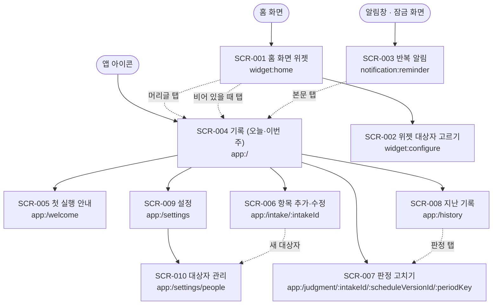

# 화면 목록과 상태 (1차 릴리즈)

- 상태: **화면 정의 승인** (2026-11-13 01:04 KST, 동희님 "추천모두승인", 프로젝트 채팅. 질문은 2026-11-13 00:55 KST 프로젝트 스레드 '약봉이 1차 릴리즈 이어 가기'의 Claude 메시지 2번. 기록은 [6장](#6-승인-기록)). 07 화면 지도(1장)도 같은 답으로 확인 끝. 그 전: CORTHEX 08 다시 하기 초안 (2026-11-12, Claude). 화면 구성과 5장 7개는 2026-11-12 10:18 KST 동희님 범위 확정 그대로이고, 다시 하기에서는 흐름을 03의 FL ID로, 화면마다 보이는 04 명세(SPEC)를, 화면 글자를 01 용어(보관·완전 삭제 등)로 맞춤. 상태별 와이어프레임: TASK-044가 위젯 큰 글씨·잠금 화면·판정 고치기를 [states/](states/README.md)에 그림(2026-11-13, PR #19). 나머지는 화면 작업 PR마다 그림
- 기준: DidITake develop `7a800ac`의 [UI 초안](https://github.com/judangbang-ops/DidITake/blob/7a800ac/docs/05-ui/README.md), [시안 v3](https://github.com/judangbang-ops/DidITake/blob/7a800ac/docs/05-ui/ui-mockup-v3.html), [플로우](https://github.com/judangbang-ops/DidITake/blob/7a800ac/docs/04-flow/flows.md), [기록 규칙](https://github.com/judangbang-ops/DidITake/blob/7a800ac/docs/02-design/record-rules.md), 지금 코드(`App.kt`, `DidITakeWidget.kt`, `Labels.kt`)
- 화면 목록의 원본은 [sitemap.yaml](sitemap.yaml)이고, 1장의 그림과 표는 그 파일에서 옮겨 그림. 요구는 [requirements.md](../01-planning/requirements.md)
- 이 문서는 UI 초안을 대신하지 않음. UI 초안의 위젯·앱·알림 화면에 화면 ID와 상태를 붙이고, 1차 범위(결정 Q1)로 새로 생긴 화면을 더함. 화면이 따르는 기록 규칙은 원본 [기록 규칙](https://github.com/judangbang-ops/DidITake/blob/7a800ac/docs/02-design/record-rules.md)과 [기록 규칙 보충](../04-spec/record-rules-supplement.md)(규칙 ID `S-1`, `P-2` 등)임

## 0. 읽는 법

- **화면 ID**: `SCR-001`부터. 상태는 `SCR-001#stale`처럼 `#` 뒤에 씀
- **상태 이름**: normal(기본), loading(불러오는 중), empty(비어 있음), error(오류), permission(권한), stale(지난 화면)은 모든 화면에서 따짐. 생기지 않는 상태는 이유를 적음. 화면에만 있는 상태(`#already`, `#skipped` 등)는 따로 붙임
- **출처**: 서버 API가 없어서 공통 코드의 함수 이름을 적음. `LoadStatusBoard`·`RecordDose`·`VoidDose`·`ChangeJudgment`·`SaveIntake`·`ArchiveIntake`·`ManagePeople`은 지금 있음. '(새로 만듦)'은 아직 없는 함수임(`RecordInWindow`, `LoadHistory` 등)
- **결과 → 상태**: `RecordResult`의 Recorded·Already·Stale·Gone·Error, `VoidResult`의 Voided·NotActive, `SaveIntakeResult`의 Saved·Invalid·Gone이 어느 상태로 가는지 각 화면에 적음
- **(제안)**: Claude가 정한 작은 것이고 범위 확정 카드에서 따로 묻지 않았음. 5장 7개는 확정됨. 이 문서의 제안 다섯(SCR-001#empty의 대상자 문구, SCR-003 주 1회 [이번 주 건너뜀], SCR-004#error, SCR-004#stale, SCR-008 무효 판정 숨김)은 2026-11-13 화면 정의 승인 때 함께 승인됨(6장). 승인 뒤 바꾸려면 동희님 결정이 필요함
- **지금 코드**: 이 저장소 main(2026-11-12 `843a737`, DidITake `7a800ac` 프로토타입에서 패키지 이름만 바뀜)을 Claude가 읽고 판단함(기기에서 실행하지 않음)

## 1. 화면 지도

진입 지점은 셋임: 홈 화면 위젯, 알림, 앱 아이콘. 실선은 부모 → 자식, 점선은 다른 화면으로 가는 길임.

<!-- sitemap:start -->

| ID | 화면 | 경로 | 누가 보나 | 흐름 | 지금 코드 |
| --- | --- | --- | --- | --- | --- |
| SCR-001 | 홈 화면 위젯 | `widget:home` | 위젯을 놓은 기기 사용자 | FL-001, FL-002, FL-006, FL-009, FL-010 | 있음 (대상자 필터·넘칠 때 처리는 없음) |
| SCR-002 | 　위젯 대상자 고르기 | `widget:configure` | 위젯을 놓거나 위젯 설정을 연 기기 사용자 | FL-001, FL-009 | 없음 |
| SCR-003 | 반복 알림 | `notification:reminder` | 알림 권한을 허용한 기기 사용자. 잠금 화면에서는 약 이름을 숨김(기본) | FL-003, FL-009 | 없음 |
| SCR-004 | 기록 (오늘·이번 주) | `app:/` | 기기 사용자 | FL-001, FL-004, FL-005, FL-006, FL-007, FL-009, FL-010 | 있음 (건너뜀·미래 시각 경고·권한 안내는 없음) |
| SCR-005 | 　첫 실행 안내 | `app:/welcome` | 처음 실행한 기기 사용자 | FL-001 | 없음 |
| SCR-006 | 　항목 추가·수정 | `app:/intake/:intakeId` | 기기 사용자 | FL-001, FL-006, FL-007 | 있음 (알림 설정·권한 요청은 없음) |
| SCR-007 | 　판정 고치기 | `app:/judgment/:intakeId/:scheduleVersionId/:periodKey` | 기기 사용자 | FL-004, FL-005 | 일부 (기록·취소만 첫 화면 버튼으로 있음) |
| SCR-008 | 　지난 기록 | `app:/history` | 기기 사용자 | FL-005 | 없음 (첫 화면의 이번 주 칸만 있음) |
| SCR-009 | 　설정 | `app:/settings` | 기기 사용자 | FL-006, FL-007, FL-008 | 없음 (첫 화면에 하루 시작·기준 시간대 표시만 있음) |
| SCR-010 | 　　대상자 관리 | `app:/settings/people` | 기기 사용자 | FL-006 | 일부 (항목 화면에서 대상자 추가만 있음) |
<!-- sitemap:end -->

그림과 표는 [sitemap.yaml](sitemap.yaml)에서 `.github/scripts/draw_sitemap.py`가 그림(2026-11-12 07 다시 하기). 흐름 열은 [03 흐름](../03-user-flow/README.md)의 FL ID이고, 들여 쓴 화면은 위 화면의 자식임. 시안의 플로우 5장(주 1회 늦은 투약 처리)은 1차에 화면이 없음(요구 4장 1번 확정: 기준일을 옮기지 않고 마지막 복용을 크게 보임).

## 2. 화면별 정의

### SCR-001 홈 화면 위젯

목적: 약을 먹은 뒤 앱을 열지 않고 한 번 눌러 기록하고, 먹기 전에 이미 먹었는지 확인함. (FL-001, FL-002, FL-006, FL-009, FL-010)

명세: SPEC-005, SPEC-006, SPEC-007, SPEC-008, SPEC-009, SPEC-020, SPEC-024, SPEC-027, SPEC-039, SPEC-040, SPEC-042, SPEC-043

목업 (09, 2안 요일 약통): [캔버스](https://claude.ai/artifact/QW5JRsx1Zpz5ekeqHmjpKC)의 보드 [`BoxWidget`](../09-mockup/boards/BoxWidget.dc.html), [`BoxWidget200`](../09-mockup/boards/BoxWidget200.dc.html)

상태 그림 (TASK-044): [위젯 두 배치](states/README.md#2-위젯-두-배치-scr-001). 가로 4개와 요일 약통을 4×2·글자 100%·200%로 견주고, 안내 줄이 보이는 10초도 그림

| 보여 주는 것 | 출처 |
| --- | --- |
| 머리글: 요일 칩 `수`, `앱 이름 · 11/11`(기준 날짜), `n / m 완료`, 건너뜀이 있으면 `· 건너뜀 k`. `n / m`만 굵게 (REQ-020, 09 BoxWidget). 한 줄에 다 들어가지 않으면 수가 둘째 줄 오른쪽으로 감 (TASK-014) | `LoadStatusBoard` → `WidgetModel` |
| 항목 버튼(칸): 대상자 이름, 위젯 별칭(없으면 이름), 칸 색은 대상자 색. 미완료 = 옅은 칸과 점선 빈 원, 복용 = 진한 칸과 흰 원 안의 체크, 건너뜀 = 회색 칸과 회색으로 채운 원 (REQ-019, REQ-027, 09 BoxWidget). 대상자 이름과 항목 이름이 한 줄에 다 들어가지 않으면 대상자 이름을 위 줄로 올림 (TASK-014) | 같음 |
| 보조 문구: 복용이면 기록 시각, 건너뜀이면 `건너뜀`, 미완료면 `마지막 복용 어제 22:00` 또는 `기록 없음`, 그보다 늦은 건너뜀이 있으면 둘째 줄 `어제 건너뜀` (REQ-021). 날짜 글자는 보충 S-2의 표. 시각은 기기 시간대 (REQ-082) | `Labels.widgetLines` |
| 주 1회 미완료 버튼: `마지막 복용 어제(일) 22:00`을 이름과 같은 글자 크기로 (REQ-075) | 같음 |
| 안내 줄: 탭 결과 문구, 10초 동안 머리글 자리에 (제안, TASK-044: 글자 200%에서 머리글과 함께 두면 목록 창이 약 20px만 남음) | `Labels.recordMessage` |
| 복원 안내 줄: `복원됨 · 마지막 기록 11/09 21:40 · 앱에서 확인` (REQ-073) | 설정 `restore_notice_pending` (새로 만듦) |
| 넘침 표시: 넘치는 동안 목록 아래 가운데에 글자 없는 작은 아래 화살표, TalkBack은 '더 있음' (REQ-078, 09 목업 확인 2026-11-12 19:11) | 없음 |

| 동작 | 결과 | 실패 |
| --- | --- | --- |
| 미완료 버튼 탭 | `RecordDose`(위젯, 그려진 기간키) → Recorded: 버튼이 완료로 바뀌고 그 창의 남은 알림이 취소됨 (REQ-022, REQ-043) | 아래 상태 표의 `#already`, `#stale`, `#gone`, `#error` |
| 완료·건너뜀 버튼 탭 | 판정을 바꾸지 않음 → `#already` (REQ-023) | 없음 |
| 경고(`!`) 버튼 탭 | 판정을 바꾸지 않음, `앱에서 확인` (REQ-009) | 없음 |
| 머리글·복원 안내 줄 탭 | 앱 SCR-004가 열림 | 없음 |

| 상태 | 사용자가 보는 것과 할 수 있는 것 | 생기는 때 |
| --- | --- | --- |
| SCR-001#normal | 머리글과 버튼. 버튼 탭으로 기록 | 보이는 항목이 1개 이상 |
| SCR-001#loading | "불러오는 중…". 누를 것 없음 | 위젯을 처음 놓았거나 앱 프로세스가 내려가 있다가 다시 그릴 때 |
| SCR-001#empty | "앱에서 복용 항목을 추가해 주세요". 누르면 SCR-004 | 보관되지 않은 항목이 0개. 대상자를 고른 위젯은 그 사람 항목이 0개일 때 "엄마 항목이 없어요"로 씀 (제안) |
| SCR-001#error | "기록하지 못했어요. 앱에서 확인해 주세요". 버튼은 미완료로 남음 | `RecordResult.Error` |
| SCR-001#permission | 해당 없음. 위젯은 권한이 필요 없고, 알림 권한이 없어도 위젯 기록은 됨 | 없음 |
| SCR-001#stale | 기록하지 않고 새 날짜로 다시 그린 뒤 "날짜가 바뀌었어요. 다시 눌러 주세요" (REQ-004) | `RecordResult.Stale`: 그려진 기간키가 지금 기간키와 다름 |
| SCR-001#gone | 문구 없이 다시 그림. 그 버튼이 사라짐 (REQ-005) | `RecordResult.Gone`: 보관된 항목, 보관된 대상자의 항목 (REQ-014, REQ-017), 앱 데이터를 지운 뒤 남은 위젯 버튼 (REQ-092) |
| SCR-001#already | "아침약: 이미 기록됨 (08:02). 변경 없음". 건너뜀이면 "아침약: 건너뜀으로 기록됨 (09:10). 바꾸려면 앱에서" (REQ-023, 화면 5장 2번) | `RecordResult.Already` |
| SCR-001#skipped | 회색으로 채운 원과 `건너뜀`. 머리글의 완료 수에 넣지 않고 `건너뜀 k`로 따로 셈 (REQ-019, REQ-020, 화면 5장 2번) | 그 창의 활성 판정이 건너뜀 (REQ-033, 결정 Q1로 1차에 들어옴) |
| SCR-001#overflow | 버튼 목록만 위젯 안에서 스크롤되고 머리글은 고정됨. 넘치는 동안 글자 없는 아래 화살표를 늘 보임 (REQ-078, 화면 5장 1번, 09 목업 확인 2026-11-12 19:11). 기술 시험(TASK-042)에서 목록 안 버튼의 탭 기록이 안 되면 `+2 더 있음 · 앱에서 보기`로 앱을 엶 | 목록이 위젯에 다 들어가지 않을 때. 4×2·글자 100%는 보통 항목 5개부터(한 줄에 둘), 큰 글자는 항목 2개부터(한 줄에 하나). 안내 줄이 보이는 10초 동안과 문구가 긴 항목은 더 일찍 ([TASK-044 그림](states/README.md#2-위젯-두-배치-scr-001)) |
| SCR-001#restored | 머리글 아래 `복원됨 · 마지막 기록 11/09 21:40 · 앱에서 확인`. 버튼 탭 기록은 그대로 됨 (REQ-073, 보충 R-3) | 복원을 감지한 뒤 앱에서 [확인했어요]를 누르기 전 |
| SCR-001#reconfigure | 버튼 없이 "위젯을 다시 설정해 주세요"(대상자 보관이면 "대상자가 보관됐어요. 위젯을 다시 설정해 주세요"). 누르면 SCR-002 (REQ-079) | 위젯이 고른 대상자를 보관함. 복원 뒤 대상자가 둘 이상인데 위젯의 선택을 알 수 없음 |
| SCR-001#clock | 그 버튼에 `!`와 `앱에서 확인`. 탭해도 판정을 바꾸지 않음 (REQ-009, 보충 C-2) | 휴대폰 시계가 틀린 채 기록돼 풀리지 않은 경고가 있는 판정의 창이 지금 창일 때. 그 창이 오기 전에는 앱에만 경고가 보임 (2026-11-12 검토 B9) |

규칙

- 기록은 공통 `RecordDose`를 거치고, 한 창의 활성 판정은 하나뿐임 (REQ-001, REQ-003). 기준 날짜와 창은 하루 시작 시각·기준 시간대로 계산함 (REQ-002)
- 위젯은 미완료 → 복용 전이만 만듦. 취소·건너뜀 버튼이 없음 (REQ-024)
- 기본 크기와 가장 작은 크기 모두 실제 4×2 칸(Pixel 5 세로 약 350×213dp)이고 그보다 작게 줄지 않음. 이 크기에서 글자 100%와 가장 큰 크기 모두 버튼, 이름, 마지막 복용 시각, 안내 줄이 잘리지 않음 (REQ-026, REQ-066). 배치는 요일 약통(09 목업): 한 줄에 둘이고, 칸 글자 폭이 주 1회 날짜·시각 묶음(`11/02(월) 08:10`)보다 좁아지면 한 줄에 하나(350dp 위젯은 글자 130% 이상으로 봄, TASK-014에서 확인). 가로 4개는 글자 100%에서도 이름과 마지막 복용이 잘려 쓰지 않음 ([TASK-044 그림](states/README.md#2-위젯-두-배치-scr-001), 2026-11-13). 구현(TASK-014, [PR #19](https://github.com/judangbang-ops/pillbadeum_release/pull/19)): 가장 작은 크기는 270×110dp(Pixel 세로 4열의 세 칸보다 넓고 Android 5열 표의 네 칸 안, Claude 계산). 한 줄에 둘·하나, 머리글 두 줄, 이름 위의 대상자, 화살표는 위젯 크기와 글자 배율로 `WidgetLayout`이 정하고, 글은 띄어쓰기에서만 줄을 바꿈(한글 낱말 사이에 U+2060). 렌더 시험(`WidgetRenderTest`)으로 확인한 것과 못 한 것은 [상태 그림 2장의 구현 확인](states/README.md#2-위젯-두-배치-scr-001)
- 판정·항목·대상자·설정이 바뀌면 모든 위젯을 바로 다시 그림 (REQ-007). 하루 시작 시각에 새 기준 날짜로 다시 그림 (REQ-008). 재부팅·시각 변경·시간대 변경·업데이트 뒤 다음 경계 갱신을 다시 예약함 (REQ-084)
- 보관되지 않은 대상자가 한 명뿐이면 배지를 숨기고, TalkBack도 대상자 이름을 읽지 않음 (REQ-018)
- 대상자를 고른 위젯은 그 사람 항목과 그 사람 완료 수만 보임 (REQ-025). 구현(TASK-012, [PR #19](https://github.com/judangbang-ops/pillbadeum_release/pull/19)): 선택은 위젯마다 Glance 상태의 `person_choice`(전체는 `*`)에 둠. 대상자가 둘 이상인 동안은 한 사람만 보이는 위젯에도 칸의 이름 위 대상자를 그대로 보임(REQ-018과 같은 규칙, Claude 선택)
- 백업에서 복원하면 런처가 위젯 자리를 되살린 경우에만 위젯이 다시 보임 (REQ-056). 위젯의 대상자 선택은 DB 밖이라 백업되지 않음. 선택이 없는 위젯은 대상자가 둘 이상이면 '전체'로 바꾸지 않고 `#reconfigure`로 보임. 대상자 고르기가 들어오기 전부터 놓인 위젯은 그 업데이트에서 선택을 '전체'로 써 둠 (REQ-079, 보충 R-3). 구현(TASK-012): 앱이 처음 DB를 열 때 한 번, 선택이 없는 놓인 위젯을 '전체'로 채움. 그 설치가 복원으로 시작했으면 채우지 않음. 한 번 했다는 표시는 백업되지 않는 폴더(`noBackupFilesDir`)에 둠
- 구현(TASK-012): `#reconfigure`는 머리글의 완료 수와 칸을 그리지 않고 안내 띠 하나만 그림. 띠를 누르면 SCR-002. 그 전에 그려진 칸이 남아 눌려도 기록하지 않음(SPEC-009). `#empty`의 대상자 문구("엄마 항목이 없어요")도 그림
- 홈 화면은 잠금을 푼 사람 누구나 봄. 약 이름을 숨기고 싶으면 위젯 별칭을 씀 (REQ-027)
- TalkBack은 복용 "아침약, 복용함, 오늘 08:02", 건너뜀 "아침약, 건너뜀", 미완료 "아침약, 미완료, 마지막 복용 어제 22:00"으로 읽음. 주 1회는 요일까지 읽고, 대상자가 둘 이상이면 이름 앞에 대상자를 읽음 (REQ-068, 보충 S-4·W-3). 코드는 [PR #19](https://github.com/judangbang-ops/pillbadeum_release/pull/19)부터 이 문장대로 읽음(`Labels.spoken`, 기기 확인 전)

바꿀 것: 대상자 필터, 건너뜀 표시와 완료 수, 마지막 복용 문구, 주 1회 마지막 복용 크기, `#overflow`, `#restored`, `#reconfigure`, `#clock`, 큰 글씨 배치, TalkBack 문장.

### SCR-002 위젯 대상자 고르기

목적: 위젯마다 누구의 약을 보일지 고름. (FL-001, FL-009)

명세: SPEC-005, SPEC-027

목업 (09, 2안 요일 약통): [캔버스](https://claude.ai/artifact/QW5JRsx1Zpz5ekeqHmjpKC)의 보드 [`WidgetPick`](../09-mockup/boards/WidgetPick.dc.html)

| 보여 주는 것 | 출처 |
| --- | --- |
| '전체'와 보관되지 않은 대상자 목록(이름, 색) | `ManagePeople.list` |

| 동작 | 결과 | 실패 |
| --- | --- | --- |
| 대상자 고르기 | 위젯이 그 대상자로 바로 그려짐 (REQ-025) | 저장 실패 → "저장하지 못했어요. 다시 골라 주세요". 위젯은 '전체' |
| 뒤로 가기 | 위젯 놓기를 취소함 (위젯이 놓이지 않음) | 없음 |

| 상태 | 사용자가 보는 것과 할 수 있는 것 | 생기는 때 |
| --- | --- | --- |
| SCR-002#normal | 목록에서 하나를 고름 | 대상자가 두 명 이상 |
| SCR-002#loading | "불러오는 중…" | 대상자를 읽는 동안 |
| SCR-002#empty | 해당 없음. 보관되지 않은 대상자가 늘 한 명 이상 있음 (REQ-093) | 없음 |
| SCR-002#error | "저장하지 못했어요. 다시 골라 주세요" | 저장 실패 |
| SCR-002#permission | 해당 없음 | 없음 |
| SCR-002#stale | 고른 대상자를 나중에 보관하면 그 위젯은 '전체'로 바꾸지 않고 SCR-001#reconfigure를 보임 (REQ-079, 검토 B7) | 대상자 보관 (REQ-017) |

규칙

- 고를 수 있는 것은 '한 명' 또는 '전체'임 (REQ-025, 요구 4장 4번 확정)
- 보관되지 않은 대상자가 한 명뿐이면 이 화면을 띄우지 않고 '전체'로 둠 (REQ-018)
- Android 12 이상에서는 위젯을 길게 눌러 다시 고를 수 있게 함 (제안). 공식 문서([앱 위젯 설정](https://developer.android.com/develop/ui/views/appwidgets/configuration), [Glance 설정](https://developer.android.com/develop/ui/compose/glance/configuration), 2026-11-13 읽음)대로 위젯 정보에 `widgetFeatures="reconfigurable"`을 둬 구현함(TASK-012). `configuration_optional`은 놓을 때 고르기를 건너뛰게 해 쓰지 않음. 런처에서의 확인은 에뮬레이터 전
- 구현(TASK-012, [PR #19](https://github.com/judangbang-ops/pillbadeum_release/pull/19)): 대상자를 읽는 0.4초 동안은 아무것도 그리지 않아 런처가 그대로 보이고, 더 걸리면 "불러오는 중…"을 보임(Claude 기본값). 대상자가 한 명이면 화면을 그리지 않고 '전체'로 놓음. 대상자를 읽지 못하면 '전체'만 보임. 고르면 위젯을 바로 다시 그림(설정 화면이 있는 위젯에는 시스템이 첫 갱신을 보내지 않음, 공식 문서)
- 저장 실패(Claude 선택, 동희님 확인 전): 동작 표의 "위젯은 '전체'"대로 하지 못함. '전체'도 같은 저장소에 써야 해서, 문구를 보이고 화면을 그대로 둠. 다시 고르거나 [취소]·뒤로 가기를 누름. 놓던 위젯은 놓이지 않고, 이미 놓인 위젯은 전과 같음

### SCR-003 반복 알림

목적: 위젯을 보지 못한 날에도 먹을 때를 알려 주고, 알림에서 바로 기록하거나 건너뜀. (FL-003, FL-009)

명세: SPEC-010, SPEC-011, SPEC-012, SPEC-013, SPEC-014, SPEC-039, SPEC-042, SPEC-043

목업 (09, 2안 요일 약통): [캔버스](https://claude.ai/artifact/QW5JRsx1Zpz5ekeqHmjpKC)의 보드 [`Notif`](../09-mockup/boards/Notif.dc.html)

상태 그림 (TASK-044): [잠금 화면 여덟 칸](states/README.md#3-잠금-화면-여덟-칸-scr-003). 아래 표와 PR #15 실험 결과를 옮겨 그림

| 보여 주는 것 | 출처 |
| --- | --- |
| 제목: "아침약 먹어~!" (위젯 별칭, 없으면 이름) (REQ-027) | 알림 예약 때 저장한 항목·기간키 |
| 본문: `마지막 복용 어제 08:02` (REQ-021의 문구). 주 1회 약은 본문 첫 줄에 `마지막 복용 어제(일) 22:00` (REQ-075). 시각은 기기 시간대 (REQ-082) | `Labels.lastLabel` |
| 버튼: [먹었어] [30분 뒤] [오늘 건너뜀] (REQ-045, REQ-088). 잠금 화면에서는 이름 표시를 켠 경우에만 (REQ-076) | 없음 |
| 잠금 화면: 이름 표시 끔(기본)이면 따로 띄운 "복용 시간이에요" 알림만 (REQ-046) | 설정 `show_names_on_lock` (기본 끔) |

잠금 화면과 버튼 (REQ-046, REQ-076, 화면 5장 6번, 검토 B2)

| 이름 표시 | 잠금 화면 | 잠금을 푼 화면 |
| --- | --- | --- |
| 끔 (기본) | 항목 알림은 보이지 않음(`VISIBILITY_SECRET`). 따로 띄운 알림 하나(`VISIBILITY_PUBLIC`): 제목 "복용 시간이에요", 본문 없음, 버튼 없음. 누르면 잠금 해제 뒤 SCR-004 | 항목 알림마다 제목 "아침약 먹어~!", 본문, 버튼 셋. "복용 시간이에요" 줄이 하나 더 보임 |
| 켬 | 항목 알림(`VISIBILITY_PRIVATE`, 공개용 판 "복용 시간이에요"): 기기가 '내용 표시'면 제목, 본문, 버튼 셋이고 버튼은 잠금 해제 없이 기록함. 기기가 '내용 숨김'이면 공개용 판만 | 항목 알림마다 제목, 본문, 버튼 셋 |

방법은 [잠금 화면 알림 실험](https://github.com/judangbang-ops/pillbadeum_release/blob/e862b05/docs/07-qa/2026-11-12-lockscreen-experiment/report.md)(PR #15, 에뮬레이터 API 26·30·34·36)으로 정함(04 명세 고정, 2026-11-13 00:16 KST 동희님 "추천 모두 승인"). 처음 계획한 공개용 판(`setPublicVersion`)만으로는 기기가 '내용 표시'일 때 잠금 화면에 약 이름과 버튼이 나왔음(실험 방법 1). 끔의 방법(실험 방법 5)은 두 기기 설정과 네 API 모두에서 이름을 가렸음. 켬의 방법은 Claude가 정함: `PUBLIC` 항목(실험 방법 7)은 기기가 '내용 숨김'이어도 이름이 보여 SPEC-013의 '기기 설정을 따름'을 어기므로 `PRIVATE` + 공개용 판을 씀. 따로 띄운 알림은 항목 알림이 모두 없어지면 함께 지우고(보충 N-13), 그 알림 때문에 소리가 한 번 더 나지 않게 함(TASK-025). 갤럭시(One UI)는 에뮬레이터와 다를 수 있어 이름 표시 끔·켬 × 잠금·해제 × 기기 설정 두 가지 여덟 칸을 TASK-025 바로 뒤에 실기기로 확인함 (TASK-052, REQ-046 합격 기준).

| 동작 | 결과 | 실패 |
| --- | --- | --- |
| [먹었어] | `RecordDose`(알림, 알림의 기간키) → Recorded: 알림이 닫히고 남은 예약이 취소되고 위젯이 다시 그려짐 (REQ-043) | `#already`, `#stale`, `#error`. Gone이면 알림만 닫음 |
| [오늘 건너뜀] | `RecordDose`(건너뜀) → Recorded: 위와 같음 | 위와 같음 |
| [30분 뒤] | 알림이 닫히고 30분 뒤 한 번 다시 울림(방해 금지여도 울림). 여러 번 누르면 마지막 것만 남음 (REQ-088, 보충 N-7) | 30분 뒤가 창 끝과 같거나 그 뒤면 미루지 않음. 창 끝까지 30분이 안 남은 때 띄운 알림에는 이 버튼이 없음 (2026-11-12 검토 B4) |
| 본문 탭 | 앱 SCR-004가 열림 | 없음 |
| 밀어서 닫기 | 다음 간격에 다시 울림 (REQ-042) | 없음 |

| 상태 | 사용자가 보는 것과 할 수 있는 것 | 생기는 때 |
| --- | --- | --- |
| SCR-003#normal | 제목·본문·버튼 셋 | 알림 시각에 그 창의 판정이 없음 (REQ-041) |
| SCR-003#loading | 해당 없음. 알림은 띄울 때 필요한 값을 다 가짐 | 없음 |
| SCR-003#empty | 해당 없음. 판정이 있으면 알림을 띄우지 않음 (REQ-041, RR-21) | 없음 |
| SCR-003#error | 알림 문구를 "기록하지 못했어요. 앱에서 확인해 주세요"로 바꿈 | `RecordResult.Error` |
| SCR-003#permission | 알림이 뜨지 않음. 대신 SCR-004#permission 안내 (REQ-089) | 알림 권한 거부, 알림 채널 끔 |
| SCR-003#stale | 기록하지 않고 "날짜가 바뀌었어요. 앱에서 확인해 주세요"로 바꿈 (REQ-004) | `RecordResult.Stale`: 경계를 넘긴 뒤 누름 (RR-23) |
| SCR-003#already | "이미 기록됨 (08:02)"으로 바꾼 뒤 닫음 | `RecordResult.Already`: 위젯·앱에서 먼저 기록함 |
| SCR-003#lock | 위 표대로. 이름 표시가 꺼져 있으면 따로 띄운 "복용 시간이에요"만 보이고 버튼이 없음 (REQ-046, REQ-076) | 잠금 화면 |
| SCR-003#restored | 복용 알림 대신 "백업에서 복원했어요. 앱에서 확인해 주세요" 알림 하나. 누르면 SCR-004 (REQ-073) | 복원을 감지한 뒤 [확인했어요] 전 |

규칙

- 버튼의 기록은 위젯과 같은 공통 `RecordDose`를 거침 (REQ-003)
- 항목마다 알림 하나. 같은 시각에 셋이면 알림 셋 (버튼이 항목마다 달라서). 알람은 다음 칸 하나만 예약하고, 울릴 때 항목별 알림을 만듦 (보충 N-8)
- 시작 시각부터 간격마다 하루 최대까지 울리고, 창 끝 뒤와 방해 금지 시간 [시작, 끝) 안의 칸은 울리지 않음. 첫 알림은 방해 금지여도 울림 (REQ-042). 시작 시각이 하루 시작 시각보다 이르면 다음 날짜의 그 시각이 첫 칸임 (보충 N-4). 기본값은 [요구 4장 3번](../01-planning/requirements.md#4-범위-확정-때-정한-것)
- [30분 뒤]는 하루 최대 횟수에 세지 않고 방해 금지여도 울림 (REQ-088, 보충 N-7)
- 밀린 칸은 알람이 울릴 때와 재부팅·시각 변경 뒤에만 모아 항목마다 하나로 띄우고, 간격보다 오래된 칸은 띄우지 않음 (보충 N-12)
- 판정이 저장되거나, 창이 끝나거나, 항목·대상자가 보관되거나, 그 항목의 알림을 끄면 떠 있는 알림을 지움. 같은 항목의 새 칸은 앞 알림을 바꿔 씀 (REQ-043, 보충 N-13)
- 지금 창의 판정이 없어지면 다시 계산함 (REQ-044). 재부팅·시각 변경·시간대 변경·업데이트, 항목·대상자 보관, 설정 변경, 복원 안내 확인 뒤 다시 계산함 (REQ-047)
- 주 1회 약은 창의 첫날에만 울림 (REQ-041, 보충 N-5). 버튼은 [이번 주 건너뜀]으로 씀 (제안)

### SCR-004 기록 (오늘·이번 주)

목적: 오늘과 이번 주에 무엇을 먹었는지 한눈에 보고, 기록·취소·건너뜀으로 가는 첫 화면. (FL-001, FL-004, FL-005, FL-006, FL-007, FL-009, FL-010)

명세: SPEC-015, SPEC-016, SPEC-018, SPEC-020, SPEC-028, SPEC-029, SPEC-039, SPEC-040, SPEC-042, SPEC-043

목업 (09, 2안 요일 약통): [캔버스](https://claude.ai/artifact/QW5JRsx1Zpz5ekeqHmjpKC)의 보드 [`BoxHome`](../09-mockup/boards/BoxHome.dc.html), [`HomeEmpty`](../09-mockup/boards/HomeEmpty.dc.html), [`HomeRestored`](../09-mockup/boards/HomeRestored.dc.html)

| 보여 주는 것 | 출처 |
| --- | --- |
| 머리글: "기록"과 [지난 기록]·[설정]. [항목 추가]는 목록 아래 큰 버튼 (09 목업, 2026-11-12. TASK-016) | 없음 |
| 복원 안내(복원 뒤 확인 전): "백업에서 복원했어요. 마지막 기록은 11/09 21:40이에요. 그 뒤의 기록은 없을 수 있어요. 한 약은 한 휴대폰에서 기록해 주세요" + [확인했어요] (REQ-073, REQ-074) | 설정 `restore_notice_pending`, `restore_notice_last_record_at` (새로 만듦) |
| 요일 배지와 기준 날짜 `11월 12일 목요일`, 그 아래 `2 / 4 완료 · 건너뜀 1 · 하루 시작 04:00` (09 BoxHome, 보충 S-1). 항목이 없으면 `하루 시작 04:00`만 | `LoadStatusBoard`, `Labels.longDate`·`countParts`·`dayStart` |
| 항목 칸(09 BoxHome의 타일, 한 줄에 둘): 대상자(둘 이상일 때), 이름, 보조 줄(주기, 기록 시각 또는 마지막 복용, 판정이 있는 주 1회 약의 다음 창 `다음 창 11/16(월)`) (REQ-028). 미완료는 사람의 연한 색과 [먹었어], 완료는 사람 색과 [기록 취소], 건너뜀은 회색과 [⋯]만. 주 1회 미완료는 `마지막 복용 11/02(월) 08:10`을 굵게 (REQ-075). 시각은 기기 시간대 (REQ-082). 글자 130%부터 한 줄에 하나(가장 긴 조각 `11/02(월) 08:10`이 칸에 들어가지 않으면, TASK-016) | `LoadStatusBoard`, `Labels.appRow`, `HomeLayout` |
| 이번 주 약통: 매일 약마다 월~일 칸. 복용은 사람 색, 건너뜀은 빗금, 빠짐은 빈 칸, 오늘 아직은 점선, 앞날은 회색, 오늘은 테두리 (REQ-035, 09 BoxHome). 글자가 크면 이름을 칸 위 줄로 | `StatusBoard`의 `DayCell` |
| 시계 경고: 맨 위 띠에 항목 이름, 문구, [그대로 두기]·[기록 취소]. 칸에는 `! 시계 확인`. 경고가 둘 이상이면 그 위에 "시계가 맞지 않았던 기록이 4개 있어요"와 [모두 그대로 두기], 경고는 2개씩 보임 (REQ-009, 보충 C-2·C-3, TASK-016) | `StatusBoard.clockWarnings` |
| 맨 아래 안내: "기록 도구이며 복용 방법은 의사·약사와 상의해 주세요." (REQ-036). 기기 시간대가 기준 시간대와 다를 때만 "날짜는 기준 시간대(Asia/Seoul)로 셈해요." (REQ-082). 하루 시작은 날짜 아래 줄에 | 설정 |

| 동작 | 결과 | 실패 |
| --- | --- | --- |
| [먹었어] (미완료 줄) | `RecordDose`(앱, 지금) → 완료 | Already → "이미 기록됨 (08:02). 변경 없음", Stale → `#stale`, Gone → 다시 불러옴, Error → "기록하지 못했어요. 다시 눌러 주세요" |
| [기록 취소] (완료 줄) | "기록을 취소할까요?" 확인 → `VoidDose` → 창이 열려 있으면 미완료, 알림 다시 예약 (REQ-029, REQ-044) | NotActive → 다시 불러옴 |
| [⋯] (모든 줄, 화면 5장 4번) | SCR-007이 열림 (지금 창) | 없음 |
| [확인했어요] (복원 안내) | 복원 안내가 사라지고 알림을 다시 계산함 (REQ-073, REQ-047) | 저장 실패 → 안내가 남고 "다시 눌러 주세요" |
| [그대로 두기] / [기록 취소] (시계 경고) | 경고가 풀림. [기록 취소]는 "기록을 취소할까요?"를 물은 뒤 `VoidDose`도 함 (REQ-009, REQ-029) | NotActive → 다시 불러옴 |
| [모두 그대로 두기] (경고 둘 이상) | 보이는 경고와 2개 밖의 경고까지 모두 [그대로 두기]. 판정은 그대로 (보충 C-3) | 실패 → "기록하지 못했어요. 다시 눌러 주세요" |
| 칸 탭 | SCR-006 (항목 수정) | 없음 |
| [항목 추가] | SCR-006 (새 항목) | 없음 |
| [지난 기록] / [설정] | SCR-008 / SCR-009 | 없음 |

| 상태 | 사용자가 보는 것과 할 수 있는 것 | 생기는 때 |
| --- | --- | --- |
| SCR-004#normal | 위 내용 | 항목이 1개 이상 |
| SCR-004#loading | 머리글과 "불러오는 중…" (지금 코드) | 처음 읽는 동안 |
| SCR-004#empty | 점선 상자에 빈 칸 일곱, "아직 복용 항목이 없어요." "[항목 추가]로 등록해 주세요."와 [항목 추가] (09 HomeEmpty) | 보관되지 않은 항목 0개 |
| SCR-004#error | "기록을 불러오지 못했어요" + [다시 시도] (제안) | DB를 열거나 읽지 못함 |
| SCR-004#permission | 알림을 켠 항목이 있는데 알림 권한·채널이 꺼져 있으면 맨 위에 "알림이 꺼져 있어 알려 드릴 수 없어요" + [설정 열기] (REQ-089). 정확 알람이 허용되지 않았으면 "알림이 늦을 수 있어요" + [허용하기] (REQ-050). 분 단위 약속은 쓰지 않음 (REQ-048) | 권한 상태를 화면에 올 때마다 확인 |
| SCR-004#stale | 화면을 켜 둔 채 하루 시작 시각을 넘기면 새 날짜로 다시 불러옴 (제안). 그 전에 누른 기록은 Stale → "날짜가 바뀌었어요. 다시 눌러 주세요" | 경계 시각, 앱으로 돌아올 때 |
| SCR-004#skipped | 회색 칸에 `매일 · 건너뜀 09:10`. 주 버튼 없이 [⋯]만 | 활성 판정이 건너뜀 (REQ-033) |
| SCR-004#future | 맨 위 띠에 "기록 시각이 휴대폰 시계와 맞지 않았어요 (금 08:00). 확인해 주세요" + [그대로 두기] [기록 취소], 칸에 `! 시계 확인`. 그날이 와도 고를 때까지 남음 (REQ-009, 보충 C-2). 칸이 좁아 문구와 버튼은 띠로 옮김 (TASK-016) | 실제 복용 시각이 지금보다 뒤인 활성 판정이 생긴 뒤 풀리지 않은 동안 (RR-19, RR-64) |
| SCR-004#restored | 맨 위 복원 안내와 [확인했어요] (REQ-073, REQ-074) | 복원을 감지한 뒤 확인 전 |

규칙

- 기록·취소는 공통 `RecordDose`·`VoidDose`를 거침 (REQ-003). 기준 날짜와 이번 주 칸은 하루 시작 시각 기준임 (REQ-002)
- 버튼은 처리하는 동안 눌리지 않음. 두 번 눌러도 결과는 하나 (REQ-001)
- 보관되지 않은 대상자가 한 명뿐이면 배지를 숨김 (REQ-018)
- 기록·취소 뒤 위젯을 바로 다시 그림 (REQ-007)
- TalkBack은 SCR-001과 같은 문장으로 읽음 (REQ-068). 칸 하나를 한 번에 읽고(`아침약, 복용함, 오늘 08:02`, 대상자 둘 이상이면 `엄마 혈압약, …`, 시계 경고가 있으면 `…, 시계 확인 필요`), 칸의 버튼과 [⋯](`아침약 판정 고치기`)는 따로 읽음. 앱은 별칭 대신 이름을 읽음 (TASK-015). 이번 주 약통은 줄마다 `혈압약 이번 주: 월 화 복용, 수 빠짐, 목 아직` (TASK-016)
- 누르는 곳은 모두 48dp 이상. [⋯]는 09 목업의 44px 대신 48dp (REQ-067, TASK-016)
- 글은 낱말 가운데서 줄이 바뀌지 않음 (BUG-002, 위젯과 같은 `keepWords`)
- 시스템 뒤로 가기는 첫 화면에서 앱을 나가고, 다른 앱 화면에서는 첫 화면으로 돌아옴(대상자 관리는 설정으로) (REQ-094). 위젯 머리글·알림은 어느 화면에 있었든 첫 화면을 엶 (`MainActivity.homeIntent`)
- 화면을 켜 둔 채 하루 시작 시각을 넘기면 그 시각에 다시 읽음(`#stale`, TASK-017). 경계 시각은 보이는 판의 다음 하루 시작(`StatusBoard.staleAt`)이고, 기다리는 동안 1분마다 시계를 봐서 시계를 앞으로 옮겨도 1분 안에 바뀜. 앱으로 돌아올 때도 다시 읽음. 다시 읽기 전에 누른 [먹었어]는 기록하지 않고 "날짜가 바뀌었어요. 다시 눌러 주세요" 뒤 새 날짜를 보임

남은 것 (2026-11-13, TASK-017 뒤): `#permission`(TASK-026), [⋯]·[지난 기록]·[설정]이 여는 화면(TASK-018·019·020, 지금은 '준비 중인 화면이에요'), 에뮬레이터 캡처(둘러보기, `#stale`은 12단계).

### SCR-005 첫 실행 안내

목적: 처음 연 사람에게 이 앱이 기록 도구라는 것, 한 약은 한 휴대폰에서 기록한다는 것, 위젯 놓는 법을 알려 줌. 한 번만 보임. (FL-001)

명세: SPEC-002, SPEC-005, SPEC-036

목업 (09, 2안 요일 약통): [캔버스](https://claude.ai/artifact/QW5JRsx1Zpz5ekeqHmjpKC)의 보드 [`Welcome1`](../09-mockup/boards/Welcome1.dc.html), [`Welcome2`](../09-mockup/boards/Welcome2.dc.html)

| 보여 주는 것 | 출처 |
| --- | --- |
| 1쪽: "먹었는지 헷갈릴 때, 위젯 한 번이면 돼요" + 기록 도구 안내 (REQ-036, REQ-080) + "한 약은 한 휴대폰에서 기록해 주세요" (REQ-074) | 없음 |
| 2쪽: 위젯 놓는 법 그림 + [위젯 추가] (런처가 지원하면) (REQ-080) | 없음 |

| 동작 | 결과 | 실패 |
| --- | --- | --- |
| [위젯 추가] | 시스템이 위젯 놓기 확인을 띄움 (Android 8 이상, 런처가 지원할 때) | 지원하지 않으면 버튼 대신 손으로 놓는 법만 보임 |
| [다음] (1쪽) | 2쪽 | 없음 |
| [시작하기] / [건너뛰기] | SCR-004. 다시 보이지 않음 | 없음 |

| 상태 | 사용자가 보는 것과 할 수 있는 것 | 생기는 때 |
| --- | --- | --- |
| SCR-005#normal | 두 쪽 | 첫 실행 |
| SCR-005#loading | 해당 없음. 읽을 데이터가 없음 | 없음 |
| SCR-005#empty | 해당 없음 | 없음 |
| SCR-005#error | [위젯 추가]를 지원하지 않는 런처 → 손으로 놓는 법 | 런처가 위젯 고정 요청을 지원하지 않음 |
| SCR-005#permission | 해당 없음. 알림 권한은 항목에서 알림을 처음 켤 때 물음 (REQ-049) | 없음 |
| SCR-005#stale | 해당 없음 | 없음 |

규칙

- 대상자 '나'는 첫 실행 때 만들어짐 (REQ-016, 지금 코드)
- 1차에 넣음 (5장 3번, 2026-11-12 확정)

### SCR-006 항목 추가·수정

목적: 복용 항목을 등록·수정·보관하고, 항목의 알림을 켬. (FL-001, FL-006, FL-007)

명세: SPEC-003, SPEC-004, SPEC-010, SPEC-021, SPEC-023, SPEC-024, SPEC-028, SPEC-031

목업 (09, 2안 요일 약통): [캔버스](https://claude.ai/artifact/QW5JRsx1Zpz5ekeqHmjpKC)의 보드 [`ItemForm`](../09-mockup/boards/ItemForm.dc.html), [`ItemFormError`](../09-mockup/boards/ItemFormError.dc.html), [`ItemForm200`](../09-mockup/boards/ItemForm200.dc.html)

| 보여 주는 것 | 출처 |
| --- | --- |
| 이름(필수), 위젯 별칭, 대상자(+ 새 대상자), 주기(매일 / 주 1회 + 기준 요일), 시간대 표시 (REQ-012, REQ-016, REQ-085, REQ-027) | `SaveIntake`, `ManagePeople` |
| 알림: [알림 받기] (기본 끔), 시작 시각. 시작 시각 기본값은 시간대 표시를 따름: 아침 08:00·점심 12:00·저녁 18:00·자기 전 21:00·없음 08:00 (REQ-041). 간격·하루 최대·방해 금지는 SCR-009에서 (REQ-042) | `reminder_rule` (새로 만듦, 스키마 2) |
| 주기를 바꿀 때 안내 "주기를 바꾸면 지금부터 새 일정이 적용돼요. 이번 창의 기록은 그대로 인정돼요." (REQ-010, 지금 코드) | 없음 |

| 동작 | 결과 | 실패 |
| --- | --- | --- |
| [저장] | `SaveIntake` → Saved: SCR-004로 돌아가고 위젯·알림이 다시 계산됨. 방해 금지 때문에 울리지 않는 칸이 있으면 먼저 `#quiet` (REQ-077) | Invalid → `#error`, Gone → `#gone` |
| [알림 받기] 켜기 | Android 13 이상에서 처음이면 알림 권한을 물음 (REQ-049) | 거부 → `#permission` |
| [보관] | "아침약을 보관할까요? 위젯·알림·오늘 목록에서 빠지고 지난 기록은 남아요" 확인 → `ArchiveIntake` → 위젯·알림·오늘 목록에서 빠짐, 기록은 남음 (REQ-014). 보관한 항목은 SCR-009에서 완전 삭제할 수 있음 | 실패 → "보관하지 못했어요. 다시 눌러 주세요" |
| [×] 닫기 | 저장하지 않고 SCR-004 | 없음 |
| 시스템 뒤로 가기 | 저장하지 않고 SCR-004 ([닫기]와 같음, REQ-094) | 없음 |

| 상태 | 사용자가 보는 것과 할 수 있는 것 | 생기는 때 |
| --- | --- | --- |
| SCR-006#normal | 빈 입력(새 항목) 또는 저장된 값(수정) | 화면 열림 |
| SCR-006#loading | 해당 없음. 첫 화면이 가진 값으로 바로 채움 | 없음 |
| SCR-006#empty | 해당 없음. 입력 화면임 | 없음 |
| SCR-006#error | 이름 칸 옆에 "이름을 입력해 주세요". 다른 입력은 그대로 (REQ-013). 저장 실패 → "저장하지 못했어요. 다시 눌러 주세요" | `SaveIntakeResult.Invalid`, DB 오류 |
| SCR-006#permission | 알림 칸 아래 "알림 권한이 없어 알림이 오지 않아요" + [설정 열기] (REQ-089) | 알림 권한 거부 |
| SCR-006#stale | 해당 없음. 이 화면을 연 동안 다른 곳에서 항목을 바꾸는 길이 없음 | 없음 |
| SCR-006#gone | "이 항목은 보관됐거나 지워졌어요" 뒤 SCR-004 | `SaveIntakeResult.Gone` |
| SCR-006#quiet | 저장한 뒤 "방해 금지 시간(22:00~07:00)과 겹쳐 다시 알림이 2번 줄어요"(시작 시각이 방해 금지 안이면 "방해 금지 시간이라 첫 알림만 울리고 다시 알림은 없어요") + [확인] → SCR-004. 저장은 막지 않음 (REQ-077, 보충 N-4) | 알림을 켠 항목의 칸 중 방해 금지에 걸리는 것이 있음 |

규칙

- 키보드가 열려도 [저장]에 닿음 (`imePadding`, `adjustResize`, QA D1 고침)
- 보관되지 않은 대상자가 한 명뿐이면 대상자 칸을 접고 [+ 가족 추가]만 보임 (REQ-018, 제안). [+ 가족 추가]로 더한 사람은 그 항목의 대상자로 바로 골라짐 (제안, TASK-015)
- 모양은 09 ItemForm (TASK-016): 이름·별칭 칸, "누구 약인가요?" 세 칸씩, "얼마나 자주?" 매일/주 1회, "무슨 요일에?" 네 칸씩과 "수요일부터 화요일 사이에 한 번 먹으면 완료예요.", "언제 먹나요?" 다섯 칸(글자가 크면 세 칸). [+ 가족]은 이 화면 안에 이름·색·"한 약은 한 휴대폰에서 기록해 주세요"를 펼침. 색은 09 PersonAdd처럼 이름(파랑·주황·초록·보라·장미·청록)으로 읽히는 48dp 칸, 이 칸 안에서는 세 칸씩 (REQ-067)
- 화면이 다시 만들어져도(회전, 키보드 연결 등) 보던 화면과 입력이 남음 (BUG-003, TASK-016)
- 수정 화면 맨 아래 [보관]과 "보관해도 지난 기록은 지워지지 않아요." 확인은 "아침약을 보관할까요?" + "위젯·알림·오늘 목록에서 빠지고 지난 기록은 남아요." (REQ-014, TERM-018, TASK-016)

남은 것 (2026-11-13, TASK-016 뒤): 알림 칸과 권한 요청 (TASK-023·026). 시스템 뒤로 가기와 [보관] 글자는 TASK-016에서 고침.

### SCR-007 판정 고치기

목적: 한 항목의 한 창 판정을 고침: 시각을 골라 기록, 먹은 시각 고치기, 건너뜀, 기록 취소, 건너뜀을 복용으로. (FL-004, FL-005)

명세: SPEC-016, SPEC-017, SPEC-018, SPEC-019, SPEC-020, SPEC-021, SPEC-042, SPEC-043

목업 (09, 2안 요일 약통): [캔버스](https://claude.ai/artifact/QW5JRsx1Zpz5ekeqHmjpKC)의 보드 [`Judge`](../09-mockup/boards/Judge.dc.html), [`JudgeTaken`](../09-mockup/boards/JudgeTaken.dc.html)

상태 그림 (TASK-044): [지난 창의 판정 고치기](states/README.md#4-지난-창의-판정-고치기-scr-007). 기록 없음·먹음·건너뜀(주 1회)·`#locked`를 폭 360dp·글자 100%·200%로 그림

| 보여 주는 것 | 출처 |
| --- | --- |
| 항목 이름, 대상자, 창(매일 `11/11 (수)`, 주 1회 `11/09 (월) ~ 11/15 (일)`), 지금 판정과 시각. 지금 창이면 제목을 "오늘 기록"(09 목업), 지난 창이면 "11/11 (수) 기록 고치기"로 씀. 주 1회 약의 지난 창은 "11/02 (월) 주 기록 고치기" (제안, TASK-044). 시각은 기기 시간대 (REQ-082) | 부르는 화면이 넘김 (`IntakeStatus`, 일정 버전과 기간키, 보충 P-1) |

| 판정 | 동작 | 결과 | 실패 |
| --- | --- | --- | --- |
| 없음 | [지금 먹었어] (지금 창에서만 보임) | `RecordDose`(앱, 지금) → Recorded | Already → `#already`, Stale → `#stale` |
| 없음 | [먹은 시각 고르기] | 시각 고르기(연 창 [시작, 끝)과 지금보다 이전 안에서만) → `RecordInWindow`(그 창, 고른 시각) → Recorded, 입력 시각은 따로 남음 (REQ-030, 보충 P-1·P-2) | 고를 수 없는 시각은 고르기에서 막힘: 지금보다 뒤, 창 밖, 항목 등록 창보다 앞 (REQ-032). Already → `#already` |
| 없음 | [건너뜀] | `RecordInWindow`(그 창, 건너뜀) → Recorded. 지난 창이면 `taken_at` = 창 시작 (REQ-033, 보충 P-3) | 위와 같음 |
| 복용 | [먹은 시각 고치기] | 시각 고르기(지금보다 이전) → 옛 판정 무효(`TIME_EDIT`) + 새 시각의 창에 새 행을 한 트랜잭션으로, 입력 시각은 따로 남음 (REQ-030, 보충 P-6) | 옮겨 갈 창에 다른 판정이 있으면 저장하지 않고 "11/11에 이미 기록됨 (21:30)" (REQ-031). 고를 수 없는 시각은 막힘 (REQ-032) |
| 복용 | [기록 취소] | 확인 → `VoidDose` → 무효 처리, 지금 창이면 미완료와 알림 다시 계산 (REQ-006, REQ-029, REQ-044) | NotActive → 새로 불러옴 |
| 건너뜀 | [먹었어로 바꾸기] | `ChangeJudgment`(그 창): 건너뜀 무효 + 복용 저장을 한 트랜잭션으로. 지금 창이면 지금 시각, 지난 창이면 시각을 먼저 고름 (REQ-034) | Already·Stale 같음 |
| 건너뜀 | [건너뜀 취소] | 확인 → `VoidDose` (REQ-029) | NotActive → 새로 불러옴 |
| 복용(시계 경고) | [그대로 두기] / [기록 취소] | 경고가 풀림. [기록 취소]는 `VoidDose`도 하고, 지금 창이면 미완료와 알림 다시 계산 (REQ-009, 보충 C-3) | NotActive → 새로 불러옴 |
| 모두 | 시스템 뒤로 가기 | 고치지 않고 SCR-004 (REQ-094) | 없음 |

| 상태 | 사용자가 보는 것과 할 수 있는 것 | 생기는 때 |
| --- | --- | --- |
| SCR-007#normal | 판정에 맞는 버튼 | 화면 열림 |
| SCR-007#loading | 해당 없음. 부르는 화면이 값을 넘김. 처리하는 동안 버튼이 눌리지 않음 | 없음 |
| SCR-007#empty | 해당 없음 | 없음 |
| SCR-007#error | "기록하지 못했어요. 다시 눌러 주세요". 화면은 그대로 | `RecordResult.Error` |
| SCR-007#permission | 해당 없음 | 없음 |
| SCR-007#stale | 오늘 창을 연 채 날짜가 바뀌면 "날짜가 바뀌었어요" 뒤 닫히고 SCR-004를 새로 불러옴 | `RecordResult.Stale` |
| SCR-007#already | "이미 기록됨 (08:02)" 뒤 판정 '복용'의 버튼으로 바뀜 | `RecordResult.Already`: 위젯·알림에서 먼저 기록 |
| SCR-007#gone | "이 항목은 보관됐거나 지워졌어요" 뒤 닫힘 | `RecordResult.Gone` |
| SCR-007#locked | "설정을 바꾸기 전의 기록은 고칠 수 없어요". 버튼 없음 (REQ-032, 보충 P-5). 둘째 줄 "하루 시작 시각이나 기준 시간대를 바꾸기 전에 끝난 날이에요." (제안, TASK-044) | 마지막 하루 시작 시각·기준 시간대 변경보다 앞에서 끝난 창을 엶 |
| SCR-007#future | 판정 옆에 "기록 시각이 휴대폰 시계와 맞지 않았어요 (금 08:00)"와 [그대로 두기]·[기록 취소] (REQ-009) | 풀리지 않은 시계 경고가 있는 판정을 엶 (보충 C-2, 2026-11-12 검토 C2) |

규칙

- 모든 동작은 공통 `RecordDose`·`RecordInWindow`(새로 만듦)·`VoidDose`·`ChangeJudgment`를 거침 (REQ-003). 위젯과 알림은 지금 창에만 씀. 판정이 저장되면 그 창의 남은 알림이 울리지 않음 (REQ-043)
- 기록할 때의 시각 고르기는 연 창 안에서만 고를 수 있음 (보충 P-2). 다른 날에 기록하려면 SCR-008에서 그날을 엶. 시각 고치기만 다른 창으로 옮길 수 있음 (보충 P-6)
- 지금 `RecordCommand`는 지금 창만 받으므로 앱 전용 `RecordInWindow`를 더함 (보충 P-1, TASK-005)

### SCR-008 지난 기록

목적: 지난날 먹었는지, 언제 먹었는지 확인함 (가벼운 투약일기, 결정 Q1). (FL-005)

명세: SPEC-020, SPEC-021, SPEC-022, SPEC-042

목업 (09, 2안 요일 약통): [캔버스](https://claude.ai/artifact/QW5JRsx1Zpz5ekeqHmjpKC)의 보드 [`History`](../09-mockup/boards/History.dc.html)

| 보여 주는 것 | 출처 |
| --- | --- |
| 달 바꾸기 `‹ 2026년 11월 ›`, (대상자 둘 이상이면) 대상자 고르기 (REQ-040) | 없음 |
| 날짜 줄(최신이 위): 그날 창의 항목별 판정. 복용 ✓ `08:02`, 건너뜀은 다른 기호와 `건너뜀` 글자(색만으로 구분하지 않음), 빠짐 (REQ-037). 그날 유효했던 일정대로 그림: 일정을 바꾼 때는 옛 버전의 칸을 바꾸기 전에 끝난 창까지, 새 버전의 칸을 바꾼 시각이 든 창부터 그림. 같은 버전의 판정은 기간키로, 다른 버전의 판정은 시각으로 칸에 맞춤. 등록 전·보관 뒤는 칸 없음 (보충 P-8). 시각은 기기 시간대 (REQ-082) | `LoadHistory`(달, 대상자) (새로 만듦) |
| 주 1회 약: 창이 시작하는 날짜 줄에 한 번, "11/09~11/15" 표시. 나머지 날은 칸 없음 (REQ-039) | 같음 |

| 동작 | 결과 | 실패 |
| --- | --- | --- |
| 이전·다음 달 | 그 달을 불러옴 | `#error` |
| 판정 탭 | SCR-007 (그 칸의 일정 버전과 창, 보충 P-1) | 없음 |
| 대상자 고르기 | 그 사람 항목만 (REQ-040) | 없음 |
| 시스템 뒤로 가기 | SCR-004 (REQ-094) | 없음 |

| 상태 | 사용자가 보는 것과 할 수 있는 것 | 생기는 때 |
| --- | --- | --- |
| SCR-008#normal | 날짜 줄 목록 | 그 달에 창이 있음 |
| SCR-008#loading | 날짜 줄 자리에 회색 줄 | 달을 읽는 동안 |
| SCR-008#empty | "이 달에는 기록할 항목이 없었어요" | 그 달에 창이 하나도 없음 (등록 전, 모두 보관 뒤) |
| SCR-008#error | "기록을 불러오지 못했어요" + [다시 시도] | 읽기 실패 |
| SCR-008#permission | 해당 없음 | 없음 |
| SCR-008#stale | 화면을 켜 둔 채 하루 시작 시각을 넘기면 다시 불러옴 (SCR-004#stale과 같음. 같은 경계 시각 `StatusBoard.staleAt`을 TASK-019에서 씀) | 경계 시각, 돌아올 때 |
| SCR-008#future | 그 판정 옆에 경고 표시. 누르면 SCR-007#future에서 [그대로 두기]·[기록 취소] (REQ-009) | 풀리지 않은 시계 경고가 있는 판정 (보충 C-2) |

규칙

- 빠짐은 끝난 창에 활성 판정이 없을 때만. 등록 전·보관 뒤 창은 칸이 없음 (REQ-038)
- 보관되지 않은 대상자가 한 명뿐이면 대상자 고르기를 숨김 (REQ-018)
- 다음 달은 이번 달까지만, 이전 달은 첫 항목을 등록한 달까지만 감
- 무효 처리한 판정은 1차에 보이지 않음 (제안)

### SCR-009 설정

목적: 날짜 계산·알림·잠금 화면 표시를 바꾸고, 알림이 오지 않을 때 고칠 곳으로 안내함. (FL-006, FL-007, FL-008)

명세: SPEC-021, SPEC-025, SPEC-029, SPEC-030, SPEC-031, SPEC-033, SPEC-034, SPEC-035, SPEC-036

목업 (09, 2안 요일 약통): [캔버스](https://claude.ai/artifact/QW5JRsx1Zpz5ekeqHmjpKC)의 보드 [`Settings`](../09-mockup/boards/Settings.dc.html)

| 보여 주는 것 | 출처 |
| --- | --- |
| 하루 시작 시각(기본 04:00), 기준 시간대(기본 Asia/Seoul) (REQ-053) | 설정 `day_start`, `base_zone` |
| 잠금 화면에 약 이름 보이기 (기본 끔) (REQ-046, REQ-053) | 설정 `show_names_on_lock` |
| 알림 간격(기본 60분)·하루 최대(3회)·방해 금지 시간(22:00~07:00). 모든 항목 공통 (REQ-042, 화면 5장 5번) | 설정 `reminder_interval_minutes`·`reminder_max_per_day`·`quiet_start`·`quiet_end` (새로 만듦) |
| 알림이 오지 않을 때: 알림 권한, 정확 알람, 배터리 최적화 상태와 [설정 열기] (REQ-089, REQ-050, REQ-051) | 시스템 상태 |
| 대상자 관리 → SCR-010 | 없음 |
| 보관된 항목과 [완전 삭제] (REQ-015, Could) | 항목(보관됨) |
| 백업 안내 "화면 잠금과 Google 백업이 켜져 있으면 복용 기록이 백업돼요". 화면 잠금이 없으면 "화면 잠금이 없어 복용 기록이 백업되지 않아요". Android 8.x면 "이 휴대폰은 Android 버전이 낮아 복용 기록이 백업되지 않아요" (REQ-054, 보충 B-3) | 시스템 화면 잠금 상태, Android 버전 |
| 앱 정보: 버전, 개인정보처리방침(브라우저로 엶, REQ-063), 의료 안내 "의료기기가 아니며 질병을 진단·치료·예방하지 않아요" (REQ-036) | 없음 |

| 동작 | 결과 | 실패 |
| --- | --- | --- |
| 하루 시작 시각·기준 시간대 바꾸기 | "바꾼 때부터 적용돼요. 지난 기록의 날짜는 그대로예요. 바꾸기 전에 끝난 날의 기록은 고칠 수 없게 돼요" 확인 → 저장 → 위젯·경계 알람·알림 다시 계산 (REQ-011, REQ-047, RR-15, 보충 P-5) | 저장 실패 → 이전 값 유지 + 안내 |
| 알림 간격·하루 최대·방해 금지 바꾸기 | 저장 → 알림 다시 계산 (REQ-047). 방해 금지 때문에 줄어드는 칸이 있으면 "방해 금지 시간과 겹쳐 다시 알림이 모두 4번 줄어요 (알림을 켠 항목 2개)" (REQ-077, 2026-11-12 검토 C6) | 같음 |
| 잠금 화면 이름 표시 바꾸기 | 다음 알림부터 적용 | 같음 |
| [완전 삭제] | 한 번 더 확인 → 항목과 판정을 지움 (REQ-015) | 같음 |
| [설정 열기] / [허용하기] | 시스템 설정 화면 | 없음 |
| 시스템 뒤로 가기 | SCR-004 (REQ-094) | 없음 |

| 상태 | 사용자가 보는 것과 할 수 있는 것 | 생기는 때 |
| --- | --- | --- |
| SCR-009#normal | 위 내용 | 화면 열림 |
| SCR-009#loading | 값 자리에 회색 칸 | 설정을 읽는 동안 |
| SCR-009#empty | 해당 없음. 설정은 기본값이 늘 있음. 보관된 항목이 없으면 그 줄을 숨김 | 없음 |
| SCR-009#error | "저장하지 못했어요" + 이전 값 | 저장 실패 |
| SCR-009#permission | 권한 상태 줄에 꺼짐 표시와 버튼. 화면 자체는 막지 않음 | 권한 거부 |
| SCR-009#stale | 시스템 설정에서 돌아오면 권한 상태를 다시 읽음 | 돌아올 때 |

규칙

- 백업 범위 자체(REQ-055)는 화면이 아니라 매니페스트와 백업 규칙 파일로 정함
- 하루 시작 시각은 시스템 시각 고르기로 분 단위까지 고름. 정시·30분으로 묶지 않음(지금 코드와 같음, 04 명세 3장에서 넘어와 08에서 정함)

### SCR-010 대상자 관리

목적: 가족 대상자를 추가·수정·보관하고, 보관한 대상자를 되살림. (FL-006)

명세: SPEC-004, SPEC-021, SPEC-026, SPEC-027, SPEC-044

목업 (09, 2안 요일 약통): [캔버스](https://claude.ai/artifact/QW5JRsx1Zpz5ekeqHmjpKC)의 보드 [`People`](../09-mockup/boards/People.dc.html), [`PersonAdd`](../09-mockup/boards/PersonAdd.dc.html)

| 보여 주는 것 | 출처 |
| --- | --- |
| 대상자 목록: 이름, 색, 항목 수. 보관된 대상자는 아래 '보관됨'에 | `ManagePeople` (수정·보관·되살리기 함수는 있음, 화면은 새로 만듦) |

| 동작 | 결과 | 실패 |
| --- | --- | --- |
| [대상자 추가] | 이름·색 입력과 "한 약은 한 휴대폰에서 기록해 주세요" 안내 (REQ-074) → 저장 (REQ-085) | 빈 이름 → 입력 옆 안내, 입력 유지 |
| 대상자 탭 → 이름·색 바꾸기 | 위젯 배지·색이 바뀜 (REQ-086) | 같음 |
| [보관] | "엄마의 항목 3개가 위젯·알림에서 빠져요. 지난 기록은 남아요" 확인 → 보관 (REQ-017). 엄마를 고른 위젯은 SCR-001#reconfigure, 알림 다시 계산 (REQ-079, REQ-047) | 보관되지 않은 대상자가 하나면 버튼이 없음 (REQ-093) |
| '보관됨'의 [되살리기] | 확인 없이 되살림 (REQ-095, SPEC-044). 보관한 동안의 창은 지난 기록에서 빠짐이 아님. 그 대상자의 항목이 위젯·알림·오늘 목록에 다시 보이고, 그 대상자를 고른 위젯은 다시 설정 안내 대신 그 대상자를 보임. 대상자가 둘 이상이 되면 배지·필터가 보임 (REQ-018) | 이미 되살렸으면 그대로 목록만 다시 읽음 |
| 시스템 뒤로 가기 | SCR-009 (REQ-094) | 없음 |

| 상태 | 사용자가 보는 것과 할 수 있는 것 | 생기는 때 |
| --- | --- | --- |
| SCR-010#normal | 목록 | 화면 열림 |
| SCR-010#loading | 목록 자리에 회색 줄 | 읽는 동안 |
| SCR-010#empty | 해당 없음. 보관되지 않은 대상자가 늘 한 명 이상 있음 (REQ-093). '나'도 보관할 수 있음(01 확인 3 답) | 없음 |
| SCR-010#error | 입력 옆 안내 또는 "저장하지 못했어요" | 빈 이름, 저장 실패 |
| SCR-010#permission | 해당 없음 | 없음 |
| SCR-010#stale | 해당 없음 | 없음 |

규칙

- 보관되지 않은 대상자가 한 명만 남으면 그 사람은 보관할 수 없음 (REQ-093). '나'도 다른 대상자처럼 보관할 수 있음
- 같은 이름의 대상자도 저장함. 색으로 구분함 (04 명세 3장, 08에서 정함)
- 대상자가 둘 이상이 되면 위젯·앱에 배지와 대상자 고르기가 보이기 시작함 (REQ-018)
- 글자가 크면(200%) '보관됨' 줄의 [되살리기]는 이름 아래 줄로 내림. 한 줄에 두면 화면 오른쪽 끝을 넘음 ([09 목업 4.1절](../09-mockup/README.md#41-기기-글꼴로-다시-잼-2026-11-13-claude))
- 배지는 이름 첫 글자라 "엄마"와 "엄지"가 같아 보임. 색으로 구분함 (QA 5장 알려진 제한). 두 글자 배지나 직접 고르는 글자는 2차 후보 (검토 B12)

## 3. 사례 종류별 처리 (앱 전체)

| 종류 | 이 앱에서 | 보이는 곳 |
| --- | --- | --- |
| 접근 | 계정이 없음. 기기를 가진 사람은 누구나 앱·위젯을 씀. 잠금 화면에는 알림 문구만 | SCR-003#lock |
| 입력 | 빈 이름, 미래 시각, 창 밖 시각, 설정 변경 전 창 | SCR-006#error, SCR-007, SCR-007#locked |
| 대상 | 보관된 항목·대상자의 버튼과 알림 | SCR-001#gone, SCR-003, SCR-006#gone, SCR-007#gone |
| 상태 변화 | 날짜가 바뀜, 다른 곳에서 먼저 기록, 백업 복원, 휴대폰 시계가 틀렸다가 돌아옴 | 각 화면 `#stale`, `#already`, `#restored`, SCR-001#reconfigure, SCR-001#clock, SCR-004#future |
| 반복 | 연타, 알림 버튼 두 번 | 활성 판정은 하나 (REQ-001). 처리 중 버튼 막음 |
| 동시성 | 위젯·앱·알림 동시 기록 | 쓰기 직렬화와 DB 유니크. 늦은 쪽은 `#already` (시퀀스 2) |
| 한도 | 하루 최대 알림, 방해 금지, 위젯에 다 들어가지 않는 항목 수, 글자 크기 200% | SCR-003, SCR-006#quiet, SCR-001#overflow, REQ-066 |
| 외부 서비스 | 해당 없음. 네트워크를 쓰지 않음 (REQ-057). 개인정보처리방침만 브라우저로 엶 | SCR-009 |
| 데이터 노출 | 잠금 화면 알림(이름 숨김 기본, 숨긴 판에는 버튼 없음), 홈 화면 위젯(별칭으로 가림), Google 백업에 DB가 들어감(화면 잠금이 있는 폰만) | SCR-003#lock, SCR-001, SCR-009 |
| 빈 결과 | 항목 없음, 그 달에 창 없음. 스트리밍 응답은 해당 없음 | 각 화면 `#empty` |
| 화면 상태 | 폭 360dp, 글자 100%·200%, 위젯 4×2와 가장 크게 | REQ-066 (아직 확인 안 함) |
| AI 답 | 해당 없음. AI 기능 없음 (REQ-059) | 없음 |

## 4. 검사 결과 (2026-11-12, Claude)

- 대조 스크립트 [`.github/scripts/check_docs.py`](../../.github/scripts/check_docs.py)를 2026-11-12에 돌린 결과임(아래 '스크립트'). PR마다 CI에서도 돎
- 닿음: 모든 화면은 세 진입 지점(홈 화면 위젯, 알림, 앱 아이콘) 중 하나에서 닿음. 화면 ID와 경로가 겹치지 않고, 누가 보는지 적음 ([sitemap.yaml](sitemap.yaml), 스크립트)
- 03 흐름(FL-001~010)에서 무언가를 보여 주는 단계는 모두 화면 ID가 있음. 흐름 파일에 나오는 화면과 sitemap.yaml의 `flows`가 같고, 1장의 그림과 표는 YAML에서 그림 (스크립트, 2026-11-12 07 다시 하기). 시스템 화면(권한 요청, 위젯 고정 요청, 시스템 설정)은 앱 화면이 아님
- 04 명세와 연결: 화면마다 `명세:` 줄에 그 화면에 보이는 SPEC을 적음. 화면 없이 뒤에서 도는 명세는 SPEC-001(첫 실행 준비), SPEC-032(알림 다시 계산), SPEC-037(백업 파일), SPEC-038(복원 감지), SPEC-041(재부팅 뒤 다시 예약)임 (스크립트가 모든 SPEC이 어느 쪽엔가 있는지 봄)
- 상태: 화면 10개 모두 여섯 기본 상태(normal·loading·empty·error·permission·stale)를 적었고, 생기지 않는 상태는 이유를 적음. 화면에만 있는 상태는 20개임(SCR-001의 gone·already·skipped·overflow·restored·reconfigure·clock 등. 2026-11-12 검토 C2로 SCR-007#future를 더함). 다른 문서가 가리키는 `SCR-xxx#상태`는 모두 이 문서에 있음 (스크립트)
- 요구와 연결: 기능 요구 62개가 모두 화면 하나 이상에 있고, 화면별 요구 ID가 sitemap.yaml과 같음 (스크립트)
- **통과하지 못한 것**: 상태별 그림이 다 있지 않음. 2026-11-12 09 목업(2안 요일 약통)이 화면 10개의 normal과 몇 상태를 그림([09 목업 3장](../09-mockup/README.md#3-그린-화면과-상태)). 그 전에는 [시안 v3](https://github.com/judangbang-ops/DidITake/blob/7a800ac/docs/05-ui/ui-mockup-v3.html)(SCR-001·SCR-003·SCR-004 일부)뿐이었음. TASK-044가 위젯 큰 글씨, 알림 잠금 화면 여덟 칸, 지난 창 판정 고치기를 먼저 그리고, 나머지 상태는 그 화면 작업이 시작할 때 그 PR에 그림(2026-11-12 검토 C5). 그래서 화면 단계의 '상태마다 그림' 검사는 화면 작업이 모두 끝나야 통과함. TASK-013·TASK-014·TASK-018·TASK-025·TASK-041은 TASK-044 뒤에 함
- 하지 않은 것: 폭 360dp·글자 200%로 실제 화면을 보지 않음 (TASK-030)

## 5. 화면에서 정한 것

2026-11-12 10:18 KST에 동희님이 범위 확정 카드에서 "확정안대로 확정"을 고르셔서 아래로 정해짐([요구 0장](../01-planning/requirements.md#0-v3-뒤에-정한-결정)의 '범위 확정'). '설계 추천'은 2026-11-11 이 장의 처음 추천이고, 확정안은 그 추천에 [설계 독립 검토](../06-review/design-review-2026-11-11.md) 4.2절의 의견을 더한 것임.

| # | 질문 | 확정 | 설계 추천과 다른 점 |
| --- | --- | --- | --- |
| 1 | 위젯에 항목이 많아 넘칠 때 | 버튼 목록만 위젯 안에서 스크롤, 머리글 고정, 가려진 항목이 있으면 `더 있음`. 먼저 작은 기술 시험으로 목록 안 버튼의 탭 기록과 가로 4개 배치가 되는지 봄(TASK-042). 안 되면 `+n 더 있음 · 앱에서 보기` (REQ-078) | 기술 시험과 '더 있음' 표시를 더함(검토 4.2절 1번, B7). 2026-11-12 19:11 KST 09 목업 확인에서 표시를 글자 없는 아래 화살표로 정함(TASK-042가 '가려진 동안만'은 못 만든다고 확인) |
| 2 | 위젯의 건너뜀 표시와 문구 | 회색으로 채운 원 + `건너뜀`, 탭하면 "건너뜀으로 기록됨 (09:10). 바꾸려면 앱에서". 완료 수와 마지막 복용에서 따로 셈 (REQ-019~021·023) | 따로 세기를 더함(검토 A4) |
| 3 | 첫 실행 안내(SCR-005)를 1차에 넣을지 | 넣음 (두 쪽, 건너뛰기 가능). 한 약은 한 휴대폰 안내도 여기 둠 (REQ-080, REQ-074) | 한 휴대폰 안내를 더함(검토 B4) |
| 4 | 시각 골라 기록·건너뜀을 어디서 | 첫 화면 줄의 [⋯] → SCR-007. 줄 탭은 지금처럼 항목 수정. 지난 창에서는 [지금 먹었어]를 숨김 (보충 P-2) | 지난 창의 버튼 구성을 더함(검토 A5). 카드의 요약 문장은 "지난 판정 고치기는 [⋯]에서 엽니다"였으나, 이 문서에서 [⋯]는 지금 창을 열고 지난 창은 지난 기록(SCR-008)에서 판정을 눌러 엶. 2026-11-12 검토가 이 차이를 찾았고 동희님께 알려 드림 |
| 5 | 알림 간격·하루 최대·방해 금지를 항목마다 둘지 | 모든 항목 공통(설정), 항목에는 켜기와 시작 시각만. 방해 금지와 겹치면 저장할 때 알림 (REQ-077) | 겹침 안내를 더함(검토 A6) |
| 6 | 잠금 화면에서 알림 버튼을 누를 때 잠금 해제를 요구할지 | 약 이름 표시를 켠 알림에만 버튼을 두고, 그때는 잠금 해제를 요구하지 않음. 이름을 숨긴 잠금 화면 판에는 버튼이 없음 (REQ-076) | 이름을 숨긴 판의 버튼을 뺌(검토 B2). 어느 약인지 모르고 [먹었어]를 누르게 되기 때문임 |
| 7 | 지난 기록 모양 | 날짜 줄 목록(최신이 위) (REQ-037) | 같음 |

## 6. 승인 기록

- 언제·누가: 2026-11-13 01:04 KST, 동희님 "추천모두승인", 프로젝트 채팅
- 물은 것: 질문은 2026-11-13 00:55 KST 프로젝트 스레드 '약봉이 1차 릴리즈 이어 가기'의 Claude 메시지 2번 "07·08 화면 지도와 화면 정의를 승인할까요?" (추천: 승인). 1장 화면 지도(진입 셋, 화면 10개)가 07 내비게이션 확인이고, 2장 화면별 정의가 08 승인임
- 함께 정해진 것: 09 목업에서 바꾼 셋(SCR-004 [항목 추가]를 목록 아래 큰 버튼으로, SCR-005 1쪽 [다음], SCR-007 지금 창이면 제목 '오늘 기록')과 Claude 제안 다섯(SCR-001#empty의 "엄마 항목이 없어요", SCR-003 주 1회 약 버튼 [이번 주 건너뜀], SCR-004#error의 [다시 시도], SCR-004#stale의 다시 불러오기, SCR-008에서 무효 판정 숨김)
- 반론으로 알린 것: 상태별 그림이 아직 다 있지 않음. TASK-044가 R2 첫 작업으로 위젯 큰 글씨·잠금 화면·판정 고치기를 먼저 그리고, 나머지 상태는 그 화면 작업 PR마다 먼저 그림(4장 '통과하지 못한 것')
- 승인 뒤 화면을 바꾸려면 동희님 결정이 필요하고, 바꾼 것은 이 장에 날짜와 함께 더함. 화면 지도는 sitemap.yaml만 고치고 1장은 draw_sitemap.py로 다시 그림
- 2026-11-13 TASK-016에서 바꾼 것 (Claude, 동희님 결정 기다림. 2026-11-13 이 스레드의 결정 카드로 여쭘, 추천: 그대로 둠): ① SCR-004#future의 문구와 [그대로 두기]·[기록 취소]를 칸 대신 맨 위 띠에 두고 칸에는 `! 시계 확인`만(09 타일이 좁아 문구와 버튼 둘이 들어가지 않음) ② 경고가 둘 이상이면 [모두 그대로 두기] 띠와 2개씩 보이기(보충 C-3 한계가 TASK-016에 맡긴 것. 시계가 크게 뒤로 가면 경고가 수십 개 생겨 첫 화면을 덮음) ③ [⋯]를 09의 44px 대신 48dp(REQ-067) ④ 항목 화면 [+ 가족]의 색을 40dp 원에서 이름으로 읽히는 48dp 칸으로(09 PersonAdd 모양, REQ-067) ⑤ 기준 시간대 안내는 기기 시간대가 다를 때만 보이고 하루 시작은 날짜 아래 줄에(09 BoxHome). 결정 전까지 이대로 둠
