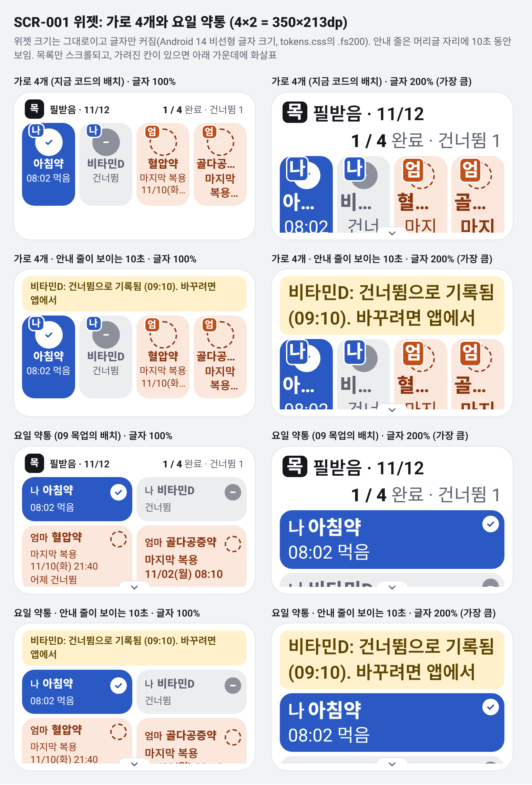
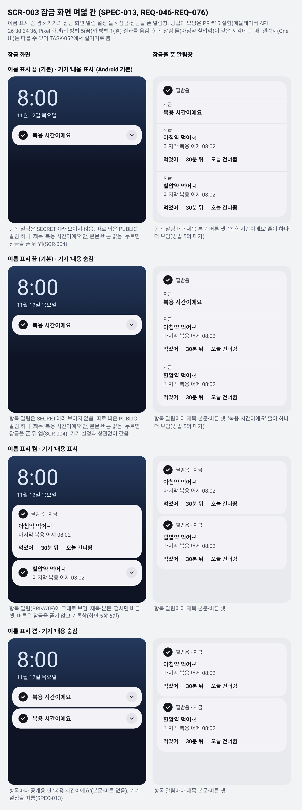
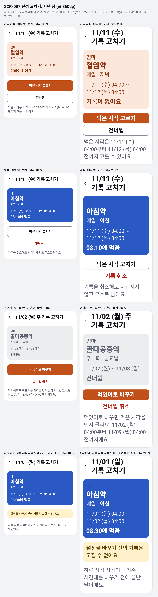

# 상태 그림 (TASK-044)

- 무엇: [화면 정의](../screens.md)의 상태 가운데 먼저 그려야 했던 셋을 그린 것: 위젯의 큰 글씨 배치(SCR-001), 알림 잠금 화면 여덟 칸(SCR-003), 지난 창의 판정 고치기(SCR-007). [WBS TASK-044](../../08-wbs/wbs.md)의 끝난 조건 "세 가지 그림이 있음"에 맞춤. 나머지 상태는 그 화면 작업 PR에서 먼저 그림(2026-11-12 검토 C5)
- 언제·누가: 2026-11-13, Claude. [PR #19](https://github.com/judangbang-ops/pillbadeum_release/pull/19)(R2 위젯·앱 화면)
- 모양: [09 목업](../../09-mockup/README.md)(2안 요일 약통)의 `tokens.css`·`box.css`를 그대로 씀. 그림 파일은 09 보드와 같은 `.dc.html` 모양이고 캔버스에는 올리지 않음
- 다시 그리기: `python3 docs/05-ui/states/build_states.py` 뒤에 `NODE_PATH=$(npm root -g) node docs/05-ui/states/render_states.js <corthex-uxui 스킬의 scripts/page-check.js>`. PNG 세 장(배율 2)과 `measure.json`을 이 폴더에 씀
- 이 문서의 숫자는 2026-11-13 [`measure.json`](measure.json)에서 옮김. 브라우저(Chromium)가 Roboto·Noto Sans KR로 그린 값이고 Glance·Android가 그린 것이 아님. 실제 화면은 TASK-014·TASK-030의 에뮬레이터 캡처와 TASK-032의 실기기로 확인함

## 1. 그림

| 그림 | 화면 | 보는 것 |
| --- | --- | --- |
| [WidgetSheet.png](WidgetSheet.png) | SCR-001 | 가로 4개(지금 코드)와 요일 약통(09 목업) 배치를 실제 4×2 크기(350×213dp)에서 글자 100%·200%로, 안내 줄이 없을 때와 있을 때 |
| [LockSheet.png](LockSheet.png) | SCR-003 | 이름 표시 끔·켬 × 기기의 잠금 화면 알림 설정 둘 × 잠금 화면·잠금을 푼 알림창 |
| [JudgeSheet.png](JudgeSheet.png) | SCR-007 | 지난 창의 기록 없음·먹음·건너뜀(주 1회)·`#locked`를 폭 360dp, 글자 100%·200%로 |

글자 200%는 Android 14의 비선형 글자 크기임(`tokens.css`의 `.fs200`: 14sp → 26, 16sp → 28). 위젯은 칸 크기가 그대로이고 글자만 커짐.

## 2. 위젯 두 배치 (SCR-001)

항목은 문구가 가장 길게 나오게 고름: 복용, 건너뜀, 매일 약 미완료에 그보다 늦은 건너뜀(보충 S-2의 둘째 줄), 주 1회 미완료(보충 W-2, 이름과 같은 크기). 안내 줄은 S-3 문구 "비타민D: 건너뜀으로 기록됨 (09:10). 바꾸려면 앱에서"임.

| 배치 · 글자 | 잘린 글자 | 머리글 높이 | 목록 창 / 내용 높이 | 다 보이는 칸 |
| --- | --- | --- | --- | --- |
| 가로 4개 · 100% | 3곳: 이름 '골다공…', 마지막 복용 두 곳(두 줄 제한) | 28px | 159 / 159px | 4 (글자가 잘린 채) |
| 가로 4개 · 200% | 6곳: 이름 넷 모두, 마지막 복용 두 곳 | 76px | 111 / 165px | 0 (넷 다 일부만) |
| 가로 4개 · 안내 줄 · 100% | 3곳 (100%와 같음) | 51px (안내 줄) | 136 / 136px | 4 (글자가 잘린 채) |
| 가로 4개 · 안내 줄 · 200% | 6곳 (200%와 같음) | 85px (안내 줄) | 102 / 165px | 0 |
| 요일 약통 · 100% | 없음 | 28px | 159 / 167px | 2, 나머지 둘은 아래가 조금 가려지고 화살표 |
| 요일 약통 · 200% | 없음 | 76px | 111 / 465px | 1, 나머지는 스크롤 |
| 요일 약통 · 안내 줄 · 100% | 없음 | 51px (안내 줄) | 136 / 167px | 2 |
| 요일 약통 · 안내 줄 · 200% | 없음 | 85px (안내 줄) | 102 / 465px | 1 |

- 가로 4개는 칸 글자 폭이 69px이라 글자 100%에서도 이름과 마지막 복용이 잘림(REQ-026을 못 지킴). 지금 코드는 이름 12sp·보조 문구 10sp로 이 폭에 맞췄는데, 토큰의 가장 작은 글자(14)보다 작고 글자 200%에서는 이름이 잘림(BUG-002)
- page-check 오류 20개 가운데 16개는 가로 4개 칸의 잘림과 한글 낱말 끊김이고, 4개는 요일 약통의 스크롤 목록 아래로 가려진 칸의 글자임(화살표로 알림)
- 끊기지 않는 가장 긴 묶음은 주 1회 문구의 날짜·시각 `11/02(월) 08:10`(이름 크기, 줄바꿈 없는 빈칸으로 이음)이고, 요일 약통 칸에서 100%는 113px / 140px, 200%(한 줄에 하나)는 199px / 306px임

**정한 것 (Claude, 2026-11-13)**

1. **배치는 요일 약통**: 09 목업(2026-11-13 01:04 승인)과 같음. 한 줄에 둘을 쓰다가, 칸 글자 폭이 위 묶음보다 좁아지면 한 줄에 하나로 바꿈. 350dp 위젯에서 묶음은 글자 크기에 비례한다고 보면 1.24배까지 들어감(140 ÷ 113). 그래서 글자 115%까지는 한 줄에 둘, 130% 이상은 한 줄에 하나로 봄(추정). TASK-014는 위젯 폭과 글자 배율로 고르고(칸 글자 폭 ≥ 이름 글자 크기 × 7.1이면 둘), 에뮬레이터 115%·130% 캡처로 문턱을 확인함
2. **안내 줄은 머리글 자리에 10초**: 200%에서 머리글(76px)과 안내 줄(85px)을 함께 두면 목록 창이 약 20px만 남음. 안내 줄은 항목 이름을 담고 있어 머리글을 잠깐 가려도 됨. 누르면 머리글처럼 앱(SCR-004)이 열림
3. **상태 원은 이름 줄 오른쪽에만**: 09 보드는 칸 오른쪽 38px을 모든 줄에서 비워, 첫 그림에서 주 1회 칸의 `08:10`이 `08:1`과 `0`으로 갈라졌음. 원을 이름 줄에만 두니 둘째 줄부터 칸 폭을 다 씀
4. **날짜와 시각 사이는 줄바꿈 없는 빈칸**(U+00A0): `11/10(화)`와 `21:40`이 다른 줄로 갈리지 않게 `Labels`가 만듦(TASK-013)
5. 가장 긴 문구 넷이면 글자 100%에서도 둘째 줄 칸의 아래 8px이 가려져 화살표가 보임. 화살표와 스크롤로 다 볼 수 있으므로 그대로 둠(SCR-001#overflow)
6. 머리글 수는 S-1대로 `1 / 4 완료 · 건너뜀 1`로 그림. 09 보드의 `2 / 4`는 칸(복용 하나)과 맞지 않았음

## 3. 잠금 화면 여덟 칸 (SCR-003)

방법은 04 명세 SPEC-013(2026-11-13 고정)이고, 모양은 [PR #15 잠금 화면 실험](https://github.com/judangbang-ops/pillbadeum_release/blob/e862b05/docs/07-qa/2026-11-12-lockscreen-experiment/report.md)(에뮬레이터 API 26·30·34·36, Pixel 화면)의 방법 5(끔)와 방법 1(켬) 결과를 옮김. 항목 알림 둘이 같은 시각에 뜬 때로 그림.

| 이름 표시 · 기기 설정 | 잠금 화면 | 잠금을 푼 알림창 |
| --- | --- | --- |
| 끔 (기본) · '내용 표시' | "복용 시간이에요" 하나(따로 띄운 `PUBLIC` 알림). 본문·버튼 없음 | 항목 알림마다 제목·본문·버튼 셋, "복용 시간이에요" 줄이 하나 더 |
| 끔 (기본) · '내용 숨김' | 위와 같음 | 위와 같음 |
| 켬 · '내용 표시' | 항목 알림(`PRIVATE`)이 그대로: 제목·본문, 펼치면 버튼 셋 | 항목 알림마다 제목·본문·버튼 셋 |
| 켬 · '내용 숨김' | 항목마다 공개용 판 "복용 시간이에요" | 위와 같음 |

- 알림 모양은 기기가 그림. 앱이 정하는 것은 글자, 작은 아이콘, 강조색뿐이라 이 그림만 기기 색을 그대로 씀(09 `Notif` 보드와 같음)
- 확인은 TASK-025(에뮬레이터 여덟 칸)와 TASK-052(갤럭시 실기기)에서 함. page-check 경고 8개는 잠금 화면 시계·날짜 글자가 그러데이션 위에 있다는 것이고, 밝은 글자(#DCE6F5)가 어두운 바탕 위라 손으로 봐도 읽힘

## 4. 지난 창의 판정 고치기 (SCR-007)

| 판정 | 버튼 |
| --- | --- |
| 기록 없음 (매일 약, 어제) | [먹은 시각 고르기], [건너뜀]. [지금 먹었어]는 지금 창에만 있음 |
| 먹음 (매일 약, 어제) | [먹은 시각 고치기], [기록 취소] |
| 건너뜀 (주 1회 약, 지난주) | [먹었어로 바꾸기](시각을 먼저 고름), [건너뜀 취소] |
| `#locked` (하루 시작 시각을 바꾸기 전에 끝난 날) | 버튼 없음 |

- 여덟 그림 모두 잘린 글자와 넘친 틀이 없고, page-check 오류·경고가 0개임
- 그림에서 Claude가 정한 것 (제안, 화면 정의 승인 뒤라 동희님이 바꿀 수 있음)
  - 주 1회 지난 창의 제목: `11/02 (월) 주 기록 고치기` (매일 약은 승인된 `11/11 (수) 기록 고치기`)
  - `#locked`의 둘째 줄: "하루 시작 시각이나 기준 시간대를 바꾸기 전에 끝난 날이에요."
  - 기록 없음에서 [먹은 시각 고르기]를 주 버튼(사람 색)으로 함
  - 날짜·요일·시각(`11/11 (수) 04:00`)과 제목의 `기록 고치기`를 줄바꿈 없는 빈칸으로 묶음. 200%에서 제목은 `11/11 (수)` / `기록 고치기` 두 줄이 됨
