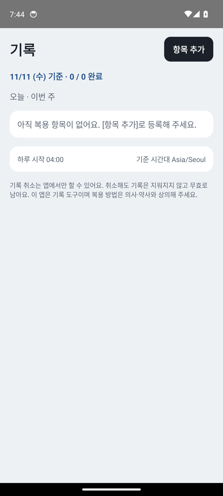
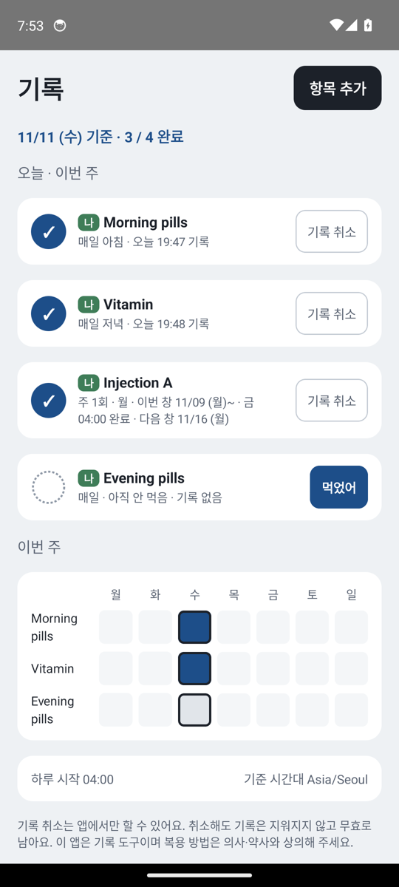
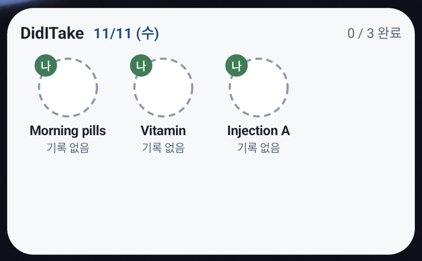
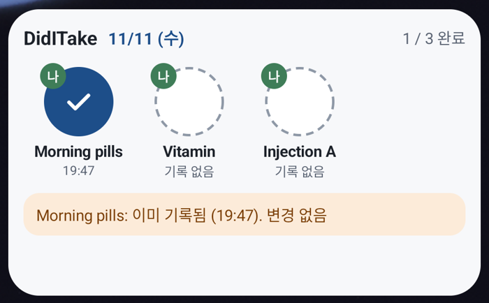
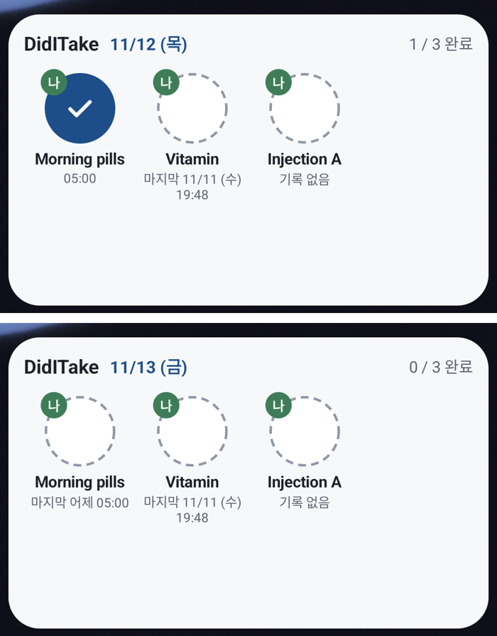
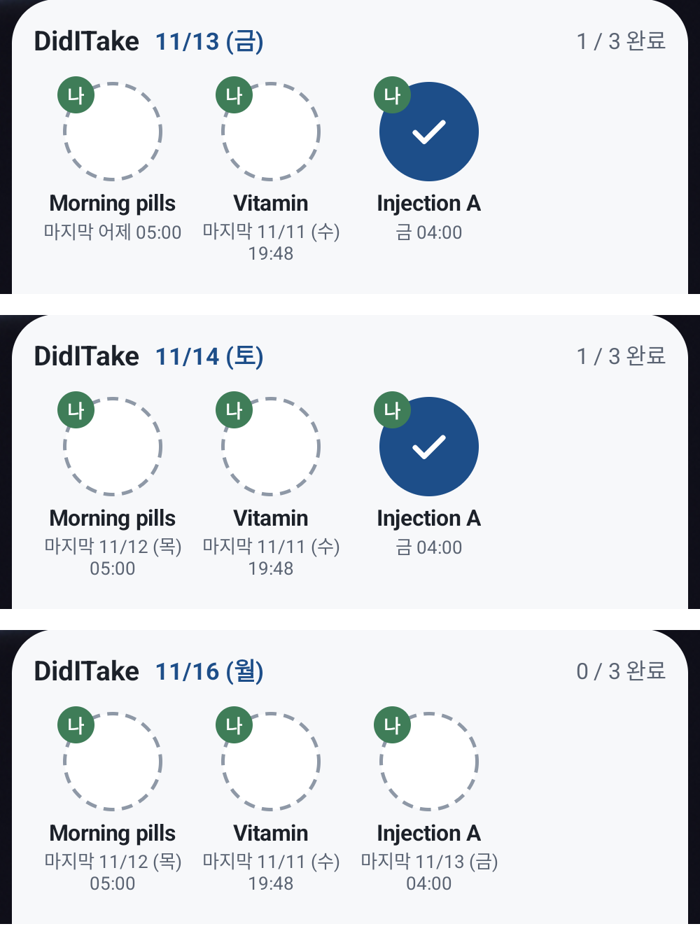

# 최소 프로토타입 동작 확인 (2026-11-11)

- 대상: develop 최소 프로토타입 (항목 등록, 위젯 탭 기록, 이미 기록됨 안내, 날짜 머리글, 오늘·이번 주 목록, 기록 취소, 04:00 경계 갱신)
- 환경: Android 에뮬레이터 API 34 (google_apis, arm64-v8a, Pixel 7 프로필), 디버그 APK
- 방법: adb로 화면을 직접 조작하고, 앱 DB(`databases/diditake.db`)를 복사해 `dose_record` 행을 확인함
- 테스트 데이터: 영문 예시 이름 (adb 입력은 한글을 넣을 수 없음)

## 1. 결과 요약

| # | 확인 항목 | 기대 동작 | 결과 | 근거 |
| --- | --- | --- | --- | --- |
| 1 | 앱 첫 실행 | 크래시 없이 빈 목록과 안내 표시 | 통과 | 01 |
| 2 | 항목 등록 (매일 2개, 주 1회 월요일 1개) | 목록에 상태·창 표시 | 통과 | 02 |
| 3 | 위젯 배치 | 머리글 날짜, n/m 완료, 빈 원, 대상자 배지, "기록 없음" | 통과 (기본 크기 결함은 4장) | 03 |
| 4 | 위젯 탭 | 완료 표시 + 기록 시각, DB 활성 1행 | 통과 | 04 |
| 5 | 같은 항목 재탭 | "이미 기록됨 (19:47). 변경 없음", DB 변화 없음 | 통과 (DB 1행 유지) | 04 |
| 6 | 다른 항목 동시 두 번 탭 | DB 1행 | 통과 (DB 1행) | DB |
| 7 | 앱에서 기록 취소 | 확인 대화상자 → 무효 처리 → 위젯 즉시 미완료 | 통과 | DB |
| 8 | 취소 후 위젯으로 재기록 | 무효 1행 + 활성 1행 (이력 보존) | 통과 | DB |
| 9 | 시계 변경 (11/11 → 11/12 05:00) | 위젯이 새 날짜로 갱신, "마지막 어제 19:47" | 통과 (시각 변경 방송으로 갱신) | 05 |
| 10 | 04:00 경계 알람 (03:59:40 → 04:00:05) | 위젯 머리글이 다음 날로, 완료 칸이 미완료로 | 통과 (알람 `04:00:05` 예약 확인) | 05 |
| 11 | 주 1회(월) 금요일 기록 → 토요일 → 다음 월요일 | 토요일 완료 유지, 월요일 미완료 + "마지막 11/13 (금)" | 통과 | 06 |
| 12 | 입력 화면에서 키보드가 열린 채 저장 | 저장 버튼에 닿을 수 있어야 함 | 결함 → 고침 | 08 |
| 13 | 위젯 기본 크기 | 버튼과 이름이 온전히 보여야 함 | 결함 → 고침 | 07 |

DB 확인 결과 (요약)

```
Morning pills  위젯 탭 3번(재탭 포함)  → 1행 (active=1)
Vitamin        동시 탭 2번            → 1행 (active=1)
Vitamin        앱에서 취소 후 재기록   → 2행 (void_reason=USER_CANCEL 1, active=1 1)
```

## 2. 화면

| 앱 (빈 상태) | 앱 (목록) |
| --- | --- |
|  |  |

| 위젯 (미완료) | 위젯 (기록 후 재탭) |
| --- | --- |
|  |  |

| 04:00 경계 전후 | 주 1회 창 (금 → 토 → 다음 월) |
| --- | --- |
|  |  |

## 3. 확인하지 못한 것

- **날짜가 바뀐 뒤 갱신되지 않은 위젯 탭** (record-rules 반례 13): 시각을 바꾸면 시스템의 시각 변경 방송으로 위젯이 먼저 갱신돼 에뮬레이터에서 재현하지 못함. 렌더 기간키 대조는 JVM 테스트 `c13`·`c23`으로만 확인함
- **위젯 기본 크기 수정 후 새로 배치한 모습**: 공급자 정보에 최소 250×110dp가 등록된 것까지 확인함 (`dumpsys appwidget`의 min=(64001x28161) = 250dp×110dp). 새 위젯을 끌어다 놓은 화면은 확인하지 못함
- 실기기(갤럭시) 동작: 절전 모드, 꺼진 상태에서 첫 탭 지연, 실제 해상도

## 4. 발견한 결함과 조치

| # | 결함 | 원인 | 조치 |
| --- | --- | --- | --- |
| D1 | 입력 화면에서 키보드가 저장·닫기 버튼을 가리고, 위로 밀어도 닿지 않음 | 화면이 키보드 높이만큼 줄어들지 않음 | 입력·목록 화면에 `imePadding()`, 액티비티에 `adjustResize`. 키보드가 열린 채 스크롤해 저장되는 것을 확인함 |
| D2 | 위젯 기본 크기 2×1에서 버튼이 반쯤 잘리고 이름이 보이지 않음 | 기본·최소 크기가 한 줄 버튼을 담기에 작음 | 기본 4×2, 최소·최소 조절 크기 250×110dp로 바꿈 |

## 5. 알려진 제한 (다음 작업 후보)

- **미래 시각 기록 경고 없음** (반례 19): 시계를 앞으로 돌렸다 되돌리면 미래 시각 기록이 현재 창을 "완료"로 표시함. 이번 확인에서 실제로 재현됨 (주 1회 항목이 수요일에 "금 04:00 완료"로 보임)
- 위젯 안내 문구는 Glance 세션이 끝나면 다음 갱신 때까지 남을 수 있음 (10초 지난 문구는 다음 렌더에서 숨김)
- 대상자 배지는 이름 첫 글자임 ("엄마" → "엄")
- 위젯 대상자 필터, 건너뜀, 늦은 투약 처리, 반복 알림, 설정 변경 화면은 이번 범위 밖임
- 모든 시각을 기준 시간대(Asia/Seoul)로 표시함. 해외에서는 기기 시각과 다르게 보일 수 있음
- 앱을 켜 둔 채 04:00을 넘기면 다시 열 때까지 앱 화면이 갱신되지 않음 (기록은 렌더 기간키 대조로 막힘)
