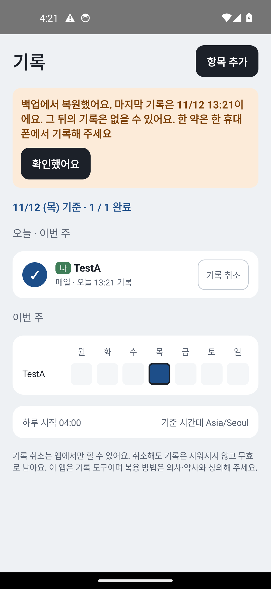
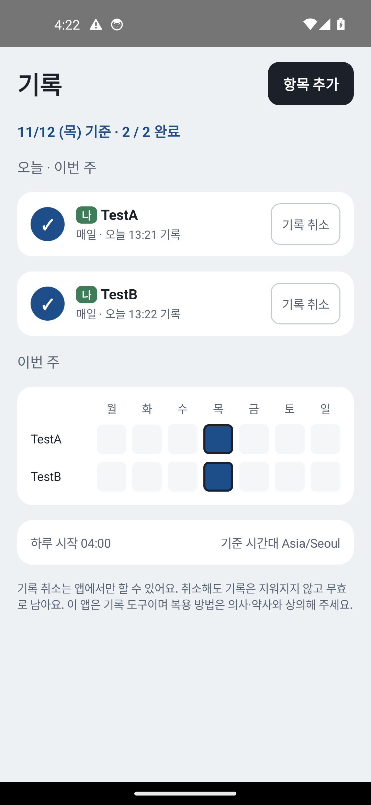

# 백업·복원과 복원 감지 에뮬레이터 확인 (2026-11-12)

- 대상: [PR #9](https://github.com/judangbang-ops/pillbadeum_release/pull/9)의 TASK-028(자동 백업·기기 간 이전 규칙)과 TASK-029(복원 감지·안내), 커밋 `311013f`
- 환경: GitHub Actions `ubuntu-latest`의 Android 에뮬레이터 4대(Pixel 5 프로필, x86_64). API 34·30·26은 `google_apis` 이미지, API 27은 `google_apis` x86_64 이미지가 없어 `default` 이미지. 같은 커밋의 디버그 APK
- 방법: [`.github/workflows/emulator.yml`](../../../.github/workflows/emulator.yml)이 [`scripts/emulator/backup_restore_check.py`](../../../scripts/emulator/backup_restore_check.py)를 돌림
  - 앱 화면을 uiautomator로 읽고 눌러 항목을 만들고 [먹었어]로 기록함
  - 시험용 백업 전송(LocalTransport)으로 `bmgr backupnow` → 앱을 지우고 다시 설치(설치 때 자동 복원) → `adb root`로 앱의 DB·표식 파일을 꺼내 sqlite3로 셈
  - 백업에 든 파일은 전송이 둔 tar 파일을 꺼내 목록으로 봄
  - 암호화 조건은 공식 [백업 시험 문서](https://developer.android.com/identity/data/testingbackup)대로 `backup_local_transport_parameters`의 `is_encrypted`·`is_device_transfer`로 바꿈(Android 12부터 받는 값)
  - 시험 전송이 정말 백업을 받는지 먼저 설정 제공자(`com.android.providers.settings`) 백업으로 확인한 뒤에 '백업 안 됨' 경우를 셈
- 테스트 데이터: 영문 항목 이름 `TestA` (adb 입력은 한글을 넣을 수 없음)
- 실행: [에뮬레이터 확인 43153614208](https://github.com/judangbang-ops/pillbadeum_release/actions/runs/43153614208). API별 결과 표는 [evidence](evidence/) 폴더, 로그캣 전체는 실행의 아티팩트(7일 보관)

## 1. 결과 요약

| # | 확인 항목 | API | 기대 동작 | 결과 | 근거 |
| --- | --- | --- | --- | --- | --- |
| 1 | 시험 전송이 백업을 받는지 (대조) | 34·30·27·26 | 설정 제공자 백업 성공 | 통과 | evidence |
| 2 | B-1 클라우드 백업에 든 파일 (암호화 있음) | 34 | 기록 DB와 짝 파일만 | 통과: `_manifest`, `db/diditake.db`, `db/diditake.db-wal` | evidence |
| 3 | RR-26·RR-69 기록 1건 → 백업 → 지우고 다시 설치 (화면 잠금 있음) | 34 | 그 1건이 돌아옴 | 통과 | evidence |
| 4 | RR-30·R-2 복원 뒤 첫 실행 | 34 | 복원 안내, 새 `device_id`, `restored_from_device_id` = 옛 값 | 통과 | 01 |
| 5 | RR-32 안내 확인 전에 기록 | 34 | 기록됨, 새 행의 `device_id` = 새 값, 안내 남음 | 통과 | evidence |
| 6 | RR-33 [확인했어요] (앱 몫) | 34 | 안내가 사라지고 `restore_notice_pending` = 0 | 통과 | 02 |
| 7 | RR-31 같은 폰에서 업데이트 | 34 | 안내 없음, `device_id`·표식 그대로 | 통과 | evidence |
| 8 | RR-71 앱이 깔린 채로 백업을 복원 | 34 | 복원으로 처리, 안내 보임 | 통과 (시스템이 복원 전에 앱 데이터를 지워 표식도 없어짐. R-1 표의 '표식 없음' 줄) | evidence |
| 9 | RR-34 앱 데이터 삭제 뒤 실행 | 34 | 새 설치, 안내 없음, 기록 0 | 통과 | evidence |
| 10 | RR-68 화면 잠금 없음(`is_encrypted=false`) | 34 | 백업에 DB 없음, 다시 설치하면 DB 없음 | 통과 (시험 전송이 0바이트 백업을 거절) | evidence |
| 11 | B-1 기기 간 이전에 든 파일 | 34 | 기록 DB와 짝 파일만 | 통과 | evidence |
| 12 | B-3 기기 간 이전(`is_device_transfer=true`, 암호화 없음) | 34 | 기록이 돌아오고 복원 안내 | 통과 | evidence |
| 13 | Android 9~11, 시험 전송에 암호화 조건 없음 | 30 | DB가 올라가지 않음, 다시 설치하면 DB 없음 | 통과 (규칙 파일은 읽힘, 0바이트라 전송이 거절) | evidence |
| 14 | RR-70 Android 8.x | 27·26 | 백업하지 않음, 다시 설치하면 DB 없음 | 통과 (규칙 파일 읽기 실패로 백업이 빈 채로 끝남) | evidence |

- 경우 수: API 34 16개, API 30 4개, API 27 4개, API 26 4개가 모두 통과 (각 API의 결과 표)
- JVM 테스트: 같은 PR의 CI에서 165개 통과. 이 두 작업의 테스트는 `BackupRulesTest` 3개(규칙 파일의 파일 목록과 암호화 조건), `BackupFileSetTest` 3개(RR-26·RR-27 400건·RR-28 음성 대조), `InstallCheckTest` 16개(R-1 표의 모든 줄, RR-30~34·71·72·75, 늦은 시계), `StatusBoardTest`의 안내 문구

8.x 규칙 파일 읽기 실패 (API 26, 로그캣)

```
V BackupXmlParserLogging: Exception trying to parse fullBackupContent xml file! Aborting full backup.
V BackupXmlParserLogging: org.xmlpull.v1.XmlPullParserException: At most 2 tag attributes allowed for "include" tag ("domain" & "path".
```

Android 9~11 규칙 파일 (API 30, 로그캣 요약): 세 파일이 `requiredFlags 1`(클라우드 백업, 암호화 필요)과 `requiredFlags 2`(기기 간 이전)로 두 번씩 읽힘

## 2. 화면

| 복원 뒤 첫 실행 (API 34) | [확인했어요] 뒤 |
| --- | --- |
|  |  |

## 3. 확인하지 못한 것

- **Android 9~11에서 화면 잠금이 있을 때 실제로 DB가 올라가는 쪽**: 시험 전송은 Android 11 이하에서 암호화 조건을 켤 수 없음(AOSP `LocalTransportParameters`). 그래서 9~11은 '조건이 없으면 올라가지 않음'만 봄. 실기기 확인은 TASK-032
- **Android 9~11의 기기 간 이전**: 같은 이유로 `deviceToDeviceTransfer` 줄이 실제로 쓰이는지 보지 못함. 규칙 파일이 그 줄을 읽는 것(`requiredFlags 2`)까지만 봄. TASK-032(RR-29)
- **RR-29 실제 기기 간 이전(케이블·Smart Switch)**, 실제 Google 백업(암호화, 25MB 한도, 하루 한 번 시점): 실기기 TASK-032
- **RR-27 기록 400건의 실제 백업**: 기록은 칸마다 한 번이라 앱 경로로 400건을 쌓을 방법이 에뮬레이터에 없음. 같은 Room·SQLite 설정으로 400건을 쓴 살아 있는 DB 파일을 규칙의 세 파일만 복사해 여는 JVM 테스트(`BackupFileSetTest`, 본 파일이 두 번 체크포인트된 상태)로만 봄
- **RR-72**(표식을 쓴 뒤 DB 트랜잭션 전에 멈춤): JVM 테스트로만 봄
- **위젯의 복원 안내 줄**("복원됨 · 마지막 기록 … · 앱에서 확인"): 이 확인은 위젯을 놓지 않아 문구는 JVM 테스트로만 봄. 위젯을 놓고 누르는 확인은 TASK-051
- **복원 안내 알림**(RR-30의 '복용 알림이 울리지 않음', RR-33의 알림 다시 예약, RR-73): 알림 작업 TASK-040
- 설정 화면의 '백업되지 않아요' 문구(REQ-054): 설정 화면 작업 뒤
- 릴리즈 변형으로 한 백업·복원: TASK-051

## 4. 발견한 결함과 조치

앱 코드의 결함은 이 확인에서 나오지 않았음. 아래는 확인 절차의 결함이고, 고치기 전의 실행은 근거로 쓰지 않음.

| # | 결함 | 원인 | 조치 |
| --- | --- | --- | --- |
| D1 | 백업 전에 `am force-stop`을 하면 앱 백업을 건너뛰는데 `bmgr` 마지막 줄은 "Success". 첫 API 30 실행이 이것으로 잘못 통과함 | 강제 종료한 앱은 정지 상태라 전체 백업 대상이 아님(AOSP `BackupEligibilityRules`, 앱 줄에 "Backup is not allowed") | 백업 전에는 홈으로 나가 `am kill`. 앱 줄("Package … with result")을 따로 봄 |
| D2 | Android 8.x에서 모든 백업이 "Unable to run backup" | 8.x의 시험 전송 이름이 `android/com.android.internal.backup.LocalTransport`로 9 이상과 다름 | `bmgr list transports`에서 이름을 고름 |
| D3 | 9~11과 RR-68에서 앱 줄이 "Transport rejected package" | 규칙이 넣은 파일이 없어 0바이트이면 시험 전송이 거절함(AOSP `LocalTransport.checkFullBackupSize`). 결함이 아니라 기대한 결과 | 이 줄도 '앱 백업이 돎'으로 받고, 백업 안 파일과 다시 설치 뒤 DB로 판정 |
| D4 | Android 10 이상에서 `bmgr restore <패키지>`가 사용법만 출력 | 복원 세트 토큰이 필요해짐 | `bmgr list sets`의 토큰으로 `bmgr restore 1 <패키지>` |
| D5 | `pm clear` 직후 `am start -W`가 120초를 넘김 | 시스템이 옛 작업을 지우며 새 프로세스를 끝냄 | `-W` 없이 띄우고 첫 화면을 기다림 |
| D6 | RR-68 준비의 새 설치에 앞 경우의 기록이 되살아남 | `bmgr wipe`가 시험 전송의 전체 백업 파일을 지우지 않음(`clearBackupData`가 그 파일을 폴더로 읽음, AOSP) | root로 그 파일도 지우고 남지 않았는지 확인 |

독립 검토(Fable 5.2, 2026-11-12)로 고친 앱 코드: 표식 파일의 이름을 바꾼 뒤 폴더까지 디스크에 내림, 복원된 판정이 모두 이 폰 시계보다 뒤일 때 '기록 없음' 대신 시각 없이 안내(`later`), 프로세스마다 처음 열 때 경계 알람을 다시 걺. 같은 검토가 '9~11·8.x 통과가 증명하는 것이 적다'고 지적해, 백업 안 파일 목록·다시 설치 뒤 DB 파일 없음·8.x 파싱 실패 기록을 판정에 넣음.

## 5. 알려진 제한

- 클라우드 백업 tar에 `db/diditake.db-wal`이 두 번 들어감. Android가 `database` 영역의 DB에 `-wal`·`-journal`을 스스로 더하고(로그캣 "automatically generated"), 규칙 파일도 `-wal`을 적어서임. 복원은 같은 파일을 두 번 써서 결과가 같고(3번 통과), 백업 크기만 WAL 크기만큼 늘어남. 보충 B-1대로 문서에 없는 자동 추가에 기대지 않으려고 그대로 둠
- 시험 전송은 실제 Google 백업과 다름: 암호화·크기 한도·하루 한 번 시점·네트워크 조건을 보지 않음
- 복원 뒤 위젯은 대상자 선택을 잃음(보충 R-3, REQ-079). 대상자 고르기는 TASK-012
- 모든 확인은 디버그 APK. 디버그와 릴리즈의 매니페스트 백업 설정은 같음(같은 `AndroidManifest.xml`)
