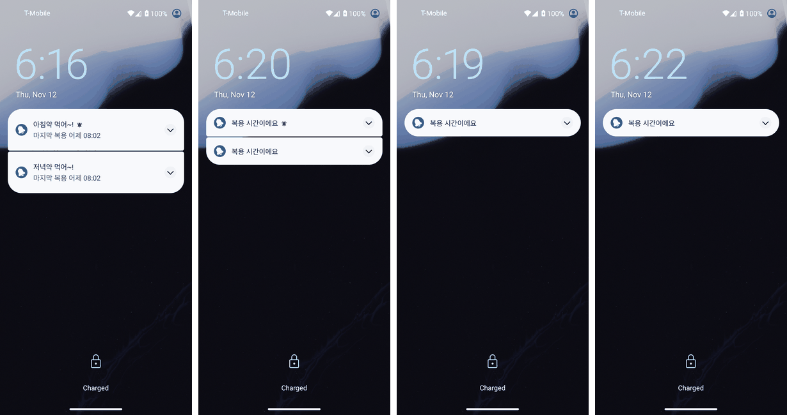
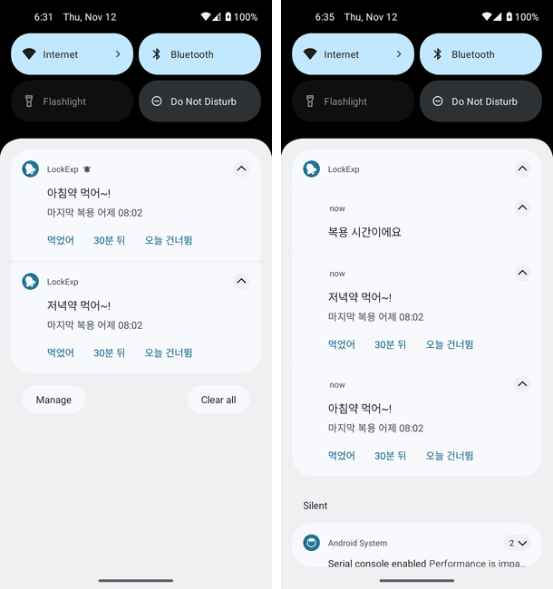

# 잠금 화면 알림 실험 (2026-11-12)

- 목적: TASK-025를 만들기 전에 [SCR-003](../../05-ui/screens.md#scr-003-반복-알림)의 잠금 화면 계획(이름 표시 끔이면 공개용 판 "복용 시간이에요"만, 버튼 없음)이 기기의 잠금 화면 알림 설정과 상관없이 지켜지는지 봄(2026-11-12 검토 B6, REQ-046, REQ-076). 공식 문서는 공개 범위 세 가지(`VISIBILITY_PUBLIC`·`PRIVATE`·`SECRET`)만 설명하고, 기기의 '내용 표시'·'내용 숨김' 설정과의 관계는 적지 않음([Create a notification](https://developer.android.com/develop/ui/views/notifications/build-notification), 2026-11-10 갱신본을 2026-11-12에 읽음)
- 제품 확인이 아님: 제품 앱이 아니라 실험 앱(`experiments/lockscreen`, `-PlockscreenExperiment`를 줄 때만 빌드에 들어감)으로 함. 이 보고서의 결과로 TASK-025의 방법을 고르고, 갤럭시 실기기 여덟 칸은 TASK-052에서 따로 봄
- 환경: GitHub Actions `ubuntu-latest`의 Android 에뮬레이터 API 26·30·34·36(`google_apis` x86_64). 34·36은 Pixel 시스템 UI. PIN 1234로 잠금
- 방법: [`.github/workflows/lockscreen-experiment.yml`](../../../.github/workflows/lockscreen-experiment.yml)이 [`scripts/emulator/lockscreen_experiment.py`](../../../scripts/emulator/lockscreen_experiment.py)를 돌림
  - 실험 앱이 항목 알림 둘("아침약 먹어~!", "저녁약 먹어~!", 본문 "마지막 복용 어제 08:02", 버튼 [먹었어] [30분 뒤] [오늘 건너뜀])을 방법마다 다른 공개 범위로 올림. 채널 중요도 높음, 시스템이 붙이는 버튼은 끔
  - 기기 설정 두 가지(`lock_screen_allow_private_notifications` 1 = 내용 표시, 0 = 내용 숨김) × 방법 일곱 가지마다: 화면 끄기 → 알림 올리기 → 화면 켜기 → 잠금 화면을 읽고 알림을 펼쳐 다시 읽기 → PIN으로 풀기 → 알림창을 내려 읽기
  - 잠금 여부는 `dumpsys`의 keyguard 값으로 확인하고, 화면은 uiautomator 덤프의 글자로 읽음. 화면 사진과 덤프는 실행의 아티팩트(7일 보관)
- 실행: [잠금 화면 알림 실험 43168139819](https://github.com/judangbang-ops/pillbadeum_release/actions/runs/43168139819)(커밋 `22329db`), 네 API 모두 잠금·풀기 확인됨. 결과 표 그대로는 [evidence/api26.md](evidence/api26.md), [api30.md](evidence/api30.md), [api34.md](evidence/api34.md), [api36.md](evidence/api36.md). 첫 실행 [43166255162](https://github.com/judangbang-ops/pillbadeum_release/actions/runs/43166255162)(`ef0ccf4`)도 이름·문구 결과는 같았음(30·34·36에서 잠금 감지가 틀려 실패로 끝났으나 화면 사진은 잠금 화면)

## 1. 결과 요약

'끔 기준'은 SCR-003의 이름 표시 끔: 잠긴 화면(펼쳐도)에 약 이름·버튼이 없고 "복용 시간이에요"가 보이며, 잠금을 풀면 알림창에 항목 이름이 다 있음.

| # | 방법 | 내용 표시 (26 · 30 · 34 · 36) | 내용 숨김 (26 · 30 · 34 · 36) |
| --- | --- | --- | --- |
| 1 | `PRIVATE` + 공개용 판 "복용 시간이에요" (screens.md 계획) | **실패**: 잠금 화면에 이름·본문이 그대로. 34·36은 펼치면 버튼도 보임 | 통과 (넷 다) |
| 2 | `PRIVATE`, 공개용 판 없음 (참고) | 실패: 이름 보임 | 실패: 시스템이 앱 이름만 남겨 "복용 시간이에요"도 없음 |
| 3 | `SECRET` | 실패: 잠금 화면에 아무것도 없음 | 같음 |
| 4 | `SECRET` 항목 + `PUBLIC` 묶음 요약 "복용 시간이에요" | 26·30 통과, **34·36 실패**: 잠금 화면에 아무것도 없음 | 같음 |
| 5 | `SECRET` 항목 + 따로 `PUBLIC` "복용 시간이에요" 알림 하나 | **통과 (넷 다)** | **통과 (넷 다)** |
| 6 | `PUBLIC` "복용 시간이에요"만 (참고) | 잠금 화면은 맞지만 풀어도 이름이 없음 | 같음 |
| 7 | `PUBLIC` 항목 (이름 표시 켬의 계획) | 잠금 화면에 이름·본문. 34·36은 펼치면 버튼 | 같음 |

- 결론: screens.md의 계획(1)은 기기가 '내용 숨김'일 때만 이름을 가림. 안드로이드 기본값인 '내용 표시'에서는 약 이름과 버튼이 잠금 화면에 나옴
- 두 기기 설정과 네 API 모두에서 끔 기준을 지킨 것은 5뿐임: 항목 알림은 `SECRET`으로 잠금 화면에서 빼고, 잠금 화면에 보일 "복용 시간이에요" 알림 하나를 `PUBLIC`으로 따로 올림
- 5의 대가: 잠금을 푼 알림창에 "복용 시간이에요" 줄이 항목 알림과 함께 하나 더 보임(시스템이 같은 앱 알림으로 묶음, 그림 2 오른쪽). 항목 알림이 모두 사라지면 이 알림도 같이 지워야 함(N-13)
- 이름 표시 켬(7)은 넷 다 잠금 화면에 이름이 보임. 34·36은 잠금 화면에서 펼친 알림에 버튼이 보였고, 26·30은 잠금 화면에서 펼치기 탭이 먹지 않아 버튼을 보지 못함(아래 3장)

## 2. 화면 (API 34)

그림 1. 잠금 화면, 왼쪽부터 방법 1 + 내용 표시(이름이 보임), 방법 1 + 내용 숨김, 방법 5 + 내용 표시, 방법 5 + 내용 숨김. 첫 실행의 사진(펼치기 전)

그림 2. 왼쪽: 방법 1 + 내용 표시에서 잠긴 채 알림을 내린 화면(덤프에 `keyguard_bottom_area`가 있어 잠금 상태), 이름과 버튼이 다 보임. 오른쪽: 방법 5 + 내용 표시에서 잠금을 푼 알림창

## 3. 확인하지 못한 것

- **삼성 One UI**: 에뮬레이터는 Pixel·AOSP 시스템 UI임. 갤럭시는 잠금 화면 알림 설정의 이름과 동작이 다를 수 있어 여덟 칸(이름 표시 끔·켬 × 잠금·해제 × 기기 설정 두 가지)을 TASK-052에서 실기기로 봄
- **API 26·30의 잠금 화면 버튼**: 잠금 화면에서 펼치기 버튼을 눌러도 펼쳐지지 않아(덤프에 버튼 글자가 없음) 이름 표시 켬일 때 버튼이 보이는지 모름. 사람이 끌어 내려 펼치면 보일 수 있음
- **소리·진동·화면 켜짐**: 방법 5는 알림이 셋(항목 둘 + 문구 하나)이라 소리가 몇 번 나는지, `SECRET` 알림이 잠긴 화면을 켜는지는 재지 않음. TASK-025에서 문구 알림에 `setOnlyAlertOnce`나 무음을 줄지 정할 때 같이 봄
- **알림 하나만 있을 때, 알림이 많을 때**: 항목 둘로만 봄. 항목 다섯(RR-54)일 때 잠금 화면에 문구 알림 하나만 보이는지는 TASK-025의 에뮬레이터 확인에서 봄
- **잠금 화면에서 버튼을 누를 때 잠금 해제를 요구하는지**(SCR-003 결정 6): 버튼을 누르지 않았음

## 4. 발견한 결함과 조치

앱 코드의 결함이 아니라 계획(screens.md SCR-003)의 빈틈과 실험 절차의 결함임.

| # | 결함 | 원인 | 조치 |
| --- | --- | --- | --- |
| E1 | screens.md 계획대로 하면 기기 기본 설정('내용 표시')에서 잠금 화면에 약 이름과 버튼이 나옴 (REQ-046·REQ-076 위반) | 공개용 판은 기기가 '내용 숨김'일 때만 쓰임 | TASK-025에서 방법 5를 쓰자고 제안함. 방향이 정해진 뒤 screens.md 잠금 화면 표의 '방법' 줄을 고침(이 PR에서는 고치지 않음) |
| E2 | 첫 실행에서 API 30·34·36이 잠금 화면을 감지하지 못해 실패로 끝남 | `dumpsys`의 keyguard 값 이름이 버전마다 다름 | `KeyguardServiceDelegate showing`, `mKeyguardShowing` 등 여러 곳을 차례로 읽음(`22329db`) |
| E3 | 접힌 알림이라 버튼이 덤프에 안 나옴 | 잠금 화면·알림창의 알림이 접힌 채 보임 | 펼치기 버튼(`expand_button`)을 눌러 다시 읽고 두 번 읽은 글자를 합침(`22329db`) |
| E4 | 실험 앱 APK 빌드 실패 | 매니페스트 XML 주석 안의 하이픈 두 개 | 주석을 고침(`ef0ccf4`) |
