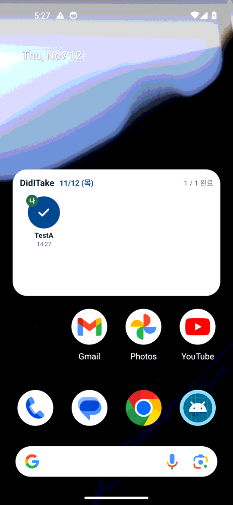
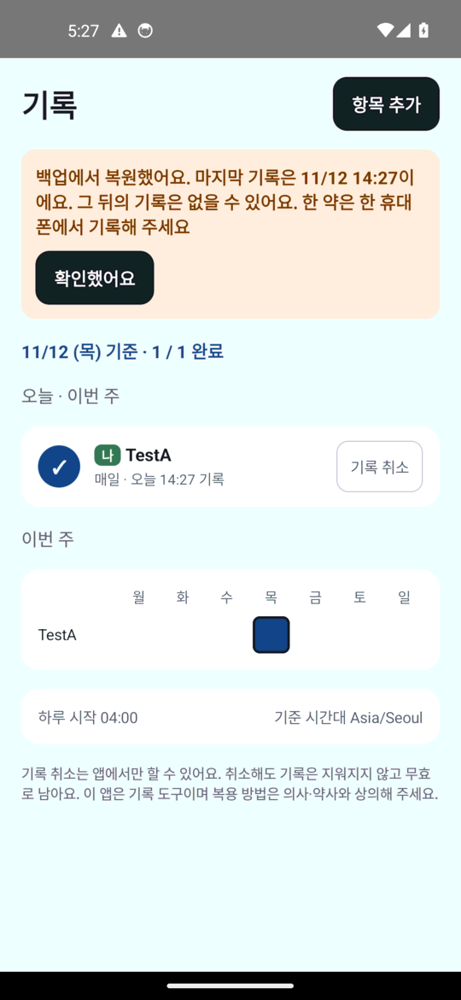
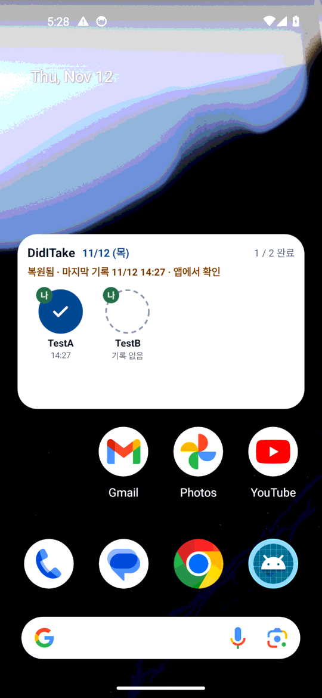
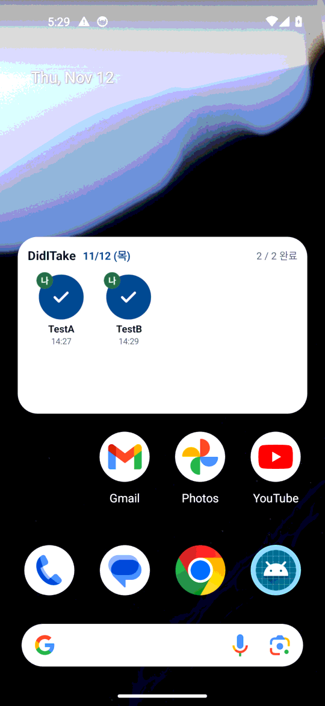

# 릴리즈 변형 에뮬레이터 확인 (2026-11-12)

- 대상: [PR #14](https://github.com/judangbang-ops/pillbadeum_release/pull/14)의 TASK-051(개인 APK를 나눠 주기 전 확인). 앱 코드는 main `b768b3d`(R0b의 TASK-001·002·004·028·029, R1 전체가 들어간 상태)와 같음
- 환경: GitHub Actions `ubuntu-latest`의 Android 에뮬레이터(API 34 `google_apis` x86_64, Pixel 5 프로필, Pixel Launcher)
- APK: 같은 커밋의 서명 안 한 릴리즈 APK(`:androidApp:assembleRelease`)를 버전 번호 N(커밋 수)과 N+1로 두 번 빌드하고, 실행마다 새로 만들고 지우는 임시 키(RSA 2048, 유효 1일) 하나로 둘 다 서명함
  - 서명 방법은 개인 APK와 같음([`scripts/sign-personal-apk.ps1`](../../../scripts/sign-personal-apk.ps1)): `zipalign -c -P 16 4`로 정렬 확인 → `apksigner sign`(PKCS12, v4 서명 끔) → 서명자 1명, v2·v3 서명, 정렬, 패키지 이름·버전 번호, 디버그 불가 확인
  - 업로드 키·앱 서명 키·GitHub Secrets는 쓰지 않음. 키만 다름
- 방법: [`.github/workflows/release-emulator.yml`](../../../.github/workflows/release-emulator.yml)이 [`scripts/emulator/release_check.py`](../../../scripts/emulator/release_check.py)를 돌림
  - 위젯은 사람처럼 놓음: 홈 화면 길게 누르기 → Widgets → DidITake 검색 → 미리보기를 끌어 홈 가운데에 놓기. 그 위젯의 항목을 눌러 기록함
  - 백업·복원은 시험용 백업 전송(LocalTransport, 암호화 있음 `is_encrypted=true`)으로 `bmgr backupnow` → 앱 지우기 → 다시 설치(설치 때 자동 복원). 기록 수·`source`·`device_id`는 `adb root`로 DB를 꺼내 sqlite3로 셈
  - 다음 빌드는 `adb install -r`로 덮어 깖
- 실행: [릴리즈 변형 에뮬레이터 확인 43160759272](https://github.com/judangbang-ops/pillbadeum_release/actions/runs/43160759272)(PR 머리 `07b343d`를 main과 합친 `48fa8e5`를 빌드), 버전 번호 77 → 78. 결과 표 그대로는 [evidence/api34.md](evidence/api34.md), 로그캣·화면 덤프는 실행의 아티팩트(7일 보관)

## 1. 결과 요약

| # | 확인 항목 | 기대 동작 | 결과 | 근거 |
| --- | --- | --- | --- | --- |
| 1 | 시험 전송이 백업을 받는지 (대조) | 설정 제공자 백업 성공 | 통과 | evidence |
| 2 | 릴리즈 변형 N 설치 | 디버그 불가(`DEBUGGABLE` 없음, `run-as` 거부), 백업 허용 | 통과: `flags [HAS_CODE ALLOW_CLEAR_USER_DATA ALLOW_BACKUP]`, `run-as: package not debuggable` | evidence |
| 3 | 홈 화면 위젯에서 항목 탭 | 기록 1건, `source` = `WIDGET`, `device_id`·설치 표식 있음 | 통과 | 01 |
| 4 | B-1 릴리즈 변형의 백업에 든 파일 | 앱 백업 성공, 기록 DB와 짝 파일만 | 통과: `_manifest`, `_meta`, `db/diditake.db`, `db/diditake.db-wal`(Android가 더한 것과 규칙의 것, 두 번) | evidence |
| 5 | RR-26 백업 → 지우고 다시 설치 | 위젯으로 쓴 기록 1건이 돌아옴, 표식 없음 | 통과 | evidence |
| 6 | RR-30 복원 뒤 첫 실행 | 복원 안내, 새 `device_id` = 표식, `restored_from_device_id` = 옛 값 | 통과 | 02 |
| 7 | 보충 R-3 복원 뒤 위젯 | 머리글 아래 "복원됨 · 마지막 기록 … · 앱에서 확인" | 통과 | 03 |
| 8 | RR-33 위젯 몫: 앱에서 [확인했어요] 뒤 | 위젯의 복원 줄이 사라짐 | 통과 | evidence |
| 9 | 다음 빌드 N+1을 덮어 설치 | 버전 번호가 커지고 기록·`device_id`·표식이 그대로 | 통과 | evidence |
| 10 | 덮어 설치 뒤 남아 있던 위젯에서 탭 | 기록 2건 모두 `WIDGET`, 새 기록의 `device_id` = 이 폰 값, 옛 기록은 옛 값 | 통과 | 04 |
| 11 | 덮어 설치 뒤 앱 | 복원 안내 없음(업데이트는 복원이 아님, RR-31) | 통과 | evidence |

- 경우 수: 11개 모두 통과
- 서명한 두 APK: 패키지 `com.judangbang.pillbadeum`, versionName 0.1.0, 서명자 1명, 같은 임시 키 인증서(실행마다 바뀜)
- 같은 실행의 디버그 APK 백업·복원 확인(API 34·30·27·26, [이전 보고서](../2026-11-12-backup-restore/report.md)의 방법)도 통과: [에뮬레이터 확인 43160759285](https://github.com/judangbang-ops/pillbadeum_release/actions/runs/43160759285)

## 2. 화면

| 1. 위젯 탭 기록 (N) | 2. 복원 뒤 첫 실행 | 3. 복원 뒤 위젯 | 4. N+1 덮어 설치 뒤 위젯 탭 |
| --- | --- | --- | --- |
|  |  |  |  |

## 3. 확인하지 못한 것

- **앱 서명 키로 서명한 진짜 개인 APK**: 키가 동희님 PC에만 있어 이 확인은 같은 방법·다른 키로 함. 개인 APK의 인증서 지문은 서명 스크립트가 확인함(TASK-002). 실제 폰에 깔고 덮어 까는 것은 TASK-047
- **실기기 런처(삼성 One UI)에서 위젯 놓기와 탭**: TASK-047
- **스키마가 바뀐 다음 빌드**: N+1은 같은 코드에 번호만 올린 빌드라, 마이그레이션이 든 업데이트는 증명하지 않음. 마이그레이션은 TASK-003의 JVM 테스트
- **Play 버전으로 넘어가기(REQ-062의 Play 몫)**: Play 앱 서명 인증서 지문과 Play 버전 덮어 깔기는 TASK-050·TASK-038
- **API 34 밖의 릴리즈 변형**: Android 8.x·9~11의 백업 동작은 디버그 APK로만 봄([이전 보고서](../2026-11-12-backup-restore/report.md)). 두 변형의 매니페스트 백업 설정과 규칙 파일은 같고, 릴리즈 변형은 코드 축소를 하지 않음
- **실제 Google 백업**(암호화, 크기 한도, 하루 한 번 시점)과 실제 기기 간 이전: TASK-032
- **복원 안내 알림**: TASK-040

## 4. 발견한 결함과 조치

앱 코드의 결함은 이 확인에서 나오지 않았음. 아래는 확인 절차의 결함이고, 고친 뒤의 실행만 근거로 씀.

| # | 결함 | 원인 | 조치 |
| --- | --- | --- | --- |
| E1 | 첫 실행에서 위젯이 놓이지 않음 | 전체 위젯 목록에서 DidITake를 펼치면 미리보기가 화면 아래 밖에 열림 | 목록에서 DidITake를 검색해 행을 위로 올리고, 그 행 아래의 미리보기(`widget_preview_container`)만 끎 |
| E2 | 앱 아이콘을 길게 눌러 Widgets로 가는 길이 안 됨 | 이 이미지의 독 자리 아이콘은 '앱 추천'이라 메뉴에 Widgets가 없음(화면 덤프로 확인) | 그 길을 빼고 E1의 길만 씀 |
| E3 | 위젯이 안 놓이면 기록이 하나도 안 생겨 뒤의 백업·덮어 설치 경우가 모두 뜻 없이 실패함 | 위젯 탭만 기다림 | 위젯 경우는 실패로 남기고, 기록은 앱에서 해 뒤 경우가 계속 의미 있게 돎 |
| E4 | 앱 첫 화면을 찾지 못함 (API 34) | 느린 에뮬레이터의 "System UI isn't responding" 대화상자가 앱을 가림 | 시스템 앱의 이 대화상자는 [Wait]로 닫고 보고서에 횟수를 적음. 우리 앱의 같은 대화상자는 닫지 않고 실패로 함 |
| E5 | 시작하자마자 `adb shell id -u -> 255` (API 27) | `adb root`가 adbd를 다시 띄우는 동안 옛 연결로 명령이 감 | root가 답할 때까지 60초 동안 다시 물음 |

독립 검토(Fable 5.2, 2026-11-12)로 고친 것: 우리 앱의 ANR은 실패로 함, `device_id`·표식이 비어 있으면 실패(빈 값끼리 같아 통과하는 것을 막음), [확인했어요] 뒤 위젯 판정은 위젯이 보일 때만, 서명 뒤 서명자 수·서명 방식·버전 번호·디버그 불가를 판정, 릴리즈 변형의 백업에 든 파일(B-1)을 판정, main에서 앱 빌드 경로가 바뀐 푸시마다 이 확인을 돌려 개인 APK로 서명할 커밋에 결과가 남게 함.

## 5. 알려진 제한

- PR에서 도는 실행은 PR 머리와 main을 합친 커밋을 빌드하므로 버전 번호가 main의 같은 코드보다 큼. main에서 도는 실행의 번호가 개인 APK의 번호와 같음
- 위젯을 놓는 단계는 런처 화면에 기대어 런처가 바뀌면 깨질 수 있음. 그때는 위젯 경우만 실패로 남고 나머지는 앱 기록으로 계속 돎(E3)
- 시험 전송은 실제 Google 백업과 다름: 암호화·크기 한도·하루 한 번 시점·네트워크 조건을 보지 않음
- 서명한 시험 APK는 하루 보관하는 실행 아티팩트로 올라감. 실제 패키지 이름에 버린 키로 서명한 것이라 실제 폰에 깔면 개인 APK를 덮어 깔 수 없게 됨. 폰에 깔지 않음
