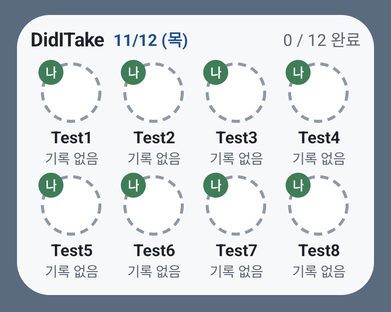
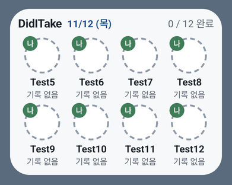
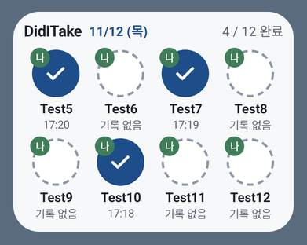
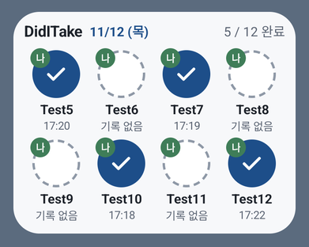
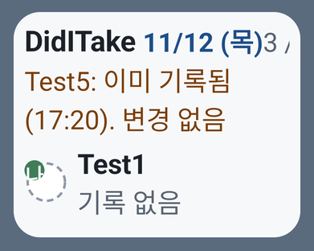
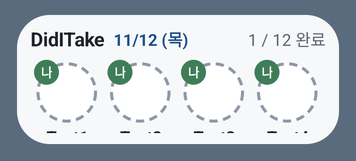
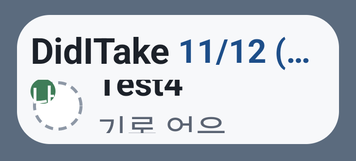
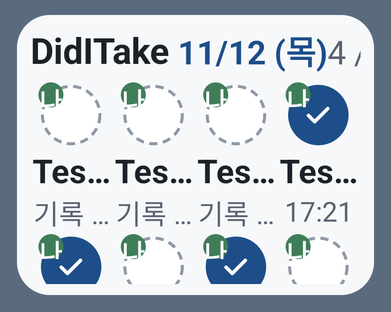
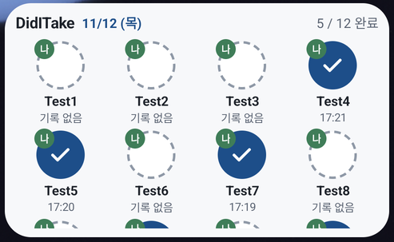
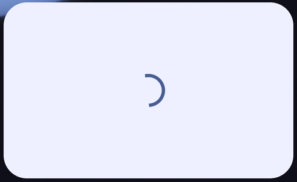

# 위젯 스크롤 기술 시험 (2026-11-12)

- 대상: [PR #16](https://github.com/judangbang-ops/pillbadeum_release/pull/16)의 TASK-042. 위젯에 항목이 넘칠 때 "버튼 목록만 스크롤, 머리글 고정"(화면 5장 1번, SCR-001#overflow, REQ-078)을 Glance로 할 수 있는지, 4×2에 가로 4개가 들어가는지 봄. 이 결과로 TASK-014가 쓸 방법을 정함(3절)
- 환경: GitHub Actions `ubuntu-latest`의 Android 에뮬레이터 API 26·34·36(`google_apis` x86_64, Pixel 5 프로필, 밀도 2.75). 가장 큰 글자는 설정 앱이 주는 최대값으로, API 34·36은 200%, API 26은 130%
- APK: 같은 커밋의 디버그 APK. 시험용 위젯·호스트는 디버그 소스 세트(`androidApp/src/debug/`)에만 있고 릴리즈 APK에는 없음. 제품 위젯(`DidITakeWidget`)은 바꾸지 않음
- 방법: [`.github/workflows/widget-scroll.yml`](../../../.github/workflows/widget-scroll.yml)이 [`scripts/emulator/widget_scroll_check.py`](../../../scripts/emulator/widget_scroll_check.py)를 돌림
  - 시험 위젯 `ScrollProbeWidget`은 제품의 `WidgetModel`을 Glance 1.2.0으로 그림. 배치는 세 가지임
    - 격자: `LazyVerticalGrid(GridCells.Fixed(4))`, Android에서는 GridView로 그려짐
    - 한 줄 목록: `LazyColumn`에 한 줄 한 항목, ListView로 그려짐
    - 4개씩 줄: `LazyColumn`에 4개씩 묶은 `Row`, ListView로 그려짐
  - 머리글은 목록 밖에 고정함. 탭은 제품 `RecordFromWidget`을 그대로 부르므로 제품 위젯과 같은 길로 기록됨
  - 디버그 호스트 `WidgetHostActivity`는 위젯을 정확한 dp 크기로 띄움. 런처를 거치지 않아 크기·글자 배율이 정확함. 런처 경우(L)는 Pixel Launcher 홈 화면에 사람처럼 놓음(길게 누르기 → Widgets → 검색 → 끌어 놓기)
  - '기록'은 다음 두 가지가 모두 된 것: DB(root로 꺼내 sqlite3로 읽음)에 그 항목의 활성 판정이 `source = WIDGET`로 있음, 버튼의 TalkBack 문장이 '기록됨'으로 바뀜
  - 스크롤은 API 29 이상에서 `input motionevent`로 함. 손가락을 터치 슬롭(8dp) 너머로 한 번에 옮기고, 멈췄다가 뗌(날림 없음). API 26은 `input swipe`를 느리게 씀
  - 항목은 매일 먹는 `Test1`~`Test12`, 대상자 1명. 경우마다 다른 항목을 누름
- 실행: [위젯 스크롤 기술 시험 43180844247](https://github.com/judangbang-ops/pillbadeum_release/actions/runs/43180844247)
  - 빌드한 커밋은 PR 머리 `36e36e7`을 main과 합친 `6b55413`
  - 결과 표 그대로는 [evidence/api26.md](evidence/api26.md), [api34.md](evidence/api34.md), [api36.md](evidence/api36.md)
  - 로그캣·화면 덤프·전체 화면은 실행의 아티팩트(7일 보관)
  - 설치 뒤 처음 놓은 위젯(F·FK, 1.5)은 [43199992534](https://github.com/judangbang-ops/pillbadeum_release/actions/runs/43199992534)(커밋 `a329cd2`)에서 봄. 이 실행에서도 1.1의 판정은 모두 통과함(API 34·36 32개씩)
  - 같은 질문을 앞선 실행에서도 봄. 실행 [43174217907](https://github.com/judangbang-ops/pillbadeum_release/actions/runs/43174217907)·[43177220819](https://github.com/judangbang-ops/pillbadeum_release/actions/runs/43177220819)·[43179018774](https://github.com/judangbang-ops/pillbadeum_release/actions/runs/43179018774)의 결과는 아래 결론과 같고, 실패는 모두 확인 절차의 결함이었음(5절)

## 1. 결과 요약

### 1.1 판정 (마지막 실행: 92개 모두 통과)

| 경우 | 배치 | 크기 | 글자 | 확인 | API 26 | API 34 | API 36 |
| --- | --- | --- | --- | --- | --- | --- | --- |
| A | 격자 | 276×220dp (Android 크기 표의 4×2 세로) | 100% | 첫 줄 4개, 목록만 스크롤해 Test10에 닿음, 머리글 고정, 탭 → `WIDGET` 기록, 버튼이 완료로 다시 그려짐 | 통과 | 통과 | 통과 |
| B | 격자 | 250×110dp (선언한 최소) | 100% | 스크롤해 Test7에 닿음(한 칸이 다 들어가지 않아 63% 이상 보이면 닿은 것으로 봄), 머리글 고정, 탭 → 기록, 다시 그림 | 통과 | 통과 | 통과 |
| C | 한 줄 목록 | 276×220dp | 가장 큼 | Test5에 닿음, 머리글 고정, 탭 → 기록, 다시 그림 | 통과 | 통과 | 통과 |
| D | 한 줄 목록 | 250×110dp | 가장 큼 | Test4에 닿음(API 34·36은 48% 이상), 머리글 고정, 탭 → 기록, 다시 그림 | 통과 | 통과 | 통과 |
| E | 격자 | 276×220dp | 가장 큼 | 그려짐(캡처만) | 통과 | 통과 | 통과 |
| R | 4개씩 줄 | 276×220dp | 100% | 첫 줄 4개, Test12에 닿음, 머리글 고정, 탭 → 기록, 다시 그림 | 통과 | 통과 | 통과 |
| L | 격자 | 런처가 준 4×2 (목록 영역 330×174dp·327×167dp) | 100% | 홈 화면에 놓임, Test11에 닿음, 머리글 고정, 탭 → 기록, 다시 그림 | 안 함(런처 위젯 목록이 다름) | 통과 | 통과 |

- 판정 수: API 26 28개, API 34 32개, API 36 32개, 모두 통과
- 기록된 항목을 다시 누르면 활성 판정은 그대로 1건이었음. C·R, 세 API 모두에서 확인

### 1.2 관찰: 탭 뒤 다시 그릴 때 목록 위치

스크롤 양은 목록 맨 위에서 내려간 거리(px, 1dp = 2.75px)임.

| 배치 | 경우 | API 26 | API 34 | API 36 |
| --- | --- | --- | --- | --- |
| 격자 | A 276×220 | 219 → 0 **맨 위로** | 224 → 0 **맨 위로** | 224 → 0 **맨 위로** |
| 격자 | B 250×110 | **맨 위로** (Test1~4가 보임) | **맨 위로** | **맨 위로** |
| 격자 | L 실제 런처 | - | 197 → 0 **맨 위로** | 217 → 0 **맨 위로** |
| 한 줄 목록 | C 276×220 | 387 → 387 그대로 | 718 → 718 그대로 | 718 → 718 그대로 |
| 한 줄 목록 | D 250×110 | 410 → 410 그대로 | 그대로 | 그대로 |
| 4개씩 줄 | R 276×220 | 219 → 219 그대로 | 224 → 224 그대로 | 224 → 224 그대로 |
| 한 줄 목록, 기록된 항목 다시 누름 | C | 387 → 0 **맨 위로** | 718 → 0 **맨 위로** | 718 → 0 **맨 위로** |
| 4개씩 줄, 기록된 항목 다시 누름 | R | 219 → 0 **맨 위로** | 224 → 0 **맨 위로** | 224 → 0 **맨 위로** |

- 다시 누르면 목록 위에 `Test5: 이미 기록됨 (17:20). 변경 없음` 같은 안내 줄이 새로 생김. 이 줄이 생기는 것과 목록이 맨 위로 가는 것이 같이 일어남
- 탭 동안 디버그 호스트는 멈추지 않았음(onStop·onStart 없음). 같은 일이 실제 런처(L)에서도 일어나므로 호스트 탓이 아님
- 앞선 실행들도 같았음: 격자는 매번 맨 위로, 한 줄 목록은 그대로(6~8회차)

### 1.3 관찰: 크기

| 크기·글자 | 머리글 아래 목록 영역 | 격자 한 칸 | 한 줄 목록 한 줄 |
| --- | --- | --- | --- |
| 276×220dp, 100% | 165dp | 82dp | - |
| 276×220dp, 200% (API 34·36) | 149dp | 113dp | 75dp |
| 276×220dp, 130% (API 26) | 160dp | 90dp | 50dp |
| 250×110dp, 100% | **55dp** | 82dp (다 안 들어감) | - |
| 250×110dp, 200% (API 34·36) | **39dp** | - | 75dp (다 안 들어감) |
| 250×110dp, 130% (API 26) | 50dp | - | 50dp |
| Pixel Launcher 4×2 세로 (API 34·36) | 330×174dp·327×167dp | 82dp | - |

- 런처의 4×2 크기: Pixel 5 에뮬레이터의 Pixel Launcher가 위젯에 알려 준 크기(로그캣 `paddedSizes`)는 세로 화면 약 350×213dp, 가로 화면 약 670×118dp. 선언한 최소 높이 110dp에 가까운 것은 가로 화면임
- 200% 글자의 격자(E)에서는 이름이 `Tes…`, 마지막 복용이 `기록 …`, 머리글 완료 수가 `4 /`로 잘림
- 250×110·200%(D)에서는 날짜가 `11/12 (…`로 잘리고, 목록에는 한 줄의 절반쯤만 보임

### 1.4 관찰: 패키지 변경(PACKAGE_CHANGED) 뒤 위젯

경우 P는 위젯이 그려진 동안 디버그 구성요소 하나를 `setComponentEnabledSetting(..., DONT_KILL_APP)`로 켜거나 끔. WorkManager가 첫 작업을 넣을 때 하는 일과 같고, 시스템은 이때 우리 패키지에 PACKAGE_CHANGED를 보냄.

| 위젯 | API 26 | API 34 | API 36 |
| --- | --- | --- | --- |
| 디버그 호스트(P) | 10초 뒤 로딩 화면, 13초 뒤 항목이 다시 보임 | 20초 동안 그대로 | 20초 동안 그대로 |
| 실제 런처(LP) | - | 런처가 위젯 뷰를 새로 만들고, 4초 뒤 로딩 화면, 14초 뒤 다시 보임 | 런처가 1초 뒤 위젯 뷰를 새로 만듦. 화면 확인 간격(1~2초) 안에서는 로딩 화면이 보이지 않음 |

- 8회차에서는 디버그 호스트(P)가 세 API 모두 20초 동안 그대로였음
- Glance 1.2.0은 세션을 시작할 때 10년 뒤 작업(`sessionWorkerKeepEnabled`)을 넣음. 그래서 WorkManager가 RescheduleReceiver를 켰다 껐다 하는 것은 첫 한 번뿐임. 라이브러리 클래스 `SessionManagerImpl`에서 확인함

### 1.5 관찰: 설치 뒤 처음 놓은 위젯 (F·FK, BUG-004)

릴리즈 확인에서 설치 직후 처음 놓은 제품 위젯이 로딩 화면에 머문 일이 한 번 있었음(PR #17의 BUG-004, 실행 [43195651489](https://github.com/judangbang-ops/pillbadeum_release/actions/runs/43195651489)). 그 로그캣과 라이브러리 소스를 대조한 결과는 이렇다.

- 첫 Glance 세션이 작업을 넣으면 WorkManager(2.7.1)가 `RescheduleReceiver`를 켬. 이 켜짐이 우리 패키지의 PACKAGE_CHANGED가 됨. Glance 1.2.0은 10년 뒤 작업(`sessionWorkerKeepEnabled`)을 함께 넣어 그 뒤로는 켜고 끄지 않게 하지만, 첫 위젯의 첫 세션 때 한 번은 켜짐
- PACKAGE_CHANGED를 받으면 `AppWidgetServiceImpl`(AOSP 14 `updateProvidersForPackageLocked`)이 그 패키지 위젯의 화면을 비우고, 호스트에 알리고, `APPWIDGET_UPDATE`를 보냄. 런처는 위젯을 초기 화면(Glance 로딩 화면)으로 되돌림
- Launcher3는 `setAppWidget`에서 `App widget created`를, 그 뒤 처음 받은 화면에서 `App widget with id: N loaded`를 남김. BUG-004에서는 10:01:48 첫 화면을 받고, 10:01:50 초기화된 뒤 10:03:00까지 `loaded`가 없었음. 그 사이 앱이 새 화면을 보내지 않았다는 뜻임. 원인은 아직 모름

같은 조건을 시험 위젯으로 만들어 봄. 경우마다 앱을 지우고 다시 설치한 뒤, 항목만 만들고 Pixel Launcher에 시험 위젯을 처음 놓고 60초 지켜봄. 시험 위젯은 받은 `APPWIDGET_UPDATE`·크기 변경과 다시 구성한 때를 로그로 남김.

- F: 그대로 놓음
- FK: 놓기 전에 디버그 `KeepWork`(3650일 뒤, 충전 중 조건의 빈 작업)를 넣음. 앱이 시작할 때 할 수 있는 일임

| 경우 | API 34 (3번) | API 36 (3번) |
| --- | --- | --- |
| F | 3번 모두 첫 구성 뒤 1초 안에 PACKAGE_CHANGED. F1·F2는 런처가 첫 화면을 받은 뒤 초기화했고, 앱이 0.5초 안에 `APPWIDGET_UPDATE`를 받아 초기화 2.3초·0.4초 뒤 다시 그려짐. F3은 첫 화면이 런처에 닿기 전에 PACKAGE_CHANGED가 나서 런처가 두 번째 화면을 처음 받음(그 사이 초기화 여부는 로그로 가릴 수 없음). 60초에 3번 모두 보임 | 이 이미지에서는 PACKAGE_CHANGED 로그 줄이 남지 않았지만, `RescheduleReceiver`가 놓기 전 기본값에서 놓은 뒤 켜짐으로 바뀜. 3번 모두 앱이 첫 구성 직후 `APPWIDGET_UPDATE`를 한 번 더 받았고, 런처는 그 뒤에 처음 화면을 받아 초기화 줄이 없음. 60초에 3번 모두 보임 |
| FK | 3번 모두 놓은 뒤 PACKAGE_CHANGED가 없고, 런처가 위젯을 초기화하지 않음 | 3번 모두 같음 |

- 예(API 34 F1): 12.478 런처가 첫 화면 받음 → 12.579 PACKAGE_CHANGED → 12.669 런처가 위젯 초기화 → 13.107 앱이 `APPWIDGET_UPDATE` 받음 → 15.012 런처가 화면 다시 받음
- 그러니 보통은 초기화되더라도 3초 안에 돌아옴. BUG-004는 이 회복이 일어나지 않은 경우이고, 그때 에뮬레이터는 부팅 직후로 시스템이 매우 바빴음(시스템 서버의 잠금 경합 경고가 이어짐). 바쁨 때문이라는 것은 추정임
- FK처럼 위젯이 생기기 전에 켜 두면 첫 위젯 때 PACKAGE_CHANGED 자체가 없음. 3절 7번의 추천 근거

## 2. 화면

API 34, 위젯 부분만 잘라 절반 크기로 줄임.

| 1. 격자 처음 (A) | 2. 격자 Test10까지 스크롤 | 3. 격자 Test10 탭 뒤: 맨 위로 |
| --- | --- | --- |
|  |  |  |

| 4. 4개씩 줄 Test12까지 스크롤 (R) | 5. 4개씩 줄 Test12 탭 뒤: 그대로 | 6. 한 줄 목록에서 기록된 항목 다시 누름: 안내 줄과 함께 맨 위로 (C, 200%) |
| --- | --- | --- |
|  |  |  |

| 7. 격자 250×110 (B): 한 칸이 다 안 들어감 | 8. 한 줄 목록 250×110·200% (D) | 9. 격자 200% (E): 이름·마지막 복용 잘림 |
| --- | --- | --- |
|  |  |  |

| 10. 실제 런처에 놓은 격자 (L) | 11. 런처에서 Test11 탭 뒤: 맨 위로 | 12. 런처, 패키지 변경 뒤 로딩 화면 (LP) |
| --- | --- | --- |
|  |  |  |

## 3. TASK-014에서 쓸 방법 (추천)

아래는 이 시험의 결과에서 나온 추천임. 화면 설계(03·04·08 단계)가 다시 정해질 때 함께 확정함.

1. **스크롤 방식으로 감**
   - 목록 안 버튼의 탭 기록이 세 API와 실제 런처에서 됨
   - 그래서 화면 5장 1번의 대안(`+n 더 있음 · 앱에서 보기`)은 필요 없음
2. **가로 4개는 격자가 아니라 "4개씩 묶은 줄의 `LazyColumn`"으로 그림**
   - `LazyVerticalGrid`는 탭할 때마다 목록이 맨 위로 돌아감(1.2). 아래쪽 항목을 누른 사람은 방금 누른 버튼이 완료로 바뀌는 것을 보지 못함
   - 4개씩 줄(R)은 겉모양이 같고, 세 API 모두에서 위치를 지킴
3. **큰 글씨에서는 한 줄에 한 항목**
   - 200%에서 4열은 이름과 마지막 복용 시각이 잘림(E). REQ-066은 마지막 복용 시각이 잘리지 않을 것을 요구함
   - 그래서 글자 배율과 위젯 크기(`LocalSize`)로 배치를 고름
   - 바꾸는 기준값은 TASK-044 와이어프레임에서 정함
4. **안내 줄이 생겨도 목록이 움직이지 않게 함**
   - 지금은 안내 줄(`이미 기록됨` 등)이 새로 생기면 목록이 맨 위로 감(1.2)
   - 방법 후보: 안내 줄 자리를 늘 두거나(내용만 바꿈), 안내를 머리글 줄 안에 넣음
   - 이 방법들이 위치를 지키는지는 아직 시험하지 않은 가설임. TASK-014에서 같은 스크립트로 확인함
5. **`더 있음` 표시는 "가려진 동안만"으로는 만들 수 없음**
   - 컬렉션 위젯은 스크롤 위치를 앱에 알려 주지 않음. Android 16의 위젯 사용 이벤트(`AppWidgetEvent`)는 나중에 모아 보내는 지표라 화면 표시에 쓸 수 없음
   - 할 수 있는 것 ①: 크기와 항목 수로 넘치는지 계산해서, 넘치면 늘 보이는 정적 표시(예: 머리글의 `12개 · 밀어서 더 보기`)를 둠
   - 할 수 있는 것 ②: 마지막 줄이 반쯤 보이게 줄 높이를 맞춤. 끝까지 내리면 자연히 사라지지만, 런처마다 크기가 달라 늘 맞지는 않음
   - REQ-078과 TASK-014의 수용 기준("가려진 동안 `더 있음`")은 문구를 조정해야 함. **동희님 결정이 필요함** (추천: ①)
6. **최소 크기 250×110dp에서는 한 칸이 들어가지 않음**
   - 머리글 아래 목록 영역은 55dp(200%에서 39dp)인데, 격자 한 칸은 82dp, 200% 목록 한 줄은 75dp임
   - REQ-026("4×2 최소에서 버튼·이름·마지막 복용 시각·안내 줄이 잘리지 않음")과 부딪힘
   - 후보 ①: 낮은 높이에서는 머리글을 줄이고 칸을 작게 함(원 36dp, 이름 한 줄)
   - 후보 ②: 선언한 최소 높이를 올림
   - 둘 다 TASK-044에서 그려 보고 고름. **설계 결정이 필요함**
7. **앱이 시작할 때 WorkManager의 `RescheduleReceiver`를 켜 둠** (BUG-004)
   - 앱 시작(`Application.onCreate`)에 이름을 정한 빈 작업 하나를 3650일 뒤·충전 중 조건으로 넣음(`ExistingWorkPolicy.KEEP`, Glance가 첫 세션 때 넣는 작업과 같은 종류). 1.5의 FK처럼 첫 위젯을 놓을 때 PACKAGE_CHANGED가 나지 않음
   - 항목을 앱에서 먼저 만들어야 위젯이 쓸모 있으므로, 보통은 위젯보다 앱이 먼저 열림. 앱을 한 번도 열지 않고 위젯부터 놓는 경우는 지금과 같음(F에서는 3초 안에 돌아옴)
   - WorkManager를 2.11로 올려도 이 켜고 끄기는 그대로임(`UnfinishedWorkListener`가 남은 작업이 있을 때 켬). 그래서 판 올리기로는 막지 못함
   - 제품 코드 변경이므로 TASK-014(또는 따로 정한 작업)에서 함. 릴리즈 확인에서 같은 위젯 첫 놓기가 다시 멈추지 않는지 봄

## 4. 확인하지 못한 것

- **실기기 런처**(삼성 One UI 등): 칸 크기와 위젯 처리 방식이 Pixel Launcher와 다를 수 있음. TASK-047·TASK-052에서 확인
- **API 26의 실제 런처**: 그 이미지의 위젯 목록 화면이 달라, 디버그 호스트로만 봄
- **가로 화면 4×2(약 670×118dp)에 놓은 위젯**: 같은 높이는 250×110 디버그 호스트 경우로 대신 봄
- **TalkBack으로 목록 스크롤하기**(접근성 스크롤 동작)
- **3절 4번의 방법이 목록 위치를 지키는지**: 가설
- **제품 위젯 배치 그대로의 결과**: 시험 위젯은 같은 모델·같은 탭 경로를 쓰지만, 칸 크기(원 48dp 등)는 시험용임. TASK-014가 실제 배치로 같은 스크립트를 다시 돌림
- **BUG-004에서 앱이 새 화면을 보내지 않은 원인**: P·LP·F에서는 패키지 변경 뒤 위젯이 2~14초 안에 돌아왔음. 돌아오지 않은 경우는 F 6번에서도 다시 만들지 못함. `APPWIDGET_UPDATE`가 늦게 닿았는지, 닿았는데 세션이 다시 보내지 않았는지는 릴리즈 확인이 실패할 때 `dumpsys activity broadcasts`를 남기면 가릴 수 있음

## 5. 발견한 결함과 조치

앱 코드의 결함은 나오지 않았음. 1.2~1.4의 관찰은 3절에서 설계로 넘김. 아래는 확인 절차의 결함이고, 고친 뒤의 실행만 근거로 씀.

| # | 결함 | 원인 | 조치 |
| --- | --- | --- | --- |
| E1 | 항목 6개에서는 276×220 격자가 스크롤할 일이 없음 | 6개가 다 들어감 | 12개로 늘리고 3줄째 항목(Test10)을 누름 |
| E2 | 작은 목록에서 목표에 닿지 못함 (API 34, 200%) | 목록 높이의 40%에서 슬롭을 빼면 한 번에 약 8dp만 움직임 | 한 번에 40%와 70dp 중 큰 쪽 + 슬롭 |
| E3 | 맞추려던 항목을 지나침 | 빠른 밀기가 날림이 됨 | `input motionevent`로 옮긴 뒤 멈췄다 뗌 |
| E4 | 실제 런처가 위젯을 들어 올림 | 슬롭 안에서 느리게 움직인 것을 길게 누르기로 봄 | 첫 움직임에서 슬롭을 한 번에 넘김 |
| E5 | 항목이 24개로 두 번 만들어짐 (API 34) | 첫 시드가 끝나기 전에 호스트를 다시 띄움 | 이름으로 빠진 것만 만들고, 잠금을 둠 |
| E6 | 200% 한 줄 목록(C)이 14번 안에 멈추지 못함 (API 34·36) | 위가 잘린 줄을 아래 끝으로 보냈다가 다시 되돌림 | 일부만 보이는 항목은 목록 가운데로 옮김. 마지막 시도 뒤도 확인 |
| E7 | '조금 움직임'으로 적은 것이 실제로는 맨 위로 돌아간 것 | 3줄 격자는 스크롤 범위가 한 줄뿐이라 y만 보면 조금 움직인 것처럼 보임 | 스크롤 양(px)으로 비교 |
| E8 | 탭 뒤 UI 덤프가 탭 전 것 | 저장 함수가 마지막 덤프를 저장함 | 새로 덤프한 뒤 저장 |
| E9 | C가 B의 기록을 찾아 통과함 | 두 경우가 같은 Test7을 누름 | 경우마다 다른 항목을 누름 |
| E10 | 런처 경우·릴리즈 확인에서 `Widgets`나 DidITake를 못 찾음 | 부팅 직후 Pixel Launcher의 메뉴·목록이 준비되기 전 | 런처 경우를 맨 끝으로 옮기고, 20초 뒤 한 번 더 함 |
| E11 | 디버그 호스트 위젯이 스크롤 전에 로딩 화면으로 돌아감 (7회차 API 34·36 A) | 부팅 직후의 느린 에뮬레이터로 추정(로그 `SessionWorker attempted restart but Session is not available`) | 관찰로 남기고 호스트를 한 번 다시 띄움. 마지막 실행에서는 생기지 않음 |
| E12 | WorkManager 대조 실험(KeepWork)이 아무것도 가르지 못함 | 전제가 틀림: Glance가 이미 같은 일을 함 | 실험을 빼고, 패키지 변경을 직접 일으키는 P로 바꿈 |

## 6. 알려진 제한

- 디버그 호스트는 크기·글자가 정확하지만 런처가 아님. 런처 동작은 Pixel Launcher(API 34·36)에서만 봄
- uiautomator는 화면에 보이는 만큼 잘린 영역을 줌. 그래서 '다 보임'은 큰 크기에서 잰 온전한 항목 높이와 비교함. 완료된 칸은 몇 px 다르므로 4%나 8px 중 큰 쪽까지 봐줌
- 초 단위 시간에는 화면 덤프 간격(1~2초)이 들어 있음
- 에뮬레이터 작업이 동시에 여럿 돌 때 런처·시스템 UI가 느려 실패가 더 잦아 보였음. 이 PR에서는 릴리즈 확인이 같은 이유(E10)로 여러 번 실패함. `36e36e7`의 실패는 다시 돌리자 통과함([43180844213](https://github.com/judangbang-ops/pillbadeum_release/actions/runs/43180844213), 두 번째 시도). 동시 실행 때문이라는 것은 추정이고 확인하지 않음
