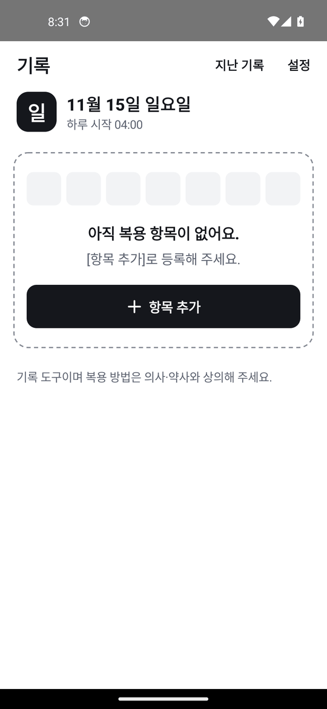
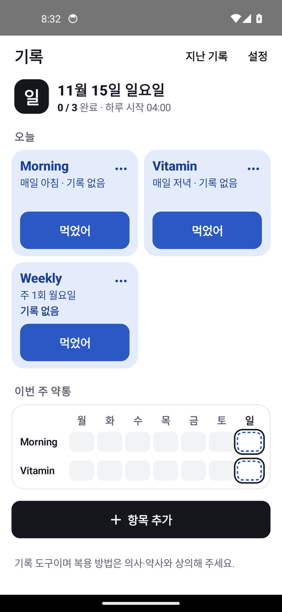
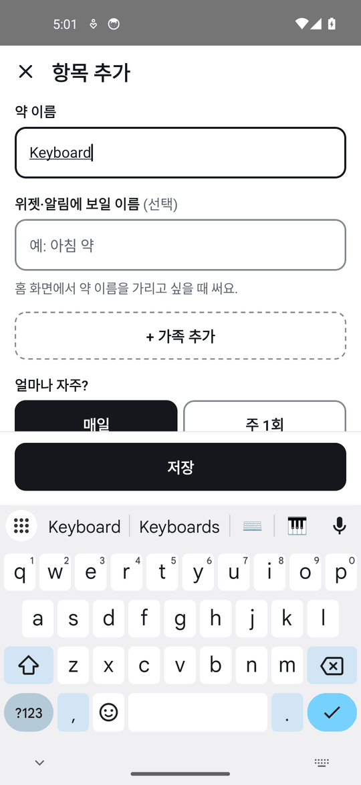
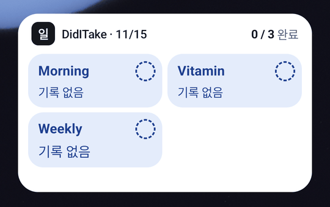
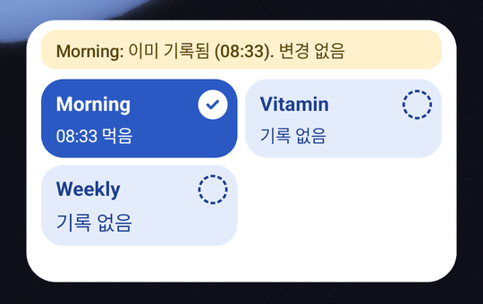
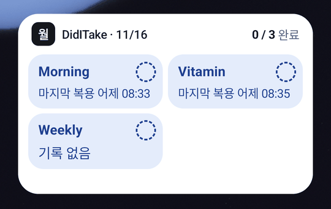
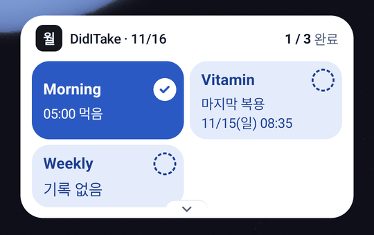
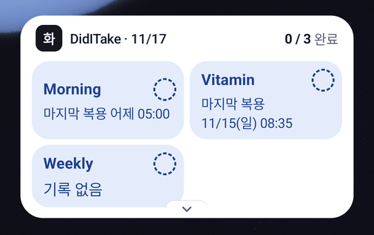
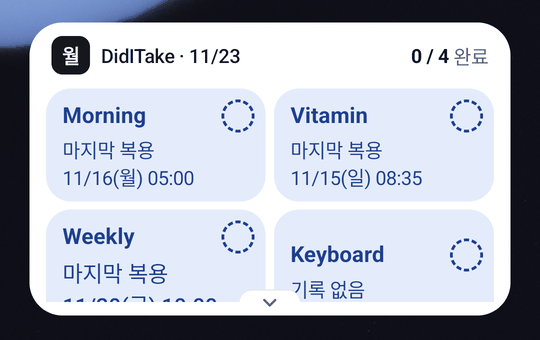
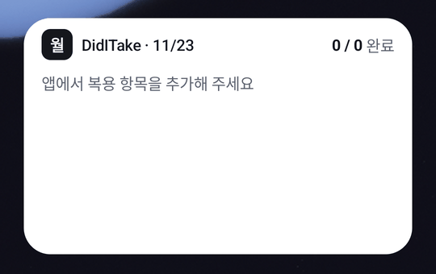

# 프로토타입 13항목 회귀 확인과 판정 쓰기 코드 검사 (2026-11-15)

- 대상: TASK-034. 2026-11-11 DidITake 프로토타입 QA(가쟈누님 저장소 `judangbang-ops/DidITake`의 [`docs/07-qa/2026-11-11-prototype/report.md`](https://github.com/judangbang-ops/DidITake/blob/7a24d73/docs/07-qa/2026-11-11-prototype/report.md), 아래 '프로토타입 QA')의 13항목을 마지막 빌드에서 다시 하고, 판정 쓰기가 공통 기록 함수만 거치는지 코드에서 봄(REQ-003). TASK-034의 근거 요구인 REQ-092(앱 데이터를 지운 뒤 남은 위젯 버튼)도 같은 실행에서 봄
- 빌드: `2909a29`의 디버그 APK. 앱 코드는 main `d994b38`(R0~R3, R2 화면 작업, BUG-005까지)과 같고, 이 PR은 스크립트·CI·문서만 바꿈. DB를 root로 읽으려고 디버그를 씀. 릴리즈 변형의 위젯 탭 기록은 [릴리즈 변형 확인](../2026-11-12-release-variant/report.md)이 봄
- 환경: GitHub Actions `ubuntu-latest`의 Android 에뮬레이터 API 34 `google_apis` x86_64, Pixel 5 프로필(1080×2340px, 밀도 2.75), Pixel Launcher, 하드웨어 키보드 켬. 프로토타입 QA는 API 34 `google_apis` arm64-v8a, Pixel 7 프로필
- 방법: [`regression.yml`](../../../.github/workflows/regression.yml)이 [`scripts/emulator/regression_check.py`](../../../scripts/emulator/regression_check.py)를 돌림. 이 스크립트나 워크플로를 바꾼 PR과 수동 실행에서만 돎(약 40분). 2026-11-15부터는 앱 코드를 바꾼 PR에서도 돎(7장)
  - 시계는 서울 시간대로 두고 앞으로만 옮김. 첫날은 실행한 날(2026-11-15 일요일) 08:30. 이름은 프로토타입 QA처럼 영어(`adb shell input text`가 한글을 넣지 못함): Morning(매일 아침), Vitamin(매일 저녁), Weekly(주 1회 월)
  - 위젯은 사람처럼 놓음(홈 화면 길게 누르기 → Widgets → 검색 → 끌어 놓기). 기록은 위젯 칸을 눌러 함
  - 판정은 화면 덤프의 TalkBack 문장(`content-desc`, 예: `Morning, 복용함, 오늘 08:33`), 위젯에 그린 글, 앱 DB의 `dose_record` 행으로 함. 위젯을 다시 그리라고 시키는 디버그 수신기는 쓰지 않음: 기록·시계 바꿈·하루 시작 뒤 위젯 모습은 앱이 스스로 그린 것
- 실행: `2909a29`의 [에뮬레이터 회귀 확인 43630931766](https://github.com/judangbang-ops/pillbadeum_release/actions/runs/43630931766)에서 준비와 15단계 16줄 모두 통과, 캡처 29장(아티팩트 `regression-api34`, 7일 보관). 스크립트 출력 그대로는 [evidence/api34.md](evidence/api34.md)

## 1. 결과 요약

13항목과 REQ-092 모두 통과. 앱의 결함은 찾지 못함. 스크립트의 잘못 셋을 고침(6장).

| QA | 확인 항목 | 프로토타입 QA의 기대 | 지금 기대 (바뀐 설계) | 결과 | 근거 |
| --- | --- | --- | --- | --- | --- |
| 1 | 앱 첫 실행 | 크래시 없이 빈 목록과 안내 | 첫 실행 안내 두 쪽(REQ-080, TASK-022) → [시작하기] → 빈 첫 화면 '아직 복용 항목이 없어요.'와 [항목 추가]. 실행 내내 크래시 기록에 이 앱 없음 | 통과 | 1·15단계, 그림 01 |
| 2 | 항목 등록 (매일 2개, 주 1회 월요일 1개) | 목록에 상태·창 표시 | 첫 화면 칸 셋이 '미완료'(주 1회는 '이번 주 미완료'), DB에 Morning 매일 아침·Vitamin 매일 저녁·Weekly 주 1회(`anchorWeekday` MON) | 통과 | 2단계, 그림 02 |
| 3 | 위젯 배치 | 머리글 날짜, n/m 완료, 빈 원, 대상자 배지, "기록 없음" | 'DidITake · 11/15'와 굵은 '0 / 3'·'완료', 칸마다 빈 원과 '기록 없음'. 대상자가 한 명이라 배지 없음(REQ-018, TASK-015) | 통과 | 3단계, 그림 03 |
| 4 | 위젯 탭 | 완료 표시 + 기록 시각, DB 활성 1행 | 칸이 'Morning, 복용함, 오늘 08:33'과 '08:33 먹음', 머리글 '1 / 3', DB 활성 1행(source WIDGET) | 통과 | 5단계 |
| 5 | 같은 항목 재탭 | "이미 기록됨 (19:47). 변경 없음", DB 변화 없음 | 머리글 자리에 'Morning: 이미 기록됨 (08:33). 변경 없음', DB 그대로 | 통과 | 6단계, 그림 04 |
| 6 | 다른 항목 동시 두 번 탭 | DB 1행 | Vitamin 칸에 두 탭을 함께 보냄 → DB 1행 | 통과 | 7단계 |
| 7 | 앱에서 기록 취소 | 확인 대화상자 → 무효 처리 → 위젯 즉시 미완료 | '기록을 취소할까요?' → [기록 취소] → 무효(USER_CANCEL), 위젯을 다시 그리라고 시키지 않아도 'Vitamin, 미완료, 기록 없음'(취소 탭부터 8초 안, 홈 화면을 읽는 시간 포함) | 통과 | 8단계 |
| 8 | 취소 후 위젯으로 재기록 | 무효 1행 + 활성 1행 | 같음. 위젯은 'Vitamin, 복용함, 오늘 08:35' | 통과 | 9단계 |
| 9 | 시계 변경 (다음 날 05:00) | 위젯이 새 날짜로, "마지막 어제 19:47" | 앱을 열지 않아도 'DidITake · 11/16'과 '0 / 3', Morning 칸에 '마지막 복용 어제 08:33', Vitamin 칸에 '마지막 복용 어제 08:35' | 통과 | 10단계, 그림 05 |
| 10 | 04:00 경계 알람 | 03:59:40 → 04:00:05, 머리글이 다음 날로, 완료 칸이 미완료로 | 11/16 기록 뒤 03:54에 'DidITake · 11/16' '1 / 3', 시계를 건드리지 않고 기다리면 04:00:05 경계 알람(정확하지 않은 알람) 뒤 'DidITake · 11/17' '0 / 3'과 Morning 미완료, 앱 로그에 다음 경계(11/18 04:00:05) 예약 | 통과 (위젯이 04:04:46에 바뀜) | 11단계, 그림 06·07 |
| 11 | 주 1회(월) 금요일 기록 → 토요일 → 다음 월요일 | 토요일 완료 유지, 월요일 미완료 + "마지막 11/13 (금)" | 금 11/20 위젯 탭(그 주 11/16 창), 토 'Weekly, 복용함, 어제 금요일 10:00'과 '1 / 3', 다음 월 11/23 'Weekly, 이번 주 미완료, 마지막 복용 11월 20일 금요일 10:00'과 그린 글 '마지막 복용 11/20(금) 10:00'(TASK-041) | 통과 | 12단계, 그림 08 |
| 12 | 입력 화면에서 키보드가 열린 채 저장 | 저장 버튼에 닿을 수 있어야 함 (프로토타입 결함 D1, 고침) | 화면 키보드가 뜬 채 [저장]이 키보드 위에 다 보이고, 누르면 저장(DB 1행) | 통과 (키보드 위쪽 1507px, [저장] 글자 (500, 1360, 580, 1424)px) | 13단계, 그림 09 |
| 13 | 위젯 기본 크기 | 버튼과 이름이 온전히 보여야 함 (프로토타입 결함 D2, 고침) | 런처가 놓은 칸 4×2, 첫 줄 칸과 이름이 다 보임. 프로토타입 QA가 보지 못한 '고친 뒤 새로 놓은 모습'도 이번에 봄 | 통과 | 4단계, 그림 03 |
| - | 앱 데이터를 지운 뒤 남은 위젯 버튼 (REQ-092) | (프로토타입 QA에 없음) | 저장공간 지우기와 같은 `pm clear` 뒤 위젯에 남은 칸을 누르면 판정 0행·항목 0개, 위젯이 칸 없이 '앱에서 복용 항목을 추가해 주세요'로 다시 그려짐 | 통과 | 14단계, 그림 10·11 |

- 프로토타입 QA와 기대가 다른 곳은 그 뒤 정해진 설계를 따른 것임: 첫 실행 안내(REQ-080), 대상자가 한 명이면 배지 없음(REQ-018), 머리글 'n/m 완료'를 굵은 'n / m'과 '완료'로, '마지막 어제'를 '마지막 복용 어제'로, 주 1회 마지막 복용을 날짜와 요일로(TASK-041). 문구는 [화면 정의](../../05-ui/screens.md)와 `Labels.kt`의 것
- 04:00 경계는 프로토타입 QA처럼 03:59:40이 아닌 03:54에서 기다림: 경계 알람은 정확하지 않은 알람(`DayBoundaryAlarm`의 `setAndAllowWhileIdle`)이라 늦게 울릴 수 있어, 그 전 모습을 넉넉히 읽고 04:00:05 뒤 6분까지 기다림. 시계를 03:54로 옮긴 뒤로는 시계를 건드리지 않았으므로 위젯을 바꾼 것은 시각 변경 방송이 아닌 경계 알람이고, 앱 로그에 그 알람이 다음 경계를 예약한 줄이 있음

DB 확인 결과 (요약, 14단계의 `pm clear` 전)

```
Morning   2026-11-15  TAKEN WIDGET 활성 08:33              5단계 (6단계 다시 탭 뒤에도 그대로)
Vitamin   2026-11-15  TAKEN WIDGET 무효(USER_CANCEL) 08:34  7단계 두 탭 → 1행, 8단계 앱에서 취소
Vitamin   2026-11-15  TAKEN WIDGET 활성 08:35              9단계
Morning   2026-11-16  활성 05:00                            11단계 앞 위젯 탭 (스크립트는 기간 키와 활성만 봄)
Weekly    2026-11-16  TAKEN WIDGET 활성 10:00              12단계, 금 11/20에 탭 (그 주 월요일 창)
항목 4개 (13단계에 Keyboard를 더함). 14단계 pm clear 뒤 판정 0행·항목 0개
```

## 2. 화면

위젯은 위젯 부분만 잘랐고, 모두 캡처를 반으로 줄임(원본은 아티팩트).

| 01 빈 첫 화면 (1단계) | 02 항목 셋 (2단계) | 09 키보드가 열린 채 [저장] (13단계) |
| --- | --- | --- |
|  |  |  |

| 03 놓은 위젯, 4×2 (3·4단계) | 04 같은 칸 다시 탭 (6단계) |
| --- | --- |
|  |  |

| 05 시계를 다음 날 05:00으로 (10단계) | 08 주 1회, 다음 월요일 (12단계) |
| --- | --- |
|  |  |

| 06 경계 전 03:54 (11단계) | 07 경계 알람 뒤 (11단계) |
| --- | --- |
|  |  |

| 10 앱 데이터를 지운 뒤 남은 칸 (14단계) | 11 남은 칸을 누른 뒤 (14단계) |
| --- | --- |
|  |  |

그림은 Claude가 모두 봄(2026-11-15). 글자가 겹치거나 옆으로 잘린 곳은 없음. 처음 보면 결함처럼 보일 수 있는 두 곳은 설계대로임:

- 06에서 Vitamin이 05의 '마지막 복용 어제 08:35'가 아니라 '마지막 복용 11/15(일) 08:35'임: 03:54는 기록일로는 11/16이지만 달력으로는 11/17이고, 오늘·어제는 하루 시작과 상관없이 표시 시간대의 달력 날짜로 셈([기록 규칙 보충](../../04-spec/record-rules-supplement.md) S-2의 날짜 글자, RR-76)
- 06~08·10의 아래 가운데 작은 화살표는 칸이 위젯에 다 들어가지 않는 동안의 '더 있음'(REQ-078, SCR-001#overflow)이고, 08·10에서 아래 칸의 글이 잘린 것은 그 칸이 스크롤 목록 아래로 넘친 것임. 칸 셋이 모두 '기록 없음'인 03에서는 넘치지 않음(4단계 '가려진 칸 없음, 화살표 없음')

## 3. 판정 쓰기 코드 검사 (REQ-003)

- 방법: [`.github/scripts/check_writes.py`](../../../.github/scripts/check_writes.py)를 CI 문서 대조 작업이 PR과 main 푸시마다 돌림(이 PR에서 더함)
  - `Daos.kt`에서 판정 표(`dose_record`)와 시계 표시(`clock_flag`)를 쓰는 메서드를 찾음: `DoseRecordDao`·`ClockFlagDao`의 `@Insert`·`@Update`·`@Delete`·`@Upsert`와, 이 둘과 `IntakePurgeDao`의 `@Query` 중 두 표에 INSERT·UPDATE·DELETE하는 것. 새 쓰기 메서드를 더하면 검사도 따라옴
  - 제품 코드(shared의 commonMain·androidMain·jvmMain, androidApp의 main·debug)에서 그 메서드를 `usecase/` 밖에서 부르면 실패. `Daos.kt` 밖의 Kotlin 글에 두 표를 쓰는 SQL이 있으면 실패(마이그레이션 포함)
- 결과 (`2909a29`의 CI [실행 43630931832](https://github.com/judangbang-ops/pillbadeum_release/actions/runs/43630931832) 요약과 로컬이 같음): 문제 없음
  - 쓰기 메서드 5개: `DoseRecordDao`·`ClockFlagDao.insertOrIgnore`, `DoseRecordDao.voidActive`, `IntakePurgeDao.deleteClockFlags`, `IntakePurgeDao.deleteJudgments`, `ClockFlagDao.resolve`
  - usecase 안에서 부르는 곳 9곳: `ChangeJudgment.kt:58`, `ClockFlags.kt:27`·`51`, `DeleteIntake.kt:29`·`30`, `JudgmentSupport.kt:105`·`106`, `RecordDose.kt:41`, `RecordInWindow.kt:299`
  - usecase 밖에서 부르는 곳 없음, `Daos.kt` 밖의 쓰기 SQL 없음
- 검사가 잡는지 (2026-11-15 로컬, Claude): 코드 사본에 잘못된 쓰기를 하나씩 심어 돌림. 넷 모두 '문제 1개'와 종료 코드 1로 잡음
  1. `status/StatusBoard.kt`에서 `doseRecordDao().voidActive(…)`를 부름 → usecase 밖 1곳
  2. `data/Migrations.kt`에 `"UPDATE dose_record SET active = 0"` → `Daos.kt` 밖 쓰기 SQL 1곳
  3. `DoseRecordDao`에 새 `@Query("DELETE FROM dose_record …")` 메서드를 더하고 androidApp `AppContainer.kt`에서 부름 → 쓰기 메서드가 6개로 늘고 usecase 밖 1곳
  4. shared androidMain `DatabaseBuilder.android.kt`에서 `clockFlagDao().resolve(…)`를 부름 → usecase 밖 1곳
- 앱의 쓰기 길 (코드를 읽어 봄): 위젯 버튼(`DidITakeWidget.kt:201`), 알림 버튼(`Reminders.kt:140`), 첫 화면 [먹었어](`App.kt:393`)는 `DidITakeCore.record`로 `RecordDose`, 기록 취소(`App.kt:402`·`657`)는 `VoidDose`, 판정 고치기(골라 기록, 건너뜀, 건너뜀 → 복용, 시각 고치기, `App.kt:634`~`651`)는 `RecordInWindow`를 거침
- 찾은 것 (요구 문장과 코드의 차이): REQ-003 문장은 공통 기록 함수를 'RecordDose·VoidDose·ChangeJudgment'로 적는데, `ChangeJudgment`는 제품 코드에서 부르지 않고 jvm `RecordRulesCounterexampleTest.c07_*`만 씀. 앱의 건너뜀 → 복용은 `RecordInWindow.record`의 `replacing`(`App.kt:651`)이고, 무효와 새 행을 한 트랜잭션에서 쓰며 새 행이 들어가지 않으면 무효도 되돌림(`voidOrRollBack`·`insertOrRollBack`, jvm `RecordInWindowTest`). 판정 쓰기가 모두 usecase를 거치므로 REQ-003의 합격 기준(판정 DAO의 쓰기를 usecase 밖에서 부르지 않음)은 통과. 문장의 함수 이름은 요구라 고치지 않고 동희님께 보고함. **정함**: 2026-11-15 14:58 KST 동희님이 '필받음 재구축 인계' 채팅에서 '추천 모두 승인'. REQ-003 문장을 'RecordDose·VoidDose·RecordInWindow'로 고침([PR #33](https://github.com/judangbang-ops/pillbadeum_release/pull/33))
- 한계: 글을 읽는 검사라 형식을 따지지 않음. DAO 형식 이름이나 `doseRecordDao()` 같은 getter가 글에 없는 파일(다른 이름의 변수로 DAO를 넘겨받은 파일)의 호출은 놓칠 수 있고, 같은 이름의 다른 메서드를 그런 파일에서 부르면 잘못 잡을 수 있음. 표 이름을 조립해 `execSQL`에 넘기는 SQL은 놓침. 시험 코드는 보지 않음

## 4. 시험

- `2909a29`의 CI [실행 43630931832](https://github.com/judangbang-ops/pillbadeum_release/actions/runs/43630931832): jvm 333개·앱 시험 122개 모두 통과, 문서 대조 '문제 없음'
- 프로토타입 QA가 jvm으로만 본 렌더 기간 키 대조는 지금 `RecordRulesCounterexampleTest.c13_staleRenderedKey_returnsStale`(위젯)과 `c23_notificationStaleKey_returnsStale`(알림)이고 위 실행에서 통과

## 5. 확인하지 못한 것

- **날짜가 바뀐 뒤 다시 그려지지 않은 위젯 탭(RR-13)**: 프로토타입 QA처럼 에뮬레이터에서 만들지 못함. 시계를 옮기면 시각 변경 방송으로, 기다리면 경계 알람으로 위젯이 먼저 다시 그려짐. jvm `c13`과 실기기 TASK-032(경계 직후 위젯 탭)
- **실기기**: Galaxy One UI 런처, 절전·Doze, 실제 해상도와 글꼴은 TASK-032·052
- **다른 API**: 이 실행은 API 34만. 다른 확인 중 위젯 크기 확인이 API 26·30·36에서 위젯을 놓고, 화면 확인 2부가 API 36에서 위젯 칸을 누름
- **한글 이름**: adb로 넣지 못해 영어 이름만 씀. 한글 이름의 화면과 위젯은 [접근성 점검](../2026-11-14-a11y/report.md)이 봄
- **동시 두 탭**: 두 `input tap`을 함께 띄워 몇 ms 차이로 닿게 했고 DB 행만 봄. 앱이 두 탭을 모두 받았는지는 보지 않음. 위젯과 앱의 거의 동시 기록(TC-043의 다른 몫)은 jvm만
- **가로 화면**: 보지 않음([접근성 점검](../2026-11-14-a11y/report.md) 6절에 가로 4×2의 크기와 계산한 목록 높이)

## 6. 찾은 결함과 조치

- 앱: 없음
- 스크립트 (이 PR에서 고침). 첫 실행 [43627835213](https://github.com/judangbang-ops/pillbadeum_release/actions/runs/43627835213)(`d43fa09`)에서 1·13단계가 실패했고, 나머지 13단계(준비, 2~12, 14, 15)는 그때도 통과함
  1. 빈 첫 화면 문구를 마침표 없이 찾아 1단계가 실패함. 앱의 문구는 '아직 복용 항목이 없어요.'(마침표 있음)라 스크립트를 고침
  2. API 34의 `dumpsys window windows`는 창 위치를 `frame=[…]`로 적는데(Android 11부터) 스크립트가 옛 꼴 `mFrame=`만 읽어, 키보드가 떠 있는데도(그 실행의 캡처 `api34-27-form-keyboard.png`) 13단계가 '키보드가 뜨지 않음'으로 실패함. 키보드 창, 키보드 인셋(`type=ime … visible=true`), `dumpsys input_method` 셋을 읽게 고침. 어디서 읽었는지는 `api34-keyboard-dumpsys.txt`(아티팩트)에 남김
  3. 11단계 설명의 시계(03:55)가 실제로 맞추는 시계(03:54)와 달라 맞춤

## 7. 다음에 할 것 (제안)

- 이 확인은 스크립트를 바꿀 때만 돎. 저장소가 공개라 Actions 분 한도가 없으니, 앱 코드(`shared/`, `androidApp/`)를 바꾼 PR에서도 돌게 하면 R4 이후의 회귀를 PR마다 잡을 수 있음(한 번에 약 40분). 정하시면 `regression.yml`의 경로를 넓힘
  - **정함**: 2026-11-15 14:58 KST 동희님이 '필받음 재구축 인계' 채팅에서 '추천 모두 승인'. [PR #33](https://github.com/judangbang-ops/pillbadeum_release/pull/33)에서 `regression.yml`의 경로에 `shared/`, `androidApp/`(시험 코드 `shared/src/jvmTest/`·`androidApp/src/test/`는 뺌), `gradle/`, 맨 위 `*.gradle.kts`, `gradle.properties`, `gradlew`를 더함. PR에 다시 푸시할 때는 지난번처럼 그 푸시가 이 경로를 바꿨을 때만 돎
