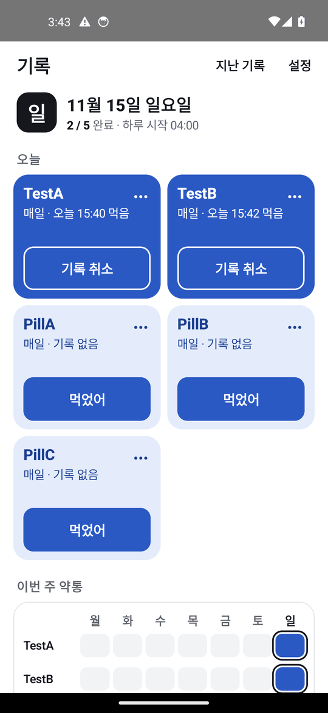
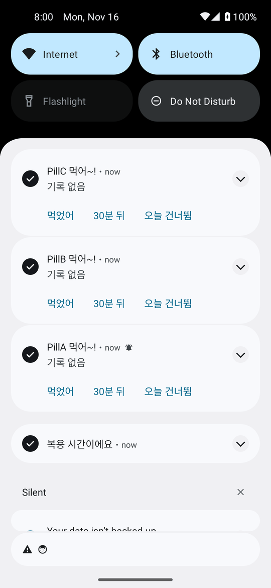
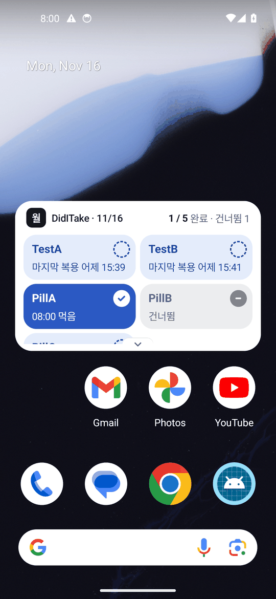

# 릴리즈 변형 에뮬레이터 확인: 알림 버튼과 코드 축소 (2026-11-15)

- 대상: [PR #34](https://github.com/judangbang-ops/pillbadeum_release/pull/34)의 TASK-046(릴리즈 변형 확인, [검토 5.3절](../../06-review/design-review-2026-11-11.md)). 앱 코드는 main `9e59f10`과 같고, 빌드 설정에 코드 축소(R8) 스위치 `-Ppillbadeum.minify`(기본 끔)만 더함
- 환경: GitHub Actions `ubuntu-latest`의 Android 에뮬레이터(API 34 `google_apis` x86_64, Pixel 5 프로필, Pixel Launcher), 시간대 Asia/Seoul
- APK: 같은 커밋의 서명 안 한 릴리즈 APK를 버전 번호 N과 N+1로 두 번 빌드하고, 실행마다 만들고 지우는 임시 키로 개인 APK와 같은 방법으로 서명함([이전 보고서](../2026-11-12-release-variant/report.md)와 같음). 코드 축소를 끈 빌드와 켠 빌드를 따로 실행해 같은 단계를 거침
- 방법: [`.github/workflows/release-emulator.yml`](../../../.github/workflows/release-emulator.yml)이 [`scripts/emulator/release_check.py`](../../../scripts/emulator/release_check.py)를 돌림. 1~5단계(위젯 탭 기록, 백업·복원, N+1 덮어 설치)는 이전 보고서와 같고, 이번에 6·7단계를 더함
  - 6단계(알림 버튼): N+1 빌드에서 앱으로 항목 셋(PillA·PillB·PillC)을 만들며 [알림 받기]를 켜고 저장함(첫 알림 기본 08:00). 시계를 정확 알람 1분 전으로 옮겨 울린 뒤 알림창에서 PillA [먹었어], PillB [오늘 건너뜀], PillC [30분 뒤]를 누르고, 앱 DB의 판정·미룸, 남은 알림, 다음 알람을 봄. 알림 권한은 `pm grant`, 정확 알람은 `appops`로 허용함
  - 7단계(판정 아님): APK 크기와 dex 수, 앱 콜드 스타트(`am start -W`의 TotalTime) 5회
- 실행
  - 코드 축소 끔: [릴리즈 변형 에뮬레이터 확인 43685796448](https://github.com/judangbang-ops/pillbadeum_release/actions/runs/43685796448)(PR 머리 `93751ee`를 main과 합친 `04891a2`를 빌드), 버전 번호 236 → 237. 결과 표 그대로는 [evidence/api34-r8-off.md](evidence/api34-r8-off.md)
  - 코드 축소 켬: [43685794993](https://github.com/judangbang-ops/pillbadeum_release/actions/runs/43685794993)(수동 실행, 입력 `minify` 켬, `93751ee`를 빌드), 버전 번호 235 → 236. 결과 표 그대로는 [evidence/api34-r8-on.md](evidence/api34-r8-on.md). R8 출력(mapping 등)은 그 실행의 아티팩트 `release-check-r8`
  - 로그캣·화면 덤프는 각 실행의 아티팩트 `release-check-api34`(7일 보관)

## 1. 결과 요약

| # | 확인 항목 | 기대 동작 | 축소 끔 | 축소 켬 | 근거 |
| --- | --- | --- | --- | --- | --- |
| 1 | 시험 전송이 백업을 받는지 (대조) | 설정 제공자 백업 성공 | 통과 | 통과 | evidence |
| 2 | 릴리즈 변형 N 설치 | 디버그 불가(`run-as` 거부), 백업 허용 | 통과 | 통과 | evidence |
| 3 | BUG-004 첫 위젯 전 `RescheduleReceiver` | 앱을 연 뒤 켜져 있음 | 통과 | 통과 | evidence |
| 4 | 홈 화면 위젯에서 항목 탭 | 기록 1건, `source` = `WIDGET`, `device_id`·설치 표식 있음 | 통과 | 통과 | evidence |
| 5 | B-1 릴리즈 변형의 백업에 든 파일 | 앱 백업 성공, 기록 DB와 짝 파일만 | 통과 | 통과 | evidence |
| 6 | RR-26 백업 → 지우고 다시 설치 | 위젯으로 쓴 기록 1건이 돌아옴 | 통과 | 통과 | evidence |
| 7 | RR-30 복원 뒤 첫 실행 | 복원 안내, 새 `device_id` = 표식, `restored_from_device_id` = 옛 값 | 통과 | 통과 | evidence |
| 8 | 보충 R-3 복원 뒤 위젯 | 머리글 아래 "복원됨 · 마지막 기록 … · 앱에서 확인" | 통과 | 통과 | evidence |
| 9 | RR-33 위젯 몫: 앱에서 [확인했어요] 뒤 | 위젯의 복원 줄이 사라짐 | 통과 | 통과 | evidence |
| 10 | 다음 빌드 N+1을 덮어 설치 | 버전 번호가 커지고 기록·`device_id`·표식이 그대로 | 통과 | 통과 | evidence |
| 11 | 덮어 설치 뒤 남아 있던 위젯에서 탭 | 기록 2건 모두 `WIDGET`, 새 기록의 `device_id` = 이 폰 값 | 통과 | 통과 | evidence |
| 12 | 덮어 설치 뒤 앱 | 복원 안내 없음(RR-31) | 통과 | 통과 | evidence |
| 13 | **새** 알림 켠 항목 셋 (TASK-023·024) | 규칙 셋 다 켜짐·08:00, 다음 칸의 정확 알람 1개 | 통과 | 통과 | 1 |
| 14 | **새** 알림 울림 (TASK-024·025) | 세 항목 알림 "<이름> 먹어~!"에 [먹었어]·[30분 뒤]·[오늘 건너뜀], 잠금 화면용 알림 "복용 시간이에요" | 통과 | 통과 | 2 |
| 15 | **새** 알림 버튼 (TC-011·TC-012) | PillA 복용·PillB 건너뜀(둘 다 `NOTIFICATION`), PillC 미룸 1건(누른 때부터 30분 뒤), 남은 알림 0개, 다음 알람 = 미룬 시각 | 통과 | 통과 | 3·4 |

- 경우 수: 두 실행 모두 15개 통과. 두 실행 모두 처음 돌린 실행이고 다시 돌리지 않음
- 6단계의 숫자(두 실행 같음): 정확 알람 2026-11-16 08:00:00(`window=0`, `exactAllowReason=permission`), 울린 알림 4개(복용 알림 셋은 `dose_reminders`·`SECRET`·버튼 3개, 잠금 화면용 알림은 `app_notices`·`PUBLIC`), PillC 미룸은 누른 때부터 30.1분, 버튼 뒤 남은 알림 0개, 다음 알람 하나가 미룬 시각(끔 08:30:42, 켬 08:30:37)
- 서명한 APK 넷의 권한이 기준 목록과 같음(8줄, `INTERNET` 없음, REQ-057). 축소를 켠 APK도 같음(각 실행의 'APK' 단계 로그)

## 2. 두 빌드 견주기 (7단계, 판정 아님)

| | 축소 끔 | 축소 켬 |
| --- | --- | --- |
| 서명한 APK 크기 | 14,240,527 바이트 | 7,320,834 바이트 (끈 빌드의 51.4%) |
| dex | 3개, 풀면 24.09 MB | 1개, 풀면 3.22 MB |
| 콜드 스타트 5회 (ms) | 841, 918, 856, 1004, 994 (중앙값 918) | 1115, 722, 928, 1054, 782 (중앙값 928) |
| Gradle 빌드 시간 N / N+1 | 3분 31초 / 7초 | 4분 5초 / 59초 |
| 빌드 경고 | 없음 | R8 경고가 빌드마다 16줄 (아래) |

- 콜드 스타트는 CI 에뮬레이터에서 5번씩이라 퍼짐(끔 163 ms, 켬 393 ms)이 중앙값 차이(10 ms)보다 훨씬 큼. 이 값으로는 빠르고 느림을 말할 수 없음
- N+1은 버전 번호만 바뀐 빌드라 끈 빌드는 거의 다시 쓰고, 켠 빌드는 R8이 앱 전체를 다시 줄임
- R8 경고(켠 빌드의 `minifyReleaseWithR8`마다 16줄): `WARNING: R8: An error occurred when parsing kotlin metadata. This normally happens when using a newer version of kotlin than the kotlin version released when this version of R8 was created.` 이 저장소는 AGP 8.13.2와 Kotlin 2.4.21을 씀(`gradle/libs.versions.toml`). [공식 표](https://developer.android.com/studio/build/kotlin-d8-r8-versions)(2026-11-15에 읽음)로는 Kotlin 2.4 메타데이터를 읽는 R8은 9.1.29부터이고, AGP 8.13.2에 든 R8(8.13 줄)은 그보다 앞선 판임

## 3. 화면

| 1. 알림을 켠 항목 셋 (켬) | 2. 울린 알림 (끔·켬 같음) | 3. 버튼 뒤 위젯 (끔) | 4. 버튼 뒤 위젯 (켬) |
| --- | --- | --- | --- |
|  |  |  |  |

- 1: 시계를 옮기기 전(11/15 15:43)의 앱 첫 화면. TestA·TestB는 1~5단계에서 위젯으로 기록한 항목
- 2: 두 실행의 원본 캡처(1080×2340)가 바이트까지 같음(md5 `e3ba3d8c8ae9fa7f1fe00b4a0319e830`)
- 3·4: 시계를 옮긴 뒤(11/16 08:00) 홈 화면 위젯. PillA "08:00 먹음", PillB "건너뜀", 머리 "1 / 5 완료 · 건너뜀 1". 두 캡처의 차이는 TestA·TestB의 기록 시각(실행 시각)뿐
- 보고서의 그림은 원본을 절반 크기로 줄이고 256색으로 줄인 것. 원본은 실행 아티팩트

## 4. 코드 축소(R8) 판단

**정함 (Claude, 2026-11-15)**: 1차는 지금처럼 끔. TASK-002에서 정한 기본을 바꾸지 않음. 담당 작업(TASK-046)의 판단이고 방향을 바꾸지 않아 Claude가 정함. 동희님이 켜자고 하시면 아래 '다시 볼 때'대로 함

- 까닭
  1. 얻는 것은 크기뿐: APK가 절반이 됨(14.24 → 7.32 MB). 콜드 스타트는 차이를 재지 못함. 개인 APK와 Play 비공개 테스트에서 14 MB가 막는 일은 없음
  2. 지금 도구끼리 짝이 맞지 않음: AGP 8.13.2에 든 R8이 Kotlin 2.4.21의 메타데이터를 읽지 못한다고 빌드마다 경고함(2장). 이번 15개 경우는 통과했지만 공식으로 맞춘 짝이 아님. 켜려면 R8 판을 따로 올리거나 AGP를 올려야 하고, 그 자체가 다시 확인할 일임
  3. 나머지 에뮬레이터 확인(화면 1·2부, 접근성, 회귀, 알림, 둘러보기, 기기 스크립트)은 축소하지 않은 디버그 빌드로 돎. 켜면 출시 빌드와 같은 것은 이 확인의 15개 경우뿐이고, 축소 탓의 결함은 대개 그 밖(리플렉션, 직렬화, 드문 화면)에서 남
  4. 켜면 배포마다 mapping 파일을 보관하고 Play Console에 올려야 오류 스택을 읽을 수 있음. 앱에 크래시 보고 SDK가 없어(REQ-090) Play Console이 거의 유일한 오류 창구라 이 일이 빠지면 안 됨
- 반대 의견(가장 강한 것): 크기가 절반이고 축소한 빌드로도 핵심 흐름 15개가 모두 통과했음. 출시 빌드는 보통 축소함. 나중에 켜면 그때 다 다시 봐야 하므로, 비공개 테스트 동안 켠 빌드를 오래 써 보는 편이 낫다는 것
- 다시 볼 때: AGP·Kotlin을 올려 R8이 Kotlin 2.4 메타데이터를 읽게 될 때, 또는 2차. `release-emulator.yml`을 `minify` 켜고 한 번 수동 실행하면 같은 15개 경우와 권한을 봄. 기본을 바꾸는 것은 [`androidApp/build.gradle.kts`](../../../androidApp/build.gradle.kts)의 `minifyRelease` 기본값(`?: false`) 하나이고, 규칙 파일 [`androidApp/proguard-rules.pro`](../../../androidApp/proguard-rules.pro)는 지금 앱만의 규칙이 없음

## 5. 확인하지 못한 것

- **실기기(갤럭시)의 릴리즈 빌드 알림과 잠금 화면**: TASK-032·052
- **잠금 화면에서 누른 버튼(릴리즈)**: 이번에는 알림창에서만 누름. 잠금 화면의 [먹었어]는 디버그 빌드 알림 확인(API 26·30·34·36, [실행 43374888132](https://github.com/judangbang-ops/pillbadeum_release/actions/runs/43374888132))에서 봄
- **권한 창과 정확 알람 허용 화면을 사람처럼 누르기**: `pm grant`·`appops`로 허용함. 그 화면은 디버그 빌드의 화면 확인에서 봄
- **미룬 알람이 실제로 다시 울리는 것(릴리즈)**: 다음 알람이 미룬 시각인 것까지만 봄. 다시 울림은 디버그 빌드 알림 확인에서 봄(TC-012)
- **축소한 빌드로 한 그 밖의 흐름**: 화면·접근성·회귀·둘러보기는 디버그 빌드로만 돎. 1차는 축소를 끄므로 출시 빌드는 디버그 빌드와 같은 코드를 축소 없이 빌드한 것임
- **콜드 스타트의 실제 차이**: 2장의 까닭으로 말할 수 없음. 실기기 값은 재지 않음
- **Play에서 받는 크기**: 이 비교는 APK임. Play는 번들(AAB)에서 기기에 맞는 조각만 내려보내 크기가 다름. TASK-038
- **API 34 밖의 릴리즈 변형**: [이전 보고서](../2026-11-12-release-variant/report.md) 3장과 같음

## 6. 발견한 결함과 조치

이 확인에서 앱 코드와 확인 절차의 결함은 나오지 않았음. 축소한 빌드의 R8 경고는 결함이 아닌 도구 짝의 문제로 보고 4장의 판단에 넣음.

## 7. 알려진 제한

- PR에서 도는 실행은 PR 머리와 main을 합친 커밋을 빌드해 버전 번호가 수동 실행보다 1 큼(236과 235)
- 6단계는 시계를 정확 알람 1분 전으로 옮겨 울림. 실제 시간이 흐르는 동안의 Doze·대기는 보지 않음(TASK-032)
- 축소를 켠 확인은 수동 실행에서만 돎. PR과 main 푸시의 실행은 끈 빌드임
- 그 밖의 제한(위젯 놓기가 런처 화면에 기댐, 시험 전송과 실제 Google 백업의 차이, 시험 APK를 폰에 깔지 않음)은 [이전 보고서](../2026-11-12-release-variant/report.md) 5장과 같음
