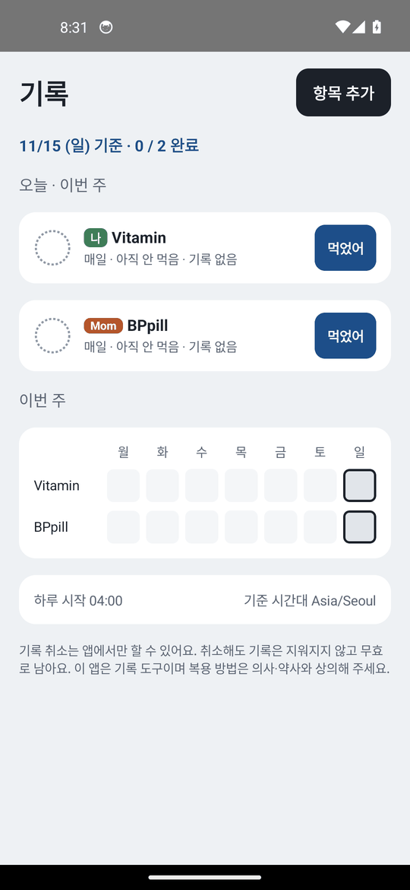
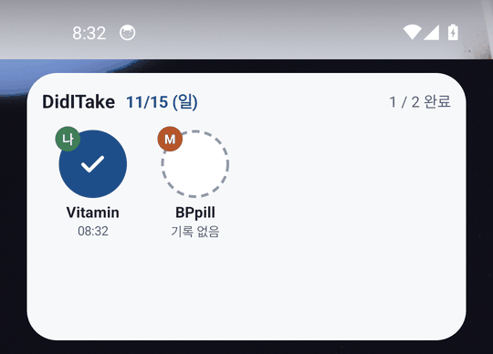
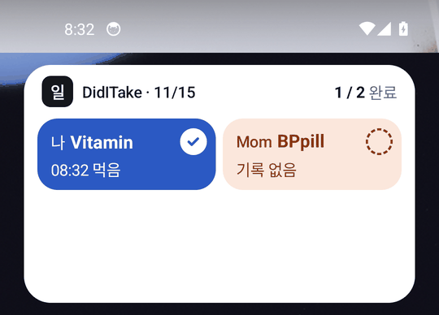
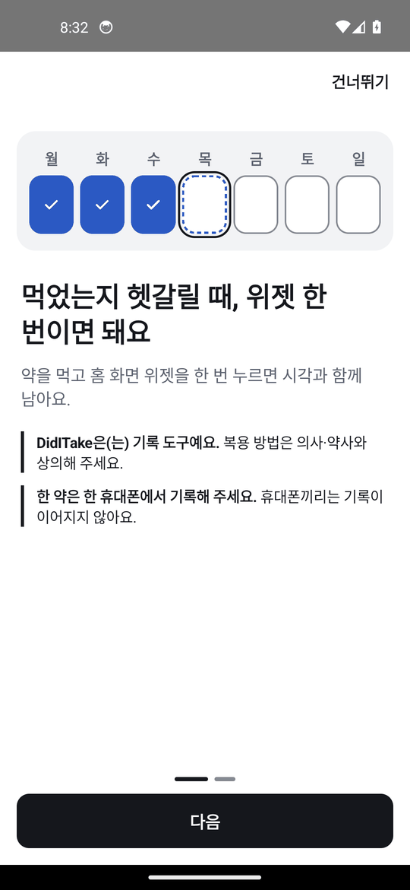
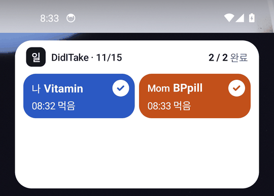
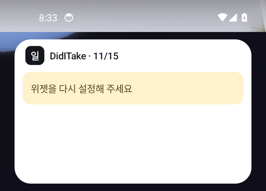

# 옛 빌드에서 덮어 설치하는 업데이트 확인 (2026-11-15)

- 대상: [PR #35](https://github.com/judangbang-ops/pillbadeum_release/pull/35)의 TASK-012 남은 몫. 보충 R-3·RR-74(REQ-079의 마지막 문장): 위젯 대상자 고르기가 들어오기 전부터 놓인 위젯은 '전체'로 채워져, 대상자가 둘 이상이어도 "위젯을 다시 설정해 주세요"를 띄우지 않아야 함. 지금까지는 앱 시험(Robolectric `WidgetPickTest.rr74_widgets_placed_before_the_picker_show_everyone_and_only_once`)으로만 봤음. 앱 코드는 바꾸지 않음
- 환경: GitHub Actions `ubuntu-latest`의 Android 에뮬레이터(API 34 `google_apis` x86_64, Pixel 5 프로필, Pixel Launcher, 하드웨어 키보드), 시간대 Asia/Seoul
- APK: 한 실행에서 옛 커밋 [`8c50d47`](https://github.com/judangbang-ops/pillbadeum_release/commit/8c50d4735ab3624d1e4689a18d55fe4bdfc86808)(2026-11-13 PR #19 전의 main, 위젯 대상자 고르기 전)과 PR 커밋(main과 합친 커밋)을 디버그 APK로 빌드함. 같은 실행의 디버그 키로 서명돼 덮어 깔 수 있음. 버전 번호는 그 커밋까지의 커밋 수(옛 빌드 111)
- 방법: [`.github/workflows/upgrade.yml`](../../../.github/workflows/upgrade.yml)이 [`scripts/emulator/upgrade_check.py`](../../../scripts/emulator/upgrade_check.py)를 돌림. 앱 코드나 이 스크립트·도우미를 바꾼 PR과 수동 실행에서 돎. 작업 시간은 1회차 11분 15초(Gradle 캐시 없음), 2회차 5분 49초, 3회차 6분 25초. 단계는 1장
- 실행 (셋 다 처음 돌린 실행이고 다시 돌리지 않음)
  - 1회차 [43689285870](https://github.com/judangbang-ops/pillbadeum_release/actions/runs/43689285870): PR 머리 `ae9019e`(빌드 `d322bd1`), 버전 번호 111 → 239. 업데이트 전 대상자는 '나' 하나. 결과 표 그대로는 [evidence/api34-run1.md](evidence/api34-run1.md)
  - 2회차 [43691218110](https://github.com/judangbang-ops/pillbadeum_release/actions/runs/43691218110): `76e1c79`(빌드 `c4250b0`), 111 → 240. 1회차에서 찾은 것(5장)을 스크립트에 반영함. [evidence/api34-run2.md](evidence/api34-run2.md)
  - 3회차 [43692177610](https://github.com/judangbang-ops/pillbadeum_release/actions/runs/43692177610): `47aefbd`(빌드 `cd33c1b`), 111 → 241. 업데이트 전에 대상자를 둘로 만듦(5장). **이 보고서의 판정과 그림은 3회차**. [evidence/api34-run3.md](evidence/api34-run3.md)
  - 로그캣·화면 덤프·원본 캡처는 각 실행의 아티팩트 `upgrade-api34`(7일 보관)

## 1. 결과 요약 (3회차)

| # | 확인 항목 | 기대 동작 | 결과 | 근거 |
| --- | --- | --- | --- | --- |
| 0 | 준비 | 서울 시간대, 오늘 08:30, 옛 빌드 설치 | 통과 | evidence |
| 1 | 옛 빌드에서 대상자 둘 | 나 Vitamin과 Mom BPpill(옛 항목 화면의 [+ 사람 추가]. 그 빌드에는 대상자 관리 화면이 없음), 고르기 화면 없이 위젯이 놓이고 위젯 탭으로 기록 1건(`WIDGET`), 위젯에 저장된 대상자 선택 없음 | 통과 | 그림 1·2 |
| 2 | 덮어 설치(`adb install -r`), **앱을 열기 전** | 버전 번호가 커지고 기록·설치 표식이 그대로. 새 빌드가 다시 그린 위젯이 '나 Vitamin, …'·'Mom BPpill, …'을 보이고 다시 설정을 묻지 않음(RR-74) | 통과 | 그림 3 |
| 3 | 새 빌드 첫 실행 | 첫 실행 안내가 한 번 뜸. 업데이트 뒤 앱이 위젯 하나를 '전체'(`*`)로 한 번 채움, 위젯에 두 사람 항목 | 통과 | 그림 4 |
| 4 | 업데이트 전에 놓은 위젯에서 Mom BPpill 탭 | 기록 2건(둘 다 `WIDGET`), 위젯이 'Mom BPpill, 복용함, …'. 선택이 없으면 대상자 둘일 때 위젯은 기록하지 않음(SPEC-009) | 통과 | 그림 5 |
| 5 | 대조: 그 위젯의 상태를 지운 뒤(복원 뒤처럼) | 같은 위젯이 "위젯을 다시 설정해 주세요"를 보이고, 앱이 다시 채우지 않음(설치마다 한 번) | 통과 | 그림 6 |

- 경우 수: 3회차 6줄 모두 통과. 1·2회차도 그때의 스크립트로 6줄 모두 통과(업데이트 전 대상자 하나, Mom은 업데이트 뒤 대상자 관리에서 더함)
- 5번은 2~4번이 채운 선택 덕에 통과함을 보임: 같은 위젯·같은 대상자 둘에서 선택만 없애면 다시 설정을 물음
- 세 실행의 로그캣에 앱의 `FATAL EXCEPTION`과 ANR이 없음

## 2. 업데이트 직후 (판정 아님)

앱이 위젯을 '전체'로 채우는 때는 사람이 앱을 처음 여는 때가 아니었음. 덮어 설치하고 1초 안에, 시스템이 깨운 새 빌드의 첫 프로세스가 채웠음.

| 실행 | 덮어 설치(`installPackageLI`) | 새 빌드 첫 프로세스 | 채움 로그 | 앱을 처음 연 때 |
| --- | --- | --- | --- | --- |
| 1회차 | 08:31:53.544 | 08:31:53.849, `DayBoundaryReceiver`에 온 방송 | 08:31:54.541 (0.997초 뒤) | 08:32:02.602 (채움 8.061초 뒤) |
| 2회차 | 08:31:47.938 | 08:31:48.136, `DidITakeWidgetReceiver`에 온 방송 | 08:31:48.526 (0.588초 뒤) | 08:31:57.927 (9.401초 뒤) |
| 3회차 | 08:32:32.502 | 08:32:32.749, `DayBoundaryReceiver`에 온 방송 | 08:32:33.451 (0.949초 뒤) | 08:32:42.877 (9.426초 뒤) |

- 채움 로그는 셋 다 `widget choices ready: 1 filled with everyone (install state Normal)` 한 줄
- 어느 수신기가 먼저 깨는지는 실행마다 달랐음: 앱 업데이트 방송(`MY_PACKAGE_REPLACED`, 경계 알람을 다시 거는 수신기)이나 위젯 갱신. 어느 쪽이든 앱의 모든 진입점은 `AppContainer.core()`를 거치고, 거기서 위젯 그림보다 먼저 선택을 채움([`AppContainer.kt`](../../../androidApp/src/main/kotlin/com/judangbang/pillbadeum/AppContainer.kt), `WidgetChoices.prepare`). 3회차는 대상자 둘이라, 채우기 전에 그렸다면 앱을 열기 전 위젯이 다시 설정을 물었을 것임. 물지 않았음(그림 3)
- 사람이 보는 것: 업데이트만 하고 앱을 열지 않아도 홈 화면 위젯은 1초 안에 새 모양으로 바뀌고 두 사람 항목을 그대로 보임. 위젯의 기록도 그대로 됨(4번은 앱을 연 뒤에 눌렀음. 앱을 열기 전 탭은 누르지 않음, 6장)

## 3. 화면 (3회차)

| 1. 옛 빌드 첫 화면 | 2. 옛 빌드 위젯 (Vitamin 탭 뒤) | 3. 덮어 설치 직후, 앱을 열기 전 |
| --- | --- | --- |
|  |  |  |

| 4. 업데이트 뒤 첫 실행 | 5. Mom BPpill 탭 뒤 | 6. 대조: 상태를 지운 뒤 |
| --- | --- | --- |
|  |  |  |

- 1: 옛 빌드(8c50d47)의 첫 화면. 대상자 표(나·Mom)가 이름 앞에 있음. BPpill은 옛 항목 화면의 [+ 사람 추가]로 Mom을 더하고 그 칩을 골라 저장함(앱 DB: 나 Vitamin, Mom BPpill)
- 2: 옛 위젯. 고르기 화면 없이 놓였고, Vitamin을 위젯에서 눌러 "1 / 2 완료". 읽는 말은 '나 Vitamin, 오늘 08:32 기록됨'·'Mom BPpill, 미완료'
- 3: 덮어 설치 뒤 약 5초, 앱을 열기 전. 새 빌드가 그린 새 모양(머리 "DidITake · 11/15", 사람 이름이 항목 앞). '나 Vitamin, 복용함, 오늘 08:32'·'Mom BPpill, 미완료, 기록 없음', 다시 설정 안내 없음
- 4: 업데이트 뒤 처음 연 앱에 첫 실행 안내가 한 번 뜸. 옛 빌드의 데이터에는 안내를 봤다는 값(`intro_seen_at`)이 없기 때문(SPEC-002). [건너뛰기]로 넘김. 7장 참고
- 5: 업데이트 전에 놓은 그 위젯(id 2)에서 BPpill을 누른 뒤. "2 / 2 완료", 'Mom BPpill, 복용함, 오늘 08:33'. 앱 DB의 활성 판정 2건이 모두 `WIDGET`
- 6: 앱을 멈추고 그 위젯의 상태 파일(`appWidget-2.preferences_pb`)을 지워 다시 그린 뒤. 대상자가 둘이라 "위젯을 다시 설정해 주세요"만 보이고, 앱은 다시 채우지 않음(로그 없음, 선택 없음)
- 그림은 원본(1080×2340)을 절반 크기·256색으로 줄인 것. 위젯 그림은 상태 표시줄과 위젯 부분만 자름. 원본은 실행 아티팩트

## 4. `onRestored` 실험 (TASK-012 끝난 조건의 마지막 줄)

- 무엇을 보려는 것인가: 런처가 백업에서 위젯을 되살리면 플랫폼이 `onRestored(옛 번호, 새 번호)`를 부르는지. 부른다면 위젯 선택을 백업되는 표에 위젯 번호로 두고 새 번호로 옮기는 방법([보충 2장의 제안](../../04-spec/record-rules-supplement.md#2-복원-감지와-안내-a2), 검토 B10)을 쓸 수 있음. 지금 선택은 백업되지 않는 Glance 상태에 있어, 복원된 위젯은 대상자가 둘 이상이면 다시 설정을 물음(REQ-079)
- 앱에 넣은 것: `DidITakeWidget.onRestored`가 아무것도 옮기지 않고 `onRestored: old … -> new …` 한 줄만 로그에 남김([`DidITakeWidget.kt`](../../../androidApp/src/main/kotlin/com/judangbang/pillbadeum/widget/DidITakeWidget.kt)). 로그에는 위젯 번호만 있고 이름은 없음(REQ-058)
- 에뮬레이터에서 볼 수 없는 까닭: 에뮬레이터의 복원 확인은 앱을 지웠다가 다시 깔고 복원함. 앱을 지우면 홈 화면의 위젯도 사라짐
- 지금까지 본 것: 2026-11-14 릴리즈 변형 확인 API 34(`56ebcf6`, [실행 43563317318](https://github.com/judangbang-ops/pillbadeum_release/actions/runs/43563317318))의 로그캣에서, 시스템은 백업에 든 위젯 번호를 새 번호로 옮겼지만(2 → 3) `onRestored` 줄은 없었음. 한 번 본 것이라 그 흐름에서 늘 오지 않는지는 정하지 않음
- 어디서 보는가: 갤럭시 두 대의 기기 간 이전([실기기 확인 순서 4장](../device-check.md#4-기기-간-이전-rr-29-두-대), TASK-032)에서 `rr29-new-app.txt`의 그 줄을 찾음. 줄이 오면 옮기는 방법을 정하고, 오지 않으면 지금처럼 다시 설정을 물음

## 5. 1·2회차에서 찾은 것과 조치

1. **스크립트의 증거 파일**: 1회차의 1·2단계 화면 덤프(XML)가 위젯 탭 **전** 화면이었음. 화면 덤프를 저장하는 `save_ui`가 새로 읽지 않고 마지막 덤프를 남기기 때문. 캡처(PNG)는 맞았고 두 단계의 판정은 앱 DB로 해서 결과는 그대로임. 2회차부터 저장 전에 화면을 다시 읽음(`76e1c79`)
2. **스크립트의 기대 문구**: 1회차는 3단계 기대를 "첫 실행에서 채움"으로 적었으나 실제로는 앱을 열기 전에 채웠음(2장). 2회차부터 2단계에서 앱을 열기 전 위젯·첫 프로세스·채움 로그를 적고, 3단계는 '업데이트 뒤 한 번'을 보고 그 때를 적음(`76e1c79`)
3. **확인이 약했던 것**: 1·2회차는 업데이트 전 대상자가 '나' 하나였음. 대상자가 하나면 선택이 없는 위젯도 항목을 그대로 보이므로, 채우기가 늦거나 빠져도 2·3단계가 통과했을 것임. RR-74가 막으려는 것은 대상자가 이미 둘인 집의 위젯임. 옛 빌드에도 항목 화면에서 대상자를 더하는 [+ 사람 추가]가 있어, 3회차부터 업데이트 전에 Mom을 만들고 2단계(앱을 열기 전)에서 판정함. 4단계는 '대상자를 더한 뒤 보임' 대신 '그 위젯에서 Mom 항목을 눌러 기록됨'으로 바꿈(`47aefbd`)

앱 코드의 결함은 나오지 않았음.

## 6. 확인하지 못한 것

- **`onRestored`**: 4장. TASK-032
- **실제로 나눠 준 서명 APK 위에 덮어 깔기**: 두 빌드 모두 같은 실행의 디버그 APK임. 개인 APK를 나눠 주면(TASK-047) 그 커밋을 입력 `from`으로 수동 실행해 '나눠 준 코드 → 이번 코드'를 볼 수 있으나, 이것도 디버그 빌드임. 릴리즈 변형끼리의 덮어 설치(N → N+1)는 [릴리즈 변형 확인](../2026-11-15-release-variant/report.md) 10~12번이 봄(둘 다 대상자 고르기 뒤 빌드)
- **Play 스토어를 거친 업데이트**: 설치 주체가 Play임. 같은 패키지 교체 방송이 올 것으로 보지만 보지 않음(TASK-048 비공개 테스트)
- **앱을 열기 전 위젯 탭**: 2단계는 앱을 열기 전 위젯의 모양만 봄. 누른 것은 앱을 연 뒤(4단계)
- **위젯 여러 개**: 위젯 하나로 봄. 선택이 이미 있는 위젯은 그대로 두는 것은 앱 시험 `rr74_*`가 봄(위젯 둘)
- **갤럭시 런처(One UI 홈)와 API 34 밖**: 업데이트 뒤 위젯을 다시 그리는 때는 런처와 버전에 따라 다를 수 있음. 실기기는 TASK-032

## 7. 알려진 제한

- **업데이트 뒤 첫 실행 안내**: 첫 실행 안내(TASK-022)가 생기기 전 빌드에서 올리면 안내가 한 번 다시 뜸(그림 4). 그 빌드들은 CI 산출물뿐이고 개인 APK를 아직 나눠 주지 않아(TASK-047) 실제 사용자에게는 일어나지 않음. 나눠 준 뒤의 빌드는 `intro_seen_at`이 있어 뜨지 않음
- PR에서 도는 실행은 PR 머리와 main을 합친 커밋을 빌드해, 커밋을 더할 때마다 버전 번호가 하나씩 큼(239, 240, 241)
- 시계를 08:30으로 옮기고 몇 분 안에 끝남. 실제 시간이 흐르는 동안의 업데이트(밤사이 자동 업데이트 등)는 보지 않음
- 5번 대조는 복원을 위젯 상태 파일 삭제로 흉내 냄. 실제 복원은 TASK-032
- 위젯 놓기는 Pixel Launcher의 위젯 화면에 기댐([릴리즈 변형 확인 보고서](../2026-11-12-release-variant/report.md) 5장과 같음)
