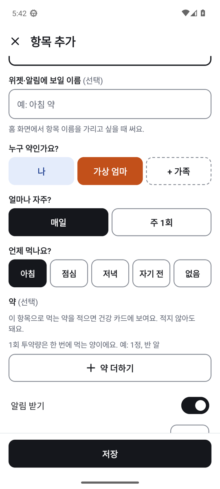
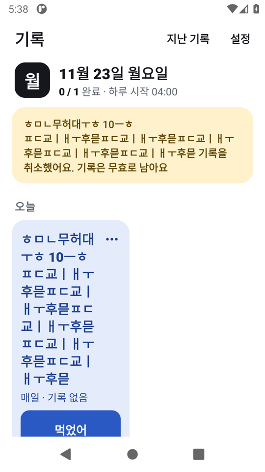

# AI 테스터 시범 1번 (2026-11-24)

- 무엇: AI 에이전트 테스터(가상 사용자 셋, 이하 페르소나)가 GitHub Actions의 Android 에뮬레이터에서 2차 개발 중인 앱을 기본 탐색으로 써 보고 찾은 것. 시범이라 [시험 계획](../../12-qa/test-plan.md)의 TC를 대신하지 않음
- 출처: 시범 보고서(Claude, 필받음 봇이 보낸 작업, 2026-11-24 KST)와 그 실행의 결과. 시범 보고서 원본과 풀린 결과는 저장소에 올리지 않았고, 이 문서는 그 요약과 근거 화면 두 장임. 찾은 것의 분류는 시범 보고서의 Claude가 화면과 문서를 대조해 붙였고, 진짜 버그 후보 둘은 필받음 봇이 화면을 직접 봐서 확인함(2026-11-24)
- 적는 법: 표시가 없는 것은 실행 기록과 문서에 있는 사실. [관찰]은 화면에서 본 것, [추정]은 확인하지 않은 판단
- 정리한 사람: Claude 작업자(2026-11-24 KST). 근거 화면 두 장은 넣기 전에 직접 봐서 가상 데이터만 있음을 확인함(4장 끝)

## 1. 실행

- 실행: [kodonghui/pillbadeum-agent-testers 45228364103](https://github.com/kodonghui/pillbadeum-agent-testers/actions/runs/45228364103), 결과 success, 다시 돌리지 않음
- 테스터 저장소 커밋 `59fe625`(템플릿 `48f8bf3`에 필받음 설정을 더함). 앱은 judangbang-ops/pillbadeum_release `b257e1a`(`release/p2-r1`)의 디버그 APK

| 입력 | 값 |
| --- | --- |
| android_personas | `pb_sunja,pb_jihye,pb_taeho` |
| ios_personas | `none` |
| source_repo / ref | `judangbang-ops/pillbadeum_release` / `b257e1aee4c9acdf417004b34091e3488feb8eb9` |
| app_dir / app_id / framework | `.` / `com.judangbang.pillbadeum` / `kmp` |
| android_build | `./gradlew :androidApp:assembleDebug` |
| apk_path | `androidApp/build/outputs/apk/debug/androidApp-debug.apk` |
| brief / model | `briefs/pillbadeum.md` / `sonnet`(실제로 쓴 모델 `claude-sonnet-5-5`) |

| 페르소나 (가상) | 기기 (에뮬레이터) | 점수 | 에이전트 시간 · 턴 | 화면 | 한 일 |
| --- | --- | --- | --- | --- | --- |
| pb_sunja (72세, 글자 200%) | Pixel 7, Android 14, 밝은 화면 | 7/10 | 3분 11초 · 44턴 | 21장 | 첫 실행 안내 → 항목 둘('아침약'·'저녁약') → [먹었어] |
| pb_jihye (46세 보호자, 어두운 화면) | Pixel 6, Android 13, 다크 모드 | 7/10 | 3분 45초 · 59턴 | 25장 | '가상 엄마'를 더하고 알림 켠 항목, 먹은 시각 고치기, 지난 기록 |
| pb_taeho (27세, 빠르게 누름) | Nexus 5, Android 11, 밝은 화면 | 7/10 | 2분 35초 · 32턴 | 17장 | 건너뛰기 → 항목 추가(아주 긴 이름) → [먹었어] → 기록 취소 |

걸린 시간: 실행 전체 13분 50초(2026-11-24 02:30~02:44 KST, UTC 17:30:14~17:44:04). 잡마다:

| 잡 | 결과 | 걸린 시간 |
| --- | --- | --- |
| plan | success | 6초 |
| build-android | success | 4분 2초 (그중 Gradle 3분 16초) |
| android (pb_taeho) | success | 5분 33초 |
| android (pb_sunja) | success | 8분 49초 (그중 APK 내려받기 3분) |
| android (pb_jihye) | success | 9분 33초 |
| build-ios, ios | skipped | - |

- 세 페르소나가 실제로 조작한 시간은 2분 35초~3분 45초, 합계 570.1초(로그의 에이전트 시간)
- 사용량: 로그의 토큰을 API 정가로 환산하면 1.23달러. 구독 토큰으로 돌아 청구되지 않음. 구독 한도의 몇 %인지는 알 수 없음

## 2. 찾은 것 17건의 분류

심각도는 테스터가 붙인 값이고, 분류는 시범 보고서의 Claude가 화면과 문서를 대조해 붙인 값임.

| 분류 | 건수 | 번호 |
| --- | ---: | --- |
| 진짜 버그 후보 | 3 (서로 다른 문제로는 2) | 1, 2, 3 |
| 설계대로 (오탐) | 12 | 4~15 |
| 도구·에뮬레이터 탓 | 1 | 16 |
| 판단 못 함 | 1 | 17 |

- 오탐 비율 12 ÷ 17 = 71%. 도구 탓과 판단 못 함을 더한 '앱 버그가 아닌 몫'은 14 ÷ 17 = 82%
- 테스터 심각도: major 2(4·5, 둘 다 설계대로), minor 11, cosmetic 4. blocker 없음

| # | 페르소나 | 찾은 것 (줄임) | 심각도 | 분류와 까닭 (줄임) |
| --- | --- | --- | --- | --- |
| 1 | pb_sunja | 항목 추가: '첫 알림 시각' 줄이 [저장] 바에 반쯤 가려짐(글자 200%) | minor | 진짜 버그 후보 → BUG-008 (3.1절) |
| 2 | pb_jihye | 같은 가림(글자 100%) | minor | 진짜 버그 후보, 1과 같은 문제 |
| 3 | pb_taeho | 긴 이름이 반쪽 폭 칸에서 9줄 | minor | 진짜 버그 후보(설계 빈틈) → 설계 바꿈 T-1 (3.2절) |
| 4 | pb_jihye | 다크 모드를 따르지 않음 | major | 설계대로: 1차는 밝은 색 고정, 다크 모드는 차수를 정하지 않음 |
| 5 | pb_sunja | 지난 기록에 어제가 없음 | major | 설계대로: 새 설치에서 오늘 만든 항목이라 어제 칸이 없음. 페르소나 목표가 새 설치에서는 이룰 수 없었음 |
| 6 | pb_sunja | 알림 권한 안내가 막연함 | minor | 설계대로: 문구가 화면 정의 그대로 |
| 7 | pb_sunja | 영어·어려운 말(Asia/Seoul 등) | minor | 설계대로: 기기 시간대가 기준 시간대와 다를 때만 보이는 줄. [관찰] 에뮬레이터가 UTC였음 |
| 8 | pb_sunja | 작은 터치 대상([⋯], 달 화살표) | minor | 설계대로: 보이는 점은 작지만 누르는 곳은 48dp(코드도 48dp) |
| 9 | pb_sunja | 첫 실행 안내 2쪽 셋째 줄이 버튼 뒤(글자 200%) | minor | 설계대로: 200%에서는 그 사이가 스크롤됨 |
| 10 | pb_sunja | 빈 화면 안내 '[항목 추가]'와 버튼 '+ 항목 추가' | cosmetic | 설계대로: 문구·버튼이 화면 정의 그대로 |
| 11 | pb_jihye | 먹은 시각 고치기 처음 값(17:40)이 기록(17:42)과 다름 | minor | 설계대로: 5분 단위로 내려 골라 둠 |
| 12 | pb_jihye | 접근성 이름이 화면 값과 다름 | minor | 설계대로: 시각을 "21시"처럼 읽게 정함 |
| 13 | pb_jihye | 오늘 칸이 화면 절반 폭 | cosmetic | 설계대로: 한 줄에 둘, 글자 130%부터 하나 |
| 14 | pb_jihye | 안내 문구에 이름이 두 번 | cosmetic | 설계대로: 화면 정의 그대로 |
| 15 | pb_taeho | 빈 이름 오류 메시지가 아래 칸을 밈 | cosmetic | 설계대로: 이름 칸 아래에 보이게 정함 |
| 16 | pb_taeho | '언제 먹나요?' 칩이 잘리고 이름 없는 컨트롤 | minor | 도구·에뮬레이터 탓 [추정]: 칩이 [저장] 바에 걸린 상태를 접근성 검사가 이름 없음으로 셈. 스크롤한 화면에서는 보임 |
| 17 | pb_taeho | 기록 취소 뒤 안내 띠가 [먹었어]를 화면 밖으로 밈 | minor | 판단 못 함: 문서가 그 안내의 자리를 정하지 않았고, 밀린 주된 까닭은 3번의 9줄 이름. 보통 길이 이름으로는 시험하지 않음 |

## 3. 진짜 버그 후보 둘

### 3.1 '첫 알림 시각' 줄이 [저장] 바에 가림 → BUG-008

- [관찰] 항목 추가(SCR-006)에서 '알림 받기'가 화면 아래쪽에 있을 때 켜면, 새로 생긴 '첫 알림 시각' 줄이 아래 [저장] 바 뒤로 들어가 시각 버튼의 위쪽만 보이고 화면이 그 줄로 스크롤되지 않음. pb_jihye 18번 화면(Pixel 6, 글자 100%)과 pb_sunja 15번 화면(Pixel 7, 글자 200%)에서 같음
- 문서: [화면 정의](../../05-ui/screens.md#scr-006-항목-추가수정) SCR-006은 켜면 그 줄이 생긴다고만 적었고 스크롤은 정하지 않았음
- 처리: 설계를 바꾸지 않는 버그라 필받음 봇 결정으로 고침. SCR-006 [알림 받기] 켜기 동작에 "그 줄이 [저장] 바 위에 다 보이게 스크롤"을 적고, [시험 계획](../../12-qa/test-plan.md#6-버그) BUG-008, 회귀 시험 TC-120, 고치는 작업 [TASK-070](../../08-wbs/wbs.md#19-2차-첫-릴리즈-건강-카드-p2-r1)
- 원인은 확인하지 않음. [추정] 스위치를 켤 때 새 줄로 스크롤을 옮기는 코드가 없음

### 3.2 긴 항목 이름이 반쪽 폭 칸에서 9줄 → 설계 바꿈 T-1

- [관찰] pb_taeho(Nexus 5, Android 11, 글자 100%)가 아주 긴 이름으로 항목을 만들자 기록 화면(SCR-004)의 반쪽 폭 칸에서 이름이 9줄이 됨(07번 화면). 기록 취소 뒤 안내 띠가 생기자 [먹었어]가 화면 아래 끝에 걸려 반쯤 잘림(11번 화면)
- [관찰] 이름은 영문을 넣으려다 한글 자판을 거쳐 들어간 자모 글임(도구 탓, 4장). 길이는 60자 안팎 [추정, 시범 보고서]
- 문서: 칸이 반쪽 폭인 것은 설계대로(SCR-004). 항목 이름에는 글자 수 한도가 없었음(SPEC-003은 빈 이름만 막음). 2차의 카드 칸·약 이름은 50자(설계 바꿈 R 12)
- 처리: 설계 빈틈이라 필받음 봇이 체크포인트로 여쭤 설계 바꿈 T-1로 승인됨(2026-11-24 KST). 항목 이름과 '위젯·알림에 보일 이름' 모두 30자, R 12 규칙 그대로, 이미 30자를 넘게 저장된 이름은 그대로 두고 그 칸을 고칠 때만 한도. [명세](../../04-functional-spec/spec.md) SPEC-003·023, SCR-006, TC-119, TASK-070. 승인 원문은 [변경 기록](../../10-records/changes/2026-11-22-phase2-release1.md) 6장 '개발 중 설계 바꿈 T'

## 4. 확인하지 못한 것과 한계

- 건강 카드(2차 핵심): [관찰] `b257e1a`의 화면에는 건강 카드가 없음(기록 화면 헤더에 [건강 카드] 없음). [추정] TASK-060·061이 아직 들어오지 않아서임
- 약 줄(SPEC-048): '약 (선택)'과 [약 더하기]는 보였지만 아무도 약 줄을 적지 않음
- 알림이 실제로 울리는지, 알림의 [먹었어]·[30분 뒤], 잠금 화면 알림, 홈 화면 위젯: 아무도 기다리거나 놓지 않음
- 알림 권한 창과 거부 뒤 안내: [추정] 도구가 권한을 미리 허용해 설치해서 아무도 보지 못함. 공유 창, 의견 보내기(SPEC-053), 이모지, TalkBack 자체, iOS, 실기기도 보지 않음
- 16번의 '이름 없는 컨트롤': 접근성 검사 원문이 결과에 남지 않아 확인하지 못함
- 도구 탓이 결과에 준 영향: 한글 입력 도구가 ASCII만 넣어 영문·긴 글이 자모로 들어감. 에뮬레이터 시간대가 UTC라 기준 시간대 안내 줄이 늘 보이고 시각이 UTC로 찍힘(7번). 시범 보고서의 Claude가 따로 본 '지난 기록 칸에 같은 날짜가 붙음'도 UTC 탓으로 보여 [추정] 17건에 넣지 않았고 판단 못 함으로 둠
- 30자 이름이 반쪽 폭 칸에서 몇 줄이 되는지는 재지 않음(TASK-070 뒤 TASK-068에서 봄)
- 쓸 만한지(시범 보고서의 판단): 싸고 빨라 릴리즈 전 화면 스캔으로는 값을 하지만 오탐이 많음. 브리프에 '설계로 정한 것'을 넣고 도구 문제 셋(한글 입력, 시간대, 권한 미리 허용)을 고친 뒤 다시 재야 함. 이 시범만으로는 TC 시험이나 실기기 확인을 줄일 근거가 되지 않음
- 개인정보: [관찰] 화면에는 가상 데이터만 있음(대상자 '나'·'가상 엄마', 항목 '아침약'·'저녁약'과 자모 글). 이 폴더의 두 장(01·02)은 이 작업자가 넣기 전에 직접 봤고, PNG에 글 정보(메타데이터)가 없음
