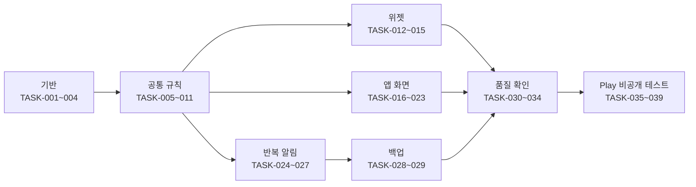

# 작업 분해 (1차 릴리즈 초안)

- 상태: **초안** (2026-11-11, Claude 작성). 범위·화면 합의 전이고, 담당은 아직 정하지 않음
- 기준: 이 저장소로 가져온 프로토타입 코드(DidITake develop `7a800ac`)와 [요구](../01-planning/requirements.md), [화면](../05-ui/screens.md)
- 범위: 지금 프로토타입에서 Google Play 비공개 테스트까지 (결정 Q13)
- 가쟈누님 로드맵 4단계([DidITake README](https://github.com/judangbang-ops/DidITake/blob/7a800ac/README.md#로드맵))의 다섯 가지는 여기 들어 있음: 미래 시각 경고 TASK-006·TASK-016, 위젯 대상자 필터 TASK-012, 건너뜀 TASK-013·TASK-016·TASK-018, 늦은 투약 처리 TASK-004·TASK-005·TASK-018, 설정 화면 TASK-020

## 0. 읽는 법

- **ID**: `TASK-001`부터. 번호는 다시 쓰지 않음. 빼는 작업은 지우지 않고 '제외'와 날짜를 적음
- **근거**: 이 작업이 채우는 요구 ID. 기능 명세(SPEC) 단계를 따로 두지 않고 요구 표의 합격 기준을 씀
- **닿는 곳**: 화면 ID, 테이블 이름, 코드 위치. 코드 위치는 이 저장소 기준임 (앱 코드를 여기서 이어 가기로 함, 2026-11-11 21:52)
- **담당**: 모두 '미정'. 가쟈누님·동희님·Claude 중 누가 맡을지 이 표를 합의할 때 정함
- **크기**: Claude가 어림한 작업일(AI 도움을 받는 한 사람 기준). 측정값이 아님
- **끝난 조건**: 다른 사람이 확인할 수 있는 것으로 씀. 공통 코드는 `./gradlew :shared:jvmTest` 통과가 기본이고, 기존 테스트도 함께 통과해야 함

## 1. 작업 표

### 1.1 기반

| ID | 작업 | 근거 | 닿는 곳 | 먼저 할 것 | 담당 | 크기 | 끝난 조건 |
| --- | --- | --- | --- | --- | --- | --- | --- |
| TASK-001 | 패키지 이름(`applicationId`)을 정해 빌드 설정에 넣기 | REQ-061 | `androidApp/build.gradle.kts` | 결정 Q9 | 미정 | 0.5일 | 정한 이름이 빌드 설정·README에 있고 디버그 APK가 그 이름으로 설치됨 |
| TASK-002 | 앱 서명 키를 만들어 저장소 밖 두 곳에 보관하고 릴리즈 서명 설정 | REQ-062 | 서명 설정(비밀값은 저장소 밖) | TASK-001 | 미정 | 0.5일 | `apksigner verify`로 릴리즈 APK가 그 키로 서명됨. 키·비밀번호가 Git에 없음 |
| TASK-003 | Room 스키마 2: 알림 규칙 저장 자리 추가와 1→2 마이그레이션 | REQ-041, REQ-042, REQ-072 | `reminder_rule`, `setting`, `shared/schemas` | 없음 | 미정 | 1일 | 스키마 2 JSON이 생기고, 1→2 마이그레이션 테스트가 기존 판정 행을 그대로 남김 |
| TASK-004 | `LatePolicy` 기본값을 `KEEP`으로 바꾸기 | REQ-010 | `ManageIntakes`, `schedule_version` | 요구 4장 1번 결정 | 미정 | 0.5일 | 새 항목의 `late_policy` = KEEP. 기존 테스트 통과 |

### 1.2 공통 기록 규칙 (shared)

| ID | 작업 | 근거 | 닿는 곳 | 먼저 할 것 | 담당 | 크기 | 끝난 조건 |
| --- | --- | --- | --- | --- | --- | --- | --- |
| TASK-005 | `RecordCommand`에 실제 복용 시각을 받아 그 시각의 창에 기록하고, 기록된 복용의 시각 고치기 추가 | REQ-030, REQ-031, REQ-032 | `RecordDose`, `ChangeJudgment`, `dose_record` | 없음 | 미정 | 1.5일 | JVM 테스트: 지난 시각 → 그 창 기간키와 따로 남은 `recorded_at`, 그 창에 판정 있음 → Already, 미래 시각 → 거절, 시각 고치기로 창이 바뀌면 원래 창은 미완료 |
| TASK-006 | 실제 복용 시각이 지금보다 뒤인 활성 판정을 찾아 표시값에 넣기 | REQ-009 | `LoadStatusBoard` | 없음 | 미정 | 0.5일 | RR-19 JVM 테스트 통과 |
| TASK-007 | 지난 기록 읽기 `LoadHistory`(달, 대상자) | REQ-037, REQ-038, REQ-039, REQ-040 | `dose_record`, `schedule_version`, `intake`, `person` | 없음 | 미정 | 1.5일 | JVM 테스트: 빠짐 판정, 등록 전·보관 뒤 칸 없음, 주 1회 창 한 칸, 대상자 거르기. 항목 10개·1년치에서 한 달 읽는 시간을 기록 |
| TASK-008 | 대상자 수정·보관·되살리기 | REQ-016, REQ-017, REQ-018 | `ManagePeople`, `person` | 없음 | 미정 | 0.5일 | JVM 테스트: 마지막 대상자 보관 거절, 보관한 대상자의 항목이 `LoadStatusBoard`에서 빠지고 지난 판정은 남음 |
| TASK-009 | 설정 저장과 '바꾼 때부터 적용' | REQ-011, REQ-053 | `setting` | 없음 | 미정 | 1일 | RR-15 JVM 테스트 통과. 지난 판정의 기간키가 바뀌지 않음 |
| TASK-010 | 보관된 항목 완전 삭제 (Could) | REQ-015 | `intake`, `dose_record`, `schedule_version` | 없음 | 미정 | 0.5일 | JVM 테스트: 항목·판정 행이 없고, 남은 위젯 버튼은 Gone |
| TASK-011 | 알림 시각 계산 `PlanReminders` | REQ-041, REQ-042, REQ-043, REQ-044 | `reminder_rule`, `setting` | TASK-003 | 미정 | 1.5일 | JVM 테스트: RR-21, RR-22, 간격·하루 최대·방해 금지·창 끝 경계 |

### 1.3 위젯

| ID | 작업 | 근거 | 닿는 곳 | 먼저 할 것 | 담당 | 크기 | 끝난 조건 |
| --- | --- | --- | --- | --- | --- | --- | --- |
| TASK-012 | 위젯 대상자 고르기 화면과 위젯별 필터 | REQ-025, REQ-018 | SCR-002, SCR-001 | TASK-008 | 미정 | 1.5일 | 에뮬레이터 캡처: '엄마' 위젯에 엄마 항목·완료 수만, 대상자 1명이면 화면이 뜨지 않음, 대상자 보관 → '전체' |
| TASK-013 | 위젯의 건너뜀 표시와 탭 문구 | REQ-019, REQ-023, REQ-033 | SCR-001#skipped, SCR-001#already | 화면 5장 2번 결정 | 미정 | 0.5일 | 캡처: 건너뜀 칸, 탭 → 건너뜀 안내, 판정 행 그대로 |
| TASK-014 | 위젯 버튼이 넘칠 때 스크롤 | REQ-019, REQ-026 | SCR-001#overflow | 화면 5장 1번 결정 | 미정 | 1일 | 4×2에 항목 6개 → 스크롤로 모두 누를 수 있음 (캡처) |
| TASK-015 | 대상자가 한 명이면 배지 숨김 | REQ-018 | SCR-001, SCR-004, SCR-006 | TASK-008 | 미정 | 0.5일 | '나'만 있을 때 배지 없음, 가족 추가 뒤 배지 보임 (캡처) |

### 1.4 앱 화면

| ID | 작업 | 근거 | 닿는 곳 | 먼저 할 것 | 담당 | 크기 | 끝난 조건 |
| --- | --- | --- | --- | --- | --- | --- | --- |
| TASK-016 | 첫 화면 보강: [지난 기록]·[설정]·[⋯], 건너뜀 줄, 미래 시각 경고, 읽기 오류와 [다시 시도] | REQ-009, REQ-028, REQ-033, REQ-036 | SCR-004 | TASK-006 | 미정 | 1일 | SCR-004의 normal·empty·error·skipped·future 캡처 |
| TASK-017 | 앱을 켜 둔 채 날짜가 바뀌면 다시 불러오기 | REQ-004, REQ-008 | SCR-004#stale, SCR-008#stale | 없음 | 미정 | 0.5일 | 에뮬레이터에서 앱을 켜 둔 채 03:59 → 04:00 → 새 기준 날짜 (QA 5장 알려진 제한 해소) |
| TASK-018 | 판정 고치기 화면 (시각 골라 기록·시각 고치기·건너뜀·취소·건너뜀을 복용으로) | REQ-006, REQ-029, REQ-030, REQ-031, REQ-032, REQ-033, REQ-034 | SCR-007 | TASK-005 | 미정 | 1.5일 | 판정별 버튼과 결과 캡처, 판정 행 확인. RR-7(앱 몫) |
| TASK-019 | 지난 기록 화면 | REQ-037, REQ-038, REQ-039, REQ-040 | SCR-008 | TASK-007, TASK-018 | 미정 | 1.5일 | 상태별 캡처, 판정 탭 → SCR-007 |
| TASK-020 | 설정 화면 | REQ-011, REQ-046, REQ-053, REQ-054 | SCR-009 | TASK-009 | 미정 | 1일 | 하루 시작 시각을 바꾸면 위젯이 새 기준으로 그려짐 (RR-15, 캡처) |
| TASK-021 | 대상자 관리 화면 | REQ-016, REQ-017 | SCR-010 | TASK-008 | 미정 | 1일 | 추가·수정·보관·되살리기 캡처 |
| TASK-022 | 첫 실행 안내와 위젯 고정 요청 | REQ-016, REQ-036 | SCR-005 | 화면 5장 3번 결정 | 미정 | 1일 | 첫 실행에만 보임. 지원하는 런처에서 [위젯 추가] → 위젯 놓기 확인 |
| TASK-023 | 항목 화면의 알림 칸 | REQ-041, REQ-049 | SCR-006 | TASK-003, TASK-026 | 미정 | 0.5일 | 알림 켜기 → Android 13 이상에서 권한 요청, 거부하면 안내 |

### 1.5 반복 알림

| ID | 작업 | 근거 | 닿는 곳 | 먼저 할 것 | 담당 | 크기 | 끝난 조건 |
| --- | --- | --- | --- | --- | --- | --- | --- |
| TASK-024 | 알림 예약기 (정확 알람이 허용되면 정확, 아니면 비정확) | REQ-041, REQ-042, REQ-048, REQ-052 | `androidApp` 알람 | TASK-011 | 미정 | 1.5일 | 허용·거부 두 경우의 예약 확인(`dumpsys alarm`), 병합 매니페스트에 `USE_EXACT_ALARM` 없음 |
| TASK-025 | 알림 표시와 버튼 (먹었어·30분 뒤·건너뜀, 잠금 화면 문구) | REQ-004, REQ-027, REQ-043, REQ-045, REQ-046 | SCR-003 | TASK-024 | 미정 | 1.5일 | 버튼마다 판정 행 확인, RR-23, 잠금 화면 캡처에 항목 이름 없음 |
| TASK-026 | 권한 안내 (알림 권한·정확 알람·배터리 최적화) | REQ-049, REQ-050, REQ-051 | SCR-004#permission, SCR-006#permission, SCR-009 | 없음 | 미정 | 1일 | 권한 거부 → 안내 → 버튼 → 시스템 화면 (에뮬레이터 캡처) |
| TASK-027 | 다시 예약: 기록·취소 뒤, 재부팅·시각 변경·시간대 변경·업데이트 뒤 | REQ-043, REQ-044, REQ-047 | `DayBoundaryReceiver`, 알림 예약기 | TASK-024 | 미정 | 1일 | RR-18, RR-21, RR-22 (에뮬레이터, 재부팅은 실기기) |

### 1.6 백업

| ID | 작업 | 근거 | 닿는 곳 | 먼저 할 것 | 담당 | 크기 | 끝난 조건 |
| --- | --- | --- | --- | --- | --- | --- | --- |
| TASK-028 | 자동 백업·기기 이전에 복용 기록 DB만 넣기 | REQ-055 | `AndroidManifest.xml`, `res/xml` 백업 규칙 | 없음 | 미정 | 0.5일 | `adb shell bmgr backupnow` → 지우고 다시 설치 → 기록이 돌아옴. DB 밖 파일은 빠짐 |
| TASK-029 | 복원 뒤 첫 실행: 위젯·경계 알람·알림 다시 만들기, 새 `device_id` | REQ-056 | `setting`, `DayBoundaryReceiver` | TASK-027, TASK-028 | 미정 | 1일 | 복원 뒤 위젯·알림 정상, 새 행의 `device_id`가 이전 값과 다름 |

### 1.7 품질 확인

| ID | 작업 | 근거 | 닿는 곳 | 먼저 할 것 | 담당 | 크기 | 끝난 조건 |
| --- | --- | --- | --- | --- | --- | --- | --- |
| TASK-030 | 접근성 점검: 글자 200%, 누르는 곳 48dp, TalkBack, 명암비 | REQ-066, REQ-067, REQ-068, REQ-069 | 모든 화면 | TASK-012~TASK-023 | 미정 | 1일 | 폭 360dp·글자 100%와 200% 화면별 캡처, 명암비 측정표 |
| TASK-031 | 개인정보 점검: `INTERNET` 없음, 로그·저장소에 이름 없음, 분석·크래시·AI SDK 없음 | REQ-057, REQ-058, REQ-059 | 병합 매니페스트, 의존성 목록, 로그 호출 | 없음 | 미정 | 0.5일 | 릴리즈 병합 매니페스트, 의존성 목록, 로그 호출 검색 결과를 QA 보고서에 남김 |
| TASK-032 | 갤럭시 실기기 확인: 경계 직후 위젯 탭, 재부팅, 알림 지연, 위젯 반영 시간, 새로 놓은 4×2 위젯 | REQ-004, REQ-008, REQ-026, REQ-047, REQ-048, REQ-070 | SCR-001, SCR-003 | TASK-012~TASK-029 | 미정 | 2일 | `docs/07-qa/`에 측정값과 캡처가 있는 보고서. RR-13 실기기 재현 |
| TASK-033 | PR마다 공통 코드 JVM 테스트 자동 실행 (제안) | REQ-071 | `.github/workflows` | 없음 | 미정 | 0.5일 | PR에서 `./gradlew :shared:jvmTest` 결과가 보임 |
| TASK-034 | 프로토타입에 이미 있는 기능의 회귀 확인: 2026-11-11 QA 13항목을 마지막 빌드로 다시 하고, 판정 쓰기가 공통 함수만 거치는지 코드 검사 | REQ-001, REQ-002, REQ-003, REQ-005, REQ-007, REQ-012, REQ-013, REQ-014, REQ-020, REQ-021, REQ-022, REQ-024, REQ-035 | SCR-001, SCR-004, SCR-006 | TASK-012~TASK-029 | 미정 | 1일 | `docs/07-qa/`에 13항목 결과와 `jvmTest` 결과가 있음. 판정 DAO의 쓰기 호출이 usecase 밖에 없음 |

### 1.8 Play 비공개 테스트

| ID | 작업 | 근거 | 닿는 곳 | 먼저 할 것 | 담당 | 크기 | 끝난 조건 |
| --- | --- | --- | --- | --- | --- | --- | --- |
| TASK-035 | 개인정보처리방침 쓰고 공개 주소에 올리기 | REQ-063 | 문서, 공개 위치(정할 것) | 없음 | 미정 | 0.5일 | 로그인 없이 주소로 읽힘. 앱 SCR-009에서 그 주소로 감 |
| TASK-036 | Play Console 앱 만들기와 '앱 콘텐츠': 건강 앱 신고, 데이터 보안, 콘텐츠 등급, 타깃 연령 | REQ-063 | Play Console | TASK-001, TASK-035, 결정 Q11 | 미정 | 1일 | '앱 콘텐츠' 항목이 모두 완료로 보이는 화면 |
| TASK-037 | 스토어 등록정보: 설명, 면책 문구 두 개, 스크린샷 | REQ-036, REQ-064 | Play Console | TASK-030 | 미정 | 0.5일 | 설명에 "의료기기가 아니며 …"와 "의학적 조언은 의료인과 …"가 있음 |
| TASK-038 | 릴리즈 번들 만들어 비공개 테스트 트랙에 올리기 | REQ-060, REQ-061, REQ-062 | Play Console | TASK-002, TASK-030~TASK-034, TASK-036, TASK-037 | 미정 | 1일 | 테스터가 Play에서 설치함. 개인 APK를 쓰던 폰에서 기록이 남아 있음 |
| TASK-039 | 테스터 12명 이상 모아 14일 연속 운영 (새 개인 계정일 때) | REQ-065 | Play Console | TASK-038 | 미정 | 14일 이상 | Play Console의 참여 기록 |

## 2. 순서

크기 합은 TASK-039(14일 이상)를 빼고 35.5일임. 한 사람이 순서대로 할 때의 어림이고, 공통 코드·위젯·알림은 나눠서 함께 할 수 있음.

- 결정이 먼저 필요한 작업: TASK-001(Q9), TASK-004(요구 4장 1번), TASK-013·TASK-014·TASK-022(화면 5장), TASK-036(Q11, 개발자 계정)
- TASK-033(테스트 자동 실행)은 다른 작업과 상관없이 먼저 하면 이후 PR이 편해짐

## 3. 검사 결과 (2026-11-11, Claude)

- 요구 72개가 모두 작업 하나 이상에 있음. 스크립트로 요구 표와 이 표의 '근거' 열을 대조함. 프로토타입에 이미 있는 요구 13개는 회귀 확인(TASK-034)으로 묶음
- 먼저 할 것에 순환이 없음 (같은 스크립트)
- 모든 작업에 끝난 조건이 있음. 담당은 모두 '미정'이라 이 검사는 아직 통과하지 못함
- API가 없어 '응답마다 테스트' 검사는 해당 없음. 대신 공통 함수의 결과(`RecordResult` 등)마다 화면 상태가 [screens.md](../05-ui/screens.md)에 있음
