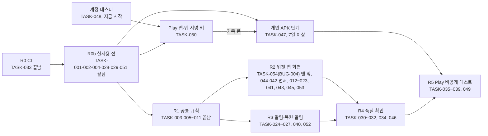
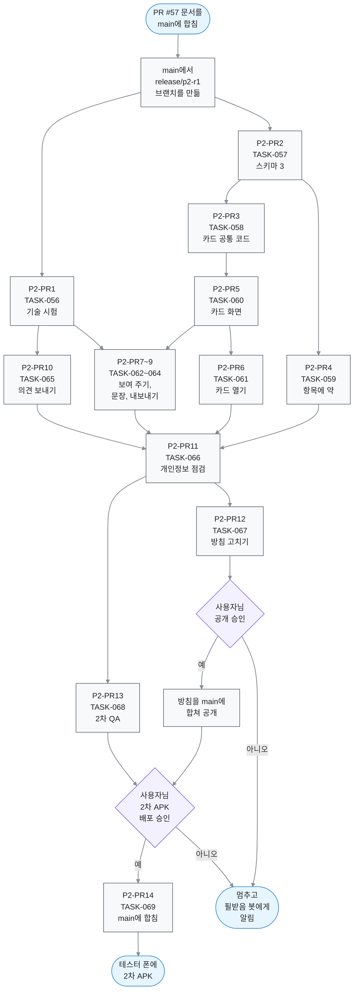

# 작업 분해 (1차 릴리즈, 2차 첫 릴리즈)

- 2차 개발 중 설계 바꿈 R: 설계 독립 검토 반영 (2026-11-23, Claude 작업자): Codex(gpt-6.2-sol)가 `release/p2-r1` `7f3fe98`의 2차 설계를 검토해 찾은 21건([검토 보고서](../07-qa/2026-11-23-p2-design-review/report.md))을 [1.9절](#19-2차-첫-릴리즈-건강-카드-p2-r1)의 TASK-058~069 줄에 나눠 넣음. 작업 번호·담당·먼저 할 것·크기는 그대로(2차 합 17.5일, 가장 긴 사슬 10.0일). **바꿈 승인**: 2026-11-23 KST, 필받음 봇이 전한 사용자님 답 "추천안 모두 승인"(근거는 사용자님 말씀(오랑이 채팅, 2026-11-23 01시대 KST, "야 누가 너한테 체크포인트때 뭐 물어보면 추천 모두 승인이라고 해")과 필받음 봇 질문 `msg_422b96fb86bb`에 대한 오랑이 답). 기록: [변경 기록](../10-records/changes/2026-11-22-phase2-release1.md) 6장 '개발 중 설계 바꿈 R'
- 2차 개발 중 설계 바꿈 S-1: 응급 대비 문장 칸별 복사 (2026-11-23, Claude 작업자): TASK-063에 종류별 줄과 [복사]를 더하고 크기를 1일에서 1.5일로(2차 합 17.5일), TASK-058의 `BuildEmergencyText`가 종류별 줄도 냄(크기 그대로), TASK-068에 갤럭시 실기기의 칸 이름·순서 확인. **바꿈 승인**: 2026-11-23 KST, 필받음 봇이 전한 사용자님 답 "추천안 모두 승인"(근거는 사용자님 말씀(오랑이 채팅, 2026-11-23 01시대 KST)과 필받음 봇 질문 `msg_c79a95db1d77`에 대한 오랑이 답). 2차 가장 긴 사슬은 10.0일 그대로(3.1절). 기록: [변경 기록](../10-records/changes/2026-11-22-phase2-release1.md) 6장 '개발 중 설계 바꿈: 응급 대비 문장 칸별 복사'
- 2차 개발 중 설계 바꿈 S-2·S-3 (2026-11-23, Claude 작업자): S-2로 TASK-063의 줄 [복사]가 카드의 낡은 문장 안내를 지우지 않게 하고(안내가 보이지 않을 때만 `emergency_copied_at`을 씀), TASK-058의 낡은 문장 안내 판정에 같은 규칙을 더함. S-3으로 TASK-068의 갤럭시 실기기 확인을 빼고 시험 계획 0장의 실기기 확인 목록(사용자님 몫)으로 옮김. 크기는 모두 그대로(2차 합 17.5일). **바꿈 승인**: 2026-11-23 KST, 필받음 봇이 전한 사용자님 답 "추천안 모두 승인"(근거는 사용자님 말씀(오랑이 채팅, 2026-11-23 01시대 KST)과 필받음 봇 질문 `msg_65a10b334ac4`·`msg_254f2f12019e`에 대한 오랑이 답). 기록: [변경 기록](../10-records/changes/2026-11-22-phase2-release1.md) 6장 '개발 중 설계 바꿈 S-2·S-3'
- 2차 첫 릴리즈 10 WBS (2026-11-23, Claude, 기능 변경): **확인 끝** (2026-11-23 KST, 필받음 봇이 전한 사용자님 답 "추천안 모두 승인"(10-1~10-4, 근거는 사용자님 말씀(오랑이 채팅, 2026-11-23 01시대 KST)과 필받음 봇 질문 `msg_9973d634e7a5`에 대한 오랑이 답). 10-2 통합 브랜치·10-3 담당 Codex는 '바꿈 승인', 10-4 119안심콜 안내는 '미룸 승인'. PR 병합·방침 공개·2차 APK 배포는 위임 밖이라 그때 사용자님께 직접 여쭘). [1.9절](#19-2차-첫-릴리즈-건강-카드-p2-r1)에 TASK-056~069(14개, 17.0일), 2장에 SPEC-045~055와 2차에서 고친 SPEC-025·037의 작업, [3.1절](#31-2차-첫-릴리즈-p2-r1-순서와-pr-단위)에 순서·PR 단위·통합 브랜치 `release/p2-r1`. 담당에 Codex를 더함(0장). 릴리즈 작업 TASK-069의 조건은 '2차 APK 배포 전 사용자님 승인'이고 개인정보처리방침(TASK-067)을 그 앞에 둠. 12 시험 계획 줄 TC-090~118을 함께 씀(02 범위 확인 02-16). 기준: [변경 기록](../10-records/changes/2026-11-22-phase2-release1.md) 2장 '10 WBS' 제안과 6장의 02~09 결과
- 05·07·08·10 확인 반영 (2026-11-13, Claude): 다음 묶음 계획을 확인받음(2026-11-13 01:04 KST, 동희님 "추천모두승인", 프로젝트 채팅. 질문은 2026-11-13 00:55 KST 프로젝트 스레드 '약봉이 1차 릴리즈 이어 가기'의 Claude 메시지 3·4번). PR #17을 합친 뒤 ① BUG-004 수정(TASK-054, 이때 더함)과 릴리즈 확인 ② R2 위젯·앱 화면(TASK-044 먼저)과 R3 알림을 나란히 함. 코드는 Claude, 실기기와 Play 계정은 동희님. 실기기는 시험용 갤럭시: 동희님 폰이 아이폰이라 동희님이 마련해 동희님 PC에 USB로 꽂아 두고, Claude가 그 PC에서 확인을 돌림. 두 대가 필요한 기기 간 이전 때만 가족 폰을 빌림(TASK-047·032·052)
- 04 명세 고정 반영 (2026-11-13, Claude): 대상자 되살리기(REQ-095, SPEC-044)의 보관한 동안 처리를 TASK-053으로 더하고 TASK-021이 그 뒤에 오게 함. TASK-025에 정한 잠금 화면 방법(SPEC-013)을 적음. 04 고정은 2026-11-13 00:16 KST 동희님 "추천 모두 승인"([명세 5장](../04-functional-spec/spec.md#5-고정-기록))
- CORTHEX 10 다시 하기 (2026-11-12, Claude): 2장에 04 명세(SPEC-001~043)마다 작업을 잇고, 05·08에서 찾은 것(첫 실행 안내를 봤는지, 위젯의 고른 대상자 저장 위치)을 TASK-022·TASK-012에 넣음. 작업 번호와 크기는 그대로. 다음 묶음 계획은 2026-11-13에 확인함(맨 위 줄)
- 상태: **1차 범위 확정 반영** (2026-11-12). 2026-11-12 10:18 KST 범위 확정(동희님, [요구 0장](../01-planning/requirements.md#0-v3-뒤에-정한-결정)의 '범위 확정')과 [설계 독립 검토](../06-review/design-review-2026-11-11.md) 5장(실사용 전 묶음, 개인 APK 단계, 빠진 작업)을 반영함. 같은 날 [범위 확정 반영 검토](../06-review/scope-confirm-review-2026-11-12.md)(Fable 5.2)의 A1~A3·B1·B6·B10·C1~C5에 따라 TASK-050~052를 더하고 TASK-004를 R0b로 당김. 처음 초안은 2026-11-11 Claude 작성. 담당과 단계 순서는 Claude 제안이고 동희님이 바꿀 수 있음 (0장)
- 기준: 이 저장소 main(2026-11-12 `843a737`)과 [요구](../01-planning/requirements.md)(REQ-001~083), [화면](../05-ui/screens.md)(SCR-001~010), [기록 규칙 보충](../04-spec/record-rules-supplement.md)(규칙 ID와 RR-26~89)
- 범위: 지금 프로토타입에서 Google Play 비공개 테스트까지 (결정 Q13). 프로덕션 출시(R6)는 이 표 밖임
- 릴리즈 단계 R0~R6은 Notion [릴리즈 계획](https://app.notion.com/p/415bf16cc3ec818aa416f5554367f67c)의 단계이고, 작업과의 대응은 2장에 있음
- 가쟈누님 로드맵 4단계([DidITake README](https://github.com/judangbang-ops/DidITake/blob/7a800ac/README.md#로드맵))의 다섯 가지는 여기 들어 있음: 미래 시각 경고 TASK-006·TASK-016, 위젯 대상자 필터 TASK-012, 건너뜀 TASK-013·TASK-016·TASK-018, 늦은 투약 처리 TASK-004·TASK-041(주 1회, 결정 Q15의 1차 방식)과 TASK-005·TASK-018(늦은 입력), 설정 화면 TASK-020

## 0. 읽는 법

- **ID**: `TASK-001`부터. 번호는 다시 쓰지 않음. 빼는 작업은 지우지 않고 '제외'와 날짜를 적음
- **근거**: 이 작업이 채우는 요구 ID. 기능 명세는 요구 표의 합격 기준과 [기록 규칙 보충](../04-spec/record-rules-supplement.md)의 규칙(`P-1`, `N-4` 등)·반례(RR)이고, 작업 칸과 끝난 조건에 그 ID를 적음
- **닿는 곳**: 화면 ID, 테이블 이름, 코드 위치. 코드 위치는 이 저장소 기준임 (앱 코드를 여기서 이어 가기로 함, 2026-11-11 21:52)
- **담당** (Claude 제안, 2026-11-12): 한 작업에 한 명
  - Claude: 코드, 문서, CI, 에뮬레이터 확인. PR로 올리고 CI가 통과하면 순서를 확인해 합침(결정 Q14)
  - 동희님: 사람의 기기·계정이 있어야 하는 일. 갤럭시 실기기, Play Console, 개발자 계정, 공개·배포 승인. 키·비밀번호 보관 같은 손작업은 Claude가 동희님 PC에서 직접 함(동희님 "너가 해봐", 2026-11-12 11:05 KST 프로젝트 채팅)
  - Codex (2차 첫 릴리즈부터. 10 확인 10-3 '바꿈 승인', 2026-11-23 KST): 코드 구현. 필받음 봇(Orca 코디네이터)이 Orca Codex 작업자에게 작업 줄과 PR 단위(3.1절)를 맡김. 리뷰와 합치기는 README 작업 규칙과 3.1절대로
  - 다른 사람이 돕는 몫(예: Play Console 답 초안은 Claude)은 작업 칸에 적음. 결정 Q15의 남은 부분은 가쟈누님과 정하는 결정이라 작업으로 두지 않음
- **크기**: Claude가 어림한 작업일(AI 도움을 받는 한 사람 기준). 측정값이 아님. '이상'이 붙은 줄은 달력 기간이라 합계에서 뺌
- **끝난 조건**: 다른 사람이 확인할 수 있는 것으로 씀. 공통 코드는 `./gradlew :shared:jvmTest` 통과가 기본이고, 기존 테스트도 함께 통과해야 함. 에뮬레이터 확인은 캡처나 로그를 PR에 남김
- **끝남**: 작업 칸 끝에 **끝남**과 날짜를 적은 줄임

## 1. 작업 표

### 1.1 기반

| ID | 작업 | 근거 | 닿는 곳 | 먼저 할 것 | 담당 | 크기 | 끝난 조건 |
| --- | --- | --- | --- | --- | --- | --- | --- |
| TASK-001 | 패키지 이름(`applicationId`)을 정해 빌드 설정에 넣기. **끝남** (2026-11-12, [PR #4](https://github.com/judangbang-ops/pillbadeum_release/pull/4)) | REQ-061 | `androidApp/build.gradle.kts` | 결정 Q9 (2026-11-12 정함) | Claude | 0.5일 | 정한 이름이 빌드 설정·README에 있고, CI가 만든 디버그 APK의 패키지 이름이 그 이름임 |
| TASK-002 | 릴리즈 서명과 버전 번호: Gradle `signingConfig`(비밀값은 환경 변수). 서명은 `pull_request`를 받지 않는 `release.yml`에서만 함(main 푸시·`v*` 태그·수동 실행). 그 한 번의 실행에서 업로드 키로 서명한 릴리즈 AAB와 서명하지 않은 개인 APK 원본이 함께 나오고, 개인 APK는 PC 스크립트가 앱 서명 키로 서명함. 개인 APK는 release 변형(디버그 불가)이고 코드 축소(R8)는 1차에 끔. 버전 번호(versionCode)는 빌드한 커밋의 `git rev-list --count HEAD`라 AAB와 개인 APK가 한 수열을 씀. PR에서는 임시 키 서명 시험과 릴리즈 변형 권한 비교를 `ci.yml`에서 함 (검토 A1~A3·B1). 키와 계획은 아래 메모. **끝남** (2026-11-12, [PR #6](https://github.com/judangbang-ops/pillbadeum_release/pull/6)) | REQ-057, REQ-062 | `androidApp/build.gradle.kts`, `.github/workflows/release.yml`(새로)·`ci.yml`, 개인 APK 서명 스크립트(새로) | TASK-001 | Claude | 1.5일 | 두 키의 알고리즘·길이를 `keytool -list -v`로 확인해 아래 메모에 적음(RSA 2048 이상, Play 요건). CI 로그에서 릴리즈 AAB의 인증서 SHA-256 = 업로드 키 지문. 동희님 PC에서 스크립트로 서명한 APK의 `apksigner verify --print-certs` SHA-256 = 앱 서명 키 지문. main의 서로 다른 두 커밋으로 만든 빌드에서 뒤 커밋의 버전 번호가 큼. CI가 개인 APK의 디버그 불가와 릴리즈 변형의 권한 목록을 확인함. 키·비밀번호가 Git과 CI 로그에 없음 |
| TASK-003 | Room 스키마 2: 알림 규칙·미루기·시계 표식 표와 1→2 마이그레이션(첫 일정 버전의 유효 시작을 등록 창 시작으로 앞당김). 설정 키는 key-value라 쓰는 작업에서 더함 (보충 N-1·N-2·C-1·P-4). **끝남** (2026-11-12, [PR #8](https://github.com/judangbang-ops/pillbadeum_release/pull/8)) | REQ-041, REQ-042, REQ-072, REQ-009 | `reminder_rule`, `reminder_snooze`, `clock_flag`, `schedule_version`, `shared/schemas` | 없음 | Claude | 1.5일 | 스키마 2 JSON이 생기고, 1→2 마이그레이션 테스트가 기존 판정 행을 그대로 남기고 첫 일정 버전의 유효 시작을 옮김 |
| TASK-004 | 새 일정 버전의 `late_policy`를 `KEEP`으로 저장 (보충 W-1, 요구 4장 1번). 개인 APK를 나눠 주기 전에 넣음(R0b). 그 사이에 만든 일정 버전이 `ASK`로 남지 않게 하기 위함 (검토 C4). **끝남** (2026-11-12, [PR #7](https://github.com/judangbang-ops/pillbadeum_release/pull/7)) | REQ-010 | `ManageIntakes`, `schedule_version` | 없음 (2026-11-12 확정) | Claude | 0.5일 | 새 항목·주기 변경의 `late_policy` = KEEP. RR-60·RR-62(기준 요일 그대로) JVM 테스트. 기존 테스트 통과 |

진행 메모 (2026-11-12)

- TASK-003: PR #8. 독립 검토(Fable 5.2) 지적에 따라 TASK-005 몫이던 "새 항목의 첫 일정 버전을 등록 창 시작부터"(보충 P-4)도 이 PR에서 함. 스키마 2 빌드와 TASK-005 사이에 만든 항목이 마이그레이션 뒤라 앞당겨지지 않는 틈을 없애려는 것임
- TASK-001: 결정 Q9의 `com.judangbang.pillbadeum`을 PR #4로 main에 합침(2026-11-12 10:19 KST, `843a737`). CI의 APK 정보에서 패키지 이름을 확인함. 기기 설치는 아직 하지 않음(TASK-047)
- TASK-033: PR #2로 main에 합침(`da916c6`). PR마다 JVM 테스트, 디버그 APK 빌드, 권한 목록 비교(`androidApp/expected-permissions.txt`, `INTERNET`이 있으면 실패)를 함. 릴리즈 변형의 권한 비교는 TASK-002에서 더함(검토 A3)
- TASK-031: [PR #28](https://github.com/judangbang-ops/pillbadeum_release/pull/28). CI의 '개인정보 점검'(`.github/scripts/check_privacy.py`)이 PR과 main 푸시마다 릴리즈 변형의 병합 매니페스트·병합 보고서·`releaseRuntimeClasspath` 의존성과 앱 소스의 로그 호출·PendingIntent를 보고, `INTERNET`, 분석·크래시·광고·AI SDK, 기준 목록(`androidApp/expected-exported.txt`)과 다른 exported 구성요소, `exported="false"`가 아닌 알림 수신기, `FLAG_IMMUTABLE` 없는 PendingIntent(까닭을 적은 예외 하나), 이름을 담을 수 있는 값을 넣는 로그 호출이 있으면 실패함. `56ebcf6`의 [실행 43563317312](https://github.com/judangbang-ops/pillbadeum_release/actions/runs/43563317312)에서 통과. 결과와 근거 파일은 [개인정보 점검 보고서](../07-qa/2026-11-14-privacy/report.md). 위젯의 마지막 탭 안내 문구(항목 이름)가 앱 전용 위젯 상태에 남는 것은 보고서 6절, WorkManager가 넣는 권한(`ACCESS_NETWORK_STATE` 등)을 그대로 두는 것(검토 B8)은 보고서 8절
- TASK-030: [PR #29](https://github.com/judangbang-ops/pillbadeum_release/pull/29). 에뮬레이터 접근성 점검 `scripts/emulator/a11y_check.py`(`a11y.yml`, API 34)가 폭 360dp·글자 100%와 200%에서 앱 화면 10개와 대화상자·고르는 창, 홈 화면에 새로 놓은 위젯, 위젯 대상자 고르기, 알림을 띄우고 목록을 맨 위부터 끝까지 내리며 쪽마다 화면 덤프와 캡처를 남겨, 누르는 곳 48dp(REQ-067), 읽을 말(REQ-068), 화면 끝에 닿음·겹침(REQ-066), 글자 명암비 4.5:1(REQ-069)을 판정함. `e27af2e`의 [실행 43585038873](https://github.com/judangbang-ops/pillbadeum_release/actions/runs/43585038873)에서 화면 × 글자 크기 38개(78쪽) 모두 통과. 찾은 앱의 문제 셋(첫 실행의 위젯 맨 위 28dp와 이번 주 약통 이름 '종합비타…', 4차·5차 실행 캡처의 글자 200% 기준 시간대 이름 갈림)을 고쳤고, 셋 다 승인 뒤 바꾼 화면이라 [화면 정의 6장](../05-ui/screens.md#6-승인-기록)에 적었고, 2026-11-14 23:24 KST 동희님이 '필받음 재구축 인계' 채팅에서 '추천 모두 승인'으로 그대로 두기로 정함. 글자가 아닌 것의 3:1(WCAG 1.4.11, REQ-069 밖)에 `color.line.strong`이 흰색이 아닌 바탕에서 못 미쳐, 같은 승인으로 #838892로 바꿈([PR #30](https://github.com/judangbang-ops/pillbadeum_release/pull/30)). 이 폭에서 런처가 위젯을 4×2가 아닌 4×3으로 놓는 것을 찾아 BUG-005로 적고 REQ-026을 실패로 둠(다음 PR에서 `minHeight`를 고쳐 폭 360dp와 기본 폭에서 봄. [PR #31](https://github.com/judangbang-ops/pillbadeum_release/pull/31)에서 고침, 1.3절 진행 메모). TalkBack 자체와 Galaxy 글꼴은 TASK-032·052. 결과와 측정표는 [접근성 점검 보고서](../07-qa/2026-11-14-a11y/report.md)
- TASK-034: [PR #32](https://github.com/judangbang-ops/pillbadeum_release/pull/32). 에뮬레이터 회귀 확인 `scripts/emulator/regression_check.py`(`regression.yml`, API 34)가 2026-11-11 DidITake 프로토타입 QA의 13항목을 지금 화면과 문구로 다시 묻고(바뀐 설계는 보고서 1장에 나란히 적음), 위젯은 사람처럼 놓아 칸을 눌러 기록하며, 판정은 화면 덤프의 읽는 말·위젯에 그린 글·앱 DB의 `dose_record`로 함. REQ-092(앱 데이터를 지운 뒤 남은 위젯 버튼)와 크래시 없음도 같은 실행에서 봄. `2909a29`의 [실행 43630931766](https://github.com/judangbang-ops/pillbadeum_release/actions/runs/43630931766)에서 준비와 15단계 16줄 모두 통과, 캡처 29장. 판정 쓰기 경로는 CI의 `.github/scripts/check_writes.py`가 PR마다 봄: `Daos.kt`에서 판정·시계 표시를 쓰는 메서드를 찾아 usecase 밖에서 부르거나 그 표를 쓰는 SQL이 `Daos.kt` 밖에 있으면 실패(일부러 심은 잘못된 쓰기 넷을 모두 잡음). REQ-003 문장의 `ChangeJudgment`는 앱이 부르지 않고 판정 고치기는 `RecordInWindow`를 거치는 것을 찾아 동희님께 보고함(문장은 그대로). 같은 커밋의 CI에서 jvm 333개·앱 시험 122개 통과. 결과는 [회귀 확인 보고서](../07-qa/2026-11-15-regression/report.md). 2026-11-15 동희님 결정으로 REQ-003 문장의 함수 이름을 코드에 맞추고, 회귀 확인이 앱 코드를 바꾼 PR에서도 돎([PR #33](https://github.com/judangbang-ops/pillbadeum_release/pull/33))
- TASK-046: [PR #34](https://github.com/judangbang-ops/pillbadeum_release/pull/34). 릴리즈 변형 확인(`release_check.py`, TASK-051)에 6단계를 더함: N+1 릴리즈 빌드에서 [알림 받기]를 켠 항목 셋을 앱으로 만들고, 시계를 정확 알람 1분 전으로 옮겨 울린 뒤 알림창의 [먹었어]·[오늘 건너뜀]·[30분 뒤]를 누르고 판정·미룸·남은 알림·다음 알람을 봄. 7단계(판정 아님)는 APK 크기와 콜드 스타트. 빌드에 코드 축소 스위치(`-Ppillbadeum.minify`, 기본 끔)와 `release-emulator.yml`의 수동 실행 입력 `minify`를 더해, 축소를 끈 빌드([실행 43685796448](https://github.com/judangbang-ops/pillbadeum_release/actions/runs/43685796448))와 켠 빌드([실행 43685794993](https://github.com/judangbang-ops/pillbadeum_release/actions/runs/43685794993))가 같은 15개 경우를 모두 통과함. 축소하면 APK가 14,240,527 → 7,320,834 바이트, 콜드 스타트는 차이를 재지 못함, R8이 Kotlin 2.4.21 메타데이터를 읽지 못한다는 경고를 빌드마다 16줄 냄. 1차는 축소를 끈 채로 둠(Claude가 정함, 까닭과 반대 의견은 [QA 보고서](../07-qa/2026-11-15-release-variant/report.md) 4장). 병합 매니페스트와 권한은 CI의 권한 비교·개인정보 점검이 PR마다 보고, 축소한 APK의 권한도 같음
- TASK-028·TASK-029: [PR #9](https://github.com/judangbang-ops/pillbadeum_release/pull/9). 백업 규칙 두 파일(`data_extraction_rules.xml`, `backup_rules.xml`)과 복원 감지(`restore.CheckInstall`, `FileInstallMarker`), 앱 첫 화면·위젯의 복원 안내와 [확인했어요], 복원 뒤 위젯·경계 알람 다시 만들기. 에뮬레이터 API 34·30·27·26에서 B-1·B-3, RR-26·RR-30~34·RR-68~71을 확인함([QA 보고서](../07-qa/2026-11-12-backup-restore/report.md)). 끝난 조건과 다른 점: RR-27(400건)은 기록이 칸마다 한 번이라 에뮬레이터에서 앱 경로로 400건을 쌓을 수 없어, 같은 Room·SQLite로 400건을 쓴 JVM 테스트(`BackupFileSetTest`)로만 봄. Android 9~11에서 암호화 조건이 있을 때의 실제 백업과 기기 간 이전은 시험 전송이 그 조건을 줄 수 없어 TASK-032에 남김. 위젯을 놓고 누르는 확인은 TASK-051, 복원 안내 알림은 TASK-040. 독립 검토(Fable 5.2)의 고칠 것 3건과 제안 4건을 반영함
- TASK-051: [PR #14](https://github.com/judangbang-ops/pillbadeum_release/pull/14). `release-emulator.yml`이 같은 커밋의 릴리즈 APK를 버전 번호 N과 N+1로 빌드해 실행마다 만드는 임시 키로 개인 APK와 같은 방법(`zipalign` 확인 → `apksigner`, v4 끔)으로 서명하고, 에뮬레이터 API 34에서 홈 화면 위젯을 놓고 탭해 기록(`source` = `WIDGET`) → 백업 → 지우고 다시 설치(RR-26) → 복원 안내·위젯 복원 줄(보충 R-3)과 [확인했어요] 뒤 사라짐 → N+1 덮어 설치 뒤에도 기록·`device_id`·표식이 남고 남은 위젯으로 다시 기록됨을 봄 (11개 경우 통과, [실행 43160759272](https://github.com/judangbang-ops/pillbadeum_release/actions/runs/43160759272), [QA 보고서](../07-qa/2026-11-12-release-variant/report.md)). 끝난 조건과 다른 점: 키가 앱 서명 키가 아닌 임시 키임(앱 서명 키는 동희님 PC에만 있음, 끝난 조건이 허용함). main에서 앱 빌드 경로가 바뀐 푸시마다 이 확인이 돌아, 개인 APK로 서명할 main 커밋에 결과가 남음. 독립 검토(Fable 5.2)의 고칠 것 6건과 제안 5건을 반영함
- TASK-002: 요구 4장 2번 확정(10:18)에 따라 키를 둘로 나눔 (릴리즈 서명 키 스레드, 동희님 PC에서 만듦)
  - 앱 서명 키 `pillbadeum-app-signing.p12`(별칭 `app-signing`, RSA 4096): Play 앱 서명과 개인 APK 서명에 씀. 잃으면 되살릴 수 없음. GitHub에는 올리지 않고 동희님 PC와 Google Drive 폴더 두 곳에 둠. 인증서 SHA-256(공개값) `35:64:B6:82:4B:1E:3D:A0:74:7A:2E:97:96:6E:F5:5D:B9:CC:93:C5:E8:8A:7D:45:24:64:2F:E6:2A:32:95:36`
  - 업로드 키 `pillbadeum-upload.p12`(별칭 `upload`, RSA 4096): CI가 Play에 올릴 AAB에 서명함. GitHub Secrets `ANDROID_UPLOAD_KEYSTORE_BASE64`, `ANDROID_UPLOAD_KEYSTORE_PASSWORD`에 있음. 별칭은 공개값이라 `release.yml`에 적고, 같이 등록한 `ANDROID_UPLOAD_KEY_ALIAS`는 읽지 않음(비밀값으로 넘기면 로그의 'upload'가 모두 가려짐, PR #6). 잃으면 Play에서 재설정할 수 있음. 인증서 SHA-256 `7D:23:C2:A8:C9:1B:96:4A:08:14:D5:70:12:CB:38:93:CF:25:BF:68:E7:A9:B3:43:6E:AA:87:FA:D5:2D:39:BB`
  - 확인한 것: Drive 사본의 SHA-256이 원본과 같음, 두 비밀번호가 서로 다름. 11:33 KST에 동희님 PC에서 `keytool -list -v`로 두 키 모두 PKCS12, 개인 키 하나, RSA 4096, SHA384withRSA, 유효 기간 2026-11-12~2054-03-30이고 지문이 위와 같음을 봄(Play 요건 RSA 2048 이상을 넘음, 검토 A1). Drive 동기화: 12:15 KST쯤 Drive API로 클라우드의 두 키 파일·암호화한 비밀번호·안내 파일이 PC 원본과 같은 크기로 있음을 봄(G: 사본은 MD5까지 같음). 실제 APK 서명: 아래 결과
  - 비밀번호의 PC 밖 사본: 위 11:05 말씀에 따라 서명 키 스레드가 직접 만듦(11:11). 앱 서명 키 비밀번호는 업로드 키 비밀번호로 암호화해 Drive 폴더에 두고, 업로드 키 비밀번호는 GitHub Secrets에 있음. Secrets는 다시 읽을 수 없어서, PC 없이 되찾는 경로가 실제로 되는지는 TASK-002에서 확인함. 확인한 것(2026-11-12): Drive 클라우드 사본이 있음(위), Secrets의 업로드 키 비밀번호가 맞음(main 실행에서 업로드 키로 서명함). 확인 못 한 것: Secrets에서 값을 꺼내는 비상 워크플로는 미리 만들지 않음. 자동 안전 검사가 '비밀값을 내보내는 코드'로 막았고, PC를 잃으면 동희님 허락을 받아 그때 만들어 시험함
  - 계획 (서명 키 스레드, 11:33): 버전 번호는 빌드한 커밋의 `git rev-list --count HEAD`이고 CI가 전체 이력을 받아 Gradle에 넘김. 같은 커밋을 다시 빌드하면 같은 번호이고, 환경 변수가 없는 로컬·디버그 빌드는 1임. 나눠 주거나 올리는 빌드는 main의 커밋에서 만든 것만 씀. release 변형은 `isMinifyEnabled = false`를 적어 둠
  - 공식 문서: Android는 깔린 것보다 낮은 versionCode의 APK 설치를 막고, Play가 받는 최대값은 2100000000임 ([Version your app](https://developer.android.com/studio/publish/versioning), 2025-08-20 갱신, 2026-11-12 읽음)
  - 저장소 설정의 한계 (검토 B1): 비공개 저장소의 무료 요금제라 브랜치 보호·규칙 모음·환경 비밀값이 없음(API 403). 그래서 '서명은 main·태그에서만'은 워크플로 파일의 조건일 뿐이고, 저장소에 쓸 수 있는 사람은 어느 브랜치에서든 워크플로를 고쳐 Secrets를 쓸 수 있음. 업로드 키는 Play에서 다시 만들 수 있고 앱 서명 키는 GitHub에 없어 지금 피해는 한정됨. TASK-049를 할지는 2장 결정 목록에서 정함. PR #6의 `release.yml`은 빌드할 커밋이 main 이력 안에 있는지도 확인함(다른 브랜치 수동 실행·main 밖 태그를 막는 실수 방지, 2026-11-12 독립 검토) 2026-11-22: 저장소가 지금은 공개라 환경 비밀값을 쓸 수 있고, 19:06 KST 동희님 카드 답('Obtainium, CI 자동 서명')으로 앱 서명 키를 main 전용 환경 `personal-apk`에 둠(TASK-055). 이 환경의 비밀값은 main에서 도는 작업만 읽음
  - 결과 ([PR #6](https://github.com/judangbang-ops/pillbadeum_release/pull/6), main `72de947`에 2026-11-12 12:09 KST 합침): main 첫 `release.yml` [실행 43146283311](https://github.com/judangbang-ops/pillbadeum_release/actions/runs/43146283311)에서 업로드 키로 서명한 AAB의 인증서 SHA-256 = 업로드 키 지문, versionCode 33 = 커밋 수, 릴리즈 APK가 debuggable 아님·정렬 맞음·권한 6줄이 기준과 같음(`INTERNET` 없음). 동희님 PC(build-tools 37.0.0)에서 `scripts/sign-personal-apk.ps1` 기본 실행이 이 실행의 APK를 받아 앱 서명 키로 서명함: `apksigner verify --print-certs` SHA-256 = 앱 서명 키 지문(versionCode 33, v2·v3 서명). PR 빌드는 `-Test` 없이 주면 거절함. 같은 PC에서 Git 전체(가지 8개·PR 참조 11개)와 이 실행 로그에 두 비밀번호와 두 키 파일(base64 조각 포함)이 없음을 확인함. 버전 번호가 커지는지는 이 기록을 합친 다음 main 커밋의 빌드로 확인함(진행 기록은 Notion). 독립 검토(Fable 5.2, 174dbf1)의 고칠 것 2건(main 밖 커밋 서명, PC 스크립트의 실행 확인)과 제안 5건을 반영함
- Play 쪽: Play 도움말([Use Play App Signing](https://support.google.com/googleplay/android-developer/answer/9842756), 2026-11-12 요약본으로 읽음)에 따르면 새 앱은 Google이 만든 키로 자동 등록되고, 공개 테스트나 프로덕션에 나가기 전에 'Change key'로 우리 키를 넘길 수 있음. 직접 넣는 키는 RSA 2048비트 이상이어야 함(검토 A1이 2026-11-12에 읽음). 개인 APK 위에 Play 버전을 덮어 깔아야 하므로(REQ-062), 계정이 생기면 바로 앱을 만들어 앱 서명 키를 넘기고(TASK-050) 그 뒤에 가족 폰에 개인 APK를 깖. 넘길 때 도움말을 다시 읽고 절차를 확인함

### 1.2 공통 기록 규칙 (shared)

| ID | 작업 | 근거 | 닿는 곳 | 먼저 할 것 | 담당 | 크기 | 끝난 조건 |
| --- | --- | --- | --- | --- | --- | --- | --- |
| TASK-005 | 앱 전용 `RecordInWindow`(일정 버전과 기간키로 창을 정함. 지금 창·끝난 창, 고른 시각)와 시각 고치기(옛 행 무효 `TIME_EDIT` + 새 행), 설정 변경 전 창 막기 (보충 I-1·I-2, P-1~P-6). 새 항목의 첫 일정 버전을 등록 창 시작부터 두는 것은 TASK-003(PR #8)에서 함. **끝남** (2026-11-12, [PR #11](https://github.com/judangbang-ops/pillbadeum_release/pull/11)) | REQ-030, REQ-031, REQ-032, REQ-033, REQ-034 | `RecordDose`, `ChangeJudgment`, `ManageIntakes`, `dose_record`, `setting` | TASK-003 | Claude | 2일 | RR-38~44 JVM 테스트 통과(RR-43의 알림 몫은 TASK-027). 위젯·알림의 `RecordCommand`는 지금 창에만 씀 |
| TASK-006 | 시계가 틀렸던 기록: 표식 남기기(`TIME_SET`·`TIMEZONE_CHANGED`·`BOOT_COMPLETED`, 판정 읽을 때, 지금보다 5분 넘게 뒤), 표시값에 넣기, [그대로 두기]·[기록 취소], 다른 길로 판정이 무효가 되면 표식도 풀기 (보충 C-1~C-3). **끝남** (2026-11-12, [PR #12](https://github.com/judangbang-ops/pillbadeum_release/pull/12)) | REQ-009 | `clock_flag`, `LoadStatusBoard`, `DayBoundaryReceiver` | TASK-003 | Claude | 1일 | RR-19, RR-64~67, RR-88·89 JVM 테스트 통과 |
| TASK-007 | 지난 기록 읽기 `LoadHistory`(달, 대상자): 그날 유효했던 일정 버전으로 칸 그리기, 칸이 판정을 고르는 법(같은 버전은 기간키, 다른 버전은 시각), 일정을 바꾼 주. 첫 화면의 이번 주 칸도 같은 규칙을 씀 (보충 P-8, S-5). **끝남** (2026-11-12, [PR #12](https://github.com/judangbang-ops/pillbadeum_release/pull/12)) | REQ-037, REQ-038, REQ-039, REQ-040 | `dose_record`, `schedule_version`, `intake`, `person`, `StatusBoard` | 없음 | Claude | 2일 | RR-45, RR-77·78과 빠짐 판정, 등록 전·보관 뒤 칸 없음, 주 1회 창 한 칸, 대상자 거르기 JVM 테스트. 항목 10개·1년치에서 한 달 읽는 시간을 기록 |
| TASK-008 | 대상자 수정·보관·되살리기, 보관한 대상자의 항목 기록 막기 (검토 B5). **끝남** (2026-11-12, [PR #11](https://github.com/judangbang-ops/pillbadeum_release/pull/11)) | REQ-005, REQ-016, REQ-017, REQ-018, REQ-085, REQ-086, REQ-093 | `ManagePeople`, `RecordDose`, `person` | 없음 | Claude | 1일 | JVM 테스트: 마지막 대상자 보관 거절, 보관한 대상자의 항목이 `LoadStatusBoard`에서 빠지고 지난 판정은 남음, 그 항목의 버튼 탭 → `Gone`(RR-14의 대상자 몫) |
| TASK-009 | 설정 저장과 '바꾼 때부터 적용', 바꾼 시각을 `window_settings_changed_at`에 남기기 (보충 P-5). **끝남** (2026-11-12, [PR #11](https://github.com/judangbang-ops/pillbadeum_release/pull/11)) | REQ-011, REQ-053 | `setting` | 없음 | Claude | 1일 | RR-15 JVM 테스트 통과. 지난 판정의 기간키가 바뀌지 않음. 하루 시작·기준 시간대를 바꾸면 그 시각이 남음 |
| TASK-010 | 보관된 항목 완전 삭제 (Could). **끝남** (2026-11-12, [PR #11](https://github.com/judangbang-ops/pillbadeum_release/pull/11)) | REQ-015 | `intake`, `dose_record`, `schedule_version` | 없음 | Claude | 0.5일 | JVM 테스트: 항목·판정 행이 없고, 남은 위젯 버튼은 Gone |
| TASK-011 | 알림 계획 `PlanReminders`: 격자 칸(칸 0은 창 시작 뒤 처음 오는 시작 시각), 방해 금지 [시작, 끝)(첫 칸은 울림), 창 끝, 미루기(방해 금지여도 울림, 창 끝 뒤는 안 씀), 다음 칸 하나, 밀린 칸 모으기, 저장 때 줄어드는 칸 수 (보충 N-3~N-8, N-12). **끝남** (2026-11-12, [PR #13](https://github.com/judangbang-ops/pillbadeum_release/pull/13)) | REQ-041, REQ-042, REQ-043, REQ-044, REQ-045, REQ-077, REQ-088 | `reminder_rule`, `reminder_snooze`, `setting` | TASK-003 | Claude | 2일 | RR-21, RR-22, RR-46~54, RR-79·80, RR-82~85 JVM 테스트 통과 |
| TASK-053 | 대상자 되살리기의 보관한 동안 처리: 되살릴 때 한 쓰기 트랜잭션에서 그 대상자의 보관되지 않은 항목마다 열린 일정 버전을 보관한 때에 닫고 되살린 때부터 같은 주기로 새 버전을 엶. 따로 보관한 항목은 그대로 (보충 P-9). 2026-11-13 04 명세 고정에서 더함 **끝남** (2026-11-13, [PR #19](https://github.com/judangbang-ops/pillbadeum_release/pull/19): `ManagePeopleTest`에 시험 4개 더함, 되살린 뒤 알림·위젯 다시 그리기는 TASK-021에서 연결) | REQ-095 | `ManagePeople.restore`, `PersonDao`, `schedule_version` | TASK-008 | Claude | 0.5일 | JVM 테스트: RR-90(보관한 동안 `LoadHistory` 칸 없음, 보관한 순간이 든 창은 판정이 있을 때만, 되살린 창부터 칸), 두 번 되살려도 버전이 한 번만 바뀜, 따로 보관한 항목의 버전은 그대로, 같은 창 안에서 보관했다 되살리면 보관 전 판정으로 그 창이 완료(위젯 탭 → `Already`), 항목마다 열린 버전은 여전히 하나. |

진행 메모 (2026-11-12)

- TASK-005·008·009·010: [PR #11](https://github.com/judangbang-ops/pillbadeum_release/pull/11). TASK-005의 '설정 변경 전 창 막기'가 TASK-009가 남기는 `window_settings_changed_at`을 써서 한 PR로 묶음. Claude가 정한 세부는 [기록 규칙 보충](../04-spec/record-rules-supplement.md) P-1·P-5·P-6의 '구현' 줄에 적음
- TASK-008: 마지막 남은 대상자는 보관할 수 없음(`LastPerson`). 보관한 대상자의 항목 탭은 판정 쓰기의 첫 확인(`lookUpWindow`)에서 `Gone`
- TASK-010: 외래 키가 NO ACTION이라 시계 표식 → 판정 → 미루기 → 알림 규칙 → 약 연결 → 일정 버전 → 항목 순서로 한 트랜잭션에서 지움
- TASK-005 곁: 항목의 일정을 바꿀 때 지금 유효한 버전이 아니라 열린(마지막) 일정 버전에서 시작함. 시계가 그 버전의 시작보다 뒤로 가 있으면 그 시작부터 바꿔(빈 버전이 남음) 열린 버전이 둘이 되지 않게 함 (PR #8 코드 주석이 TASK-005로 넘긴 갈래)
- TASK-006·007: [PR #12](https://github.com/judangbang-ops/pillbadeum_release/pull/12). Claude가 정한 세부는 [기록 규칙 보충](../04-spec/record-rules-supplement.md) C-3과 P-8의 '구현' 줄에 적음
- TASK-006: 경고의 [기록 취소]도 첫 화면의 취소(`VoidDose`)와 같은 규칙이라, 설정 변경 전에 끝난 칸의 판정이면 `Locked`이고 [그대로 두기]는 늘 됨(P-5). PR #11 독립 검토가 '고치면 좋은 것'으로 남긴 대로 지금 창 판정 바꾸기(`ChangeJudgment`)도 같은 잠금을 봄
- TASK-007: 항목 10개·1년치(판정 3,640행)에서 한 달 읽기 12.6 ms와 24.1 ms (JVM 테스트 `ten_items_for_a_year_read_one_month_in_time`, 4코어 클라우드 컨테이너, 2026-11-12 두 번). 휴대폰에서 잰 값은 아님
- TASK-011: [PR #13](https://github.com/judangbang-ops/pillbadeum_release/pull/13). 계산과 저장만 하고, 안드로이드 알람·알림은 TASK-024·025, 다시 계산을 부르는 곳은 TASK-027. Claude가 정한 세부는 [기록 규칙 보충](../04-spec/record-rules-supplement.md) N-13 아래 '구현' 줄에 적음. 독립 검토에서 늦은 알람이 다시 계산 때 빠지는 경로가 나와 `reminder_alarm_at`으로 고침(N-12)
- PR #12 재검토의 '고치면 좋은 것'도 PR #13에서 함: 일정을 바꿨다가 같은 창 안에서 되돌리면 지난 기록 한 줄에 같은 판정이 두 번 보이던 것, 보충 P-8의 잘린 칸 설명과 한계 한 줄

### 1.3 위젯

| ID | 작업 | 근거 | 닿는 곳 | 먼저 할 것 | 담당 | 크기 | 끝난 조건 |
| --- | --- | --- | --- | --- | --- | --- | --- |
| TASK-012 | 위젯 대상자 고르기 화면과 위젯별 필터. 이 업데이트 전부터 놓인 위젯과 대상자가 한 명일 때 놓은 위젯은 선택을 '전체'로 써 둠. 고른 대상자 보관·복원 뒤(대상자 둘 이상) `#reconfigure`. `onRestored`로 선택을 옮기는 방법 시험 (보충 R-3 제안, 검토 B10). 고른 대상자는 DB가 아니라 위젯마다 Glance 상태에 둠(백업 안 됨, TERM-026, [05 ERD 5장 2](../05-erd/README.md#5-0104와-대조해-찾은-것)) **끝남** (2026-11-15, [PR #35](https://github.com/judangbang-ops/pillbadeum_release/pull/35)) | REQ-018, REQ-025, REQ-079 | SCR-002, SCR-001#reconfigure, Glance 위젯 상태 | TASK-008, TASK-029 | Claude | 2일 | 에뮬레이터 캡처: '엄마' 위젯에 엄마 항목·완료 수만, 대상자 1명이면 화면이 뜨지 않음, 엄마 보관 → 안내만 보임, 위젯 선택 저장을 지워 복원을 흉내 낸 뒤 대상자 둘 → 안내만, 이 업데이트 전부터 놓인 위젯은 '전체'(RR-74). 런처가 위젯을 되살리는 기기 간 이전은 TASK-032. `onRestored` 시험 결과를 PR에 적음 |
| TASK-013 | 건너뜀 표시와 따로 세기: 위젯 칸, 머리글 수, 마지막 복용 문구와 날짜 글자, 탭 문구, TalkBack 문장 (보충 S-1~S-4) **끝남** (2026-11-13, [PR #25](https://github.com/judangbang-ops/pillbadeum_release/pull/25)) | REQ-019, REQ-020, REQ-021, REQ-023, REQ-033, REQ-068 | SCR-001#skipped, SCR-001#already, `LoadStatusBoard`, `Labels` | TASK-044 | Claude | 1일 | RR-35~37, RR-76 JVM 테스트. 캡처: 건너뜀 칸, 탭 → 건너뜀 안내, 판정 행 그대로 |
| TASK-014 | 위젯 버튼이 넘칠 때: 버튼 목록만 스크롤(LazyColumn, 줄마다 둘·큰 글자는 하나씩, [TASK-044 그림](../05-ui/states/README.md#2-위젯-두-배치-scr-001)), 머리글 고정(안내 줄은 10초 동안 머리글 자리에), 넘치는 동안 글자 없는 아래 화살표(09 목업 확인 2026-11-12 19:11). 위젯의 가장 작은 크기를 실제 4×2 칸으로 올림(REQ-026). TASK-042에서 안 되면 `+n 더 있음 · 앱에서 보기` (화면 5장 1번) **끝남** (2026-11-14, [PR #26](https://github.com/judangbang-ops/pillbadeum_release/pull/26)) | REQ-019, REQ-026, REQ-078 | SCR-001#overflow | TASK-042, TASK-044 | Claude | 1일 | 4×2에 항목 6개 → 6개 모두 누를 수 있고 가려진 동안 `더 있음`이 보임 (캡처) |
| TASK-015 | 대상자가 한 명이면 배지·필터를 숨기고 TalkBack도 대상자 이름을 읽지 않기 (요구 4장 5번) **끝남** (2026-11-13, [PR #25](https://github.com/judangbang-ops/pillbadeum_release/pull/25)) | REQ-018, REQ-068 | SCR-001, SCR-004, SCR-006, SCR-008 | TASK-008 | Claude | 0.5일 | '나'만 있을 때 배지·필터 없음과 TalkBack "아침약, …", 가족 추가 뒤 배지와 "엄마 아침약, …" (캡처, 접근성 노드 덤프) |
| TASK-041 | 주 1회 마지막 복용 크게: 위젯 버튼(이름과 같은 글자 크기), 앱 줄 둘째 줄 굵게, 알림 본문 첫 줄, `지난주 건너뜀`, TalkBack (보충 W-2~W-4, 결정 Q15의 1차 방식) **끝남** (2026-11-14, [PR #26](https://github.com/judangbang-ops/pillbadeum_release/pull/26)) | REQ-075, REQ-068 | SCR-001, SCR-003, SCR-004, `Labels` | TASK-013, TASK-025, TASK-044 | Claude | 1일 | RR-59~63 JVM 테스트(문구). 4×2 위젯의 글자 100%·가장 큰 크기 캡처에서 그 문구가 잘리지 않음 |
| TASK-042 | 위젯 스크롤 기술 시험: Glance 목록 안 버튼의 탭 기록과 가로 4개 배치가 되는지 (화면 5장 1번, 검토 4.2절) **끝남** (2026-11-14, [PR #26](https://github.com/judangbang-ops/pillbadeum_release/pull/26)) | REQ-078 | SCR-001#overflow | 없음 | Claude | 0.5일 | 에뮬레이터(API 26·34·36) 결과와 TASK-014에서 쓸 방법을 PR에 적음 |
| TASK-054 | BUG-004 수정: 앱 시작 때(`Application.onCreate`) 이름을 정한 빈 작업 하나를 3650일 뒤·충전 중 조건·`KEEP`으로 넣어 WorkManager의 `RescheduleReceiver`를 미리 켜 둠. 처음 위젯을 놓을 때 구성요소가 켜지며 나는 `PACKAGE_CHANGED`로 위젯이 로딩 표시에 멈추는 것을 막음. `setComponentEnabledSetting`으로 켜고 끄지 않음(위젯이 약 10초 로딩됨). 근거는 PR #16(`e423d6e`) 보고서 1.5절·3절 7번. 2026-11-13 10 계획 확인에서 R2 맨 앞으로 더함. 2026-11-22: 실기기 확인은 하지 않고 에뮬레이터 결과로 닫기로 함(동희님 "전체적으로 QA는 너가 직접 해"). 테스터 실사용에서 위젯이 멈췄다는 말은 없음(동희님 "그런 말 없음"). One UI 런처의 처음 위젯은 [진행 기록](../10-records/progress.md) 2026-11-22 '남는 차이'. **끝남** (2026-11-22, [에뮬레이터 QA](../07-qa/2026-11-22-emulator-qa/report.md) 4장: 릴리즈 변형 확인 API 34에서 처음 놓은 위젯에 항목이 보이고 위젯을 놓은 뒤 우리 패키지의 `PACKAGE_CHANGED` 없음, BUG-004 닫음) | REQ-019 | `androidApp` Application, WorkManager, SCR-001#loading | 없음 | Claude | 0.5일 | 릴리즈 변형 확인(`release_check.py`, API 34)에서 설치 직후 처음 놓은 위젯이 몇 초 안에 항목을 그림(캡처)이고, 위젯을 놓을 때 우리 패키지의 `PACKAGE_CHANGED`가 없음(logcat). 다시 나면 `dumpsys activity broadcasts`를 남김. BUG-004를 닫음 |

진행 메모 (2026-11-13)

- TASK-013·041·043의 공통 코드: R2 [PR #19](https://github.com/judangbang-ops/pillbadeum_release/pull/19). 건너뜀 따로 세기, 마지막 복용(복용만)과 늦은 건너뜀 줄, 보충 S-2의 날짜 글자, 주 1회 첫 줄 크게, TalkBack 문장, 기기 시간대 표시. jvm `LabelsTest` 15개와 고친 `StatusBoardTest`가 로컬과 CI에서 통과(PR 마지막 커밋 `7043925`의 [CI 실행 43360186951](https://github.com/judangbang-ops/pillbadeum_release/actions/runs/43360186951): jvm 304개·앱 시험 105개 모두 통과). Claude가 정한 세부는 [기록 규칙 보충 3장·6장의 구현](../04-spec/record-rules-supplement.md)
- TASK-014 위젯 새 배치: 같은 PR. 09 토큰(`design/base.tokens.json` → `Tokens`, 대상자 색 여섯과 '나'의 파랑), 요일 칩 머리글, 사람 색 칸, 점선·체크·빼기 원, 목록만 스크롤과 아래 화살표, 안내 줄은 머리글 자리, 가장 작은 크기 270×110dp(BUG-005로 [PR #31](https://github.com/judangbang-ops/pillbadeum_release/pull/31)에서 Android 12 이상 270×102dp, 8~11 230×102dp로 바꿈. 아래 BUG-005 줄). 배치는 `WidgetLayout`이 위젯 크기와 글자 배율로 정함(한 줄에 둘·하나, 머리글 두 줄, 이름 위 대상자, 화살표). 글자 배율이 바뀌면 위젯을 다시 그림. 시험: jvm `WidgetLayoutTest`·`TokensTest`, 렌더 `WidgetRenderTest` 12개(로컬, [시험 계획 7장](../12-qa/test-plan.md#7-셈-2026-11-12). CI 실행 43360186951에서도 통과, TASK-012의 2개를 더해 14개). 남은 것: 런처 캡처(4×2에 6개, 글자 115%·130% 문턱)는 에뮬레이터 스크립트에 아직 없음(둘러보기는 항목 3개로 글자 1.3·2.0을 캡처)
- TASK-015 대상자 한 명: 같은 PR. 규칙 하나(`showsPeople`, 보관되지 않은 대상자 둘 이상)를 첫 화면·위젯·지난 기록이 같이 씀. 앱 첫 화면은 한 명이면 배지를 그리지 않고, 줄마다 TalkBack이 위젯과 같은 문장(`Labels.spoken`, 앱은 별칭 대신 이름)을 읽고 버튼은 따로 읽힘. 항목 화면은 한 명이면 대상자 칸을 접고 [+ 가족 추가]만 보이며, 그렇게 더한 사람이 바로 골라짐(Claude 선택). 지난 기록의 대상자 고르기는 `HistoryMonth.showPeople`로 숨김 값을 주고 화면은 TASK-019에서 그림. 위젯의 대상자 고르기 화면을 한 명일 때 건너뛰는 것은 TASK-012. 시험: jvm `LabelsTest.rr57_archiving_me_leaves_mom_without_badge_name_or_picker`, 앱 화면 시험 `AppScreenTest` 3개(Robolectric으로 앱을 폭 360dp에 그려 PNG와 의미 트리를 남김, 로컬). 남은 것: 에뮬레이터 캡처와 TalkBack 확인(TASK-030과 함께)
- TASK-012 위젯 대상자 고르기: 같은 PR. 보기 규칙 하나(`WidgetChoice.view`)가 선택(전체·한 사람·없음)과 보관되지 않은 대상자로 위젯이 항목을 보일지 `#reconfigure`를 보일지 정함. 고르기 화면(SCR-002)은 공유 Compose(`WidgetPickScreen`)를 `WidgetPickActivity`가 위젯 설정 화면으로 띄움. 선택은 위젯마다 Glance 상태에 둠. 이 업데이트 전부터 놓인 위젯은 앱이 처음 DB를 열 때 한 번 '전체'로 채우고 복원으로 시작한 설치는 건너뜀(RR-74). Android 12 이상은 길게 눌러 다시 설정. 시험: jvm `WidgetChoiceTest` 8개, 앱 시험 `WidgetPickTest` 11개와 렌더 시험 2개(로컬). 저장에 실패하면 문구를 보이고 다시 고르게 한 것은 [화면 정의 6장](../05-ui/screens.md#6-승인-기록)에 적음. 2026-11-13 09:33 KST 동희님이 결정 카드에서 그대로 두기로 정함. 에뮬레이터: `7043925`에서 둘러보기([실행 43360186956](https://github.com/judangbang-ops/pillbadeum_release/actions/runs/43360186956))가 고르기 화면에서 '전체'를 골라 위젯을 놓았고, 릴리즈 확인([실행 43360186991](https://github.com/judangbang-ops/pillbadeum_release/actions/runs/43360186991))에서 복원 뒤 위젯의 '복원됨 · … · 앱에서 확인' 줄과 [확인했어요] 뒤 사라짐이 통과. 남은 것: `onRestored` 실험(보충 R-3). 에뮬레이터 확인은 앱을 지웠다가 복원해 홈 화면의 위젯이 사라지므로 볼 수 없어 갤럭시 기기 간 이전([실기기 순서 4장](../07-qa/device-check.md#4-기기-간-이전-rr-29-두-대), TASK-032)에서 봄 2026-11-14 관찰(`onRestored`): 릴리즈 변형 확인 API 34(`56ebcf6`, [실행 43563317318](https://github.com/judangbang-ops/pillbadeum_release/actions/runs/43563317318))의 logcat에서, 지웠다가 다시 설치한 앱에 백업을 복원하자 시스템은 백업에 든 위젯 번호를 새 번호로 옮겼지만(2 → 3. 복원 때 공급자는 아직 설치되지 않은 것 `Z`로 적힘) 앱이 `onRestored`에서 남기는 'onRestored: old … -> new …' 줄은 없었고, 0.07초 뒤 위젯 방송으로 앱이 떠 복원 확인을 함([PR #28](https://github.com/judangbang-ops/pillbadeum_release/pull/28) '확인한 것'). 한 번 본 것이라 이 흐름에서 늘 오지 않는지는 정하지 않음. 2026-11-15 [PR #35](https://github.com/judangbang-ops/pillbadeum_release/pull/35)로 끝남: 옛 빌드에서 덮어 설치하는 업데이트 확인 `scripts/emulator/upgrade_check.py`(`upgrade.yml`, API 34. 앱 코드 PR마다 돎)가 한 실행에서 대상자 고르기 전 커밋 `8c50d47`과 PR 커밋을 디버그 APK로 빌드해, 옛 빌드에서 대상자 둘(옛 항목 화면의 [+ 사람 추가]로 Mom)로 위젯을 놓아 기록한 뒤 `adb install -r`로 올림. `47aefbd`의 [실행 43692177610](https://github.com/judangbang-ops/pillbadeum_release/actions/runs/43692177610)에서 6줄 모두 통과: 앱을 열기 전부터 새 빌드가 다시 그린 그 위젯이 두 사람 항목을 보이고 다시 설정을 묻지 않음(RR-74), 첫 실행 안내 한 번, 채움 로그 한 번(`*`), 그 위젯에서 누른 Mom 항목이 기록됨, 대조(상태를 지우면 다시 설정을 묻고 다시 채우지 않음). 채움은 덮어 설치 0.6~1.0초 뒤 시스템이 깨운 첫 프로세스(경계 알람 수신기나 위젯 수신기)가 했고, 앱을 연 것은 그 8~9초 뒤(세 실행). 결과와 1·2회차에서 고친 확인 절차는 [QA 보고서](../07-qa/2026-11-15-upgrade/report.md). 끝난 조건과 다른 점: `onRestored` 시험은 에뮬레이터에서 할 수 없어(앱을 지웠다가 복원하면 위젯이 사라짐) 앱은 그 줄을 로그에 남기기만 하고, 그 줄이 오는지는 TASK-032 기기 간 이전([실기기 순서 4장](../07-qa/device-check.md#4-기기-간-이전-rr-29-두-대))에서 봄(보고서 4장)
- TASK-016 첫 화면: 같은 PR. 09 BoxHome·HomeEmpty·HomeRestored대로 다시 그림: 요일 배지와 날짜·완료 수·하루 시작, 사람 색 칸 한 줄에 둘(글자 130%부터 하나, `HomeLayout`), 건너뜀 칸은 [⋯]만, 이번 주 약통(복용·빗금·빈 칸·점선·오늘 테두리), 맨 아래 의료 안내. 머리글 [지난 기록]·[설정]과 칸의 [⋯]가 있고, 여는 화면은 TASK-018~020까지 '준비 중인 화면이에요'. 시계 경고는 맨 위 띠와 [그대로 두기]·[기록 취소](묻고 무효), 둘 이상이면 [모두 그대로 두기]와 2개씩(보충 C-3이 이 작업에 맡긴 것). 읽기 오류와 [다시 시도]. 시스템 뒤로 가기(BUG-001), 다시 만들어진 화면의 입력 유지(BUG-003), 위젯 머리글이 어느 화면에서든 첫 화면을 엶(`MainActivity.homeIntent`). 항목 화면도 09 ItemForm대로 다시 그리고 [항목 삭제]를 [보관]으로 바꿈(REQ-014). 앱 글은 모두 `Words`로 그려 낱말 가운데서 갈리지 않음(BUG-002). 누르는 곳은 모두 48dp 이상(REQ-067: [⋯] 44dp와 색 고르기 40dp를 고침). 시험: 앱 시험 `AppScreenTest` 13개, jvm `LabelsTest` 4개와 `HomeLayoutTest` 2개(로컬, [시험 계획 7장](../12-qa/test-plan.md#7-셈-2026-11-12)). 에뮬레이터 스크립트 셋을 새 화면에 맞춤(`7043925`에서 둘러보기 [43360186956](https://github.com/judangbang-ops/pillbadeum_release/actions/runs/43360186956), 백업·복원 [43360187004](https://github.com/judangbang-ops/pillbadeum_release/actions/runs/43360187004), 릴리즈 [43360186991](https://github.com/judangbang-ops/pillbadeum_release/actions/runs/43360186991) 모두 통과). 승인 뒤 화면을 바꾼 다섯은 [화면 정의 6장](../05-ui/screens.md#6-승인-기록)에 적음. 2026-11-13 09:13 KST 동희님이 결정 카드에서 그대로 두기로 정함. 끝남(2026-11-14, [PR #27](https://github.com/judangbang-ops/pillbadeum_release/pull/27)): error는 화면 확인 1부 15-3단계([실행 43556208708](https://github.com/judangbang-ops/pillbadeum_release/actions/runs/43556208708)), normal·empty·skipped·future와 경고가 남는 것(RR-64)은 1부 캡처(PR #25), `#permission`은 2부 캡처(PR #26, TASK-026), `#stale`은 TASK-017의 둘러보기 12단계, 뒤로 가기는 둘러보기 7-3. 첫 화면 상태의 1부 캡처는 동희님이 1부 모음 페이지에서 28단계 모두 '좋아요'로 봄(2026-11-14 06:15~06:16 KST). 둘러보기 1~8 캡처(실행 43360186956)는 따로 보여 드리지 않았음: 같은 첫 화면 상태를 1부가 다시 찍음
- TASK-017 켜 둔 채 날짜 바뀜: 같은 PR. 첫 화면이 보이는 판의 다음 하루 시작(`StatusBoard.staleAt`)에 스스로 다시 읽음. 기다리는 동안 1분마다 시계를 봐서 시계를 앞으로 옮겨도 1분 안에 바뀌고, 앱으로 돌아올 때도 다시 읽음. 그 전에 그린 [먹었어]는 `RecordResult.Stale`로 기록 0건과 "날짜가 바뀌었어요. 다시 눌러 주세요" 뒤 새 날짜. 지난 기록(TASK-019)과 판정 고치기(TASK-018)도 같은 경계 시각을 씀. 시험: 앱 시험 2개, jvm 1개(로컬). 끝난 조건의 에뮬레이터 확인은 둘러보기 12단계(03:55 → 04:00): [실행 43360186956](https://github.com/judangbang-ops/pillbadeum_release/actions/runs/43360186956)(`7043925`, API 34)에서 앱을 켜 둔 채 04:00:04에 첫 화면이 '11월 14일 토요일'에서 '11월 15일 일요일'로 바뀌어 통과
- TASK-018 판정 고치기: 같은 PR. 첫 화면 칸의 [⋯]가 그 칸의 지금 창(일정 버전과 기간키)을 SCR-007로 엶. 09 Judge·JudgeTaken과 TASK-044 그림대로 판정별 버튼을 그림: 없음은 [지금 먹었어](지금 창만)·[먹은 시각 고르기]·[건너뜀], 먹음은 [먹은 시각 고치기]·[기록 취소], 건너뜀은 [먹었어로 바꾸기]·[건너뜀 취소], 시계 경고는 [그대로 두기]·[기록 취소], 잠긴 창은 버튼 없음. 시각 고르기는 Claude 설계(날짜·시·5분 단위 분 칸, 모두 48dp, 고를 수 없는 시각은 칸이 없거나 눌리지 않음). 시각 고치기로 다른 날로 옮기면 화면이 그 창을 따라감. [먹었어로 바꾸기]는 `RecordInWindow`의 `replacing`으로 건너뜀 무효와 복용 저장을 한 번에 함(지난 창도). 지금 창을 연 채 하루 시작을 넘기면 "날짜가 바뀌었어요" 뒤 첫 화면(TASK-017과 같은 경계). 시험: 앱 시험 `JudgeScreenTest` 11개, jvm `JudgeCellTest` 9개·`JudgeOutcomesTest` 4개(로컬). 승인된 정의와 달라진 다섯은 [화면 정의 6장](../05-ui/screens.md#6-승인-기록)에 적음. 2026-11-13 09:13 KST 동희님이 결정 카드에서 그대로 두기로 정함. 남은 것: 지난 창은 지난 기록(TASK-019)이 생겨야 바로 열림, 에뮬레이터 캡처
- TASK-019 지난 기록: 같은 PR. 첫 화면의 [지난 기록]이 기준 날짜가 든 달을 '전체'로 엶. 09 History대로 달 바꾸기(첫 항목의 달부터 이번 달까지, 끝에 닿은 쪽은 흐리게), 대상자 고르기(둘 이상일 때), 최신이 위인 날짜 줄과 칸을 그림: 복용은 사람 색에 체크와 시각, 지금 창은 점선 '아직', 건너뜀은 회색에 빼기 기호와 '건너뜀', 빠짐은 테두리, 주 1회는 줄 하나에 `11/09~11/15`. 칸은 한 줄에 둘이고 글자 200%처럼 '골다공증약'이 들어가지 않으면 하나(`HistoryLayout`). 칸을 누르면 그 칸의 창으로 SCR-007을 열고, 닫으면 같은 달·대상자·줄로 돌아옴. 보관된 항목의 칸은 그 자리에서 "이 항목은 보관됐거나 지워졌어요". 시계 경고 칸은 `! 시계 확인`. 읽는 동안 회색 줄, 읽기 실패와 [다시 시도], 켜 둔 채 하루 시작을 넘기면 다시 읽음(TASK-017과 같은 경계). TalkBack은 날짜 줄을 제목으로, 칸을 한 문장으로 읽음. 시험: 앱 시험 `HistoryScreenTest` 10개, jvm `HistoryLabelsTest` 5개·`HistoryLayoutTest` 3개·`LoadHistoryTest` 1개(로컬, [시험 계획 7장](../12-qa/test-plan.md#7-셈-2026-11-12)). 승인된 정의와 달라진 넷은 [화면 정의 6장](../05-ui/screens.md#6-승인-기록)에 적음. 2026-11-13 09:13 KST 동희님이 결정 카드에서 그대로 두기로 정함. 남은 것: 에뮬레이터 캡처(둘러보기에 지난 기록 단계 더하기)
- TASK-020 설정: 같은 PR. 첫 화면의 [설정]이 엶. 09 Settings대로 하루 기준·알림 (모든 약 같이)·가족과 보관·백업·앱 정보를 줄로 그림(값이 줄 폭의 45%를 넘으면 이름 아래로). 하루 시작 시각은 시스템 시각 고르기(24시간)로 고르고 기준 시간대는 목록(쓰는 것·이 휴대폰·Asia/Seoul이 위, 지금 UTC 차이)에서 고름. 다르면 P-5 문구로 묻고 저장한 뒤 위젯과 경계 알람을 다시 맞춤(RR-15). 다시 알림 간격·하루 최대는 칸과 [저장], 방해 금지는 [시작]·[끝]과 시·00/30분 칸(폭 360dp에서 칸 48dp). 공통 설정을 저장하면 방해 금지로 빠지는 다시 알림을 알림 켠 항목 모두에서 더해 안내(검토 C6, `quietDrops`). 잠금 화면 이름 스위치, 보관한 항목을 펼쳐 [완전 삭제](묻고 항목·판정 지움), 화면 잠금(`KeyguardManager.isDeviceSecure`)과 Android 8.x에 따른 백업 문구, 버전·개인정보처리방침(주소 전까지 '준비 중', TASK-035)·의료 안내. 읽는 동안 회색 칸, 읽기 실패와 [다시 시도], 저장 실패면 이전 값과 안내, 앱으로 돌아오면 다시 읽음. 시스템 시각 고르기·버전·화면 잠금·브라우저·경계 알람은 `Phone`(Android는 `AndroidPhone`)으로 씀. 시험: 앱 시험 `SettingsScreenTest` 13개, jvm `SettingsTest` 5개·`SettingsLabelsTest` 6개(로컬, [시험 계획 7장](../12-qa/test-plan.md#7-셈-2026-11-12)). 승인된 정의와 달라진 다섯은 [화면 정의 6장](../05-ui/screens.md#6-승인-기록)에 적음. 2026-11-13 09:13 KST 동희님이 결정 카드에서 그대로 두기로 정함. 남은 것: '알림이 오지 않을 때'와 권한 줄(TASK-026), 설정을 바꾼 뒤 알림 다시 계산(R3 PR #20의 `Reminders.afterWrite`가 들어간 뒤), 에뮬레이터 캡처
- TASK-021 대상자 관리: 같은 PR. 설정의 '대상자 관리'가 엶. 09 People대로 안내 문구, 보관되지 않은 대상자(만든 차례, 줄마다 색 배지·이름·따로 보관하지 않은 항목 수), [대상자 추가], '보관됨'(최근 보관이 위)과 [되살리기]를 그림. 글자가 커서 [되살리기]가 배지 옆 폭의 45%를 넘으면 이름 아래로(`ArchivedLine`). [대상자 추가]와 줄은 09 PersonAdd 모양의 추가·수정 화면을 엶: 이름, 색 여섯 칸(아무도 쓰지 않은 첫 색이 골라져 있음, `PersonColors.leastUsed`. 항목 화면 [+ 가족]도 같음), 다른 대상자가 쓰는 색, 추가할 때만 입력 중인 이름을 넣은 한 휴대폰 안내(REQ-074). [보관]은 수정 화면 아래에서 항목 수를 묻고 보관하며, 한 명이면 [보관] 대신 안내(REQ-093). [되살리기]는 묻지 않음. 그 사이 보관됐거나 이미 되살렸으면 쓰지 않고 목록을 다시 읽음. 쓰기는 DB → 위젯 다시 그리기 → 목록 다시 읽기 뒤에 결과를 보여 그동안 다른 탭을 막음. 목록은 `LoadPeople`(`DidITakeCore.loadPeople`)이 읽음. 읽는 동안 회색 줄, 읽기 실패와 [다시 시도], 저장 실패면 입력 유지. 시험: 앱 시험 `PeopleScreenTest` 10개(보관·되살리기 뒤 위젯은 위젯이 고른 대상자와 DB로 그려 봄), jvm `PeopleTest` 5개(로컬, [시험 계획 7장](../12-qa/test-plan.md#7-셈-2026-11-12)). 승인된 정의와 달라진 여섯은 [화면 정의 6장](../05-ui/screens.md#6-승인-기록)에 적음. 2026-11-13 09:13 KST 동희님이 결정 카드에서 그대로 두기로 정함. 남은 것: 보관·되살리기 뒤 알림 다시 계산(REQ-047, R3 PR #20의 `Reminders.afterWrite`가 들어간 뒤), 에뮬레이터 캡처와 TalkBack
- TASK-022 첫 실행 안내: 같은 PR. setting `intro_seen_at`이 없으면 DB를 연 뒤 첫 화면 대신 SCR-005 1쪽을 엶(`ManageSettings.introSeen`). 09 Welcome1·Welcome2대로 두 쪽을 그림: 1쪽은 요일 약통 그림, 제목, 기록 도구(REQ-036)·한 휴대폰(REQ-074) 문장과 [다음], 2쪽은 위젯 그림, 번호 붙은 세 단계와 [위젯 추가]·[시작하기]. [건너뛰기]·[시작하기]는 첫 화면으로 바로 가고 뒤에서 `intro_seen_at`을 저장(`markIntroSeen`, 처음 시각을 지킴). [위젯 추가]는 `Phone.pinWidget`(Android는 `AppWidgetManager.requestPinAppWidget`)으로 부르고, 런처가 받지 않으면 버튼을 없앰. 런처가 이렇게 놓은 위젯에는 SCR-002를 띄우지 않으므로 성공 콜백을 받는 `WidgetPinnedReceiver`(내보내지 않음)가 대상자가 한 명이면 '전체'로 저장하고 위젯을 그림(`WidgetChoices.choosePinned`). 뒤로 가기는 2쪽 → 1쪽 → 앱 닫힘(다 본 것으로 치지 않음). 다시 만들어진 화면은 그 쪽을 지키고, 위젯·알림이 열어도 안내가 남음. 시험용 `TestApp`은 기본으로 안내를 본 DB로 열고(`introSeen`), 에뮬레이터 스크립트의 `launch_app`은 안내가 보이면 [건너뛰기]를 누름(둘러보기 1단계는 두 쪽을 찍음). 시험: 앱 시험 `IntroScreenTest` 9개, jvm `SettingsTest`·`LabelsTest`에 1개씩(로컬, [시험 계획 7장](../12-qa/test-plan.md#7-셈-2026-11-12)). 승인된 정의와 달라진 여섯은 [화면 정의 6장](../05-ui/screens.md#6-승인-기록)에 적음. 2026-11-13 09:33 KST 동희님이 결정 카드에서 그대로 두기로 정함. 남은 것: 실제 런처의 놓기 확인과 놓인 위젯, 앱 이름(TASK-045), 에뮬레이터 캡처와 TalkBack. 2026-11-16 모두 봄(아래 'TASK-022 끝')
- TASK-026 권한 안내(화면 부분): 같은 PR. 알림 예약과 알림 자체는 R3([PR #20](https://github.com/judangbang-ops/pillbadeum_release/pull/20))가 맡고, 이 작업은 알림이 오지 않을 까닭을 첫 화면과 설정에 보임. 휴대폰 상태(앱 알림과 복용 알림 채널, Android 12 이상의 정확 알람, 배터리 최적화와 Android 9 이상의 백그라운드 제한)는 `Phone.reminderAccess`(Android는 `AndroidPhone`)로 읽고 권한을 더 받지 않음(권한 목록 그대로). 첫 화면은 알림을 켠 항목이 있을 때(`StatusBoard.remindersOn`)만 띠 하나를 보임(`accessNotice`): 알림이 꺼져 있으면 "알림이 꺼져 있어 알려 드릴 수 없어요"와 [설정 열기], 알림은 켜져 있고 정확 알람이 허용되지 않았으면 "알림이 늦을 수 있어요"와 [허용하기]. 설정은 09 Settings대로 '알림이 오지 않을 때' 세 줄(켜짐·제한 없음, 또는 꺼짐 문장과 버튼). 버튼은 채널 설정·앱 알림 설정·정확 알람 허용 화면·배터리 최적화 목록을 열고, 없으면 앱 정보 화면, 그것도 없으면 안내 문장. 첫 화면에 올 때와 앱으로 돌아올 때 다시 읽음. 정확 알람 권한 선언은 PR #20에 있어 이 PR만으로는 Android 12 이상에서 정확 알람 줄이 늘 꺼짐으로 보임. 시험: 앱 시험 `AccessScreenTest` 6개, jvm `AccessNoticeTest` 3개·`StatusBoardTest` 1개(로컬, [시험 계획 7장](../12-qa/test-plan.md#7-셈-2026-11-12)). 설정에 줄이 늘어 아래쪽 줄(대상자 관리·보관한 항목)을 누르던 앱 시험 12개는 스크롤한 뒤 누르게 고침. 승인된 정의와 달라진 넷은 [화면 정의 6장](../05-ui/screens.md#6-승인-기록)에 적음. 2026-11-13 11:21 KST 동희님이 '필받음 재구축 인계' 채팅에서 '추천 모두 승인'으로 그대로 두기로 정함. 남은 것: 에뮬레이터 캡처(알림 끔·정확 알람 거부), 갤럭시 실기기의 배터리 최적화 목록(TC-030). 알림·정확 알람 판단은 R3 함수(`ReminderNotifications.canPostDoses`·`ReminderAlarm.canScheduleExact`)로 모았음(R3 PR #20의 `c70ea5d`)
- TASK-023 항목 화면 알림 칸: 같은 PR. 09 ItemForm대로 '알림 받기' 스위치(새 항목은 끔)와, 켜면 '첫 알림 시각' 버튼(시스템 시각 고르기)과 설정 안내를 그림. 첫 알림 시각은 직접 고르기 전까지 시간대 기본값을 따름(아침 08:00·점심 12:00·저녁 18:00·자기 전 21:00·없음과 주 1회 08:00, 보충 N-3). 알림 켜기와 시각은 항목 저장과 같은 트랜잭션에 씀(`SaveIntake`가 `IntakeDraft.reminder`를 `writeReminderRule`로 씀. `ManageReminders.saveRule`과 같은 함수. 값이 같으면 쓰지 않아 RR-79의 기준 시각이 그대로). 켤 때 앱에 알림 권한이 없으면 Android 13 이상에서 시스템 권한 창을 띄우고(`Phone.askNotifications`, `MainActivity`의 `RequestPermission`), 거부해도 켠 채로 두고 스위치 아래 "알림 권한이 없어 알림이 오지 않아요"와 [설정 열기]를 보임(SCR-006#permission). 이번 저장에서 알림을 켰거나 시각이 바뀌었고 방해 금지에 걸리는 다시 알림이 있으면 "저장했어요" 창에 "방해 금지 시간(22:00~07:00)과 겹쳐 다시 알림이 2번 줄어요"(시작이 방해 금지 안이면 "방해 금지 시간이라 첫 알림만 울리고 다시 알림은 없어요")와 [확인] → 첫 화면(SCR-006#quiet). 권한 선언(`POST_NOTIFICATIONS`)은 R3 PR #20에 있어, 이 PR만으로는 실제 휴대폰에서 창 없이 거절됨(앱 시험은 Robolectric이라 선언을 보지 않음). 시험: 앱 시험 `ItemReminderTest` 6개, jvm `ManageIntakesTest` 5개·`ItemLabelsTest` 2개(로컬, [시험 계획 7장](../12-qa/test-plan.md#7-셈-2026-11-12)). 승인된 정의와 달라진 다섯은 [화면 정의 6장](../05-ui/screens.md#6-승인-기록)에 적음(2026-11-14 동희님 '추천 모두 승인'으로 그대로 둠). 남은 것: PR #20이 들어간 뒤 에뮬레이터(API 33 이상)에서 권한 창 허용·거부 캡처(TC-028·TC-050)
- R2 화면의 에뮬레이터 캡처: [PR #25](https://github.com/judangbang-ops/pillbadeum_release/pull/25). `scripts/emulator/screens_check.py`가 API 34 에뮬레이터 하나에서 29단계로 TASK-012·013·015·016·018·019·021·022·043의 남은 캡처를 찍고, 단계마다 화면 덤프(TalkBack이 읽는 `content-desc`)와 DB로 판정함(`screens.yml`, 아티팩트 `screens-api34`는 7일 보관). `4509d11`의 [실행 43471126530](https://github.com/judangbang-ops/pillbadeum_release/actions/runs/43471126530)에서 29단계 모두 통과, 캡처 64장. 이것으로 끝남: TASK-013(위젯 건너뜀 칸과 탭 안내, 판정 수 그대로), TASK-015(한 명일 때 앱·위젯 문장에 대상자 없음, 둘이면 `나 …`·`Mom …`, 지난 기록 고르기 없음), TASK-018(판정별 버튼과 결과, 지난 창, 시계 경고, 기준 시간대를 바꾼 뒤 그 전에 끝난 칸의 `#locked`), TASK-019(전체·Mom, 칸을 눌러 고친 뒤 바뀐 칸, 시계 경고 칸. loading·empty·error·stale은 앱 시험 그림과 둘러보기 12단계), TASK-021(추가·수정·보관·되살리기, 되살린 뒤 Mom 위젯, 글자 200%의 [되살리기]가 폭 393dp에서는 이름 옆이고 폭 360dp에서는 이름 아래, 둘 다 화면 안. 보관·되살리기 뒤 알림 다시 계산은 R3 `Reminders.afterWrite`이고 되살리기는 jvm `PlanRemindersTest.rr90_*`를 더해 봄), TASK-043(기기 런던: 기록 시각은 런던, 날짜·칸은 서울, 첫 화면 기준 시간대 안내). 남음: TASK-012는 이 업데이트 전부터 놓인 위젯(RR-74, 옛 APK가 있어야 함)과 `onRestored` 실험(2026-11-15 [PR #35](https://github.com/judangbang-ops/pillbadeum_release/pull/35)로 끝남, `onRestored`는 TASK-032), TASK-016은 error 상태가 앱 시험 그림뿐이고 `#permission` 캡처는 TASK-026, TASK-022는 앱 이름(TASK-045)이 정해진 뒤의 캡처와 TalkBack(TASK-030). 한계: 창 한가운데에 되살리면 보관한 동안 시각이 지난 칸이 간격 안일 때 다른 항목의 알람에 함께 뜰 수 있음. 먹지 않은 약을 한 번 더 알리는 쪽이라 [보충 N-12](../04-spec/record-rules-supplement.md)의 '다른 항목의 알람에 따라 달라지는 곳'처럼 그대로 둠. 기준 시간대를 바꾸면 지난 날을 지금 설정으로 나눠 없던 '빠짐' 칸이 생기는 것(15-2)은 [보충 P-5](../04-spec/record-rules-supplement.md) 한계의 예로 적음. 같은 PR에서 기기 스크립트 확인(`device_kit_check.py`)의 날짜 D를 전날로 바꿈: 재부팅 뒤 에뮬레이터가 실제 시각으로 돌아와 한국 시각 0시~6시 30분에 돌면 항목이 생기기 전이라 알림 알람이 없었음
- R2 화면의 에뮬레이터 캡처 2부: [PR #26](https://github.com/judangbang-ops/pillbadeum_release/pull/26). `scripts/emulator/screens2_check.py`가 TASK-014·020·023·026·041·042의 남은 캡처를 찍고, 단계마다 화면 덤프(TalkBack이 읽는 `content-desc`)와 DB·`dumpsys`로 판정함(`screens2.yml`, API 34·36·26·27을 나란히, 아티팩트 `screens2-apiNN`은 7일 보관). `c6a817a`의 [실행 43544246697](https://github.com/judangbang-ops/pillbadeum_release/actions/runs/43544246697)에서 API 34 23단계·36 23단계·26 11단계·27 3단계 모두 통과, 캡처 106장. 이것으로 끝남: TASK-023(API 34·36: [알림 받기] → 시스템 권한 창 → [Don't allow]면 스위치는 켠 채 스위치 아래 안내와 [설정 열기], 두 번 거부하면 고정(USER_FIXED)되어 창 없이 안내, 다시 물을 수 있게 한 뒤 [Allow]면 안내 없음, 자기 전 21:00 저장 → '방해 금지 시간(22:00~07:00)과 겹쳐 다시 알림이 2번 줄어요'), TASK-026(거부 → 첫 화면 안내 → [설정 열기] → 앱 알림 시스템 화면, 정확 알람 안내 → [허용하기] → 시스템 'Alarms & reminders'의 이 앱 화면, 배터리 [설정 열기] → 시스템 배터리 목록(API 26·34 'Battery optimization', Android 16은 'App battery usage'), 설정 '알림이 오지 않을 때' 세 줄의 꺼짐·켜짐, 안내 문장에 분 단위 약속 없음. API 26은 알림·정확 알람이 켜짐으로 읽히고 배터리 줄만 제한), TASK-020(백업 문구: 화면 잠금 없음·있음·지운 뒤, Android 8.0·8.1은 버전 문구 하나. 잠금 화면 이름 켬·끔, 다시 알림 간격 120분 → '모두 3번 줄어요 (알림을 켠 항목 2개)', 11/15 03:30에 하루 시작 04:00 → 03:00(P-5 질문, [바꾸기]) → 위젯이 11/14 6 / 6에서 11/15 1 / 6으로 다시 그려지고 판정 수·기간키 그대로(RR-15)), TASK-041(항목 여섯 4×2 위젯의 글자 100%와 가장 큰 크기(API 34·36 200%, API 26 130%)에서 Weekly '마지막 복용 11/07(토) 08:31' 줄이 목록 안에 다 보임), TASK-014(같은 위젯에서 한 줄 칸 수가 `WidgetLayout`의 규칙과 같고 가려진 칸이 있는 동안 '더 있음' 화살표, 목록을 스크롤해 여섯 칸 모두 위젯에서 기록(source WIDGET), 머리글 6 / 6), TASK-042(제품 위젯을 API 26·34·36의 런처에서 위처럼 확인. API 34·36은 `input motionevent`로 슬롭을 한 번에 넘는 드래그, API 26은 0.25초 안에 끝나는 드래그로 스크롤함: Android 8 Pixel 런처는 위젯을 0.3초쯤 누르면 집어 들어, 25dp/s로 천천히 끈 드래그는 목록이 아니라 위젯을 옮김(캡처, 앞선 실행 43542096180에서 30번 모두 목록 그대로). 위젯을 탭한 뒤 목록은 대개 제자리였고 API 34·36의 마지막 탭(Weekly) 뒤에만 다 보이는 칸이 넷에서 둘로 바뀜(관찰). 시험과 방법은 닫은 초안 [PR #16](https://github.com/judangbang-ops/pillbadeum_release/pull/16)의 보고서와 본문). 반복에서 고친 시험 스크립트: Android 8 런처의 추가 창은 제목도 'Add to Home screen'이라 맨 아래 버튼을 누름, Pixel 런처는 위젯을 2쪽에 놓고 런처가 앞에 있을 때 HOME은 1쪽을 보여 위젯이 있는 쪽을 넘겨 찾음, API 36은 하드웨어 키보드가 있어도 화면 키보드가 떠 항목 화면 아래를 가려 키보드만 BACK으로 닫음, API 34 설정의 Compose 화면은 스위치 노드가 없어 줄을 눌러 정확 알람을 허용함, API 26은 위 드래그. 갤럭시 배터리 목록(TC-030)과 One UI 런처는 실기기(TASK-032)
- R2 화면의 에뮬레이터 캡처 1부 보충: [PR #27](https://github.com/judangbang-ops/pillbadeum_release/pull/27). `screens_check.py`에 15-3단계(TASK-016 SCR-004#error)를 더함. 앱을 멈춘 채 DB 파일(`databases/diditake.db`) 권한을 root로 000으로 바꾸고 앱을 열면 첫 화면이 '기록을 불러오지 못했어요'와 [다시 시도]를 보이고, 권한을 되돌린 뒤 [다시 시도]를 누르면 첫 화면과 기록이 그대로 돌아옴(활성 판정 5 → 5). 앱은 번들 SQLite 드라이버로 DB를 열고 지우는 대비책이 없어(`buildDidITakeDatabase`), 열지 못해도 기록을 지우지 않음. `0627bbc`의 [실행 43556208708](https://github.com/judangbang-ops/pillbadeum_release/actions/runs/43556208708)에서 30단계 모두 통과, 캡처 66장. 이것으로 TASK-016 끝남. 같은 PR에서 TASK-017의 끝남 표시를 더함: 끝난 조건(켜 둔 채 03:55 → 04:00 → 새 기준 날짜)은 PR #19의 둘러보기 12단계([실행 43360186956](https://github.com/judangbang-ops/pillbadeum_release/actions/runs/43360186956), `7043925`)에서 이미 통과했으나 표에 적지 않았었음. 2부 보고서 문장의 조사도 고쳐 2부를 다시 돌림([실행 43556208621](https://github.com/judangbang-ops/pillbadeum_release/actions/runs/43556208621): API 34·36·26·27이 23·23·11·3단계 모두 통과)
- R2가 R3에 넘긴 것: 알림 본문 첫 줄과 알림 시각의 기기 시간대(`ReminderLabels`가 위젯 줄과 같은 `Labels`를 씀), 알림을 누르면 여는 화면을 `MainActivity.homeIntent`로. 둘 다 R3 PR #20의 `c70ea5d`에서 함
- BUG-005 위젯의 기본 크기(REQ-026): [PR #31](https://github.com/judangbang-ops/pillbadeum_release/pull/31). 접근성 점검(TASK-030)이 찾은, 폭 360dp의 Pixel 런처가 위젯을 4×3으로 놓는 것을 고침. 에뮬레이터 위젯 크기 확인 `scripts/emulator/widget_size_check.py`(`widget-size.yml`, API 34·36·30·26, 기본 폭과 폭 360dp)를 더함: 첫 실행 안내의 [위젯 추가]로 놓고 런처 추가 창의 크기 글, 놓인 칸, 크기 조절 틀로 한 줄 늘린 칸과 가장 작게 줄인 칸을 읽고, 런처의 세로·가로 칸으로 Launcher3 규칙을 계산해 견줌. 첫 실행(고치기 전 270×110dp)에서 잰 칸으로 높이 102dp와 옛 런처용 너비 230dp를 골라, 위젯 정의를 Android 12 이상(`res/xml-v31`, `targetCell` 4×2)과 8~11(`res/xml`)로 나눔. `5836d10`의 [실행 43615451592](https://github.com/judangbang-ops/pillbadeum_release/actions/runs/43615451592)에서 네 API의 두 폭 모두 4×2로 놓이고 4×2보다 줄지 않음. 렌더 시험에 런처가 준 가장 작은 세로 4×2 둘(Android 11의 249×189dp 글자 100%·130%, Android 14 이상의 321×195dp 글자 200%)을 더함. 남은 것: Galaxy(One UI 런처)는 TASK-052. 가로로 돌린 홈 화면은 확인하지 않음(시험 계획 7장의 PR #31 줄)
- TASK-054 BUG-004 (2026-11-16 확인): 고침은 [PR #19](https://github.com/judangbang-ops/pillbadeum_release/pull/19)의 `RescheduleReceiverKeeper`(앱이 시작할 때 `AppContainer`가 부름). 끝난 조건의 에뮬레이터 몫은 채움: 릴리즈 변형 확인(`release_check.py`) API 34의 'BUG-004 첫 위젯 전 RescheduleReceiver' 검사가 [43360186991](https://github.com/judangbang-ops/pillbadeum_release/actions/runs/43360186991)(`7043925`)에서 처음 통과했고, 가장 최근 [43818403884](https://github.com/judangbang-ops/pillbadeum_release/actions/runs/43818403884)(`1cf4e34`)에서도 '켜짐'으로 통과하고 놓은 위젯에 항목(TestA)이 보임. [시험 계획](../12-qa/test-plan.md) BUG-004와 [갤럭시 확인 순서](../07-qa/device-check.md) 2장 4번(`bug004`)대로 실기기에서 본 뒤 BUG-004를 닫고 끝남으로 함. 2026-11-22 바뀜: 실기기 확인 없이 [에뮬레이터 QA](../07-qa/2026-11-22-emulator-qa/report.md)의 릴리즈 변형 확인(API 34)과 기기 스크립트(API 34·36)로 닫음
- TASK-032·052·054 실기기 방법 (2026-11-16): 시험용 갤럭시가 없어서(동희님 18:06 KST "나 갤럭시 없는데 어떻게 하지?"), 가족·지인 세 분이 자기 갤럭시에 앱 서명 키 개인 APK를 깔고 [테스터 안내](../07-qa/galaxy-testers.md)대로 손으로 봄(동희님 18:15 KST 프로젝트 채팅 "apk로 해보라할거야"). 테스터 방법으로 못 보는 것(RR-13, RR-29, logcat·알람 목록처럼 adb로만 읽는 값)은 안내 1장에 적고, 갤럭시를 PC에 꽂을 수 있게 되면 [갤럭시 확인 순서](../07-qa/device-check.md)대로 봄. 결과는 `docs/07-qa/<첫 결과 날짜>-galaxy/report.md`

### 1.4 앱 화면

| ID | 작업 | 근거 | 닿는 곳 | 먼저 할 것 | 담당 | 크기 | 끝난 조건 |
| --- | --- | --- | --- | --- | --- | --- | --- |
| TASK-016 | 첫 화면 보강: [지난 기록]·[설정]·[⋯], 건너뜀 줄, 시계 경고와 [그대로 두기]·[기록 취소], 읽기 오류와 [다시 시도]. 앱 안 화면의 시스템 뒤로 가기 **끝남** (2026-11-14, [PR #27](https://github.com/judangbang-ops/pillbadeum_release/pull/27)) | REQ-009, REQ-028, REQ-033, REQ-036, REQ-094 | SCR-004 | TASK-006 | Claude | 1.5일 | SCR-004의 normal·empty·error·skipped·future 캡처. 경고는 그날이 와도 남음(RR-64). 항목 추가 화면에서 뒤로 → SCR-004, 첫 화면에서 뒤로 → 앱이 닫힘(에뮬레이터 둘러보기) |
| TASK-017 | 앱을 켜 둔 채 날짜가 바뀌면 다시 불러오기 **끝남** (2026-11-13, [PR #19](https://github.com/judangbang-ops/pillbadeum_release/pull/19). 끝남 표시는 2026-11-14 [PR #27](https://github.com/judangbang-ops/pillbadeum_release/pull/27)에서 더함) | REQ-004, REQ-008 | SCR-004#stale, SCR-008#stale | 없음 | Claude | 0.5일 | 에뮬레이터에서 앱을 켜 둔 채 03:59 → 04:00 → 새 기준 날짜 (QA 5장 알려진 제한 해소) |
| TASK-018 | 판정 고치기 화면: 시각 골라 기록, 시각 고치기, 건너뜀, 취소, 건너뜀을 복용으로. 지난 창은 [지금 먹었어] 없음, 설정 변경 전 창은 `#locked` (보충 P-2·P-5, 화면 5장 4번) **끝남** (2026-11-13, [PR #25](https://github.com/judangbang-ops/pillbadeum_release/pull/25)) | REQ-006, REQ-029, REQ-030, REQ-031, REQ-032, REQ-033, REQ-034 | SCR-007 | TASK-005, TASK-044 | Claude | 1.5일 | 판정별 버튼과 결과 캡처, 판정 행 확인. RR-7(앱 몫), RR-38~44의 화면 몫 |
| TASK-019 | 지난 기록 화면: 날짜 줄 목록(최신이 위), 건너뜀 기호, 시계 경고(누르면 SCR-007의 [그대로 두기]·[기록 취소]) (화면 5장 7번) **끝남** (2026-11-13, [PR #25](https://github.com/judangbang-ops/pillbadeum_release/pull/25)) | REQ-037, REQ-038, REQ-039, REQ-040 | SCR-008 | TASK-006, TASK-007, TASK-018 | Claude | 1.5일 | 상태별 캡처, 판정 탭 → SCR-007 |
| TASK-020 | 설정 화면: 하루 시작·기준 시간대(P-5 확인 문구), 잠금 화면 이름 표시, 공통 알림 설정과 방해 금지 안내, 백업 안내(화면 잠금 있음·없음), 의료 안내, 개인정보처리방침 링크 **끝남** (2026-11-14, [PR #26](https://github.com/judangbang-ops/pillbadeum_release/pull/26)) | REQ-011, REQ-036, REQ-042, REQ-046, REQ-053, REQ-054, REQ-063, REQ-077 | SCR-009 | TASK-009, TASK-011 | Claude | 1.5일 | 하루 시작 시각을 바꾸면 위젯이 새 기준으로 그려짐(RR-15, 캡처). 화면 잠금 있음·없음의 백업 문구 캡처. 방해 금지와 겹치는 공통 설정 저장 → 안내 |
| TASK-021 | 대상자 관리 화면: 추가(한 약은 한 휴대폰 안내), 수정, 보관, 되살리기 **끝남** (2026-11-13, [PR #25](https://github.com/judangbang-ops/pillbadeum_release/pull/25)) | REQ-016, REQ-017, REQ-074, REQ-085, REQ-086, REQ-093, REQ-095 | SCR-010 | TASK-008, TASK-053 | Claude | 1일 | 추가·수정·보관·되살리기 캡처. 추가 화면에 "한 약은 한 휴대폰에서 기록해 주세요". 되살린 뒤 그 대상자를 고른 위젯이 다시 그 대상자를 보임(캡처). 글자 200%에서 [되살리기]가 이름 아래 줄에 있고 화면 안에 있음 |
| TASK-022 | 첫 실행 안내(두 쪽)와 위젯 고정 요청 (화면 5장 3번). 안내를 봤는지는 setting `intro_seen_at`에 둠([05 ERD 5장 1](../05-erd/README.md#5-0104와-대조해-찾은-것)). **끝남** (2026-11-16, [PR #47](https://github.com/judangbang-ops/pillbadeum_release/pull/47). 앱 이름이 든 안내와 [위젯 추가]의 에뮬레이터 실행) | REQ-016, REQ-036, REQ-074, REQ-080 | SCR-005, TBL-008 | 없음 | Claude | 1일 | 첫 실행에만 보임. 캡처에 기록 도구 안내와 한 휴대폰 안내. 지원하는 런처에서 [위젯 추가] → 위젯 놓기 확인 |
| TASK-023 | 항목 화면의 알림 칸: [알림 받기](기본 끔), 시작 시각 기본값(시간대 표시를 따름), 저장할 때 방해 금지 안내 `#quiet` (보충 N-3·N-4) **끝남** (2026-11-14, [PR #26](https://github.com/judangbang-ops/pillbadeum_release/pull/26)) | REQ-041, REQ-049, REQ-077 | SCR-006 | TASK-003, TASK-011, TASK-026 | Claude | 1일 | 알림 켜기 → Android 13 이상에서 권한 요청, 거부하면 안내. 자기 전(21:00) 저장 → "다시 알림이 2번 줄어요"(RR-49의 화면 몫) |
| TASK-043 | 시각을 기기 시간대로 보이기. 창과 기준 날짜는 기준 시간대로 계산 (검토 B12, 보충 RR-58) **끝남** (2026-11-13, [PR #25](https://github.com/judangbang-ops/pillbadeum_release/pull/25)) | REQ-082 | SCR-001, SCR-003, SCR-004, SCR-007, SCR-008, `Labels` | 없음 | Claude | 1일 | 표시 시각 JVM 테스트. 기기 시간대를 바꾼 에뮬레이터 캡처에서 기록 시각은 기기 시간대, 칸과 기준 날짜는 그대로 |
| TASK-044 | 상태별 와이어프레임: 위젯 큰 글씨 배치와 가로 4개 배치 비교, 알림 잠금 화면 여덟 칸, 지난 창의 판정 고치기. [screens.md](../05-ui/screens.md)의 나머지 상태는 그 화면 작업이 시작할 때 그 PR에 먼저 그림 (검토 5.3절, 2026-11-12 검토 C5). **끝남** (2026-11-13, [PR #19](https://github.com/judangbang-ops/pillbadeum_release/pull/19), [그림 세 장](../05-ui/states/README.md): 위젯은 요일 약통 배치로 정함) | REQ-019, REQ-026, REQ-030, REQ-046, REQ-066 | `docs/05-ui/` (SCR-001, SCR-003, SCR-007) | 없음 | Claude | 1.5일 | 세 가지 그림이 있음: 위젯 두 배치를 4×2 글자 100%·가장 큰 크기로, 잠금 화면 여덟 칸, 판정 고치기를 폭 360dp 글자 100%·200%로 |
| TASK-045 | 앱 표시 이름과 아이콘: 런처 아이콘, 스토어 512px 아이콘, 대표 이미지. 지금은 아이콘이 없고 이름이 `DidITake`임 (검토 5.3절). **끝남** (2026-11-16, [PR #43](https://github.com/judangbang-ops/pillbadeum_release/pull/43) 이름 '필받음'·런처 아이콘·스토어 아이콘, [PR #46](https://github.com/judangbang-ops/pillbadeum_release/pull/46) 그래픽 이미지와 런처·위젯 목록 캡처) | REQ-060 | `strings.xml`, `res/mipmap`, 스토어 그림 | 앱 표시 이름 결정 (동희님) | Claude | 0.5일 | 런처와 위젯 목록에 정한 이름과 아이콘이 보임(캡처). 스토어용 그림 파일이 저장소에 있음 |

### 1.5 반복 알림

| ID | 작업 | 근거 | 닿는 곳 | 먼저 할 것 | 담당 | 크기 | 끝난 조건 |
| --- | --- | --- | --- | --- | --- | --- | --- |
| TASK-024 | 알림 예약기: 모든 항목의 다음 칸 하나만 예약(정확 알람이 허용되면 정확, 아니면 비정확), 울리면 밀린 칸을 항목마다 알림 하나로 (보충 N-8). **끝남** (2026-11-13, [PR #20](https://github.com/judangbang-ops/pillbadeum_release/pull/20)) | REQ-041, REQ-042, REQ-048, REQ-052 | `androidApp` 알람 | TASK-011 | Claude | 1.5일 | 허용·거부 두 경우의 `dumpsys alarm`에서 이 앱의 반복 알림 알람이 허용이면 정확 알람 하나, 거부면 같은 시각의 비정확 알람과 10분 창 알람 둘(보충 N-13 '구현'의 창 알람, PR #20. 하루 경계 알람은 따로 있음). RR-54 (에뮬레이터). 병합 매니페스트에 `USE_EXACT_ALARM` 없음. `nextAlarm`·`fire`가 돌려준 시각을 지난 시각이어도 그대로 예약하고 null이면 지움(보충 N-13 '구현'의 앱이 지킬 순서) |
| TASK-025 | 알림 표시와 버튼(먹었어·30분 뒤·건너뜀), 떠 있는 알림 지우기, 잠금 화면 이름 숨기기와 이름 숨김이면 버튼 없음, 버튼 수신기 보호 (보충 N-7·N-13, 화면 5장 6번). 잠금 화면 방법은 04 명세 고정(2026-11-13)의 SPEC-013: 이름 표시 끔이면 항목 알림 `VISIBILITY_SECRET` + 따로 `VISIBILITY_PUBLIC` "복용 시간이에요" 하나(PR #15 실험 방법 5), 켬이면 `VISIBILITY_PRIVATE` + 공개용 판. **끝남** (2026-11-13, [PR #20](https://github.com/judangbang-ops/pillbadeum_release/pull/20): RR-23·RR-52·RR-85는 jvm·앱 시험으로 봄. Android 16이 알림을 스스로 묶는 한계와 API 30 아이콘 설명은 보충 N-13 한계, 실기기는 TASK-052). BUG-007 고침 (2026-11-16, [PR #45](https://github.com/judangbang-ops/pillbadeum_release/pull/45): 지난 창의 알림이 남은 채 울린 알람(RR-93)과 같은 시각의 두 알람(RR-94)은 앱 시험 `ReminderListLagTest`로 봄) | REQ-004, REQ-027, REQ-043, REQ-045, REQ-046, REQ-076, REQ-081, REQ-088 | SCR-003, 알림 버튼 수신기 | TASK-024, TASK-044 | Claude | 2일 | 버튼마다 판정 행 확인, RR-23, RR-51·52, RR-85~87(RR-85는 버튼 숨김 몫). 이름 표시 끔·켬 × 잠금·해제 × 기기 설정 두 가지 여덟 칸 에뮬레이터 캡처(실기기는 TASK-052): 끔이면 두 기기 설정 모두 잠금 화면(펼쳐도)에 이름·버튼 없음. 항목 다섯 개(RR-54)일 때 잠금 화면에 "복용 시간이에요" 하나, 그 알림 때문에 소리가 더 나지 않음, 항목 알림이 모두 지워지면 "복용 시간이에요"도 사라짐(N-13). 수신기 `exported="false"`, PendingIntent `FLAG_IMMUTABLE` |
| TASK-026 | 권한 안내: 알림 권한, 정확 알람, 배터리 최적화. 분 단위 약속 없이 "알림이 늦을 수 있어요" (검토 B1, 보충 N-11) **끝남** (2026-11-14, [PR #26](https://github.com/judangbang-ops/pillbadeum_release/pull/26)) | REQ-048, REQ-049, REQ-050, REQ-051, REQ-089 | SCR-004#permission, SCR-006#permission, SCR-009 | 없음 | Claude | 1일 | 권한 거부 → 안내 → 버튼 → 시스템 화면 (에뮬레이터 캡처). 앱 문구에 분 단위 약속이 없음 |
| TASK-027 | 다시 계산: 판정·항목·대상자·알림 설정·하루 시작·기준 시간대가 바뀐 뒤, 재부팅·시각 변경·시간대 변경·업데이트 뒤. 밀린 칸은 알람·재부팅·시각 변경 때만 모음 (보충 N-9·N-10·N-12, P-7, 검토 B5). **끝남** (2026-11-13, [PR #23](https://github.com/judangbang-ops/pillbadeum_release/pull/23): RR-43의 알림 몫은 에뮬레이터 대신 앱 시험 `ReminderFlowTest`로 봄. 재부팅 실기기는 TASK-032) | REQ-043, REQ-044, REQ-047 | `DayBoundaryReceiver`, 알림 예약기 | TASK-024 | Claude | 1일 | RR-18, RR-43의 알림 몫, RR-55~58, RR-81, RR-91·92 (에뮬레이터. 재부팅 실기기는 TASK-032). 알람이 늦는 동안 기록해도 그 칸이 뜸(보충 N-12 늦은 알람, `PlanRemindersTest`의 늦은 알람 두 경우를 에뮬레이터로) |
| TASK-040 | 복원 뒤 알림: [확인했어요] 전에는 복용 알림 대신 복원 안내 알림 하나, 확인 뒤 알림 다시 계산 (보충 R-3의 알림 몫). **끝남** (2026-11-13, [PR #20](https://github.com/judangbang-ops/pillbadeum_release/pull/20)) | REQ-047, REQ-073 | SCR-003#restored, 알림 예약기 | TASK-027, TASK-029 | Claude | 0.5일 | RR-30(알림 몫), RR-33, RR-73 (에뮬레이터 복원). 확인 전에는 복원된 지난 `reminder_alarm_at` 때문에 복용 알림이 뜨지 않음: 복원을 감지할 때 그 키를 지우거나 확인 전에는 `fire`를 부르지 않음(보충 N-12 늦은 알람, PR #13 재검토) |

진행 메모 (2026-11-13)

- TASK-024·025·027·040과 TASK-026의 정확 알람 부분: R3 [PR #20](https://github.com/judangbang-ops/pillbadeum_release/pull/20). 안드로이드 `reminder` 패키지(알람 하나, 알림과 버튼, 잠금 화면 방법 5, 떠 있는 알림 지우기, 복원 안내 알림)와 공통 코드의 `PlanReminders.review`(떠 있는 알림 중 지울 것), 복원 대기 중 `nextAlarm`·`fire` 멈춤, `ReminderLabels`(알림 문구). Claude가 정한 세부는 [기록 규칙 보충](../04-spec/record-rules-supplement.md) N-13 아래 TASK-024 '구현' 줄. 처음 올릴 때 JVM 테스트 21개를 더해 226개(2026-11-13 컨테이너). 마지막 코드 커밋 `dd4f390`에서 CI의 JVM 테스트 330개와 앱 시험 118개(그중 알림 흐름 `ReminderFlowTest` 13개)가 모두 통과([실행 43374888170](https://github.com/judangbang-ops/pillbadeum_release/actions/runs/43374888170))
- TASK-026은 나눔(2026-11-13 R2 스레드와 합의): 정확 알람 예약·권한 바뀜 방송·알림 채널은 이 PR, 권한 안내 화면(SCR-004#permission, SCR-006#permission, SCR-009)은 R2. R2가 쓸 수 있게 `ManageReminders.anyEnabled()`(알림 켠 항목이 있는지)를 더함
- 에뮬레이터 확인은 `scripts/emulator/reminder_check.py`와 `reminder-emulator.yml`(알림 코드를 바꾼 PR 푸시마다 API 26·30·34·36, 라벨 `emulator-reminders`로 다시 돌림). 알림 켠 항목은 디버그 빌드에만 있는 수신기로 만듦(릴리즈 병합 매니페스트에 없음을 확인, 화면의 알림 칸은 앱 시험 `ItemReminderTest`). GitHub Actions가 2026-11-12 23:52 KST부터 러너 배정 전에 실패했고, 2026-11-13 저장소를 공개로 돌린 뒤 돌기 시작함. 실행마다 고친 것: [43360309166](https://github.com/judangbang-ops/pillbadeum_release/actions/runs/43360309166)에서 Android가 넷 이상의 알림을 앱 이름 아래로 묶어 '내용 숨김' 잠금 화면에 앱 이름만 보이던 것을 그룹 키로 막음(`f69bd4f`, 스크립트 `4f011c9`), [43365673905](https://github.com/judangbang-ops/pillbadeum_release/actions/runs/43365673905)의 스크립트 쪽 실패(`a71009e`), [43370487070](https://github.com/judangbang-ops/pillbadeum_release/actions/runs/43370487070)에서 본 Android 16의 자동 묶음과 에뮬레이터의 밀기(스크립트 `36f32e6`, 보충 N-13 한계)와 백업 확인의 다시 설치 직후 경쟁(`9a57801`). 마지막 확인은 `dd4f390`의 [실행 43374888132](https://github.com/judangbang-ops/pillbadeum_release/actions/runs/43374888132)에서 API 26·30·34·36 통과 (API 26은 시도 1에서 시작 때 adb 연결이 끊기고 시도 2에서 재부팅 중 에뮬레이터가 꺼져, 그 작업만 다시 돌린 시도 3에서 통과. 앱 코드는 `faa983a` 뒤로 그대로)
- TASK-027 (PR #20 때): 에뮬레이터는 재부팅(RR-18·RR-55), 놓친 알람(N-12), 창 끝(RR-87)만 봤고, RR-56~58·RR-81·RR-91·RR-92와 끝난 조건의 늦은 알람 두 경우(보충 N-12)는 jvm `PlanRemindersTest`·`ShownRemindersTest`·`ReminderLabelsTest`로만 봄
- TASK-027 끝남 (2026-11-13, [PR #23](https://github.com/judangbang-ops/pillbadeum_release/pull/23)): `reminder_check.py`에 다시 계산·늦은 알람 단계를 더해 위의 남은 것을 에뮬레이터로 봄. 첫 알림 시각 바꾸기(RR-56), 08:00 알림 직후 시계 10초 되돌림(RR-92), 미룬 알림이 있는 대상자 보관(RR-57), 시계 10:00 → 08:30(RR-81), 기기 시간대 런던(RR-58), 40분 늦게 온 알람(RR-91), 알람이 늦는 동안 앱에서 기록함(늦은 알람·늦은 미루기, 보충 N-12). 첫 알림 시각·대상자 보관·알림 설정은 디버그 수신기 `ReminderSeedReceiver`에 더한 동작이 화면과 같은 use case를 불러 바꿈(보충 N-13 '구현'). API 26·30·34·36 통과([실행 43434875342](https://github.com/judangbang-ops/pillbadeum_release/actions/runs/43434875342), `9fea03f`, 40·40·41·41칸. API 26은 시도 1에서 시작 직후 adb가 끊겨(출력 없이 255) 그 작업만 다시 돌린 시도 2에서 통과). 앞선 실행 [43429029456](https://github.com/judangbang-ops/pillbadeum_release/actions/runs/43429029456)(`0802b45`)도 모두 통과로 적혔지만 API 26의 RR-92는 시계가 뒤로 가지 않은 채였음: API 26의 `cmd alarm set-time`은 시계를 그대로 두는데 스크립트가 2분 넘게 어긋날 때만 `date`로 넘어갔음. 시계를 맞췄는지 보는 방법과 RR-92 판정을 고침(`9fea03f`). RR-43의 알림 몫(오늘 복용을 어젯밤으로 옮기면 오늘 다음 칸이 다시 울림)은 에뮬레이터 대신 앱 시험 `ReminderFlowTest.a_time_edit_that_moves_todays_dose_to_last_night_brings_todays_next_slot_back`으로 봄(CI [실행 43434874876](https://github.com/judangbang-ops/pillbadeum_release/actions/runs/43434874876)). 재부팅 실기기는 TASK-032
- BUG-007 (2026-11-16, [PR #45](https://github.com/judangbang-ops/pillbadeum_release/pull/45)): TASK-025·027의 모으기 순서를 고침. 떠 있는 알림 정리를 새 알림 앞으로 옮기고, 새 알림이 시스템 목록에 오를 때까지 잠금을 쥐고 기다림(보충 N-13 '구현', RR-93·94). 앱 시험 `ReminderListLagTest`가 알림을 늦게 목록에 올리는 NotificationManager로 봄

### 1.6 백업

| ID | 작업 | 근거 | 닿는 곳 | 먼저 할 것 | 담당 | 크기 | 끝난 조건 |
| --- | --- | --- | --- | --- | --- | --- | --- |
| TASK-028 | 자동 백업·기기 간 이전에 기록 DB와 짝 파일(`-wal`, `-journal`)만 넣고, 화면 잠금이 없는 폰과 Android 8.x는 클라우드 백업에서 빼기. Android 9~11의 기기 간 이전이 암호화 조건에 걸리는지와 시험용 전송에서 암호화 조건을 켜는 방법을 [백업 시험 문서](https://developer.android.com/identity/data/testingbackup)로 확인 (보충 B-1~B-3, 결정 Q16, 검토 A4). **끝남** (2026-11-12, [PR #9](https://github.com/judangbang-ops/pillbadeum_release/pull/9)) | REQ-055 | `AndroidManifest.xml`, `res/xml` 백업 규칙 두 파일 | 없음 | Claude | 1일 | RR-28 JVM 테스트(음성 대조), RR-26·RR-27·RR-69 에뮬레이터(`bmgr backupnow` → 지우고 다시 설치 → 기록이 돌아옴), RR-68 에뮬레이터(화면 잠금 없음 → 돌아오지 않음), RR-70 에뮬레이터(API 26·27). RR-29는 TASK-032 |
| TASK-029 | 복원 감지(`install_marker`에 `device_id`를 적고 DB 값과 대조)와 처리: 새 `device_id`를 표식에 먼저 씀, 마지막 기록 시각(지금보다 앞의 판정만), 앱 첫 화면·위젯 복원 안내와 [확인했어요], 위젯·경계 알람 다시 만들기 (보충 R-1·R-2, R-3의 알림 밖 몫, R-4, 검토 B10·C9). **끝남** (2026-11-12, [PR #9](https://github.com/judangbang-ops/pillbadeum_release/pull/9)) | REQ-056, REQ-073, REQ-074 | `setting`, `noBackupFilesDir`, SCR-001#restored, SCR-004#restored | TASK-028 | Claude | 1.5일 | RR-30~32, RR-34 (에뮬레이터 복원), RR-71·72·75 (JVM 또는 에뮬레이터). 새 행의 `device_id`가 이전 값과 다르고 옛 값이 `restored_from_device_id`에 남음 |

### 1.7 품질 확인

| ID | 작업 | 근거 | 닿는 곳 | 먼저 할 것 | 담당 | 크기 | 끝난 조건 |
| --- | --- | --- | --- | --- | --- | --- | --- |
| TASK-030 | 접근성 점검: 글자 200%, 누르는 곳 48dp, TalkBack, 명암비 **끝남** (2026-11-14, [PR #29](https://github.com/judangbang-ops/pillbadeum_release/pull/29)) | REQ-066, REQ-067, REQ-068, REQ-069 | 모든 화면 | TASK-012~TASK-023, TASK-041, TASK-043 | Claude | 1일 | 폭 360dp·글자 100%와 200% 화면별 캡처, 명암비 측정표 |
| TASK-031 | 개인정보 점검: 릴리즈 병합 매니페스트에 `INTERNET` 없음, 권한 전체 목록과 출처(검토 B8), 로그·저장소에 이름 없음, 분석·크래시·AI·광고 SDK 없음, 수신기 보호 **끝남** (2026-11-14, [PR #28](https://github.com/judangbang-ops/pillbadeum_release/pull/28)) | REQ-057, REQ-058, REQ-059, REQ-081, REQ-083, REQ-090 | 병합 매니페스트, 의존성 목록, 로그 호출 | TASK-012~TASK-029, TASK-040~TASK-043 | Claude | 0.5일 | 릴리즈 병합 매니페스트, 권한 목록과 출처, 의존성 목록, 로그 호출 검색 결과를 QA 보고서에 남김 |
| TASK-032 | 갤럭시 실기기 확인: 경계 직후 위젯 탭(RR-13), 재부팅(RR-18), 하룻밤 Doze 뒤 알림 지연(정확 알람 허용·거부를 하룻밤씩, 이틀 밤), 위젯 반영 시간, 새로 놓은 4×2 위젯 큰 글씨, 기기 간 이전(RR-29, 두 대, Android 9~11 기기가 있으면 한 대 포함, 위젯 선택이 되살아나는지), 대상 API 36에서 WorkManager 2.7.1 (검토 B1·B10·B12). 잠금 화면은 TASK-052. 순서와 기록 양식은 Claude가 씀([순서](../07-qa/device-check.md)·[양식](../07-qa/device-check-template.md), 스크립트 `scripts/device/device-check.ps1`, 에뮬레이터 확인 `device-kit.yml`). 기기는 시험용 갤럭시(2026-11-13 결정: 동희님이 마련해 동희님 PC에 USB로 연결, Claude가 그 PC에서 돌림). 두 대가 필요한 기기 간 이전 때만 가족 폰을 잠깐 빌림. 2026-11-22 바뀜: 테스터에게 묻지 않고 Claude가 에뮬레이터로 함(동희님 "전체적으로 QA는 너가 직접 해"). 실기기 몫은 테스터 실사용 양호(TASK-047)로 갈음하고, 에뮬레이터로 못 보는 차이는 [진행 기록](../10-records/progress.md) 2026-11-22 '남는 차이'에 적음. **끝남** (2026-11-22, [에뮬레이터 QA](../07-qa/2026-11-22-emulator-qa/report.md): API 34·36 Pixel 5 프로필의 측정값·캡처와 남는 차이 7가지. REQ-048의 P50·최댓값과 REQ-070의 P95는 실기기 측정이라 채우지 않음) | REQ-004, REQ-008, REQ-026, REQ-047, REQ-048, REQ-055, REQ-070, REQ-084 | SCR-001, SCR-003 | TASK-012~TASK-029, TASK-040~TASK-043, TASK-046 | Claude | 2일 | `docs/07-qa/`에 기기·Android 버전·측정값·캡처가 있는 보고서. REQ-048의 P50·최댓값과 REQ-070의 P95가 적힘. 2026-11-22부터: 에뮬레이터(API와 기기 프로필을 적음)의 측정값·캡처와 실기기에서만 보이는 차이 목록이 있는 보고서 |
| TASK-033 | PR마다 공통 코드 JVM 테스트, 디버그 APK 빌드, 권한 목록 비교 자동 실행. **끝남** (2026-11-12, [PR #2](https://github.com/judangbang-ops/pillbadeum_release/pull/2)) | REQ-071, REQ-091 | `.github/workflows` | 없음 | Claude | 0.5일 | PR에서 `./gradlew :shared:jvmTest` 결과와 권한 비교 결과가 보임 |
| TASK-034 | 프로토타입에 이미 있는 기능의 회귀 확인: 2026-11-11 QA 13항목을 마지막 빌드로 다시 하고, 판정 쓰기가 공통 함수만 거치는지 코드 검사 **끝남** (2026-11-15, [PR #32](https://github.com/judangbang-ops/pillbadeum_release/pull/32)) | REQ-001, REQ-002, REQ-003, REQ-005, REQ-007, REQ-012, REQ-013, REQ-014, REQ-020, REQ-021, REQ-022, REQ-024, REQ-035, REQ-092 | SCR-001, SCR-004, SCR-006 | TASK-012~TASK-029, TASK-040~TASK-043 | Claude | 1일 | `docs/07-qa/`에 13항목 결과와 `jvmTest` 결과가 있음. 판정 DAO의 쓰기 호출이 usecase 밖에 없음 |
| TASK-046 | 릴리즈 변형 확인: 코드 축소(R8)를 켤지 다시 정하고(1차 기본은 끔, TASK-002), 서명된 릴리즈 빌드로 핵심 흐름(위젯 탭 기록, 알림 버튼, 백업·복원)과 병합 매니페스트를 다시 확인 (검토 5.3절) **끝남** (2026-11-15, [PR #34](https://github.com/judangbang-ops/pillbadeum_release/pull/34)) | REQ-003, REQ-057 | `androidApp/build.gradle.kts`, 릴리즈 병합 매니페스트 | TASK-002, TASK-012~TASK-029, TASK-040~TASK-043 | Claude | 1일 | 릴리즈 빌드로 한 핵심 흐름의 결과가 QA 보고서에 있음. R8을 켜기로 하면 켠 빌드로 다시 함. 릴리즈 변형의 권한 비교는 TASK-002부터 CI에서 돎 |
| TASK-052 | 잠금 화면 알림 갤럭시 실기기 확인: 이름 표시 끔·켬 × 잠금·해제 × 기기의 잠금 화면 알림 설정('내용 표시'·'내용 숨김') 여덟 칸. TASK-025 바로 뒤에 하고, 이름 표시가 끔인데 이름이 보이면 TASK-025의 방법을 고침 (검토 B6). 순서와 기록 양식은 Claude가 씀([순서](../07-qa/device-check.md)·[양식](../07-qa/device-check-template.md), 스크립트 `scripts/device/device-check.ps1`, 에뮬레이터 확인 `device-kit.yml`). 기기는 시험용 갤럭시(2026-11-13 결정: 동희님이 마련해 동희님 PC에 USB로 연결, Claude가 그 PC에서 돌림). 2026-11-22 바뀜: Claude가 에뮬레이터(AOSP 잠금 화면)로 여덟 칸을 함(동희님 "전체적으로 QA는 너가 직접 해"). One UI 잠금 화면은 [진행 기록](../10-records/progress.md) 2026-11-22 '남는 차이'. **끝남** (2026-11-22, [에뮬레이터 QA](../07-qa/2026-11-22-emulator-qa/report.md): API 26·30·34·36 Pixel 5 프로필의 여덟 칸 캡처, 이름 표시 끔이면 잠금 화면 어느 칸에도 이름 없음) | REQ-046, REQ-076 | SCR-003#lock, 실기기 | TASK-025 | Claude | 0.5일 | `docs/07-qa/`에 기기·Android 버전과 여덟 칸 캡처가 있고, 이름 표시가 끔인 동안 잠금 화면 어느 칸에도 항목 이름이 없음. 2026-11-22부터: 기기 대신 에뮬레이터 API와 기기 프로필을 적음 |

### 1.8 개인 APK와 Play 비공개 테스트

| ID | 작업 | 근거 | 닿는 곳 | 먼저 할 것 | 담당 | 크기 | 끝난 조건 |
| --- | --- | --- | --- | --- | --- | --- | --- |
| TASK-047 | 개인 APK 단계: 앱 서명 키로 서명한 APK를 시험용 갤럭시와 가족 갤럭시에 깔아 씀. 동희님 폰은 아이폰이라 2026-11-13 동희님이 시험용 갤럭시를 마련하기로 함. 가족 폰은 앱 서명 키가 Play에 들어간 것을 확인한 뒤(TASK-050)이고, 그 전에는 시험용 갤럭시에만 깖 (Claude 제안, 2026-11-12 검토 A1). 앱을 열지 않고 위젯만 쓰는 날을 포함해 7일 이상 (검토 5.2절·B11). 새 빌드가 나오면 덮어 깜(버전 번호가 커야 깔림). **끝남** (2026-11-22, 끝난 조건을 '테스터 실사용 양호(기종 모름)'으로 바꿈. 2026-11-22 16:07 KST 동희님이 프로젝트 채팅에서 테스터 두 분(가쟈누님, 동희님 누나)에 대해 "안드로이드임. 폰 모델 모름", "최신 apk로 설치해서 잘 쓰는중", "잘 쓰고 계셔", 확인을 더 부탁하는 대신 "전체적으로 QA는 너가 직접 해". 기종·Android 버전·깐 날·날짜별 기록은 없고, 실기기에서만 보이는 차이는 [진행 기록](../10-records/progress.md) 2026-11-22 '남는 차이') | REQ-008, REQ-051, REQ-062 | 실기기, `docs/07-qa/` | TASK-002, TASK-004, TASK-028, TASK-029, TASK-051. 가족 폰은 TASK-050 뒤 | 동희님 | 7일 이상 | `docs/07-qa/`에 기기·Android 버전과 날짜별로 경계 갱신과 위젯 탭 기록이 됐는지 적은 기록(Claude가 정리). 덮어 깐 뒤에도 기록이 남음 |
| TASK-048 | Play 개발자 계정(결정 Q11: 개인·조직)을 정해 만들고, 비공개 테스트 테스터를 모으기 시작. 달력 시간이 오래 걸릴 수 있어 지금 시작 (검토 5.3절). **보류** (2026-11-22 16:07 KST 동희님이 결정 Q11을 D 'Play 출시 보류, APK만'으로 정함. 지원팀 답과 결정은 3장 Q11 줄, [진행 기록](../10-records/progress.md) 2026-11-22) | REQ-065 | Play Console, 테스터 명단(저장소 밖) | 결정 Q11 | 동희님 | 1일 | 계정이 만들어지고 본인 확인이 끝남. 테스터 명단이 저장소 밖에 있음 (새 개인 계정이면 12명 이상) |
| TASK-035 | 개인정보처리방침: 기기 안 저장, Google 백업에 들어가는 조건, 지우는 방법, 광고 없음. 공개 주소에 올리기 (검토 B9). **끝남** (2026-11-16, [PR #41](https://github.com/judangbang-ops/pillbadeum_release/pull/41) 첫 공개, [PR #42](https://github.com/judangbang-ops/pillbadeum_release/pull/42) 앱 링크). APK 배포를 반영한 판의 시행일은 [방침](../release/privacy-policy.md) 상단에 적음(PR #62) | REQ-063 | 문서, 공개 위치(정할 것) | 없음 | Claude | 0.5일 | 동희님 승인 뒤 공개 주소에서 로그인 없이 읽힘. 앱 SCR-009에서 그 주소로 감 |
| TASK-036 | Play Console '앱 콘텐츠': 건강 앱 신고, 데이터 보안, 콘텐츠 등급, 타깃 연령. 답 초안은 Claude가 씀. 앱 만들기는 TASK-050. **보류** (2026-11-22 결정 Q11 D: Play 출시 보류, APK만) | REQ-063 | Play Console | TASK-035, TASK-050 | 동희님 | 1일 | '앱 콘텐츠' 항목이 모두 완료로 보이는 화면. 자동 백업이 데이터 보안 양식의 '수집'인지 도움말로 확인한 결과(검토 B9) |
| TASK-037 | 스토어 등록정보 초안: 설명, 면책 문구 두 개, 스크린샷 **끝남** (2026-11-16, [PR #39](https://github.com/judangbang-ops/pillbadeum_release/pull/39) 글, [PR #46](https://github.com/judangbang-ops/pillbadeum_release/pull/46) 스크린샷 6장) | REQ-036, REQ-064, REQ-087 | 저장소 문서, Play 등록정보 | TASK-030, TASK-045 | Claude | 0.5일 | 설명 초안에 "의료기기가 아니며 …"와 "의학적 조언은 의료인과 …"가 있고 스크린샷이 저장소에 있음. Play Console 입력은 TASK-038 |
| TASK-038 | 첫 비공개 테스트 릴리즈: 등록정보 입력, CI가 만든 릴리즈 번들 올리기, 테스터 초대. 앱 서명 키는 TASK-050에서 넘김. **보류** (2026-11-22 결정 Q11 D: Play 출시 보류, APK만) | REQ-060, REQ-061, REQ-062 | Play Console | TASK-030~TASK-034, TASK-036, TASK-037, TASK-046, TASK-047, TASK-050, TASK-052 | 동희님 | 1일 | 테스터가 Play에서 설치함. Play Console의 업로드 인증서 SHA-256 = 업로드 키 지문. 올린 번들의 버전 번호가 깔려 있는 개인 APK보다 큼. 개인 APK를 쓰던 폰에 Play 버전을 덮어 깐 뒤 기록이 남음 |
| TASK-039 | 테스터 12명 이상이 14일 연속 참여 (새 개인 계정일 때). **보류** (2026-11-22 결정 Q11 D: Play 출시 보류, APK만) | REQ-065 | Play Console | TASK-038, TASK-048 | 동희님 | 14일 이상 | Play Console의 참여 기록 |
| TASK-049 | 릴리즈 자동 업로드 (제안): 태그를 달면 CI가 업로드 키로 서명한 번들을 비공개 테스트 트랙에 올림. Play 서비스 계정 키를 Secrets에 넣는 것은 동희님 승인. 서비스 계정 권한은 테스트 트랙 릴리즈로만 좁힘. 지금 저장소 설정으로는 이 키를 브랜치·태그로 막을 수 없어(검토 B1), 할지는 2장 결정 목록대로 정함. **보류** (2026-11-22 결정 Q11 D: Play 출시 보류, APK만) | REQ-060 | `.github/workflows`, Play Console | TASK-038 | Claude | 1일 | 태그 하나로 올린 버전이 Play Console 비공개 테스트 트랙에 보임. 키가 저장소·로그에 없음 |
| TASK-050 | Play Console에 앱을 만들고 앱 서명 키 넘기기: 동희님이 앱을 만들고, Play 앱 서명에서 직접 관리하는 키로 바꾸기를 고름. 키 내보내기(Play Console이 안내하는 도구)와 올릴 파일 준비는 Claude가 동희님 PC에서 함. 넘길 때 Play 도움말을 다시 읽음 (2026-11-12 검토 A1). **보류** (2026-11-22 결정 Q11 D: Play 출시 보류, APK만) | REQ-062 | Play Console, 동희님 PC | TASK-002, TASK-048 | 동희님 | 0.5일 | Play Console의 앱 서명 인증서 SHA-256 = 앱 서명 키 지문 (캡처). 키·비밀번호가 Git·로그·채팅에 없음 |
| TASK-051 | 개인 APK를 나눠 주기 전 에뮬레이터 확인: TASK-002의 release 변형 APK(같은 빌드를 시험 키로 서명해도 됨)를 깔고 위젯 탭 기록 → 백업·복원 → 버전 번호가 큰 다음 빌드를 덮어 깔아도 기록이 남는지 봄 (2026-11-12 검토 A3). **끝남** (2026-11-12, [PR #14](https://github.com/judangbang-ops/pillbadeum_release/pull/14)) | REQ-055, REQ-062 | 에뮬레이터, `docs/07-qa/` | TASK-002, TASK-004, TASK-028, TASK-029 | Claude | 0.5일 | `docs/07-qa/`에 로그와 캡처: release 변형이고 디버그 불가, 위젯 탭 기록, 백업 → 지우고 다시 설치 → 기록이 돌아옴(RR-26), 다음 빌드를 덮어 깐 뒤 기록이 남음 |
| TASK-055 | 테스터 폰 자동 업데이트: 버전 이름에 versionCode를 붙임(`0.1.0.<커밋 수>`, Obtainium이 깔린 버전과 릴리즈 태그를 비교함). main 앱 빌드가 릴리즈 변형 확인을 통과하면 앱 서명 키로 서명해 GitHub 릴리즈에 올리는 워크플로(`publish-apk.yml`): 서명 인증서 지문·권한(REQ-057)·버전을 확인하고, 이미 올린 것보다 versionCode가 크지 않으면 올리지 않음. 키가 없으면 건너뜀. 테스터 Obtainium 설정 안내. 앱 서명 키를 main 전용 환경 `personal-apk`에 넣는 것은 2026-11-22 19:06 KST 동희님 카드 답 'Obtainium, CI 자동 서명'으로 정함(2026-11-12에 정한 'GitHub에 올리지 않음'을 바꿈). **끝남** (2026-11-23, [PR #55](https://github.com/judangbang-ops/pillbadeum_release/pull/55)·[#56](https://github.com/judangbang-ops/pillbadeum_release/pull/56)·[#58](https://github.com/judangbang-ops/pillbadeum_release/pull/58)·[#59](https://github.com/judangbang-ops/pillbadeum_release/pull/59). 첫 릴리즈 v0.1.0.297, 에뮬레이터 TC-089 A·B 통과 [실행 45050351093](https://github.com/judangbang-ops/pillbadeum_release/actions/runs/45050351093)) | REQ-096, REQ-057 | `.github/workflows/publish-apk.yml`, `androidApp/build.gradle.kts`, [Obtainium 안내](../07-qa/obtainium-testers.md), 저장소 환경 `personal-apk` | TASK-002, TASK-051 | Claude | 1일 | 키를 넣은 뒤 첫 main 앱 빌드의 릴리즈가 있고, 워크플로 요약의 인증서 SHA-256이 앱 서명 키 지문과 같음. 에뮬레이터에서 Obtainium으로 개인 APK(`0.1.0`) 위에 릴리즈를 덮어 깔아 기록이 남고, 그 다음 릴리즈는 확인 창 없이 깔림 |

- TASK-035 초안: [PR #36](https://github.com/judangbang-ops/pillbadeum_release/pull/36). [방침 초안](../release/privacy-policy.md)은 공개할 글만 담고, 문장마다의 근거(코드·QA 보고서·요구)와 Play·개인정보 보호법 요건 대조, 정할 것은 [근거와 정할 것](../release/privacy-policy-basis.md)에 둠. 앱 코드는 바꾸지 않음. 남은 것: 동희님이 정할 것(앱 이름 TASK-045, 개발자 이름과 연락처, 공개 위치, 시행일)과 공개 승인, 공개한 뒤 앱 설정의 주소(`PRIVACY_POLICY_URL`, SCR-009)와 그 시험(TC-036·TC-075)
- TASK-036 답 초안: [PR #38](https://github.com/judangbang-ops/pillbadeum_release/pull/38). [앱 콘텐츠 답](../release/play-app-content.md)에 항목별 답과 도움말 원문 근거를 둠. 검토 B9의 물음(자동 백업이 데이터 보안의 '수집'인가)은 도움말에 Android 자동 백업 문장이 없어, 종단 간 암호화 예외와 사용자 클라우드 예외로 '수집 아님'이라 판단함(Claude). 새로 알게 된 것: Play는 새 계정에 "건강 앱(예: 의료 앱 및 인간 대상 연구 앱)"이면 조직 계정을 요구함. 이 앱이 거기 드는지는 도움말에 없어 결정 Q11(TASK-048)에 걸림. 남은 것: 동희님의 계정 종류·타겟 연령 결정, 앱을 만든 뒤(TASK-050) 입력과 완료 화면 캡처
- TASK-037 초안: [PR #39](https://github.com/judangbang-ops/pillbadeum_release/pull/39). [스토어 등록정보](../release/store-listing.md)에 근거·그림 계획·정할 것을, [붙여 넣을 글](../release/listing/ko-KR/)에 앱 이름·간단한 설명(49자)·자세한 설명(1,213자)을 둠. 자세한 설명에 건강 정책의 고지 둘(의료기기 아님·의료 전문가 상의)이 있음. CI 문구 검사(`.github/scripts/check_wording.py`)가 등록정보 글의 길이·고지·금지 문구와 앱 문구의 의학 판단 문구를 PR마다 봄(TC-061·TC-076). 지금의 QA 캡처(540×1170, 긴 변이 2.167배)는 Play 스크린샷 규격(긴 변이 짧은 변의 두 배 이하)에 맞지 않아 1080×1920으로 따로 찍기로 함. 남은 것: 앱 이름(TASK-045) 뒤 스크린샷·아이콘·그래픽 이미지, 동희님이 정할 연락 이메일·카테고리(추천 의료), 입력은 TASK-038
- 2026-11-16 결정 반영: [PR #41](https://github.com/judangbang-ops/pillbadeum_release/pull/41). 동희님이 앱 이름 '필받음'(TASK-045), Play에 보일 개발자 이름과 연락 이메일, 방침 공개 위치(이 저장소의 파일)와 문안, 타겟 연령 18세 이상만(TASK-036), 카테고리 의료(TASK-037)를 정하심([요구 0장](../01-planning/requirements.md#0-v3-뒤에-정한-결정)의 '출시 준비 뒤 정한 것'). TASK-035는 방침의 빈칸을 채워 공개함(남은 것: 앱 설정의 주소와 시험). TASK-048은 계정을 만들기 전에 Play 개발자 지원에 묻기로 함(문의 글은 [앱 콘텐츠 답](../release/play-app-content.md) 0장, 보내는 것은 동희님). TASK-045는 이름이 정해져 시작할 수 있음
- TASK-035 끝: [PR #42](https://github.com/judangbang-ops/pillbadeum_release/pull/42). 앱 설정(SCR-009)의 [개인정보처리방침]이 '준비 중' 대신 방침 파일의 main 주소(`PRIVACY_POLICY_URL`)를 브라우저로 엶. jvm `PrivacyPolicyUrlTest`가 그 주소의 파일이 저장소에 있고 빈칸·초안 상자 없이 시행일이 있는지 봄. 앱에 들어간 주소는 업데이트 없이 못 바꾸므로 방침 파일을 옮기면 이 시험이 막음. 공개 주소는 2026-11-16 PR #41 머지 뒤 로그인 없이 열림(curl, 쿠키 없음, HTTP 200). Play Console의 방침 칸은 TASK-036
- TASK-045 이름과 아이콘: [PR #43](https://github.com/judangbang-ops/pillbadeum_release/pull/43). 앱 이름이 '필받음'이 됨(`app_name`·`widget_label`, `Labels.APP_NAME`): 런처·위젯 목록·알림의 앱 이름, 위젯 머리글, 첫 실행 안내, 배터리·설정 안내. 런처 아이콘은 적응형 아이콘(바탕 #2B59C3, 비스듬한 캡슐과 체크 배지, Android 13 이상의 테마 아이콘용 단색 층)이고 minSdk 26이라 비트맵 없이 벡터만 둠. 스토어 아이콘(`docs/release/listing/ko-KR/images/icon.png`, 512×512 32-bit PNG)은 같은 벡터를 SVG로 옮겨 그림. 에뮬레이터 스크립트는 런처의 위젯 목록에서 앱을 이름으로 찾는데 `adb shell input text`가 한글을 못 쳐서, 한글 이름은 검색 대신 목록을 위에서부터 훑게 고침(`release_check.open_full_widget_picker`). 업데이트 확인의 옛 빌드는 이름이 DidITake라 그 커밋의 `app_name`으로 찾음. 남은 것: 그래픽 이미지(1024×500)와 런처·위젯 목록 캡처는 TASK-037 스크린샷과 같은 PR에서
- TASK-037 스크린샷과 TASK-045 끝: [PR #46](https://github.com/judangbang-ops/pillbadeum_release/pull/46). Actions의 '스토어 스크린샷'(`store-shots.yml`, `scripts/emulator/store_shots.py`)이 API 34 에뮬레이터를 Pixel 2 기기 정의(1080×1920)로 만들어 보기 데이터(나·엄마의 약 여섯, 0일 앞 31일의 기록 156건)를 넣고 스크린샷 여섯(위젯, 펼친 알림, 첫 화면, 지난 기록, 항목 수정, 글자 200% 위젯)과 런처의 앱 목록을 찍음. 단계마다 화면 덤프와 DB로 판정함. `scripts/release/store_images.py`가 그것을 24-bit PNG 여섯과 그래픽 이미지(1024×500)로 만들어 `docs/release/listing/ko-KR/images/`에 둠. 장면·대체 텍스트·보기 데이터는 [스토어 등록정보 4.3·4.4](../release/store-listing.md#43-찍은-장면). 디버그 수신기에 지난 기록을 쓰는 `RECORD`를 더함(디버그 빌드에만 있음). 사진은 다섯 번째 실행으로 만듦(앞 실행에서 고친 것은 [진행 기록](../10-records/progress.md)). 본 것: 다섯 칸 런처에서 네 칸 폭(296dp) 위젯은 칸을 한 줄에 하나 놓음(`WidgetLayout.plan` 경계 113.6dp 바로 아래, 실기기 갤럭시는 네 칸이라 TASK-032에서 봄), 에뮬레이터는 켤 때 시간대와 시계를 컴퓨터 것으로 돌림
- TASK-022 끝: [PR #47](https://github.com/judangbang-ops/pillbadeum_release/pull/47). 앱 이름이 든 안내를 두 커밋의 실행으로 봄. PR #46의 마지막 커밋 `1cf4e34`(main `92c5cb6`): 회귀 확인 [43818404064](https://github.com/judangbang-ops/pillbadeum_release/actions/runs/43818404064) 1단계(새로 깐 앱의 안내 두 쪽. 1쪽에 '필받음은 기록 도구예요.'와 '한 약은 한 휴대폰에서 기록해 주세요.', 2쪽에 '필받음' 위젯 그림과 [위젯 추가]·[시작하기]. [시작하기] 뒤 빈 첫 화면), 접근성 확인 [43818404042](https://github.com/judangbang-ops/pillbadeum_release/actions/runs/43818404042)의 SCR-005 글자 100%·200%(누르는 곳 모두 48dp 이상, 가장 작은 [건너뛰기] 78.7×48dp·124×48dp, 모든 글이 TalkBack이 읽는 말로 있음, 글자 명암비 최소 5.50:1). 이름을 바꾼 PR #43의 `64ecbe8`: 화면 확인 [43794389361](https://github.com/judangbang-ops/pillbadeum_release/actions/runs/43794389361) 17단계([위젯 추가] → Pixel 런처의 놓기 창 '필받음 widget', 4 × 2 → 홈 화면에 위젯, 대상자 한 명이라 '전체'로 저장, 위젯 머리 '필받음 · 11/18')와 둘러보기 [43794389204](https://github.com/judangbang-ops/pillbadeum_release/actions/runs/43794389204) 1단계. '첫 실행에만 보임'은 앱 시험 `IntroScreenTest`(CI). 갤럭시 홈(One UI)의 놓기 창은 [갤럭시 확인 순서](../07-qa/device-check.md) 2.4에 단계를 더함(TASK-032)

### 1.9 2차 첫 릴리즈: 건강 카드 (P2-R1)

2차 첫 릴리즈(로드맵 1~4·22번, 서버 없음)의 작업. 순서와 PR 단위는 [3.1절](#31-2차-첫-릴리즈-p2-r1-순서와-pr-단위). 입력은 [04 명세](../04-functional-spec/spec.md) SPEC-045~055와 2차에서 고친 SPEC-025·037, [05 ERD](../05-erd/README.md) 8장 스키마 3, [08 화면 정의](../05-ui/screens.md) SCR-011~015와 '(2차)' 줄, [09 목업](../09-mockup/README.md) 8장 보드, [변경 기록](../10-records/changes/2026-11-22-phase2-release1.md) 2장 '10 WBS' 제안.

| ID | 작업 | 근거 | 닿는 곳 | 먼저 할 것 | 담당 | 크기 | 끝난 조건 |
| --- | --- | --- | --- | --- | --- | --- | --- |
| TASK-056 | 기술 시험 (2차): 앱 코드에 넣기 전에 Actions 에뮬레이터(API 32·34·36)에서 작은 시험 코드로 봄. 시험 코드는 `release/p2-r1`에 합치지 않고 결과만 보고서로 남김. (1) 내보내기: `PdfDocument`로 A4 세로 한 쪽, 앱에 든 Gothic A1 한글, 기기 글자 200%에서도 파일 글자 크기 그대로, 칸이 많으면 2쪽과 쪽마다 이름·쪽 번호, PNG 한 장 (2) `FileProvider`로 앱 캐시의 내보내기 폴더를 공유 창에 넘기기와 다음 실행 때 지우기 (3) 클립보드: `ClipDescription.EXTRA_IS_SENSITIVE`로 Android 13 이상 복사 미리보기가 가려지는지, Android 12 이하의 복사, 시스템 복사 확인 표시와 앱 안내 줄(SCR-014#copied)이 겹쳐 보이는지 (4) 보여 주기: 화면 켜 두기, 잠금 화면 위에 뜨지 않음(`setShowWhenLocked`를 쓰지 않음) (5) 긴급 정보: Pixel(에뮬레이터)과 갤럭시(삼성 공식 도움말)의 메뉴 이름과 경로, 설정을 바로 여는 방법이 있는지, 의료 정보 입력란의 글자 수 한계(09 보드 예시 197자) (6) 119안심콜: 소방청 공식 안내로 등록 항목과 SCR-014의 "119안심콜에 등록할 때도 쓸 수 있어요."가 맞는지 확인. 확인 전에는 그 문장을 빼고 만듦(10 확인 10-4 '미룸 승인') (7) 메일 앱 열기(`ACTION_SENDTO`, `mailto:`)와 메일 앱이 없을 때, Android 11 이상의 패키지 보기 제한 때문에 매니페스트 `<queries>`가 필요한지 (8) 위 동작으로 권한 목록(`androidApp/expected-permissions.txt`)이 바뀌지 않는지(`INTERNET` 없음, REQ-057) | REQ-100, REQ-101, REQ-102, REQ-105, REQ-107 | SCR-009, SCR-013, SCR-014, SCR-015, 시험 코드(따로 둔 브랜치), `docs/07-qa/`(보고서) | 없음 (10 확인 뒤) | Codex | 1.5일 | `docs/07-qa/<날짜>-p2-tech-test/report.md`에 (1)~(8)마다 API 버전, 결과, 캡처나 로그, 근거 문서 주소와 읽은 날짜가 있음. 결과로 바뀌는 화면 글자(SCR-014 넣는 곳 안내의 메뉴 이름과 119안심콜 문장, 글자 수 안내)는 screens.md를 고치는 제안으로 적고, 승인된 글자를 바꾸면 필받음 봇에게 따로 여쭘. 권한 목록이 바뀌어야 하면 앱 코드를 쓰기 전에 멈추고 여쭘 |
| TASK-057 | Room 스키마 3: [ERD 8장](../05-erd/README.md#8-2차-첫-릴리즈-스키마-3-설계)의 새 표 여섯(TBL-012~017)과 쓰기 시작하는 표 둘(TBL-009 `medication`, TBL-010 `intake_medication`)의 엔티티·DAO, 데이터베이스 버전 3, `MIGRATION_2_3`(새 표를 만들고 있는 대상자마다 `health_card` 행 하나, ERD 8.5), `shared/schemas`의 `3.json`. `3.json`의 CREATE 문을 ERD 8.3 설계와 대조해 `db/schema.sql`로 옮기고 8.3의 표 주석도 옮김. 백업 규칙 파일은 바꾸지 않음(같은 DB, 변경 기록 3장 2번) | REQ-072, REQ-097, REQ-098 | TBL-009, TBL-010, TBL-012~017, `shared/.../data/`, `shared/schemas`, `db/schema.sql`, `docs/05-erd/README.md` | 없음 | Codex | 1.5일 | `MigrationTest`에 2→3: 스키마 2 DB(가상 대상자 둘, 항목 셋, 판정 10건)를 3으로 옮기면 1차 표의 행이 그대로이고 대상자마다 `health_card` 행이 하나이며 `edited_at`이 ERD 8.5대로 채워짐(TC-111). `check_docs.py`의 스키마 대조가 `3.json`(버전 3)과 `db/schema.sql`이 같다고 함. 기존 jvm·앱 시험과 `BackupFileSetTest`(카드 칸·약 줄이 든 DB, TC-102) 통과 |
| TASK-058 | 건강 카드 공통 코드(shared): `LoadHealthCard`(카드와 칸, 보관한 대상자 표시), `SaveCardEntry`(칸 종류 여섯(표 다섯, SPEC-045)의 적기·고치기, 꼭 적는 칸과 아는 만큼의 날짜 검사, 오늘 뒤·1900년 앞은 거절. 설계 바꿈 R 12: 앞뒤 공백만 떼고 공백뿐이면 빈 값, 글자 수는 코드 포인트, '오늘'은 기준 시간대, 날짜 오류는 "1900년부터 적을 수 있어요"와 "오늘보다 뒤의 날은 적을 수 없어요" 둘), 칸 지우기와 카드 모두 지우기(한 거래, 대상자·항목·약 줄·판정은 그대로), 카드 요약(지금 먹는 약은 보관하지 않은 항목의 약 줄과 주기·시간대, 같은 약 이름도 합치지 않음, 약 줄이 없는 항목은 "항목 이름 · 주기 시간대 (약 이름 미입력)"이고 문장과 종류별 줄도 같은 글(설계 바꿈 R 06), 마지막으로 고친 날짜. 설계 바꿈 R 11: 요약에 내용이 있는지(보여 주기·내보내기가 열림)와 문장에 넣는 종류에 내용이 있는지(응급 대비 문장이 열림)를 따로 냄), `BuildEmergencyText`(이름 → 알레르기 → 지금 먹는 약 → 질환 → 이식형 의료기기 → 보호자 연락처 → 의료기관, 끝 문구, 글자 수. 설계 바꿈 S-1(2026-11-23): 종류별 줄도 냄. 줄의 글은 문장의 그 부분과 같고 종류 이름·대상자 이름·끝 문구가 없으며, 적은 칸이 없는 종류는 줄이 없음), 낡은 문장 안내 판정(설계 바꿈 R 05로 시각 비교 대신 상태로 정함, ERD 8.4 4: `emergency_copied_at`이 있고 `stale_notice_closed_at`이 비면 보임. 복사는 [모두 복사]든 줄이든 안내가 보이지 않을 때만 두 열에 지금을 쓰고 보이면 아무것도 쓰지 않음(R 02. S-2 때는 [모두 복사]가 지웠음). 카드 고친 시각을 쓸 때 `emergency_copied_at`이 있으면 같은 거래에서 `stale_notice_closed_at`을 비움. 복원 감지는 같은 거래에서 `emergency_copied_at`이 있는 모든 카드의 `stale_notice_closed_at`을 비우고 설정 `restored_at`을 씀. [다 넣었어요]와 요약이 빈 문구의 [닫기]가 `stale_notice_closed_at`에 지금을 씀. 문구는 요약이 비면 '카드 내용이 없어요', 아니면 `restored_at`이 있고 `restored_at` ≥ `edited_at`이면 복원 문구, 그 밖은 '카드가 바뀌었어요'), 카드 고친 시각 쓰기(설계 바꿈 R 08: 이 작업의 몫은 `markHealthCardEdited`, 카드 칸, 대상자 이름, 복원 경로. 복용 항목 경로는 TASK-059. 두 PR 가운데 나중에 합쳐지는 PR이 한 함수로 모음), 건강 카드 대상자 고르기(보관한 대상자를 뺌). 시험은 04 명세의 합격 기준을 그대로 씀 | REQ-097, REQ-099, REQ-103, REQ-104, REQ-108, REQ-110 | TBL-012~017, `shared/.../usecase/`, `Labels.kt` | TASK-057 | Codex | 2일 | jvm 시험이 SPEC-045·046·047·049·051(문장 순서와 끝 문구, 종류별 줄의 글)·054·055의 합격 기준(주어진·하면·그러면)을 하나씩 통과함(TC-090~092·094·096·099·100의 jvm 몫). 설계 바꿈 R 뒤 더한 것: SPEC-045의 고정 시계 경계값(2026-11-24·1899 거절, 2026-11-23·1900 저장, 공백, 51자 붙여 넣기), SPEC-055의 시계 앞섬·뒤처짐·두 번 복원, TC-094의 카드 칸·대상자 이름·복원 경로가 카드 고친 시각을 씀. 카드 내용을 넣는 로그 호출이 없음(CI 개인정보 점검). 기존 시험 통과 |
| TASK-059 | 복용 항목에 약 적기 (SCR-006): 시간대 칸 아래·알림 위의 '약' 부분(약 이름 필수, 1회 투약량 선택, [빼기], [약 더하기], 10줄까지), 항목 저장과 같은 거래로 `intake_medication`·`medication` 쓰기, 약 이름 빈 줄이면 SCR-006#error에 덧붙임, '연 화면으로 돌아감'을 일반 동작으로 만듦: 다른 화면에서 열었으면 저장·닫기·뒤로 가기·`#gone`·`#quiet`의 [확인] 뒤 모두 그 화면으로 돌아감(REQ-094의 '앞 화면으로', 설계 바꿈 R 17. 카드에서 들어가는 진입점과 통합 시험 TC-103은 TASK-060), 약 줄 입력은 SCR-012와 같은 검사(앞뒤 공백, 코드 포인트, 한도를 넘는 붙여 넣기는 한도까지와 "{한도}자까지 적을 수 있어요", 설계 바꿈 R 12), 복용 항목 경로가 그 대상자의 카드 고친 시각을 씀(설계 바꿈 R 08: `ManageIntakes`의 항목 더하기, 항목 이름, 주기, 시간대 표시, 대상자 바꾸기(두 대상자 모두), 보관, 완전 삭제, 약 줄), 항목 완전 삭제가 그 약 줄도 지움(SPEC-025 2차). 09 확인 09-3에 따라 이름 칸 글자를 "항목 이름"(입력 예 "예: 아침약"), 별칭 설명을 "홈 화면에서 항목 이름을 가리고 싶을 때 써요."로 바꾸고(`ItemScreen.kt` 160·172줄), 그 칸을 '약 이름'으로 찾는 앱 시험(`AppScreenTest`·`ItemReminderTest`의 `nameField()`)을 고침. 약 줄은 위젯·알림·오늘 목록에 보이지 않음 | REQ-098, REQ-015, REQ-094 | SCR-006, TBL-009, TBL-010, `ItemScreen.kt`, `ManageIntakes` | TASK-057 | Codex | 1.5일 | 앱 시험이 09 보드 `ItemFormMeds`·`ItemFormMeds200`·`ItemFormMedsError`와 같은 배치를 글자 100%·200%로 렌더함. jvm·앱 시험이 SPEC-048과 SPEC-025 2차의 합격 기준(TC-093·101)을 통과함. jvm 시험이 R 08의 항목 경로마다 카드 고친 시각이 바뀜을 봄(TC-094의 항목 몫). 앱 시험이 연 화면이 있을 때 다섯 끝냄(저장, 닫기, 뒤로 가기, `#gone`, `#quiet`의 [확인]) 모두 연 화면으로 감을 봄. 위젯·알림 렌더 시험의 글이 바뀌지 않음. 고친 앱 시험 둘이 '항목 이름'으로 칸을 찾고 통과함 |
| TASK-060 | 건강 카드 화면과 칸 적기 (SCR-011·012): 카드 화면(맨 위 [보여 주기], 그 아래 [응급 대비 문장]·[내보내기], 종류마다 제목·설명 한 줄·칸 줄·[+ 더하기], 지금 먹는 약 줄은 그 항목 화면으로 감, 마지막으로 고친 날짜, [카드 모두 지우기]), 빈 카드(SCR-011#empty, 세 버튼 없음, 보관한 대상자여도 `#archived`보다 앞섬), 문장에 넣을 종류가 없으면 [응급 대비 문장]을 흐리고 "응급 대비 문장에 넣을 내용이 없어요"(설계 바꿈 R 11), 보관한 대상자(SCR-011#archived, 약 줄은 눌리지 않음), 낡은 문장 안내 줄 셋(SCR-011#recopy. [다 넣었어요]·[닫기]가 `stale_notice_closed_at`을 씀, 설계 바꿈 R 05), 카드에서 항목 화면으로 들어가는 진입점(그 화면을 어떻게 끝내도 이 카드로 돌아옴, 설계 바꿈 R 17), SCR-011~015가 보이는 동안 Android 13 이상에서 최근 앱 미리보기 끄기(`setRecentsScreenshotEnabled(false)`, `FLAG_SECURE`는 쓰지 않음, 설계 바꿈 R 16). 칸 적기·고치기 화면(SCR-012: 설명 한 줄과 예, 꼭 적는 칸, 아는 만큼의 날짜, SCR-012#error와 날짜 오류 두 글, 코드 포인트 글자 수, 한도를 넘는 붙여 넣기 안내(설계 바꿈 R 12), SCR-012#gone), 칸 [지우기]와 카드 모두 지우기의 확인 대화상자. 글자 200%는 09 확인 09-2대로 버튼과 [+ 더하기]·[지우기]를 세로로 쌓음 | REQ-097, REQ-104, REQ-108, REQ-110 | SCR-011, SCR-012, `shared/.../ui/`(새 화면) | TASK-058 | Codex | 2일 | 앱 시험이 09 보드 `Card`·`Card200`·`CardEmpty`·`CardArchived`·`CardRecopy`·`CardEntry`·`CardEntry200`·`CardEntryError`와 같은 상태를 렌더(PNG)하고, 화면 글자가 screens.md 2장·7장(표준 용어와 설명 한 줄)과 같음. 누르는 곳 48dp(`assertTargetsAtLeast48dp`). TC-090~092·100·113·114의 앱 시험 몫 통과. TC-103(카드 → 지금 먹는 약 줄 → 항목 화면의 다섯 끝냄이 모두 카드로 돌아옴, 설계 바꿈 R 17)의 통합 시험 통과. 수술·시술만 적은 카드의 흐린 [응급 대비 문장]과 보관한 빈 카드의 `#empty`를 렌더함(R 11) |
| TASK-061 | 건강 카드 열기 (SCR-004·010): 기록 화면 헤더의 [건강 카드]([지난 기록] 앞), 보관하지 않은 대상자가 둘 이상이면 고르기 창(SCR-004#cardpicker), 한 명이면 바로 그 카드. 이름이 같은 대상자가 있으면 그 줄의 이름 아래에 항목 이름 줄(보관하지 않은 항목 가운데 기록 화면 순서의 첫 항목과 나머지 수, 예: "항목: 아침약 외 1", 항목이 없으면 "항목 없음")과 창 아래 "이름이 같은 대상자가 있어요. 대상자 관리에서 이름을 바꾸면 헷갈리지 않아요", TalkBack은 항목 줄까지 읽음(설계 바꿈 R 04). 글자 200%에서 헤더 버튼 셋이 한 줄에 들어가지 않으면 [건강 카드]를 날짜 아래 줄 버튼으로 둠(09-2). 대상자 관리의 '대상자 수정' 맨 위 [건강 카드], '보관됨' 줄은 [되살리기] 밖을 누르면 그 사람의 카드(SCR-011#archived)이고, 200%에서는 이름·항목 수·'건강 카드 보기 ›'·[되살리기]를 쌓음. 시스템 뒤로 가기는 연 화면으로 | REQ-108, REQ-097, REQ-094 | SCR-004, SCR-010, SCR-011, 기록 화면, `PeopleScreen.kt`(`ArchivedLine`) | TASK-060 | Codex | 1일 | 앱 시험이 09 보드 `HomeCard`·`HomeCard200`·`HomeCardPick`·`PeopleCard`·`PeopleCard200`·`PersonEditCard`와 같은 배치를 렌더하고, SPEC-054 합격 기준(TC-099, 같은 이름 둘 포함)과 SCR-004#cardpicker(TC-118, 같은 이름 둘 포함)를 통과함. 1차 기록 화면·대상자 관리 앱 시험이 그대로 통과함 |
| TASK-062 | 보여 주기 (SCR-013): 전체 화면에 카드 요약(이름 26sp, 종류 제목 18sp, 칸 20sp, 사람 색 없음, 순서는 REQ-100), 보이는 동안 화면 켜 두기, 잠금 화면 위에 띄우지 않음, 이름 바로 아래에 "사용자가 적은 내용이며 의료기관의 기록이 아니에요. 적지 않은 종류는 보이지 않아요(없다는 뜻이 아니에요)"(설계 바꿈 R 06. 전에는 맨 아래), 맨 아래에 마지막으로 고친 날짜, 약 줄이 없는 항목은 "(약 이름 미입력)", 고치기·지우기 버튼 없음, 뒤로 가기는 카드 화면. 방법은 TASK-056 결과를 따름 | REQ-100, REQ-103, REQ-107 | SCR-013 | TASK-056, TASK-060 | Codex | 1일 | 앱 시험이 09 보드 `CardShow`·`CardShow200`과 같은 배치를 렌더함. 에뮬레이터에서 SPEC-050 합격 기준(TC-095: 1분 동안 화면이 켜져 있음, 전원 버튼 뒤 잠금 화면에 카드가 없음, 뒤로 가기 뒤 30초면 꺼짐)과 TC-109를 캡처·로그로 남김 |
| TASK-063 | 응급 대비 문장 (SCR-014): 맨 위 대상자를 밝히는 줄 "{이름}의 정보예요. {이름}이 쓰는 휴대폰의 긴급 정보에 넣어 주세요"(조사는 이름 끝 글자에 맞춤, 확인 대화상자 없음, 설계 바꿈 R 01), `BuildEmergencyText`의 문장과 글자 수(문장 글은 고를 수 없음, 설계 바꿈 R 07), [모두 복사](클립보드, Android 13 이상 민감 표시, 앱은 토스트 없이 안내 줄만 바꿈, SCR-014#copied), 설계 바꿈 S-1(2026-11-23)의 종류별 줄과 줄마다 [복사](알레르기, 지금 먹는 약, 질환, 이식형 의료기기, 보호자 연락처, 의료기관. 민감 표시는 [모두 복사]와 같고, 안내 줄은 누른 버튼 아래에 하나만, TalkBack은 "알레르기 복사"처럼 읽음), [모두 복사]와 줄의 [복사] 모두 카드의 낡은 문장 안내가 보이지 않을 때만 그 대상자의 `emergency_copied_at`·`stale_notice_closed_at`에 지금을 쓰고 보이는 동안에는 아무것도 쓰지 않음(설계 바꿈 R 02·05. S-2 때는 [모두 복사]가 안내를 지웠음). 안내가 보이는 동안 복사하면 누른 버튼의 안내 줄 끝에 "휴대폰에 저장한 뒤 건강 카드로 돌아가 [다 넣었어요]를 눌러 주세요"(설계 바꿈 R 19. 이 화면에는 [다 넣었어요]를 두지 않음), 넣는 곳 안내(screens.md SCR-014의 ①~⑤: 대상자를 밝히는 줄, 제조사가 Samsung·Google이면 갤럭시·Pixel 메뉴 경로이고 그 밖은 일반 안내, "칸마다 맞는 줄을 복사해 붙여 넣어 주세요. 붙여 넣은 뒤 저장해 주세요. 보호자는 휴대폰 긴급 연락처에서 연락처를 골라 따로 더해 주세요. 잠금 화면에 보이게 하려면 휴대폰 설정에서 켜 주세요.", "카드에서 지운 정보는 휴대폰 긴급 정보에서도 지워 주세요.", "앱은 대신 등록하지 않아요.". 설계 바꿈 R 01·02·09. 119안심콜은 10-4대로 미룸, R 10), 문장에 넣는 종류에 내용이 없으면 이 화면을 열지 않음(SCR-014#empty는 해당 없음. 빈 카드는 SCR-011#empty에 버튼이 없고, 수술·시술만 적은 카드는 [응급 대비 문장]이 흐림, 설계 바꿈 R 11) | REQ-101, REQ-110 | SCR-014, TBL-012 | TASK-056, TASK-060 | Codex | 1.5일 | 앱 시험이 09 보드 `Emergency`·`EmergencyCopied`·`Emergency200`과 같은 배치를 글자 100%·200%로 렌더함. 에뮬레이터 API 34에서 [모두 복사]와 줄의 [복사] 모두 복사 미리보기가 가려지고 API 32에서도 복사됨(TC-096). 문장을 길게 눌러도 선택 메뉴가 없음(TC-096, R 07). 맨 위 대상자 줄이 보임(TC-116, R 01). 복사 뒤 카드를 바꾸면 카드 화면에 안내가 보임(TC-100). 줄 하나만 복사한 뒤 카드를 바꿔도 같음(TC-096). 안내가 보일 때 [모두 복사]나 줄을 복사해도 안내가 남고 [다 넣었어요]로만 사라짐(TC-100, 설계 바꿈 R 02) |
| TASK-064 | 내보내기 (SCR-015): PDF(기본)·PNG 고르기, A4 세로 미리보기, 내용이 한 쪽을 넘치면 다음 쪽(글자 200%와 상관없음)과 쪽 수 안내(SCR-015#pages), 쪽마다 위쪽에 이름·쪽 번호·문구·날짜 둘(설계 바꿈 R 06·13), 이름 바로 아래에 "사용자가 적은 내용이며 의료기관의 기록이 아니에요. 적지 않은 종류는 보이지 않아요(없다는 뜻이 아니에요)"(R 06), 파일에 마지막으로 고친 날짜·만든 날짜, PNG가 1190 × 3368px(PDF 2쪽 높이)를 넘으면 만들지 않고 "사진이 너무 길어요. PDF로 보내 주세요"(R 13), 파일 이름 `pillbadeum-card-<날짜>.pdf`(대상자 이름 없음), 앱 캐시의 내보내기 폴더 안에 내보내기마다 무작위 이름으로 새로 만든 폴더에 만들고 같은 경로를 다시 쓰지 않음(R 03), `FileProvider`로 Android 공유 창에 넘김, 공유 창을 닫으면 미리보기 그대로(R 20), 앱 프로세스가 시작된 뒤 처음 앱 화면을 열 때 내보내기 폴더를 지우고 받는 앱이 파일을 읽으려고 앱 프로세스를 깨울 때는 지우지 않음(R 13). 앱이 직접 보내지 않음. 방법은 TASK-056 결과를 따름 | REQ-102, REQ-103 | SCR-015, 앱 캐시, 매니페스트(`FileProvider`) | TASK-056, TASK-060 | Codex | 1.5일 | 앱 시험이 09 보드 `Export`·`ExportPages`와 같은 배치를 렌더함. 시험이 만든 PDF가 한 쪽이고 한글 글꼴이 들어감. 에뮬레이터에서 SPEC-052 합격 기준(TC-097: 파일 앱에 저장, 앱을 끝내고 앱 화면을 다시 열면 내보내기 폴더가 빔, 1쪽과 2쪽의 경계 고정 데이터, 긴 칸 하나, 같은 날 두 사람을 차례로 보내도 경로가 다름, PNG 높이 한도). 공유 창을 닫으면 미리보기 그대로(TC-106). 권한 목록이 그대로(CI 권한 비교) |
| TASK-065 | 의견 보내기 (SCR-009): 설정의 앱 정보 아래 [의견 보내기]와 설명, 메일 앱 열기(받는 사람은 개인정보처리방침 8장의 연락 이메일, 제목, 앱 버전·Android 버전·기기 모델만), 메일 앱이 없으면 SCR-009#nomail(주소와 [복사]). 방법은 TASK-056 결과를 따름 | REQ-105 | SCR-009, 설정 화면 | TASK-056 | Codex | 0.5일 | 앱 시험이 09 보드 `SettingsFeedback`·`SettingsNoMail`과 같은 배치를 렌더함. 에뮬레이터에서 SPEC-053 합격 기준(TC-098). 새 메일에 기록·이름·카드 내용이 없음 |
| TASK-066 | 2차 개인정보 점검: CI 개인정보 점검(`check_privacy.py`)이 카드·약 줄 값(약 이름, 1회 투약량, 질환, 수술·시술, 알레르기, 이식형 의료기기, 의료기관·담당 의사, 보호자 연락처)을 넣는 로그 호출을 잡게 넓히고, 위젯·알림을 그리는 코드가 카드 표와 약 줄을 읽지 않는지 봄. 클립보드 값과 내보내기 파일이 로그에 없음. 권한 목록과 exported 기준 목록이 그대로인지(`FileProvider`는 exported 아님). 설계 바꿈 R 15·16: 기기 SQLite의 `secure_delete`가 켜져 있는지 에뮬레이터에서 봄([추정] Android는 기본으로 켜져 있다고 알려져 있음), 홈·최근 앱 화면에 카드 내용이 남지 않는지(Android 13 이상)와 실패 경로(저장 실패, 내보내기 실패)의 로그를 봄. Android 12 이하는 최근 앱 미리보기를 따로 끌 수 없음을 보고서에 적음 | REQ-106, REQ-057, REQ-081 | `.github/scripts/check_privacy.py`, 병합 매니페스트, 위젯·알림 코드 | TASK-059~TASK-065 | Codex | 0.5일 | 일부러 심은 잘못된 로그 호출을 CI가 잡고(시험 커밋), 지운 뒤 통과함. 위젯·알림 렌더 시험의 글에 카드 내용이 없음(TC-108). `secure_delete` 값과 최근 앱 확인(TC-108)을 포함해 결과를 `docs/07-qa/`의 2차 개인정보 점검 보고서에 남김 |
| TASK-067 | 개인정보처리방침 고치기: 공개본 [방침](../release/privacy-policy.md) 1장 표에 건강 카드 정보(질환, 수술·시술, 알레르기, 이식형 의료기기, 의료기관·담당 의사, 보호자 연락처: 보호자 본인의 정보)와 약 줄을 더하고, 사용자가 내보내기·복사·메일로 직접 넘길 수 있다고 고치며, 5장에 카드 지우기를 더함(변경 기록 3장 4번 '바꿈'). 설계 바꿈 R 15·16으로 더 넣을 것: '개발자는 받지 않습니다'라는 단정을 "앱은 자동으로 보내지 않고, 의견을 직접 보내면 메일 주소·쓴 내용·기기 정보(앱 버전·Android 버전·기기 모델) 세 가지가 개발자 메일함에 갑니다"로 고치고 그 메일의 보관·삭제 방법을 적음. "카드에서 지워도, 이미 보낸 파일이나 휴대폰 긴급 정보에 옮긴 것은 따로 지워 주세요"를 더함. Android 12 이하에서는 최근 앱 화면에 카드가 보일 수 있음을 적음(TASK-066 결과에 맞춤). 이 줄은 설계 단계의 승인이고 공개본은 아래 공개 승인 전에 고치지 않음. 근거 문서와 시행일을 고침. 공개는 이 파일을 main에 합치는 것이라 **공개(PR 병합) 전 사용자님 승인**을 그때 직접 여쭤 받고, 2차 APK보다 먼저 공개함(방침 9장 "그 앱 업데이트를 내기 전에 이 페이지에 알립니다") | REQ-109 | `docs/release/privacy-policy.md`, `docs/release/privacy-policy-basis.md` | TASK-066 | Claude | 0.5일 | 고친 방침이 TASK-056·059~066의 실제 동작과 맞고(근거 문서에 문장마다 근거), `PrivacyPolicyUrlTest`가 통과하며, 사용자님 공개 승인(말씀과 때·곳)을 적은 뒤 main에 합침. 합친 커밋과 공개 주소를 적음(TC-110) |
| TASK-068 | 2차 첫 릴리즈 QA: [12 시험 계획](../12-qa/test-plan.md)의 2차 줄(TC-090~118)을 `release/p2-r1`의 한 커밋으로 돌림. 에뮬레이터(API 34·36, 폭 360dp, 글자 100%·200%)로 새 화면 다섯과 바뀐 화면 넷을 걷고 캡처, 접근성 점검(`a11y_check.py`에 새 화면을 더함), 회귀 확인과 업데이트 확인(1차 main 빌드 위에 2차 릴리즈 변형을 덮어 깔아 1차 기록·대상자·위젯이 남고 스키마 3이 됨), 백업·복원 뒤 카드와 약 줄이 돌아옴(SPEC-037 2차). 설계 바꿈 R 14: 1→3 이주 jvm 시험(TC-111, 스키마 1 DB를 3으로)과 스키마 2 백업을 2차 앱에 복원해 여는 시험(TC-102)을 더함. 기기 간 이전은 지금처럼 실기기 확인 목록. 설계 바꿈 R 18: TalkBack은 화면 덤프의 읽는 말 자동 확인과 TalkBack을 켜고 쓰는 동작 확인을 나눔. 에뮬레이터에 TalkBack이 없으면 동작 확인은 시험 계획 0장의 실기기 확인 목록 9번으로 옮김(TC-112). 응급 대비 문장의 종류별 줄은 에뮬레이터의 긴급 정보 칸에 붙여 넣어 봄(TC-105). 갤럭시 의료정보의 칸 이름·순서와 칸별 붙여 넣기는 [시험 계획 0장](../12-qa/test-plan.md#0-읽는-법)의 실기기 확인 목록(사용자님 몫)에 두고 이 작업에서는 하지 않음(설계 바꿈 S-3. S-1 때는 이 작업) | REQ-055, REQ-066, REQ-067, REQ-068, REQ-069, REQ-072, REQ-106, REQ-107 | SCR-004, SCR-006, SCR-009~015, `scripts/emulator/`, `docs/07-qa/` | TASK-059~TASK-066 | Claude | 2일 | `docs/07-qa/`에 2차 QA 보고서(커밋, API, 캡처, 측정값, 실기기에서만 보이는 차이)가 있고, test-plan.md의 TC-090~118 '지금' 칸이 결과로 바뀜. 출시 판단에 쓸 남은 문제 목록이 있고, 실기기 확인 목록 가운데 남은 것(2차의 갤럭시 의료정보 확인 포함)을 거기에 적음 |
| TASK-069 | 2차 첫 릴리즈 배포: `release/p2-r1`을 main에 합치는 PR 하나. [에이전트 작업 규칙](../../AGENTS.md#pr-리뷰)대로 합치기 직전에 Codex 리뷰를 한 번 요청함(사용 한도로 실패하면 Claude 리뷰로 판단하고 그 사실을 PR에 적음). **조건: 2차 APK 배포 전 사용자님 승인**(실사용자 대상 릴리즈이고 PR 병합이라 오랑이 위임 밖. 그때 사용자님께 직접 여쭤 받은 승인 말씀과 때·곳을 PR과 이 줄에 적은 뒤에만 합침). 합치면 `publish-apk.yml`이 테스터 폰에 2차 APK를 올림(REQ-096). 개인정보처리방침(TASK-067)이 먼저 공개돼 있어야 함. 설계 바꿈 R 14: 이주 뒤 문제가 생기면 DB를 지우지 않고, 스키마 3을 여는 고친 APK로 복구함(1차 APK로 되돌리지 않음. 1차 APK는 스키마 3을 열지 못함). 이 줄을 PR에 적음 | REQ-109, REQ-096 | main, `publish-apk.yml`, GitHub 릴리즈 | TASK-067, TASK-068 | Claude | 0.5일 | 사용자님 승인이 적혀 있고, main의 그 커밋에서 `publish-apk.yml`이 성공해 GitHub 릴리즈에 versionCode가 더 큰 APK가 있으며 인증서 SHA-256과 권한 목록이 기준과 같음. 출시 뒤 `obtainium.yml`로 1차 릴리즈에서 이 릴리즈로 업데이트되고 기록이 남음을 봄 |

- 2장 제안과 달라진 것: 제안의 TASK-059(카드 보기·고치기·지우기)를 공통 코드(TASK-058)·카드 화면(TASK-060)·카드 열기(TASK-061)로 나눔. 개인정보 점검(TASK-066)과 배포(TASK-069)를 따로 둠. 제안의 TASK-065(QA)는 TASK-068. 까닭: 11에서 Codex 작업자에게 PR 하나씩 맡기려면 작업 하나가 리뷰할 수 있는 크기여야 하고, 배포는 사용자님 승인이 걸린 따로 된 일임
- 화면 작업(TASK-059~065)의 끝난 조건에 적은 보드는 [09 목업 8장](../09-mockup/README.md#8-2차-첫-릴리즈-건강-카드-보드-2026-11-23-claude-기능-변경)의 것임. 보드와 다르게 만들어야 하면 그 PR에 까닭을 적고 screens.md 6장에 남김
- 크기는 Claude가 어림한 작업일(측정값 아님). 2차 합은 17.5일(10 확인 때 17.0일. 설계 바꿈 S-1로 TASK-063이 1일에서 1.5일). 설계 바꿈 R은 크기를 바꾸지 않음: 추천안에 크기 변경이 없고, 더한 일은 각 작업 안의 검사·문구·시험이라 어림 범위 안으로 봄 [추정]
- 설계 바꿈 R의 작업 나눔(2026-11-23 오랑이가 코드 작업자에게 전한 세부와 같음): TASK-058은 R 02·05·06·11·12와 R 08의 카드 칸·대상자 이름·복원 경로, TASK-059는 R 12·17과 R 08의 복용 항목 경로, TASK-060은 R 11·16·17(카드 진입점과 TC-103), TASK-061은 R 04, TASK-062는 R 06, TASK-063은 R 01·02·05·07·09·10·19, TASK-064는 R 03·06·13·20, TASK-066은 R 15·16, TASK-067은 R 15(방침에 넣을 것), TASK-068은 R 14·18, TASK-069는 R 14. R 21은 SPEC-045 글만 고침(스키마 3에 이미 있음)

## 2. 명세와 작업 (10 다시 하기, 2026-11-12)

[04 기능 명세](../04-functional-spec/spec.md)의 줄마다 그 동작을 만들거나 확인하는 작업. 프로토타입에 이미 있는 동작(SPEC-003·023·024 등)은 회귀 확인 TASK-034가 맡음. 작업 표의 근거 열은 요구(REQ)이고, 이 표가 작업에서 명세로 가는 길임. `check_docs.py`가 모든 SPEC 줄에 작업이 있는지 봄.

| 명세 | 작업 |
| --- | --- |
| SPEC-001 | TASK-029, TASK-034 |
| SPEC-002 | TASK-022 |
| SPEC-003 | TASK-034 |
| SPEC-004 | TASK-008, TASK-021 |
| SPEC-005 | TASK-012, TASK-015, TASK-022 |
| SPEC-006 | TASK-013, TASK-014, TASK-041, TASK-042, TASK-044, TASK-054 |
| SPEC-007 | TASK-027, TASK-034 |
| SPEC-008 | TASK-013, TASK-034 |
| SPEC-009 | TASK-008, TASK-012, TASK-034 |
| SPEC-010 | TASK-011, TASK-020, TASK-023, TASK-024 |
| SPEC-011 | TASK-025 |
| SPEC-012 | TASK-011, TASK-025 |
| SPEC-013 | TASK-025, TASK-052 |
| SPEC-014 | TASK-025, TASK-027 |
| SPEC-015 | TASK-016, TASK-026, TASK-041 |
| SPEC-016 | TASK-018 |
| SPEC-017 | TASK-005, TASK-018 |
| SPEC-018 | TASK-005, TASK-016, TASK-018 |
| SPEC-019 | TASK-005, TASK-018 |
| SPEC-020 | TASK-006, TASK-016 |
| SPEC-021 | TASK-016 |
| SPEC-022 | TASK-007, TASK-019 |
| SPEC-023 | TASK-004, TASK-034 |
| SPEC-024 | TASK-034 |
| SPEC-025 | TASK-010, TASK-020, TASK-059 |
| SPEC-026 | TASK-008, TASK-021 |
| SPEC-027 | TASK-008, TASK-012, TASK-015, TASK-021 |
| SPEC-028 | TASK-023, TASK-026 |
| SPEC-029 | TASK-026 |
| SPEC-030 | TASK-026 |
| SPEC-031 | TASK-011, TASK-020, TASK-023 |
| SPEC-032 | TASK-027 |
| SPEC-033 | TASK-009, TASK-020 |
| SPEC-034 | TASK-009, TASK-020 |
| SPEC-035 | TASK-020 |
| SPEC-036 | TASK-016, TASK-020, TASK-022 |
| SPEC-037 | TASK-028, TASK-057, TASK-068 |
| SPEC-038 | TASK-029 |
| SPEC-039 | TASK-029, TASK-040 |
| SPEC-040 | TASK-017, TASK-027 |
| SPEC-041 | TASK-027, TASK-032 |
| SPEC-042 | TASK-043 |
| SPEC-043 | TASK-005, TASK-034 |
| SPEC-044 | TASK-053, TASK-021 |
| SPEC-045 | TASK-058, TASK-060 |
| SPEC-046 | TASK-058, TASK-060, TASK-066 |
| SPEC-047 | TASK-058, TASK-060 |
| SPEC-048 | TASK-057, TASK-059, TASK-060 |
| SPEC-049 | TASK-058, TASK-060, TASK-062, TASK-063, TASK-064 |
| SPEC-050 | TASK-056, TASK-062 |
| SPEC-051 | TASK-056, TASK-058, TASK-063 |
| SPEC-052 | TASK-056, TASK-064 |
| SPEC-053 | TASK-056, TASK-065 |
| SPEC-054 | TASK-058, TASK-060, TASK-061 |
| SPEC-055 | TASK-058, TASK-060, TASK-063 |

- 2차 (2026-11-23): SPEC-045~055는 1.9절의 작업. 2차에서 고친 SPEC-025(완전 삭제가 약 줄도 지움)는 TASK-059, SPEC-037(카드도 백업)은 TASK-057·068이 더 맡음. 설계 바꿈 R(2026-11-23)로 SPEC-046에 TASK-066(`secure_delete` 확인, R 15), SPEC-048에 TASK-060(카드 진입점과 TC-103, R 17), SPEC-054에 TASK-060(최근 앱 미리보기, R 16)을 더함

## 3. 순서

크기 합과 가장 긴 사슬은 3장의 검사 결과에 있음. 한 사람이 순서대로 할 때의 어림이고, 공통 코드·위젯·알림은 나눠서 함께 할 수 있음.

| 단계 | 작업 | 지금 (2026-11-12) | 끝나는 때 |
| --- | --- | --- | --- |
| R0 CI | TASK-033 | 끝남 | PR마다 테스트·빌드·권한 비교가 돎 |
| R0b 실사용 전 | TASK-001(끝남), TASK-002(끝남), TASK-004(끝남), TASK-028(끝남), TASK-029(끝남), TASK-051(끝남) | 끝남 (2026-11-12, PR #6·#7·#9·#10·#14) | 개인 APK를 나눠 줘도 키·패키지 이름·버전 번호·빌드 변형·백업 때문에 기록을 잃지 않음 (검토 5.1절, 2026-11-12 검토 A1~A4·C4) |
| 개인 APK 단계 | TASK-047(끝남) | R0b 뒤 동희님 폰부터, 가족 폰은 TASK-050 뒤. R1~R4와 함께 감. 2026-11-22 끝남: 테스터 실사용 양호(기종 모름), 결정 Q11 D로 1차 배포는 이 단계가 이어짐 | 7일 이상의 실사용 기록. 개인 APK → Play 전환 시험은 TASK-038 |
| R1 공통 규칙 | TASK-003(끝남), TASK-005~TASK-011(끝남) | 끝남 (2026-11-12, PR #8·#11·#12·#13) | JVM 테스트로 규칙 보충의 반례가 통과함 |
| R2 위젯·앱 화면 | TASK-054(BUG-004) 맨 앞, TASK-044·TASK-042 먼저, TASK-012~TASK-023, TASK-041, TASK-043, TASK-045, TASK-053(공통 코드, TASK-021 전) | R1 뒤. 2026-11-13 계획 확인: PR #17을 합친 뒤 TASK-054부터, R3와 나란히 | 화면별 캡처 |
| R3 알림·복원 알림 | TASK-024~TASK-027, TASK-040, TASK-052 | R1 뒤, R2와 함께 | 에뮬레이터 확인. 잠금 화면은 실기기(TASK-052) |
| R4 품질 확인 | TASK-030~TASK-032, TASK-034, TASK-046 | R2·R3 뒤 | QA 보고서 |
| R5 Play 비공개 테스트 | TASK-035~TASK-039, TASK-048(지금 시작), TASK-049, TASK-050(계정이 생기면 바로) | 계정·테스터와 TASK-050은 지금부터, 나머지는 R4 뒤. **보류** (2026-11-22 결정 Q11 D: Play 출시 보류, APK만). TASK-035·037은 끝나 있어 다시 할 때 씀 | 테스터가 Play에서 설치하고, 새 개인 계정이면 14일 운영 |
| P2-R1 2차 첫 릴리즈 | TASK-056~TASK-069 | 2026-11-23 10 WBS 확인 끝. 11은 통합 브랜치 `release/p2-r1`에서 Codex 작업자가 함(3.1절) | 사용자님 2차 APK 배포 승인 뒤 main에 합쳐 테스터 폰에 2차 APK(TASK-069) |
| R6 프로덕션 | 이 표 밖 | | |

- 결정이나 승인이 먼저 필요한 작업
  - TASK-045: 앱 표시 이름 (동희님) → 2026-11-16 '필받음'으로 정함
  - TASK-036·TASK-039·TASK-048: 결정 Q11 (개발자 계정 종류) → 2026-11-16 계정을 만들기 전에 Play 개발자 지원에 묻기로 정함. 답을 받아 계정 종류를 고름 → 2026-11-17 12:14 KST 동희님 지시로 Claude가 보냄([앱 콘텐츠 답](../release/play-app-content.md) 0장). 답은 이메일로 영업일 기준 이틀 안 → 2026-11-17 14:26 KST 답이 옴(2026-11-22 Claude가 Gmail에서 찾음): 건강 앱은 조직 계정에서만 낼 수 있고, 개인사업자는 조직 계정으로 인증 양식을 거침. 개인 사업자가 아닌 개인 개발자는 건강 앱을 낼 수 없음([앱 콘텐츠 답](../release/play-app-content.md) 0장 '답'). 계정 종류는 2026-11-22 카드로 동희님이 정함 → 2026-11-22 16:07 KST 동희님이 프로젝트 채팅에서 "7. Play 개발자: D". 카드의 D는 'Play 출시 보류, APK만'이라 TASK-036·038·039·048·049·050을 보류함. Play를 다시 하면 지원팀 답대로 조직 계정부터 정함
  - TASK-035: 개인정보처리방침을 올릴 공개 위치와 공개 승인 (동희님) → 2026-11-16 이 저장소의 파일 주소로 정하고 공개함
  - TASK-049: Play 서비스 계정 키를 Secrets에 넣는 승인 (동희님)
  - TASK-002·TASK-049의 보호 수준 (2026-11-12 검토 B1, 결정 Q17): (가) 지금 요금제를 받아들임. 서명은 `pull_request`를 받지 않는 `release.yml`에서만 하고, TASK-049는 하지 않고 Play 업로드는 손으로 함. (나) GitHub 유료 요금제로 올려 환경 비밀값을 태그로 묶은 뒤 TASK-049를 함. Claude 추천 (가): 업로드 키는 Play에서 다시 만들 수 있고 앱 서명 키는 GitHub에 없어 지금 피해가 한정됨. 반론: 배포 파이프라인 끝의 업로드 한 단계가 손으로 남음. TASK-049 전에 동희님이 고름 → 2026-11-22 (Claude): 이 결정의 전제였던 '비공개 저장소의 무료 요금제'가 2026-11-13 저장소 공개로 바뀜. 공개 저장소는 무료 요금제에서도 환경 비밀값과 배포 보호 규칙을 쓸 수 있음(GitHub 문서 'Managing environments for deployment'). TASK-049는 Play 보류로 함께 보류이고, 앱 서명 키를 환경에 넣을지는 자동 업데이트 방식 카드(2026-11-22)에서 따로 정함
  - TASK-047의 가족 폰: Claude 제안은 TASK-050 뒤. 계정(TASK-048)이 늦어져 더 일찍 깔기로 하시면, 적어도 TASK-002의 키 확인(11:33에 RSA 4096 확인함)과 TASK-051을 마친 뒤 깖 (2026-11-12 검토 A1) → 2026-11-16 18:15 KST 동희님이 프로젝트 채팅에서 가족·지인 세 분께 APK로 해 보게 하기로 함("apk로 해보라할거야"). Claude가 앱 서명 키 개인 APK로 고름(고친 빌드와 Play 버전을 덮어 깔 수 있음). 두 조건은 끝나 있음. 남는 위험: TASK-050에서 키를 못 넘기면 그 폰은 지우고 다시 깖([테스터 안내](../07-qa/galaxy-testers.md))
  - 결정 Q15의 남은 부분(주 1회 묻기): 가쟈누님과 정함. 넣기로 하면 TASK-004·TASK-041 뒤에 작업을 더하고 보충 6장을 고침
- 사람의 손이 필요한 줄: TASK-032·TASK-036·TASK-038·TASK-039·TASK-047·TASK-048·TASK-050·TASK-052(동희님) → 2026-11-22: TASK-047 끝남, TASK-032·052는 Claude가 에뮬레이터로 해서 같은 날 끝남, 나머지는 Play 보류로 보류

### 3.1 2차 첫 릴리즈 (P2-R1) 순서와 PR 단위

- 상태: **정함** (2026-11-23 KST, 필받음 봇이 전한 사용자님 답 "추천안 모두 승인"(10-1~10-4, 근거는 사용자님 말씀(오랑이 채팅, 2026-11-23 01시대 KST)과 필받음 봇 질문 `msg_9973d634e7a5`에 대한 오랑이 답). 10-1 이대로, 10-2 통합 브랜치 '바꿈 승인'). 11은 필받음 봇(Orca 코디네이터)이 이 표로 Codex 작업자에게 맡김
- PR 병합은 사용자님 승인: 오랑이가 2026-11-23 10 확인 답에 덧붙인 말 "개인정보처리방침 공개, 2차 APK 배포, PR 병합은 위임 밖이라 그때 사용자님께 직접 여쭤요"에 따라, 이 표의 PR은 `release/p2-r1`에 합치는 것도 main에 합치는 것도 그때 사용자님께 직접 여쭤 받은 승인(말씀과 때·곳)을 PR에 적은 뒤에만 합침. P2-PR12는 방침 공개 승인, P2-PR14는 2차 APK 배포 승인을 겸함
- 통합 브랜치 `release/p2-r1`: 2차 코드 PR은 main이 아니라 이 브랜치에 합침. 까닭: main에 앱 코드가 들어가면 `publish-apk.yml`이 테스터 폰에 APK를 올리고(TASK-055), 그러면 2차 기능과 스키마 2→3 이주가 사용자님 승인 전에 실사용자에게 감. 이주는 테스터 폰에서 되돌릴 수 없음. 11을 시작할 때 PR #57을 main에 합친 뒤 main에서 만듦. main에 1차 고침이 들어오면 그때마다 main을 이 브랜치에 합침(강제 푸시 없음)
- 리뷰: PR마다 Claude가 `/code-review`, 보안에 닿는 PR(아래 표 '리뷰' 칸)은 `/security-review`([에이전트 작업 규칙](../../AGENTS.md#pr-리뷰)). Codex 리뷰는 main에 합치기 직전인 P2-PR12·P2-PR14에서만 요청함
- 앱 코드는 PR마다 CI(jvm·앱 시험, 권한 비교, 개인정보 점검, 회귀 확인, 업데이트 확인)를 통과해야 합침. 화면이 여럿 겹치는 코드(화면 이동)는 PR마다 충돌이 날 수 있어, 앞 PR을 합친 뒤 다음 PR을 그 위에서 시작함

그림 읽는 법: 둥근 끝은 시작과 끝, 네모는 PR이나 동작, 마름모는 사용자님 승인. 화살표는 '앞이 합쳐진 뒤 시작함'.

| PR | 작업 | 맡을 작업자 | 합칠 곳 (병합은 사용자님 승인) | 먼저 합칠 PR | 리뷰 |
| --- | --- | --- | --- | --- | --- |
| P2-PR1 | TASK-056 기술 시험 | Codex 작업자 | `release/p2-r1` (보고서만. 시험 코드는 합치지 않음) | 없음 | `/code-review` |
| P2-PR2 | TASK-057 스키마 3 | Codex 작업자 | `release/p2-r1` | 없음 (P2-PR1과 나란히) | `/code-review` |
| P2-PR3 | TASK-058 카드 공통 코드 | Codex 작업자 | `release/p2-r1` | P2-PR2 | `/code-review` |
| P2-PR4 | TASK-059 항목에 약, '항목 이름' | Codex 작업자 | `release/p2-r1` | P2-PR2 (P2-PR3과 나란히) | `/code-review` |
| P2-PR5 | TASK-060 카드 화면과 칸 적기 | Codex 작업자 | `release/p2-r1` | P2-PR3 | `/code-review` |
| P2-PR6 | TASK-061 카드 열기 | Codex 작업자 | `release/p2-r1` | P2-PR5 | `/code-review` |
| P2-PR7 | TASK-062 보여 주기 | Codex 작업자 | `release/p2-r1` | P2-PR1, P2-PR5 | `/code-review`, `/security-review`(잠금 화면) |
| P2-PR8 | TASK-063 응급 대비 문장 | Codex 작업자 | `release/p2-r1` | P2-PR1, P2-PR5 | `/code-review`, `/security-review`(클립보드) |
| P2-PR9 | TASK-064 내보내기 | Codex 작업자 | `release/p2-r1` | P2-PR1, P2-PR5 | `/code-review`, `/security-review`(`FileProvider`) |
| P2-PR10 | TASK-065 의견 보내기 | Codex 작업자 | `release/p2-r1` | P2-PR1 | `/code-review` |
| P2-PR11 | TASK-066 2차 개인정보 점검 | Codex 작업자 | `release/p2-r1` | P2-PR4~P2-PR10 | `/code-review`, `/security-review` |
| P2-PR12 | TASK-067 개인정보처리방침 | Claude | main (사용자님 공개 승인 뒤) | P2-PR11 | `/code-review`, 합치기 직전 Codex 리뷰 |
| P2-PR13 | TASK-068 2차 QA | Claude | `release/p2-r1` (보고서와 시험 계획 '지금' 칸) | P2-PR11 | `/code-review` |
| P2-PR14 | TASK-069 배포 | Claude | main ← `release/p2-r1` (사용자님 2차 APK 배포 승인 뒤) | P2-PR12 공개, P2-PR13 | `/code-review`, `/security-review`, 합치기 직전 Codex 리뷰 |

- 나란히 할 수 있는 것: P2-PR1과 P2-PR2, P2-PR3과 P2-PR4, P2-PR5 뒤의 P2-PR6~9. P2-PR10은 P2-PR1 뒤 아무 때나
- 가장 긴 사슬(`check_docs.py`와 같은 셈으로 TASK-069까지, 2026-11-23): TASK-057 > TASK-058 > TASK-060 > TASK-064 > TASK-066 > TASK-068 > TASK-069, 10.0일. 설계 바꿈 S-1로 TASK-063이 1.5일이 된 뒤에는 TASK-064 대신 TASK-063을 거치는 사슬도 10.0일로 같고, 가장 긴 사슬의 길이는 그대로임(2026-11-23 다시 셈)
- 사람의 승인이 걸린 곳: 모든 PR 병합(위 '합칠 곳'), 그중 방침 공개(P2-PR12)와 2차 APK 배포(P2-PR14). 모두 그때 사용자님께 직접 여쭤 받은 말씀과 때·곳을 적은 뒤에만 합침

## 4. 검사 결과

2026-11-12, Claude. 대조 스크립트 [`.github/scripts/check_docs.py`](../../.github/scripts/check_docs.py)를 돌린 결과임(아래 '스크립트'). PR마다 CI에서도 돎.

- 2026-11-24 개발 중 설계 바꿈 R(설계 독립 검토 반영) 뒤 (스크립트): 작업 69개, 빠진 번호 없음, 담당 Claude 52·Codex 11·동희님 6. 요구가 모두 작업에 있고(Must 중 빠진 것 없음), SPEC-001~055 모두 작업이 있음(2장에 SPEC-046·048·054의 작업을 더함). 크기 합 72.5일(기간이 열린 TASK-039·047 빼고. 2차는 17.5일 그대로), 끝난 것 50.5일, 1차의 가장 긴 사슬은 그대로 12.0일. 2차는 먼저 할 것과 크기가 그대로라 가장 긴 사슬도 10.0일 그대로(다시 셈하지 않음). 시험 118개, 정의 안 된 화면 상태 참조 없음, 문서 66개의 상대 링크 938개·표 325개 문제 없음
- 2026-11-23 개발 중 설계 바꿈 S-1(응급 대비 문장 칸별 복사) 뒤 (스크립트): 작업 69개, 빠진 번호 없음, 담당 Claude 52·Codex 11·동희님 6. 요구가 모두 작업에 있고, SPEC-001~055 모두 작업이 있음. 크기 합 72.5일(기간이 열린 TASK-039·047 빼고. 2차 TASK-056~069는 17.5일, TASK-063이 1일에서 1.5일), 끝난 것 50.5일, 1차의 가장 긴 사슬은 그대로 12.0일. 2차의 가장 긴 사슬은 같은 셈을 TASK-069에 돌려 10.0일이고, TASK-064를 거치는 사슬과 TASK-063을 거치는 사슬 둘이 같음. 시험 118개, 문서 검사 문제 없음
- 2026-11-23 2차 첫 릴리즈 10 WBS 뒤 (스크립트, PR #57): 작업 69개(TASK-056~069를 더함), 빠진 번호 없음, 담당 Claude 52·Codex 11·동희님 6(0장에 Codex를 더하고 검사의 담당 목록에도 더함). 요구 110개가 모두 작업에 있고(REQ-097~110 포함, Must 중 빠진 것 없음), 반례 RR-26~94와 SPEC-001~055도 모두 작업이 있음. 정의 안 된 화면 상태 참조 없음, '먼저 할 것'에 순환 없음. 크기 합 72.0일(기간이 열린 TASK-039·047 빼고. 2차 TASK-056~069는 17.0일), 끝난 것 50.5일, 1차의 가장 긴 사슬은 그대로 12.0일. 2차의 가장 긴 사슬은 TASK-057 > TASK-058 > TASK-060 > TASK-064 > TASK-066 > TASK-068 > TASK-069의 10.0일(같은 셈을 TASK-069에 돌림, 스크립트는 TASK-038·039만 보임). 시험 118개(TC-090~118을 '계획'으로 더함), 스펙·흐름·비기능 Must·화면 상태 모두 시험이 있음. 문서 검사 문제 없음
- 2026-11-23 TASK-055 끝남 반영 뒤 (스크립트): 작업 55개, 빠진 번호 없음, 담당 Claude 49·동희님 6. 크기 합 55.0일(기간이 열린 TASK-039·047 빼고), 끝난 것 50.5일(TASK-055 1일을 더함), 가장 긴 사슬은 그대로 12.0일. 시험 89개, 문서 검사 문제 없음
- 2026-11-22 에뮬레이터 QA 반영 뒤 (스크립트, 같은 PR #55): 작업 55개, 빠진 번호 없음, 담당 Claude 49·동희님 6. 크기 합 55.0일(기간이 열린 TASK-039·047 빼고), 끝난 것 49.5일(TASK-032 2일·052 0.5일·054 0.5일을 더함), 가장 긴 사슬은 그대로 12.0일. 시험 89개, 스펙·흐름·비기능 Must·화면 상태 모두 시험이 있음. 문서 검사 문제 없음
- 2026-11-22 [PR #55](https://github.com/judangbang-ops/pillbadeum_release/pull/55) 반영 뒤 (스크립트): 작업 55개(TASK-055를 더함), 빠진 번호 없음, 담당 Claude 49·동희님 6. 요구가 모두 작업에 있고(REQ-096 포함), 반례 RR-26~94와 SPEC-001~044도 모두 작업이 있음. 크기 합 55.0일(기간이 열린 TASK-039·047 빼고), 끝난 것 46.5일, 가장 긴 사슬은 그대로 12.0일. 시험 89개, 비기능 Must 요구가 모두 시험이 있음(TC-089)
- 2026-11-22 [PR #54](https://github.com/judangbang-ops/pillbadeum_release/pull/54) 반영 뒤 (스크립트): 작업 54개, 빠진 번호 없음, 담당 Claude 48·동희님 6(TASK-032·052를 Claude로 옮김). 요구가 모두 작업에 있고, 반례 RR-26~94와 SPEC-001~044도 모두 작업이 있음. 크기 합 54.0일(기간이 열린 TASK-039·047 빼고), 끝난 것 46.5일(TASK-047이 끝났으나 기간이 열려 있어 더하지 않음. 끝난 작업 수는 45개), 가장 긴 사슬은 그대로 12.0일. 보류 6개(TASK-036·038·039·048·049·050)는 따로 세지 않음
- 2026-11-15 [PR #35](https://github.com/judangbang-ops/pillbadeum_release/pull/35) 반영 뒤 (스크립트): 작업 54개, 빠진 번호 없음, 담당 Claude 46·동희님 8. 요구가 모두 작업에 있고, 반례 RR-26~92와 SPEC-001~044도 모두 작업이 있음. 크기 합 54.0일, 끝난 것 44.0일(TASK-012의 2일을 더함), 가장 긴 사슬은 그대로 12.0일
- 2026-11-15 [PR #34](https://github.com/judangbang-ops/pillbadeum_release/pull/34) 반영 뒤 (스크립트): 작업 54개, 빠진 번호 없음, 담당 Claude 46·동희님 8. 요구가 모두 작업에 있고, 반례 RR-26~92와 SPEC-001~044도 모두 작업이 있음. 크기 합 54.0일, 끝난 것 42.0일(TASK-046의 1일을 더함), 가장 긴 사슬은 그대로 12.0일
- 2026-11-15 [PR #32](https://github.com/judangbang-ops/pillbadeum_release/pull/32) 반영 뒤 (스크립트): 작업 54개, 빠진 번호 없음, 담당 Claude 46·동희님 8. 요구가 모두 작업에 있고, 반례 RR-26~92와 SPEC-001~044도 모두 작업이 있음. 크기 합 54.0일, 끝난 것 41.0일(TASK-034의 1일을 더함), 가장 긴 사슬은 그대로 12.0일
- 2026-11-14 [PR #29](https://github.com/judangbang-ops/pillbadeum_release/pull/29) 반영 뒤 (스크립트): 작업 54개, 빠진 번호 없음, 담당 Claude 46·동희님 8. 요구가 모두 작업에 있고, 반례 RR-26~92와 SPEC-001~044도 모두 작업이 있음. 크기 합 54.0일, 끝난 것 40.0일(TASK-030의 1일을 더함), 가장 긴 사슬은 그대로 12.0일
- 2026-11-14 [PR #28](https://github.com/judangbang-ops/pillbadeum_release/pull/28) 반영 뒤 (스크립트): 작업 54개, 빠진 번호 없음, 담당 Claude 46·동희님 8. 요구가 모두 작업에 있고, 반례 RR-26~92와 SPEC-001~044도 모두 작업이 있음. 크기 합 54.0일, 끝난 것 39.0일(TASK-031의 0.5일을 더함), 가장 긴 사슬은 그대로 12.0일
- 2026-11-14 [PR #27](https://github.com/judangbang-ops/pillbadeum_release/pull/27) 반영 뒤 (스크립트): 작업 54개, 빠진 번호 없음, 담당 Claude 46·동희님 8. 요구가 모두 작업에 있고, 반례 RR-26~92와 SPEC-001~044도 모두 작업이 있음. 크기 합 54.0일, 끝난 것 38.5일(TASK-016의 1.5일과 TASK-017의 0.5일을 더함), 가장 긴 사슬은 그대로 12.0일
- 2026-11-14 [PR #26](https://github.com/judangbang-ops/pillbadeum_release/pull/26) 반영 뒤 (스크립트): 작업 54개, 빠진 번호 없음, 담당 Claude 46·동희님 8. 요구가 모두 작업에 있고, 반례 RR-26~92와 SPEC-001~044도 모두 작업이 있음. 크기 합 54.0일, 끝난 것 36.5일(TASK-014·020·023·026·041·042의 6.0일을 더함), 가장 긴 사슬은 그대로 12.0일
- 2026-11-13 [PR #25](https://github.com/judangbang-ops/pillbadeum_release/pull/25) 반영 뒤 (스크립트): 작업 54개, 빠진 번호 없음, 담당 Claude 46·동희님 8. 요구가 모두 작업에 있고, 반례 RR-26~92와 SPEC-001~044도 모두 작업이 있음. 크기 합 54.0일, 끝난 것 30.5일(TASK-013·015·018·019·021·043의 6.5일을 더함. **끝남**을 끝난 조건 칸에 적어 스크립트가 세지 않던 TASK-053 0.5일은 작업 칸으로 옮겨 셈. PR #23의 TASK-027 1.0일은 아래 줄 뒤에 끝남), 가장 긴 사슬은 그대로 12.0일
- 2026-11-13 R3 PR #20 반영 뒤 (스크립트): 작업 54개, 빠진 번호 없음, 담당 Claude 46·동희님 8. 요구가 모두 작업에 있고, 반례 RR-26~92와 SPEC-001~044도 모두 작업이 있음. 크기 합 54.0일, 끝난 것 22.5일(PR #19의 TASK-044 1.5일과 이 PR의 TASK-024·025·040 4.0일을 더함), 가장 긴 사슬은 그대로 12.0일
- 2026-11-13 05·07·08·10 확인 반영 뒤 (스크립트): 작업 54개(TASK-001~054), 빠진 번호 없음, 담당 Claude 46·동희님 8. 요구가 모두 작업에 있고 Must 중 빠진 것 없음, 반례 RR-26~90과 SPEC-001~044도 모두 작업이 있음. 크기 합 54.0일(끝난 것 17.0일, 늘어난 0.5일은 새 TASK-054), 가장 긴 사슬은 그대로 12.0일
- 2026-11-13 04 명세 고정 반영 뒤 (스크립트): 작업 53개(TASK-001~053), 빠진 번호 없음, 담당 Claude 45·동희님 8. 요구 95개와 반례 RR-26~90이 모두 작업에 있고, SPEC-001~044가 모두 2장에 작업이 있음. 크기 합 53.5일(끝난 것 17.0일), 가장 긴 사슬은 그대로 12.0일. 아래 줄들은 2026-11-12의 결과임

- 작업 52개(TASK-001~052), 빠진 번호 없음. 모든 작업에 담당이 한 명(Claude 44, 동희님 8)이고 끝난 조건이 있음 (스크립트)
- 요구 83개가 모두 작업 하나 이상의 '근거'에 있음. 작업이 없는 Must 요구도 없음 (스크립트)
- [기록 규칙 보충](../04-spec/record-rules-supplement.md)의 반례 RR-26~89가 모두 어느 작업의 작업 칸이나 끝난 조건에 있음 (스크립트)
- '먼저 할 것'에 순환이 없고, 가리키는 작업이 모두 표에 있음 (스크립트)
- 크기 합은 '이상'이 붙은 TASK-039(14일 이상)와 TASK-047(7일 이상)을 빼고 53.0일이고, 그중 끝난 TASK-001~TASK-011·TASK-028·TASK-029·TASK-033·TASK-051이 17.0일임 (스크립트, TASK-004는 2026-11-12 PR #7, TASK-002는 같은 날 PR #6 결과 기록, TASK-003은 같은 날 PR #8, TASK-005·008·009·010은 같은 날 PR #11, TASK-006·007은 같은 날 PR #12, TASK-028·029는 같은 날 PR #9, TASK-011은 같은 날 PR #13, TASK-051은 같은 날 PR #14에서 더함). 2026-11-11 초안의 35.5일에서 새 작업 TASK-040~049가 8.0일, 범위 확정과 규칙 보충으로 기존 작업 15개를 0.5일씩 늘린 것이 7.5일, 2026-11-12 검토로 새 작업 TASK-050~052가 1.5일, TASK-002를 0.5일 늘린 것이 0.5일임
- 가장 긴 사슬은 TASK-038까지 12.0일임: TASK-003 > TASK-011 > TASK-024 > TASK-025 > TASK-041 > TASK-046 > TASK-032 > TASK-038 ('이상' 작업은 0으로 셈, 스크립트). 달력으로는 TASK-047(7일 이상)과 TASK-048의 계정·테스터 모집, TASK-032의 하룻밤 측정 두 번이 더 길 수 있음
- API가 없어 '응답마다 테스트' 검사는 해당 없음. 대신 공통 함수의 결과(`RecordResult` 등)마다 화면 상태가 [screens.md](../05-ui/screens.md)에 있음
- 2차 사람 확인 (2026-11-23): 1.9절 작업, 3.1절 순서·PR 단위·통합 브랜치, 0장 담당 Codex를 10 확인에서 정함(2026-11-23 KST, 필받음 봇이 전한 사용자님 답 "추천안 모두 승인"(10-1~10-4, 근거는 사용자님 말씀(오랑이 채팅, 2026-11-23 01시대 KST)과 필받음 봇 질문 `msg_9973d634e7a5`에 대한 오랑이 답). 질문 `msg_540e4ae869c3`, 답장 `msg_db82735856af`). 10-2·10-3 '바꿈 승인', 10-4 '미룸 승인'. 개인정보처리방침 공개, 2차 APK 배포, PR 병합은 위임 밖이라 그때 사용자님께 직접 여쭘(3.1절)
- 사람 확인: 담당과 R 단계 순서는 Claude 제안이었고, 2026-11-13 01:04 KST 10 계획 확인(동희님 "추천모두승인")에서 PR #17 뒤 TASK-054 → R2·R3 나란히와 담당(코드 Claude, 실기기·계정 동희님)을 확인받음. 그 전 기록: 2026-11-12 지시("범위 확정 후 Fable 5.2 독립검토를 거쳐 Opus 5.5 xhigh로 개발 구현 및 배포 파이프라인을 완결하세요")에 따라 독립 검토 뒤 R0b·R1을 이 순서로 시작하고, 바꾸라고 하시면 이 표를 고침. 2026-11-12 검토 반영으로 TASK-004를 R0b로 당기고 TASK-050~052를 더한 것도 Claude 제안임
