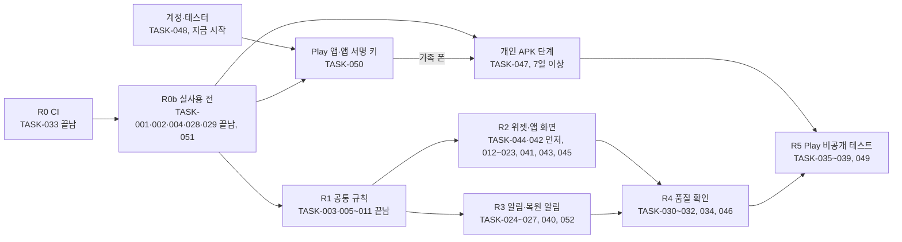

# 작업 분해 (1차 릴리즈)

- 상태: **1차 범위 확정 반영** (2026-11-12). 2026-11-12 10:18 KST 범위 확정(동희님, [요구 0장](../01-planning/requirements.md#0-v3-뒤에-정한-결정)의 '범위 확정')과 [설계 독립 검토](../06-review/design-review-2026-11-11.md) 5장(실사용 전 묶음, 개인 APK 단계, 빠진 작업)을 반영함. 같은 날 [범위 확정 반영 검토](../06-review/scope-confirm-review-2026-11-12.md)(Fable 5.2)의 A1~A3·B1·B6·B10·C1~C5에 따라 TASK-050~052를 더하고 TASK-004를 R0b로 당김. 처음 초안은 2026-11-11 Claude 작성. 담당과 단계 순서는 Claude 제안이고 동희님이 바꿀 수 있음 (0장)
- 기준: 이 저장소 main(2026-11-12 `843a737`)과 [요구](../01-planning/requirements.md)(REQ-001~083), [화면](../05-ui/screens.md)(SCR-001~010), [기록 규칙 보충](../04-spec/record-rules-supplement.md)(규칙 ID와 RR-26~89)
- 범위: 지금 프로토타입에서 Google Play 비공개 테스트까지 (결정 Q13). 프로덕션 출시(R6)는 이 표 밖임
- 릴리즈 단계 R0~R6은 Notion [릴리즈 계획](https://app.notion.com/p/415bf16cc3ec818aa416f5554367f67c)의 단계이고, 작업과의 대응은 2장에 있음
- 가쟈누님 로드맵 4단계([DidITake README](https://github.com/judangbang-ops/DidITake/blob/7a800ac/README.md#로드맵))의 다섯 가지는 여기 들어 있음: 미래 시각 경고 TASK-006·TASK-016, 위젯 대상자 필터 TASK-012, 건너뜀 TASK-013·TASK-016·TASK-018, 늦은 투약 처리 TASK-004·TASK-041(주 1회, 결정 Q15의 1차 방식)과 TASK-005·TASK-018(늦은 입력), 설정 화면 TASK-020

## 0. 읽는 법

- **ID**: `TASK-001`부터. 번호는 다시 쓰지 않음. 빼는 작업은 지우지 않고 '제외'와 날짜를 적음
- **근거**: 이 작업이 채우는 요구 ID. 기능 명세는 요구 표의 합격 기준과 [기록 규칙 보충](../04-spec/record-rules-supplement.md)의 규칙(`P-1`, `N-4` 등)·반례(RR)이고, 작업 칸과 끝난 조건에 그 ID를 적음
- **닿는 곳**: 화면 ID, 테이블 이름, 코드 위치. 코드 위치는 이 저장소 기준임 (앱 코드를 여기서 이어 가기로 함, 2026-11-11 21:52)
- **담당** (Claude 제안, 2026-11-12): 한 작업에 한 명
  - Claude: 코드, 문서, CI, 에뮬레이터 확인. PR로 올리고 CI가 통과하면 순서를 확인해 합침(결정 Q14)
  - 동희님: 사람의 기기·계정이 있어야 하는 일. 갤럭시 실기기, Play Console, 개발자 계정, 공개·배포 승인. 키·비밀번호 보관 같은 손작업은 Claude가 동희님 PC에서 직접 함(동희님 "너가 해봐", 2026-11-12 11:05 KST 프로젝트 채팅)
  - 다른 사람이 돕는 몫(예: Play Console 답 초안은 Claude)은 작업 칸에 적음. 결정 Q15의 남은 부분은 가쟈누님과 정하는 결정이라 작업으로 두지 않음
- **크기**: Claude가 어림한 작업일(AI 도움을 받는 한 사람 기준). 측정값이 아님. '이상'이 붙은 줄은 달력 기간이라 합계에서 뺌
- **끝난 조건**: 다른 사람이 확인할 수 있는 것으로 씀. 공통 코드는 `./gradlew :shared:jvmTest` 통과가 기본이고, 기존 테스트도 함께 통과해야 함. 에뮬레이터 확인은 캡처나 로그를 PR에 남김
- **끝남**: 작업 칸 끝에 **끝남**과 날짜를 적은 줄임

## 1. 작업 표

### 1.1 기반

| ID | 작업 | 근거 | 닿는 곳 | 먼저 할 것 | 담당 | 크기 | 끝난 조건 |
| --- | --- | --- | --- | --- | --- | --- | --- |
| TASK-001 | 패키지 이름(`applicationId`)을 정해 빌드 설정에 넣기. **끝남** (2026-11-12, [PR #4](https://github.com/judangbang-ops/pillbadeum_release/pull/4)) | REQ-061 | `androidApp/build.gradle.kts` | 결정 Q9 (2026-11-12 정함) | Claude | 0.5일 | 정한 이름이 빌드 설정·README에 있고, CI가 만든 디버그 APK의 패키지 이름이 그 이름임 |
| TASK-002 | 릴리즈 서명과 버전 번호: Gradle `signingConfig`(비밀값은 환경 변수). 서명은 `pull_request`를 받지 않는 `release.yml`에서만 함(main 푸시·`v*` 태그·수동 실행). 그 한 번의 실행에서 업로드 키로 서명한 릴리즈 AAB와 서명하지 않은 개인 APK 원본이 함께 나오고, 개인 APK는 PC 스크립트가 앱 서명 키로 서명함. 개인 APK는 release 변형(디버그 불가)이고 코드 축소(R8)는 1차에 끔. 버전 번호(versionCode)는 빌드한 커밋의 `git rev-list --count HEAD`라 AAB와 개인 APK가 한 수열을 씀. PR에서는 임시 키 서명 시험과 릴리즈 변형 권한 비교를 `ci.yml`에서 함 (검토 A1~A3·B1). 키와 계획은 아래 메모. **끝남** (2026-11-12, [PR #6](https://github.com/judangbang-ops/pillbadeum_release/pull/6)) | REQ-057, REQ-062 | `androidApp/build.gradle.kts`, `.github/workflows/release.yml`(새로)·`ci.yml`, 개인 APK 서명 스크립트(새로) | TASK-001 | Claude | 1.5일 | 두 키의 알고리즘·길이를 `keytool -list -v`로 확인해 아래 메모에 적음(RSA 2048 이상, Play 요건). CI 로그에서 릴리즈 AAB의 인증서 SHA-256 = 업로드 키 지문. 동희님 PC에서 스크립트로 서명한 APK의 `apksigner verify --print-certs` SHA-256 = 앱 서명 키 지문. main의 서로 다른 두 커밋으로 만든 빌드에서 뒤 커밋의 버전 번호가 큼. CI가 개인 APK의 디버그 불가와 릴리즈 변형의 권한 목록을 확인함. 키·비밀번호가 Git과 CI 로그에 없음 |
| TASK-003 | Room 스키마 2: 알림 규칙·미루기·시계 표식 표와 1→2 마이그레이션(첫 일정 버전의 유효 시작을 등록 창 시작으로 앞당김). 설정 키는 key-value라 쓰는 작업에서 더함 (보충 N-1·N-2·C-1·P-4). **끝남** (2026-11-12, [PR #8](https://github.com/judangbang-ops/pillbadeum_release/pull/8)) | REQ-041, REQ-042, REQ-072, REQ-009 | `reminder_rule`, `reminder_snooze`, `clock_flag`, `schedule_version`, `shared/schemas` | 없음 | Claude | 1.5일 | 스키마 2 JSON이 생기고, 1→2 마이그레이션 테스트가 기존 판정 행을 그대로 남기고 첫 일정 버전의 유효 시작을 옮김 |
| TASK-004 | 새 일정 버전의 `late_policy`를 `KEEP`으로 저장 (보충 W-1, 요구 4장 1번). 개인 APK를 나눠 주기 전에 넣음(R0b). 그 사이에 만든 일정 버전이 `ASK`로 남지 않게 하기 위함 (검토 C4). **끝남** (2026-11-12, [PR #7](https://github.com/judangbang-ops/pillbadeum_release/pull/7)) | REQ-010 | `ManageIntakes`, `schedule_version` | 없음 (2026-11-12 확정) | Claude | 0.5일 | 새 항목·주기 변경의 `late_policy` = KEEP. RR-60·RR-62(기준 요일 그대로) JVM 테스트. 기존 테스트 통과 |

진행 메모 (2026-11-12)

- TASK-003: PR #8. 독립 검토(Fable 5.2) 지적에 따라 TASK-005 몫이던 "새 항목의 첫 일정 버전을 등록 창 시작부터"(보충 P-4)도 이 PR에서 함. 스키마 2 빌드와 TASK-005 사이에 만든 항목이 마이그레이션 뒤라 앞당겨지지 않는 틈을 없애려는 것임
- TASK-001: 결정 Q9의 `com.judangbang.pillbadeum`을 PR #4로 main에 합침(2026-11-12 10:19 KST, `843a737`). CI의 APK 정보에서 패키지 이름을 확인함. 기기 설치는 아직 하지 않음(TASK-047)
- TASK-033: PR #2로 main에 합침(`da916c6`). PR마다 JVM 테스트, 디버그 APK 빌드, 권한 목록 비교(`androidApp/expected-permissions.txt`, `INTERNET`이 있으면 실패)를 함. 릴리즈 변형의 권한 비교는 TASK-002에서 더함(검토 A3)
- TASK-028·TASK-029: [PR #9](https://github.com/judangbang-ops/pillbadeum_release/pull/9). 백업 규칙 두 파일(`data_extraction_rules.xml`, `backup_rules.xml`)과 복원 감지(`restore.CheckInstall`, `FileInstallMarker`), 앱 첫 화면·위젯의 복원 안내와 [확인했어요], 복원 뒤 위젯·경계 알람 다시 만들기. 에뮬레이터 API 34·30·27·26에서 B-1·B-3, RR-26·RR-30~34·RR-68~71을 확인함([QA 보고서](../07-qa/2026-11-12-backup-restore/report.md)). 끝난 조건과 다른 점: RR-27(400건)은 기록이 칸마다 한 번이라 에뮬레이터에서 앱 경로로 400건을 쌓을 수 없어, 같은 Room·SQLite로 400건을 쓴 JVM 테스트(`BackupFileSetTest`)로만 봄. Android 9~11에서 암호화 조건이 있을 때의 실제 백업과 기기 간 이전은 시험 전송이 그 조건을 줄 수 없어 TASK-032에 남김. 위젯을 놓고 누르는 확인은 TASK-051, 복원 안내 알림은 TASK-040. 독립 검토(Fable 5.2)의 고칠 것 3건과 제안 4건을 반영함
- TASK-002: 요구 4장 2번 확정(10:18)에 따라 키를 둘로 나눔 (릴리즈 서명 키 스레드, 동희님 PC에서 만듦)
  - 앱 서명 키 `pillbadeum-app-signing.p12`(별칭 `app-signing`, RSA 4096): Play 앱 서명과 개인 APK 서명에 씀. 잃으면 되살릴 수 없음. GitHub에는 올리지 않고 동희님 PC와 Google Drive 폴더 두 곳에 둠. 인증서 SHA-256(공개값) `35:64:B6:82:4B:1E:3D:A0:74:7A:2E:97:96:6E:F5:5D:B9:CC:93:C5:E8:8A:7D:45:24:64:2F:E6:2A:32:95:36`
  - 업로드 키 `pillbadeum-upload.p12`(별칭 `upload`, RSA 4096): CI가 Play에 올릴 AAB에 서명함. GitHub Secrets `ANDROID_UPLOAD_KEYSTORE_BASE64`, `ANDROID_UPLOAD_KEYSTORE_PASSWORD`에 있음. 별칭은 공개값이라 `release.yml`에 적고, 같이 등록한 `ANDROID_UPLOAD_KEY_ALIAS`는 읽지 않음(비밀값으로 넘기면 로그의 'upload'가 모두 가려짐, PR #6). 잃으면 Play에서 재설정할 수 있음. 인증서 SHA-256 `7D:23:C2:A8:C9:1B:96:4A:08:14:D5:70:12:CB:38:93:CF:25:BF:68:E7:A9:B3:43:6E:AA:87:FA:D5:2D:39:BB`
  - 확인한 것: Drive 사본의 SHA-256이 원본과 같음, 두 비밀번호가 서로 다름. 11:33 KST에 동희님 PC에서 `keytool -list -v`로 두 키 모두 PKCS12, 개인 키 하나, RSA 4096, SHA384withRSA, 유효 기간 2026-11-12~2054-03-30이고 지문이 위와 같음을 봄(Play 요건 RSA 2048 이상을 넘음, 검토 A1). Drive 동기화: 12:15 KST쯤 Drive API로 클라우드의 두 키 파일·암호화한 비밀번호·안내 파일이 PC 원본과 같은 크기로 있음을 봄(G: 사본은 MD5까지 같음). 실제 APK 서명: 아래 결과
  - 비밀번호의 PC 밖 사본: 위 11:05 말씀에 따라 서명 키 스레드가 직접 만듦(11:11). 앱 서명 키 비밀번호는 업로드 키 비밀번호로 암호화해 Drive 폴더에 두고, 업로드 키 비밀번호는 GitHub Secrets에 있음. Secrets는 다시 읽을 수 없어서, PC 없이 되찾는 경로가 실제로 되는지는 TASK-002에서 확인함. 확인한 것(2026-11-12): Drive 클라우드 사본이 있음(위), Secrets의 업로드 키 비밀번호가 맞음(main 실행에서 업로드 키로 서명함). 확인 못 한 것: Secrets에서 값을 꺼내는 비상 워크플로는 미리 만들지 않음. 자동 안전 검사가 '비밀값을 내보내는 코드'로 막았고, PC를 잃으면 동희님 허락을 받아 그때 만들어 시험함
  - 계획 (서명 키 스레드, 11:33): 버전 번호는 빌드한 커밋의 `git rev-list --count HEAD`이고 CI가 전체 이력을 받아 Gradle에 넘김. 같은 커밋을 다시 빌드하면 같은 번호이고, 환경 변수가 없는 로컬·디버그 빌드는 1임. 나눠 주거나 올리는 빌드는 main의 커밋에서 만든 것만 씀. release 변형은 `isMinifyEnabled = false`를 적어 둠
  - 공식 문서: Android는 깔린 것보다 낮은 versionCode의 APK 설치를 막고, Play가 받는 최대값은 2100000000임 ([Version your app](https://developer.android.com/studio/publish/versioning), 2025-08-20 갱신, 2026-11-12 읽음)
  - 저장소 설정의 한계 (검토 B1): 비공개 저장소의 무료 요금제라 브랜치 보호·규칙 모음·환경 비밀값이 없음(API 403). 그래서 '서명은 main·태그에서만'은 워크플로 파일의 조건일 뿐이고, 저장소에 쓸 수 있는 사람은 어느 브랜치에서든 워크플로를 고쳐 Secrets를 쓸 수 있음. 업로드 키는 Play에서 다시 만들 수 있고 앱 서명 키는 GitHub에 없어 지금 피해는 한정됨. TASK-049를 할지는 2장 결정 목록에서 정함. PR #6의 `release.yml`은 빌드할 커밋이 main 이력 안에 있는지도 확인함(다른 브랜치 수동 실행·main 밖 태그를 막는 실수 방지, 2026-11-12 독립 검토)
  - 결과 ([PR #6](https://github.com/judangbang-ops/pillbadeum_release/pull/6), main `72de947`에 2026-11-12 12:09 KST 합침): main 첫 `release.yml` [실행 43146283311](https://github.com/judangbang-ops/pillbadeum_release/actions/runs/43146283311)에서 업로드 키로 서명한 AAB의 인증서 SHA-256 = 업로드 키 지문, versionCode 33 = 커밋 수, 릴리즈 APK가 debuggable 아님·정렬 맞음·권한 6줄이 기준과 같음(`INTERNET` 없음). 동희님 PC(build-tools 37.0.0)에서 `scripts/sign-personal-apk.ps1` 기본 실행이 이 실행의 APK를 받아 앱 서명 키로 서명함: `apksigner verify --print-certs` SHA-256 = 앱 서명 키 지문(versionCode 33, v2·v3 서명). PR 빌드는 `-Test` 없이 주면 거절함. 같은 PC에서 Git 전체(가지 8개·PR 참조 11개)와 이 실행 로그에 두 비밀번호와 두 키 파일(base64 조각 포함)이 없음을 확인함. 버전 번호가 커지는지는 이 기록을 합친 다음 main 커밋의 빌드로 확인함(진행 기록은 Notion). 독립 검토(Fable 5.2, 174dbf1)의 고칠 것 2건(main 밖 커밋 서명, PC 스크립트의 실행 확인)과 제안 5건을 반영함
- Play 쪽: Play 도움말([Use Play App Signing](https://support.google.com/googleplay/android-developer/answer/9842756), 2026-11-12 요약본으로 읽음)에 따르면 새 앱은 Google이 만든 키로 자동 등록되고, 공개 테스트나 프로덕션에 나가기 전에 'Change key'로 우리 키를 넘길 수 있음. 직접 넣는 키는 RSA 2048비트 이상이어야 함(검토 A1이 2026-11-12에 읽음). 개인 APK 위에 Play 버전을 덮어 깔아야 하므로(REQ-062), 계정이 생기면 바로 앱을 만들어 앱 서명 키를 넘기고(TASK-050) 그 뒤에 가족 폰에 개인 APK를 깖. 넘길 때 도움말을 다시 읽고 절차를 확인함

### 1.2 공통 기록 규칙 (shared)

| ID | 작업 | 근거 | 닿는 곳 | 먼저 할 것 | 담당 | 크기 | 끝난 조건 |
| --- | --- | --- | --- | --- | --- | --- | --- |
| TASK-005 | 앱 전용 `RecordInWindow`(일정 버전과 기간키로 창을 정함. 지금 창·끝난 창, 고른 시각)와 시각 고치기(옛 행 무효 `TIME_EDIT` + 새 행), 설정 변경 전 창 막기 (보충 I-1·I-2, P-1~P-6). 새 항목의 첫 일정 버전을 등록 창 시작부터 두는 것은 TASK-003(PR #8)에서 함. **끝남** (2026-11-12, [PR #11](https://github.com/judangbang-ops/pillbadeum_release/pull/11)) | REQ-030, REQ-031, REQ-032, REQ-033, REQ-034 | `RecordDose`, `ChangeJudgment`, `ManageIntakes`, `dose_record`, `setting` | TASK-003 | Claude | 2일 | RR-38~44 JVM 테스트 통과(RR-43의 알림 몫은 TASK-027). 위젯·알림의 `RecordCommand`는 지금 창에만 씀 |
| TASK-006 | 시계가 틀렸던 기록: 표식 남기기(`TIME_SET`·`TIMEZONE_CHANGED`·`BOOT_COMPLETED`, 판정 읽을 때, 지금보다 5분 넘게 뒤), 표시값에 넣기, [그대로 두기]·[기록 취소], 다른 길로 판정이 무효가 되면 표식도 풀기 (보충 C-1~C-3). **끝남** (2026-11-12, [PR #12](https://github.com/judangbang-ops/pillbadeum_release/pull/12)) | REQ-009 | `clock_flag`, `LoadStatusBoard`, `DayBoundaryReceiver` | TASK-003 | Claude | 1일 | RR-19, RR-64~67, RR-88·89 JVM 테스트 통과 |
| TASK-007 | 지난 기록 읽기 `LoadHistory`(달, 대상자): 그날 유효했던 일정 버전으로 칸 그리기, 칸이 판정을 고르는 법(같은 버전은 기간키, 다른 버전은 시각), 일정을 바꾼 주. 첫 화면의 이번 주 칸도 같은 규칙을 씀 (보충 P-8, S-5). **끝남** (2026-11-12, [PR #12](https://github.com/judangbang-ops/pillbadeum_release/pull/12)) | REQ-037, REQ-038, REQ-039, REQ-040 | `dose_record`, `schedule_version`, `intake`, `person`, `StatusBoard` | 없음 | Claude | 2일 | RR-45, RR-77·78과 빠짐 판정, 등록 전·보관 뒤 칸 없음, 주 1회 창 한 칸, 대상자 거르기 JVM 테스트. 항목 10개·1년치에서 한 달 읽는 시간을 기록 |
| TASK-008 | 대상자 수정·보관·되살리기, 보관한 대상자의 항목 기록 막기 (검토 B5). **끝남** (2026-11-12, [PR #11](https://github.com/judangbang-ops/pillbadeum_release/pull/11)) | REQ-005, REQ-016, REQ-017, REQ-018 | `ManagePeople`, `RecordDose`, `person` | 없음 | Claude | 1일 | JVM 테스트: 마지막 대상자 보관 거절, 보관한 대상자의 항목이 `LoadStatusBoard`에서 빠지고 지난 판정은 남음, 그 항목의 버튼 탭 → `Gone`(RR-14의 대상자 몫) |
| TASK-009 | 설정 저장과 '바꾼 때부터 적용', 바꾼 시각을 `window_settings_changed_at`에 남기기 (보충 P-5). **끝남** (2026-11-12, [PR #11](https://github.com/judangbang-ops/pillbadeum_release/pull/11)) | REQ-011, REQ-053 | `setting` | 없음 | Claude | 1일 | RR-15 JVM 테스트 통과. 지난 판정의 기간키가 바뀌지 않음. 하루 시작·기준 시간대를 바꾸면 그 시각이 남음 |
| TASK-010 | 보관된 항목 완전 삭제 (Could). **끝남** (2026-11-12, [PR #11](https://github.com/judangbang-ops/pillbadeum_release/pull/11)) | REQ-015 | `intake`, `dose_record`, `schedule_version` | 없음 | Claude | 0.5일 | JVM 테스트: 항목·판정 행이 없고, 남은 위젯 버튼은 Gone |
| TASK-011 | 알림 계획 `PlanReminders`: 격자 칸(칸 0은 창 시작 뒤 처음 오는 시작 시각), 방해 금지 [시작, 끝)(첫 칸은 울림), 창 끝, 미루기(방해 금지여도 울림, 창 끝 뒤는 안 씀), 다음 칸 하나, 밀린 칸 모으기, 저장 때 줄어드는 칸 수 (보충 N-3~N-8, N-12). **끝남** (2026-11-12, [PR #13](https://github.com/judangbang-ops/pillbadeum_release/pull/13)) | REQ-041, REQ-042, REQ-043, REQ-044, REQ-045, REQ-077 | `reminder_rule`, `reminder_snooze`, `setting` | TASK-003 | Claude | 2일 | RR-21, RR-22, RR-46~54, RR-79·80, RR-82~85 JVM 테스트 통과 |

진행 메모 (2026-11-12)

- TASK-005·008·009·010: [PR #11](https://github.com/judangbang-ops/pillbadeum_release/pull/11). TASK-005의 '설정 변경 전 창 막기'가 TASK-009가 남기는 `window_settings_changed_at`을 써서 한 PR로 묶음. Claude가 정한 세부는 [기록 규칙 보충](../04-spec/record-rules-supplement.md) P-1·P-5·P-6의 '구현' 줄에 적음
- TASK-008: 마지막 남은 대상자는 보관할 수 없음(`LastPerson`). 보관한 대상자의 항목 탭은 판정 쓰기의 첫 확인(`lookUpWindow`)에서 `Gone`
- TASK-010: 외래 키가 NO ACTION이라 시계 표식 → 판정 → 미루기 → 알림 규칙 → 약 연결 → 일정 버전 → 항목 순서로 한 트랜잭션에서 지움
- TASK-005 곁: 항목의 일정을 바꿀 때 지금 유효한 버전이 아니라 열린(마지막) 일정 버전에서 시작함. 시계가 그 버전의 시작보다 뒤로 가 있으면 그 시작부터 바꿔(빈 버전이 남음) 열린 버전이 둘이 되지 않게 함 (PR #8 코드 주석이 TASK-005로 넘긴 갈래)
- TASK-006·007: [PR #12](https://github.com/judangbang-ops/pillbadeum_release/pull/12). Claude가 정한 세부는 [기록 규칙 보충](../04-spec/record-rules-supplement.md) C-3과 P-8의 '구현' 줄에 적음
- TASK-006: 경고의 [기록 취소]도 첫 화면의 취소(`VoidDose`)와 같은 규칙이라, 설정 변경 전에 끝난 칸의 판정이면 `Locked`이고 [그대로 두기]는 늘 됨(P-5). PR #11 독립 검토가 '고치면 좋은 것'으로 남긴 대로 지금 창 판정 바꾸기(`ChangeJudgment`)도 같은 잠금을 봄
- TASK-007: 항목 10개·1년치(판정 3,640행)에서 한 달 읽기 12.6 ms와 24.1 ms (JVM 테스트 `ten_items_for_a_year_read_one_month_in_time`, 4코어 클라우드 컨테이너, 2026-11-12 두 번). 휴대폰에서 잰 값은 아님
- TASK-011: [PR #13](https://github.com/judangbang-ops/pillbadeum_release/pull/13). 계산과 저장만 하고, 안드로이드 알람·알림은 TASK-024·025, 다시 계산을 부르는 곳은 TASK-027. Claude가 정한 세부는 [기록 규칙 보충](../04-spec/record-rules-supplement.md) N-13 아래 '구현' 줄에 적음. 독립 검토에서 늦은 알람이 다시 계산 때 빠지는 경로가 나와 `reminder_alarm_at`으로 고침(N-12)
- PR #12 재검토의 '고치면 좋은 것'도 PR #13에서 함: 일정을 바꿨다가 같은 창 안에서 되돌리면 지난 기록 한 줄에 같은 판정이 두 번 보이던 것, 보충 P-8의 잘린 칸 설명과 한계 한 줄

### 1.3 위젯

| ID | 작업 | 근거 | 닿는 곳 | 먼저 할 것 | 담당 | 크기 | 끝난 조건 |
| --- | --- | --- | --- | --- | --- | --- | --- |
| TASK-012 | 위젯 대상자 고르기 화면과 위젯별 필터. 이 업데이트 전부터 놓인 위젯과 대상자가 한 명일 때 놓은 위젯은 선택을 '전체'로 써 둠. 고른 대상자 보관·복원 뒤(대상자 둘 이상) `#reconfigure`. `onRestored`로 선택을 옮기는 방법 시험 (보충 R-3 제안, 검토 B10) | REQ-018, REQ-025, REQ-079 | SCR-002, SCR-001#reconfigure | TASK-008, TASK-029 | Claude | 2일 | 에뮬레이터 캡처: '엄마' 위젯에 엄마 항목·완료 수만, 대상자 1명이면 화면이 뜨지 않음, 엄마 보관 → 안내만 보임, 위젯 선택 저장을 지워 복원을 흉내 낸 뒤 대상자 둘 → 안내만, 이 업데이트 전부터 놓인 위젯은 '전체'(RR-74). 런처가 위젯을 되살리는 기기 간 이전은 TASK-032. `onRestored` 시험 결과를 PR에 적음 |
| TASK-013 | 건너뜀 표시와 따로 세기: 위젯 칸, 머리글 수, 마지막 복용 문구와 날짜 글자, 탭 문구, TalkBack 문장 (보충 S-1~S-4) | REQ-019, REQ-020, REQ-021, REQ-023, REQ-033, REQ-068 | SCR-001#skipped, SCR-001#already, `LoadStatusBoard`, `Labels` | TASK-044 | Claude | 1일 | RR-35~37, RR-76 JVM 테스트. 캡처: 건너뜀 칸, 탭 → 건너뜀 안내, 판정 행 그대로 |
| TASK-014 | 위젯 버튼이 넘칠 때: 버튼 목록만 스크롤, 머리글 고정, `더 있음` 표시. TASK-042에서 안 되면 `+n 더 있음 · 앱에서 보기` (화면 5장 1번) | REQ-019, REQ-026, REQ-078 | SCR-001#overflow | TASK-042, TASK-044 | Claude | 1일 | 4×2에 항목 6개 → 6개 모두 누를 수 있고 가려진 동안 `더 있음`이 보임 (캡처) |
| TASK-015 | 대상자가 한 명이면 배지·필터를 숨기고 TalkBack도 대상자 이름을 읽지 않기 (요구 4장 5번) | REQ-018, REQ-068 | SCR-001, SCR-004, SCR-006, SCR-008 | TASK-008 | Claude | 0.5일 | '나'만 있을 때 배지·필터 없음과 TalkBack "아침약, …", 가족 추가 뒤 배지와 "엄마 아침약, …" (캡처, 접근성 노드 덤프) |
| TASK-041 | 주 1회 마지막 복용 크게: 위젯 버튼(이름과 같은 글자 크기), 앱 줄 둘째 줄 굵게, 알림 본문 첫 줄, `지난주 건너뜀`, TalkBack (보충 W-2~W-4, 결정 Q15의 1차 방식) | REQ-075, REQ-068 | SCR-001, SCR-003, SCR-004, `Labels` | TASK-013, TASK-025, TASK-044 | Claude | 1일 | RR-59~63 JVM 테스트(문구). 4×2 위젯의 글자 100%·가장 큰 크기 캡처에서 그 문구가 잘리지 않음 |
| TASK-042 | 위젯 스크롤 기술 시험: Glance 목록 안 버튼의 탭 기록과 가로 4개 배치가 되는지 (화면 5장 1번, 검토 4.2절) | REQ-078 | SCR-001#overflow | 없음 | Claude | 0.5일 | 에뮬레이터(API 26·34·36) 결과와 TASK-014에서 쓸 방법을 PR에 적음 |

### 1.4 앱 화면

| ID | 작업 | 근거 | 닿는 곳 | 먼저 할 것 | 담당 | 크기 | 끝난 조건 |
| --- | --- | --- | --- | --- | --- | --- | --- |
| TASK-016 | 첫 화면 보강: [지난 기록]·[설정]·[⋯], 건너뜀 줄, 시계 경고와 [그대로 두기]·[기록 취소], 읽기 오류와 [다시 시도] | REQ-009, REQ-028, REQ-033, REQ-036 | SCR-004 | TASK-006 | Claude | 1.5일 | SCR-004의 normal·empty·error·skipped·future 캡처. 경고는 그날이 와도 남음(RR-64) |
| TASK-017 | 앱을 켜 둔 채 날짜가 바뀌면 다시 불러오기 | REQ-004, REQ-008 | SCR-004#stale, SCR-008#stale | 없음 | Claude | 0.5일 | 에뮬레이터에서 앱을 켜 둔 채 03:59 → 04:00 → 새 기준 날짜 (QA 5장 알려진 제한 해소) |
| TASK-018 | 판정 고치기 화면: 시각 골라 기록, 시각 고치기, 건너뜀, 취소, 건너뜀을 복용으로. 지난 창은 [지금 먹었어] 없음, 설정 변경 전 창은 `#locked` (보충 P-2·P-5, 화면 5장 4번) | REQ-006, REQ-029, REQ-030, REQ-031, REQ-032, REQ-033, REQ-034 | SCR-007 | TASK-005, TASK-044 | Claude | 1.5일 | 판정별 버튼과 결과 캡처, 판정 행 확인. RR-7(앱 몫), RR-38~44의 화면 몫 |
| TASK-019 | 지난 기록 화면: 날짜 줄 목록(최신이 위), 건너뜀 기호, 시계 경고(누르면 SCR-007의 [그대로 두기]·[기록 취소]) (화면 5장 7번) | REQ-037, REQ-038, REQ-039, REQ-040 | SCR-008 | TASK-006, TASK-007, TASK-018 | Claude | 1.5일 | 상태별 캡처, 판정 탭 → SCR-007 |
| TASK-020 | 설정 화면: 하루 시작·기준 시간대(P-5 확인 문구), 잠금 화면 이름 표시, 공통 알림 설정과 방해 금지 안내, 백업 안내(화면 잠금 있음·없음), 의료 안내, 개인정보처리방침 링크 | REQ-011, REQ-036, REQ-042, REQ-046, REQ-053, REQ-054, REQ-063, REQ-077 | SCR-009 | TASK-009, TASK-011 | Claude | 1.5일 | 하루 시작 시각을 바꾸면 위젯이 새 기준으로 그려짐(RR-15, 캡처). 화면 잠금 있음·없음의 백업 문구 캡처. 방해 금지와 겹치는 공통 설정 저장 → 안내 |
| TASK-021 | 대상자 관리 화면: 추가(한 약은 한 휴대폰 안내), 수정, 보관, 되살리기 | REQ-016, REQ-017, REQ-074 | SCR-010 | TASK-008 | Claude | 1일 | 추가·수정·보관·되살리기 캡처. 추가 화면에 "한 약은 한 휴대폰에서 기록해 주세요" |
| TASK-022 | 첫 실행 안내(두 쪽)와 위젯 고정 요청 (화면 5장 3번) | REQ-016, REQ-036, REQ-074, REQ-080 | SCR-005 | 없음 | Claude | 1일 | 첫 실행에만 보임. 캡처에 기록 도구 안내와 한 휴대폰 안내. 지원하는 런처에서 [위젯 추가] → 위젯 놓기 확인 |
| TASK-023 | 항목 화면의 알림 칸: [알림 받기](기본 끔), 시작 시각 기본값(시간대 표시를 따름), 저장할 때 방해 금지 안내 `#quiet` (보충 N-3·N-4) | REQ-041, REQ-049, REQ-077 | SCR-006 | TASK-003, TASK-011, TASK-026 | Claude | 1일 | 알림 켜기 → Android 13 이상에서 권한 요청, 거부하면 안내. 자기 전(21:00) 저장 → "다시 알림이 2번 줄어요"(RR-49의 화면 몫) |
| TASK-043 | 시각을 기기 시간대로 보이기. 창과 기준 날짜는 기준 시간대로 계산 (검토 B12, 보충 RR-58) | REQ-082 | SCR-001, SCR-003, SCR-004, SCR-007, SCR-008, `Labels` | 없음 | Claude | 1일 | 표시 시각 JVM 테스트. 기기 시간대를 바꾼 에뮬레이터 캡처에서 기록 시각은 기기 시간대, 칸과 기준 날짜는 그대로 |
| TASK-044 | 상태별 와이어프레임: 위젯 큰 글씨 배치와 가로 4개 배치 비교, 알림 잠금 화면 여덟 칸, 지난 창의 판정 고치기. [screens.md](../05-ui/screens.md)의 나머지 상태는 그 화면 작업이 시작할 때 그 PR에 먼저 그림 (검토 5.3절, 2026-11-12 검토 C5) | REQ-019, REQ-026, REQ-030, REQ-046, REQ-066 | `docs/05-ui/` (SCR-001, SCR-003, SCR-007) | 없음 | Claude | 1.5일 | 세 가지 그림이 있음: 위젯 두 배치를 4×2 글자 100%·가장 큰 크기로, 잠금 화면 여덟 칸, 판정 고치기를 폭 360dp 글자 100%·200%로 |
| TASK-045 | 앱 표시 이름과 아이콘: 런처 아이콘, 스토어 512px 아이콘, 대표 이미지. 지금은 아이콘이 없고 이름이 `DidITake`임 (검토 5.3절) | REQ-060 | `strings.xml`, `res/mipmap`, 스토어 그림 | 앱 표시 이름 결정 (동희님) | Claude | 0.5일 | 런처와 위젯 목록에 정한 이름과 아이콘이 보임(캡처). 스토어용 그림 파일이 저장소에 있음 |

### 1.5 반복 알림

| ID | 작업 | 근거 | 닿는 곳 | 먼저 할 것 | 담당 | 크기 | 끝난 조건 |
| --- | --- | --- | --- | --- | --- | --- | --- |
| TASK-024 | 알림 예약기: 모든 항목의 다음 칸 하나만 예약(정확 알람이 허용되면 정확, 아니면 비정확), 울리면 밀린 칸을 항목마다 알림 하나로 (보충 N-8) | REQ-041, REQ-042, REQ-048, REQ-052 | `androidApp` 알람 | TASK-011 | Claude | 1.5일 | 허용·거부 두 경우의 `dumpsys alarm`에서 이 앱의 반복 알림 알람이 하나(하루 경계 알람은 따로 있음). RR-54 (에뮬레이터). 병합 매니페스트에 `USE_EXACT_ALARM` 없음. `nextAlarm`·`fire`가 돌려준 시각을 지난 시각이어도 그대로 예약하고 null이면 지움(보충 N-13 '구현'의 앱이 지킬 순서) |
| TASK-025 | 알림 표시와 버튼(먹었어·30분 뒤·건너뜀), 떠 있는 알림 지우기, 잠금 화면에서 이름을 숨기는 방법(공개용 판으로 안 되면 다른 방법, 검토 B6)과 이름 숨김이면 버튼 없음, 버튼 수신기 보호 (보충 N-7·N-13, 화면 5장 6번) | REQ-004, REQ-027, REQ-043, REQ-045, REQ-046, REQ-076, REQ-081 | SCR-003, 알림 버튼 수신기 | TASK-024, TASK-044 | Claude | 2일 | 버튼마다 판정 행 확인, RR-23, RR-51·52, RR-85~87(RR-85는 버튼 숨김 몫). 이름 표시 끔·켬 × 잠금·해제 × 기기 설정 두 가지 여덟 칸 에뮬레이터 캡처(실기기는 TASK-052). 수신기 `exported="false"`, PendingIntent `FLAG_IMMUTABLE` |
| TASK-026 | 권한 안내: 알림 권한, 정확 알람, 배터리 최적화. 분 단위 약속 없이 "알림이 늦을 수 있어요" (검토 B1, 보충 N-11) | REQ-048, REQ-049, REQ-050, REQ-051 | SCR-004#permission, SCR-006#permission, SCR-009 | 없음 | Claude | 1일 | 권한 거부 → 안내 → 버튼 → 시스템 화면 (에뮬레이터 캡처). 앱 문구에 분 단위 약속이 없음 |
| TASK-027 | 다시 계산: 판정·항목·대상자·알림 설정·하루 시작·기준 시간대가 바뀐 뒤, 재부팅·시각 변경·시간대 변경·업데이트 뒤. 밀린 칸은 알람·재부팅·시각 변경 때만 모음 (보충 N-9·N-10·N-12, P-7, 검토 B5) | REQ-043, REQ-044, REQ-047 | `DayBoundaryReceiver`, 알림 예약기 | TASK-024 | Claude | 1일 | RR-18, RR-43의 알림 몫, RR-55~58, RR-81 (에뮬레이터. 재부팅 실기기는 TASK-032). 알람이 늦는 동안 기록해도 그 칸이 뜸(보충 N-12 늦은 알람, `PlanRemindersTest`의 늦은 알람 두 경우를 에뮬레이터로) |
| TASK-040 | 복원 뒤 알림: [확인했어요] 전에는 복용 알림 대신 복원 안내 알림 하나, 확인 뒤 알림 다시 계산 (보충 R-3의 알림 몫) | REQ-047, REQ-073 | SCR-003#restored, 알림 예약기 | TASK-027, TASK-029 | Claude | 0.5일 | RR-30(알림 몫), RR-33, RR-73 (에뮬레이터 복원). 확인 전에는 복원된 지난 `reminder_alarm_at` 때문에 복용 알림이 뜨지 않음: 복원을 감지할 때 그 키를 지우거나 확인 전에는 `fire`를 부르지 않음(보충 N-12 늦은 알람, PR #13 재검토) |

### 1.6 백업

| ID | 작업 | 근거 | 닿는 곳 | 먼저 할 것 | 담당 | 크기 | 끝난 조건 |
| --- | --- | --- | --- | --- | --- | --- | --- |
| TASK-028 | 자동 백업·기기 간 이전에 기록 DB와 짝 파일(`-wal`, `-journal`)만 넣고, 화면 잠금이 없는 폰과 Android 8.x는 클라우드 백업에서 빼기. Android 9~11의 기기 간 이전이 암호화 조건에 걸리는지와 시험용 전송에서 암호화 조건을 켜는 방법을 [백업 시험 문서](https://developer.android.com/identity/data/testingbackup)로 확인 (보충 B-1~B-3, 결정 Q16, 검토 A4). **끝남** (2026-11-12, [PR #9](https://github.com/judangbang-ops/pillbadeum_release/pull/9)) | REQ-055 | `AndroidManifest.xml`, `res/xml` 백업 규칙 두 파일 | 없음 | Claude | 1일 | RR-28 JVM 테스트(음성 대조), RR-26·RR-27·RR-69 에뮬레이터(`bmgr backupnow` → 지우고 다시 설치 → 기록이 돌아옴), RR-68 에뮬레이터(화면 잠금 없음 → 돌아오지 않음), RR-70 에뮬레이터(API 26·27). RR-29는 TASK-032 |
| TASK-029 | 복원 감지(`install_marker`에 `device_id`를 적고 DB 값과 대조)와 처리: 새 `device_id`를 표식에 먼저 씀, 마지막 기록 시각(지금보다 앞의 판정만), 앱 첫 화면·위젯 복원 안내와 [확인했어요], 위젯·경계 알람 다시 만들기 (보충 R-1·R-2, R-3의 알림 밖 몫, R-4, 검토 B10·C9). **끝남** (2026-11-12, [PR #9](https://github.com/judangbang-ops/pillbadeum_release/pull/9)) | REQ-056, REQ-073, REQ-074 | `setting`, `noBackupFilesDir`, SCR-001#restored, SCR-004#restored | TASK-028 | Claude | 1.5일 | RR-30~32, RR-34 (에뮬레이터 복원), RR-71·72·75 (JVM 또는 에뮬레이터). 새 행의 `device_id`가 이전 값과 다르고 옛 값이 `restored_from_device_id`에 남음 |

### 1.7 품질 확인

| ID | 작업 | 근거 | 닿는 곳 | 먼저 할 것 | 담당 | 크기 | 끝난 조건 |
| --- | --- | --- | --- | --- | --- | --- | --- |
| TASK-030 | 접근성 점검: 글자 200%, 누르는 곳 48dp, TalkBack, 명암비 | REQ-066, REQ-067, REQ-068, REQ-069 | 모든 화면 | TASK-012~TASK-023, TASK-041, TASK-043 | Claude | 1일 | 폭 360dp·글자 100%와 200% 화면별 캡처, 명암비 측정표 |
| TASK-031 | 개인정보 점검: 릴리즈 병합 매니페스트에 `INTERNET` 없음, 권한 전체 목록과 출처(검토 B8), 로그·저장소에 이름 없음, 분석·크래시·AI·광고 SDK 없음, 수신기 보호 | REQ-057, REQ-058, REQ-059, REQ-081, REQ-083 | 병합 매니페스트, 의존성 목록, 로그 호출 | TASK-012~TASK-029, TASK-040~TASK-043 | Claude | 0.5일 | 릴리즈 병합 매니페스트, 권한 목록과 출처, 의존성 목록, 로그 호출 검색 결과를 QA 보고서에 남김 |
| TASK-032 | 갤럭시 실기기 확인: 경계 직후 위젯 탭(RR-13), 재부팅(RR-18), 하룻밤 Doze 뒤 알림 지연(정확 알람 허용·거부를 하룻밤씩, 이틀 밤), 위젯 반영 시간, 새로 놓은 4×2 위젯 큰 글씨, 기기 간 이전(RR-29, 두 대, Android 9~11 기기가 있으면 한 대 포함, 위젯 선택이 되살아나는지), 대상 API 36에서 WorkManager 2.7.1 (검토 B1·B10·B12). 잠금 화면은 TASK-052. 순서와 기록 양식은 Claude가 씀 | REQ-004, REQ-008, REQ-026, REQ-047, REQ-048, REQ-055, REQ-070 | SCR-001, SCR-003 | TASK-012~TASK-029, TASK-040~TASK-043, TASK-046 | 동희님 | 2일 | `docs/07-qa/`에 기기·Android 버전·측정값·캡처가 있는 보고서. REQ-048의 P50·최댓값과 REQ-070의 P95가 적힘 |
| TASK-033 | PR마다 공통 코드 JVM 테스트, 디버그 APK 빌드, 권한 목록 비교 자동 실행. **끝남** (2026-11-12, [PR #2](https://github.com/judangbang-ops/pillbadeum_release/pull/2)) | REQ-071 | `.github/workflows` | 없음 | Claude | 0.5일 | PR에서 `./gradlew :shared:jvmTest` 결과와 권한 비교 결과가 보임 |
| TASK-034 | 프로토타입에 이미 있는 기능의 회귀 확인: 2026-11-11 QA 13항목을 마지막 빌드로 다시 하고, 판정 쓰기가 공통 함수만 거치는지 코드 검사 | REQ-001, REQ-002, REQ-003, REQ-005, REQ-007, REQ-012, REQ-013, REQ-014, REQ-020, REQ-021, REQ-022, REQ-024, REQ-035 | SCR-001, SCR-004, SCR-006 | TASK-012~TASK-029, TASK-040~TASK-043 | Claude | 1일 | `docs/07-qa/`에 13항목 결과와 `jvmTest` 결과가 있음. 판정 DAO의 쓰기 호출이 usecase 밖에 없음 |
| TASK-046 | 릴리즈 변형 확인: 코드 축소(R8)를 켤지 다시 정하고(1차 기본은 끔, TASK-002), 서명된 릴리즈 빌드로 핵심 흐름(위젯 탭 기록, 알림 버튼, 백업·복원)과 병합 매니페스트를 다시 확인 (검토 5.3절) | REQ-003, REQ-057 | `androidApp/build.gradle.kts`, 릴리즈 병합 매니페스트 | TASK-002, TASK-012~TASK-029, TASK-040~TASK-043 | Claude | 1일 | 릴리즈 빌드로 한 핵심 흐름의 결과가 QA 보고서에 있음. R8을 켜기로 하면 켠 빌드로 다시 함. 릴리즈 변형의 권한 비교는 TASK-002부터 CI에서 돎 |
| TASK-052 | 잠금 화면 알림 갤럭시 실기기 확인: 이름 표시 끔·켬 × 잠금·해제 × 기기의 잠금 화면 알림 설정('내용 표시'·'내용 숨김') 여덟 칸. TASK-025 바로 뒤에 하고, 이름 표시가 끔인데 이름이 보이면 TASK-025의 방법을 고침 (검토 B6). 순서와 기록 양식은 Claude가 씀 | REQ-046, REQ-076 | SCR-003#lock, 실기기 | TASK-025 | 동희님 | 0.5일 | `docs/07-qa/`에 기기·Android 버전과 여덟 칸 캡처가 있고, 이름 표시가 끔인 동안 잠금 화면 어느 칸에도 항목 이름이 없음 |

### 1.8 개인 APK와 Play 비공개 테스트

| ID | 작업 | 근거 | 닿는 곳 | 먼저 할 것 | 담당 | 크기 | 끝난 조건 |
| --- | --- | --- | --- | --- | --- | --- | --- |
| TASK-047 | 개인 APK 단계: 앱 서명 키로 서명한 APK를 본인·가족 갤럭시에 깔아 씀. 가족 폰은 앱 서명 키가 Play에 들어간 것을 확인한 뒤(TASK-050)이고, 그 전에는 동희님 폰에만 깖 (Claude 제안, 2026-11-12 검토 A1). 앱을 열지 않고 위젯만 쓰는 날을 포함해 7일 이상 (검토 5.2절·B11). 새 빌드가 나오면 덮어 깜(버전 번호가 커야 깔림) | REQ-008, REQ-051, REQ-062 | 실기기, `docs/07-qa/` | TASK-002, TASK-004, TASK-028, TASK-029, TASK-051. 가족 폰은 TASK-050 뒤 | 동희님 | 7일 이상 | `docs/07-qa/`에 기기·Android 버전과 날짜별로 경계 갱신과 위젯 탭 기록이 됐는지 적은 기록(Claude가 정리). 덮어 깐 뒤에도 기록이 남음 |
| TASK-048 | Play 개발자 계정(결정 Q11: 개인·조직)을 정해 만들고, 비공개 테스트 테스터를 모으기 시작. 달력 시간이 오래 걸릴 수 있어 지금 시작 (검토 5.3절) | REQ-065 | Play Console, 테스터 명단(저장소 밖) | 결정 Q11 | 동희님 | 1일 | 계정이 만들어지고 본인 확인이 끝남. 테스터 명단이 저장소 밖에 있음 (새 개인 계정이면 12명 이상) |
| TASK-035 | 개인정보처리방침: 기기 안 저장, Google 백업에 들어가는 조건, 지우는 방법, 광고 없음. 공개 주소에 올리기 (검토 B9) | REQ-063 | 문서, 공개 위치(정할 것) | 없음 | Claude | 0.5일 | 동희님 승인 뒤 공개 주소에서 로그인 없이 읽힘. 앱 SCR-009에서 그 주소로 감 |
| TASK-036 | Play Console '앱 콘텐츠': 건강 앱 신고, 데이터 보안, 콘텐츠 등급, 타깃 연령. 답 초안은 Claude가 씀. 앱 만들기는 TASK-050 | REQ-063 | Play Console | TASK-035, TASK-050 | 동희님 | 1일 | '앱 콘텐츠' 항목이 모두 완료로 보이는 화면. 자동 백업이 데이터 보안 양식의 '수집'인지 도움말로 확인한 결과(검토 B9) |
| TASK-037 | 스토어 등록정보 초안: 설명, 면책 문구 두 개, 스크린샷 | REQ-036, REQ-064 | 저장소 문서, Play 등록정보 | TASK-030, TASK-045 | Claude | 0.5일 | 설명 초안에 "의료기기가 아니며 …"와 "의학적 조언은 의료인과 …"가 있고 스크린샷이 저장소에 있음. Play Console 입력은 TASK-038 |
| TASK-038 | 첫 비공개 테스트 릴리즈: 등록정보 입력, CI가 만든 릴리즈 번들 올리기, 테스터 초대. 앱 서명 키는 TASK-050에서 넘김 | REQ-060, REQ-061, REQ-062 | Play Console | TASK-030~TASK-034, TASK-036, TASK-037, TASK-046, TASK-047, TASK-050, TASK-052 | 동희님 | 1일 | 테스터가 Play에서 설치함. Play Console의 업로드 인증서 SHA-256 = 업로드 키 지문. 올린 번들의 버전 번호가 깔려 있는 개인 APK보다 큼. 개인 APK를 쓰던 폰에 Play 버전을 덮어 깐 뒤 기록이 남음 |
| TASK-039 | 테스터 12명 이상이 14일 연속 참여 (새 개인 계정일 때) | REQ-065 | Play Console | TASK-038, TASK-048 | 동희님 | 14일 이상 | Play Console의 참여 기록 |
| TASK-049 | 릴리즈 자동 업로드 (제안): 태그를 달면 CI가 업로드 키로 서명한 번들을 비공개 테스트 트랙에 올림. Play 서비스 계정 키를 Secrets에 넣는 것은 동희님 승인. 서비스 계정 권한은 테스트 트랙 릴리즈로만 좁힘. 지금 저장소 설정으로는 이 키를 브랜치·태그로 막을 수 없어(검토 B1), 할지는 2장 결정 목록대로 정함 | REQ-060 | `.github/workflows`, Play Console | TASK-038 | Claude | 1일 | 태그 하나로 올린 버전이 Play Console 비공개 테스트 트랙에 보임. 키가 저장소·로그에 없음 |
| TASK-050 | Play Console에 앱을 만들고 앱 서명 키 넘기기: 동희님이 앱을 만들고, Play 앱 서명에서 직접 관리하는 키로 바꾸기를 고름. 키 내보내기(Play Console이 안내하는 도구)와 올릴 파일 준비는 Claude가 동희님 PC에서 함. 넘길 때 Play 도움말을 다시 읽음 (2026-11-12 검토 A1) | REQ-062 | Play Console, 동희님 PC | TASK-002, TASK-048 | 동희님 | 0.5일 | Play Console의 앱 서명 인증서 SHA-256 = 앱 서명 키 지문 (캡처). 키·비밀번호가 Git·로그·채팅에 없음 |
| TASK-051 | 개인 APK를 나눠 주기 전 에뮬레이터 확인: TASK-002의 release 변형 APK(같은 빌드를 시험 키로 서명해도 됨)를 깔고 위젯 탭 기록 → 백업·복원 → 버전 번호가 큰 다음 빌드를 덮어 깔아도 기록이 남는지 봄 (2026-11-12 검토 A3) | REQ-055, REQ-062 | 에뮬레이터, `docs/07-qa/` | TASK-002, TASK-004, TASK-028, TASK-029 | Claude | 0.5일 | `docs/07-qa/`에 로그와 캡처: release 변형이고 디버그 불가, 위젯 탭 기록, 백업 → 지우고 다시 설치 → 기록이 돌아옴(RR-26), 다음 빌드를 덮어 깐 뒤 기록이 남음 |

## 2. 순서

크기 합과 가장 긴 사슬은 3장의 검사 결과에 있음. 한 사람이 순서대로 할 때의 어림이고, 공통 코드·위젯·알림은 나눠서 함께 할 수 있음.

| 단계 | 작업 | 지금 (2026-11-12) | 끝나는 때 |
| --- | --- | --- | --- |
| R0 CI | TASK-033 | 끝남 | PR마다 테스트·빌드·권한 비교가 돎 |
| R0b 실사용 전 | TASK-001(끝남), TASK-002(끝남), TASK-004(끝남), TASK-028(끝남), TASK-029(끝남), TASK-051 | 진행 중 (2026-11-12) | 개인 APK를 나눠 줘도 키·패키지 이름·버전 번호·빌드 변형·백업 때문에 기록을 잃지 않음 (검토 5.1절, 2026-11-12 검토 A1~A4·C4) |
| 개인 APK 단계 | TASK-047 | R0b 뒤 동희님 폰부터, 가족 폰은 TASK-050 뒤. R1~R4와 함께 감 | 7일 이상의 실사용 기록. 개인 APK → Play 전환 시험은 TASK-038 |
| R1 공통 규칙 | TASK-003(끝남), TASK-005~TASK-011(끝남) | 끝남 (2026-11-12, PR #8·#11·#12·#13) | JVM 테스트로 규칙 보충의 반례가 통과함 |
| R2 위젯·앱 화면 | TASK-044·TASK-042 먼저, TASK-012~TASK-023, TASK-041, TASK-043, TASK-045 | R1 뒤 | 화면별 캡처 |
| R3 알림·복원 알림 | TASK-024~TASK-027, TASK-040, TASK-052 | R1 뒤, R2와 함께 | 에뮬레이터 확인. 잠금 화면은 실기기(TASK-052) |
| R4 품질 확인 | TASK-030~TASK-032, TASK-034, TASK-046 | R2·R3 뒤 | QA 보고서 |
| R5 Play 비공개 테스트 | TASK-035~TASK-039, TASK-048(지금 시작), TASK-049, TASK-050(계정이 생기면 바로) | 계정·테스터와 TASK-050은 지금부터, 나머지는 R4 뒤 | 테스터가 Play에서 설치하고, 새 개인 계정이면 14일 운영 |
| R6 프로덕션 | 이 표 밖 | | |

- 결정이나 승인이 먼저 필요한 작업
  - TASK-045: 앱 표시 이름 (동희님)
  - TASK-036·TASK-039·TASK-048: 결정 Q11 (개발자 계정 종류)
  - TASK-035: 개인정보처리방침을 올릴 공개 위치와 공개 승인 (동희님)
  - TASK-049: Play 서비스 계정 키를 Secrets에 넣는 승인 (동희님)
  - TASK-002·TASK-049의 보호 수준 (2026-11-12 검토 B1, 결정 Q17): (가) 지금 요금제를 받아들임. 서명은 `pull_request`를 받지 않는 `release.yml`에서만 하고, TASK-049는 하지 않고 Play 업로드는 손으로 함. (나) GitHub 유료 요금제로 올려 환경 비밀값을 태그로 묶은 뒤 TASK-049를 함. Claude 추천 (가): 업로드 키는 Play에서 다시 만들 수 있고 앱 서명 키는 GitHub에 없어 지금 피해가 한정됨. 반론: 배포 파이프라인 끝의 업로드 한 단계가 손으로 남음. TASK-049 전에 동희님이 고름
  - TASK-047의 가족 폰: Claude 제안은 TASK-050 뒤. 계정(TASK-048)이 늦어져 더 일찍 깔기로 하시면, 적어도 TASK-002의 키 확인(11:33에 RSA 4096 확인함)과 TASK-051을 마친 뒤 깖 (2026-11-12 검토 A1)
  - 결정 Q15의 남은 부분(주 1회 묻기): 가쟈누님과 정함. 넣기로 하면 TASK-004·TASK-041 뒤에 작업을 더하고 보충 6장을 고침
- 사람의 손이 필요한 줄: TASK-032·TASK-036·TASK-038·TASK-039·TASK-047·TASK-048·TASK-050·TASK-052(동희님)

## 3. 검사 결과

2026-11-12, Claude. 대조 스크립트 [`.github/scripts/check_docs.py`](../../.github/scripts/check_docs.py)를 돌린 결과임(아래 '스크립트'). PR마다 CI에서도 돎.

- 작업 52개(TASK-001~052), 빠진 번호 없음. 모든 작업에 담당이 한 명(Claude 44, 동희님 8)이고 끝난 조건이 있음 (스크립트)
- 요구 83개가 모두 작업 하나 이상의 '근거'에 있음. 작업이 없는 Must 요구도 없음 (스크립트)
- [기록 규칙 보충](../04-spec/record-rules-supplement.md)의 반례 RR-26~89가 모두 어느 작업의 작업 칸이나 끝난 조건에 있음 (스크립트)
- '먼저 할 것'에 순환이 없고, 가리키는 작업이 모두 표에 있음 (스크립트)
- 크기 합은 '이상'이 붙은 TASK-039(14일 이상)와 TASK-047(7일 이상)을 빼고 53.0일이고, 그중 끝난 TASK-001~TASK-010·TASK-028·TASK-029·TASK-033이 14.5일임 (스크립트, TASK-004는 2026-11-12 PR #7, TASK-002는 같은 날 PR #6 결과 기록, TASK-003은 같은 날 PR #8, TASK-005·008·009·010은 같은 날 PR #11, TASK-006·007은 같은 날 PR #12, TASK-028·029는 같은 날 PR #9에서 더함). 2026-11-11 초안의 35.5일에서 새 작업 TASK-040~049가 8.0일, 범위 확정과 규칙 보충으로 기존 작업 15개를 0.5일씩 늘린 것이 7.5일, 2026-11-12 검토로 새 작업 TASK-050~052가 1.5일, TASK-002를 0.5일 늘린 것이 0.5일임
- 가장 긴 사슬은 TASK-038까지 12.0일임: TASK-003 > TASK-011 > TASK-024 > TASK-025 > TASK-041 > TASK-046 > TASK-032 > TASK-038 ('이상' 작업은 0으로 셈, 스크립트). 달력으로는 TASK-047(7일 이상)과 TASK-048의 계정·테스터 모집, TASK-032의 하룻밤 측정 두 번이 더 길 수 있음
- API가 없어 '응답마다 테스트' 검사는 해당 없음. 대신 공통 함수의 결과(`RecordResult` 등)마다 화면 상태가 [screens.md](../05-ui/screens.md)에 있음
- 사람 확인: 담당과 R 단계 순서는 Claude 제안이고 동희님이 아직 보지 않음. 2026-11-12 지시("범위 확정 후 Fable 5.2 독립검토를 거쳐 Opus 5.5 xhigh로 개발 구현 및 배포 파이프라인을 완결하세요")에 따라 독립 검토 뒤 R0b·R1을 이 순서로 시작하고, 바꾸라고 하시면 이 표를 고침. 2026-11-12 검토 반영으로 TASK-004를 R0b로 당기고 TASK-050~052를 더한 것도 Claude 제안임
