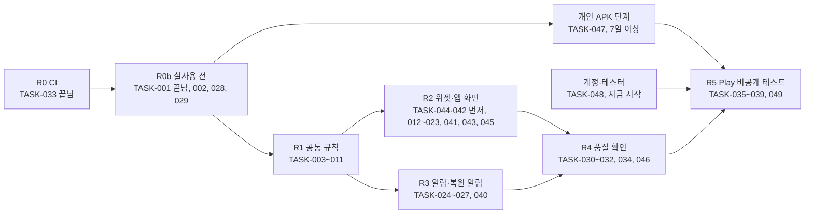

# 작업 분해 (1차 릴리즈)

- 상태: **1차 범위 확정 반영** (2026-11-12). 2026-11-12 10:18 KST 범위 확정(동희님, [요구 0장](../01-planning/requirements.md#0-v3-뒤에-정한-결정)의 '범위 확정')과 [설계 독립 검토](../06-review/design-review-2026-11-11.md) 5장(실사용 전 묶음, 개인 APK 단계, 빠진 작업)을 반영함. 처음 초안은 2026-11-11 Claude 작성. 담당과 단계 순서는 Claude 제안이고 동희님이 바꿀 수 있음 (0장)
- 기준: 이 저장소 main(2026-11-12 `843a737`)과 [요구](../01-planning/requirements.md)(REQ-001~083), [화면](../05-ui/screens.md)(SCR-001~010), [기록 규칙 보충](../04-spec/record-rules-supplement.md)(규칙 ID와 RR-26~67)
- 범위: 지금 프로토타입에서 Google Play 비공개 테스트까지 (결정 Q13). 프로덕션 출시(R6)는 이 표 밖임
- 릴리즈 단계 R0~R6은 Notion [릴리즈 계획](https://app.notion.com/p/415bf16cc3ec818aa416f5554367f67c)의 단계이고, 작업과의 대응은 2장에 있음
- 가쟈누님 로드맵 4단계([DidITake README](https://github.com/judangbang-ops/DidITake/blob/7a800ac/README.md#로드맵))의 다섯 가지는 여기 들어 있음: 미래 시각 경고 TASK-006·TASK-016, 위젯 대상자 필터 TASK-012, 건너뜀 TASK-013·TASK-016·TASK-018, 늦은 투약 처리 TASK-004·TASK-041(주 1회, 결정 Q15의 1차 방식)과 TASK-005·TASK-018(늦은 입력), 설정 화면 TASK-020

## 0. 읽는 법

- **ID**: `TASK-001`부터. 번호는 다시 쓰지 않음. 빼는 작업은 지우지 않고 '제외'와 날짜를 적음
- **근거**: 이 작업이 채우는 요구 ID. 기능 명세는 요구 표의 합격 기준과 [기록 규칙 보충](../04-spec/record-rules-supplement.md)의 규칙(`P-1`, `N-4` 등)·반례(RR)이고, 작업 칸과 끝난 조건에 그 ID를 적음
- **닿는 곳**: 화면 ID, 테이블 이름, 코드 위치. 코드 위치는 이 저장소 기준임 (앱 코드를 여기서 이어 가기로 함, 2026-11-11 21:52)
- **담당** (Claude 제안, 2026-11-12): 한 작업에 한 명
  - Claude: 코드, 문서, CI, 에뮬레이터 확인. PR로 올리고 CI가 통과하면 순서를 확인해 합침(결정 Q14)
  - 동희님: 사람의 기기·계정이 있어야 하는 일. 갤럭시 실기기, Play Console, 개발자 계정, 공개·배포 승인. 키·비밀번호 보관 같은 손작업은 Claude가 동희님 PC에서 직접 함(동희님 "너가 해봐", 2026-11-12 11:05 KST 프로젝트 채팅)
  - 다른 사람이 돕는 몫(예: Play Console 답 초안은 Claude)은 작업 칸에 적음. 결정 Q15의 남은 부분은 가쟈누님과 정하는 결정이라 작업으로 두지 않음
- **크기**: Claude가 어림한 작업일(AI 도움을 받는 한 사람 기준). 측정값이 아님. '이상'이 붙은 줄은 달력 기간이라 합계에서 뺌
- **끝난 조건**: 다른 사람이 확인할 수 있는 것으로 씀. 공통 코드는 `./gradlew :shared:jvmTest` 통과가 기본이고, 기존 테스트도 함께 통과해야 함. 에뮬레이터 확인은 캡처나 로그를 PR에 남김
- **끝남**: 작업 칸 끝에 **끝남**과 날짜를 적은 줄임

## 1. 작업 표

### 1.1 기반

| ID | 작업 | 근거 | 닿는 곳 | 먼저 할 것 | 담당 | 크기 | 끝난 조건 |
| --- | --- | --- | --- | --- | --- | --- | --- |
| TASK-001 | 패키지 이름(`applicationId`)을 정해 빌드 설정에 넣기. **끝남** (2026-11-12, [PR #4](https://github.com/judangbang-ops/pillbadeum_release/pull/4)) | REQ-061 | `androidApp/build.gradle.kts` | 결정 Q9 (2026-11-12 정함) | Claude | 0.5일 | 정한 이름이 빌드 설정·README에 있고, CI가 만든 디버그 APK의 패키지 이름이 그 이름임 |
| TASK-002 | 릴리즈 서명 설정: Gradle `signingConfig`(비밀값은 환경 변수), CI가 업로드 키로 릴리즈 AAB에 서명(PR에서는 서명하지 않고 main·태그·수동 실행에서만), 개인 APK를 앱 서명 키로 서명하는 PC 스크립트. 키는 아래 메모 | REQ-062 | `androidApp/build.gradle.kts`, `.github/workflows`, 개인 APK 서명 스크립트(새로) | TASK-001 | Claude | 1일 | CI 로그에서 릴리즈 AAB의 인증서 SHA-256 = 업로드 키 지문. 동희님 PC에서 스크립트로 서명한 APK의 `apksigner verify --print-certs` SHA-256 = 앱 서명 키 지문. 키·비밀번호가 Git과 CI 로그에 없음 |
| TASK-003 | Room 스키마 2: 알림 규칙·미루기·시계 표식 표와 1→2 마이그레이션(첫 일정 버전의 유효 시작을 등록 창 시작으로 앞당김). 설정 키는 key-value라 쓰는 작업에서 더함 (보충 N-1·N-2·C-1·P-4) | REQ-041, REQ-042, REQ-072, REQ-009 | `reminder_rule`, `reminder_snooze`, `clock_flag`, `schedule_version`, `shared/schemas` | 없음 | Claude | 1.5일 | 스키마 2 JSON이 생기고, 1→2 마이그레이션 테스트가 기존 판정 행을 그대로 남기고 첫 일정 버전의 유효 시작을 옮김 |
| TASK-004 | 새 일정 버전의 `late_policy`를 `KEEP`으로 저장 (보충 W-1, 요구 4장 1번) | REQ-010 | `ManageIntakes`, `schedule_version` | 없음 (2026-11-12 확정) | Claude | 0.5일 | 새 항목·주기 변경의 `late_policy` = KEEP. RR-60·RR-62(기준 요일 그대로) JVM 테스트. 기존 테스트 통과 |

진행 메모 (2026-11-12)

- TASK-001: 결정 Q9의 `com.judangbang.pillbadeum`을 PR #4로 main에 합침(2026-11-12 10:19 KST, `843a737`). CI의 APK 정보에서 패키지 이름을 확인함. 기기 설치는 아직 하지 않음(TASK-047)
- TASK-033: PR #2로 main에 합침(`da916c6`). PR마다 JVM 테스트, 디버그 APK 빌드, 권한 목록 비교(`androidApp/expected-permissions.txt`, `INTERNET`이 있으면 실패)를 함. 릴리즈 변형은 아직 비교하지 않음(TASK-046)
- TASK-002: 요구 4장 2번 확정(10:18)에 따라 키를 둘로 나눔 (릴리즈 서명 키 스레드, 동희님 PC에서 만듦)
  - 앱 서명 키 `pillbadeum-app-signing.p12`(별칭 `app-signing`): Play 앱 서명과 개인 APK 서명에 씀. 잃으면 되살릴 수 없음. GitHub에는 올리지 않고 동희님 PC와 Google Drive 폴더 두 곳에 둠. 인증서 SHA-256(공개값) `35:64:B6:82:4B:1E:3D:A0:74:7A:2E:97:96:6E:F5:5D:B9:CC:93:C5:E8:8A:7D:45:24:64:2F:E6:2A:32:95:36`
  - 업로드 키 `pillbadeum-upload.p12`(별칭 `upload`, RSA 4096): CI가 Play에 올릴 AAB에 서명함. GitHub Secrets 3개(`ANDROID_UPLOAD_KEYSTORE_BASE64`, `ANDROID_UPLOAD_KEYSTORE_PASSWORD`, `ANDROID_UPLOAD_KEY_ALIAS`)에 있음. 잃으면 Play에서 재설정할 수 있음. 인증서 SHA-256 `7D:23:C2:A8:C9:1B:96:4A:08:14:D5:70:12:CB:38:93:CF:25:BF:68:E7:A9:B3:43:6E:AA:87:FA:D5:2D:39:BB`
  - 확인한 것: Drive 사본의 SHA-256이 원본과 같음, 두 비밀번호가 서로 다름. 확인 전: Drive 동기화 완료, 실제 APK 서명
  - 비밀번호의 PC 밖 사본: 위 11:05 말씀에 따라 서명 키 스레드가 직접 만듦(11:11). 앱 서명 키 비밀번호는 업로드 키 비밀번호로 암호화해 Drive 폴더에 두고, 업로드 키 비밀번호는 GitHub Secrets에 있음. Secrets는 다시 읽을 수 없어서, PC 없이 되찾는 경로가 실제로 되는지는 TASK-002에서 확인함
- Play 쪽: Play 도움말([Use Play App Signing](https://support.google.com/googleplay/android-developer/answer/9842756), 2026-11-12 요약본으로 읽음)에 따르면 새 앱은 Google이 만든 키로 자동 등록되고, 공개 테스트나 프로덕션에 나가기 전에 'Change key'로 우리 키를 넘길 수 있음. 개인 APK 위에 Play 버전을 덮어 깔아야 하므로(REQ-062) 첫 비공개 테스트 릴리즈 전에 앱 서명 키를 넘김(TASK-038). 그때 도움말을 다시 읽고 절차를 확인함

### 1.2 공통 기록 규칙 (shared)

| ID | 작업 | 근거 | 닿는 곳 | 먼저 할 것 | 담당 | 크기 | 끝난 조건 |
| --- | --- | --- | --- | --- | --- | --- | --- |
| TASK-005 | 앱 전용 `RecordInWindow`(지금 창·끝난 창, 고른 시각)와 시각 고치기(옛 행 무효 `TIME_EDIT` + 새 행), 설정 변경 전 창 막기 (보충 I-1·I-2, P-1~P-6) | REQ-030, REQ-031, REQ-032, REQ-033, REQ-034 | `RecordDose`, `ChangeJudgment`, `dose_record`, `setting` | TASK-003 | Claude | 2일 | RR-38~44 JVM 테스트 통과. 위젯·알림의 `RecordCommand`는 지금 창에만 씀 |
| TASK-006 | 시계가 틀렸던 기록: 표식 남기기(`TIME_SET`·`TIMEZONE_CHANGED`·`BOOT_COMPLETED`, 판정 읽을 때), 표시값에 넣기, [그대로 두기]·[기록 취소] (보충 C-1~C-3) | REQ-009 | `clock_flag`, `LoadStatusBoard`, `DayBoundaryReceiver` | TASK-003 | Claude | 1일 | RR-19, RR-64~67 JVM 테스트 통과 |
| TASK-007 | 지난 기록 읽기 `LoadHistory`(달, 대상자): 그날 유효했던 일정 버전으로 칸 그리기 (보충 P-8, S-5) | REQ-037, REQ-038, REQ-039, REQ-040 | `dose_record`, `schedule_version`, `intake`, `person` | 없음 | Claude | 2일 | RR-45와 빠짐 판정, 등록 전·보관 뒤 칸 없음, 주 1회 창 한 칸, 대상자 거르기 JVM 테스트. 항목 10개·1년치에서 한 달 읽는 시간을 기록 |
| TASK-008 | 대상자 수정·보관·되살리기, 보관한 대상자의 항목 기록 막기 (검토 B5) | REQ-005, REQ-016, REQ-017, REQ-018 | `ManagePeople`, `RecordDose`, `person` | 없음 | Claude | 1일 | JVM 테스트: 마지막 대상자 보관 거절, 보관한 대상자의 항목이 `LoadStatusBoard`에서 빠지고 지난 판정은 남음, 그 항목의 버튼 탭 → `Gone`(RR-14의 대상자 몫) |
| TASK-009 | 설정 저장과 '바꾼 때부터 적용', 바꾼 시각을 `window_settings_changed_at`에 남기기 (보충 P-5) | REQ-011, REQ-053 | `setting` | 없음 | Claude | 1일 | RR-15 JVM 테스트 통과. 지난 판정의 기간키가 바뀌지 않음. 하루 시작·기준 시간대를 바꾸면 그 시각이 남음 |
| TASK-010 | 보관된 항목 완전 삭제 (Could) | REQ-015 | `intake`, `dose_record`, `schedule_version` | 없음 | Claude | 0.5일 | JVM 테스트: 항목·판정 행이 없고, 남은 위젯 버튼은 Gone |
| TASK-011 | 알림 계획 `PlanReminders`: 격자 칸, 방해 금지(첫 칸은 울림), 창 끝, 미루기, 다음 칸 하나, 저장 때 줄어드는 칸 수 (보충 N-3~N-8) | REQ-041, REQ-042, REQ-043, REQ-044, REQ-045, REQ-077 | `reminder_rule`, `reminder_snooze`, `setting` | TASK-003 | Claude | 2일 | RR-21, RR-22, RR-46~54 JVM 테스트 통과 |

### 1.3 위젯

| ID | 작업 | 근거 | 닿는 곳 | 먼저 할 것 | 담당 | 크기 | 끝난 조건 |
| --- | --- | --- | --- | --- | --- | --- | --- |
| TASK-012 | 위젯 대상자 고르기 화면과 위젯별 필터. 고른 대상자 보관·복원 뒤(대상자 둘 이상) `#reconfigure`. `onRestored`로 선택을 옮기는 방법 시험 (보충 R-3 제안) | REQ-018, REQ-025, REQ-079 | SCR-002, SCR-001#reconfigure | TASK-008, TASK-029 | Claude | 2일 | 에뮬레이터 캡처: '엄마' 위젯에 엄마 항목·완료 수만, 대상자 1명이면 화면이 뜨지 않음, 엄마 보관 → 안내만 보임, 대상자 둘인 기록 복원 → 모든 위젯이 안내만. `onRestored` 시험 결과를 PR에 적음 |
| TASK-013 | 건너뜀 표시와 따로 세기: 위젯 칸, 머리글 수, 마지막 복용 문구, 탭 문구, TalkBack 문장 (보충 S-1~S-4) | REQ-019, REQ-020, REQ-021, REQ-023, REQ-033, REQ-068 | SCR-001#skipped, SCR-001#already, `LoadStatusBoard`, `Labels` | TASK-044 | Claude | 1일 | RR-35~37 JVM 테스트. 캡처: 건너뜀 칸, 탭 → 건너뜀 안내, 판정 행 그대로 |
| TASK-014 | 위젯 버튼이 넘칠 때: 버튼 목록만 스크롤, 머리글 고정, `더 있음` 표시. TASK-042에서 안 되면 `+n 더 있음 · 앱에서 보기` (화면 5장 1번) | REQ-019, REQ-026, REQ-078 | SCR-001#overflow | TASK-042, TASK-044 | Claude | 1일 | 4×2에 항목 6개 → 6개 모두 누를 수 있고 가려진 동안 `더 있음`이 보임 (캡처) |
| TASK-015 | 대상자가 한 명이면 배지·필터를 숨기고 TalkBack도 대상자 이름을 읽지 않기 (요구 4장 5번) | REQ-018, REQ-068 | SCR-001, SCR-004, SCR-006, SCR-008 | TASK-008 | Claude | 0.5일 | '나'만 있을 때 배지·필터 없음과 TalkBack "아침약, …", 가족 추가 뒤 배지와 "엄마 아침약, …" (캡처, 접근성 노드 덤프) |
| TASK-041 | 주 1회 마지막 복용 크게: 위젯 버튼(이름과 같은 글자 크기), 앱 줄 둘째 줄 굵게, 알림 본문 첫 줄, `지난주 건너뜀`, TalkBack (보충 W-2~W-4, 결정 Q15의 1차 방식) | REQ-075, REQ-068 | SCR-001, SCR-003, SCR-004, `Labels` | TASK-013, TASK-025, TASK-044 | Claude | 1일 | RR-59~63 JVM 테스트(문구). 4×2 위젯의 글자 100%·가장 큰 크기 캡처에서 그 문구가 잘리지 않음 |
| TASK-042 | 위젯 스크롤 기술 시험: Glance 목록 안 버튼의 탭 기록과 가로 4개 배치가 되는지 (화면 5장 1번, 검토 4.2절) | REQ-078 | SCR-001#overflow | 없음 | Claude | 0.5일 | 에뮬레이터(API 26·34·36) 결과와 TASK-014에서 쓸 방법을 PR에 적음 |

### 1.4 앱 화면

| ID | 작업 | 근거 | 닿는 곳 | 먼저 할 것 | 담당 | 크기 | 끝난 조건 |
| --- | --- | --- | --- | --- | --- | --- | --- |
| TASK-016 | 첫 화면 보강: [지난 기록]·[설정]·[⋯], 건너뜀 줄, 시계 경고와 [그대로 두기]·[기록 취소], 읽기 오류와 [다시 시도] | REQ-009, REQ-028, REQ-033, REQ-036 | SCR-004 | TASK-006 | Claude | 1.5일 | SCR-004의 normal·empty·error·skipped·future 캡처. 경고는 그날이 와도 남음(RR-64) |
| TASK-017 | 앱을 켜 둔 채 날짜가 바뀌면 다시 불러오기 | REQ-004, REQ-008 | SCR-004#stale, SCR-008#stale | 없음 | Claude | 0.5일 | 에뮬레이터에서 앱을 켜 둔 채 03:59 → 04:00 → 새 기준 날짜 (QA 5장 알려진 제한 해소) |
| TASK-018 | 판정 고치기 화면: 시각 골라 기록, 시각 고치기, 건너뜀, 취소, 건너뜀을 복용으로. 지난 창은 [지금 먹었어] 없음, 설정 변경 전 창은 `#locked` (보충 P-2·P-5, 화면 5장 4번) | REQ-006, REQ-029, REQ-030, REQ-031, REQ-032, REQ-033, REQ-034 | SCR-007 | TASK-005, TASK-044 | Claude | 1.5일 | 판정별 버튼과 결과 캡처, 판정 행 확인. RR-7(앱 몫), RR-38~44의 화면 몫 |
| TASK-019 | 지난 기록 화면: 날짜 줄 목록(최신이 위), 건너뜀 기호, 시계 경고 (화면 5장 7번) | REQ-037, REQ-038, REQ-039, REQ-040 | SCR-008 | TASK-007, TASK-018 | Claude | 1.5일 | 상태별 캡처, 판정 탭 → SCR-007 |
| TASK-020 | 설정 화면: 하루 시작·기준 시간대(P-5 확인 문구), 잠금 화면 이름 표시, 공통 알림 설정과 방해 금지 안내, 백업 안내(화면 잠금 있음·없음), 의료 안내, 개인정보처리방침 링크 | REQ-011, REQ-036, REQ-042, REQ-046, REQ-053, REQ-054, REQ-063, REQ-077 | SCR-009 | TASK-009, TASK-011 | Claude | 1.5일 | 하루 시작 시각을 바꾸면 위젯이 새 기준으로 그려짐(RR-15, 캡처). 화면 잠금 있음·없음의 백업 문구 캡처. 방해 금지와 겹치는 공통 설정 저장 → 안내 |
| TASK-021 | 대상자 관리 화면: 추가(한 약은 한 휴대폰 안내), 수정, 보관, 되살리기 | REQ-016, REQ-017, REQ-074 | SCR-010 | TASK-008 | Claude | 1일 | 추가·수정·보관·되살리기 캡처. 추가 화면에 "한 약은 한 휴대폰에서 기록해 주세요" |
| TASK-022 | 첫 실행 안내(두 쪽)와 위젯 고정 요청 (화면 5장 3번) | REQ-016, REQ-036, REQ-074, REQ-080 | SCR-005 | 없음 | Claude | 1일 | 첫 실행에만 보임. 캡처에 기록 도구 안내와 한 휴대폰 안내. 지원하는 런처에서 [위젯 추가] → 위젯 놓기 확인 |
| TASK-023 | 항목 화면의 알림 칸: [알림 받기](기본 끔), 시작 시각 기본값(시간대 표시를 따름), 저장할 때 방해 금지 안내 `#quiet` (보충 N-3·N-4) | REQ-041, REQ-049, REQ-077 | SCR-006 | TASK-003, TASK-011, TASK-026 | Claude | 1일 | 알림 켜기 → Android 13 이상에서 권한 요청, 거부하면 안내. 자기 전(21:00) 저장 → "다시 알림이 2번 줄어요"(RR-49의 화면 몫) |
| TASK-043 | 시각을 기기 시간대로 보이기. 창과 기준 날짜는 기준 시간대로 계산 (검토 B12, 보충 RR-58) | REQ-082 | SCR-001, SCR-003, SCR-004, SCR-007, SCR-008, `Labels` | 없음 | Claude | 1일 | 표시 시각 JVM 테스트. 기기 시간대를 바꾼 에뮬레이터 캡처에서 기록 시각은 기기 시간대, 칸과 기준 날짜는 그대로 |
| TASK-044 | 상태별 와이어프레임: 위젯 큰 글씨 배치와 가로 4개 배치 비교, 알림 잠금 화면 네 칸, 지난 창의 판정 고치기를 먼저, 그다음 [screens.md](../05-ui/screens.md)의 나머지 상태 (검토 5.3절) | REQ-019, REQ-026, REQ-030, REQ-046, REQ-066 | `docs/05-ui/` (SCR-001~010) | 없음 | Claude | 1.5일 | screens.md의 모든 상태('해당 없음' 제외)에 그림이 있고, 위젯은 4×2 글자 100%·가장 큰 크기, 앱은 폭 360dp 글자 100%·200% 판이 있음 |
| TASK-045 | 앱 표시 이름과 아이콘: 런처 아이콘, 스토어 512px 아이콘, 대표 이미지. 지금은 아이콘이 없고 이름이 `DidITake`임 (검토 5.3절) | REQ-060 | `strings.xml`, `res/mipmap`, 스토어 그림 | 앱 표시 이름 결정 (동희님) | Claude | 0.5일 | 런처와 위젯 목록에 정한 이름과 아이콘이 보임(캡처). 스토어용 그림 파일이 저장소에 있음 |

### 1.5 반복 알림

| ID | 작업 | 근거 | 닿는 곳 | 먼저 할 것 | 담당 | 크기 | 끝난 조건 |
| --- | --- | --- | --- | --- | --- | --- | --- |
| TASK-024 | 알림 예약기: 모든 항목의 다음 칸 하나만 예약(정확 알람이 허용되면 정확, 아니면 비정확), 울리면 밀린 칸을 항목마다 알림 하나로 (보충 N-8) | REQ-041, REQ-042, REQ-048, REQ-052 | `androidApp` 알람 | TASK-011 | Claude | 1.5일 | 허용·거부 두 경우의 `dumpsys alarm`에서 이 앱의 알람이 하나. RR-54 (에뮬레이터). 병합 매니페스트에 `USE_EXACT_ALARM` 없음 |
| TASK-025 | 알림 표시와 버튼(먹었어·30분 뒤·건너뜀), 잠금 화면 공개용 판(이름 숨김이면 버튼 없음), 버튼 수신기 보호 (보충 N-7, 화면 5장 6번) | REQ-004, REQ-027, REQ-043, REQ-045, REQ-046, REQ-076, REQ-081 | SCR-003, 알림 버튼 수신기 | TASK-024, TASK-044 | Claude | 2일 | 버튼마다 판정 행 확인, RR-23, RR-51·52. 이름 표시 끔·켬 × 잠금·해제 네 칸 에뮬레이터 캡처(실기기는 TASK-032). 수신기 `exported="false"`, PendingIntent `FLAG_IMMUTABLE` |
| TASK-026 | 권한 안내: 알림 권한, 정확 알람, 배터리 최적화. 분 단위 약속 없이 "알림이 늦을 수 있어요" (검토 B1) | REQ-048, REQ-049, REQ-050, REQ-051 | SCR-004#permission, SCR-006#permission, SCR-009 | 없음 | Claude | 1일 | 권한 거부 → 안내 → 버튼 → 시스템 화면 (에뮬레이터 캡처). 앱 문구에 분 단위 약속이 없음 |
| TASK-027 | 다시 계산: 판정·항목·대상자·알림 설정·하루 시작·기준 시간대가 바뀐 뒤, 재부팅·시각 변경·시간대 변경·업데이트 뒤 (보충 N-9·N-10, 검토 B5) | REQ-043, REQ-044, REQ-047 | `DayBoundaryReceiver`, 알림 예약기 | TASK-024 | Claude | 1일 | RR-18, RR-55~58 (에뮬레이터. 재부팅 실기기는 TASK-032) |
| TASK-040 | 복원 뒤 알림: [확인했어요] 전에는 복용 알림 대신 복원 안내 알림 하나, 확인 뒤 알림 다시 계산 (보충 R-3의 알림 몫) | REQ-047, REQ-073 | SCR-003#restored, 알림 예약기 | TASK-027, TASK-029 | Claude | 0.5일 | RR-30(알림 몫), RR-33 (에뮬레이터 복원) |

### 1.6 백업

| ID | 작업 | 근거 | 닿는 곳 | 먼저 할 것 | 담당 | 크기 | 끝난 조건 |
| --- | --- | --- | --- | --- | --- | --- | --- |
| TASK-028 | 자동 백업·기기 간 이전에 기록 DB와 짝 파일(`-wal`, `-journal`)만 넣고, 화면 잠금이 없는 폰은 클라우드 백업에서 빼기. Android 8.x에서 암호화 조건이 어떻게 동작하는지 공식 문서로 확인 (보충 B-1~B-3, 결정 Q16) | REQ-055 | `AndroidManifest.xml`, `res/xml` 백업 규칙 두 파일 | 없음 | Claude | 1일 | RR-28 JVM 테스트(음성 대조), RR-26·RR-27 에뮬레이터(`bmgr backupnow` → 지우고 다시 설치 → 기록이 돌아옴). RR-29는 TASK-032 |
| TASK-029 | 복원 감지(`install_marker`)와 처리: 새 `device_id`, 마지막 기록 시각, 앱 첫 화면·위젯 복원 안내와 [확인했어요], 위젯·경계 알람 다시 만들기 (보충 R-1·R-2, R-3의 알림 밖 몫, R-4) | REQ-056, REQ-073, REQ-074 | `setting`, `noBackupFilesDir`, SCR-001#restored, SCR-004#restored | TASK-028 | Claude | 1.5일 | RR-30~32, RR-34 (에뮬레이터 복원). 새 행의 `device_id`가 이전 값과 다르고 옛 값이 `restored_from_device_id`에 남음 |

### 1.7 품질 확인

| ID | 작업 | 근거 | 닿는 곳 | 먼저 할 것 | 담당 | 크기 | 끝난 조건 |
| --- | --- | --- | --- | --- | --- | --- | --- |
| TASK-030 | 접근성 점검: 글자 200%, 누르는 곳 48dp, TalkBack, 명암비 | REQ-066, REQ-067, REQ-068, REQ-069 | 모든 화면 | TASK-012~TASK-023, TASK-041, TASK-043 | Claude | 1일 | 폭 360dp·글자 100%와 200% 화면별 캡처, 명암비 측정표 |
| TASK-031 | 개인정보 점검: 릴리즈 병합 매니페스트에 `INTERNET` 없음, 권한 전체 목록과 출처(검토 B8), 로그·저장소에 이름 없음, 분석·크래시·AI·광고 SDK 없음, 수신기 보호 | REQ-057, REQ-058, REQ-059, REQ-081, REQ-083 | 병합 매니페스트, 의존성 목록, 로그 호출 | TASK-012~TASK-029, TASK-040~TASK-043 | Claude | 0.5일 | 릴리즈 병합 매니페스트, 권한 목록과 출처, 의존성 목록, 로그 호출 검색 결과를 QA 보고서에 남김 |
| TASK-032 | 갤럭시 실기기 확인: 경계 직후 위젯 탭(RR-13), 재부팅(RR-18), 하룻밤 Doze 뒤 알림 지연(정확 알람 허용·거부), 위젯 반영 시간, 새로 놓은 4×2 위젯 큰 글씨, 잠금 화면 네 칸, 기기 간 이전(RR-29, 두 대), 대상 API 36에서 WorkManager 2.7.1 (검토 B1·B2·B10·B12). 순서와 기록 양식은 Claude가 씀 | REQ-004, REQ-008, REQ-026, REQ-046, REQ-047, REQ-048, REQ-055, REQ-070 | SCR-001, SCR-003 | TASK-012~TASK-029, TASK-040~TASK-043, TASK-046 | 동희님 | 2일 | `docs/07-qa/`에 기기·Android 버전·측정값·캡처가 있는 보고서. REQ-048의 P50·P95와 REQ-070의 P95가 적힘 |
| TASK-033 | PR마다 공통 코드 JVM 테스트, 디버그 APK 빌드, 권한 목록 비교 자동 실행. **끝남** (2026-11-12, [PR #2](https://github.com/judangbang-ops/pillbadeum_release/pull/2)) | REQ-071 | `.github/workflows` | 없음 | Claude | 0.5일 | PR에서 `./gradlew :shared:jvmTest` 결과와 권한 비교 결과가 보임 |
| TASK-034 | 프로토타입에 이미 있는 기능의 회귀 확인: 2026-11-11 QA 13항목을 마지막 빌드로 다시 하고, 판정 쓰기가 공통 함수만 거치는지 코드 검사 | REQ-001, REQ-002, REQ-003, REQ-005, REQ-007, REQ-012, REQ-013, REQ-014, REQ-020, REQ-021, REQ-022, REQ-024, REQ-035 | SCR-001, SCR-004, SCR-006 | TASK-012~TASK-029, TASK-040~TASK-043 | Claude | 1일 | `docs/07-qa/`에 13항목 결과와 `jvmTest` 결과가 있음. 판정 DAO의 쓰기 호출이 usecase 밖에 없음 |
| TASK-046 | 릴리즈 변형 확인: 코드 축소(R8)를 켤지 정하고, 서명된 릴리즈 빌드로 핵심 흐름(위젯 탭 기록, 알림 버튼, 백업·복원)과 병합 매니페스트를 다시 확인 (검토 5.3절) | REQ-003, REQ-057 | `androidApp/build.gradle.kts`, 릴리즈 병합 매니페스트 | TASK-002, TASK-012~TASK-029, TASK-040~TASK-043 | Claude | 1일 | CI가 릴리즈 변형의 권한 목록도 비교함. 릴리즈 빌드로 한 핵심 흐름의 결과가 QA 보고서에 있음 |

### 1.8 개인 APK와 Play 비공개 테스트

| ID | 작업 | 근거 | 닿는 곳 | 먼저 할 것 | 담당 | 크기 | 끝난 조건 |
| --- | --- | --- | --- | --- | --- | --- | --- |
| TASK-047 | 개인 APK 단계: 앱 서명 키로 서명한 APK를 본인·가족 갤럭시에 깔아 씀. 앱을 열지 않고 위젯만 쓰는 날을 포함해 7일 이상 (검토 5.2절·B11). 새 빌드가 나오면 덮어 깜 | REQ-008, REQ-051, REQ-062 | 실기기, `docs/07-qa/` | TASK-002, TASK-028, TASK-029 | 동희님 | 7일 이상 | `docs/07-qa/`에 기기·Android 버전과 날짜별로 경계 갱신과 위젯 탭 기록이 됐는지 적은 기록(Claude가 정리). 덮어 깐 뒤에도 기록이 남음 |
| TASK-048 | Play 개발자 계정(결정 Q11: 개인·조직)을 정해 만들고, 비공개 테스트 테스터를 모으기 시작. 달력 시간이 오래 걸릴 수 있어 지금 시작 (검토 5.3절) | REQ-065 | Play Console, 테스터 명단(저장소 밖) | 결정 Q11 | 동희님 | 1일 | 계정이 만들어지고 본인 확인이 끝남. 테스터 명단이 저장소 밖에 있음 (새 개인 계정이면 12명 이상) |
| TASK-035 | 개인정보처리방침: 기기 안 저장, Google 백업에 들어가는 조건, 지우는 방법, 광고 없음. 공개 주소에 올리기 (검토 B9) | REQ-063 | 문서, 공개 위치(정할 것) | 없음 | Claude | 0.5일 | 동희님 승인 뒤 공개 주소에서 로그인 없이 읽힘. 앱 SCR-009에서 그 주소로 감 |
| TASK-036 | Play Console 앱 만들기와 '앱 콘텐츠': 건강 앱 신고, 데이터 보안, 콘텐츠 등급, 타깃 연령. 답 초안은 Claude가 씀 | REQ-063 | Play Console | TASK-001, TASK-035, TASK-048 | 동희님 | 1일 | '앱 콘텐츠' 항목이 모두 완료로 보이는 화면. 자동 백업이 데이터 보안 양식의 '수집'인지 도움말로 확인한 결과(검토 B9) |
| TASK-037 | 스토어 등록정보 초안: 설명, 면책 문구 두 개, 스크린샷 | REQ-036, REQ-064 | 저장소 문서, Play 등록정보 | TASK-030, TASK-045 | Claude | 0.5일 | 설명 초안에 "의료기기가 아니며 …"와 "의학적 조언은 의료인과 …"가 있고 스크린샷이 저장소에 있음. Play Console 입력은 TASK-038 |
| TASK-038 | 첫 비공개 테스트 릴리즈: Play 앱 서명에 앱 서명 키 넘기기, 등록정보 입력, CI가 만든 릴리즈 번들 올리기, 테스터 초대 | REQ-060, REQ-061, REQ-062 | Play Console | TASK-002, TASK-030~TASK-034, TASK-036, TASK-037, TASK-046, TASK-047 | 동희님 | 1일 | 테스터가 Play에서 설치함. Play Console의 앱 서명 인증서 SHA-256 = 앱 서명 키 지문. 개인 APK를 쓰던 폰에 Play 버전을 덮어 깐 뒤 기록이 남음 |
| TASK-039 | 테스터 12명 이상이 14일 연속 참여 (새 개인 계정일 때) | REQ-065 | Play Console | TASK-038, TASK-048 | 동희님 | 14일 이상 | Play Console의 참여 기록 |
| TASK-049 | 릴리즈 자동 업로드 (제안): 태그를 달면 CI가 업로드 키로 서명한 번들을 비공개 테스트 트랙에 올림. Play 서비스 계정 키를 Secrets에 넣는 것은 동희님 승인 | REQ-060 | `.github/workflows`, Play Console | TASK-038 | Claude | 1일 | 태그 하나로 올린 버전이 Play Console 비공개 테스트 트랙에 보임. 키가 저장소·로그에 없음 |

## 2. 순서

크기 합과 가장 긴 사슬은 3장의 검사 결과에 있음. 한 사람이 순서대로 할 때의 어림이고, 공통 코드·위젯·알림은 나눠서 함께 할 수 있음.

| 단계 | 작업 | 지금 (2026-11-12) | 끝나는 때 |
| --- | --- | --- | --- |
| R0 CI | TASK-033 | 끝남 | PR마다 테스트·빌드·권한 비교가 돎 |
| R0b 실사용 전 | TASK-001(끝남), TASK-002, TASK-028, TASK-029 | 다음 차례 | 개인 APK를 나눠 줘도 키·패키지 이름·백업 때문에 기록을 잃지 않음 (검토 5.1절) |
| 개인 APK 단계 | TASK-047 | R0b 뒤 시작, R1~R4와 함께 감 | 7일 이상의 실사용 기록. 개인 APK → Play 전환 시험은 TASK-038 |
| R1 공통 규칙 | TASK-003~TASK-011 | R0b 다음 | JVM 테스트로 규칙 보충의 반례가 통과함 |
| R2 위젯·앱 화면 | TASK-044·TASK-042 먼저, TASK-012~TASK-023, TASK-041, TASK-043, TASK-045 | R1 뒤 | 화면별 캡처 |
| R3 알림·복원 알림 | TASK-024~TASK-027, TASK-040 | R1 뒤, R2와 함께 | 에뮬레이터 확인 |
| R4 품질 확인 | TASK-030~TASK-032, TASK-034, TASK-046 | R2·R3 뒤 | QA 보고서 |
| R5 Play 비공개 테스트 | TASK-035~TASK-039, TASK-048(지금 시작), TASK-049 | 계정·테스터는 지금, 나머지는 R4 뒤 | 테스터가 Play에서 설치하고, 새 개인 계정이면 14일 운영 |
| R6 프로덕션 | 이 표 밖 | | |

- 결정이나 승인이 먼저 필요한 작업
  - TASK-045: 앱 표시 이름 (동희님)
  - TASK-036·TASK-039·TASK-048: 결정 Q11 (개발자 계정 종류)
  - TASK-035: 개인정보처리방침을 올릴 공개 위치와 공개 승인 (동희님)
  - TASK-049: Play 서비스 계정 키를 Secrets에 넣는 승인 (동희님)
  - 결정 Q15의 남은 부분(주 1회 묻기): 가쟈누님과 정함. 넣기로 하면 TASK-004·TASK-041 뒤에 작업을 더하고 보충 6장을 고침
- 사람의 손이 필요한 줄: TASK-032·TASK-036·TASK-038·TASK-039·TASK-047·TASK-048(동희님)

## 3. 검사 결과

2026-11-12, Claude. 대조 스크립트 [`.github/scripts/check_docs.py`](../../.github/scripts/check_docs.py)를 돌린 결과임(아래 '스크립트'). PR마다 CI에서도 돎.

- 작업 49개(TASK-001~049), 빠진 번호 없음. 모든 작업에 담당이 한 명(Claude 43, 동희님 6)이고 끝난 조건이 있음 (스크립트)
- 요구 83개가 모두 작업 하나 이상의 '근거'에 있음. 작업이 없는 Must 요구도 없음 (스크립트)
- [기록 규칙 보충](../04-spec/record-rules-supplement.md)의 반례 RR-26~67이 모두 어느 작업의 작업 칸이나 끝난 조건에 있음 (스크립트)
- '먼저 할 것'에 순환이 없고, 가리키는 작업이 모두 표에 있음 (스크립트)
- 크기 합은 '이상'이 붙은 TASK-039(14일 이상)와 TASK-047(7일 이상)을 빼고 51.0일이고, 그중 끝난 TASK-001·TASK-033이 1.0일임 (스크립트). 2026-11-11 초안의 35.5일에서 새 작업 TASK-040~049가 8.0일, 범위 확정과 규칙 보충으로 기존 작업 15개를 0.5일씩 늘린 것이 7.5일임
- 가장 긴 사슬은 TASK-038까지 12.0일임: TASK-003 > TASK-011 > TASK-024 > TASK-025 > TASK-041 > TASK-046 > TASK-032 > TASK-038 ('이상' 작업은 0으로 셈, 스크립트). 달력으로는 TASK-047(7일 이상)과 TASK-048의 계정·테스터 모집이 더 길 수 있음
- API가 없어 '응답마다 테스트' 검사는 해당 없음. 대신 공통 함수의 결과(`RecordResult` 등)마다 화면 상태가 [screens.md](../05-ui/screens.md)에 있음
- 사람 확인: 담당과 R 단계 순서는 Claude 제안이고 동희님이 아직 보지 않음. 2026-11-12 지시("범위 확정 후 Fable 5.2 독립검토를 거쳐 Opus 5.5 xhigh로 개발 구현 및 배포 파이프라인을 완결하세요")에 따라 독립 검토 뒤 R0b·R1을 이 순서로 시작하고, 바꾸라고 하시면 이 표를 고침
